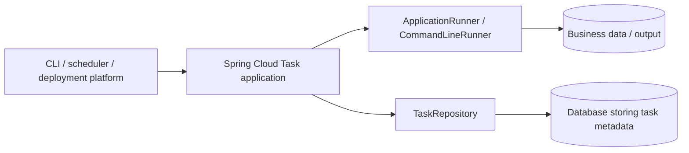

# Preparing H2 for Learning and Persistent Databases

## 1. Why Does Spring Cloud Task Need a Database?

**Spring Cloud Task** is designed for Spring Boot applications with a finite runtime: they receive a request or parameters, perform work, and terminate. Examples include nightly data imports, report generation, syncing partner files, or running a scheduled processing step. Unlike continuously running web applications, each launch of a task typically corresponds to **a single execution** that must be tracked.

Spring Cloud Task uses **`TaskRepository`** to store metadata about a run, such as task name, start/end timestamps, exit code, and error messages. Business data (imported records, exported reports, etc.) is managed by the application itself; `TaskRepository` does not automatically store business results or guarantee on its own that a task executes only once.



The goal of this lesson is to set up an environment for **quick experimentation with H2**, inspect execution history, and then understand how to move metadata to a **persistent database** when tasks run periodically, across multiple machines, or in real operational environments.

## 2. Choosing an Appropriate Storage Mode

H2 is a lightweight relational database that can be embedded directly inside the JVM. Two modes commonly used for learning are **in-memory** and **file-based**.

| Option | Example JDBC URL | After JVM Process Exits | Suitable Use Case |
| --- | --- | --- | --- |
| In-memory H2 | `jdbc:h2:mem:task_demo;DB_CLOSE_DELAY=-1` | Data is lost | Standalone lab exercises, quick tests |
| File-based H2 | `jdbc:h2:file:./data/task_demo;DB_CLOSE_ON_EXIT=FALSE` | Data persisted in a file on disk | Learning how to inspect history across multiple runs on the same machine |
| PostgreSQL or server-based RDBMS | `jdbc:postgresql://db-host:5432/taskdb` | Data persisted on the DB service | Scheduled tasks, multiple processes, real deployments |

**Important distinction:** `DB_CLOSE_DELAY=-1` only keeps an in-memory H2 database alive while the JVM is still running after the last connection closes; it does **not** preserve data after the JVM exits. Conversely, file-based H2 writes to disk, yet still depends on the exact same path, write permissions, and file availability. Embedded H2 is also not a good choice for multiple processes on multiple machines writing metadata into a shared store.

## 3. Preparing a Spring Cloud Task Project

### 3.1. Prerequisites

You need a **Spring Boot** project using a JDK matching your chosen Spring Boot version, Maven (or Gradle), and a **Spring Cloud version set compatible with Spring Boot**. Manage Spring Cloud versions via the project's BOM; do not pick individual library versions arbitrarily, because schema initialization and properties can differ across version lines.

With Maven, the core dependencies are:

```xml
<!-- A Spring Cloud BOM compatible with Spring Boot must be configured in the project. -->
<dependencies>
    <dependency>
        <groupId>org.springframework.cloud</groupId>
        <artifactId>spring-cloud-starter-task</artifactId>
    </dependency>
    <dependency>
        <groupId>com.h2database</groupId>
        <artifactId>h2</artifactId>
        <scope>runtime</scope>
    </dependency>
</dependencies>
```

The starter provides Spring Cloud Task integration and execution tracking. The H2 driver allows `DataSource` to connect to H2. The examples below assume the project is configured to build an executable Spring Boot JAR (such as `target/demo-task.jar`).

### 3.2. Creating a Finite-Lived Task

Create an application class, for example `DemoTaskApplication.java`:

```java
import org.springframework.boot.ApplicationArguments;
import org.springframework.boot.ApplicationRunner;
import org.springframework.boot.SpringApplication;
import org.springframework.boot.autoconfigure.SpringBootApplication;
import org.springframework.context.annotation.Bean;

import java.util.List;

@SpringBootApplication
public class DemoTaskApplication {

    public static void main(String[] args) {
        SpringApplication.run(DemoTaskApplication.class, args);
    }

    @Bean
    ApplicationRunner processOnce() {
        return args -> {
            List<String> values = args.getOptionValues("source");
            String source = (values == null || values.isEmpty())
                    ? "demo" : values.get(0);

            System.out.println("Starting to process source: " + source);
            // Replace with actual business logic: read file, import data, export report...

            if (args.containsOption("simulate-error")) {
                throw new IllegalStateException("Simulated error to test TaskRepository");
            }

            System.out.println("Processing completed.");
        };
    }
}
```

`ApplicationRunner` receives the application's command-line arguments. Each invocation of the executable JAR is an independent task run; add `--simulate-error` to intentionally observe the failure case. This example needs neither a web server nor an infinite loop.

In `src/main/resources/application.yml`, declare shared configuration:

```yaml
spring:
  application:
    name: demo-task
  main:
    web-application-type: none
  cloud:
    task:
      name: demo-task
      initialize-enabled: true
```

`spring.main.web-application-type: none` makes the example run as a finite-lived process. `spring.cloud.task.name` gives the task a consistent name when viewing history; `initialize-enabled: true` initializes metadata tables in the learning environment. Schema initialization must be verified against your project's specific Spring Cloud Task version. When using a real database, schema creation/updates should be handed over to a controlled migration workflow.

> **Note:** Do not manually create the `TASK_EXECUTION` table by guessing its structure. The metadata schema is defined by the **exact Spring Cloud Task version** and may include execution tables, parameter tables, and Spring Batch link tables.

## 4. Configuring In-Memory H2 for Quick Learning

Create `src/main/resources/application-h2-memory.yml`:

```yaml
spring:
  datasource:
    driver-class-name: org.h2.Driver
    url: jdbc:h2:mem:task_demo;DB_CLOSE_DELAY=-1
    username: sa
    password: ""
```

Run the application with this profile (adjust the JAR name to match your build output):

```bash
java -jar target/demo-task.jar --spring.profiles.active=h2-memory --source=sample.csv
```

After processing finishes, Spring Cloud Task records completion metadata, the application closes, and the process exits. The next run with the same command initializes **a brand-new in-memory database**. Therefore, this profile cannot be used to inspect history across two separate `java -jar` invocations.

In-memory mode is useful for lab exercises, testing mappings, trying out `ApplicationRunner`, and automated tests because data does not persist across separate runs. If you need to observe multiple task records across different startups, switch to file-based H2.

## 5. Configuring File-Based H2 to Retain History Across Runs

Create `src/main/resources/application-h2-file.yml`:

```yaml
spring:
  datasource:
    driver-class-name: org.h2.Driver
    url: jdbc:h2:file:./data/task_demo;DB_CLOSE_ON_EXIT=FALSE
    username: sa
    password: ""
```

Create the `data` directory inside the **working directory where you run the command**, then run it twice:

```bash
mkdir data
java -jar target/demo-task.jar --spring.profiles.active=h2-file --source=first.csv
java -jar target/demo-task.jar --spring.profiles.active=h2-file --source=second.csv
```

H2 typically creates a data file such as `data/task_demo.mv.db`. Both runs share the same metadata store as long as the URL, working directory, and read/write permissions remain unchanged. The `DB_CLOSE_ON_EXIT=FALSE` parameter adjusts H2's automatic database close behavior on JVM exit; **it does not replace properly shutting down the application and closing connections**.

A few caveats when working with relative paths:

- `./data/task_demo` is resolved from the **process working directory**, not automatically from the directory containing the JAR. Running from two different directories can create two separate stores and cause confusion that history was lost.
- Do not rename or delete an H2 file while it is in use. H2 uses file locking; opening the same database from multiple embedded processes concurrently can trigger lock errors.
- An H2 file preserves metadata across runs, but if stored inside a container with an ephemeral filesystem it can be lost when the container is replaced. To keep data, use properly mounted persistent storage.
- `sa` with an empty password is strictly for local practice, never to be reused as-is in real systems.

## 6. Inspecting Metadata Tables and Execution Status

After the task using file-based H2 **has exited**, open the database using an H2-compatible SQL tool (IDE database client or H2 Shell) with the exact JDBC URL `jdbc:h2:file:./data/task_demo;IFEXISTS=TRUE` and user `sa` from the same working directory. `IFEXISTS=TRUE` helps catch wrong paths instead of accidentally creating a new empty database. Close the SQL client connection before running the task again if file lock contention occurs.

### 6.1. Finding Tables Managed by Spring Cloud Task

```sql
SELECT TABLE_NAME
FROM INFORMATION_SCHEMA.TABLES
WHERE TABLE_SCHEMA = 'PUBLIC'
  AND TABLE_NAME LIKE 'TASK%'
ORDER BY TABLE_NAME;
```

Under default configuration, the central table is `TASK_EXECUTION` storing each run; `TASK_EXECUTION_PARAMS` stores associated argument information. Table names or counts may vary if you customize prefixes, use Spring Batch, or use a different library version.

### 6.2. Viewing Execution History

```sql
SELECT TASK_EXECUTION_ID,
       TASK_NAME,
       START_TIME,
       END_TIME,
       EXIT_CODE,
       EXIT_MESSAGE
FROM TASK_EXECUTION
ORDER BY TASK_EXECUTION_ID DESC;
```

For a successful command run, `END_TIME` is normally populated and `EXIT_CODE = 0`. Run a failure case as well:

```bash
java -jar target/demo-task.jar --spring.profiles.active=h2-file --source=broken.csv --simulate-error
```

Then query `TASK_EXECUTION` again; a failed execution is recorded with a non-zero exit code and/or an error message depending on the application version's exception-handling mechanism. The actual exit code also depends on how the application maps errors and how the process terminates, so always **read the actual recorded value** rather than assuming every error produces a fixed code.

You can inspect parameters with:

```sql
SELECT TASK_EXECUTION_ID, TASK_PARAM
FROM TASK_EXECUTION_PARAMS
ORDER BY TASK_EXECUTION_ID;
```

**Never pass passwords, tokens, or sensitive information in CLI arguments** if they may be written to metadata or logs. Use environment variables or a secrets management system suitable for your deployment platform.

### 6.3. Correctly Interpreting Status When a Process Is Interrupted

`TaskRepository` updates records when the task starts and when Spring's normal shutdown hook runs. If the process is forcibly terminated (e.g., `kill -9`, abrupt container eviction, power loss), writing `END_TIME` or the final exit code may **fail to occur**. A record with a null `END_TIME` needs investigation; it neither proves the task is still running nor proves the task succeeded.

## 7. Moving to a Persistent Database for Operations

File-based H2 preserves history on a single machine for learning, but scheduled or multi-instance environments require an **RDBMS hosted on a reliable service** such as PostgreSQL. That way, runs across multiple processes share centralized metadata along with proper access control, backups, recovery, and monitoring.

If choosing PostgreSQL, add the driver (still managed by your project's BOM/dependency management):

```xml
<dependency>
    <groupId>org.postgresql</groupId>
    <artifactId>postgresql</artifactId>
    <scope>runtime</scope>
</dependency>
```

Example `src/main/resources/application-postgres.yml`:

```yaml
spring:
  datasource:
    driver-class-name: org.postgresql.Driver
    url: ${TASK_DB_URL}
    username: ${TASK_DB_USER}
    password: ${TASK_DB_PASSWORD}
  cloud:
    task:
      initialize-enabled: false
```

Here, `TASK_DB_URL`, `TASK_DB_USER`, and `TASK_DB_PASSWORD` are supplied from the runtime environment or a secrets manager. `initialize-enabled: false` assumes **the TaskRepository tables have already been created** using the official schema script matching your Spring Cloud Task version, via migrations or a controlled deployment step. Turning off initialization without having created the schema will cause the task to fail when writing metadata.

A reliable deployment workflow requires:

1. Creating the database and connection account, granting only the privileges the task actually needs.
2. Applying and verifying migrations for Spring Cloud Task metadata tables before running the process, using scripts matching the framework version.
3. Supplying connection settings via environment variables or a secrets manager, with pool limits and timeouts tuned for short-lived tasks.
4. Testing both successful and failed runs, then querying `TASK_EXECUTION` from an independent connection even after the process has exited.
5. Setting up backups/recovery, storage monitoring, metadata retention policies, alerts for failed or hanging tasks, and handling for interrupted runs.

If the schedule can re-trigger the same job, design **business logic that is safe to rerun** (such as idempotency keys or upserts by business key). A new metadata row in `TASK_EXECUTION` does not prevent business data from being duplicated during reruns or retries.

### Relationship with Spring Batch

When a task triggers a Spring Batch job, **Spring Cloud Task metadata** (each task process run) and **Spring Batch metadata** (job instance, job execution, step execution, etc.) are two separate tracking layers. Integrating the two frameworks does not make `BATCH_*` tables appear simply by creating `TASK_*` tables; you must prepare separate schemas and initialization/migration mechanisms for Spring Batch matching its version. In real environments, ensure both sets of metadata use storage suited to restart and traceability requirements.

## 8. Common Environment Setup Errors

| Symptom | Likely Cause | What to Check |
| --- | --- | --- |
| `Table "TASK_EXECUTION" not found` or task table query error | Schema not initialized, wrong database/schema selected, or prefix changed | Check JDBC URL, active profile, existing schema, and `spring.cloud.task.initialize-enabled`; use version-matched scripts |
| Rerun shows no previous history | Using H2 `mem`, changed working directory, or changed JDBC URL | Use H2 `file`, resolve the absolute file path, and check `*.mv.db` |
| H2 reports `Database may be already in use` / file lock error | Another app or SQL tool has the same H2 file open | Close other connections; if concurrent multi-process runs are needed, move to a server RDBMS |
| H2 file cannot be created | Parent directory missing or lacking write permissions | Create `data`, check permissions and actual resolved path |
| Task does not exit after processing completes | App still has a web server, scheduler, threads, or background tasks running | Check `web-application-type: none`, runners, and thread lifecycles |
| `END_TIME` is null or exit code is missing | Process is still running, was forcibly killed, or failed to update metadata on shutdown | Cross-check logs, process state, and runtime platform events before concluding |
| Schema errors when running against PostgreSQL | Migrations not applied or schema incompatible with the library | Check Spring Cloud Task version, database privileges, and applied schema scripts |

## 9. Self-Check Lab Exercise

Follow these steps in order to distinguish the storage modes:

1. Run the task twice with the `h2-memory` profile. Explain why each run creates a fresh database despite `DB_CLOSE_DELAY=-1`.
2. Switch to `h2-file` and run twice from the same working directory. Open the database file after the process exits and confirm execution history exists for both runs.
3. Run again with `--simulate-error`, then inspect the exit code and error message in `TASK_EXECUTION`. Inspect the parameters recorded in `TASK_EXECUTION_PARAMS`.
4. Test running from a different working directory to observe the effect of relative paths; then return to the original directory and confirm the data was not actually lost.
5. Outline the plan to move to PostgreSQL: connecting via environment variables, version-matched `TaskRepository` schema migrations, permissions, failure monitoring, and backups.

Upon completion, you should be able to explain the difference between **task metadata** and **business outcomes**, why in-memory H2 does not preserve history across processes, the limitations of file-based H2, and the prerequisites for operating a Spring Cloud Task on a persistent database.
