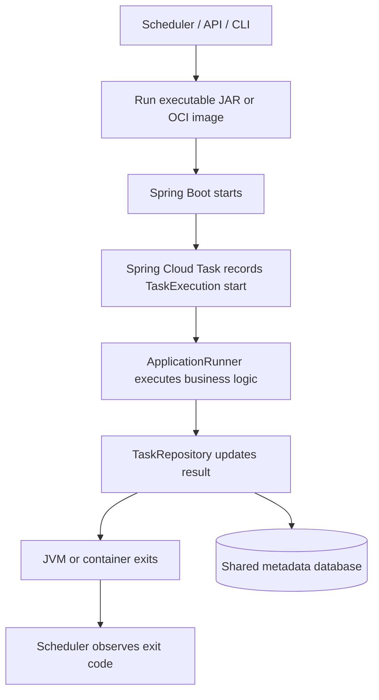
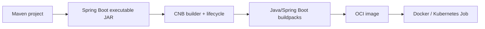

# Packaging JARs, Dockerfiles, and Cloud Native Buildpacks

## 1. Why is deploying Spring Cloud Task different from a web service?

**Spring Cloud Task** serves Spring Boot applications with a **finite** runtime: start, process a job, and terminate. The job might be generating a report, synchronizing data, handling a scheduled run request, or executing a Spring Batch Job. Information for each run is recorded in **`TaskRepository`** as a `TaskExecution`, including task name, start/end timestamps, exit code, and error information.

Unlike a typical web service, a task does not necessarily listen on HTTP or keep the JVM running after the work completes. Therefore, when packaging and deploying, you need to care about two outcomes:

1. **A runnable artifact:** a JAR or OCI image containing the right libraries, entrypoint, Java runtime, and configuration.
2. **A proper termination lifecycle:** after processing, the process returns the accurate exit code, `TaskRepository` saves the history, resources are cleaned up, and the orchestrator detects success or failure.

This lesson belongs to the **Deployment** chapter and explains three options:

- **Executable JAR:** run `mvn package` and then `java -jar`; suitable for local testing, running on VMs, or serving as input for containers.
- **Dockerfile:** explicitly choose the base image, user, layers, entrypoint, and files copied into the OCI image.
- **Cloud Native Buildpacks (CNB):** use the Spring Boot Maven/Gradle plugin to automatically build an image from the artifact without writing a Dockerfile yourself.

After this lesson, you will be able to package and run all three approaches, understand the trade-offs, deploy to Kubernetes `Job`/`CronJob`, and properly inspect both the **container exit code** and **`TaskExecution`**.

## 2. Deployment architecture of a finite task



| Component | When running JAR | When running container |
| --- | --- | --- |
| Artifact | `report-task-0.0.1-SNAPSHOT.jar` | OCI image containing JAR and JRE |
| Java runtime | JRE/JDK installed on the host | JRE packaged inside the image |
| Business parameters | `java -jar ... --report-date=...` | `docker run image --report-date=...` or Kubernetes `args` |
| Datasource configuration | Properties, env, secret manager | Env/Secret injected into the container |
| `TaskRepository` | Database the JAR connects to | **Same persistent database**, reachable from the container |
| Success tracking | Exit code of the Java process | Exit code of the container/pod + Task metadata |
| Scheduling tool | cron, systemd timer, other scheduler | Kubernetes Job/CronJob or equivalent platform |

**Principle:** An image is only a **way to distribute the application**. Packaging a JAR or using buildpacks **does not automatically create a scheduler** and does not decide the run schedule. `TaskRepository` tracks execution runs; it is not a container deployment tool.

## 3. Sample project `report-task`

The example uses **JDK 17**, **Spring Boot 3.4.5**, **Spring Cloud 2024.0.2**, and Maven. A compatible Spring Cloud Task version must be managed by a release train aligned with Spring Boot. An H2 file database is used for local JAR testing; in the container environment, an **external PostgreSQL** instance is used.

Recommended structure:

```text
report-task/
├── pom.xml
├── Dockerfile
├── Dockerfile.layers
├── .dockerignore
└── src/main/
    ├── java/com/example/report/
    │   ├── ReportTaskApplication.java
    │   └── ReportRunner.java
    └── resources/
        ├── application.yml
        └── application-init.yml
```

### 3.1. The `pom.xml` file

```xml
<?xml version="1.0" encoding="UTF-8"?>
<project xmlns="http://maven.apache.org/POM/4.0.0"
         xmlns:xsi="http://www.w3.org/2001/XMLSchema-instance"
         xsi:schemaLocation="http://maven.apache.org/POM/4.0.0 https://maven.apache.org/xsd/maven-4.0.0.xsd">
    <modelVersion>4.0.0</modelVersion>

    <parent>
        <groupId>org.springframework.boot</groupId>
        <artifactId>spring-boot-starter-parent</artifactId>
        <version>3.4.5</version>
        <relativePath/>
    </parent>

    <groupId>com.example</groupId>
    <artifactId>report-task</artifactId>
    <version>0.0.1-SNAPSHOT</version>

    <properties>
        <java.version>17</java.version>
    </properties>

    <dependencyManagement>
        <dependencies>
            <dependency>
                <groupId>org.springframework.cloud</groupId>
                <artifactId>spring-cloud-dependencies</artifactId>
                <version>2024.0.2</version>
                <type>pom</type>
                <scope>import</scope>
            </dependency>
        </dependencies>
    </dependencyManagement>

    <dependencies>
        <dependency>
            <groupId>org.springframework.cloud</groupId>
            <artifactId>spring-cloud-starter-task</artifactId>
        </dependency>
        <dependency>
            <groupId>org.springframework.boot</groupId>
            <artifactId>spring-boot-starter-jdbc</artifactId>
        </dependency>
        <dependency>
            <groupId>com.h2database</groupId>
            <artifactId>h2</artifactId>
            <scope>runtime</scope>
        </dependency>
        <dependency>
            <groupId>org.postgresql</groupId>
            <artifactId>postgresql</artifactId>
            <scope>runtime</scope>
        </dependency>
    </dependencies>

    <build>
        <plugins>
            <plugin>
                <groupId>org.springframework.boot</groupId>
                <artifactId>spring-boot-maven-plugin</artifactId>
            </plugin>
        </plugins>
    </build>
</project>
```

`spring-boot-maven-plugin` performs the **repackage** step, producing a JAR runnable via `java -jar`. `spring-cloud-starter-task` provides the TaskRepository/lifecycle infrastructure, and JDBC connects the metadata to the database. The PostgreSQL driver is packaged in the JAR so the image can connect to a database server; H2 is reserved for local hands-on practice.

### 3.2. Spring Boot application

Create `src/main/java/com/example/report/ReportTaskApplication.java`:

```java
package com.example.report;

import org.springframework.boot.SpringApplication;
import org.springframework.boot.autoconfigure.SpringBootApplication;
import org.springframework.cloud.task.configuration.EnableTask;

@SpringBootApplication
@EnableTask
public class ReportTaskApplication {

    public static void main(String[] args) {
        SpringApplication.run(ReportTaskApplication.class, args);
    }
}
```

Create `src/main/java/com/example/report/ReportRunner.java`:

```java
package com.example.report;

import java.time.LocalDate;
import java.util.List;

import org.springframework.boot.ApplicationArguments;
import org.springframework.boot.ApplicationRunner;
import org.springframework.stereotype.Component;

@Component
public class ReportRunner implements ApplicationRunner {

    @Override
    public void run(ApplicationArguments args) throws Exception {
        List<String> values = args.getOptionValues("report-date");
        if (values == null || values.size() != 1) {
            throw new IllegalArgumentException(
                    "Exactly one --report-date=yyyy-MM-dd argument is required");
        }

        LocalDate date = LocalDate.parse(values.get(0));
        System.out.println("[TASK] Starting report for date " + date);

        if (args.containsOption("fail")) {
            throw new IllegalStateException("Simulated report generation error");
        }

        // Replace with actual query, aggregation, and report persistence logic.
        Thread.sleep(500);
        System.out.println("[TASK] Generated report for date " + date);
    }
}
```

The runner finishes processing and returns. When an error occurs—for example, with `--fail`—the exception propagates so Spring Boot/Spring Cloud Task can record the failure. In a real application, you should not catch and swallow business errors; you must handle exit codes and data side effects according to your operational contract.

**If the runner spawns asynchronous work**, it must wait for all required `Future`/`CompletableFuture` instances to complete before returning; otherwise, the task could be marked as completed while workers are still processing.

### 3.3. Metadata and context closing configuration

Create `src/main/resources/application.yml`:

```yaml
spring:
  application:
    name: report-task
  main:
    web-application-type: none
  datasource:
    url: ${TASK_DB_URL:jdbc:h2:file:./data/report-db;DB_CLOSE_ON_EXIT=FALSE}
    username: ${TASK_DB_USER:sa}
    password: ${TASK_DB_PASSWORD:}
  cloud:
    task:
      name: report-task
      initialize-enabled: false
      closecontext-enabled: true
```

Explanation:

- `web-application-type: none` prevents creating a web server that keeps the process alive.
- `closecontext-enabled: true` tells Spring Cloud Task to close the application context once the lifecycle completes. This is helpful if the infrastructure still has threads/beans that have not shut down on their own, though it **does not replace** stopping workers properly.
- `initialize-enabled: false` assumes by default that the **TaskRepository schema already exists**; suitable for repeated runs or production.
- The three variables `TASK_DB_URL`, `TASK_DB_USER`, and `TASK_DB_PASSWORD` allow switching the datasource via runtime configuration **without rebuilding the JAR/image**.
- If no environment variables are provided, the application uses an H2 file for practice; therefore, you must create the `data` directory before running locally.

Create `src/main/resources/application-init.yml`:

```yaml
spring:
  cloud:
    task:
      initialize-enabled: true
```

The `init` profile is only for a **new** practice database when you want Spring Cloud Task to prepare the metadata tables. Do not use this profile as a migration mechanism in production: apply the DDL matching your Spring Cloud Task version using Flyway, Liquibase, or a DBA, and leave the initializer disabled.

## 4. Packaging an executable JAR

### 4.1. Build

In the project directory:

```bash
mvn clean package
```

After a successful build, Maven produces an artifact such as:

```text
target/report-task-0.0.1-SNAPSHOT.jar
```

This is a **Spring Boot executable JAR**, containing the required dependencies and the Spring Boot loader. It differs from a standard Java library JAR, which only contains classes and requires manual classpath configuration. An executable JAR can run without Maven installed on the target machine, but **the target machine must have a compatible Java 17 runtime**.

If a secondary artifact like `*.jar.original` exists, that is not the file to put into a Dockerfile to run as a Spring Boot JAR. Always use the artifact repackaged by the plugin.

### 4.2. Testing success and failure runs

```bash
mkdir -p data

# First run on a new H2 file: allow schema initialization
java -jar target/report-task-0.0.1-SNAPSHOT.jar \
  --spring.profiles.active=init --report-date=2026-11-24

# Subsequent runs use the existing schema
java -jar target/report-task-0.0.1-SNAPSHOT.jar \
  --report-date=2026-11-25

# Intentional failure scenario
java -jar target/report-task-0.0.1-SNAPSHOT.jar \
  --report-date=2026-11-26 --fail
```

In PowerShell, `mkdir -p` does not have identical syntax to Bash; you can use `New-Item -ItemType Directory -Force data`. Single-line Java commands do not need the `\` line-continuation character.

A normal run will print:

```text
[TASK] Starting report for date 2026-11-24
[TASK] Generated report for date 2026-11-24
```

In the `--fail` scenario, the application throws an exception; check the **process exit code** (Bash: `echo $?`; PowerShell: `$LASTEXITCODE`) and the metadata in `TASK_EXECUTION`. You need to inspect both sources because the orchestrator's exit code and the repository data serve two different purposes.

### 4.3. Inspecting TaskRepository

After the process has exited, connect to H2 using JDBC URL `jdbc:h2:file:./data/report-db`, username `sa`, and an empty password (using the same working directory or an absolute URL). Query:

```sql
SELECT TASK_EXECUTION_ID,
       TASK_NAME,
       START_TIME,
       END_TIME,
       EXIT_CODE,
       ERROR_MESSAGE
FROM TASK_EXECUTION
ORDER BY TASK_EXECUTION_ID DESC;
```

Every run that progresses to the repository write step gets a new `TaskExecution`. For a failure occurring too early during `ApplicationContext` initialization, there may be **no record**, so you must still read the application logs and scheduler logs.

## 5. Packaging with a simple Dockerfile

### 5.1. Dockerfile for running the JAR

Create `Dockerfile` in the project root directory:

```dockerfile
FROM eclipse-temurin:17-jre-jammy

WORKDIR /app

COPY target/report-task-0.0.1-SNAPSHOT.jar /app/app.jar

# Non-root UID; JAR read permissions remain intact.
USER 10001

ENTRYPOINT ["java", "-jar", "/app/app.jar"]
```

This Dockerfile intentionally **omits `EXPOSE 8080`** because the task does not serve an HTTP service. It also does not include `RUN java -jar ...`: executing the job during **image build** would run it at the wrong time. `ENTRYPOINT` runs the JAR each time a container is created from the image.

| Instruction | Meaning |
| --- | --- |
| `FROM eclipse-temurin:17-jre-jammy` | Image containing JRE 17. Choose a tested tag/digest and apply security updates per your policy. |
| `WORKDIR /app` | Sets the working directory for the container process. |
| `COPY ... /app/app.jar` | Copies the exact built executable JAR. |
| `USER 10001` | Runs with a non-root UID, reducing privileges inside the container. |
| `ENTRYPOINT [...]` | Starts Java when the container starts; Docker/Kubernetes can pass additional arguments for the runner. |

Base images frequently change contents for a given tag. In production deployments, **pin the image digest**, scan for CVEs, and rebuild when JRE patches are released instead of assuming tag 17 remains byte-for-byte identical forever.

### 5.2. Reducing the build context

Create `.dockerignore` to avoid sending local data and secrets to the Docker daemon:

```dockerignore
.git
.idea
.vscode
data/
input/
output/
*.env
.env
*.log
target/classes/
target/test-classes/
target/surefire-reports/
```

**Do not exclude** the JAR file in `target/` because the Dockerfile needs to copy that artifact. In real projects, tailor `.dockerignore` to your Docker build strategy (copying a pre-built JAR vs. building with Maven inside the container).

### 5.3. Building the OCI image

```bash
mvn clean package
docker build -t report-task:0.0.1 .
docker image ls report-task
```

`docker build` requires a running Docker daemon/engine with permission to pull the base image, unless the image is already in the local cache. If working on Windows, verify that Docker Desktop or your Docker context points to the right engine.

## 6. Running the container with external PostgreSQL

**Do not rely on an H2 file inside the image as a production database.** Every new container has its own filesystem; when a container is removed, H2 data created inside the container filesystem can be lost. If multiple containers run concurrently, they also cannot properly share `TaskRepository`.

Use a **persistent PostgreSQL server** so runs observe the same history. The example assumes database `task_metadata`, user `task_runtime`, and the `TASK_EXECUTION` schema are already prepared.

When the database runs on Docker network `task-net` under hostname `postgres`, connect using:

```text
jdbc:postgresql://postgres:5432/task_metadata
```

If PostgreSQL is outside Docker or inside Kubernetes, replace the hostname with the actual service name. `localhost` inside a container refers to **the container itself**, not the Docker host's localhost.

### 6.1. Providing runtime configuration

Example of a **local, uncommitted** file named `task.env`:

```dotenv
TASK_DB_URL=jdbc:postgresql://postgres:5432/task_metadata
TASK_DB_USER=task_runtime
TASK_DB_PASSWORD=<replace-with-a-secret>
```

In real environments, password values should be supplied by a secret manager/Kubernetes Secret or secret file—never hardcoded in the image, Dockerfile, committed docs, or command-line arguments. **Env files are also sensitive data**: restrict read permissions and ensure they are excluded from Git and the build context. The value above is a placeholder, not a working credential.

Run the container:

```bash
docker run --rm \
  --name report-task-run-001 \
  --network task-net \
  --env-file task.env \
  report-task:0.0.1 \
  --report-date=2026-11-24
```

Arguments after the image name are forwarded by Docker to `ENTRYPOINT`. `--rm` removes the container upon exit but **does not delete the `TaskExecution` history** stored in PostgreSQL outside the container.

Practicing with PostgreSQL requires preparing the **network and database service beforehand**. Do not run this command when the database is not ready or `task-net` does not exist yet. After the container exits, check the Docker CLI exit code and query `TASK_EXECUTION` to see the execution result.

### 6.2. Arguments, timing, and signals

- Each `docker run` is **a new run** and normally creates a new `TaskExecution`.
- When the runner finishes, Spring Cloud Task updates metadata; Java exits and the container stops.
- If the container receives `SIGKILL`/is OOM-killed, the task may not have time to write `END_TIME`. `SIGTERM` gives the application a chance to shut down cleanly, though completion is **not guaranteed** if the grace period expires.
- Long-running tasks must implement timeouts, checkpoints, or safe restarts; do not rely on Docker always granting enough time for cleanup.
- Do not use a `restart: always` policy for finite tasks: a successful run could be restarted repeatedly and process data multiple times.

## 7. Layer-optimized Dockerfile for Spring Boot 3.4

A single-JAR Dockerfile is very simple, yet changing a single class in the JAR usually invalidates the entire `app.jar` layer. **Spring Boot 3.4** supports **layered JARs** and `spring-boot-jarmode-tools` to separate stable dependencies from application classes/resources.

Per the Spring Boot 3.4 Dockerfile guide, you can run:

```bash
java -Djarmode=tools -jar \
  target/report-task-0.0.1-SNAPSHOT.jar list-layers
```

Typical layers:

```text
dependencies
spring-boot-loader
snapshot-dependencies
application
```

### 7.1. Multi-stage `Dockerfile.layers`

```dockerfile
# Stage 1: extract JAR by layer
FROM eclipse-temurin:17-jre-jammy AS extract
WORKDIR /workspace
COPY target/report-task-0.0.1-SNAPSHOT.jar app.jar
RUN java -Djarmode=tools -jar app.jar extract --layers --destination extracted

# Stage 2: small runtime image with only runtime + extracted contents
FROM eclipse-temurin:17-jre-jammy
WORKDIR /application

COPY --from=extract /workspace/extracted/dependencies/ ./
COPY --from=extract /workspace/extracted/spring-boot-loader/ ./
COPY --from=extract /workspace/extracted/snapshot-dependencies/ ./
COPY --from=extract /workspace/extracted/application/ ./

USER 10001
ENTRYPOINT ["java", "-jar", "application.jar"]
```

Note: in the layout extracted by `jarmode=tools`, `application.jar` at the root of the extracted directory is a **launcher JAR**, not an exact copy of the original `app.jar`. The four `COPY` instructions place dependencies and application bytecode into separate layers so Docker can cache effectively.

Build:

```bash
docker build -f Dockerfile.layers -t report-task:0.0.1-layered .
```

**Prerequisite:** The JAR must be packaged with layering and `spring-boot-jarmode-tools` (the Spring Boot Maven plugin enables this). If the project disables layers, uses a different archive layout, or configures a **fully executable** JAR with an embedded launch script, `extract --layers` may not work. In that case, use the simple Dockerfile or adjust packaging settings.

The benefit of a layered Dockerfile does not mean the image automatically becomes much smaller: dependencies still take up the same total size. The primary goal is **layer reuse** when only application code changes, speeding up image transfers across CI, registry, and nodes.

## 8. Building images with Cloud Native Buildpacks (CNB)

**Cloud Native Buildpacks** is a model that transforms source/artifacts into OCI images via a **builder**, **buildpacks**, **lifecycle**, and **run image**. Buildpacks detect a Java application, select a runtime, configure a launch process, layer libraries, and package the image. The Spring Boot Maven plugin integrates CNB directly to build an image from the packaged application **without needing a Dockerfile**.



### 8.1. Building the image with the Maven plugin

While the Docker daemon is running:

```bash
mvn spring-boot:build-image \
  -Dspring-boot.build-image.imageName=report-task:0.0.1-cnb
```

The `spring-boot:build-image` Maven goal runs the necessary packaging steps before creating the image. The image is loaded into the current Docker daemon (unless configured to publish to a registry). Inspect the result:

```bash
docker image ls report-task
docker image inspect report-task:0.0.1-cnb
```

With the Spring Boot Maven plugin, the image name can be configured via `spring-boot.build-image.imageName`; if omitted, the plugin derives the name from the Maven project. `build-image` requires access to the Docker daemon and downloads compatible **builder/run images**, so the first run may consume significant network bandwidth and disk space.

**No `Dockerfile` is needed for CNB.** If the project directory has both a Dockerfile and the CNB plugin, each tool builds images via its own mechanism; do not assume CNB reads your Dockerfile.

### 8.2. Customizing the builder, Java runtime, and image name

With Paketo Java buildpacks supported by Spring Boot, the Java version can be inferred from the project's compiler configuration; `BP_JVM_VERSION` can also be used to control the Java version chosen by the buildpack. Ensure the JRE inside the image matches the bytecode (`Java 17` in the example).

To configure the Maven plugin explicitly:

```xml
<plugin>
    <groupId>org.springframework.boot</groupId>
    <artifactId>spring-boot-maven-plugin</artifactId>
    <configuration>
        <image>
            <name>example/report-task:0.0.1</name>
            <env>
                <BP_JVM_VERSION>17</BP_JVM_VERSION>
            </env>
        </image>
    </configuration>
</plugin>
```

This **replaces the existing plugin configuration** in `pom.xml`—do not add a second plugin with the same `groupId/artifactId`. In CI/CD, supply the version/image tag from the pipeline and pin builder/run image digests according to your change-management policy.

### 8.3. Running the CNB image

```bash
docker run --rm \
  --network task-net \
  --env-file task.env \
  report-task:0.0.1-cnb \
  --report-date=2026-11-25
```

A container started from the CNB image still runs the **same Spring Cloud Task application** and uses the **same TaskRepository** as the Dockerfile image, provided datasource variables, artifacts, and runtime arguments match. Compare the exit code and `TASK_EXECUTION` records between both packaging approaches.

CNB typically provides a launch process and runs as a non-root user by design in Spring Boot integration. Do not depend on a specific JAR path or entrypoint inside the CNB image; those are implementation details managed by the buildpack/lifecycle and may differ from a hand-written Dockerfile.

### 8.4. When to choose CNB over a Dockerfile?

| Requirement | Dockerfile | CNB |
| --- | --- | --- |
| Full control over base image, extra file copies, and OS commands | Explicit and direct | Must check builder/buildpack customization capabilities |
| Simply packaging a Spring Boot JAR into a standard image | Maintain build recipe manually | **`spring-boot:build-image`** is straightforward |
| Optimizing dependency caching | Write a layered Dockerfile manually | Buildpacks can create layers based on metadata |
| Managing runtime CVEs | Update base image manually | Update builder/run image, rebase when supported |
| Depending on special OS libraries | Dockerfile may be more convenient | Requires matching builder/buildpack |
| Reproducible builds, SBOM, and provenance | Integrate scanners/CI workflows | Buildpacks support metadata, though verification and governance are still required |
| Running finite tasks | Works if `ENTRYPOINT` is right | Works if the launch process is right |

**Neither choice is "always better."** If the project is purely a Spring Boot JAR with standard runtime needs, CNB reduces Dockerfile maintenance. If you need system binaries or strict image policies, a Dockerfile can offer finer control.

## 9. Deploying the image as a Kubernetes Job/CronJob

When a task needs to run on demand or on a schedule, choose a **Kubernetes `Job` or `CronJob`** instead of a Deployment designed to keep replicas running continuously. A Deployment may keep restarting the task container after the process exits, causing unintended runs.

Example `Job` manifest (the image must be pushed to a registry the cluster has permission to pull from):

```yaml
apiVersion: batch/v1
kind: Job
metadata:
  name: report-task-20261124
spec:
  backoffLimit: 1
  ttlSecondsAfterFinished: 86400
  template:
    spec:
      restartPolicy: Never
      containers:
        - name: report
          image: registry.example.com/tasks/report-task:0.0.1
          imagePullPolicy: IfNotPresent
          args:
            - "--report-date=2026-11-24"
          env:
            - name: TASK_DB_URL
              valueFrom:
                secretKeyRef:
                  name: task-db
                  key: jdbc-url
            - name: TASK_DB_USER
              valueFrom:
                secretKeyRef:
                  name: task-db
                  key: username
            - name: TASK_DB_PASSWORD
              valueFrom:
                secretKeyRef:
                  name: task-db
                  key: password
          resources:
            requests:
              cpu: "100m"
              memory: "256Mi"
            limits:
              cpu: "1"
              memory: "512Mi"
```

The manifest assumes a Kubernetes Secret named `task-db` has been created securely in the right namespace with the three keys listed above; **do not** commit sample secrets with real passwords to Git. The registry URL is a placeholder. The database must already have the **Spring Cloud Task schema** before the Job runs, because runtime uses `initialize-enabled=false`.

Configuration details:

- `restartPolicy: Never`: The Pod does not restart the container on failure; the Job controller can create a retry Pod up to `backoffLimit`.
- `backoffLimit: 1`: Limits controller-managed retries; **you must design for idempotency** because each attempt may have already written partial data.
- `ttlSecondsAfterFinished`: Requests cleanup of the **completed Job object** after the specified duration; this does not delete `TASK_EXECUTION` rows in PostgreSQL.
- `args`: Passes arguments to the OCI image entrypoint.
- `resources`: Prevents the task from consuming unbounded resources. Values are illustrative and should be sized from real workloads.

Monitoring:

```bash
kubectl apply -f report-task-job.yml
kubectl get jobs
kubectl get pods -l job-name=report-task-20261124
kubectl logs job/report-task-20261124
kubectl describe job report-task-20261124
```

These commands are illustrative assuming an authorized kubeconfig/context. For a `CronJob`, setting `concurrencyPolicy: Forbid` prevents a new schedule trigger from creating an overlapping Job while one is still running; however, this mechanism **does not replace** locking/idempotency when external triggers, retries, or multiple CronJobs access the same data.

## 10. Final state: JAR, container, and TaskRepository

**Packaging properly is not enough; you must verify the right outcome.**

| Status source | How to observe | Notes |
| --- | --- | --- |
| `java -jar` | Process exit code (`echo $?` or `$LASTEXITCODE`) | Schedulers usually rely on this code. |
| Docker | Container exit code / `docker run` result | `--rm` removes the container immediately upon exit; capture logs if post-mortem inspection is needed. |
| Kubernetes Job | `Complete` / `Failed`, Pod status, and container exit code | Multiple Pods can exist on retries; match against the exact run. |
| Spring Cloud Task | `TASK_EXECUTION.EXIT_CODE`, `START_TIME`, `END_TIME`, `ERROR_MESSAGE` | The repository only has rows if the app progressed far enough to write metadata. |
| Spring Batch (if integrated) | `BATCH_JOB_EXECUTION.STATUS`/`EXIT_CODE` and Step counters | A failed Batch Job is not always automatically reflected as a Task exit code unless result propagation is configured. |

When combining with Spring Batch, monitor **two levels**. `TaskRepository` records application lifecycle, whereas `JobRepository` stores Job/Step state; with asynchronous Batch launches, wait for the job to finish before the task exits and check `spring.cloud.task.batch.fail-on-job-failure` if using the integration support.

**Do not treat `END_TIME IS NULL` as definitive proof that a task is still running.** An OOM-killed container, node power loss, or forced process termination can leave metadata un-updated. Always cross-check the database, logs, orchestrator, and process state.

## 11. Common packaging and deployment issues

| Symptom | Possible cause | Resolution |
| --- | --- | --- |
| `no main manifest attribute` when running JAR | Artifact was not repackaged by the Spring Boot plugin | Check `spring-boot-maven-plugin`, use the main JAR from `target`, and rebuild. |
| `UnsupportedClassVersionError` | JAR built for a newer Java version than the runtime JRE | Use a bytecode-compatible JRE and configure `java.version` consistently. |
| Docker `COPY failed: file not found` | Forgot `mvn package`, wrong JAR name, or `.dockerignore` issue | Verify the exact artifact version and build context. |
| `jarmode=tools` does not recognize `extract` | Layers/tools disabled or fully executable JAR used | Check Spring Boot version and plugin/layers config; use the simple Dockerfile if layers aren't needed. |
| `spring-boot:build-image` cannot connect to Docker | Docker daemon stopped, wrong context, or insufficient permissions | Verify Docker engine/context/permissions. |
| CNB reports missing Java/compatible builder | Builder doesn't support Java 17 or target image platform | Choose a compatible builder/run image, configure `BP_JVM_VERSION` and architecture. |
| Container fails connecting to PostgreSQL | Wrong `localhost` inside container, DB not ready, or wrong network | Use the proper service/network hostname, check ACLs and database readiness. |
| `TASK_EXECUTION` does not exist | Metadata schema has not been initialized | Apply the matching version migration before starting the container. |
| Task history disappears after `docker run --rm` | Using an H2 file inside the container's ephemeral filesystem | Use an external database or persistent volume for testing. |
| Task finishes work but container stays running | A web server or non-daemon thread keeps the JVM alive | Set `web-application-type: none`, close the context, and release threads properly. |
| Job executes multiple times | `restart: always`, Kubernetes Job retries, or overlapping CronJob schedules | Fix the policy; design idempotency/locking and track each run. |
| `EXIT_CODE=0` despite Batch data errors | Job status not propagated to Task/OS process | Inspect `JobExecution` and configure appropriate result/exception propagation. |
| Permission denied when writing files | Image runs non-root, mounted directory lacks write access | Mount volumes with appropriate permissions; avoid arbitrary `chmod 777`. |
| Secret accidentally included in image | `COPY . .` or build context contains `.env`/credentials | Use `.dockerignore`, runtime secret injection, and image scanning. |

### 11.1. Short diagnostic workflow

1. **Artifact:** Did `mvn package` produce the right JAR? Does `java -jar` run locally?
2. **Image:** Did Dockerfile or CNB build the image with the right tag/architecture? Does the entrypoint invoke the right app?
3. **Runtime:** Did the container receive all arguments, profiles, secrets, and datasource variables?
4. **Database:** Is it reaching the right PostgreSQL/schema, and does it have write access to `TaskRepository`?
5. **Termination:** Did the runner truly complete, write its outcome, and return the right process exit code?
6. **Orchestrator:** Does the Job/CronJob have retries, timeouts, kill signals, or concurrency policies altering the outcome?

Diagnosing in this order separates **build** errors, **container environment** errors, and **business** errors.

## 12. Safe deployment checklist

- **Artifact and versions:** Pin Spring Boot/Spring Cloud Task/JDK, verify dependencies, generate an SBOM, and scan for vulnerabilities.
- **Immutable images:** Use version/commit tags and preferably pin digests upon deployment; never overwrite published tag contents.
- **Non-root:** Use a non-root user and a read-only filesystem when possible; attach appropriately permissioned volumes if the task writes files.
- **Secrets:** Never store credentials in JARs, Dockerfiles, image layers, logs, or command-line args.
- **Metadata:** `TaskRepository` uses a persistent database with applied migrations, backups, and least-privilege access.
- **Finite tasks:** Do not start unnecessary web servers; handle timeouts, cleanup, and await all required workers.
- **Exit codes:** Test both success and failure at the Java, Docker, Kubernetes **and** `TaskRepository` levels.
- **Retries:** Use idempotency keys, unique constraints, or locks as needed; retries are not inherently safe.
- **Observability:** Log run identifiers, timestamps, and outcomes; export metrics if a monitoring platform is available.
- **Rollback plan:** Deploying a new image does not revert old schema changes; check data and migration compatibility before rolling back.

## 13. Hands-on practice and self-check

### Exercise 1: Executable JAR

1. Create the `report-task` project and run `mvn clean package`.
2. Verify the JAR runs via `java -jar` with `--report-date=2026-11-24`.
3. Run once with `--fail`; check the exit code and `TASK_EXECUTION`.
4. Explain why configuring an HTTP port is unnecessary for this Task application.

### Exercise 2: Two Dockerfiles

1. Build an image from the simple Dockerfile and run it against external PostgreSQL.
2. Build an image from `Dockerfile.layers` and inspect the layers via `docker image history`.
3. Change just one log line in the runner, rebuild, and compare which layers Docker can reuse from cache.
4. Check the Java process UID inside the container and verify the task does not need root privileges to run.

### Exercise 3: Cloud Native Buildpacks

1. Run `mvn spring-boot:build-image` to build an OCI image.
2. Inspect the image and entrypoint with `docker image inspect`.
3. Run the CNB image with the same datasource and arguments as the Dockerfile image.
4. Compare the records in `TASK_EXECUTION`; explain why packaging does not change `TaskRepository` logic.

### Exercise 4: Kubernetes Job

1. Read the example `Job` YAML and identify `args`, Secret-backed env vars, `resources`, and `backoffLimit`.
2. Simulate a failing task and explain why the Job controller may create a new Pod.
3. Propose a way to ensure report generation **does not duplicate** when the controller retries.
4. Explain why you should not use a Deployment with `restartPolicy: Always` to run a finite scheduled workload.

### Review questions

1. How does a Spring Boot executable JAR differ from a standard library JAR?
2. Why should a Dockerfile use `ENTRYPOINT` instead of `RUN java -jar` to execute a task?
3. Why can running an H2 file inside an ephemeral container lose `TaskExecution` history?
4. Into which layers does Spring Boot 3.4 split a JAR when using `jarmode=tools`?
5. How does `mvn spring-boot:build-image` differ from `docker build` in building an OCI image?
6. When should you choose a Dockerfile versus Cloud Native Buildpacks?
7. Why might a Kubernetes Job create multiple Pods for a single run request?
8. How do the roles of `EXIT_CODE` in `TASK_EXECUTION` and the container exit code differ?
9. Does `TaskRepository` schedule task runs on its own?
10. When an application runs Spring Batch, what additional status must be inspected besides `TaskExecution`?

**Key takeaway:** Spring Cloud Task can be packaged as an **executable JAR**, an OCI image from a **Dockerfile**, or an OCI image from **Cloud Native Buildpacks**. Regardless of the approach, the application must still terminate cleanly as a finite process, store metadata in a **persistent TaskRepository**, report clear exit codes, and be orchestrated by an appropriate tool. The image only handles distribution/runtime; correctness under retries, concurrency, and failure remains the responsibility of application design and operations.

## References

- [Spring Boot 3.4 — Executable JAR](https://docs.spring.io/spring-boot/3.4/reference/packaging/executable-jar/index.html): how executable JAR packaging works.
- [Spring Boot 3.4 — Dockerfiles](https://docs.spring.io/spring-boot/3.4/reference/packaging/container-images/dockerfiles.html): layered JARs, `jarmode=tools`, and multi-stage Dockerfiles.
- [Spring Boot 3.4 — Cloud Native Buildpacks](https://docs.spring.io/spring-boot/3.4/reference/packaging/container-images/cloud-native-buildpacks.html): CNB concepts and buildpack images.
- [Spring Boot 3.4 — Maven Packaging OCI Images](https://docs.spring.io/spring-boot/3.4/maven-plugin/build-image.html): `spring-boot:build-image` command and OCI image configuration.
- [Spring Cloud Task 3.2 — Features](https://docs.spring.io/spring-cloud-task/reference/3.2/features.html): TaskExecution lifecycle, closing the application context, and database metadata.
- [Kubernetes — Jobs](https://kubernetes.io/docs/concepts/workloads/controllers/job/): running finite workloads, retries/backoff, and Job status.
- [Kubernetes — CronJob](https://kubernetes.io/docs/concepts/workloads/controllers/cron-jobs/): scheduling, `concurrencyPolicy`, and time-based Jobs.
