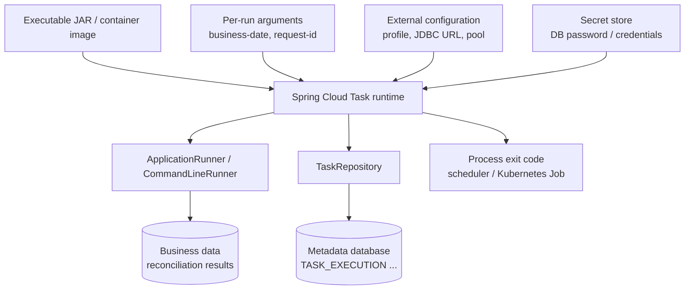

# Passing Configuration, Arguments, and Database Connection Details

A **Spring Cloud Task** application is typically packaged as a JAR or container to execute **a finite job**: ingesting daily data, reconciling records, exporting reports, recording status in a database, and terminating. Unlike a continuously running web service, each time a scheduler, operator, or API launches a task, it usually spawns **a separate process**. Therefore, deployment configuration must ensure every process receives the **right input data**, connects to the **right `TaskRepository` store**, and handles errors without exposing sensitive information.

Running example throughout this lesson: the `daily-reconcile` task receives `--business-date=2026-11-24` and `--request-id=...`, accesses PostgreSQL to record `TaskExecution` metadata, and generates reconciliation results. The same JAR is used on developer machines, servers, and Kubernetes; **environment differences are supplied externally** rather than editing Java code and rebuilding.

After completing this lesson in the **Deployment** chapter, you will be able to:

- Distinguish **Spring Boot configuration**, **business arguments**, **environment variables**, and **connection secrets**.
- Pass `--business-date`, profiles, JDBC URLs, and credentials properly when running `java -jar`.
- Intentionally use `application.yml`, external configuration files outside the JAR, OS environment variables, and Spring Boot command-line overrides.
- Deploy via a **Kubernetes Job** using a ConfigMap for regular configuration and a Secret for credentials.
- Ensure `TaskRepository`, business datasources, and schemas are aligned; inspect `TaskExecution` after each run.
- Diagnose connection errors, wrong profiles, wrong paths, missing metadata, duplicate retries, and discrepancies between process exit codes and actual data.

## 1. Four groups of information you should never mix

| Group | Examples | Who provides it? | Should it be passed via CLI? |
| --- | --- | --- | --- |
| **Application configuration** | `spring.main.web-application-type=none`, log levels, timeouts | Artifact or environment configuration | Allowed if non-sensitive. |
| **Per-run business arguments** | `--business-date=2026-11-24`, `--request-id=run-2401` | Operator, scheduler, API | **Yes**, provided it is validated and contains no secrets. |
| **Connection details** | `spring.datasource.url`, username, pool size | ConfigMap, external config file, environment variables | Prefer external configuration over hardcoding. |
| **Secrets** | DB password, tokens, private keys | Secret manager/Kubernetes Secret, vault | **Never** pass passwords/tokens via CLI or commit them to a repo. |

This separation matters because Spring Boot commonly maps `--key=value` options into the `Environment`; Spring Cloud Task may persist **run arguments** into metadata tables such as `TASK_EXECUTION_PARAMS`. Moreover, CLI flags can appear in shell history, process lists, and launcher logs. **Never treat a command-line option as a safe channel for passing secrets.**

### Deployment diagram



**Distinguishing data sources:** `TaskRepository` stores execution lifecycle metadata, not the entire business output. A run might succeed from a business perspective yet fail when updating metadata due to a dropped connection; therefore, you must observe output data, exit codes, and logs together.

## 2. Where does Spring Boot load configuration from?

Spring Boot supports **externalized configuration**: a single JAR can read configuration values from YAML/properties files inside the JAR, external files outside the JAR, profiles, environment variables, JVM system properties, and command-line arguments.

In typical execution, **later sources can override earlier ones** (partial excerpt of key precedence, excluding the full `PropertySource` list for tests/devtools):

1. `application.yml` packaged inside the JAR.
2. External `application.yml` and profile-specific files outside the JAR, per config data rules.
3. **OS environment variables**.
4. **Java system properties** such as `-Dspring.profiles.active=prod`.
5. **Command-line arguments** such as `--spring.datasource.url=...`.

Spring Boot supports many additional configuration sources. When multiple profiles and location groups are involved, detailed override ordering gets more nuanced; consult the **Externalized Configuration** documentation for your Boot version. **Never assume every property always comes from `application.yml` inside the JAR.**

For example, a file inside the JAR sets:

```yaml
spring:
  application:
    name: daily-reconcile-task
  main:
    web-application-type: none
  cloud:
    task:
      name: dailyReconcile
      initialize-enabled: false
```

When running:

```bash
java -jar daily-reconcile-task.jar \
  --spring.profiles.active=prod \
  --business-date=2026-11-24
```

`--spring.profiles.active=prod` is a **Spring Boot configuration property**. `--business-date` is an **application-defined business option**. Both arrive via the command line, yet they are consumed by different components.

### Environment variables and relaxed binding

For common properties like `spring.datasource.url`, Spring Boot lets you use environment variable names:

| Property | Environment variable |
| --- | --- |
| `spring.datasource.url` | `SPRING_DATASOURCE_URL` |
| `spring.datasource.username` | `SPRING_DATASOURCE_USERNAME` |
| `spring.datasource.password` | `SPRING_DATASOURCE_PASSWORD` |
| `spring.profiles.active` | `SPRING_PROFILES_ACTIVE` |
| `spring.application.name` | `SPRING_APPLICATION_NAME` |

Spring Boot supports **relaxed binding**, though not every hyphenated key is mechanically converted by replacing every dot and hyphen with underscores in all cases. For less common properties such as `spring.cloud.task.initialize-enabled`, prefer placing them in `application.yml` or verifying binding rules for your Boot version before inventing environment variable names.

## 3. Example Spring Cloud Task application accepting arguments

Create a Spring Boot project (Java version compatible with your Spring Cloud release train), including **Spring Cloud Task**, the JDBC starter, and the PostgreSQL driver:

```xml
<dependencies>
    <dependency>
        <groupId>org.springframework.cloud</groupId>
        <artifactId>spring-cloud-starter-task</artifactId>
    </dependency>
    <dependency>
        <groupId>org.springframework.boot</groupId>
        <artifactId>spring-boot-starter-jdbc</artifactId>
    </dependency>
    <dependency>
        <groupId>org.postgresql</groupId>
        <artifactId>postgresql</artifactId>
        <scope>runtime</scope>
    </dependency>
</dependencies>
```

This snippet is added to a `pom.xml` that already includes a Spring Boot parent or equivalent dependency management, the **matching Spring Cloud BOM**, and `spring-boot-maven-plugin`. Do not mix arbitrary Spring Boot and Spring Cloud versions.

Create `src/main/java/com/example/task/DailyReconcileApplication.java`:

```java
package com.example.task;

import java.time.LocalDate;
import java.util.List;

import org.springframework.boot.ApplicationArguments;
import org.springframework.boot.ApplicationRunner;
import org.springframework.boot.SpringApplication;
import org.springframework.boot.autoconfigure.SpringBootApplication;
import org.springframework.cloud.task.configuration.EnableTask;
import org.springframework.context.annotation.Bean;

@SpringBootApplication
@EnableTask
public class DailyReconcileApplication {

    public static void main(String[] args) {
        SpringApplication.run(DailyReconcileApplication.class, args);
    }

    @Bean
    ApplicationRunner reconcile() {
        return args -> {
            LocalDate businessDate =
                LocalDate.parse(requiredOption(args, "business-date"));
            String requestId = requiredOption(args, "request-id");

            System.out.printf(
                "Starting reconciliation for date %s, request=%s%n",
                businessDate, requestId
            );

            if (args.containsOption("simulate-error")) {
                throw new IllegalStateException(
                    "Simulated reconciliation error"
                );
            }

            // TODO: Call business service with transaction and idempotency.
            System.out.println("Reconciliation completed");
        };
    }

    private static String requiredOption(
            ApplicationArguments args, String name) {
        List<String> values = args.getOptionValues(name);
        if (values == null || values.size() != 1
                || values.get(0) == null || values.get(0).isBlank()) {
            throw new IllegalArgumentException(
                "Exactly one --" + name + "=... must be provided"
            );
        }
        return values.get(0);
    }
}
```

**Notes:**

- `@EnableTask` enables `TaskExecution` lifecycle recording per Spring Cloud Task's mechanism.
- `ApplicationArguments` separates named options from non-option arguments; the application must validate missing, duplicate, and malformed date inputs.
- `request-id` correlates requests across schedulers, logs, and business data; it is **not a password** and does not enforce idempotency by itself.
- If an error occurs, the runner should **let the exception propagate** or report an appropriate exit code; never swallow errors and print "success".
- This example only illustrates inputs and lifecycle; it does not implement real revenue calculations. Production code must enforce transactions, unique constraints, or deduplication strategies for the same date/data unit.

## 4. Configuring PostgreSQL for `TaskRepository`

An `application.yml` configuration can define non-sensitive values and read credentials from the environment:

```yaml
spring:
  application:
    name: daily-reconcile-task
  main:
    web-application-type: none
  datasource:
    url: ${TASK_DB_URL}
    username: ${TASK_DB_USERNAME}
    password: ${TASK_DB_PASSWORD}
    hikari:
      maximum-pool-size: 4
      connection-timeout: 15000
  cloud:
    task:
      name: dailyReconcile
      initialize-enabled: false
```

In this example, `TASK_DB_URL`, `TASK_DB_USERNAME`, and `TASK_DB_PASSWORD` must be supplied prior to execution. **Never provide a default value for a password** such as `password: demo123` in production profiles.

### Details to align on

| Item | Example | Why it matters |
| --- | --- | --- |
| **JDBC URL** | `jdbc:postgresql://db.internal:5432/task_metadata` | Points to the right database; from inside a container use a reachable hostname, not `localhost` if PostgreSQL runs elsewhere. |
| **Driver** | PostgreSQL JDBC driver | Must be packaged in the executable JAR/image; missing the driver fails startup. |
| **Username/password** | Dedicated account for task metadata | Needs appropriate privileges; avoid superuser accounts. |
| **Schema and table prefix** | `TASK_EXECUTION`, `TASK_EXECUTION_PARAMS` | DDL and `spring.cloud.task.tablePrefix` (if customized) must match. |
| **TLS** | `sslmode=verify-full` when infrastructure and trust chain support it | Protects connections and verifies server identity instead of blindly setting `ssl=true`. |
| **Pool and timeout** | Hikari pool of 4 connections, 15s timeout | Caps resource usage and ensures connection errors fail finitely, matching task concurrency. |

**`spring.cloud.task.initialize-enabled: false`** requires the Spring Cloud Task tables to **already exist** via version-compatible schema/migrations. In local lessons you may use the framework's default initializer, but in production do not let multiple Jobs/Pods race to create or alter schemas.

### One or multiple `DataSource`s?

With **a single `DataSource`**, Spring Cloud Task can typically use it for `TaskRepository`, `TaskExplorer`, and the corresponding JDBC transaction manager.

When using **two `DataSource`s** — one for Task metadata and one for business data — you must **explicitly choose the metadata datasource via `TaskConfigurer`** along with the appropriate transaction manager. Do not slap `@Primary` onto the business datasource and assume `TaskRepository` knows to use another database. Furthermore, business and metadata transactions do not automatically form an atomic distributed transaction across two databases: if business data commits but metadata fails to update, retries must still be **idempotent**.

### Reading execution history after a run

Once the datasource connects and the schema is valid, run a diagnostic query:

```sql
SELECT
    TASK_EXECUTION_ID,
    TASK_NAME,
    START_TIME,
    END_TIME,
    EXIT_CODE
FROM TASK_EXECUTION
ORDER BY TASK_EXECUTION_ID DESC;
```

Every new run generally receives a new `TASK_EXECUTION_ID`, even when `business-date` and `request-id` match a prior run. If no row appears, the task may have failed **before metadata could be created**; inspect application/JVM/platform logs instead of assuming the launch never happened.

## 5. Deploying with `java -jar` on a server

After packaging with Maven:

```bash
./mvnw clean package
```

Assume the artifact is `target/daily-reconcile-task-0.0.1-SNAPSHOT.jar`. In a test environment, non-secret variables can be exported via shell:

```bash
export TASK_DB_URL="jdbc:postgresql://127.0.0.1:5432/task_metadata"
export TASK_DB_USERNAME="task_user"

# TASK_DB_PASSWORD is provided by the secret manager or deployment environment.
java -jar target/daily-reconcile-task-0.0.1-SNAPSHOT.jar \
  --business-date=2026-11-24 \
  --request-id=manual-20261124-01
echo $?
```

`echo $?` prints the exit code of the immediately preceding command; invoke it right after `java -jar`. A normal successful execution returns `0`; missing arguments, database errors, or business exceptions normally cause non-zero failure exits. **The OS exit code and `TaskExecution.exitCode` can diverge if the process dies abruptly or metadata DB writes fail.**

In PowerShell:

```powershell
$env:TASK_DB_URL = "jdbc:postgresql://db.internal:5432/task_metadata"
$env:TASK_DB_USERNAME = "task_user"
# TASK_DB_PASSWORD has been securely provided by the deployment environment.

java -jar .\target\daily-reconcile-task-0.0.1-SNAPSHOT.jar --business-date=2026-11-24 --request-id=manual-20261124-01
$LASTEXITCODE
```

Never print `TASK_DB_PASSWORD` or dump the entire environment for debugging. Environment variables **reduce the need to pass secrets on the CLI**, yet they can still be inspected by privileged processes or leaked in debug dumps; apply least privilege, secret managers, and redaction.

### Using standard Spring Boot names directly

You do not have to declare `TASK_DB_URL` placeholders in YAML. If your image/framework accepts standard variables directly:

```text
SPRING_DATASOURCE_URL=jdbc:postgresql://db.internal:5432/task_metadata
SPRING_DATASOURCE_USERNAME=task_user
SPRING_DATASOURCE_PASSWORD=(fetched from secret store)
SPRING_PROFILES_ACTIVE=prod
```

Spring Boot binds these directly to `spring.datasource.*` and active profiles. **Pick one style consistently** per property: either `TASK_DB_*` via YAML placeholders or standard `SPRING_DATASOURCE_*`. Mixing both alongside command-line overrides requires careful awareness of precedence to avoid surprising configuration.

### Reading configuration files outside the JAR

To reuse the same JAR across environments:

```bash
java -jar daily-reconcile-task.jar \
  --spring.profiles.active=prod \
  --spring.config.additional-location=optional:file:/etc/daily-reconcile/ \
  --business-date=2026-11-24 \
  --request-id=scheduler-20261124
```

If that directory contains `application.yml` or `application-prod.yml`, Spring Boot loads them and overrides default config data. `spring.config.additional-location` **adds** search locations; `spring.config.location` **replaces** default locations, which can easily drop configuration inside the JAR if misused. Location properties must be supplied **early at startup** (CLI/system property/environment), not after the context has already been created.

`optional:` is only suitable if missing files are acceptable; for **mandatory production configuration**, usually omit `optional:` so startup fails fast if the file is absent. Apply appropriate read permissions to external files and never commit secrets to source repositories.

## 6. Deploying to a Kubernetes Job

Kubernetes **Job** is well suited for finite processes: the controller creates a Pod to finish the work, tracks completion, and enforces retry policies. Avoid using a Deployment that keeps replicas running for a task that runs and exits—a Deployment aims to preserve replica counts and easily triggers unintended restarts.

### 6.1. ConfigMap for regular configuration

Define a `ConfigMap` containing only **non-secret** data:

```yaml
apiVersion: v1
kind: ConfigMap
metadata:
  name: reconcile-task-config
data:
  SPRING_DATASOURCE_URL: "jdbc:postgresql://postgresql.database.svc.cluster.local:5432/task_metadata"
  SPRING_PROFILES_ACTIVE: "prod"
```

The DNS name `postgresql.database.svc.cluster.local` illustrates a Service named `postgresql` in namespace `database`. Kubernetes does not create this Service automatically; use your cluster's **actual Service name**. `localhost` inside a Pod refers solely to that Pod/container network namespace, not an external PostgreSQL server.

### 6.2. Secret for credentials

Assume the namespace already has a Kubernetes Secret `reconcile-db-credentials` with `username` and `password` keys provisioned by your organization's secret management system. Reference them in the Pod via `secretKeyRef`:

```yaml
env:
  - name: SPRING_DATASOURCE_USERNAME
    valueFrom:
      secretKeyRef:
        name: reconcile-db-credentials
        key: username
  - name: SPRING_DATASOURCE_PASSWORD
    valueFrom:
      secretKeyRef:
        name: reconcile-db-credentials
        key: password
```

This is a **Pod spec snippet**, not a standalone Kubernetes manifest. The Secret must reside **in the same namespace as the Pod**, and the Pod must have permission to read/mount it. A Kubernetes Secret is not automatically secure merely because it is base64-encoded in YAML: enforce RBAC, cluster encryption at rest, auditing, and secret rotation.

Environment variables from Secrets are resolved when the container starts; updating a Secret **does not automatically update env values in an already-running process**. A new task/Pod must be created to pick up updated values.

### 6.3. Complete Job manifest

Assume the image is built with an entrypoint launching `daily-reconcile-task.jar`. `args` below are **appended to the image's ENTRYPOINT** and will not invoke Java on their own if the image lacks an entrypoint.

```yaml
apiVersion: batch/v1
kind: Job
metadata:
  name: reconcile-20261124
  labels:
    app: daily-reconcile-task
spec:
  backoffLimit: 1
  activeDeadlineSeconds: 1800
  ttlSecondsAfterFinished: 86400
  template:
    metadata:
      labels:
        app: daily-reconcile-task
    spec:
      restartPolicy: Never
      containers:
        - name: task
          image: registry.example.com/finance/daily-reconcile-task:1.0.0
          imagePullPolicy: IfNotPresent
          args:
            - "--business-date=2026-11-24"
            - "--request-id=job-20261124-01"
          envFrom:
            - configMapRef:
                name: reconcile-task-config
          env:
            - name: SPRING_DATASOURCE_USERNAME
              valueFrom:
                secretKeyRef:
                  name: reconcile-db-credentials
                  key: username
            - name: SPRING_DATASOURCE_PASSWORD
              valueFrom:
                secretKeyRef:
                  name: reconcile-db-credentials
                  key: password
          resources:
            requests:
              cpu: "100m"
              memory: "256Mi"
            limits:
              cpu: "1"
              memory: "768Mi"
```

**Key points to understand:**

- `backoffLimit: 1` lets the Job controller retry up to the limit after Pod failure; it **does not guarantee the code runs only once**.
- `activeDeadlineSeconds: 1800` caps total Job runtime in this example; upon timeout, Kubernetes marks it failed and stops Pods. This does not automatically roll back already-committed data.
- `restartPolicy: Never` keeps failed Pods separate for easier debugging. `backoffLimit` and `restartPolicy` belong to **Kubernetes**, not Spring Cloud Task.
- `ttlSecondsAfterFinished` cleans up the Job/Pods once finished and the TTL expires; rely on **centralized logging** if you need to investigate after cleanup.
- `ConfigMap` and `Secret` supply config and credentials. **Per-run arguments** live in `args` so the date can vary daily without rebuilding the image.
- `resources` must match real workload, concurrency, and JVM memory footprints. Low memory limits can trigger OOMKills and leave `TaskExecution` without a completion update.

Create the Job with:

```bash
kubectl apply -f reconcile-job.yaml
kubectl get jobs
kubectl get pods -l app=daily-reconcile-task
kubectl logs job/reconcile-20261124
kubectl describe job reconcile-20261124
```

These commands are meant for **learners to run in a test environment**; they are not executed when authoring this guide. Ensure the namespace, ConfigMap, Secret, image, and Kubernetes permissions exist beforehand.

### Running on a schedule

A **CronJob** spawns Jobs on a schedule; it does not replace business-date parameter handling. When `business-date` must change per trigger, never hardcode a date in the manifest and reuse it forever: pass the date via a controlled mechanism (such as a service calculating the target period, an API creating Jobs with arguments, or inputs derived from schedule and timezone). Note that the scheduler's timezone and the business timezone may differ.

Kubernetes Jobs/CronJobs can occasionally produce **multiple executions of the same workload** due to retries, controller issues, or manual triggers. Design **idempotency** around a key like `tenant + businessDate + requestType` and control concurrency to prevent duplicate reconciliations.

## 7. Passing configuration from Spring Cloud Data Flow or other launchers

When using **Spring Cloud Data Flow (SCDF)**, the task application is registered, turned into a **Task definition**, and launched on demand. SCDF forwards runtime arguments and deployer properties to the `TaskLauncher` for the target platform. Exact deployer property names vary across Kubernetes, Cloud Foundry, or local runtimes.

Illustrative Shell syntax:

```text
dataflow:>task launch reconcile-daily --arguments "--business-date=2026-11-24 --request-id=dataflow-20261124"
```

These arguments flow into the Spring Cloud Task application and may appear in execution history/task metadata. **Never pass `--spring.datasource.password=...` or tokens via `--arguments`**. Instead, supply configs/secrets using deployer-supported mechanisms, platform service accounts, or an infrastructure secret manager.

**Distinguishing IDs:** A Task definition name is not `TaskExecution.executionId`; platform IDs (Pod/Job/platform task ID) are also not `TaskRepository` IDs. When debugging connection failures, log correlations across these IDs while keeping secrets out of logs.

## 8. Separating Task metadata and business databases in deployment

A task can share one database for both business data and `TaskRepository` or split them across two databases:

```text
daily-reconcile-task
  ├─ TaskRepository / TaskExplorer
  │    └─ taskMetadataDataSource
  │          └─ TASK_EXECUTION, TASK_EXECUTION_PARAMS, ...
  └─ ReconciliationService
       └─ businessDataSource
             └─ daily_revenue, payment, ...
```

If **splitting datasources**, configure them cleanly:

| Component | Which resource to select? |
| --- | --- |
| Spring Cloud Task `TaskConfigurer` | `taskMetadataDataSource` and the metadata transaction manager. |
| Business service | `businessDataSource` and the business transaction manager. |
| Spring Batch (if used) | `JobRepository` and Step transaction manager matching the schema/Step. |

Never reuse a single superuser account for everything just to bypass permission errors. In production, grant connection/schema privileges per role, maintain separate migrations, and configure metadata backups/retention if audit history is needed.

### Impact of retries

Suppose `2026-11-24` was reconciled and written to the business database, but the Pod received `SIGKILL` before Spring Cloud Task updated `END_TIME`. When Kubernetes spawns a replacement Pod or SCDF relaunches the task, the application may process the work **a second time**.

Therefore:

1. Use a stable **business idempotency key**, not `TaskExecution.executionId`.
2. Record completion markers and business effects in the **same transaction** when sharing a database.
3. For external APIs or messages outside the database, use receiver-side idempotency keys, a transactional outbox, or compensating actions.
4. Check exit codes, Job/Pod status, `TaskExecution`, and business outputs before deciding to retry.

## 9. Common configuration errors

| Symptom | Possible cause | How to diagnose and fix |
| --- | --- | --- |
| `Failed to configure a DataSource` | Missing URL, driver, or unbound property | Check env var names, YAML, dependencies, and active profiles. |
| `Connection refused` | Wrong host/port, DB not ready, or blocked by NetworkPolicy | From the task's runtime environment, verify DNS, network, Service, and DB port. |
| `UnknownHostException` | Using a laptop-only hostname or wrong Kubernetes Service DNS | Use the right namespace/cluster Service name; never use `localhost` if DB is outside the Pod. |
| Authentication failed | Wrong username/password, wrong Secret key, expired credentials | Verify secret references, rotation, and DB permissions; never print passwords. |
| `relation "task_execution" does not exist` | Metadata schema not created, wrong `search_path`, or wrong prefix | Apply version-matching migrations, check schema/prefix and permissions. |
| Task writes metadata to the wrong database | Profile/CLI overrode datasource, or multiple `DataSource` beans | Check effective property sources and `TaskConfigurer`. |
| `java -jar` works locally but fails in Pod | Image missing driver/wrong entrypoint, or config not injected | Inspect image, `command`/`args`, env, logs, and `describe Pod`. |
| Env var changed but task still uses old value | Container was created before Secret/ConfigMap update | Trigger a fresh run/Pod after updating configuration. |
| Task stays running after finishing work | Web server or background thread still alive | Use `web-application-type: none`, close executors/context properly. |
| `TaskExecution` missing `END_TIME` | Process killed, failed before finish, or metadata DB disconnected | Cross-check Pod/events/logs/DB; do not assume "nothing was processed". |
| Job reruns and inserts duplicate data | Platform/scheduler retry or duplicate manual run | Add unique constraints, idempotency, concurrency limits, and completion markers. |
| Secret exposed in logs/process list | Password passed via CLI or full config dumped | Stop logging secrets, rotate credentials, and switch to secret-store injection. |

### Recommended troubleshooting order

1. **Artifact:** right JAR/image, right Java runtime, JDBC driver present, and right entrypoint?
2. **Config sources:** right profile, file locations, environment variables, and override order?
3. **Network/DB:** DNS, host, port, firewall/NetworkPolicy, TLS, secrets, and permissions?
4. **Schema:** do `TASK_EXECUTION` tables exist in the target database/schema, and are migrations applied?
5. **Business args:** are `business-date` and `request-id` present and valid?
6. **Runtime:** OS exit code, logs, Pod/Job status, timeouts, and JVM health?
7. **Data:** do `TaskExecution` and business outputs match, and is a retry safe?

Never edit `TASK_EXECUTION.EXIT_CODE` or `END_TIME` directly just to turn a dashboard green; resolve the root cause and preserve accurate history.

## 10. Security and operational principles

**Never commit secrets:** Do not place passwords in committed `application-prod.yml`, Dockerfile `ENV` instructions, public manifests, or command-line arguments. Use a secret manager, protected Kubernetes Secrets, or controlled secret-file injection. **Base64 is not encryption.**

**Least privilege:** Use database accounts with minimal permissions; apply schemas/migrations via a dedicated pipeline. If the app needs table-creation rights in local sandboxes, do not carry those permissions into production without review.

**Never dump full configuration:** Spring Boot Actuator `env`/`configprops` and debug logs help inspect property sources, but keep them restricted/disabled appropriately and verify sanitization. Never dump `System.getenv()` or embed passwords inside exception messages.

**Use TLS properly:** Configure PostgreSQL SSL and truststores to match your infrastructure. With `sslmode=verify-full`, provide valid certificates and matching hostnames; simply flipping an SSL flag without server verification is insufficient for sensitive environments.

**Do not confuse retry with restart:** Every container created by Kubernetes or relaunch by a user can create a **new `TaskExecution`**. When Spring Batch is involved, `JobExecution`/`JobInstance` and checkpoints are a separate layer; do not substitute `TaskExecution` for Batch state.

**Observe every layer:** Track processes/containers, `TaskRepository`, `JobRepository` (if applicable), and business output databases/files. Centralize logs and configure TTL/retention so diagnostic data survives after Jobs are cleaned up.

## 11. Hands-on self-check exercises

Run in a test environment:

1. Package the Spring Cloud Task JAR and run it via `java -jar` with `--business-date` and `--request-id`; verify metadata is recorded.
2. Switch PostgreSQL settings from `application.yml` to environment-supplied `SPRING_DATASOURCE_URL`/`SPRING_DATASOURCE_USERNAME` and password. Explain why the JAR does not need rebuilding.
3. Create an external `application-prod.yml` outside the JAR, activate `prod`, and pass `spring.config.additional-location`. Check which properties override those inside the JAR.
4. Query `TASK_EXECUTION` and compare with the process exit code. What should you do when no row appears due to a pre-startup connection error?
5. Create a Kubernetes ConfigMap for the JDBC URL, a Secret for username/password, and a Job passing business-date `args`. Verify the Pod receives the configuration without logging credentials.
6. Intentionally set `localhost` in the PostgreSQL URL inside a Pod not hosting the database. Analyze the error and fix it with Service DNS.
7. Set `backoffLimit: 1`, simulate a business error; observe the Pods and design how to prevent retries from duplicating data.
8. Trigger a Job deadline timeout in a test environment; explain why `TaskExecution.END_TIME` may remain un-updated and how to verify business outputs.
9. When an application has two datasources, diagram the Task metadata transaction manager vs. the business transaction manager; explain why an explicit `TaskConfigurer` is necessary.
10. Design a runbook table recording request ID, business date, `TaskExecution` ID, platform Job/Pod name, artifact version, and business status.

**Review questions:**

- How are `--business-date=...` and `--spring.profiles.active=prod` similar and different?
- Why are environment variables generally safer than CLI arguments for passing passwords, yet still require access controls?
- When multiple datasources exist, which manager must `TaskRepository` use?
- Does Kubernetes `backoffLimit` guarantee exactly-once business execution?
- Why is an empty `TaskExecution.END_TIME` insufficient proof that data was not committed?
- When using a CronJob, how should business-date parameters be supplied to avoid reusing a hardcoded date forever?

**Key takeaway:** When deploying Spring Cloud Task, **keep the artifact immutable**, supply **per-run business arguments**, inject **connection configuration from the environment**, deliver **secrets via protected channels**, and ensure `TaskRepository` targets the right database/schema. Operational outcomes are trustworthy only when cross-checking **process exit codes, Task/Batch metadata, and business data**, alongside retry/idempotency safeguards for every failure mode.

**Official references:**

- [Spring Boot — Externalized Configuration](https://docs.spring.io/spring-boot/reference/features/external-config.html): config sources, profiles, CLI, environment variables, and override precedence.
- [Spring Cloud Task — Features](https://docs.spring.io/spring-cloud-task/reference/features.html): `TaskRepository`, `TASK_EXECUTION_PARAMS`, `initialize-enabled`.
- [Kubernetes — Distribute Credentials Securely Using Secrets](https://kubernetes.io/docs/tasks/inject-data-application/distribute-credentials-secure/): referencing Secrets via `secretKeyRef`.
- [Kubernetes — Jobs](https://kubernetes.io/docs/concepts/workloads/controllers/job/): `backoffLimit`, `restartPolicy`, deadlines, and cleanup.
