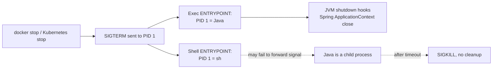
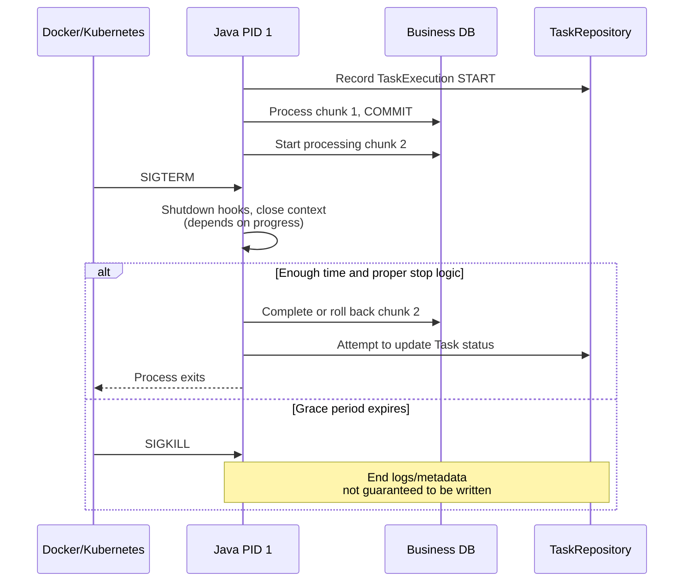

# Docker `ENTRYPOINT`, Shutdown Signals, and Container Exit Codes

## Learning objectives

After completing this lesson, you will be able to:

- Distinguish **exec-form** and **shell-form** `ENTRYPOINT`, and understand why the Java process should receive shutdown signals directly inside a container.
- Describe the role of `PID 1`, `SIGTERM`, `SIGKILL`, the grace period before forced termination, and startup script behavior.
- Propagate Spring Boot/Spring Cloud Task exit codes to the operating system via `SpringApplication.exit(...)` and `System.exit(...)`.
- Understand why **container exit code**, `TaskExecution.exitCode`, Spring Batch Job status, and business outcomes can differ.
- Package a finite Task application with Docker, run it, inspect exit status, and test graceful shutdown paths.
- Configure a Kubernetes Job/CronJob with `restartPolicy`, `backoffLimit`, `terminationGracePeriodSeconds`, and runtime deadlines.
- Design controlled shutdown handling, retry deduplication, and post-incident cross-checks across logs, metadata, and container state.

> **Context:** This lesson belongs to the **Deployment** chapter of the **SPRING_CLOUD_TASK** module. Spring Cloud Task helps build finite Spring Boot applications that store execution times, status, and results in a database via `TaskRepository`; tasks can run manually, on a schedule, or alongside Spring Batch. When packaged into a Docker image and deployed to Kubernetes, **how the JVM starts and stops** determines whether the orchestrator receives accurate success/failure signals and gives the Task a chance to release resources.

## 1. Three questions to separate when a Task finishes

Suppose `daily-settlement-task` runs:

```bash
java -jar /app/daily-settlement-task.jar --business-date=2026-11-24
```

The application reconciles 50,000 transactions and writes results to PostgreSQL. When the process stops, there are three outcome layers to distinguish:

| Outcome layer | Where information lives | Question answered |
| --- | --- | --- |
| **Java process/container** | Exit status recorded by Docker/container runtime or Kubernetes. | Did the main process exit normally, error out, or get killed? |
| **Spring Cloud Task** | `TaskExecution` in `TASK_EXECUTION`, columns `END_TIME`, `EXIT_CODE`, `ERROR_MESSAGE`. | How did the framework record this Task run? |
| **Business / Spring Batch** | Settlement tables, business data, and `BATCH_JOB_EXECUTION` when a Job runs. | Did the work truly complete, roll back, or partially commit? |

These three pieces of information **do not automatically match**. For instance, a `SIGKILL`ed container can return a failure exit status even though the business database already committed part of the work, while `TASK_EXECUTION.END_TIME` remains `NULL` because the JVM could not update the repository in time.

**Goal of proper deployment:** Let Java receive signals, exit according to defined rules, return a meaningful exit code, and preserve enough trace data to investigate interrupted runs.

## 2. `ENTRYPOINT` determines which process receives signals

Dockerfiles support two primary forms:

```dockerfile
# Exec form (recommended for Java Tasks):
ENTRYPOINT ["java", "-jar", "/app/daily-settlement-task.jar"]

# Shell form (avoid this form unless you have a clear reason and explicit signal handling):
ENTRYPOINT java -jar /app/daily-settlement-task.jar
```

Exec form directly runs the specified executable as the container's main process. Shell form goes through an intermediate shell (usually `/bin/sh -c`); Java can become a child process, and stop signals arriving at the shell are **not forwarded properly** to Java. Docker recommends exec form to avoid signal-delivery issues.

### Quick comparison

| Aspect | Exec form | Shell form |
| --- | --- | --- |
| Syntax | JSON array, e.g., `["java","-jar","/app/task.jar"]`. | Command string, e.g., `java -jar /app/task.jar`. |
| Typical main process | Java is `PID 1`. | Shell is `PID 1`; Java is a child process. |
| `SIGTERM` to JVM | Can be received directly. | Risks never arriving because the shell does not forward it. |
| Arguments from `docker run image <args>` | Appended to `ENTRYPOINT`; overrides default `CMD`. | May be ignored under shell-form semantics. |
| `$VAR` expansion / pipes | No automatic shell expansion. | Shell handles variable expansion, pipes, and redirects. |
| Choice for Spring Cloud Task | **Preferred.** | Only use when a signal-forwarding wrapper is explicitly engineered. |

**`PID 1`** is the first process in the container's PID namespace and normally receives stop signals from the runtime. If PID 1 is a shell that does not forward signals, Java may keep running until the container is forcibly killed; flushing logs and closing the Spring context are no longer guaranteed.



This diagram shows the typical hazard, not that every shell is incapable of handling signals. A properly engineered script can use `exec` or explicitly trap/forward signals and wait on child processes.

## 3. A Dockerfile suited for Spring Cloud Task

Example using JDK/JRE 21 and a pre-built Spring Boot executable JAR:

```dockerfile
FROM eclipse-temurin:21-jre

WORKDIR /app

COPY --chown=10001:10001 target/daily-settlement-task.jar /app/task.jar

USER 10001:10001

STOPSIGNAL SIGTERM

ENTRYPOINT ["java", "-jar", "/app/task.jar"]

CMD ["--business-date=2026-11-24"]
```

Explanation:

- `FROM eclipse-temurin:21-jre`: base image matching the Java version the project was built with; verify OS support, CPU architecture, and image patching policy.
- `COPY`: copies the pre-built JAR; in real pipelines, pin image versions/digests and scan for vulnerabilities.
- `USER 10001:10001`: runs as non-root; `COPY --chown` grants matching read permissions on the artifact.
- `STOPSIGNAL SIGTERM`: declares controlled shutdown intent. On standard Linux Docker containers, `SIGTERM` is also the default if omitted.
- **Exec-form `ENTRYPOINT`:** Java is the main process and receives runtime signals directly.
- `CMD` holds a **default** parameter for local testing. In scheduled production runs, supply the exact business date per run rather than freezing one date inside the image.

Build and run example:

```bash
docker build -t example/daily-settlement-task:1.0 .

docker run --name settlement-run-1 \
  --env-file ./task.env \
  example/daily-settlement-task:1.0 \
  --business-date=2026-11-24
```

`docker run` passes arguments that replace the default `CMD`. `task.env` in the example must be managed securely and never committed to repositories. For production, use a secret manager or Kubernetes Secrets with least privilege. Additionally, a database URL using `localhost` inside a container **points to the container itself**, not automatically to the Docker host or an external PostgreSQL server.

**Operational note:** `docker run --rm` deletes the container upon exit, so avoid it when you need `docker inspect` or logs from a stopped container. Keep the container until investigation completes, or ship logs to centralized logging.

### Combining `ENTRYPOINT` and `CMD`

Docker combines these values into the final command as follows:

```text
ENTRYPOINT ["java","-jar","/app/task.jar"]
CMD        ["--business-date=2026-11-24"]

Default:
java -jar /app/task.jar --business-date=2026-11-24

docker run image --business-date=2026-11-25:
java -jar /app/task.jar --business-date=2026-11-25
```

With Java `ApplicationArguments`, `--business-date=...` is an option argument parsed by the runner. Never place passwords, bearer tokens, or secrets in `CMD` or CLI args because they can appear in `TASK_EXECUTION_PARAMS` metadata, container specs, and observability tools.

## 4. If a startup script is needed: use `exec`

Sometimes you need to validate inputs, create temporary directories, or compute arguments before starting the JVM. Do not write a wrapper that leaves the shell as PID 1 and spawns Java without supervision.

**Unsuitable pattern:**

```sh
#!/bin/sh
java -jar /app/task.jar "$@"
# Shell remains PID 1 while Java is running.
```

**Simple recommended pattern:**

```sh
#!/bin/sh
set -eu

# Perform only brief setup; do not launch background services.
echo "Launching finite Spring Cloud Task"

exec java -jar /app/task.jar "$@"
```

`exec` **replaces the shell process with the JVM** under the same PID, so Java receives main-process signals and Java's exit status becomes the container's exit status.

Corresponding Dockerfile:

```dockerfile
FROM eclipse-temurin:21-jre
WORKDIR /app
COPY --chown=10001:10001 target/daily-settlement-task.jar /app/task.jar
COPY --chown=10001:10001 --chmod=755 entrypoint.sh /app/entrypoint.sh
USER 10001:10001
ENTRYPOINT ["/app/entrypoint.sh"]
```

This is a **learning configuration snippet**, assuming `entrypoint.sh` has already been created in the build context; this lesson does not generate it automatically. `COPY --chmod` requires a compatible builder. If building images on Windows, ensure shell scripts use LF line endings; CRLF can cause interpreter lookup errors.

### When is `exec` not enough?

If a container genuinely must run **multiple processes**, a shell wrapper ending in `exec java` cannot manage the lifecycle of the other processes. In that case:

- Restructure so each container runs a single main process if possible.
- Use a proper supervisor/init that forwards signals to children and `wait`s on the right process.
- Consider `docker run --init` or a lightweight init process that forwards signals and reaps zombies.
- Explicitly define which process's exit status determines the container's status.

Never run `java ... &` and let the wrapper `exit 0` while the JVM is still running: the container would be reported as succeeding before the work has finished.

## 5. Shutdown signals and their meanings

On Linux containers, common signals include:

| Signal | Common number | Typical source | Impact |
| --- | ---: | --- | --- |
| `SIGTERM` | 15 | `docker stop`, Kubernetes graceful termination, orchestrators. | Requests shutdown; JVM can run shutdown hooks to close the context. |
| `SIGINT` | 2 | Ctrl+C in an interactive terminal session. | Typically used for handleable interrupt requests. |
| `SIGKILL` | 9 | `docker kill`, grace period expiration, some OOM scenarios. | **Cannot be caught, blocked, or cleaned up** by the killed process. |
| `SIGQUIT` | 3 | JVM diagnostics depending on environment. | JVM behavior varies; do not use as a normal stop signal. |

Do not equate "sending a signal" with "already terminated". After `SIGTERM`, Java still needs time to run shutdown hooks/callbacks; after `SIGKILL`, there is no opportunity to execute `finally`, `@PreDestroy`, or update `TaskRepository`. Docker documentation specifies that `docker stop` sends the stop signal to the main process, waits for a grace period, and then sends `SIGKILL` if it is still running.

### `docker stop` vs. `docker kill`

```bash
# Request graceful stop; wait up to 30 seconds then force kill.
docker stop --timeout 30 settlement-run-1

# Send SIGTERM immediately, without a timed stop grace period.
docker kill --signal=TERM settlement-run-1

# Special test scenario: forced termination, no cleanup.
docker kill --signal=KILL settlement-run-1
```

Only run the third command in **test environments with non-sensitive data**. `SIGKILL` can leave partial DB commits, incomplete Task metadata, and lost tail logs.

`docker stop` returns exit code `0` for the **Docker CLI command** itself when the command succeeds; that number **does not mean** the Java process exited with `0`. To inspect the container's exit code, check `docker wait` or `docker inspect`.

## 6. `SpringApplication.exit` and `System.exit` in `main`

A finite Spring Cloud Task does not need an open web server. A common Spring Boot pattern is:

```java
package com.example.settlement;

import org.springframework.boot.SpringApplication;
import org.springframework.boot.autoconfigure.SpringBootApplication;
import org.springframework.cloud.task.configuration.EnableTask;
import org.springframework.context.ConfigurableApplicationContext;

@SpringBootApplication
@EnableTask
public class SettlementTaskApplication {

    public static void main(String[] args) {
        ConfigurableApplicationContext context =
                SpringApplication.run(SettlementTaskApplication.class, args);

        int exitCode = SpringApplication.exit(context);
        System.exit(exitCode);
    }
}
```

**Three calls with distinct roles:**

1. `SpringApplication.run(...)` initializes the context and runs `ApplicationRunner`/`CommandLineRunner` synchronously; returns `ConfigurableApplicationContext` on success.
2. `SpringApplication.exit(context)` computes the exit code via Spring Boot's mechanism (`ExitCodeGenerator` and related callbacks) and closes the Spring context.
3. `System.exit(exitCode)` instructs the JVM to return that integer to the OS; Docker tracks the JVM's exit status when it is the main process.

If you call `SpringApplication.exit(context)` **without** `System.exit(code)`, the integer return value does not automatically become the process exit status; when the JVM exits naturally, the OS exit code can still be `0` even if the app defined another code.

If `SpringApplication.run(...)` throws an exception, lines after it **do not run along the normal path**. Spring Boot handles startup errors itself; an unhandled exception leaving `main` typically causes the JVM to exit non-zero. Never hardcode `System.exit(0)` in a `finally` block, as it can mask real failures.

### Minimal `application.yml`

```yaml
spring:
  application:
    name: daily-settlement-task
  main:
    web-application-type: none
  cloud:
    task:
      initialize-enabled: false
  datasource:
    url: ${TASK_JDBC_URL}
    username: ${TASK_DB_USER}
    password: ${TASK_DB_PASSWORD}
```

The example assumes `spring-cloud-starter-task`, a JDBC driver, a database, and **a version-matched migrated Task schema**. `initialize-enabled=false` means runtime **does not auto-create tables**, not that `TaskExecution` recording is disabled. For projects adding Spring Batch, also configure `JobRepository`, Batch metadata, and Job-failure propagation rules.

Do not place secrets in the Dockerfile or environment dumps. Environment variables are injected via your runtime's secure configuration mechanism.

## 7. Swallowed failures can make a container return `0`

A common bug in runners:

```java
@Component
class SettlementRunner implements ApplicationRunner {

    private static final Logger log =
            LoggerFactory.getLogger(SettlementRunner.class);

    private final SettlementService service;

    SettlementRunner(SettlementService service) {
        this.service = service;
    }

    @Override
    public void run(ApplicationArguments args) {
        try {
            service.process();
        } catch (Exception ex) {
            log.error("Settlement failed", ex);
            // Error occurred but was swallowed.
        }
    }
}
```

`log.error` **does not change the exit code**. Returning normally from the runner causes Spring Boot to treat startup as successful, `SpringApplication.exit(context)` returns `0`, and Docker/Kubernetes marks the container as succeeded.

Fix for failures that must fail the Task:

```java
@Override
public void run(ApplicationArguments args) {
    try {
        service.process();
    } catch (RuntimeException ex) {
        log.error("Settlement failed", ex);
        throw ex; // Propagate error to the Task management layer.
    }
}
```

Depending on requirements, you can define an `ExitCodeGenerator` bean to classify handled business outcomes—for example, `2` for invalid arguments and `10` for business failure. Always **test** both the process exit status and `TaskExecution.exitCode`: passing a manual exit code to `SpringApplication.exit` does not guarantee `TaskRepository` recorded the exact same code in every version/execution path.

If a Spring Batch Job returns `BatchStatus.FAILED` yet the runner ignores `JobExecution` or catches and returns normally, the container also risks returning `0`. An orchestrator watching only container exit status cannot read internal Job state unless the app propagates it.

## 8. `SIGTERM` and Spring Boot's shutdown hook

Spring Boot registers a JVM **shutdown hook** to attempt closing `ApplicationContext` when the JVM terminates. Callbacks such as `@PreDestroy`, `DisposableBean`, and related bean lifecycle methods can run. This helps release Spring-managed resources, subject to clear limits:

- A shutdown hook is not a Spring Batch **pause/restart checkpoint** mechanism.
- It does not wait indefinitely for a mid-flight runner to finish.
- Closing the context does not guarantee business transactions that just called external APIs commit or roll back as desired.
- On `SIGKILL`, the hook **never runs**.
- If the Task database connection drops or the process is killed mid-callback, `TaskExecution` may lack completion updates.
- `SIGTERM` does not inherently mean business work succeeded or failed; define explicit operational rules.

### A stop signal can arrive between two commits



Once an earlier chunk has committed, stopping the worker **does not undo completed commits**. A scheduler retry may re-read the same input data. Thus, you must design idempotency by **business key**, transactions, checkpoints, or Spring Batch restart rules—never treat a new `TaskExecution` ID as proof that data needs fresh processing.

## 9. Designing controlled shutdown without trying to "save" every case

For long-running workloads, the runner can check for a stop request **between units of work** to avoid starting a new chunk while shutting down. Core example:

```java
package com.example.settlement;

import java.util.concurrent.atomic.AtomicBoolean;

import jakarta.annotation.PreDestroy;
import org.springframework.stereotype.Component;

@Component
public class StopRequested {

    private final AtomicBoolean stopping = new AtomicBoolean();

    public boolean isStopping() {
        return stopping.get();
    }

    @PreDestroy
    public void onShutdown() {
        stopping.set(true);
    }
}
```

The service or runner checks the flag:

```java
for (WorkUnit unit : workUnits) {
    if (stopRequested.isStopping()
            || Thread.currentThread().isInterrupted()) {
        throw new IllegalStateException(
                "Task interrupted before next work unit");
    }

    processInTransaction(unit);
}
```

`WorkUnit` and `processInTransaction(...)` are illustrative business components to be defined in your project. Key points:

1. `processInTransaction(unit)` should process **one idempotent unit** with crisp transaction boundaries.
2. When stopping, **do not swallow exceptions** to return fake success; define an abort/retry or checkpoint policy.
3. `@PreDestroy` runs only when the Spring context actually closes and destroys beans; it can execute on the shutdown thread **while the runner is still active**. Never assume every `SIGTERM` runs all callbacks and updates `TaskRepository`.
4. Never hold locks or make unbounded network calls inside `@PreDestroy`. Cleanup must be deadline-bounded, respect interrupts, and honor stop budgets.
5. Do not register extra `Runtime.getRuntime().addShutdownHook(...)` calls to invoke `context.close()` multiple times when Spring Boot already manages the hook, unless clearly justified and tested.
6. External non-database dependencies (email, message brokers, banks) require verification/idempotency keys; a JDBC rollback cannot undo already-dispatched external effects.

### Distinguishing Task cancellation from "completed successfully"

If an operator stops a task due to misconfiguration or maintenance, that run is not a business success. Your system may record `CANCELLED`/`INTERRUPTED` states in business tables or the orchestrator, but **do not assume Spring Cloud Task always has such an enum status**. In `TASK_EXECUTION`, status is inferred from `startTime`, `endTime`, `exitCode`, and error fields; after a crash, the trailing fields may be missing.

## 10. Docker and Kubernetes timeouts: long enough, yet finite

### 10.1. Docker

Per Docker documentation, `docker stop` sends the stop signal (usually `SIGTERM`) and waits for a grace period. If the JVM has not exited, Docker sends `SIGKILL`. Docker's default timeout depends on the platform (for example, CLI docs note **10 seconds for Linux containers** when unconfigured); override it via `--timeout` on `docker stop` or `--stop-timeout` when creating the container.

```bash
docker run -d --name settlement-stop-test \
  --stop-timeout 45 \
  example/daily-settlement-task:1.0 \
  --business-date=2026-11-24

docker stop --timeout 45 settlement-stop-test
```

To genuinely test `SIGTERM`, the test workload must run long enough that the container is **still active** when stopped. If the Task already exited earlier, `docker stop` cannot exercise mid-flight interruption.

### 10.2. Kubernetes

Kubernetes Pods default to `terminationGracePeriodSeconds` of **30 seconds**. Kubelet asks the container runtime to stop the container with `SIGTERM` (or the image/runtime stop signal), waits for the grace period, and then sends `SIGKILL` to any remaining processes.

```yaml
spec:
  terminationGracePeriodSeconds: 90
  restartPolicy: Never
  containers:
    - name: settlement
      image: registry.example.com/settlement-task:1.0
```

This is a **Pod spec snippet**, not a complete `Job` manifest. Inside a Job, place it under `spec.template.spec`. `terminationGracePeriodSeconds` should allow reasonable cleanup without being unbounded: a hung workload needs a failure/cleanup path.

If a Pod defines a `preStop` hook, hook execution time **counts against the grace period**. Do not put `sleep 60` in `preStop` without clear reason; it consumes the budget needed for the JVM to close resources.

**Relationship with Spring Boot:** `spring.lifecycle.timeout-per-shutdown-phase` bounds how long Spring `SmartLifecycle` phases wait during shutdown. It does not replace `terminationGracePeriodSeconds`, nor does it force a multi-minute `ApplicationRunner` to run to completion.

## 11. Container exit codes: interpreting them accurately

Common values observed on Linux:

| Exit code / status | Common meaning | Further verification needed |
| --- | --- | --- |
| `0` | Main process exited cleanly and reported success. | Did business work truly complete? Batch Job `COMPLETED`? |
| `1` or other non-`0` code set by app | Application reported an error. | Exceptions, config, input, logs. |
| `2` | **Illustrative convention** for invalid app arguments. | Does your app actually define this code? |
| `143` | Typical value under `128 + 15` when killed by `SIGTERM`. | Did JVM/wrapper pick a different code? Did shutdown hooks run? |
| `137` | Typical value under `128 + 9` when killed by `SIGKILL`. | Grace period expired, OOM, or operator kill? |
| `OOMKilled` (container reason) | Runtime/Kubernetes detected memory limit exceeded. | Memory limit, heap, native memory, worker/thread count. |
| `Error`/`ContainerCannotRun` (possible reasons) | Container failed to start/run properly. | Image, `ENTRYPOINT`, permissions, architecture, mounts, secrets. |

**143 and 137 are common conventions, not absolute rules for every runtime/JVM.** A shutdown hook may cause the JVM to exit differently; wrappers can remap codes; Windows containers have different semantics. Always inspect `exitCode`, `reason`, timestamps, infrastructure state, and logs together.

`SIGKILL` cannot be caught. So when seeing `137`, do not expect tail logs, `@PreDestroy`, or `TASK_EXECUTION.END_TIME` to have been updated. Also check `OOMKilled` to distinguish out-of-memory kills from grace-period timeouts.

### Docker CLI: reading the container's true exit code

```bash
# For a container that has run and was not removed by --rm:
docker wait settlement-run-1

docker inspect \
  --format '{{.State.ExitCode}}' \
  settlement-run-1

docker inspect \
  --format '{{.State.OOMKilled}}' \
  settlement-run-1

docker logs --timestamps settlement-run-1
```

`docker wait` blocks until the container stops and prints its exit status. `docker inspect` reads the recorded state—unlike `echo $?` right after `docker stop` (which is the **Docker CLI command's** exit code, not Java's).

On a running container, `docker wait` waits until the Task finishes; use it in tests or with appropriate timeouts. When `--rm` deletes a container upon exit, nothing remains to inspect; capture exit status at run time or use centralized logging/platform events.

## 12. Kubernetes Job for a finite Task

A `Job` manifest suits run-to-completion programs far better than a `Deployment`: the Job controller manages completion/failure and applies retry policies on Pod errors. Example:

```yaml
apiVersion: batch/v1
kind: Job
metadata:
  name: settlement-once
spec:
  backoffLimit: 2
  activeDeadlineSeconds: 1800
  template:
    spec:
      restartPolicy: Never
      terminationGracePeriodSeconds: 90
      containers:
        - name: settlement
          image: registry.example.com/daily-settlement-task:1.0
          imagePullPolicy: IfNotPresent
          args:
            - "--business-date=2026-11-24"
          env:
            - name: TASK_JDBC_URL
              value: jdbc:postgresql://task-db:5432/taskdb
            - name: TASK_DB_USER
              valueFrom:
                secretKeyRef:
                  name: task-db-credentials
                  key: username
            - name: TASK_DB_PASSWORD
              valueFrom:
                secretKeyRef:
                  name: task-db-credentials
                  key: password
          resources:
            requests:
              cpu: "250m"
              memory: "256Mi"
            limits:
              memory: "512Mi"
```

This is an **illustrative manifest**, assuming Secrets and database/DNS already exist, the image is pushed to the registry, the JAR is properly configured, and `ENTRYPOINT` uses exec form. Do not reuse a fixed date for a daily CronJob; pass dynamic dates per scheduler contract or compute them in business logic with timezone controls.

Important fields:

- `restartPolicy: Never`: when a container/Pod fails, the Job controller can create a **new Pod**; convenient for inspecting logs per attempt.
- `backoffLimit: 2`: caps retries counted by the Job controller; **does not** guarantee the application runs only once.
- `activeDeadlineSeconds: 1800`: caps total Job duration. Upon expiration, Kubernetes marks the Job failed and terminates workloads.
- `terminationGracePeriodSeconds: 90`: grants time for controlled shutdown before forced termination.
- `args`: appended to the image's `ENTRYPOINT`; declaring `command` on the container overrides `ENTRYPOINT`, so ensure you do not accidentally invoke it through a shell.
- `resources`: tune against real load profiles; `OOMKilled` can still happen even if timeouts and grace periods are set properly.

### Checking Job/Pod outcomes

```bash
kubectl get jobs
kubectl describe job settlement-once

# Get the Pod for the exact Job.
kubectl get pods -l job-name=settlement-once

# Replace <pod-name> with the actual Pod name.
kubectl logs <pod-name>
kubectl describe pod <pod-name>

# For a terminated Pod with a single container:
kubectl get pod <pod-name> \
  -o jsonpath='{.status.containerStatuses[0].state.terminated.exitCode}'
```

`<pod-name>` is a placeholder, not literal command syntax. With multiple containers, select the matching `containerStatuses` entry by name. If Pods are deleted by TTL/cleanup, inspect persisted logs and metrics.

Kubernetes may retry a Task due to process errors, OOMs, evictions, or other infrastructure events. Kubernetes documentation notes that even with `parallelism=1` and `completions=1`, a program can sometimes start more than once. **Idempotency is the application's responsibility**, not automatically provided by `Job`.

### Policy to avoid retrying input errors

By default, Kubernetes Jobs mainly distinguish exit code `0` vs. non-`0`. If you want exit code `2` (invalid input) to fail the Job immediately without retrying, use `podFailurePolicy` on supported clusters together with `restartPolicy: Never`:

```yaml
spec:
  backoffLimit: 2
  podFailurePolicy:
    rules:
      - action: FailJob
        onExitCodes:
          containerName: settlement
          operator: In
          values: [2]
  template:
    spec:
      restartPolicy: Never
      containers:
        - name: settlement
          image: registry.example.com/daily-settlement-task:1.0
```

This is a **Job spec snippet**—attach full `apiVersion`/`kind`/`metadata` when applying. `FailJob` only triggers if the program actually returns exit code `2` to the container runtime. With an unmapped `RuntimeException`, the JVM may exit with a different code, failing to match the rule.

## 13. CronJob, retries, and duplicate-processing risk

A Kubernetes CronJob creates Jobs on a schedule. Each Job can spawn multiple Pod runs due to retries, so one schedule trigger **does not equal one data mutation**.

Conceptual schedule example:

```yaml
apiVersion: batch/v1
kind: CronJob
metadata:
  name: daily-settlement
spec:
  schedule: "0 2 * * *"
  concurrencyPolicy: Forbid
  successfulJobsHistoryLimit: 3
  failedJobsHistoryLimit: 5
  jobTemplate:
    spec:
      backoffLimit: 2
      template:
        spec:
          restartPolicy: Never
          terminationGracePeriodSeconds: 90
          containers:
            - name: settlement
              image: registry.example.com/daily-settlement-task:1.0
              # Do not hardcode the daily business date inside the image.
```

In real environments, specify the **schedule timezone** and rules for deriving `businessDate`. CronJob supports `timeZone` on compatible Kubernetes versions; verify on your cluster. `concurrencyPolicy: Forbid` keeps Jobs from **the same CronJob** from overlapping via the controller, but does not prevent an operator from running the Task manually or another CronJob from touching the same data.

When a Job retries, Spring Cloud Task typically creates a new `TaskExecution` with a new `executionId` for the new launch. **Never use `executionId` as an idempotency key.** Use business keys (e.g., `businessDate + region`), unique constraints, transactions, and/or Spring Batch checkpoints to determine what has already completed.

## 14. Reconciling `TaskRepository` with container state

Spring Cloud Task with JDBC typically writes metadata to `TASK_EXECUTION`. Example query:

```sql
SELECT
    TASK_EXECUTION_ID,
    TASK_NAME,
    START_TIME,
    END_TIME,
    EXIT_CODE,
    EXIT_MESSAGE,
    ERROR_MESSAGE
FROM TASK_EXECUTION
WHERE TASK_NAME = 'daily-settlement-task'
ORDER BY START_TIME DESC, TASK_EXECUTION_ID DESC;
```

Analyze outcomes across multiple sources:

| `TaskRepository` | Container/Kubernetes | Interpretation to verify |
| --- | --- | --- |
| `END_TIME` present, `EXIT_CODE=0` | Container exit `0` | Both signals align; still verify business data. |
| `END_TIME` present, non-`0` code | Container errored | Inspect exceptions, Batch Jobs, retries, and partial commits. |
| `END_TIME IS NULL` | Container received `SIGKILL` | Metadata may not have updated; check logs/Pod and business data. |
| No Task row | Container failed to start | Possible image, entrypoint, secret, datasource/schema error, or very early crash. |
| `EXIT_CODE=0` | Container exited non-`0` | Task may have recorded completion before being interrupted, or an error happened post-update. |
| `EXIT_CODE` non-`0` | Container exit `0` | Wrapper/`main` may have dropped the code, or the result layer is misconfigured. |

**Note:** There is no rule saying "`END_TIME IS NULL` definitely means still RUNNING". A lost Pod or container killed before updating metadata produces the exact same pattern.

If the Task runs a Spring Batch Job, also inspect:

```sql
SELECT
    JOB_EXECUTION_ID,
    STATUS,
    EXIT_CODE,
    EXIT_MESSAGE,
    START_TIME,
    END_TIME
FROM BATCH_JOB_EXECUTION
ORDER BY JOB_EXECUTION_ID DESC;
```

With proper Task–Batch integration, `TASK_TASK_BATCH` links `TASK_EXECUTION_ID` to `JOB_EXECUTION_ID`; never assume those two IDs are equal. A `FAILED` `JobExecution` can be missed if the runner swallows exceptions, leaving the process returning `0`. On supported lines, consider `spring.cloud.task.batch.fail-on-job-failure=true` and **test end-to-end**.

## 15. A safe testing workflow from Docker to Kubernetes

### 15.1. Verifying exit codes on normal runs

1. Build the image with exec-form Dockerfile and prepare `taskdb`, Task schema, and environment variables.
2. Run once with valid arguments against test data.
3. Capture `docker wait`/`docker inspect` exit code and query `TASK_EXECUTION`.
4. Run `--business-date=not-a-date` and confirm the runner throws an error or maps a non-`0` exit code.
5. Verify outputs match business state.

```bash
docker run -d --name settlement-valid \
  --env-file ./task.env \
  example/daily-settlement-task:1.0 \
  --business-date=2026-11-24

docker wait settlement-valid
docker inspect --format '{{.State.ExitCode}}' settlement-valid
docker logs settlement-valid
```

If the application catches errors and handles them specially, invalid-input tests must verify **both process exit code and repository code**; a single `ERROR` log line is not enough for a scheduler to mark failure.

### 15.2. Testing graceful stop

In a test environment, run a workload long enough to stay active:

```bash
docker run -d --name settlement-term \
  --stop-timeout 60 \
  --env-file ./task.env \
  example/daily-settlement-task:1.0 \
  --business-date=2026-11-24

docker stop --timeout 60 settlement-term

docker inspect \
  --format '{{.State.ExitCode}}' \
  settlement-term

docker logs --timestamps settlement-term
```

**Condition:** Meaningful only if the process is still running when `docker stop` is issued. Use a large test dataset or an app-supported slow test mode; never introduce artificial delays in production. Observe `@PreDestroy` logs (if present), business rollbacks/checkpoints, and `END_TIME` in `TaskRepository`. Do not conclude that seeing a shutdown hook proves every commit/retry is safe.

### 15.3. Testing forced termination

```bash
# Run only in test environments after assessing impact:
docker kill --signal=KILL settlement-term
```

This command fails if `settlement-term` already stopped in the previous step; to test it, launch **a fresh running instance**. On `SIGKILL`, no JVM cleanup runs; compare container state, Task metadata, and committed data to identify inconsistency windows.

### 15.4. Testing on Kubernetes Job

1. Use a Job manifest with `restartPolicy: Never`, bounded `backoffLimit`, and reasonable grace period.
2. Let the Task run long enough; watch Pod/Job via `kubectl get` and container logs.
3. In dev/test, delete the Pod or terminate the workload using permitted procedures; record exit code/reason and signal timestamp.
4. Check whether the controller spins up a replacement Pod and creates a new `TaskExecution`.
5. Verify business records are not duplicated and errors are not swallowed.
6. Cross-check `StepExecution`s if running Spring Batch, especially steps committed prior to interruption.

Never arbitrarily delete/kill production Pods as an exercise, especially for payment or critical import workloads.

## 16. Common deployment issues

| Symptom | Possible cause | Resolution |
| --- | --- | --- |
| `docker stop` times out and container is killed | Shell-form `ENTRYPOINT` blocks `SIGTERM`; JVM hung or cleanup too slow. | Use exec form/`exec` in wrapper; measure shutdown duration, inspect thread dumps/logs. |
| Docker reports `137` | Likely `SIGKILL` or OOM. | Inspect `OOMKilled`, container reason, grace period, and memory limits; do not guess from code alone. |
| Docker reports `143` | Usually tied to `SIGTERM` on Linux. | Check who sent the signal, whether JVM/wrapper caught it, and whether Task wrote metadata. |
| Task logs `ERROR` yet Job succeeds | Exception caught and ignored; JVM exit code `0`. | Propagate exceptions or configure verified exit codes. |
| `TaskExecution.exitCode` differs from container exit | Repository updates and process exit are separate; killed mid-way or wrapper altered code. | Inspect Task logs, `main`, `ENTRYPOINT`, JVM, and runtime. |
| `END_TIME` stays `NULL` after Pod dies | Task couldn't record completion or metadata DB failed. | Cross-check Pod termination, logs, and business data; do not edit metadata arbitrarily. |
| Retried Job creates duplicate transactions | Idempotency wrongly keyed on `TaskExecution` ID or missing business key. | Use business keys, unique constraints, transactions, checkpoints, and concurrency controls. |
| Worker never exits after runner finishes | Non-daemon threads, schedulers, or unclosed executors remain. | Use `SpringApplication.exit`, proper lifecycle/close, inspect live threads. |
| Kubernetes `command` overrides `ENTRYPOINT` | Image entrypoint replaced by a different shell/binary. | Use `args` when only passing arguments; keep Java as the main process. |
| `CrashLoopBackOff` in `OnFailure` Job | Container repeatedly fails and restarts inside the Pod. | Check exit codes/logs and consider `Never` to debug individual Pods. |
| `OOMKilled` on large Batch workloads | Heap/native memory or concurrency exceeds resource limits. | Set realistic JVM memory budgets, reduce chunk/parallelism, benchmark real loads. |
| Fixed date parameter runs wrong data in CronJob | Hardcoded date in image `CMD` or manifest `args`. | Derive business dates from schedule/triggers and timezone rules. |
| Logs missing after Job cleanup | Pod/container deleted without centralized logging. | Configure log aggregation/retention before enabling cleanup. |

## 17. Safe operations checklist

- [ ] Dockerfile uses **exec-form `ENTRYPOINT`**, or wrapper ends with `exec java ... "$@"`.
- [ ] Java receives `SIGTERM` in tests with a bounded resource-closing path; `SIGKILL` is treated as a possible metadata-loss case.
- [ ] `main` forwards Spring Boot's exit code to the JVM; runners never swallow business errors.
- [ ] `TaskRepository` and schema migrations match; `executionId` is logged and correlated with container/Pod IDs when needed.
- [ ] With Spring Batch, inspect `JobExecution`/`StepExecution` and propagate Job failures into the process exit code.
- [ ] `terminationGracePeriodSeconds` suffices for bounded cleanup; no unnecessary `preStop` sleeps.
- [ ] Kubernetes Job sets appropriate `restartPolicy`, `backoffLimit`, `activeDeadlineSeconds`, and CPU/RAM resources.
- [ ] **Business-key** idempotency and restart plans cover chunks committed before a kill.
- [ ] Centralized logging and monitoring track `137`/`143`, `OOMKilled`, `END_TIME NULL`, and Job/Task failures.
- [ ] Secrets are injected securely and never appear in Dockerfiles, CLI args, or logs.
- [ ] Cleanup/TTL policies do not purge logs and metadata before investigation windows expire.

## 18. Hands-on exercises

**Exercise 1 — Comparing ENTRYPOINT:** Build two test images, one using `ENTRYPOINT ["java", "-jar", "/app/task.jar"]` and one using `ENTRYPOINT java -jar /app/task.jar`. Run a long Task, call `docker stop`, record PIDs, and observe whether Java receives `SIGTERM`. Explain why behavior can differ.

**Exercise 2 — `exec` wrapper:** Create `entrypoint.sh` that performs a config check and then runs `exec java -jar /app/task.jar "$@"`. Compare exit codes and argument forwarding against a wrapper calling plain `java`.

**Exercise 3 — JVM exit codes:** Have the runner throw `IllegalArgumentException` on invalid arguments. Inspect `docker wait`, `docker inspect`, and `TASK_EXECUTION.EXIT_CODE`; analyze the bug where an error is logged yet the container exits `0` because the exception was swallowed.

**Exercise 4 — Graceful stop:** Configure a Task updating 10 chunks, each in its own transaction. Trigger a stop after the third chunk in a test environment; determine committed data, Task status, which shutdown callbacks ran, and a retry policy that avoids duplicate records.

**Exercise 5 — `SIGKILL`/OOM:** Test `SIGKILL` in an isolated environment and compare the container `EXIT_CODE` with `END_TIME` in the database. Do not trigger real OOMs if risky to the environment; simulate via safe test cases/reports instead.

**Exercise 6 — Kubernetes retries:** Deploy a Job with `restartPolicy: Never` and `backoffLimit: 2`. Force the first attempt to fail, observe the replacement Pod and new `TaskExecution`. Design idempotency using `businessDate + region` instead of `TaskExecution` ID.

**Exercise 7 — Input error policy:** Define exit code `2` for invalid arguments and configure a matching `podFailurePolicy` on a supported cluster. Verify the Job does not retry unrecoverable input errors while still retrying transient errors per policy.

## Key takeaways

- **Exec-form `ENTRYPOINT`** makes Java the container's main process so it receives shutdown signals directly; shell-form risks blocking or failing to forward `SIGTERM`.
- **`docker stop`** requests shutdown with a grace period and may follow with **`SIGKILL`**. `SIGKILL` prevents any JVM cleanup from running.
- **`SpringApplication.exit(context)`** computes the exit code and closes the context; **`System.exit(code)`** passes that code to the OS.
- **Container exit code differs from `TaskExecution.exitCode` and Spring Batch Job status**; cross-check logs and business data after abnormal stops.
- `143`/`137` are common Linux values from TERM/KILL, not sole proof of root cause.
- Jobs/CronJobs can relaunch Tasks; **idempotency, transactions, checkpoints, and concurrency controls** are mandatory for safe retries.

## References

- [Docker — Dockerfile reference: ENTRYPOINT, CMD, STOPSIGNAL](https://docs.docker.com/reference/dockerfile/)
- [Docker — JSON arguments recommended for signal handling](https://docs.docker.com/reference/build-checks/json-args-recommended/)
- [Docker — docker container stop](https://docs.docker.com/reference/cli/docker/container/stop/)
- [Docker — docker container wait](https://docs.docker.com/reference/cli/docker/container/wait/)
- [Spring Boot — SpringApplication and Application Exit](https://docs.spring.io/spring-boot/reference/features/spring-application.html)
- [Spring Cloud Task — Reference Documentation](https://docs.spring.io/spring-cloud-task/reference/)
- [Spring Cloud Task — Features and TaskRepository](https://docs.spring.io/spring-cloud-task/reference/features.html)
- [Kubernetes — Termination of Pods](https://kubernetes.io/docs/concepts/workloads/pods/pod-termination/)
- [Kubernetes — Jobs](https://kubernetes.io/docs/concepts/workloads/controllers/job/)
- [Kubernetes — CronJobs](https://kubernetes.io/docs/concepts/workloads/controllers/cron-jobs/)
