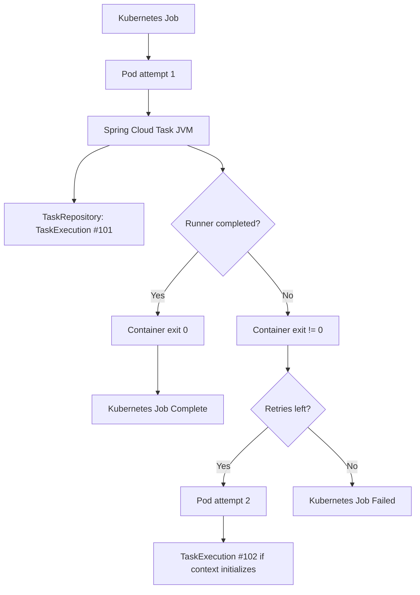

# Running Spring Cloud Task as a Kubernetes Job

## 1. Why is a Kubernetes Job a good fit for Spring Cloud Task?

**Spring Cloud Task** helps build Spring Boot applications with a **finite runtime**: start up, receive arguments, do work, store results in `TaskRepository`, and exit. For example, a system may ingest orders, reconcile payments, or aggregate reports on a schedule. A Task can be triggered manually, on a schedule, or by an orchestration platform; for large workloads, it can also invoke Spring Batch.

A **Kubernetes Job** is designed for workloads that run to completion, unlike a `Deployment` which primarily keeps Pods serving continuously. The Job controller creates Pods to execute the work, tracks Pod success/failure, and can retry according to policy. Once completion conditions are met, the Job transitions to `Complete`; if retry or time limits are exhausted, the Job can transition to `Failed`.

Example of an `invoice-import` Task taking `businessDate`, importing invoices, and exiting:

1. A scheduler creates a Kubernetes Job to run the container image containing the app.
2. The Pod starts the JVM; Spring Cloud Task creates a `TaskExecution` in the shared database.
3. The runner reads arguments, performs business logic, and exits; the repository records `endTime`, `exitCode`, and messages.
4. The container exits with an exit code; Kubernetes uses the Pod outcome to decide whether the `Job` succeeded or failed.
5. Operations cross-checks **Kubernetes Job/Pod** with **`TaskRepository`** and logs to decide whether to rerun.

After this lesson, you will be able to:

- Package a Task into a container that genuinely **exits on its own** without leaving a long-lived HTTP server open.
- Write a `batch/v1` `Job` manifest with a database, Secrets, resource limits, timeouts, and retries.
- Explain the differences among `restartPolicy`, `backoffLimit`, `activeDeadlineSeconds`, and `ttlSecondsAfterFinished`.
- Observe Job/Pod status and `TaskExecution` metadata, and handle failed or killed Pods.
- Extend to `CronJob` and operate safely when a Task involves Spring Batch, multiple retries, or deduplication requirements.

## 2. Two lifecycles that do not map one-to-one

A **Kubernetes Job** and a **Spring Cloud `TaskExecution`** track different units:

| Component | Tracks | Primary outcome |
| --- | --- | --- |
| Kubernetes `Job` | One request to finish a unit of work; may spawn multiple Pods | `Complete` / `Failed` condition, `succeeded` / `failed` / `active` counts |
| `Pod` | One container run on a node | Pod status, per-container exit codes, reason `OOMKilled` or `Error` |
| `TaskExecution` | One Spring Cloud Task app launch whose context initialized cleanly | `taskExecutionId`, `startTime`, `endTime`, `exitCode`, `exitMessage`, `errorMessage` |
| Spring Batch `JobExecution` (if present) | One Batch Job execution inside the Task | `BatchStatus`, `ExitStatus`, Step states, and checkpoints |



The diagram simplifies the retry path. **One Kubernetes Job does not necessarily equal one `TaskExecution`.** When the first Pod fails and the Job controller spawns another Pod, each JVM can produce **a new `TaskExecution`**. If a Pod dies before initializing enough of `ApplicationContext`, `TaskRepository` may not even have **any record** for that attempt.

Kubernetes can spawn replacement Pods even with `parallelism=1` and `completions=1` under certain disruption scenarios. Therefore, **a Job does not guarantee business-level exactly-once execution**. You need unique constraints, idempotency keys, or transactional/Batch restart designs to prevent duplicate processing.

## 3. Preparing a genuinely finite Task

An application uses `@SpringBootApplication` and `@EnableTask`, placing its work inside an `ApplicationRunner` or `CommandLineRunner`. It does not need to be a web application. If web dependencies exist, set `spring.main.web-application-type=none` so no HTTP server stays open.

**Java 17+** example:

```java
package com.example.invoice;

import java.time.LocalDate;
import java.time.format.DateTimeParseException;
import java.util.List;

import org.springframework.boot.ApplicationArguments;
import org.springframework.boot.ApplicationRunner;
import org.springframework.boot.SpringApplication;
import org.springframework.boot.autoconfigure.SpringBootApplication;
import org.springframework.cloud.task.configuration.EnableTask;
import org.springframework.context.ConfigurableApplicationContext;
import org.springframework.context.annotation.Bean;

@SpringBootApplication
@EnableTask
public class InvoiceImportTaskApplication {

    public static void main(String[] args) {
        ConfigurableApplicationContext context =
            SpringApplication.run(InvoiceImportTaskApplication.class, args);
        int exitCode = SpringApplication.exit(context);
        System.exit(exitCode);
    }

    @Bean
    ApplicationRunner importInvoices() {
        return arguments -> {
            LocalDate date = readBusinessDate(arguments);

            // Replace with importService.importForDate(date) in production.
            // Real logic must use transactions and idempotency keyed on businessDate.
            System.out.println("Import completed for date=" + date);
        };
    }

    private static LocalDate readBusinessDate(ApplicationArguments arguments) {
        List<String> values = arguments.getOptionValues("task.business-date");
        if (values == null || values.size() != 1
                || values.get(0) == null || values.get(0).isBlank()) {
            throw new IllegalArgumentException(
                "Exactly one --task.business-date=yyyy-MM-dd argument is required"
            );
        }
        try {
            return LocalDate.parse(values.get(0));
        } catch (DateTimeParseException ex) {
            throw new IllegalArgumentException(
                "task.business-date is not a valid ISO date", ex
            );
        }
    }
}
```

Explanation:

1. `@EnableTask` registers the Spring Cloud Task infrastructure; `TaskRepository` requires a matching datasource/schema.
2. `ApplicationRunner` executes once the context initializes. On success, it returns normally; on real failure, **throw an exception** so the lifecycle records failure.
3. `SpringApplication.exit(context)` resolves Spring Boot's exit code while closing the context; `System.exit(exitCode)` turns it into the **process exit code** observed by Kubernetes. If `SpringApplication.run(...)` fails before returning a context, this normal exit branch is skipped; test actual exit codes during failure tests.
4. Do not open an HTTP server, nor leave indefinite non-daemon background threads or schedulers alive. If work runs asynchronously, **await completion** before returning from the runner.
5. With Spring Batch, ensure a `FAILED` Batch Job propagates to the Task exit code—for instance, verify `spring.cloud.task.batch.fail-on-job-failure=true` when using that integration; do not assume every failed Batch Job automatically makes the container exit non-zero.

> Note: if the JVM receives `SIGKILL` or crashes before Spring Cloud Task writes to the repository, `endTime` and `exitCode` may remain `NULL`. Kubernetes status and `TaskRepository` are **two complementary sources of evidence**, not substitutes for each other.

## 4. Packaging the application into a container

Build an executable JAR from the project using the Spring Boot Maven Plugin or Gradle plugin, then package with Docker/Buildpacks. Below is an **illustrative Dockerfile** for a pre-built JAR—not the output of a live build:

```dockerfile
FROM eclipse-temurin:21-jre

WORKDIR /app
RUN useradd --system --uid 10001 --no-create-home taskuser
COPY target/invoice-import-task.jar /app/app.jar

USER 10001
ENTRYPOINT ["java", "-jar", "/app/app.jar"]
```

If using Gradle, adjust the `COPY` path to the executable JAR in `build/libs/`. If using Buildpacks (such as `spring-boot:build-image` or `bootBuildImage`), you may not need a Dockerfile; just verify the image's `ENTRYPOINT` and exit codes.

Container image design principles:

- The Java runtime must match the application version; e.g., the image above uses JRE 21 for a Java 17+ program.
- Use JSON-array (exec-form) `ENTRYPOINT` so `java` receives stop signals directly, avoiding a shell wrapper that drops exit codes or fails to forward `SIGTERM`.
- Run as a non-root user and restrict filesystem and network privileges.
- Pin images by **verified digest** or immutable tags, scan for vulnerabilities, and sign/approve images per policy.
- Never bake passwords, tokens, or production environment values into image layers.

Example build/push commands once your team has a registry ready:

```bash
./mvnw -DskipTests package
docker build -t registry.example.com/batch/invoice-import-task:1.0.0 .
docker push registry.example.com/batch/invoice-import-task:1.0.0
```

`registry.example.com` is an **illustrative address**. In real pipelines, do not skip tests before releasing; `-DskipTests` above only isolates the packaging step, whereas CI/CD must run tests and security checks before pushing images.

## 5. Complete Kubernetes Job manifest for a single run

Example creating an invoice-import Job for `2026-11-24`. The namespace, Secret, registry, and network permissions **must be prepared beforehand**; this is a template manifest to adapt to your environment, not a copy-paste production command.

```yaml
apiVersion: batch/v1
kind: Job
metadata:
  name: invoice-import-20261124
  namespace: batch-workloads
  labels:
    app.kubernetes.io/name: invoice-import
    app.kubernetes.io/part-of: billing-batch
spec:
  completions: 1
  parallelism: 1
  backoffLimit: 2
  activeDeadlineSeconds: 1800
  ttlSecondsAfterFinished: 86400
  template:
    metadata:
      labels:
        app.kubernetes.io/name: invoice-import
    spec:
      restartPolicy: Never
      automountServiceAccountToken: false
      terminationGracePeriodSeconds: 60
      securityContext:
        runAsNonRoot: true
        runAsUser: 10001
      containers:
        - name: invoice-import-task
          image: registry.example.com/batch/invoice-import-task:1.0.0
          imagePullPolicy: IfNotPresent
          args:
            - "--task.business-date=2026-11-24"
          env:
            - name: SPRING_MAIN_WEB_APPLICATION_TYPE
              value: "none"
            - name: SPRING_APPLICATION_NAME
              value: "invoice-import"
            - name: SPRING_CLOUD_TASK_NAME
              value: "invoice-import"
            - name: SPRING_CLOUD_TASK_INITIALIZE_ENABLED
              value: "false"
            - name: SPRING_DATASOURCE_URL
              valueFrom:
                secretKeyRef:
                  name: invoice-task-db
                  key: jdbc-url
            - name: SPRING_DATASOURCE_USERNAME
              valueFrom:
                secretKeyRef:
                  name: invoice-task-db
                  key: username
            - name: SPRING_DATASOURCE_PASSWORD
              valueFrom:
                secretKeyRef:
                  name: invoice-task-db
                  key: password
            - name: K8S_POD_NAME
              valueFrom:
                fieldRef:
                  fieldPath: metadata.name
          resources:
            requests:
              cpu: "250m"
              memory: "512Mi"
            limits:
              cpu: "1"
              memory: "1Gi"
          securityContext:
            allowPrivilegeEscalation: false
            readOnlyRootFilesystem: true
            capabilities:
              drop:
                - ALL
          volumeMounts:
            - name: temporary-files
              mountPath: /tmp
      volumes:
        - name: temporary-files
          emptyDir: {}
```

**Prerequisites for this example to work:**

- Namespace `batch-workloads` and Secret `invoice-task-db` already exist; the Secret contains the exact three keys `jdbc-url`, `username`, and `password`.
- The external database holds the **version-matched `TaskRepository` schema**, managed by migrations. `SPRING_CLOUD_TASK_INITIALIZE_ENABLED=false` means the Task does not expect to auto-create tables.
- NetworkPolicies, firewalls, DNS, and TLS permit the Task to reach the database; the JDBC driver is packaged inside the JAR.
- The image uses `USER 10001`; if changing images, check permissions and temp paths. `readOnlyRootFilesystem` paired with a `/tmp` volume serves the JVM/libraries needing temporary files.
- Every attempt of the same Kubernetes Job shares `SPRING_CLOUD_TASK_NAME`, yet each JVM startup can receive a distinct `TaskExecutionId`.
- `args` only carry **non-sensitive business dates**. Never pass credentials via command-line arguments because they can land in `TaskExecution.arguments` and Pod metadata.

### Meaning of spec fields

| Field | Example value | Interpretation |
| --- | --- | --- |
| `apiVersion / kind` | `batch/v1` / `Job` | Controller running finite workloads |
| `completions` | `1` | Job requires one successful Pod completion to finish |
| `parallelism` | `1` | Desired concurrency of one Pod; **not an exactly-once guarantee** |
| `restartPolicy` | `Never` | Container does not restart inside the same Pod; Job controller can spawn a **new** Pod |
| `backoffLimit` | `2` | Caps failure retries managed by the Job controller |
| `activeDeadlineSeconds` | `1800` | Maximum active runtime for the **Job**, in seconds, across retries |
| `ttlSecondsAfterFinished` | `86400` | Once `Complete`/`Failed`, the Job can be garbage-collected after 1 day |
| `terminationGracePeriodSeconds` | `60` | Time allowed for the Pod to handle `SIGTERM` before forced kill |
| `resources` | CPU/RAM requests and limits | Enables scheduler placement and caps resource consumption |
| `automountServiceAccountToken` | `false` | Skips mounting the Kubernetes API token when the Task does not call the API |

Do not pick all parameters with a single rigid formula. For instance, `activeDeadlineSeconds=1800` gives 30 minutes **for the entire Job**; if the first attempt takes 25 minutes before failing, the retry may run out of time. Tune values to real workload runtimes and recovery policies.

## 6. Deploying and inspecting a run

Once `invoice-import-job.yaml` exists **in your operations workspace** and `kubectl` targets the right cluster/namespace:

```bash
kubectl config current-context
kubectl apply --dry-run=server -f invoice-import-job.yaml
kubectl apply -f invoice-import-job.yaml
kubectl get jobs -n batch-workloads
kubectl describe job invoice-import-20261124 -n batch-workloads
```

**Never test directly against production** without verifying the environment and inputs that could cause side effects. `kubectl apply` creates a live Job; the commands above are instructions, not commands already executed.

List Pods belonging to the Job using standard labels:

```bash
kubectl get pods -n batch-workloads \
  -l batch.kubernetes.io/job-name=invoice-import-20261124 \
  -o wide

kubectl logs -n batch-workloads \
  -l batch.kubernetes.io/job-name=invoice-import-20261124 \
  --all-containers=true --prefix=true --max-log-requests=10
```

If Pods retried, multiple Pods with separate logs may exist. To inspect a specific attempt, run `kubectl logs pod/<pod-name> -n batch-workloads`; if a container restarted inside the same Pod (`OnFailure`), `--previous` may be needed. With `restartPolicy: Never`, the Job creates replacement Pods, so inspect the failed Pods rather than only the final one.

Check Job status:

```bash
kubectl get job invoice-import-20261124 -n batch-workloads -o yaml

# This command succeeds if the Job reaches Complete before the timeout.
kubectl wait -n batch-workloads \
  --for=condition=complete job/invoice-import-20261124 \
  --timeout=30m
```

**`kubectl wait --for=condition=complete` will not succeed if the Job becomes `Failed`.** On timeout, do not jump to conclusions; inspect `Job.status.conditions`, Pod exit codes, controller events, and `TaskRepository`. Jobs deleted by TTL disappear from the API, so production systems need centralized logs/metrics.

### Reconciling Kubernetes status with TaskRepository

Read-only query against the standard `TASK_EXECUTION` table:

```sql
SELECT
    TASK_EXECUTION_ID,
    TASK_NAME,
    START_TIME,
    END_TIME,
    EXIT_CODE,
    EXIT_MESSAGE,
    CASE
        WHEN ERROR_MESSAGE IS NULL THEN 'NO'
        ELSE 'YES'
    END AS HAS_ERROR_MESSAGE
FROM TASK_EXECUTION
WHERE TASK_NAME = 'invoice-import'
ORDER BY TASK_EXECUTION_ID DESC;
```

Rows in the example may show different `TASK_EXECUTION_ID`s if Kubernetes ran multiple Pods. Never assume the Kubernetes Job name is automatically written into `EXTERNAL_EXECUTION_ID` by Spring Cloud Task—explicit integration/logic is required to assign correlation IDs. For traceability, log `K8S_POD_NAME` and execution IDs safely or record them in business metadata under clear conventions.

**Do not count `TaskExecution` rows as the number of Kubernetes Jobs.** A K8s Job can retry Pods multiple times, and a Pod failing before `ApplicationContext` initialization may produce zero `TaskExecution` rows.

## 7. Distinguishing four "rerun" mechanisms

### 7.1. `restartPolicy: Never` vs. `OnFailure`

`restartPolicy` lives in the **Pod template**, not at the Job level. Kubernetes Jobs only allow `Never` or `OnFailure`.

- **`Never`:** when the container fails, the Pod enters Failed; the Job controller checks `backoffLimit` to create a **new Pod**. Helpful when you want to preserve separate logs and failure causes per attempt.
- **`OnFailure`:** kubelet can restart the container inside the **same Pod**; container retries also count toward Job failure limits per controller rules. Inspect `restartCount` and `--previous` logs.

Never use `Always` for a Kubernetes Job. Do not equate `restartPolicy` with Spring Boot's `spring.batch.job.enabled` or Batch restart policies.

### 7.2. `backoffLimit` vs. business retries

`backoffLimit` is the **Job controller's retry threshold**; it defaults to `6` when no per-index policy applies. It does not distinguish unfixable input errors from transient network drops unless an appropriate Pod failure policy is configured.

Examples:

- Task hits a transient SQL timeout: one retry may make sense if transactions and data are idempotent.
- Task receives an invalid `businessDate`: retrying the same command repeatedly **will not fix the error**.
- Pod is `OOMKilled`: without increasing memory or shrinking load, subsequent retries just repeat the crash.

With `podFailurePolicy` (on supported clusters), you can classify exit codes to **FailJob** immediately instead of retrying unrecoverable errors, or ignore certain Pod disruptions per policy. This is an advanced setting requiring testing: when using `podFailurePolicy`, Kubernetes requires `restartPolicy: Never`.

**Idempotency remains mandatory** because a retry Pod can start **after the prior attempt already committed partial data**.

### 7.3. `activeDeadlineSeconds` is the whole-Job timeout

`spec.activeDeadlineSeconds` limits total elapsed time since the Job became active. Upon expiration, Kubernetes terminates active Pods and marks the Job `Failed`, typically with reason `DeadlineExceeded`. It **takes precedence over `backoffLimit`**: the Job stops retrying once the overall deadline passes.

This **does not guarantee** external transactions roll back, dispatched events undo themselves, or `TaskRepository` receives `endTime`. Before relaunching, inspect side effects in databases/files/brokers.

### 7.4. `ttlSecondsAfterFinished` only cleans up Kubernetes resources

`ttlSecondsAfterFinished` starts counting once the Job reaches a terminal state (`Complete` or `Failed`), allowing the TTL controller to delete the Job and its Pods. It **does not**:

- Delete `TaskExecution` rows in `TASK_EXECUTION`.
- Delete **Spring Batch** `JobExecution`/`StepExecution` records.
- Delete logs already shipped to centralized storage.
- Govern business data retention policies.

A one-day TTL in the manifest helps reduce stale Job/Pod clutter in the API server, and is **not a retention policy for Spring Cloud Task metadata**. If longer failure investigations are needed, manage log retention, monitoring, backups, and DB retention separately.

## 8. Running periodically with Kubernetes CronJob

When a Task must run on a schedule, use a **CronJob** rather than embedding an endless `@Scheduled` loop inside a finite Task. CronJob creates a new **Job** on schedule, and each Job spawns Pods to do the work.

Minimal example illustrating orchestration only (real deployments must add datasource variables, Secrets, security settings, and resources as in Section 5's Job manifest):

```yaml
apiVersion: batch/v1
kind: CronJob
metadata:
  name: invoice-import-daily
  namespace: batch-workloads
spec:
  schedule: "0 1 * * *"
  timeZone: "Asia/Ho_Chi_Minh"
  concurrencyPolicy: Forbid
  startingDeadlineSeconds: 900
  successfulJobsHistoryLimit: 3
  failedJobsHistoryLimit: 5
  jobTemplate:
    spec:
      backoffLimit: 1
      activeDeadlineSeconds: 1800
      ttlSecondsAfterFinished: 604800
      template:
        spec:
          restartPolicy: Never
          containers:
            - name: invoice-import-task
              image: registry.example.com/batch/invoice-import-task:1.0.0
              env:
                - name: SPRING_MAIN_WEB_APPLICATION_TYPE
                  value: "none"
```

`timeZone` is a CronJob field—**do not put `TZ`/`CRON_TZ` inside the `schedule` string**. Mapping a 01:00 `Asia/Ho_Chi_Minh` trigger to **which `businessDate`** the app processes is a business decision. Never rely blindly on `LocalDate.now()` when the Pod happens to start, since Pods can be delayed or retried into the next calendar day. Pass a stable business date from the scheduler or define explicit rules deriving it from the scheduled trigger time.

| `concurrencyPolicy` | Behavior | Limitation |
| --- | --- | --- |
| `Allow` | Lets Jobs from the same CronJob overlap | Default; business logic must tolerate concurrency |
| `Forbid` | Skips new schedules while a prior Job from **the same CronJob** is still running | Can miss schedules; does not enqueue missed runs |
| `Replace` | Replaces the currently running Job with a new Job | Can interrupt work mid-flight; requires idempotency/compensation |

**`concurrencyPolicy` only coordinates Jobs created by the same CronJob**; it does not block a manually launched Job or a different CronJob. When strict data-level deduplication is required, add business keys, unique constraints, or Spring Cloud Task's single-instance lock backed by a shared database (with proper TTL sizing).

CronJobs can occasionally create **two Jobs or skip a Job** under specific scheduling/controller edge cases; never treat CronJob as exactly-once delivery. Keep `successfulJobsHistoryLimit`/`failedJobsHistoryLimit` and `ttlSecondsAfterFinished` aligned with investigation needs instead of deleting history prematurely.

## 9. Protecting data when a Job retries or gets killed

For order/invoice processing apps, data correctness outweighs a Pod reporting success. A solid design includes:

1. **Stable business key:** e.g., `(tenant_id, business_date, invoice_id)`.
2. **Unique constraints** preventing two runs from inserting the same invoice; combine with idempotent upserts if business rules allow.
3. **Transactions/chunks:** each batch has crisp commit boundaries so failures reveal exactly which records persisted.
4. **Idempotency:** rerunning the same request creates no unwanted side effects; for outbound notifications, consider a transactional outbox.
5. **Attempt tracking:** record Job name, Pod name, `TaskExecutionId`, and business date; never confuse Pod retries with Batch Job restarts.
6. **Never retry while an owner is still alive:** if a Pod is Terminating yet a process/transaction is still running, verify it has ended before letting a new run touch the same dataset.

When integrating Spring Batch, a **Kubernetes Pod retry** starts a fresh JVM and can create a new `TaskExecution`, whereas a **Spring Batch restart** uses `JobRepository` to resume a failed `JobInstance` for the same `JobParameters`. Those are distinct actions. Avoid injecting random parameters just to bypass `JobInstanceAlreadyCompleteException` when your goal is resuming from a checkpoint.

### Exit codes must reflect true outcomes

| Scenario | Task/Batch | Container/Pod and Kubernetes | What to verify |
| --- | --- | --- | --- |
| Runner succeeds and JVM exits 0 | `TaskExecution.exitCode` is typically `0` | Pod `Succeeded`, Job can be `Complete` | Were business results committed? |
| Runner throws unhandled exception | Task may record `exitCode=1` or mapped code | Container usually exits non-zero; Job considers retry | Was partial data written? |
| Batch Job `FAILED` yet Task emits no error signal | Batch `FAILED`, Task may be `0` | Pod may be `Succeeded` | Enable `fail-on-job-failure` bridge or check manually |
| JVM is `OOMKilled` | Repository may lack final state | Pod terminated with reason `OOMKilled` | Memory limits, heap, chunk/page size |
| Job exceeds `activeDeadlineSeconds` | Task may lack `endTime` | Job `Failed` / `DeadlineExceeded` | Is Pod still running? Did transactions commit? |
| DB unreachable at startup | May not create `TaskExecution` | Pod/Job fails if exit is non-zero | Secrets, DNS, network, and schema |

Never judge full business completion solely from the exit code. In particular, a Batch worker may fail while an error is caught and suppressed; ensure the app propagates outcomes up to Task and JVM.

## 10. Security, configuration, and resource limits

In Kubernetes, a Task normally needs only permission to **read Secrets and connect to its database**, not call the Kubernetes API:

- **Use Secrets** for JDBC credentials; separate Secret read rights from Job modification rights. Referencing Secrets via env vars does not create end-to-end encryption on its own—enforce RBAC, encryption at rest, and Secret rotation.
- **Disable ServiceAccount token mounting** when not calling the Kubernetes API (`automountServiceAccountToken: false`). If the Task genuinely calls the API, bind a dedicated ServiceAccount with minimal RBAC rather than broad default permissions.
- **Apply NetworkPolicies** restricting outbound traffic to exact database/broker endpoints, and enforce TLS where appropriate.
- **Run non-root** and restrict filesystem access; mount a writable `/tmp` volume when `readOnlyRootFilesystem` is enabled.
- **Size CPU/RAM limits** appropriately; Java memory budgeting must include native memory, Metaspace, buffers, and overhead rather than setting `-Xmx` equal to the container limit.
- **Manage schemas** via Flyway/Liquibase/dedicated migration pipelines. Never let concurrent Task Pods run DDL at startup.
- **Never pass passwords in CLI args, logs, or `exitMessage`**; Spring Cloud Task may persist raw launch arguments in `TASK_EXECUTION_PARAMS`.
- **Use clear names and labels** for application/environment/run; in shared namespaces, enforce proper access controls and quotas.

### Coordinating multiple instances

A Job with `parallelism=1` and a CronJob with `concurrencyPolicy=Forbid` do not fully block different launch paths. If two differently named Jobs import the same business date, enforce controls across layers:

- Kubernetes level: CronJob policies, admission controls, orchestrators, or dedicated controllers.
- Spring Cloud Task level: `single-instance-enabled` when appropriate, backed by a **shared lock store** with a TTL exceeding valid run duration.
- Data level: unique constraints, idempotent writes, state transitions, and business locks.

Even with distributed locks, an overly short TTL or an uncleanly killed process can allow overlap; **data constraints remain the final safety net**.

## 11. Runbook when a Kubernetes Job fails

When a Job fails to reach `Complete`, follow these steps in order:

1. **Read Job conditions:** `kubectl describe job`; inspect `Failed`, `DeadlineExceeded`, `backoffLimit`, and controller events.
2. **Inspect all Pod attempts:** list via `batch.kubernetes.io/job-name`; gather container exit codes, `reason`, and logs from **every** Pod, not just the last one.
3. **Correlate timestamps and metadata:** query `TASK_EXECUTION` by task name and time window; record every `TaskExecutionId` generated by retries.
4. **Identify the failure layer:** missing image/registry credentials, wrong DB Secret, schema/migration error, `OOMKilled`, deadline, invalid arguments, or business logic.
5. **Assess data impact:** check for committed rows, published messages, or written files; for Batch Jobs, inspect `JobRepository` and checkpoints.
6. **Classify retryability:** transient errors may allow bounded retries; config/input errors must be fixed first. Never blindly auto-retry or delete rows to "clean up".
7. **Launch a deliberate new Job** after fixing the root cause and verifying idempotency. Completed/failed Kubernetes Jobs cannot be "restarted" by editing Pod names; submit a new Job/attempt or use Batch restart mechanisms.
8. **Record evidence:** Job name, Pod name, `TaskExecutionId`, business key, image digest, exit code, log/trace ID, and operational decision.

Example inspecting container termination status of a specific Pod:

```bash
kubectl get pod POD_NAME -n batch-workloads \
  -o jsonpath='{range .status.containerStatuses[*]}{.name}{" exit="}{.state.terminated.exitCode}{" reason="}{.state.terminated.reason}{"\n"}{end}'
```

Replace `POD_NAME` with the actual Pod name. While a container is still running, `state.terminated` is absent; for multi-container Pods, target the Task container specifically. This command is read-only and does not modify or restart resources.

### Common scenarios

| Symptom | Possible cause | Resolution |
| --- | --- | --- |
| `ImagePullBackOff` | Unable to pull image, wrong registry, or invalid credentials | Check image/tag/digest and `imagePullSecrets` permissions |
| `CrashLoopBackOff` | Typical of `OnFailure` container restarts; or mistakenly deployed as a Deployment | Check workload kind and `restartPolicy` first |
| `OOMKilled` | Insufficient RAM, heap/chunk too large | Profile memory, tune limits and batch sizes |
| `DeadlineExceeded` | Job runtime exceeded, possibly across retries | Review runtime distribution, timeout, and resumability |
| Pod `Succeeded` yet business data is missing | App swallowed errors or Batch didn't propagate failure | Inspect Task/Batch status and business logic |
| Job `Failed` with no `TaskExecution` | Crashed before context creation; DB connectivity/schema not ready | Inspect startup logs/Secrets/network |
| Job has multiple `TaskExecution`s with same name | Kubernetes retries spawned new JVMs | Enforce idempotency and aggregate by Job/Pod attempt |
| `kubectl logs` can no longer find Pods | TTL controller cleaned up Job/Pods | Use centralized logging with proper retention |

## 12. Hands-on exercises

### Exercise 1 — Running a successful Job

Create a sample Task JAR simulating counting 100 invoices (using synthetic data), package the image, prepare the `TaskRepository` database in a test namespace, and apply a Job manifest with `backoffLimit=0`. Observe the Pod `Succeeded` and `TASK_EXECUTION.EXIT_CODE=0`, and note `TASK_EXECUTION_ID`.

### Exercise 2 — One Job, multiple `TaskExecution`s

Modify the runner to throw an exception during a test run, configuring `restartPolicy=Never` and `backoffLimit=2`. Count failed Pods and generated `TaskExecution` rows, comparing against the single Kubernetes Job. Explain why row counts may differ from Pod counts if the context fails before `TaskRepository` writes.

### Exercise 3 — Timeouts and `SIGTERM`

Simulate a Task running longer than the Job's `activeDeadlineSeconds`. Observe `DeadlineExceeded` and `END_TIME`/`EXIT_CODE` in `TaskRepository`. Inspect `terminationGracePeriodSeconds` and explain why losing a Pod never guarantees prior changes rolled back.

### Exercise 4 — CronJob and business dates

Design a CronJob running daily at 01:00 `Asia/Ho_Chi_Minh` with `concurrencyPolicy=Forbid`. Explain where the Task should obtain its business date if a run is delayed past midnight so it does not process the wrong day. Check whether `Forbid` blocks a manually created Job with the same Task name.

### Exercise 5 — Spring Batch and retries

Have the Task launch a chunk-oriented Batch Job. Force the Job to fail mid-way, then inspect `BATCH_JOB_EXECUTION` and `TASK_EXECUTION`. Design a **restart `JobInstance`** strategy instead of reprocessing from scratch, adding unique constraints or idempotency keys to avoid duplicate writes.

### Self-assessment questions

1. Why should Spring Cloud Task run as a `Job` rather than a `Deployment` with replicas pinned to 1?
2. Does `restartPolicy=Never` mean Kubernetes will never rerun the Job?
3. How do `backoffLimit` and `activeDeadlineSeconds` differ?
4. Why can a single Kubernetes Job produce multiple `TaskExecution` rows?
5. Does `ttlSecondsAfterFinished` delete rows from `TASK_EXECUTION` or `BATCH_JOB_EXECUTION`?
6. If a Batch Job becomes `FAILED` while the container exits 0, what does Kubernetes observe?
7. Why is `CronJob.concurrencyPolicy=Forbid` insufficient to prevent all duplicate launches?
8. What evidence must be captured before retrying a Job that already wrote partial results?

**Completion criteria:** You can package a finite Task into a container, deploy a `batch/v1` Job with a persistent database and Secrets, read outcomes from both Kubernetes and `TaskRepository`, configure retries/timeouts/TTL distinctly, and design safe reruns across Batch jobs, crashes, and multiple Pod attempts.

## Official references

- [Kubernetes — Jobs](https://kubernetes.io/docs/concepts/workloads/controllers/job/): Pod restarts, backoff, active deadlines, completions, and Job conditions.
- [Kubernetes — Job API (batch/v1)](https://kubernetes.io/docs/reference/kubernetes-api/batch/job-v1/): detailed `JobSpec` and `PodTemplate` fields.
- [Kubernetes — CronJobs](https://kubernetes.io/docs/concepts/workloads/controllers/cron-jobs/): schedules, timeZones, `concurrencyPolicy`, and scheduling caveats.
- [Kubernetes — TTL After Finished](https://kubernetes.io/docs/concepts/workloads/controllers/ttlafterfinished/): cleaning up completed Jobs/Pods.
- [Kubernetes — Pod Failure Policy](https://kubernetes.io/docs/tasks/job/pod-failure-policy/): classifying retryable vs. non-retryable failures.
- [Spring Cloud Task — Features](https://docs.spring.io/spring-cloud-task/reference/features.html): `TaskExecution`, `TaskRepository`, lifecycle, and exit codes.
- [Spring Cloud Task — Batch Integration](https://docs.spring.io/spring-cloud-task/reference/batch.html): coordinating Batch Job outcomes with Tasks.
- [Spring Boot — Container Images](https://docs.spring.io/spring-boot/reference/packaging/container-images/index.html): Dockerfiles and Buildpacks.
