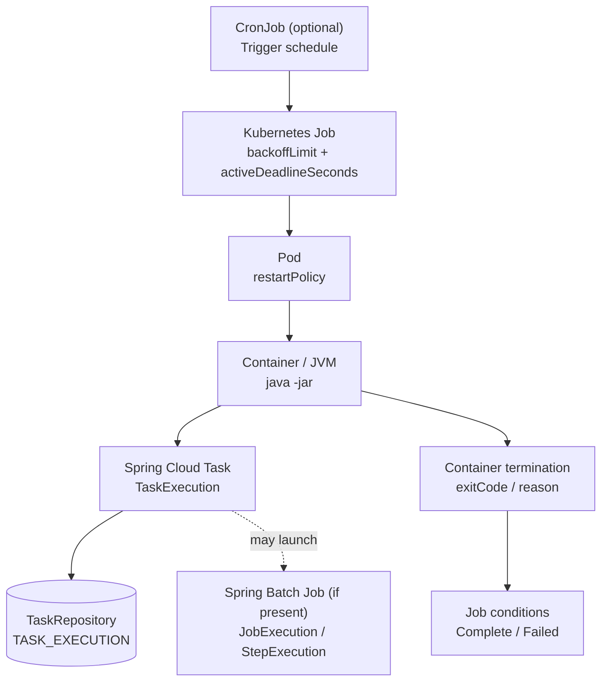
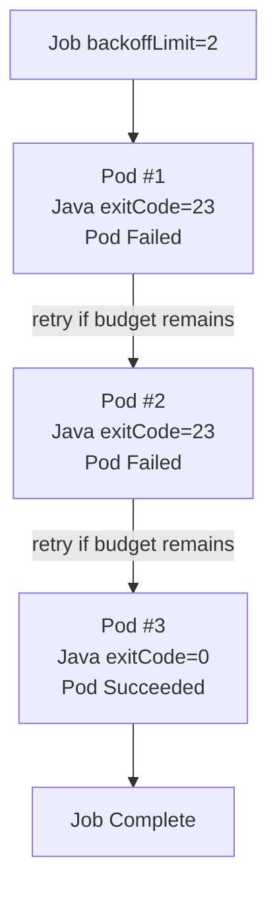
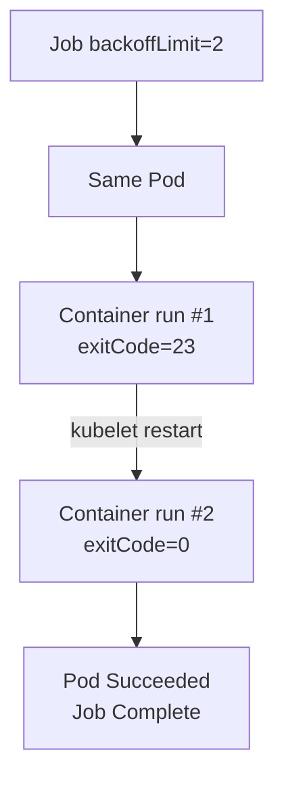
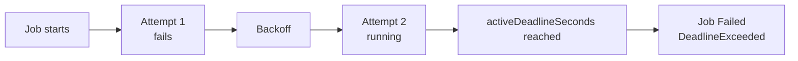

# restartPolicy, backoffLimit, and activeDeadlineSeconds

## Lesson objectives

In the **Deployment** chapter of the **Spring Cloud Task** module, this lesson explains three essential properties when running a finite Spring Boot application as a **Kubernetes Job** or **CronJob**: `restartPolicy`, `backoffLimit`, and `activeDeadlineSeconds`. They determine *how failures are retried*, *when retries stop*, and *when an entire run must terminate due to a deadline*.

After this lesson, you will be able to:

- Place each property at its exact **configuration level** in a Job/CronJob manifest.
- Compare `restartPolicy: Never` against `restartPolicy: OnFailure`; understand whether containers restart inside the same Pod or the controller spawns a new Pod.
- Explain `backoffLimit: 0`, retry counts, exponential backoff, and exit-code-based failure classification policies.
- Use `activeDeadlineSeconds` to bound the **overall duration of a Job**, including retries.
- Distinguish **Job** `activeDeadlineSeconds`, **Pod** `activeDeadlineSeconds`, and **CronJob** `startingDeadlineSeconds`.
- Write manifests, test success/failure runs, and read Pod/Job conditions and exit codes with `kubectl`.
- Reconcile `TaskExecution` rows in `TaskRepository` with Kubernetes status, identifying un-updated history when processes are killed.
- Design safe retries, idempotency, timeouts, monitoring, and metadata retention for scheduled or on-demand tasks.

## 1. A finite task can fail across multiple layers

Suppose `rental-reconcile` runs nightly to reconcile rental transactions for `2026-11-23`:

1. Kubernetes creates a **Job**, or a CronJob creates a Job.
2. The Job controller creates a **Pod**; the Pod runs a container executing `java -jar app.jar`.
3. Spring Boot starts; Spring Cloud Task begins recording metadata in `TaskRepository`.
4. `ApplicationRunner` or a Spring Batch Job runs business logic.
5. The Java process exits with an exit code; the container stops; Kubernetes updates Pod and Job states.



**There are at least four distinct outcome layers:**

| Layer | Status/values | Scope |
| --- | --- | --- |
| Spring Cloud Task | `TaskExecution.exitCode`, `endTime`, `errorMessage` | One JVM run tracked by the framework |
| Container | `state.terminated.exitCode`, `reason`, `restartCount` | One or more container runs |
| Pod | `Pending` / `Running` / `Succeeded` / `Failed` | One Pod managed by the Job |
| Kubernetes Job | `Complete` / `Failed`, succeeded/failed Pod counts | The **entire** workload across retry policies |

One failed container **does not mean the Job has permanently failed**: the Job may retry and succeed. Conversely, the JVM may be killed before Spring Cloud Task writes `endTime`, leaving the Job `Failed` while the repository still holds an unfinished `TaskExecution` entry.

## 2. Three properties located in three deliberate places

For a typical **Job**:

```yaml
apiVersion: batch/v1
kind: Job
metadata:
  name: rental-reconcile-demo
spec:
  backoffLimit: 2
  activeDeadlineSeconds: 600
  template:
    spec:
      restartPolicy: Never
      containers:
        - name: task
          image: registry.example.com/rental-reconcile:1.0.0
          args: ["--businessDate=2026-11-23"]
```

`registry.example.com/rental-reconcile:1.0.0` is an **illustrative image name**; build and push a real image reachable by your cluster before applying. The manifest above mainly teaches where these three parameters sit and how they relate.

| Property | API path | Typical values | What does it control? |
| --- | --- | --- | --- |
| `restartPolicy` | `Job.spec.template.spec.restartPolicy` | `Never` or `OnFailure` | Does kubelet restart the **container inside the Pod** when it fails? |
| `backoffLimit` | `Job.spec.backoffLimit` | `0`, `1`, `2`, default commonly `6` | When does the **Job controller** stop retrying after enough failures? |
| `activeDeadlineSeconds` | `Job.spec.activeDeadlineSeconds` | e.g., `600` (seconds) | Caps total active duration of the Job, including retries |

**Syntax rule:** `restartPolicy` must sit **inside the Pod template**; `backoffLimit` and `activeDeadlineSeconds` must sit under **the Job's `spec`**. Placing them at the wrong YAML level causes Kubernetes to reject the manifest or ignore your intended setting.

### 2.1. Do not confuse three meanings of "restart"

| Common term | Actual mechanism |
| --- | --- |
| **Container restart** | Kubelet restarts the container in the same Pod under `restartPolicy: OnFailure` |
| **Job retry** | Job controller continues retrying the workload, potentially via a new Pod subject to `backoffLimit` |
| **Batch restart** | Spring Batch reuses a `JobInstance` and `ExecutionContext` for another `JobExecution`, assuming metadata and identifying params remain intact |

These are **three independent mechanisms**. Setting `backoffLimit: 2` does not automatically make Spring Batch resume from a checkpoint. Similarly, Spring Batch saving checkpoints does not ensure Kubernetes keeps spawning Pods once the deadline expires.

## 3. `restartPolicy`: where does the container get rerun?

Kubernetes Jobs only support two values for `spec.template.spec.restartPolicy`:

- `Never`.
- `OnFailure`.

**`Always` is invalid for a Job's Pod template**, even though `Always` is standard for long-running workloads like Deployments.

### 3.1. `Never` — preserve failed Pods for inspection

When the Java container exits non-zero, the Pod normally enters `Failed`. If the Job still has retry budget under `backoffLimit` and has not hit its deadline, the **Job controller can create a new Pod** to retry.



Pods #1, #2, and #3 illustrate a **logical scenario**, not a promise that the system always creates exactly three Pods or hits fixed timings. In practice, evictions, Pod creation failures, quotas, Pod failure policies, and controller race conditions also come into play.

**Advantages of `Never`:**

- Each failed attempt typically gets its own **separate failed Pod** for inspecting logs and `terminated.exitCode`.
- Easier to correlate Kubernetes attempts with `TaskExecution` rows when each Pod runs one Java process.
- Helpful when debugging business errors and when using `podFailurePolicy` to classify exit codes.

**Limitation:** Old Pods can be removed by TTL, CronJob history limits, or operator cleanup. Maintain centralized logging and persistent metadata if long-term auditing is needed.

### 3.2. `OnFailure` — restart the container inside the same Pod

When the container exits with an error, **kubelet** can restart that container **inside the same Pod**:



Kubernetes may still spawn a new Pod if the **entire Pod** fails or its node is replaced; `OnFailure` does not promise every attempt stays inside one Pod.

**Advantages of `OnFailure`:** saves Pod-creation overhead on certain transient failures; suits safely repeatable apps where retaining every failed Pod is unnecessary.

**Risks with Spring Cloud Task:**

- Every **JVM restart** is a fresh application run that can insert a **new `TaskExecution`**, even though the Pod name stays identical.
- `restartCount` climbs while `kubectl get pods` shows a single Pod; counting Pods alone can **miss multiple business executions**.
- Logs from the prior container run require `kubectl logs --previous` (if still retained by the runtime); never assume current logs contain earlier failures.
- Once `backoffLimit` is hit, Kubernetes may terminate the Pod, making failed log retrieval harder.

### 3.3. Quick comparison

| Question | `Never` | `OnFailure` |
| --- | --- | --- |
| Can a failed container restart inside that Pod? | Does not restart failed containers in that Pod | Kubelet can restart the container in the same Pod |
| How does the Job retry? | Typically creates a replacement Pod | Restarts the container, or creates a Pod if the Pod fails |
| Tracking attempt count | Usually observe multiple failed Pods | Inspect `restartCount` inside one Pod |
| Investigating failure logs | Easier to tie to old Pods | Requires `--previous` or centralized logging |
| Supports `podFailurePolicy` | **Yes**, required by the API | **No**, the policy requires `Never` |
| Guarantees exactly-once | **No** | **No** |

For database-mutating reconciliation tasks needing per-attempt audits, **`Never` is usually easier to govern**. Nevertheless, both require idempotent design.

## 4. `backoffLimit`: how many failures before the Job stops?

`Job.spec.backoffLimit` is the Job's retry budget. Kubernetes defaults to `backoffLimit=6` for standard Jobs, except Indexed Jobs configured with `backoffLimitPerIndex` (where the global default differs).

| Setting | Practical meaning |
| --- | --- |
| `backoffLimit: 0` | No intentional retries once a failure counts against the budget |
| `backoffLimit: 1` | Very small retry budget; verify actual Pod/launch counts |
| `backoffLimit: 2` | Allows a few transient failures before marking the Job failed |
| Omitted | Commonly defaults to `6`, without guaranteeing six extra attempts will always execute |

**Do not treat `backoffLimit` as an exact counter of Java runs.** Per Kubernetes docs, the Job controller counts failures based on:

1. Pods belonging to the Job with `status.phase = Failed`.
2. When `restartPolicy=OnFailure`, total container restarts in Pods whose phase is `Pending` or `Running`.

Once the threshold is reached per controller rules, the Job is marked failed; active Pods may be terminated. If you need an **exact count of business executions started**, rely on `TaskExecutionId`, logs, and data audits rather than inferring from `backoffLimit`.

### 4.1. Exponential backoff

Kubernetes applies **exponential backoff** when recreating Pods or restarting containers after failures. Current Job documentation cites an initial sequence around `10s, 20s, 40s...` up to an upper cap; exact caps vary across Kubernetes releases.

```text
Task fails first time
    ↓ wait backoff
Retry → if still failing
    ↓ wait longer
Retry → backoffLimit budget exhausted
    ↓
Job Failed (reason may be BackoffLimitExceeded)
```

These intervals are **Kubernetes backoff**, separate from retries coded inside your HTTP client, database driver, or Spring Batch. If **each Java run retries 10 times internally** while Kubernetes also retries multiple times, outbound request volume to external systems can multiply sharply.

### 4.2. Does `backoffLimit: 0` mean "at most once"?

**No.** `backoffLimit: 0` only suppresses the controller's standard retry path. Kubernetes documentation warns that even for a Job with `parallelism=1`, `completions=1`, and `restartPolicy=Never`, the same program can still **be started multiple times** during certain orchestration disruptions.

Accordingly, transaction-processing systems need:

- Clear **business keys**, such as `(partnerId, businessDate)`.
- Unique constraints or idempotent upserts in the target database.
- Concurrency controls/business locks if two distinct Jobs might target the same date.
- Verifiable outputs whenever a run ends ambiguously.

### 4.3. Retry transient errors, fail immediately on permanent ones

Example **application-defined** exit code contract:

| Exit code from Java | Scenario | Is retrying helpful? |
| --- | --- | --- |
| `0` | Reconciliation succeeded | Not needed |
| `12` | Bad `businessDate` or permanently missing required file | Usually no; fix inputs |
| `23` | HTTP 503/timeout from partner | Possibly, with backoff and limits |
| `1` | Generic unclassified failure | Inspect logs before deciding |
| `137` or `OOMKilled` | Container killed, often memory-related | Diagnose resources; identical retries often repeat the crash |

`12` and `23` are **illustrative codes**, not standards mandated by Kubernetes or Spring Cloud Task.

Using the same `backoffLimit=3` for every failure lets Jobs retry misconfigurations, wasting resources and generating alert noise. When classifying failures by exit code is needed, see `podFailurePolicy` in Section 10.

## 5. `activeDeadlineSeconds`: capping total Job duration

`Job.spec.activeDeadlineSeconds` sets the **maximum seconds** the Job may stay active across the Job's lifecycle, including retries—**not** merely the duration of `ApplicationRunner` inside a single JVM.

Example:

```yaml
spec:
  backoffLimit: 5
  activeDeadlineSeconds: 180
```

If the Job runs for roughly `180` seconds without completing, the Job controller terminates active Pods and transitions the Job to **`Failed`**, typically with `reason: DeadlineExceeded`.



### 5.1. Deadline **takes precedence over** the retry budget

Per official Kubernetes documentation:

> A Job's `activeDeadlineSeconds` **takes precedence over** `backoffLimit`.

This means the Job **stops retrying** once the deadline hits even if retry budget remains. Do not set `backoffLimit: 100` to "guarantee plenty of retries" if `activeDeadlineSeconds` only allows a tiny window.

### 5.2. Does the deadline reset each time a Pod is created?

**No.** It spans the **Job's** duration, not "each Pod gets another `180` seconds". A replacement Pod only receives **whatever time remains** in the Job's deadline.

Conceptual timeline:

| Elapsed time since Job start | Event |
| --- | --- |
| `0s` | Job starts |
| `60s` | First Java run fails |
| `90s` | Retry attempt starts |
| `180s` | Job hits deadline, even though the second Pod only ran ~`90s` |

Do not use that table as an exact timing prediction, because scheduling, image pulls, controller reconciliation delays, and shutdowns shift timings. Note that in Kubernetes, when a Job is **suspended and resumed**, the start timestamp used for the active deadline may reset per documented behavior; verify if your workflows use `spec.suspend`.

### 5.3. A deadline is not a rollback guarantee

Upon deadline expiration, Kubernetes requests Pod termination—potentially allowing a graceful shutdown window followed by forced kill. Java might not finish writing `TaskExecution.endTime`, a Batch Step might still read `STARTED`, or business data may be partially committed.

**Never treat `DeadlineExceeded` as "no data was written".** Reconcile business results, databases, logs, and metadata. If a CronJob retries or an operator reruns manually, the task must be idempotent.

### 5.4. Watch out for three "deadline" fields

| Field | Path | Meaning |
| --- | --- | --- |
| **Job active deadline** | `Job.spec.activeDeadlineSeconds` | Total time a Job may remain active before failing |
| **Pod active deadline** | `Job.spec.template.spec.activeDeadlineSeconds` | Caps a single **Pod's** lifetime; does not replace the Job-level cap |
| **CronJob start deadline** | `CronJob.spec.startingDeadlineSeconds` | Maximum delay allowed when **creating a Job relative to its schedule** |

Putting `activeDeadlineSeconds` **inside the Pod template** creates a Pod limit distinct from the Job limit covered here. Putting `startingDeadlineSeconds` into `Job.spec` likewise creates no runtime duration limit for the Job.

## 6. Complete example: one-off Job running Spring Cloud Task

Assume the app is packaged as `registry.example.com/rental-reconcile:1.0.0`, uses `@EnableTask`, accepts `--businessDate`, finishes work, and exits with an appropriate code.

Manifest `reconcile-job.yaml`:

```yaml
apiVersion: batch/v1
kind: Job
metadata:
  name: rental-reconcile-20261123
  labels:
    app: rental-reconcile
spec:
  completions: 1
  parallelism: 1
  backoffLimit: 2
  activeDeadlineSeconds: 900
  ttlSecondsAfterFinished: 86400
  template:
    metadata:
      labels:
        app: rental-reconcile
    spec:
      restartPolicy: Never
      terminationGracePeriodSeconds: 30
      containers:
        - name: task
          image: registry.example.com/rental-reconcile:1.0.0
          imagePullPolicy: IfNotPresent
          args:
            - "--businessDate=2026-11-23"
          resources:
            requests:
              cpu: "250m"
              memory: "256Mi"
            limits:
              cpu: "1"
              memory: "512Mi"
          env:
            - name: SPRING_DATASOURCE_URL
              value: "jdbc:postgresql://postgres.example.svc:5432/taskdb"
            - name: SPRING_DATASOURCE_USERNAME
              valueFrom:
                secretKeyRef:
                  name: task-db-credentials
                  key: username
            - name: SPRING_DATASOURCE_PASSWORD
              valueFrom:
                secretKeyRef:
                  name: task-db-credentials
                  key: password
```

Hostnames, Secrets, image names, and resource values are **examples**, not pre-provisioned resources. Create the database/schema and Secret in the right namespace, package the PostgreSQL driver inside the image, and ensure network policies allow access.

Explaining the choices:

1. `completions: 1` and `parallelism: 1`: aims for one completed outcome without intentionally spinning up parallel Pods.
2. `restartPolicy: Never`: preserves each failed Pod separately for debugging while the Job controller manages retries.
3. `backoffLimit: 2`: bounded retry budget rather than unbounded retries.
4. `activeDeadlineSeconds: 900`: maximum total Job duration of **15 minutes**, covering attempts and backoff.
5. `ttlSecondsAfterFinished: 86400`: completed or failed Jobs may be deleted by the TTL controller after **24 hours**; export logs/metadata separately before cleanup.
6. `terminationGracePeriodSeconds: 30`: gives the container time for graceful shutdown on stop signals, though running every final callback is **not guaranteed**.
7. `env.valueFrom.secretKeyRef`: injects DB credentials from a Kubernetes Secret; **never** pass passwords in `args` because Spring Cloud Task can persist task arguments into metadata.

To keep Java as the main process, the Dockerfile should use **exec form**:

```dockerfile
FROM eclipse-temurin:21-jre
WORKDIR /app
COPY target/rental-reconcile-0.0.1-SNAPSHOT.jar /app/app.jar
ENTRYPOINT ["java", "-jar", "/app/app.jar"]
```

This example uses Java 21; match the Java version used during build and Spring Boot/Spring Cloud libraries. Using a shell entrypoint like `sh -c "java ...; echo done"` lets the shell's exit code mask Java failures.

## 7. Comparison example: same Job with `OnFailure`

Change **only** the Pod restart policy while keeping the rest:

```yaml
spec:
  backoffLimit: 2
  activeDeadlineSeconds: 900
  template:
    spec:
      restartPolicy: OnFailure
      containers:
        - name: task
          image: registry.example.com/rental-reconcile:1.0.0
```

This is a **configuration snippet**, not a complete Job YAML. With `OnFailure`, one Pod can execute multiple Java runs. When inspecting, check:

- `kubectl get pod ... -o jsonpath='{.status.containerStatuses[0].restartCount}'`.
- `kubectl logs POD_NAME -c task --previous` to read logs from the previous container run, if retained.
- `kubectl describe pod POD_NAME` for container status and restart reasons.
- `TaskRepository`: multiple `TASK_EXECUTION_ID`s may exist even though only **one Pod** is visible.

**Practical recommendation:** when initially debugging a database-writing Spring Cloud Task or Batch Job, start with `Never`; once idempotency and centralized logging are verified, evaluate `OnFailure` based on operational needs.

## 8. CronJob: placing the three parameters in `jobTemplate`

A CronJob decides **when to create a Job**. The created Jobs themselves enforce `restartPolicy`, `backoffLimit`, and `activeDeadlineSeconds`.

Example running at 02:00 Vietnam time:

```yaml
apiVersion: batch/v1
kind: CronJob
metadata:
  name: rental-reconcile-nightly
spec:
  schedule: "0 2 * * *"
  timeZone: "Asia/Ho_Chi_Minh"
  concurrencyPolicy: Forbid
  startingDeadlineSeconds: 600
  successfulJobsHistoryLimit: 3
  failedJobsHistoryLimit: 3
  jobTemplate:
    spec:
      backoffLimit: 2
      activeDeadlineSeconds: 900
      template:
        spec:
          restartPolicy: Never
          containers:
            - name: task
              image: registry.example.com/rental-reconcile:1.0.0
              args: ["--businessDate=2026-11-23"]
```

**This example freezes a date only to illustrate syntax.** Never keep `--businessDate=2026-11-23` in a recurring CronJob: derive the business date from schedule/snapshot rules per timezone and closing policy, or inject it via an appropriate launcher mechanism. Otherwise, the CronJob will reprocess the exact same day forever.

### 8.1. Three CronJob properties often confused with retries

| Property | Meaning |
| --- | --- |
| `schedule: "0 2 * * *"` | Schedule for **creating Jobs** at 02:00 daily |
| `concurrencyPolicy: Forbid` | Avoids creating a new scheduled Job while a prior Job from **the same CronJob** is still running |
| `startingDeadlineSeconds: 600` | If delayed, a Job may still be created only within a **10-minute** late window per CronJob policy |

`startingDeadlineSeconds` is **not** the maximum runtime of the task. Once the Job is created, `activeDeadlineSeconds: 900` governs Job duration.

`concurrencyPolicy: Forbid` does not lock the whole cluster: a manual Job, another CronJob, or controller glitches can still trigger duplicate processing. **Business-data idempotency remains mandatory.**

### 8.2. Choosing `Allow`, `Forbid`, or `Replace`

| CronJob concurrency policy | Behavior | When to consider |
| --- | --- | --- |
| `Allow` (default) | Allows scheduled runs to overlap | Runs are independent and touch disjoint data |
| `Forbid` | Skips a new trigger if the previous Job from the same CronJob is still running | Daily reconciliations that must not overlap |
| `Replace` | Replaces the running Job with the newly scheduled Job | Only when safe mid-flight stop and recovery exist |

Never use `Replace` on jobs with irreversible side effects unless mid-commit termination has been tested. With `Forbid`, an overly slow run can skip the next scheduled trigger; add alerting and backfill handling for missed dates.

## 9. Hands-on: observing Kubernetes Jobs with `kubectl`

**Prerequisites:** image, namespace, Secret, DB, and cluster are ready. Never run deliberate failure experiments on production. The following commands are **instructions for practicing on a test cluster**.

### 9.1. Validating YAML before creating

```bash
kubectl apply --dry-run=server -f reconcile-job.yaml
kubectl apply -f reconcile-job.yaml
```

A successful `kubectl apply` only confirms **the API accepted the manifest**, not that the Job executed successfully.

### 9.2. Listing the Job and its Pods

```bash
kubectl get job rental-reconcile-20261123
kubectl describe job rental-reconcile-20261123
kubectl get pods -l batch.kubernetes.io/job-name=rental-reconcile-20261123
```

The `batch.kubernetes.io/job-name` label is applied to Pods by the Job controller in modern versions; on older clusters, inspect actual `job-name` labels on the Pods.

Reading logs from a Pod:

```bash
kubectl logs pod/POD_NAME -c task
```

Replace `POD_NAME` with the real name from `kubectl get pods`. With `restartPolicy: Never` and retries, **multiple Pods may exist**: read logs from earlier failed Pods too, not solely the latest one.

### 9.3. Reading container exit codes and restart counts

For a Pod with **one main container**:

```bash
kubectl get pod POD_NAME \
  -o jsonpath='{.status.containerStatuses[0].state.terminated.exitCode}'

kubectl get pod POD_NAME \
  -o jsonpath='{.status.containerStatuses[0].state.terminated.reason}'

kubectl get pod POD_NAME \
  -o jsonpath='{.status.containerStatuses[0].restartCount}'
```

If the container is **not terminated yet** (still Running or Waiting), `state.terminated.exitCode` will be empty—which is not `0`. Under `OnFailure`, the current container might be running while the prior run sits in `lastState.terminated`:

```bash
kubectl get pod POD_NAME \
  -o jsonpath='{.status.containerStatuses[0].lastState.terminated.exitCode}'

kubectl logs POD_NAME -c task --previous
```

When a Pod has sidecars or multiple containers, **do not assume `containerStatuses[0]` is your Java Task**; match the container name `task`. In PowerShell, enter commands on a single line or use PowerShell's line-continuation syntax; trailing `\` is Bash syntax.

### 9.4. Reading final Job status

```bash
kubectl get job rental-reconcile-20261123 -o yaml
kubectl describe job rental-reconcile-20261123
```

Under `status.conditions`, inspect:

- `type: Complete`, `status: "True"`: Job satisfied completion conditions.
- `type: Failed`, `status: "True"`: Job failed.
- `reason: BackoffLimitExceeded` (or similar): hit the retry budget limit.
- `reason: DeadlineExceeded`: hit `activeDeadlineSeconds`.

Kubernetes may not record the final condition until associated Pods actually terminate. **Seeing a single Pod `Failed` does not equal a `Failed` Job condition.**

To simply wait for Job completion:

```bash
kubectl wait --for=condition=complete job/rental-reconcile-20261123 --timeout=20m
```

**Warning:** this command does not automatically surface why a Job failed right away; it can hang until timeout even after the Job is already `Failed`. For CI pipelines to react properly, **watch both `Complete` and `Failed` conditions**, extract reason/message, and bound wait times.

### 9.5. Reconciling with Spring Cloud Task

If the app uses a persistent Task database, query:

```sql
SELECT
    TASK_EXECUTION_ID,
    TASK_NAME,
    START_TIME,
    END_TIME,
    EXIT_CODE,
    EXIT_MESSAGE,
    ERROR_MESSAGE
FROM TASK_EXECUTION
WHERE TASK_NAME = 'rental-reconcile'
ORDER BY TASK_EXECUTION_ID DESC;
```

`TASK_NAME` in the SQL is illustrative; the actual name comes from `spring.application.name` or `spring.cloud.task.name`. Across retries, match each `TaskExecutionId` and timestamp against its Pod/container:

| Kubernetes | Spring Cloud Task | Interpretation |
| --- | --- | --- |
| Container `exitCode=0`, Job `Complete` | `EXIT_CODE=0`, `END_TIME` populated | Normal completion path; still verify business data |
| One Pod `Failed`, Job ultimately `Complete` | At least one Task attempt may show failure, later attempt succeeded | Retry recovered from the error; inspect **every attempt** |
| Job `Failed` on deadline | `END_TIME` may be `NULL` | JVM killed before repository update |
| `OnFailure`, single Pod `restartCount=2` | Multiple `TaskExecution` rows possible | Each JVM restart can create a distinct Task run |
| Pod never started Java (`ImagePullBackOff`) | No new `TaskExecution` | Infrastructure failure before Spring Cloud Task started |

**Never manually update `TASK_EXECUTION.EXIT_CODE` to `0` just to make history look clean.** For stuck rows, follow an audit procedure combining Job/Pod status, logs, IDs, and output data.

## 10. Advanced option: `podFailurePolicy` to classify exit codes

When `backoffLimit` alone cannot distinguish unretryable errors from transient ones, Kubernetes offers `Job.spec.podFailurePolicy`. It is stable from Kubernetes 1.31 onward and **requires `restartPolicy: Never`**.

Example: the Job must **stop immediately** if the app exits with `12` (invalid input), while still applying backoff to other error codes:

```yaml
apiVersion: batch/v1
kind: Job
metadata:
  name: rental-reconcile-policy
spec:
  backoffLimit: 3
  activeDeadlineSeconds: 900
  podFailurePolicy:
    rules:
      - action: FailJob
        onExitCodes:
          containerName: task
          operator: In
          values: [12]
  template:
    spec:
      restartPolicy: Never
      containers:
        - name: task
          image: registry.example.com/rental-reconcile:1.0.0
          args: ["--businessDate=2026-11-23"]
```

Rules:

- If container `task` exits with `12`, the controller marks the Job failed **without waiting to exhaust `backoffLimit`**.
- Unmatched failures follow default failure counting and continue retrying within budget.
- `podFailurePolicy.rules` are evaluated **in order**; the first matching rule decides the action.
- Supported actions include `FailJob`, `Ignore`, `Count`, and `FailIndex` for Indexed Jobs.

In practice, you can also ignore certain infrastructure-disruption Pod failures using `Ignore` on `DisruptionTarget`. **Do not overuse `Ignore`**: repeatedly ignored failures may leave the Job relying heavily on `activeDeadlineSeconds` to stop.

### 10.1. `backoffLimitPerIndex` is not the same as `backoffLimit`

For Indexed Jobs processing partitions/indices, Kubernetes supports `backoffLimitPerIndex` to bound failures **per index** (stable since Kubernetes 1.33). When `backoffLimitPerIndex` is set, the global `backoffLimit` default can become very large (`MaxInt32`) unless explicitly specified.

This lesson focuses on **non-indexed Jobs with `completions: 1`**. When moving to Indexed Jobs, redesign partition boundaries, per-index idempotency, `maxFailedIndexes`, and failure policies rather than reusing single-process Job retry tables verbatim.

## 11. Application timeouts differ from Kubernetes timeouts

The three Kubernetes properties do not replace business-logic timeouts:

| Level | Example | When needed? |
| --- | --- | --- |
| HTTP client | 5s connect, 30s read | Prevents partner calls from hanging forever |
| Database / transaction | Query timeout, statement timeout | Prevents queries from holding locks indefinitely |
| Spring Batch Step | Application-level duration cap | Overdue data steps fail explicitly |
| **Kubernetes Job** | `activeDeadlineSeconds: 900` | Total run/retry time stays under 15 minutes per policy |
| Kubernetes Pod shutdown | `terminationGracePeriodSeconds: 30` | Window to release resources on stop signals |
| CronJob | `startingDeadlineSeconds: 600` | Avoids launching too late relative to schedule |

**Design recommendation:** internal timeouts should be **shorter than** the active deadline so Java has room to raise errors, close the Spring Context, and update `TaskRepository`. Even then, always prepare for node loss, OOMs, or `SIGKILL` where final callbacks never run.

### 11.1. Exit codes and metadata persistence

In Spring Boot, `ExitCodeGenerator`/`ExitCodeExceptionMapper` can classify application errors. An uncaught exception in the runner signals failure to the framework.

If the app catches every exception, prints `"ERROR"`, and returns normally, Java can exit `0`; the Job controller treats it as success and skips retries regardless of corrupt business tables.

With Spring Batch, a `FAILED` `JobExecution` sometimes **does not produce a non-zero exit code automatically** unless mapping is configured. With compatible Spring Cloud Task/Batch integrations, verify `spring.cloud.task.batch.fail-on-job-failure=true` and **measure the actual Java exit code** rather than trusting `BatchStatus` alone.

### 11.2. Why can a Job deadline leave a Task "stuck running"?

Spring Cloud Task's `TaskLifecycleListener` writes `endTime` during normal shutdown paths. If the container is killed before trailing code runs, you can observe:

```text
Kubernetes:
  Job condition = Failed
  reason = DeadlineExceeded
  Pod/container = Terminated

Spring Cloud Task:
  START_TIME = 02:00
  END_TIME = NULL
  EXIT_CODE = NULL or value not reflecting final failure
```

This is an **explainable discrepancy**, not proof that the Job is still running. Cross-check container state and database records before deciding whether to rerun or annotate metadata per audit policy.

## 12. Common troubleshooting matrix

| Symptom | Possible cause | Check / Resolution |
| --- | --- | --- |
| Job YAML rejected with `restartPolicy: Always` | Jobs do not allow `Always` | Use only `Never` or `OnFailure` |
| `restartPolicy` has no expected effect | Wrong YAML indentation level or checking **Job** instead of Pod | Check `spec.template.spec.restartPolicy` |
| Java keeps failing despite backoff | Permanent input error, wrong DB, or incompatible image | Inspect logs/exit codes; fail fast or use `podFailurePolicy` |
| Same Pod runs Task multiple times | `restartPolicy: OnFailure` | Inspect `restartCount`, `--previous`, and multiple `TaskExecution`s |
| Multiple `Failed` Pods for one Job | `Never` with Job controller retries | Inspect all Pods, timestamps, and exit codes |
| Job `Failed` before exhausting retries | Hit `activeDeadlineSeconds` or `podFailurePolicy` | Check Job `reason` and deadline |
| Task killed before deadline | OOM, eviction, external signal, or Pod-level deadline | Check Pod reason, events, and resource limits |
| Job hit `DeadlineExceeded`, `TaskExecution` lacks `endTime` | JVM couldn't update repository in time | Compare Job/Pod logs with Task metadata |
| `kubectl apply` succeeds yet Job fails | API accepted manifest, business run failed | Inspect Job conditions, Pod exit codes, and logs |
| `kubectl wait --for=condition=complete` times out | Job `Failed` or running slow | Watch both `Complete` and `Failed`; don't assume timeout is root cause |
| Job `Complete` yet business output incomplete | Code swallowed exceptions or skipped validation | Check row counts, checksums, DB output, and exit mapping |
| CronJob skips the next scheduled run | `concurrencyPolicy: Forbid`, prior Job still active | Alert on missed schedules; check duration/deadlines |
| CronJob misses schedule timing | Wrong timezone, too-small `startingDeadlineSeconds`, controller lag | Inspect CronJob events, `schedule`, and `timeZone` |
| Retries create duplicate results | Missing idempotency, two Jobs overlapping on same data | Enforce unique keys, upserts, business locks, concurrency limits |
| Pods/logs gone after a few days | TTL/cleanup deleted Jobs and Pods | Ship centralized logs and retain metadata separately |
| `OnFailure` rejects `podFailurePolicy` | API requires `Never` | Switch to `restartPolicy: Never` for exit-code policies |

## 13. Controlled testing strategy

To verify the three fields behave as expected, practice **in a dev namespace** using a test image able to return controllable exit codes.

### 13.1. Success case

- `restartPolicy: Never`, `backoffLimit: 0`, `activeDeadlineSeconds: 120`.
- App finishes in a few seconds and returns `0`.
- Observe `Pod Succeeded`, `Job Complete`, and `TaskExecution.exitCode=0`.

### 13.2. Permanent error without retry

- `restartPolicy: Never`, `backoffLimit: 0`.
- App validates arguments and exits `12`.
- Observe `Pod Failed`, final Job `Failed`, and expect no retries per configuration.
- Diagnose root cause before an operator fixes inputs and launches a **new Job**.

### 13.3. Transient error with retries

- `restartPolicy: Never`, `backoffLimit: 2`, generous deadline.
- App simulates HTTP 503 on attempt 1, then succeeds on the next attempt using **external state outside the process**.
- Count Pods, inspect logs and `TaskExecution` rows; verify target DB has no duplicate rows.
- Never use an in-JVM `static` counter to "fail once": a new Pod spawns a fresh JVM, resetting static fields.

### 13.4. `OnFailure` and same-Pod restarts

- `restartPolicy: OnFailure`, `backoffLimit: 2`.
- Have Java exit non-zero first, then succeed on a subsequent attempt.
- Check `restartCount` and `lastState.terminated.exitCode`. Compare `TaskExecution` count against Pod count.

### 13.5. Deadline beats backoff

- `restartPolicy: Never`, `backoffLimit: 10`, `activeDeadlineSeconds: 30`.
- Have the app sleep longer than `30` seconds or fail repeatedly.
- Observe `Job Failed` with `reason: DeadlineExceeded` even though retry budget remains.
- Inspect Pod termination, logs, `END_TIME` in `TaskRepository`, and committed business side effects.

**Do not expect every run to create an exact fixed number of Pods.** Outcomes can vary due to admission policies, node health, scheduling, image pulls, Kubernetes versions, and pre-container failures.

## 14. Operational readiness checklist

1. **Correct YAML levels:** `restartPolicy` inside Pod template; `backoffLimit` and `activeDeadlineSeconds` in Job spec; inside `jobTemplate.spec` for CronJobs.
2. **Exit codes reflect business outcomes:** `0` only on success; separate non-retryable from transient errors; keep Java as main container process.
3. **Bounded retries:** set `backoffLimit` per failure type and SLA; use `podFailurePolicy` with `Never` if differentiating codes.
4. **Realistic deadlines:** measure startup and processing times; set `activeDeadlineSeconds` wide enough for valid retries without letting hung Jobs linger.
5. **Concurrency limits:** align CronJob `concurrencyPolicy`, `parallelism`, business locks, and idempotency.
6. **Persistent metadata store:** `TaskRepository`/Batch `JobRepository` use a migrated DB; never rely on H2 inside ephemeral Pod filesystems.
7. **Multi-layer observability:** monitor Job conditions, Pod/container exit codes, logs, `TaskExecution`, and business results; alert on stale `endTime IS NULL`.
8. **Resources and shutdown:** size CPU/memory requests/limits, `terminationGracePeriodSeconds`, and internal timeouts; never rely unconditionally on shutdown hooks.
9. **Secrets:** use Kubernetes Secrets/service accounts; never put tokens/passwords in `args`, command lines, `JobParameters`, or logs.
10. **Retention:** `ttlSecondsAfterFinished`/CronJob history limits clean up Kubernetes objects; persist logs and audits externally prior to cleanup.
11. **Failure drills:** verify `0`, input errors, transient failures, OOMs, and deadlines in isolation before enabling production schedules.

## 15. Self-assessment questions

**1. Does `restartPolicy: OnFailure` automatically restart a Job that already reached `Failed`?**

> No. `restartPolicy` governs restarting **containers inside a Pod**. Once a Job enters `Failed` from backoff or deadline limits, Kubernetes will not reset and rerun that same Job; a new manual run or schedule trigger is required.

**2. With `restartPolicy: Never`, if the first Java run exits `23` and `backoffLimit: 2`, what can happen?**

> The Job controller can spawn a new Pod to retry while retry budget and deadline remain. Do not declare the Job permanently `Failed` solely because the first Pod failed.

**3. Does `activeDeadlineSeconds: 300` grant `300` fresh seconds to each new Pod?**

> No. It caps total active Job runtime, encompassing all retry attempts.

**4. What happens if a Job still has retry budget left when the deadline expires?**

> The deadline wins; the Job is terminated and typically marked `Failed` with `reason: DeadlineExceeded`.

**5. A Pod shows `restartCount=3` under a single Pod name. Why do multiple `TaskExecutionId`s appear?**

> Under `OnFailure`, a single Pod can restart Java multiple times; each JVM startup initiates a new Spring Cloud Task execution.

**6. Does `backoffLimit: 0` guarantee business data is processed at most once?**

> No. Controller edge cases can still trigger duplicate launches, and another Job may process the same business key. Enforce idempotency at the application and database layers.

**7. In a CronJob, how do `startingDeadlineSeconds` and `activeDeadlineSeconds` differ?**

> `startingDeadlineSeconds` bounds how late a Job may still be **created from its schedule**; `activeDeadlineSeconds` bounds **how long the Job may stay active once started**.

**8. Why can `TaskExecution.endTime` stay `NULL` even after a Job is `Failed`?**

> Java may be killed by a deadline, OOM, or node failure before Spring Cloud Task updates final metadata. Always check Job/Pod status, logs, and database state together.

**9. Can `podFailurePolicy` be combined with `restartPolicy: OnFailure`?**

> No. Kubernetes requires `restartPolicy: Never` when configuring `podFailurePolicy`.

## Key takeaways

- **`restartPolicy` belongs to the Pod**: `Never` leaves failed Pods intact and lets the Job spawn new Pods; `OnFailure` lets kubelet restart the container inside the Pod where appropriate.
- **`backoffLimit` belongs to the Job**: caps failure retry budget; it is neither an exact `TaskExecution` counter nor an exactly-once guarantee.
- **`activeDeadlineSeconds` belongs to the Job**: bounds duration for the **entire Job**, including retries, and **takes precedence over** `backoffLimit`.
- **CronJobs have a separate `startingDeadlineSeconds`**—do not confuse it with Job execution runtime.
- **Job `Failed` differs from Pod `Failed`; Pod `Failed` differs from `TaskExecution.exitCode`; Java can be killed before updating `TaskRepository`**.
- Safe Spring Cloud Task operations demand **accurate exit codes, idempotency, deadlines, centralized logging, persistent schemas/metadata, and multi-layer observability**.

## References

1. [Kubernetes — Jobs: failure/retry, backoffLimit, activeDeadlineSeconds, and podFailurePolicy](https://kubernetes.io/docs/concepts/workloads/controllers/job/)
2. [Kubernetes — CronJob: jobTemplate, concurrencyPolicy, and startingDeadlineSeconds](https://kubernetes.io/docs/concepts/workloads/controllers/cron-jobs/)
3. [Kubernetes — Pod Lifecycle: restartPolicy, container termination, and exit codes](https://kubernetes.io/docs/concepts/workloads/pods/pod-lifecycle/)
4. [Kubernetes — Clean Up Finished Jobs Automatically: TTL](https://kubernetes.io/docs/concepts/workloads/controllers/ttlafterfinished/)
5. [Kubernetes API Reference — Job v1](https://kubernetes.io/docs/reference/kubernetes-api/workload-resources/job-v1/)
6. [Kubernetes API Reference — CronJob v1](https://kubernetes.io/docs/reference/kubernetes-api/batch/cron-job-v1/)
7. [Spring Cloud Task — Features: TaskExecution, TaskRepository, and metadata](https://docs.spring.io/spring-cloud-task/reference/features.html)
8. [Spring Cloud Task — Batch: Job failure and exit codes](https://docs.spring.io/spring-cloud-task/reference/batch.html)
9. [Spring Boot — Application Exit and ExitCodeGenerator](https://docs.spring.io/spring-boot/reference/features/spring-application.html)
