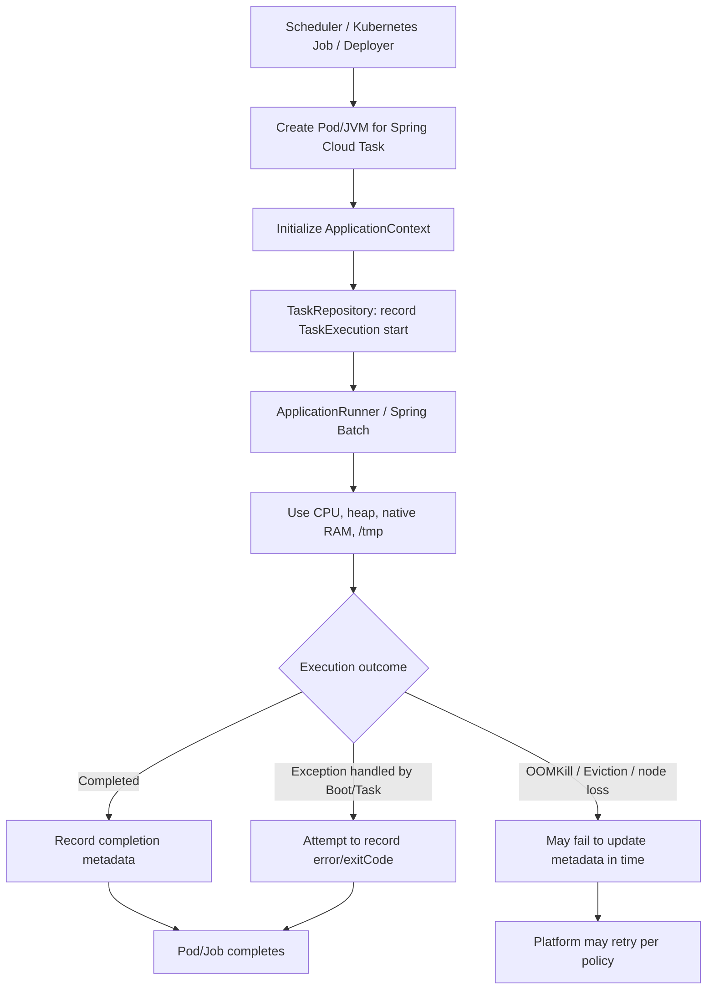

# CPU, Memory, and Ephemeral Storage When Deploying Spring Cloud Task

## 1. Why do resource limits matter for a finite-running application?

A **Spring Cloud Task** application usually starts up to perform one job—ingesting data, generating reports, reconciling transactions, or running a Spring Batch job—and then exits. It is easy to assume a "short-lived" task does not require tight resource management like a long-lived web service. In reality, a single Task run can read millions of rows, produce huge intermediate files, or open many database connections.

For example, a `daily-settlement` app fetches transaction data, decompresses a 1.5 GiB CSV file, computes totals, and uploads the report to object storage. With uncalibrated defaults:

- The JVM can hold too many records in heap and hit `OutOfMemoryError` or get `OOMKilled` by the container runtime.
- Extracted files can fill `/tmp`, the container's writable layer, or ephemeral disk space on the node.
- Too little CPU causes the job to miss the Kubernetes Job deadline; too low a CPU limit triggers *throttling* even when the host still has spare compute capacity.
- A failed run can be automatically relaunched by the scheduler and create duplicate data if idempotency is missing.

This lesson in the **Deployment** chapter of the `SPRING_CLOUD_TASK` module focuses on **CPU, memory, and ephemeral storage** when deploying finite Task applications. We use Kubernetes Jobs/CronJobs to illustrate resource requests/limits clearly, while noting the same reasoning applies to VMs and other cloud platforms.

After this lesson, you will be able to:

1. Distinguish `requests` and `limits` for CPU, RAM, and `ephemeral-storage`.
2. Choose JVM heap limits that leave headroom for *off-heap* memory.
3. Understand how temporary files, logs, writable layers, disk `emptyDir`, and `emptyDir.medium: Memory` consume resources.
4. Write an illustrative Kubernetes Job for a non-web Spring Cloud Task.
5. Use bounded streaming reads/writes instead of loading huge files into RAM.
6. Investigate `OOMKilled`, CPU throttling, ephemeral disk exhaustion, and `Evicted` Pods.
7. Cap concurrent Tasks, timeouts, and retries, and ensure safe reruns.

## 2. How does the Task lifecycle relate to resources?

Spring Cloud Task stores **`TaskExecution`** records in **`TaskRepository`** to track each application launch. The Task infrastructure creates metadata once `ApplicationContext` initializes cleanly and updates the outcome when synchronous runners finish or the application hits an error path.



This creates a crucial requirement: **resources affect not only speed, but also the completeness of execution history**.

When the kernel kills a container for running out of memory, the JVM gets no chance to run shutdown callbacks to write `endTime`. When a Pod is evicted due to disk pressure, metadata may likewise lack final results. Therefore, you must inspect **both `TaskRepository` and Kubernetes Job/Pod status**.

## 3. Three primary resource types

In Kubernetes, a Task running inside a container can declare `resources.requests` and `resources.limits`.

| Resource | Example units | What are `requests` for? | How do `limits` take effect? |
| --- | --- | --- | --- |
| **CPU** | `250m`, `1` | Helps the scheduler place the Pod on a node; governs CPU shares under contention | Kernel generally applies CPU throttling when usage exceeds the limit |
| **Memory** | `512Mi`, `1Gi` | Scheduling baseline and certain resource allocation checks | Kernel/cgroup can OOM-kill the process when exceeding the limit |
| **Ephemeral storage** | `1Gi`, `2Gi` | Scheduler checks local temporary storage availability for the Pod | Kubelet can evict the Pod if usage exceeds the limit under supported accounting |

### 3.1. Distinguishing request and limit

`requests` is **not** a dedicated disk slice or a hard CPU ceiling for the container. For example, `cpu: 250m` requests 0.25 CPU for scheduling/sharing; the container can burst higher when capacity allows.

`limits` are enforcement ceilings. For CPU, hitting the limit causes **throttling**, not normally an immediate Pod kill. For memory, exceeding the limit can trigger an **OOM kill**. For local ephemeral storage, exceeding kubelet-tracked usage can trigger Pod **eviction**. Ephemeral storage enforcement depends on filesystem layout and cluster accounting support.

### 3.2. Easily confused units

- `1000m` CPU = **1 CPU**; `250m` = **0.25 CPU**.
- `1Gi` = 1,073,741,824 bytes; `1G` is 1,000,000,000 bytes.
- `512Mi` differs from `512M`.
- For `ephemeral-storage`, **`400m` is not 400 MB**: `m` is the milli suffix; use `400Mi` or `400M` for storage sizes.

When sizing, always state explicit **units** and match environment conventions. Avoid writing "the Task needs 1G" without clarifying whether that means RAM, disk space, or Java heap.

## 4. CPU: choosing requests, limits, and concurrency

CPU affects Spring Boot startup time, decompression, encryption/decryption, data computation, and GC overhead. For a Task that must finish before a deadline, **CPU throttling can make the Job time out and fail**, even when the code throws zero business exceptions.

### 4.1. How to reason about CPU sizing

Suppose a benchmark run on representative data shows these characteristics:

| Phase | Characteristic | Recommendation |
| --- | --- | --- |
| Spring Boot bootstrap | Brief CPU spike | Do not set the limit so low that startup drags out |
| Reading data from database | Often I/O-bound, low CPU | Inspect query latency and connection pools too |
| Compressing or decrypting reports | Sustained high CPU | Increase CPU when throughput benefits |
| Waiting on external HTTP APIs | Low CPU while task wall-clock runs long | Focus on timeouts, retry/backoff—not just CPU |
| GC under heavy heap pressure | CPU spikes from memory collection | Optimize data structures and heap before merely raising limits |

Never choose a CPU limit based solely on node core counts. **Measure throughput, completion time, throttling time, and downstream load** before settling on a sensible value.

### 4.2. An illustrative configuration

```yaml
resources:
  requests:
    cpu: "250m"
  limits:
    cpu: "1"
```

This tells the scheduler to reserve 0.25 CPU and caps the container at 1 CPU. It **does not guarantee** 1 idle CPU is always available, nor does it restrict the Task to 250m. If CPU limits noticeably degrade performance, adjust based on measurements and cluster policies.

### 4.3. Multiple concurrent workers

If each Task requests 250m and the scheduler runs 20 Tasks concurrently, total requests add up to **5 CPU**, before counting system components and other workloads. When a Task uses Spring Batch partitioning or multi-Pod Jobs, account for the **cluster-wide budget**:

```text
Total worker CPU requests = active workers × CPU request per worker
Example: 20 × 250m = 5000m = 5 CPU
```

Adding workers does not guarantee proportional speedups; the database, object storage, or external APIs may become the bottleneck. Bound worker counts, connection pools, and request rates alongside CPU.

## 5. Memory: Java heap is only part of container RAM

A common misconfiguration is seeing `memory: 1Gi` on the container and setting `-Xmx1g`. That leaves virtually zero room for **off-heap** memory used by the JVM and native libraries, so the container can be OOM-killed even before Java heap throws `OutOfMemoryError`.

Actual container memory usage includes:

| Component | Usage examples |
| --- | --- |
| **Java heap** | Objects, collections, record/row buffers, JSON/CSV parsers, business data |
| **Metaspace and code cache** | Class metadata, JIT runtime compilation |
| **Thread stacks** | Runner threads, JDBC/network threads, batch worker threads |
| **Direct/native buffers** | NIO, compression libraries, TLS, I/O, JDBC drivers |
| **GC/JVM native overhead** | Internal JVM bookkeeping memory |
| **Memory-backed volumes** | Files written to `emptyDir.medium: Memory`/tmpfs, charged to the writing container |
| **Other processes in container** | Agents or auxiliary processes if present |

You can model an **approximate budget** as:

```text
Container memory limit
  > Actual Java heap used
  + native/off-heap/threads
  + file cache memory and other cgroup-charged usage
  + tmpfs if writing files to a RAM-backed volume
  + headroom for load spikes
```

This is an **estimation model**, not an exact memory accounting formula. OS kernels, JVMs, GCs, and cgroups account details differently; always inspect real runtime metrics.

### 5.1. `-Xmx` and `MaxRAMPercentage`

With modern container-aware Java, you can bound heap using:

```text
JAVA_TOOL_OPTIONS=-XX:MaxRAMPercentage=55.0 -Djava.io.tmpdir=/tmp
```

With a `1Gi` memory limit, `MaxRAMPercentage=55` sets a **heap ceiling around 563MiB** provided the JVM detects the container limit accurately. The remainder covers native memory, thread stacks, page cache, and other overhead; it is **not** a guarantee that total JVM RSS stays at 563MiB.

Alternatively, set an explicit absolute ceiling:

```bash
java -Xms128m -Xmx512m -jar settlement-task.jar
```

Never mix `-Xmx` and `MaxRAMPercentage` with conflicting assumptions. Explicit `-Xmx` typically overrides percentage sizing; inspect the effective command line and JVM logs to confirm applied flags. Whenever upgrading Java versions or container runtimes, re-verify cgroup limit detection.

### 5.2. Do not merely raise heap on OOM

When a Task reads 5 million rows via `findAll()` into a `List`, raising `-Xmx` only delays the crash rather than fixing $O(n)$ memory consumption.

More effective fixes include:

- Using `JdbcTemplate` streaming, cursors, paging, or appropriate Spring Batch `ItemReader`s.
- Processing in periodically committed chunks instead of holding the whole dataset in one collection.
- Retaining only needed fields; avoiding repeated JSON/byte-array copies.
- Spilling intermediate results to bounded temporary files or object storage where appropriate.
- Limiting parallel workers/partitions/threads, since each worker holds its own buffers.
- Auditing connection pools, HTTP client buffering, queue capacities, and direct memory.

In Spring Batch, **chunk size is not a cap on total heap**: readers, processors, writers, and caches can retain extra state. Benchmark with production-scale data sizes and shapes.

### 5.3. JVM OOM differs from Pod `OOMKilled`

`java.lang.OutOfMemoryError: Java heap space` is thrown by the JVM when heap allocation fails. By contrast, `OOMKilled` is the termination reason reported by the kernel/container runtime when the cgroup hits memory pressure. A Pod can be `OOMKilled` **with no Java stack trace**, because the process had no time to flush logs.

To tell them apart, combine `kubectl describe pod`, `lastState.terminated.reason`, logs (if present), and container metrics. Exit code `137` typically signals `SIGKILL`, which **alone is not conclusive proof of OOM** because a process can be killed from other sources too.

## 6. Ephemeral storage: `/tmp`, writable layer, logs, and `emptyDir`

Many tasks produce CSV, ZIP, PDF, cache, or intermediate sort files. These files typically live in:

1. **The container writable layer**, when the app writes directly to a writable directory inside the image.
2. **Disk-backed `emptyDir`**, mounted into the Pod such as `/tmp` or `/work`.
3. **`emptyDir.medium: Memory`**, backed by RAM/tmpfs rather than disk.
4. **Persistent volumes or object storage**, when data must outlive the Pod.

In Kubernetes, local `ephemeral-storage` can cover the writable layer, container logs, and disk `emptyDir`, depending on node/kubelet configuration. **Tmpfs `emptyDir` is primarily accounted against memory usage**, not ephemeral disk storage.

### 6.1. Disk-backed `emptyDir`

```yaml
volumes:
  - name: task-scratch
    emptyDir:
      sizeLimit: 1Gi

containers:
  - name: settlement
    volumeMounts:
      - name: task-scratch
        mountPath: /tmp
```

In a real manifest, `volumes` sits under the Pod's `spec.template.spec` while `volumeMounts` sits on the container. This YAML snippet focuses purely on volume configuration.

`emptyDir` exists for the **Pod's** lifetime and can be shared across containers in the same Pod. When the Pod is deleted, volume contents disappear; **a container restart inside the same Pod does not necessarily wipe `emptyDir`**. When a Job spawns a **new Pod** to retry, the new Pod sees none of the old Pod's temporary files.

`sizeLimit: 1Gi` caps that volume, **which does not mean the Pod as a whole gets 1Gi**: writable layers and logs also consume ephemeral storage. Available capacity also depends on free disk space on the node; disk exhaustion can happen before hitting `sizeLimit`.

### 6.2. `emptyDir.medium: Memory`

```yaml
volumes:
  - name: in-memory-scratch
    emptyDir:
      medium: Memory
      sizeLimit: 256Mi
```

This volume uses tmpfs; files written here **increase container memory usage**, risking `OOMKilled` if heap/JVM usage already nears the memory limit. `sizeLimit` is a cap on the volume, **not free bonus RAM**.

Choose tmpfs only for small, latency-sensitive scratch data accounted for inside your memory budget. Never use tmpfs to extract multi-GiB files inside a container with only 1Gi RAM.

### 6.3. `ephemeral-storage` requests and limits

```yaml
resources:
  requests:
    ephemeral-storage: 1Gi
  limits:
    ephemeral-storage: 2Gi
```

The Kubernetes scheduler uses requests for placement; kubelet can monitor total Pod ephemeral disk usage and evict the Pod if it exceeds limits per supported cluster accounting. Measurement intervals and filesystem layouts affect enforcement.

**Never treat an ephemeral-storage limit as guaranteed pre-reserved disk space.** If a node runs out of disk or faces filesystem pressure, Pods can be evicted even before hitting their configured limit.

### 6.4. Logs consume storage too

Printing millions of `System.out.println(...)` lines inflates container logs, raising local ephemeral storage usage and log-ingestion costs. Log only essential metadata: task ID, processing window, record counts, attempt number, and summarized errors. Avoid logging raw payloads, tokens, or personal data.

A Task can barely touch `/tmp` and still get evicted if logs and writable layers exceed thresholds. When investigating, check **every temporary storage source**, not just mounted volumes.

## 7. Illustrative Kubernetes Job manifest for Spring Cloud Task

The example below deploys a Job for `daily-settlement`. Sizes are **starting baselines for load testing**, not universal values for every application.

```yaml
apiVersion: batch/v1
kind: Job
metadata:
  name: daily-settlement-example
spec:
  backoffLimit: 1
  activeDeadlineSeconds: 1800
  ttlSecondsAfterFinished: 86400
  template:
    metadata:
      labels:
        app: daily-settlement
    spec:
      restartPolicy: Never
      containers:
        - name: settlement
          image: registry.example.invalid/team/daily-settlement:1.0.0
          imagePullPolicy: IfNotPresent
          env:
            - name: JAVA_TOOL_OPTIONS
              value: "-XX:MaxRAMPercentage=55.0 -Djava.io.tmpdir=/tmp"
          envFrom:
            - secretRef:
                name: task-metadata-db
          resources:
            requests:
              cpu: "250m"
              memory: 512Mi
              ephemeral-storage: 1Gi
            limits:
              cpu: "1"
              memory: 1Gi
              ephemeral-storage: 2Gi
          volumeMounts:
            - name: scratch
              mountPath: /tmp
      volumes:
        - name: scratch
          emptyDir:
            sizeLimit: 1Gi
```

**Prerequisites to run this example:** the image exists with an entrypoint launching the Spring Boot Task, Secret `task-metadata-db` supplies required env vars (e.g., `TASK_DB_URL`, `TASK_DB_USER`, `TASK_DB_PASSWORD`), the cluster has network access to the database, and a compatible Spring Cloud Task schema is ready. `registry.example.invalid` is an illustrative placeholder, not a real registry.

### 7.1. Reading each setting accurately

| Field | Role | Its limitation |
| --- | --- | --- |
| `requests.cpu: 250m` | CPU demand for scheduling | Does not guarantee finishing on time |
| `limits.cpu: 1` | CPU ceiling | Can throttle under heavy computation |
| `requests.memory: 512Mi` | Memory demand for Pod placement | Not a JVM cap |
| `limits.memory: 1Gi` | Container memory ceiling | OOM kill can occur if total usage exceeds limit |
| `JAVA_TOOL_OPTIONS` | Percentage-based heap cap, redirects `java.io.tmpdir` to `/tmp` | Does not cap direct memory, native stacks, or tmpfs files |
| `emptyDir.sizeLimit: 1Gi` | Size cap on scratch volume | Does not cover total writable layer/logs |
| `limits.ephemeral-storage: 2Gi` | Ceiling on accounted local ephemeral storage | Eviction depends on node/kubelet and storage pressure |
| `activeDeadlineSeconds: 1800` | Overall Job active deadline | Forced termination may leave metadata unfinished |
| `backoffLimit: 1` | Kubernetes Job retry limit | Does not replace idempotency or in-code retries |
| `ttlSecondsAfterFinished` | TTL for cleaning up finished Jobs | Does not preserve temp files or replace long-term logging |

`backoffLimit: 1` with `restartPolicy: Never` does not mean every Job **will run exactly two Pods**: failure counting depends on Pod states and controller behavior. Always observe actual run counts and ensure every retry is business-safe.

### 7.2. Why not set `memory limit = Xmx`?

With a `1Gi` memory limit and `MaxRAMPercentage=55`, maximum heap stays **well below the container RAM limit**, leaving room for native allocations, thread stacks, and buffers. This reduces risk rather than **guaranteeing** zero OOMs: an app can still exhaust memory via direct buffers, native allocations, or tmpfs files.

### 7.3. Never store final outputs in `emptyDir`

`emptyDir` should hold only **scratch** or regenerable data. Finished report files must be uploaded to object storage, written to a database, stored on a PVC, or persisted externally **before the runner exits successfully**.

If the Job sets `ttlSecondsAfterFinished` and the Pod is cleaned up, `/tmp/report.csv` is gone forever. `TaskExecution.exitCode=0` cannot recover lost files. Always verify final outputs were durably persisted.

## 8. Scheduling via CronJob and per-tick resources

For periodic runs, use Kubernetes `CronJob` or an orchestrator such as Spring Cloud Data Flow when supported. CPU/RAM/scratch limits apply to **each Task run's Pod**, not merely the scheduler.

In a CronJob, those fields live here:

```yaml
apiVersion: batch/v1
kind: CronJob
metadata:
  name: daily-settlement
spec:
  schedule: "0 2 * * *"
  timeZone: "Asia/Ho_Chi_Minh"
  concurrencyPolicy: Forbid
  jobTemplate:
    spec:
      backoffLimit: 1
      activeDeadlineSeconds: 1800
      template:
        spec:
          restartPolicy: Never
          containers:
            - name: settlement
              image: registry.example.invalid/team/daily-settlement:1.0.0
              resources:
                requests:
                  cpu: 250m
                  memory: 512Mi
                  ephemeral-storage: 1Gi
                limits:
                  cpu: "1"
                  memory: 1Gi
                  ephemeral-storage: 2Gi
```

This is a **structural snippet** omitting the Secret and `emptyDir` shown in Section 7's Job example. For live runs, include `env`, `volumeMounts`, `volumes`, and security settings. Support for `spec.timeZone` depends on the Kubernetes version; when unavailable, verify scheduler timezone and adjust cron expressions accordingly.

`concurrencyPolicy: Forbid` prevents **two Jobs from the same CronJob** from overlapping while the earlier run is still active, but does not prevent a manual run or a second CronJob from processing the same business date. Enforce idempotency at the data layer.

## 9. Processing temp files in Java without holding everything in heap

A common mistake is reading a huge CSV completely into a `byte[]`/`String` before writing it out. That scales heap linearly with file size. Instead, use a fixed-size buffer and stream into a file in `/tmp`.

The example below illustrates **staging capped at 800MiB**. Input streams in small chunks; after staging succeeds, it must **publish to durable storage** before returning. `ReportSink` is an application contract requiring an implementation (object storage, file server, or another output sink).

```java
import java.io.IOException;
import java.io.InputStream;
import java.io.OutputStream;
import java.nio.file.Files;
import java.nio.file.Path;

public final class BoundedReportStaging {

    private static final long MAX_FILE_BYTES = 800L * 1024 * 1024;
    private static final int BUFFER_SIZE = 64 * 1024;

    public static long stageAndPublish(
            InputStream source,
            String businessKey,
            ReportSink sink) throws IOException {

        Path tmpDir = Path.of(System.getProperty("java.io.tmpdir"));
        Path staged = Files.createTempFile(tmpDir, "report-", ".csv");
        long total = 0;

        try {
            try (OutputStream output = Files.newOutputStream(staged)) {
                byte[] buffer = new byte[BUFFER_SIZE];
                int n;

                while ((n = source.read(buffer)) != -1) {
                    if (n == 0) {
                        continue;
                    }
                    if (total > MAX_FILE_BYTES - n) {
                        throw new IOException(
                            "Temporary file exceeds 800MiB limit");
                    }
                    output.write(buffer, 0, n);
                    total += n;
                }
            }

            // Must persist results durably before completing successfully.
            sink.publish(businessKey, staged);
            return total;
        } finally {
            Files.deleteIfExists(staged);
        }
    }

    @FunctionalInterface
    public interface ReportSink {
        void publish(String businessKey, Path stagedFile)
                throws IOException;
    }

    private BoundedReportStaging() {}
}
```

**Notes:** This helper focuses on temp-file handling and is not a full Spring Boot application. The caller manages and closes `InputStream` properly. `ReportSink.publish` must return only after durable storage confirms persistence per contract; use a stable **idempotency key** such as `(reportType,businessDate)` so retries never create duplicates.

### 9.1. Why cap at 800MiB when `emptyDir` is 1Gi?

800MiB is an **illustrative margin leaving space for other files and filesystem metadata**, not a mandatory rule. If a task runs multiple steps or threads creating files simultaneously, total scratch usage can exceed 1Gi even if each file stays under 800MiB.

Calculate **peak coexisting disk footprint**:

```text
Scratch peak ≈
  undeleted input files
+ concurrent intermediate output files
+ compressed file and concurrent decompressed copy
+ disk-backed buffers/caches
+ headroom
```

For instance, a 400MiB ZIP file can decompress to 2GiB. Sizing `/tmp` from **compressed sizes** can fail; estimate/bound post-decompression sizes and guard against zip bombs.

### 9.2. Cleanup on success differs from cleanup when killed

`finally` deletes files when Java follows a normal exit path or handled exception. On `OOMKilled`/`kill -9`, `finally` does not run. An `emptyDir` volume is reclaimed when **the Pod is deleted**; as long as the Pod survives or containers restart inside it, leftover files continue occupying space.

Never rely solely on `finally` as your scratch-management strategy; enforce `sizeLimit`, monitor usage, and never rely on local files to resume across Pods.

## 10. Sizing CPU, RAM, and scratch from workload profiles

Before locking in production limits, benchmark on **representative** data matching the largest expected volume.

### 10.1. Metrics to measure

| Metric | Question |
| --- | --- |
| `TaskExecution` duration and exit code | How long does the Task run, and does it fail under heavy load? |
| CPU usage/CPU throttling | How much CPU does it truly use, and is it throttled? |
| Container memory working set/peak | How much off-heap RAM is consumed? |
| JVM heap used, GC pauses/time | Is it retaining too many objects or thrashing GC? |
| Peak temporary file size | During extraction/sorting/exporting, how high does `/tmp` grow? |
| Writable layer and log size | Is disk filling up from logs/caches outside `/tmp`? |
| JDBC connection counts and query times | Does adding workers bottleneck the database? |
| Throughput, retries, API errors | Do extra resources actually speed up completion? |

Measure using **long-tail data**, such as higher-than-usual row counts or abnormally wide records. "It works on a small file" does not prove production readiness.

### 10.2. Example worker budget calculation

Suppose a workload splits across **8 workers**, each requesting:

- `cpu=500m`
- `memory=1Gi`
- `ephemeral-storage=2Gi`

The total request budget for simultaneously running workers is:

```text
Total CPU requests = 8 × 0.5 = 4 CPU
Total memory requests = 8 × 1Gi = 8Gi
Total ephemeral-storage requests = 8 × 2Gi = 16Gi
```

That excludes the Spring Batch manager, database, sidecars, system daemons, and other Jobs. If the scheduler/cluster lacks free capacity, some Pods stay **Pending** instead of running. Tuning parallelism is not merely changing `gridSize`; balance throughput against infrastructure capacity.

### 10.3. Add CPU or optimize I/O?

If the Task spends most of its time waiting on the database, raising CPU from 1 to 4 may yield little speedup. Inspect slow queries, indexes, connection pooling, fetch sizes, and batch sizes. If the Task spends sustained CPU compressing files while throttled, adding CPU helps noticeably.

Similarly, adding RAM will not fix unbounded `List` allocations; raising `ephemeral-storage` will not fix unbounded logging. **Use metrics to locate the bottleneck before raising limits.**

## 11. Observing and investigating resource failures

### 11.1. Useful Kubernetes commands

```bash
kubectl get jobs -n batch-workloads
kubectl get pods -n batch-workloads
kubectl describe job daily-settlement-example -n batch-workloads
kubectl describe pod <pod-name> -n batch-workloads
kubectl logs <pod-name> -n batch-workloads
kubectl top pod -n batch-workloads
```

`kubectl top` requires an active Metrics Server/metrics pipeline; it reports point-in-time CPU/memory, **not historical peaks or ephemeral-storage**. Once short-lived Pods are deleted, rely on previously collected metrics/logs.

If a Pod is still running and policy permits exec inspection of scratch space:

```bash
kubectl exec -n batch-workloads <pod-name> -- df -h /tmp
kubectl exec -n batch-workloads <pod-name> -- du -sh /tmp
```

`df`/`du` reflect only the filesystem/path visible inside the container, not total Pod accounting measured by kubelet. Also inspect the writable layer and container logs using node/platform observability tools.

### 11.2. Diagnostic matrix

| Symptom | Possible cause | Check and resolution |
| --- | --- | --- |
| Pod `Pending`, `Insufficient cpu` | CPU requests exceed node capacity | Check scheduler events, quotas, worker count, and resource requests |
| Pod `Pending`, `Insufficient memory` | Memory requests cannot be scheduled | Inspect node allocatable resources, quotas, tune concurrency |
| Runtime grows while memory looks normal | CPU throttling or slow downstream | Check CPU throttling, I/O latency, DB queries; raise limit if needed |
| Pod `OOMKilled` | Total memory exceeded limit (heap/native/tmpfs) | Inspect `lastState.terminated.reason`, heap/GC/native metrics |
| Java log shows `OutOfMemoryError` | Heap/direct/metaspace or other JVM exhaustion | Identify OOM type, profile memory, switch to streaming/bounded buffers |
| Pod `Evicted`, `ephemeral-storage`/`DiskPressure` | Scratch, logs, or writable layer exceeded space | Inspect events, `emptyDir`, logs, node filesystems, retention |
| `No space left on device` | `/tmp` or writable layer full; or node disk full | Check exact mount/`sizeLimit` and node capacity |
| Task missing `endTime` metadata | Forced kill, eviction, or DB connection loss | Cross-check `TaskRepository` with Job/Pod status and logs |
| Retry generates duplicate report | Side effect happened before Pod kill | Enforce idempotency keys, ledgers, unique constraints, reconciliation |

A container exiting with `exitCode=137` indicates `SIGKILL`; seeing `reason=OOMKilled` provides stronger evidence of a memory cgroup kill. Kubernetes also evicts under other conditions; always check `status.reason`/`message` and events before concluding.

### 11.3. Inspecting Spring Cloud Task metadata

```sql
SELECT TASK_EXECUTION_ID,
       TASK_NAME,
       START_TIME,
       END_TIME,
       EXIT_CODE,
       EXIT_MESSAGE,
       ERROR_MESSAGE
FROM TASK_EXECUTION
WHERE TASK_NAME = 'daily-settlement'
ORDER BY TASK_EXECUTION_ID DESC;
```

The SQL uses standard table/column names; verify against your exact schema and version. If a Task is killed before creating `ApplicationContext`, there may be **no row at all**. If killed mid-execution, `END_TIME` may be null.

Do not equate `TaskRepository` records with Pod `Succeeded`/`Failed` status. A scheduler can retry a Job multiple times; each Pod that bootstraps creates a **new `TaskExecution`**. To track an entire business period, link executions via a **business key** (e.g., settlement date) rather than a single `executionId`.

## 12. Retries and idempotency when resources fall short

Suppose a report-generation Job uploads its output file yet gets OOM-killed before updating completion metadata. Kubernetes detects the failed Pod and retries. If the retry writes another report under a random filename, **two outputs exist for the same period**, even though the first `TaskRepository` row lacked `endTime`.

Design safeguards:

1. Stable job key, e.g., `settlement:2026-11-23:merchant-42`.
2. Check whether the output already exists before redoing work.
3. Persist data with transactions/unique constraints or APIs supporting idempotency keys.
4. When outcome is ambiguous after a timeout or kill, inspect target state before deciding.
5. Bound retries in both Spring Retry/Spring Batch and Kubernetes Jobs.
6. After max attempts, alert and require investigation instead of retrying endlessly.

**Chronic resource exhaustion is not an error worth retrying forever.** If a Pod consistently gets `OOMKilled` at 1Gi, ten more retries with identical limits usually repeat the crash. Fix algorithms, data fetching, or sizing after analysis.

### 12.1. Relationship with Spring Batch

When a Task runs Spring Batch:

- `TaskRepository` tracks **application launches**.
- `JobRepository` stores `JobExecution`/`StepExecution`, checkpoints, and chunk state.
- A killed Task can leave a Batch step unfinished; inspect `JobRepository` before restarting.
- Raising `chunkSize`, `gridSize`, or worker counts increases aggregate memory and database connections.
- If a job ends in `BatchStatus.FAILED` yet the app returns normally, verify Batch-to-Task error propagation so the scheduler sees failure.

A Batch restart can resume steps from metadata **if the job is restartable**, but does not automatically make external side effects happen only once. Deduplication still requires idempotency.

## 13. Ephemeral storage and security hygiene

Temporary storage must never be treated as a safe place for unbounded sensitive data retention.

- **Never write passwords, tokens, or sensitive raw data to logs** or temp files unless strictly required.
- Create uniquely named temp files via `Files.createTempFile` with restrictive permissions; avoid fixed paths where concurrent workers can collide.
- When processing sensitive data in scratch space, enforce access controls, encryption at rest, node security policies, and short retention.
- `emptyDir` vanishes with the Pod, yet that **does not equal cryptographic/secure erasure** on underlying physical storage.
- Run containers with least privilege and consider `readOnlyRootFilesystem` where supported. With a read-only root filesystem, explicitly mount writable paths such as `/tmp`.
- Use Secrets/ConfigMaps properly for configuration; never bake credentials into images or CLI flags.
- Separate metadata migration accounts from runtime accounts where possible; a Task needs no DDL privileges at runtime once schemas are prepared.

When deploying outside Kubernetes, target platforms apply their own CPU/RAM/disk quota models. Never copy Kubernetes manifests verbatim into Cloud Foundry or local configs; check the platform's **units and limit semantics**.

## 14. Practice scenario: sizing a data-import Task

A Task imports a 2 GiB file nightly and must finish within 30 minutes. Plan testing across these steps:

1. **Measure baseline** on a representative file: duration, average/peak CPU, JVM heap peak, total memory, scratch, and logs.
2. **Verify streaming mode:** avoid loading all 2 GiB into RAM; use chunking, iterators, or streaming readers.
3. **Estimate scratch space:** for compressed inputs, measure uncompressed size and concurrent intermediate files; size `emptyDir.sizeLimit` and ephemeral limits with headroom.
4. **Start with memory headroom:** cap heap well below the container limit; observe actual native/direct/thread memory.
5. **Tune CPU from benchmarks:** compare runtimes at 500m, 1 CPU, and 2 CPU limits while watching throttling.
6. **Set timeouts:** Kubernetes `activeDeadlineSeconds` must exceed normal duration with margin without letting stuck Jobs hang forever.
7. **Test controlled resource failures** in a test environment: OOM, full `/tmp`, simulated Pod eviction; inspect logs, Job status, and `TaskRepository`.
8. **Test retries:** if output already exists, the Task must not duplicate records even after a mid-run Pod kill.
9. **Scale workers cautiously:** track quotas and DB pools when running 2, 4, or 8 concurrent workers.
10. **Monitor post-deployment:** alert when runtimes approach deadlines, memory/scratch peaks climb, OOM/evictions occur, or a scheduled run is missed.

**No single resource profile fits every Task.** For I/O-bound Tasks, adding CPU rarely helps; for decompression and sorting Tasks, scratch space and RAM are often primary bottlenecks. Base decisions on real loads and operational SLOs.

## 15. Deployment checklist

- [ ] Distinguish `requests` and `limits` across CPU, memory, and ephemeral-storage.
- [ ] CPU limits do not cause excessive throttling that blows deadlines.
- [ ] JVM heap leaves headroom for metaspace, direct/native memory, threads, GC, and tmpfs files.
- [ ] Large files/datasets are never held unbounded in a single `List` or `byte[]`.
- [ ] Temp files store only regenerable data, with size caps and cleanup.
- [ ] `/tmp` is mounted properly and `java.io.tmpdir` points to a writable location.
- [ ] `emptyDir.sizeLimit` and `ephemeral-storage` are budgeted separately; logs and writable layers are accounted for.
- [ ] `emptyDir.medium: Memory` is not used for large files without sufficient RAM.
- [ ] Final results are persisted to database/object storage/PVC before the runner reports success.
- [ ] `Job`/`CronJob`, deadlines, backoff, concurrency, and resource quotas have been verified.
- [ ] Task metadata resides in a persistent `TaskRepository` with version-matched schemas.
- [ ] Logging/metrics cover CPU, heap, total memory, scratch, exit codes, OOM/evictions, and duration.
- [ ] Idempotency and reconciliation procedures handle killed and retried Jobs.
- [ ] Tested against heavy load, data skew, concurrent workers, and resource exhaustion.
- [ ] Secrets never appear in logs, arguments, or unprotected temp files.

## 16. Self-assessment questions

**Q1.** Why shouldn't a `1Gi` container memory limit automatically translate to `-Xmx1g`?

**Q2.** How do a `250m` CPU request and a `1` CPU limit differ? Is a CPU-throttled Task necessarily killed by Kubernetes?

**Q3.** Does a disk `emptyDir` with `sizeLimit=1Gi` mean the Pod can use at most 1Gi of local ephemeral storage in total?

**Q4.** Why can setting `emptyDir.medium: Memory` cause a Task to be `OOMKilled` even when Java heap barely grows?

**Q5.** A Pod exits with code `137`. Can you immediately conclude it was a Java heap error?

**Q6.** A Task generates a report but gets killed before writing `TaskExecution.endTime`. The scheduler retries—how do you prevent duplicate reports?

**Q7.** With eight workers, each requesting 500m CPU and 1Gi RAM, what is the total request? Why does increasing `gridSize` not guarantee faster completion?

**Q8.** Does `Files.deleteIfExists` inside `finally` guarantee file deletion when a Pod receives `kill -9`? How long do `emptyDir` files persist?

**Answer hints:** (1) The JVM also uses native/off-heap/thread memory requiring headroom; (2) requests guide scheduler placement while limits cap CPU via throttling rather than killing by default; (3) no—writable layers, logs, and Pod-level limits also apply; (4) tmpfs counts toward container memory; (5) no—check `reason=OOMKilled` and events; (6) use a stable business key, check destination state, and perform idempotent retries; (7) 4 CPU and 8Gi RAM; bottlenecks can lie in the DB/API; (8) no—it only cleans up when the JVM executes `finally`, whereas `emptyDir` lives for the Pod lifecycle and is deleted when the Pod is removed.

## 17. Summary

For a **Spring Cloud Task**, **CPU determines whether work finishes within deadlines**, **RAM holds the heap plus native/off-heap allocations**, and **ephemeral storage holds temp files, writable layers, and logs**. All three resources must be bounded, measured, and tested together. On Kubernetes, `requests` drive scheduling/sharing while `limits` enforce differently: CPU throttles, memory OOM-kills, and local ephemeral storage triggers Pod eviction.

Safe Task design includes: streaming/chunked processing, heap sizing with headroom, bounded `/tmp` mounts, persisting outputs before exiting, capping Job retries/concurrency, and checking **`TaskRepository` + platform status + business data** to confirm true outcomes. When combining with Spring Batch, also account for workers/partitions, memory buffers, checkpoints, and idempotent restarts.

**Official references:**

- [Kubernetes — Resource Management for Pods and Containers](https://kubernetes.io/docs/concepts/configuration/manage-resources-containers/)
- [Kubernetes — Local Ephemeral Storage](https://kubernetes.io/docs/concepts/storage/ephemeral-storage/)
- [Kubernetes — Volume Types / emptyDir](https://kubernetes.io/docs/concepts/storage/volumes/#emptydir)
- [Kubernetes — Jobs](https://kubernetes.io/docs/concepts/workloads/controllers/job/)
- [Kubernetes — CronJob](https://kubernetes.io/docs/concepts/workloads/controllers/cron-jobs/)
- [Spring Cloud Task — Task lifecycle and TaskRepository](https://docs.spring.io/spring-cloud-task/reference/features.html)
- [Spring Batch — Scaling and Parallel Processing](https://docs.spring.io/spring-batch/reference/scalability.html)
- [Java — JVM Options: MaxRAMPercentage](https://docs.oracle.com/en/java/javase/17/docs/specs/man/java.html)
