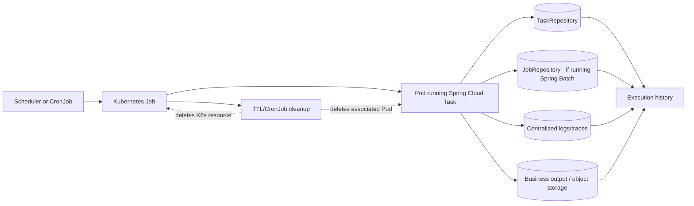
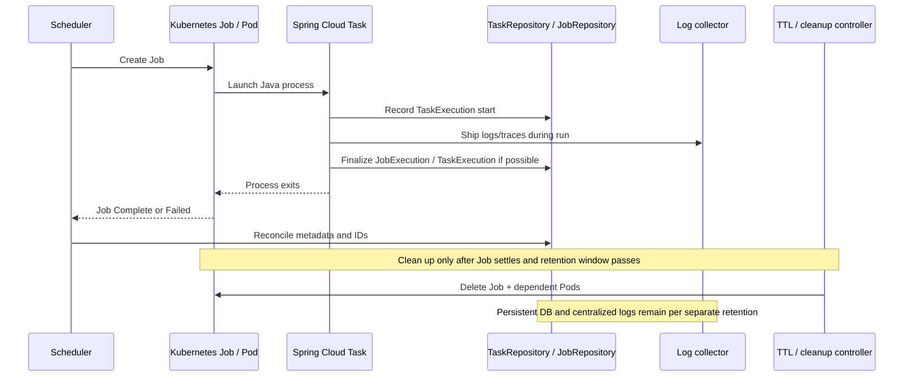
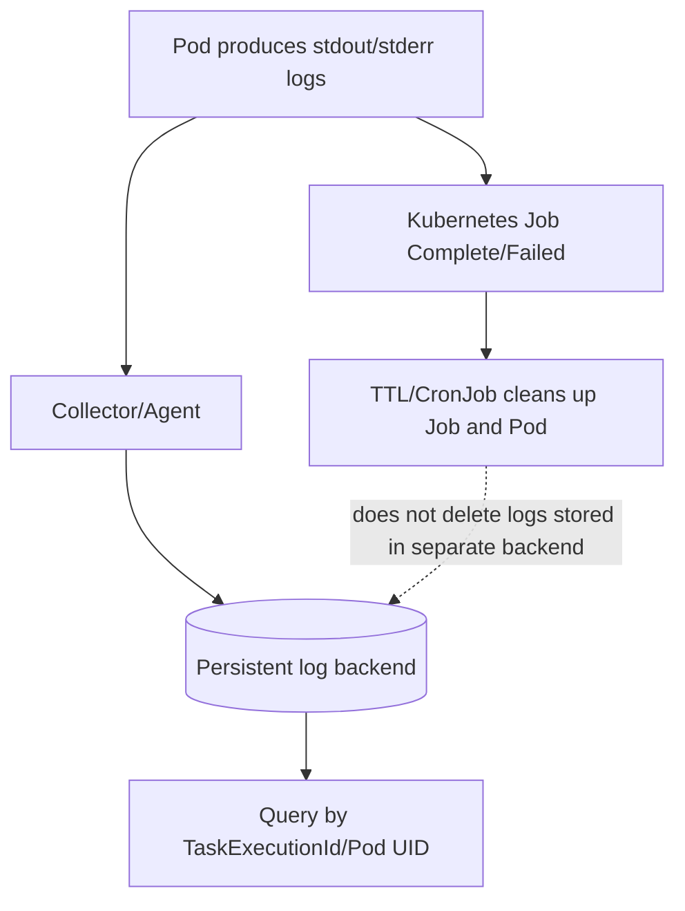

# Cleaning Up Completed Jobs and Preserving Execution History

## Objectives and context

In **Spring Cloud Task**, applications are designed to execute a **finite** job and then exit: importing invoices, aggregating revenue, running a Spring Batch Job, or reconciling data. Each launch can be initiated by a **Kubernetes Job**, **Kubernetes CronJob**, external scheduler, or **Spring Cloud Data Flow (SCDF)**. Without cleanup, finished Jobs/Pods accumulate in the cluster; with careless cleanup, the system can **lose logs, failure evidence, or metadata required for restarts and audits**.

This lesson in the **Deployment** chapter clarifies how to **reclaim compute resources after completion** while **preserving execution history** in `TaskRepository`, `JobRepository` (when integrating Spring Batch), centralized logs, and output stores.

After this lesson, you will be able to:

- Distinguish **Kubernetes Job**, **Spring Batch Job**, and **Spring Cloud `TaskExecution`**—three entities often loosely called "Job".
- Configure `ttlSecondsAfterFinished`, `CronJob` history limits, and cleanup operations in **Spring Cloud Data Flow**.
- Distinguish **`CLEANUP` of execution resources** from **`REMOVE_DATA` deleting metadata** in the SCDF API.
- Design retention policies across `TASK_EXECUTION`, `BATCH_JOB_EXECUTION`, logs, artifacts, and operational evidence.
- Handle abruptly killed Pods, un-finalized batches, split metadata databases, retries/reruns, and prematurely deleted Jobs.
- Build a **pre- and post-cleanup** reconciliation procedure with backups/restores and least-privilege deletion permissions.

> **Version note:** Kubernetes examples use the `batch/v1` API and TTL-after-finished (stable since Kubernetes 1.23). SCDF commands and behavior follow Spring Cloud Data Flow 2.11.x documentation; verify exact syntax for your deployed version before operating. Repository column names reflect corresponding Spring Cloud Task/Spring Batch schemas. Retention numbers in this guide are **policy examples only**, not universal safe defaults for every organization.

## 1. Three types of "Job" and four categories of data to keep

| Concept | Where does it live? | What does it record? | How does deletion affect it? |
| --- | --- | --- | --- |
| **Kubernetes Job** | Kubernetes API/etcd | Pod orchestration, completions, failed/succeeded counts, condition timestamps | Deleting the Job normally **cascades** to delete its Pods |
| **Pod/container** | Node/Kubernetes | Which image ran, process exit code, stdout/stderr, OOM/eviction reason | Deleting the Pod usually loses local log access and short-term diagnostic info |
| **Spring Cloud `TaskExecution`** | `TaskRepository` in RDBMS | `executionId`, `taskName`, `startTime`, `endTime`, `exitCode`, arguments, and errors | Survives Kubernetes Job/Pod deletion **if the DB is persistent and independent** |
| **Spring Batch `JobExecution`** | `JobRepository` in RDBMS | `JobInstance`, `JobExecution`, `StepExecution`, `ExecutionContext`, and counters | Deleting metadata can destroy history **and restart context** |
| **Logs/traces/artifacts** | Log collector, tracing backend, object storage, or business DB | Investigation details, CSV files, checksums, correlation IDs, output versions | Governed by separate retention; deleting Jobs/Pods does not automatically protect them |

**Two critical rules:**

1. **Cleaning up Jobs/Pods** does not mean **deleting `TASK_EXECUTION`/`BATCH_JOB_EXECUTION`**. Kubernetes never runs `DELETE FROM TASK_EXECUTION`.
2. **Keeping `TaskRepository`** does not mean **keeping full evidence**. The repository stores metadata only; if logs only existed inside a deleted Pod, you know the task failed yet **have no logs to investigate**.



This diagram shows **separation of responsibilities**—not a guarantee that every Task writes a row if startup fails too early. If `DataSource`/`ApplicationContext` fails to bootstrap, a `TaskExecution` may **not exist**. If the JVM is killed before updating metadata, `exitCode`/`endTime` may remain `NULL`. In those cases, Kubernetes status and logs become even more critical.

## 2. What does "finished" mean at each layer?

| Layer | Terminal condition | Do NOT assume |
| --- | --- | --- |
| Kubernetes Job | Reached `Complete` or `Failed` condition; Pods/containers obeyed controller rules | Do not assume Task/Batch history was cleanly saved |
| Container | Process exited with an OS exit code | Do not assume business logic committed or Batch Job succeeded |
| Spring Cloud Task | `TaskExecution.endTime`/`exitCode` written by framework on clean completion paths | Do not assume metadata cannot get stuck on crashes or DB failures |
| Spring Batch | `JobExecution` reaches `BatchStatus.COMPLETED`/`FAILED`/`STOPPED`… and Step/`ExecutionContext` updated | Do not assume Task exit code always equals Job `ExitStatus` |
| Business | Records, files, or external events persisted/published per contract | Do not infer solely from `exitCode=0` or Kubernetes `Complete` |

Example: the JVM commits 100 invoices yet receives `SIGKILL` before updating `TaskRepository`. Kubernetes marks the Pod `Failed` and after retries concludes the Kubernetes Job; that JVM attempt's `TASK_EXECUTION.EXIT_CODE` may remain `NULL`. If the Pod is wiped right away, **only the external DB and previously shipped logs** remain to reconstruct what happened.



Before cleaning up, decide **the source of truth for each question**: Kubernetes confirms process status, `TaskRepository` logs Task runs, `JobRepository` preserves Batch restartability, and the business DB proves real-world effects. Never collapse everything into one status column.

## 3. Configuring Kubernetes Jobs with TTL after completion

Kubernetes includes a **TTL-after-finished controller** for **Jobs** that have reached `Complete` or `Failed`. Setting:

```yaml
spec:
  ttlSecondsAfterFinished: 86400
```

means that **86,400 seconds (24 hours)** after the Job finishes, it becomes **eligible** for controller deletion. It is not a second-accurate deletion promise. When deleting, Kubernetes performs **cascading** removal of the Job and dependent objects like Pods while honoring finalizers/lifecycle guarantees. TTL does not apply directly to standalone Pods and **never deletes `TaskRepository` rows**.

Reference: [Kubernetes – Automatic Cleanup for Finished Jobs](https://kubernetes.io/docs/concepts/workloads/controllers/ttlafterfinished/).

### 3.1. Illustrative manifest

A Job running `settlement-task` for period `2026-11-23`:

```yaml
apiVersion: batch/v1
kind: Job
metadata:
  name: settlement-20261123
  namespace: batch-workloads
  labels:
    app: settlement-task
    component: nightly-settlement
spec:
  backoffLimit: 0
  activeDeadlineSeconds: 3600
  ttlSecondsAfterFinished: 86400
  template:
    metadata:
      labels:
        app: settlement-task
    spec:
      restartPolicy: Never
      containers:
        - name: task
          image: registry.example.internal/settlement-task:1.0.0
          imagePullPolicy: IfNotPresent
          args:
            - "--business-date=2026-11-23"
          env:
            - name: SPRING_PROFILES_ACTIVE
              value: "prod"
            - name: SPRING_DATASOURCE_URL
              valueFrom:
                secretKeyRef:
                  name: settlement-db
                  key: jdbc-url
            - name: SPRING_DATASOURCE_USERNAME
              valueFrom:
                secretKeyRef:
                  name: settlement-db
                  key: username
            - name: SPRING_DATASOURCE_PASSWORD
              valueFrom:
                secretKeyRef:
                  name: settlement-db
                  key: password
          resources:
            requests:
              cpu: "250m"
              memory: "256Mi"
            limits:
              memory: "1Gi"
```

**Prerequisites for this example:** namespace `batch-workloads`, Secret `settlement-db` (with those three keys), the container image, and the repository schema already exist; substitute your real resources before applying. The image entrypoint must launch the Spring Cloud Task JAR and **exit once the runner completes**; if the container keeps an HTTP server or non-daemon thread alive forever, the Kubernetes Job never reaches `Complete` and the TTL countdown **never begins**.

Fields to understand:

- `restartPolicy: Never`: when the container fails, the Pod enters `Failed`; the Job controller can create a new Pod **if** retry policies permit.
- `backoffLimit: 0` in the demo: avoids default retries on Pod failure; useful before business operations are proven idempotent. In production, tune backoff by exit code and retry safety.
- `activeDeadlineSeconds: 3600`: caps **Job** runtime at roughly one hour; past the deadline, the Job fails and running Pods terminate. This is an **execution timeout**, distinct from post-completion **TTL cleanup**.
- `ttlSecondsAfterFinished: 86400`: observation window after the Job reaches a terminal state—not a `timeout`, and it cannot stop a hung Job.
- `image: ...:1.0.0` is illustrative; production should record image digests, release IDs, and schema versions to make history reproducible.

**Never pass passwords/tokens in `args` or `--spring.datasource.password=...`.** Spring Cloud Task records CLI arguments into metadata; passwords can surface in process lists and logs. Secret-backed env vars still need RBAC limits, Pod isolation, and zero environment dumps.

### 3.2. Safe inspection commands before cleanup

After deploying to a test cluster with `kubectl` access, read-only commands:

```bash
kubectl get jobs -n batch-workloads -l app=settlement-task
kubectl describe job settlement-20261123 -n batch-workloads
kubectl get pods -n batch-workloads -l job-name=settlement-20261123
kubectl logs -n batch-workloads job/settlement-20261123
```

`kubectl logs` works **only while Pods and node logs remain**; it is not long-term log storage. Ship stdout/stderr via a collector/agent to centralized logging **before TTL**, tagged with correlation IDs. Manual deletion is **only for Jobs verified safe to clean up**:

```bash
kubectl delete job settlement-20261123 -n batch-workloads
```

**Never run bulk deletions** like `kubectl delete jobs --all` or overly broad Pod label deletes just to free space. Deleting a Job cascades to dependent Pods; verify exact target objects and handle finalizers/deletion errors properly. The [Kubernetes Jobs](https://kubernetes.io/docs/concepts/workloads/controllers/job/) docs note that without automatic cleanup, completed Jobs and Pods accumulate for status/log inspection, adding load to the Kubernetes API server.

### 3.3. TTL leaves Task/Batch metadata intact, yet logs still risk loss

`ttlSecondsAfterFinished` governs **Kubernetes API objects**. It has **no awareness** of `TASK_EXECUTION` or `BATCH_JOB_EXECUTION` schemas, so it never deletes repository rows. However, if the Task's database is **in-memory H2 inside the Pod**, history dies with the JVM even if the Kubernetes Job stays around for another 24 hours.

To preserve history across Pods/Jobs:

1. Use a **persistent database outside Pod lifecycles** for `TaskRepository` and `JobRepository`.
2. Manage schemas with migrations, backups, least-privilege grants, and retention policies.
3. Ship logs/traces to external storage and verify collector ingestion.
4. Store business artifacts (CSVs, reconciliations, manifests, external checkpoints) in durable storage if still needed.
5. Query history **after** Jobs/Pods are deleted to confirm nothing was lost.

**PVC/PV:** Deleting a Job does not automatically delete every `PersistentVolumeClaim` referenced by its Pods; lifecycle depends on ownership, controllers, finalizers, and storage policies. Never treat a temporary per-Job PVC as your sole long-term output store without an explicit data lifecycle workflow.

## 4. Kubernetes CronJob: how many succeeded/failed Jobs to retain?

For nightly tasks, **CronJob** adds two history fields:

- `spec.successfulJobsHistoryLimit`: number of **succeeded** Jobs retained. Default is **3**.
- `spec.failedJobsHistoryLimit`: number of **failed** Jobs retained. Default is **1**.

A value of `0` retains zero finished Jobs of that category under this count limit. This caps **Job object counts**, **not days**, and does not touch `TaskRepository` data.

Reference: [Kubernetes – CronJob: Jobs history limits](https://kubernetes.io/docs/concepts/workloads/controllers/cron-jobs/).

CronJob example (complete application-template manifest):

```yaml
apiVersion: batch/v1
kind: CronJob
metadata:
  name: settlement-nightly
  namespace: batch-workloads
spec:
  schedule: "15 2 * * *"
  timeZone: "Asia/Ho_Chi_Minh"
  concurrencyPolicy: Forbid
  successfulJobsHistoryLimit: 5
  failedJobsHistoryLimit: 3
  jobTemplate:
    spec:
      backoffLimit: 0
      activeDeadlineSeconds: 3600
      ttlSecondsAfterFinished: 604800
      template:
        metadata:
          labels:
            app: settlement-task
        spec:
          restartPolicy: Never
          containers:
            - name: task
              image: registry.example.internal/settlement-task:1.0.0
              env:
                - name: SPRING_PROFILES_ACTIVE
                  value: "prod"
                - name: SPRING_DATASOURCE_URL
                  valueFrom:
                    secretKeyRef:
                      name: settlement-db
                      key: jdbc-url
                - name: SPRING_DATASOURCE_USERNAME
                  valueFrom:
                    secretKeyRef:
                      name: settlement-db
                      key: username
                - name: SPRING_DATASOURCE_PASSWORD
                  valueFrom:
                    secretKeyRef:
                      name: settlement-db
                      key: password
```

This is a **deployment skeleton**—add per-run `business-date` resolution (scheduler/deployer passing Job args or app logic computing the period under an agreed timezone); **never** hardcode a single fixed date into a daily CronJob. The system must deterministically identify the target period across backfills and timezone/DST boundaries instead of calling `LocalDate.now()` arbitrarily inside each replica.

- `schedule` and `timeZone` govern launch time (`timeZone` has been stable since Kubernetes 1.27).
- `concurrencyPolicy: Forbid` prevents overlapping **Jobs from the same CronJob**; it does not stop an operator from creating a manual Job against the same data, nor does it replace idempotency.
- `successfulJobsHistoryLimit: 5` and `failedJobsHistoryLimit: 3` prune by **finished execution count**.
- `ttlSecondsAfterFinished: 604800` prunes **7 days** after Job completion.

### TTL and history limits do not guarantee 7-day retention together

This is a subtle trap: **the CronJob controller can delete an older Job to enforce history limits before that Job's 7-day TTL expires**. Conversely, TTL can remove a Job before the count limit is reached. The two controls do not combine into "at least 5 Jobs and at least 7 days".

If compliance requires **7 full days for investigation**, do not rely on a 7-day TTL plus a small history limit on a CronJob running multiple times per day. Define retention around **where logs and metadata live**, treating Jobs/Pods strictly as short-term diagnostics. Keeping Kubernetes Job objects for a guaranteed time window requires a dedicated policy rather than assuming the maximum of two independent cleanup controllers.

With `concurrencyPolicy: Replace`, CronJob can kill an active run to launch a new one; with `Forbid`, a new schedule tick can be skipped if the prior run is still going. Those are **execution policies**, not post-completion cleanup. For data-mutating tasks, test them alongside retry and idempotency logic.

## 5. Spring Cloud Data Flow: `CLEANUP` vs. `REMOVE_DATA`

When deploying via **Spring Cloud Data Flow**, the platform exposes an API and Shell to manage executions. SCDF 2.11.x documentation defines two **distinct** actions on `DELETE /tasks/executions/{ids}`:

| Action | Primary effect | Impact on history |
| --- | --- | --- |
| **`CLEANUP`** | Cleans up **deployer resources** tied to a `TaskExecution`, depending on platform (e.g., task Pod) | Reclaims compute resources; **does not delete Task/Batch metadata** |
| **`REMOVE_DATA`** | Deletes **`TaskExecution` rows** and can also delete linked **Spring Batch Job data** in the persistent store | **Risks losing history and restart state** |
| **`CLEANUP,REMOVE_DATA`** | Both cleans up deployer resources and wipes repository data | **Unsuitable** when the goal is preserving history |

Reference: [SCDF Reference – Delete Task Execution / Deleting Task Execution Data](https://docs.spring.io/spring-cloud-dataflow/docs/current/reference/htmlsingle/index.html). Per docs, omitting `action` defaults to **`CLEANUP`**, yet production automation should still specify the action explicitly and verify against your version.

### 5.1. SCDF Shell commands to clean up resources while keeping metadata

With the Shell connected to SCDF Server (**SCDF Shell** syntax, not Bash):

```text
dataflow:> task execution list
dataflow:> task execution cleanup --id 123
```

`task execution list` identifies the exact **`TaskExecution` ID**; `cleanup` requests deletion of deployer resources for execution `123`. SCDF docs describe cleaning up finished Pods by execution ID. **Never treat a "request submitted" message as completed cleanup**: verify the resource is actually gone and the `TaskExecution` still exists.

Example endpoint using **only `CLEANUP`** (requires proper auth/network; never run directly without permissions and an approved runbook):

```bash
curl -X DELETE \
  'https://dataflow.example.internal/tasks/executions/123?action=CLEANUP'
```

This is a **syntax example**, not a command to execute blindly. Check URLs, authentication, `schemaTarget`, and API contracts against your SCDF release; never put SCDF secrets in docs or shell history.

### 5.2. Why avoid `REMOVE_DATA` when preserving history?

SCDF docs warn that `REMOVE_DATA` deletes associated `TaskExecution` metadata and can also remove **Spring Batch `JobExecution`s linked to the Task**. In **composed tasks**, deleting data for a **child execution** is rejected; you must supply the **parent task execution** ID per SCDF 2.11.x API rules.

Therefore, **never** put a URI like this into default cleanup scripts:

```text
DELETE /tasks/executions/123?action=CLEANUP,REMOVE_DATA
```

The line above illustrates an **anti-pattern to recognize**, **not a recommended command**. If retention policies require purging old metadata, run a **separate workflow** with compliance review, backups/archives, restartability checks, parent–child handling, deletion audit logs, and version-matched framework deletion logic.

In SCDF, **`task execution cleanup` is not `task execution destroy`**; command names and effects differ by object type. Never guess behavior solely from the HTTP `DELETE` verb—**the `action` parameter defines the data boundary**.

### 5.3. Check the platform before calling cleanup

For Tasks deployed to Kubernetes, SCDF can launch **standalone Pods** in certain versions or deployer modes; on other platforms, Tasks map to Kubernetes Jobs or Cloud Foundry Tasks. `CLEANUP` is **platform-specific**, so never assume the cleaned object is always a Kubernetes `Job`. Verify `externalExecutionId`, SCDF metadata, namespaces, labels, and platform accounts.

## 6. Preserving `TaskRepository`: Task history does not live inside the Pod

The default Spring Cloud Task schema uses these tables (exact names may vary with table prefixes/schemas across versions):

| Table | Core data | What is lost if deleted carelessly? |
| --- | --- | --- |
| `TASK_EXECUTION` | Execution ID, Task name, start/end, `EXIT_CODE`, `ERROR_MESSAGE`, parent/external IDs | **Run history**, parent–child links, and failure evidence |
| `TASK_EXECUTION_PARAMS` | CLI arguments per `TASK_EXECUTION_ID` | Run context; **can contain sensitive data** |
| `TASK_TASK_BATCH` | Links `TASK_EXECUTION_ID` ↔ `JOB_EXECUTION_ID` | Traceability from a Task to linked Batch Jobs |
| `TASK_LOCK` | Locks supporting `single-instance-enabled` | Coordination state; **not** a history table |
| `TASK_SEQ` or equivalent sequence | Allocates IDs for `TaskExecution` depending on DB | Risk of ID collisions or allocation errors after improper restores |

Reference: [Spring Cloud Task – Task Repository Schema](https://docs.spring.io/spring-cloud-task/reference/appendix-task-repository-schema.html).

**Fundamental requirement for history to survive cleanup:** `TaskRepository` must connect to a **persistent RDBMS** with proper schemas, backups, and monitoring. `jdbc:h2:mem:...` inside each Pod is for demos, not production history. Misconfiguring `spring.datasource.url` to point at another DB can also make dashboards appear to "lose history" while rows actually sit in a different database.

Configuration example without hardcoded credentials:

```yaml
spring:
  application:
    name: settlement-task
  main:
    web-application-type: none
  datasource:
    url: ${TASK_DB_URL}
    username: ${TASK_DB_USER}
    password: ${TASK_DB_PASSWORD}
  cloud:
    task:
      initialize-enabled: false
      closecontext-enabled: true
```

Here `initialize-enabled: false` **assumes** operations already created Task tables via version-matched migrations; otherwise, the app fails when writing metadata. `closecontext-enabled` helps in non-web batch apps, though a Java process can still linger if unclosed threads or resources remain.

### 6.1. Read-only queries to verify Tasks before and after cleanup

PostgreSQL example against the same repository written by the app, using **read-only** credentials:

```sql
SELECT
    TASK_EXECUTION_ID,
    TASK_NAME,
    START_TIME,
    END_TIME,
    EXIT_CODE,
    EXTERNAL_EXECUTION_ID,
    PARENT_TASK_EXECUTION_ID,
    LAST_UPDATED
FROM TASK_EXECUTION
WHERE TASK_NAME = 'settlement-task'
ORDER BY TASK_EXECUTION_ID DESC
LIMIT 20;
```

Find Tasks with un-finalized metadata:

```sql
SELECT TASK_EXECUTION_ID, TASK_NAME, START_TIME, END_TIME, EXIT_CODE
FROM TASK_EXECUTION
WHERE END_TIME IS NULL OR EXIT_CODE IS NULL
ORDER BY START_TIME;
```

`EXIT_CODE IS NULL` means **no final code was recorded yet**—potentially still running, crashed, failed DB update, or a special lifecycle edge case. **Never** write `WHERE EXIT_CODE = NULL`; SQL requires `IS NULL`. **Never** manually update `EXIT_CODE = 1` to "mark failed", as that fabricates history and hides partial-commit risks.

When selecting Kubernetes resources for cleanup, correlate **Job UID / name / namespace / labels** with the **`TaskExecution` ID** recorded by the app or launcher. `TASK_EXECUTION_ID` does not necessarily match the Kubernetes Job UID or Pod name; never guess IDs from `MAX(TASK_EXECUTION_ID)` when multiple tasks run concurrently.

### 6.2. Preserving parent–child relationship history

With Composed Task Runner or custom launchers, child runs carry `PARENT_TASK_EXECUTION_ID`. When retaining metadata, keep **connected sets together**:

```sql
SELECT
    p.TASK_EXECUTION_ID AS parent_id,
    p.TASK_NAME AS parent_name,
    c.TASK_EXECUTION_ID AS child_id,
    c.TASK_NAME AS child_name,
    c.EXIT_CODE AS child_exit_code
FROM TASK_EXECUTION p
LEFT JOIN TASK_EXECUTION c
  ON c.PARENT_TASK_EXECUTION_ID = p.TASK_EXECUTION_ID
WHERE p.TASK_EXECUTION_ID = 900
ORDER BY c.TASK_EXECUTION_ID;
```

This is a read-only `LEFT JOIN`; ID `900` is illustrative. When archiving by age, **never delete parent rows first** while child executions or Batch links still need retention. Retention rules must operate on **whole workflows**, not isolated rows.

## 7. Preserving Spring Batch `JobRepository` and restartability

When a Task embeds Spring Batch, the framework persists several metadata layers:

| Default table group | Role |
| --- | --- |
| `BATCH_JOB_INSTANCE` | Identifies a `JobInstance` by Job name + identifying `JobParameters` |
| `BATCH_JOB_EXECUTION` | One Job run, `STATUS`, `EXIT_CODE`, start/end timestamps |
| `BATCH_JOB_EXECUTION_PARAMS` | `JobParameters` used at runtime and for distinguishing `JobInstance`s |
| `BATCH_STEP_EXECUTION` | Step executions, read/write/skip/rollback counters |
| `BATCH_JOB_EXECUTION_CONTEXT` / `BATCH_STEP_EXECUTION_CONTEXT` | Checkpoint/restart state for Jobs and Steps |
| `TASK_TASK_BATCH` | Links a `TaskExecution` to a Batch `JobExecution` under Task–Batch integration |

These are **Spring Batch/Task metadata tables**, not business data tables. Schemas vary across versions and may use custom table prefixes. A MongoDB `JobRepository` stores structures completely different from RDBMS, so the SQL below applies only to the **default JDBC `JobRepository`**.

References: [Spring Batch – Configuring a JobRepository](https://docs.spring.io/spring-batch/reference/job/configuring-repository.html) and [Spring Cloud Task – Batch integration](https://docs.spring.io/spring-cloud-task/reference/batch.html).

### 7.1. Checking Batch `JobExecution`s linked to a Task

When `TaskRepository` and `JobRepository` share a database (or support cross-schema reads):

```sql
SELECT
    t.TASK_EXECUTION_ID,
    t.TASK_NAME,
    t.EXIT_CODE AS task_exit_code,
    b.JOB_EXECUTION_ID,
    b.STATUS AS batch_status,
    b.EXIT_CODE AS batch_exit_code,
    b.START_TIME AS batch_started,
    b.END_TIME AS batch_ended
FROM TASK_EXECUTION t
JOIN TASK_TASK_BATCH link
  ON link.TASK_EXECUTION_ID = t.TASK_EXECUTION_ID
JOIN BATCH_JOB_EXECUTION b
  ON b.JOB_EXECUTION_ID = link.JOB_EXECUTION_ID
WHERE t.TASK_EXECUTION_ID = 123
ORDER BY b.JOB_EXECUTION_ID;
```

If Task and Batch repositories live in **separate databases**, you cannot run that `JOIN` directly without cross-DB federation; query both sources by `TASK_TASK_BATCH`/execution IDs and correlate in a service or BI layer.

Expected state prior to resource cleanup: if the Job is `COMPLETED`, its corresponding Task state is finalized too; if the Job stays `FAILED`/`STOPPED`/`STARTED` abnormally long, inspect the process and restart policy. `TaskExecution.exitCode=0` does not prove `BatchStatus.COMPLETED` in all setups; `spring.cloud.task.batch.fail-on-job-failure=true` propagates Batch failures up to the Task in supported integrations.

### 7.2. Deleting `JobRepository` too early destroys restartability

Spring Batch relies on `ExecutionContext`, `JobInstance`, and `StepExecution` to resume failed runs. **Deleting metadata while a Job is `FAILED` or `STOPPED`** breaks normal restart paths. Creating a brand-new `JobInstance` instead of restarting **does not** make previously written rows safe; writers still need idempotency.

Therefore:

- **Never** run `TRUNCATE BATCH_*` or delete rows blindly by age without checking foreign keys/links.
- **Never** wipe `BATCH_JOB_EXECUTION_CONTEXT` solely to reclaim DB space, as it holds checkpoints.
- Align metadata retention with **restart windows** required by SLAs, reconciliation cycles, and audits before archiving/purging.
- Only use controlled framework/app retention procedures after verifying foreign keys, Job states, and restart impact.
- Perform **backup/restore rehearsals** and reconcile execution counts and relations afterward.

## 8. Logs, traces, and artifacts: history beyond metadata

Keeping a `TASK_EXECUTION` row with exit code `1` still cannot explain **why** the app failed if `errorMessage` was truncated or an exception hit before `TaskRepository` initialized. Before deleting Pods, ensure logs and required outputs are shipped elsewhere.

### 8.1. Correlation IDs across Kubernetes and Spring Cloud Task

Reference convention:

| Source | IDs to capture | Used to link with |
| --- | --- | --- |
| Kubernetes | Namespace, Job name, Job UID, Pod UID/container ID | Pod logs, failure reasons, retry attempts |
| Spring Cloud Task | `TaskExecutionId`, task name, external execution ID | `TASK_EXECUTION`, Task arguments, and lifecycle |
| Spring Batch | `JobExecutionId`, `JobInstanceId`, `StepExecutionId` | `JobRepository` and Step counters |
| Business | `tenantId`, `businessDate`, `requestId`, or idempotency key | Target outputs, artifacts, reconciliations |
| Logs/traces | Trace/span ID, release/image digest | Error chain and exact code version executed |

**`TaskExecutionId` is not the Kubernetes Job UID**, and **Spring Batch `JobExecutionId` is not `TaskExecutionId`**. Emit correlation IDs safely in logs or traces. Because some IDs are assigned only **after the Task starts**, do not expect the Kubernetes Job name to contain the Task ID upfront.

Example listener logging IDs safely:

```java
package com.example.task;

import org.slf4j.Logger;
import org.slf4j.LoggerFactory;
import org.springframework.cloud.task.repository.TaskExecution;
import org.springframework.cloud.task.listener.TaskExecutionListener;
import org.springframework.stereotype.Component;

@Component
public class TaskCorrelationLogging implements TaskExecutionListener {

    private static final Logger log =
            LoggerFactory.getLogger(TaskCorrelationLogging.class);

    @Override
    public void onTaskStartup(TaskExecution taskExecution) {
        log.info("task_started id={} name={}",
                taskExecution.getExecutionId(),
                taskExecution.getTaskName());
    }

    @Override
    public void onTaskEnd(TaskExecution taskExecution) {
        log.info("task_completed id={} name={}",
                taskExecution.getExecutionId(),
                taskExecution.getTaskName());
    }

    @Override
    public void onTaskFailed(
            TaskExecution taskExecution, Throwable throwable) {
        log.error("task_failed id={} type={}",
                taskExecution.getExecutionId(),
                throwable.getClass().getSimpleName());
    }
}
```

This snippet illustrates **correlation**—it does not replace application stack-trace logging and cannot guarantee callbacks execute if the JVM is killed or crashes before listeners register. When debugging requires stack traces, redact sensitive data and restrict access; **never** put tokens or PII into `exitMessage` or `arguments`.

### 8.2. Log collectors must ingest before cleanup

Minimal log retention flow:



- **Asynchronous collectors:** lag, quota/network drops, or filters can drop lines; "agent enabled" does not prove logs arrived in the backend.
- **Log retention vs. metadata retention:** e.g., 30 days for raw logs vs. 180 days for metadata; verify whether having only metadata after 30 days meets audit rules.
- **Artifacts:** store CSVs or reports in S3-compatible/object storage or persistent DBs and publish only once complete; never leave the sole copy in a Pod's ephemeral filesystem.
- **Sensitive data:** Task arguments can land in `TASK_EXECUTION_PARAMS`. Long-term history can leak sensitive data if CLI flags are poorly designed; minimize data at the source, enforce access controls, and follow legal deletion policies.

## 9. Multi-tier retention design

**There is no universal default retention period** for every organization. Below is a *hypothetical internal policy example* illustrating how tiers separate:

| Tier | Illustrative retention target | Cleanup trigger | How to verify |
| --- | --- | --- | --- |
| Succeeded Kubernetes Jobs/Pods | 24 hours | Kubernetes reached `Complete`; logs shipped | `kubectl get job`, log backend, `TaskRepository` |
| Failed Kubernetes Jobs/Pods | 72 hours | Kubernetes reached `Failed`; incident trace captured | Pod exit reason, logs, and incident ID |
| Raw logs/traces | 30–90 days | Backend retention per sensitivity/cost | Search by Job UID/`TaskExecutionId` |
| `TaskExecution` metadata | 180 days or per business SLA | Archive/delete only when unreferenced and backed up | `TaskExplorer`/SQL query and restore test |
| Batch `JobRepository` metadata | Beyond **restart/audit** window | Purge only per safe `JobInstance`/`ExecutionContext` policy | Restart test, foreign-key integrity |
| Artifacts and business outputs | Per data/legal contract | Object/business DB lifecycle | Checksums, owner, legal holds |

These figures are **not requirements from Spring or Kubernetes**. They must be approved by system owners, SRE, DBA, security, and compliance. For finance, healthcare, or regulated records, retention may be longer or require *legal holds*. Conversely, keeping raw arguments forever can conflict with data-minimization rules.

### 9.1. "Archiving" must be proven restorable

A sound metadata archival process includes:

1. **Snapshot candidates** from the DB (IDs, status, dates, tenants, Task–Batch links, parent–child links) matching reviewed criteria.
2. **Back up/export** consistently and encrypted per policy, including join tables, counters, and contexts; never export one table alone and assume it suffices.
3. **Verify checksums and row counts**, tracking schema/versions and archive retention.
4. **Rehearse restores in an isolated environment** to prove records reconstruct cleanly and—if still needed—failed `JobInstance`s remain restartable.
5. **Audit log** who approved, who executed, ID sets, timestamps, and verification outcomes.
6. **Only under explicit policy**, remove purged metadata via supported APIs/procedures. Data deletion is **never part of default Job/Pod cleanup**.

Avoid ad-hoc bulk SQL `DELETE`s on `TASK_EXECUTION`/`BATCH_*`, since child tables, foreign keys, and restart semantics vary across versions. `TASK_SEQ` or database sequences must also be preserved across restores to avoid reusing IDs.

### 9.2. Cost and performance of the history store

At thousands of tasks per day, metadata and logs grow rapidly. Plan ahead:

- Index common queries (`TASK_NAME`, `START_TIME`, `PARENT_TASK_EXECUTION_ID`) as needed and check execution plans; avoid unneeded indexes that slow writes.
- Size capacity and backup windows for databases, filesystems, and object stores.
- Separate heavy dashboard reads from `TaskRepository` write paths if necessary.
- Alert on `TASK_EXECUTION` rows with `END_TIME IS NULL`/`EXIT_CODE IS NULL` past SLAs, without assuming they are still running.
- Monitor **completed Kubernetes Job/Pod counts**, dropped logs, retention backlogs, and metadata growth rates.

## 10. Cleanup runbook: observe → reconcile → clean → verify

Production cleanup requires **entry criteria** and post-action verification—never a blind delete command.

### Step 1 — Identify targets and terminal states

Read-only inspection of the target namespace/Job:

```bash
kubectl get jobs -n batch-workloads -l app=settlement-task
kubectl get job settlement-20261123 -n batch-workloads -o yaml
kubectl get pods -n batch-workloads -l job-name=settlement-20261123
```

Inspect Job `status.conditions`, UID, namespace, owner references, and Pod states. Only consider a Job a cleanup candidate once it has `Complete` or `Failed` and its investigation window has elapsed. With SCDF, run `task execution list` to grab the **exact `TaskExecution` ID** rather than guessing from task names.

### Step 2 — Capture traces and reconcile data

Record Job UID, Pod UID/container exit reason, image digest, end timestamp, `TaskExecutionId`, `JobExecutionId` (if applicable), and correlation IDs. Confirm logs reached the backend, artifacts have stable checksums/URIs, and business data committed or logged failure properly. Never place raw secrets into audit logs.

Run a read-only PostgreSQL summary check:

```sql
SELECT
    TASK_NAME,
    COUNT(*) AS executions,
    COUNT(*) FILTER (
        WHERE EXIT_CODE = 0 AND END_TIME IS NOT NULL
    ) AS successful,
    COUNT(*) FILTER (
        WHERE EXIT_CODE <> 0 AND END_TIME IS NOT NULL
    ) AS failed,
    COUNT(*) FILTER (
        WHERE EXIT_CODE IS NULL OR END_TIME IS NULL
    ) AS not_finalized
FROM TASK_EXECUTION
WHERE START_TIME >= CURRENT_TIMESTAMP - INTERVAL '7 days'
GROUP BY TASK_NAME
ORDER BY TASK_NAME;
```

`not_finalized` rows **require reconciliation** with process/container state and do not mean `RUNNING`. If a Kubernetes Job is `Failed` with zero `TaskExecution` rows, investigate bootstrap/schema/DB errors and Pod logs rather than fabricating a fake success row.

### Step 3 — Pick the right lifecycle tool

| Who manages the task? | Cleanup mechanism | Never confuse with |
| --- | --- | --- |
| Operations-created Kubernetes Job | `ttlSecondsAfterFinished` or deleting **one verified Job** | Deleting the database or every Job in the namespace |
| Kubernetes CronJob | History limits and TTL aligned with retention | A promise to retain Jobs for at least N days |
| SCDF deployer | `task execution cleanup --id 123` / `action=CLEANUP` | `action=REMOVE_DATA` or wiping Task/Batch metadata |
| Other platforms | Version-appropriate deployer cleanup | Assuming every task runs as a Kubernetes Job |

Never let **two controllers/scripts** manage cleanup without clear ownership. When SCDF creates standalone Pods, never blindly run Kubernetes Job deletion scripts matched by task name alone.

### Step 4 — Verify after cleanup

Once the controller finishes deleting, verify:

```bash
kubectl get jobs -n batch-workloads -l app=settlement-task
kubectl get pods -n batch-workloads -l app=settlement-task
```

The targeted Job should be gone while unrelated Jobs remain untouched. Query **the exact `TaskExecution` ID / `JobExecution` ID** in the repository and search the log backend to prove history survived. With SCDF, `task execution cleanup` is asynchronous; declare success only once compute resources are gone and metadata remains queryable.

### Step 5 — Log audit trail and handle discrepancies

Record scope, cleanup reason, policy, actor/automation, timestamp, IDs, and pre/post checks. If metadata disappeared, investigate whether automation called `REMOVE_DATA`, DB URLs/schemas changed, or DB retention jobs collided. Restore using tested backups/runbooks; **never** manually insert fabricated `TASK_EXECUTION` or `BATCH_JOB_EXECUTION` rows with guessed IDs.

## 11. Cleanup does not prevent retries or duplicate data side effects

Deleting a Kubernetes Job only removes **execution compute resources**—it does not undo committed transactions or external API calls. When an operator no longer sees the old Job and hits "run again", a Task may process **the same business period** twice. Even with `parallelism=1` and `completions=1`, Kubernetes Jobs do not guarantee exactly-once execution across all failure modes.

Safety policies require:

- **Stable business idempotency keys**, e.g., `(tenantId, businessDate, reportVersion)`—never use per-retry `TaskExecution` IDs or Pod UIDs as dedup keys.
- **`UNIQUE`/`PRIMARY KEY` constraints** in business databases plus conditional writes distinguishing valid replays from conflicting payloads.
- **Spring Batch checkpoints** and `JobRepository` retained throughout restart windows. If writers are non-idempotent, retries can insert duplicates.
- **Outboxes/dedup** on external systems if Tasks publish to Kafka, send emails, or call payment APIs.
- **Bounded backoff**, exit-code classification, and checking committed data before backfilling.
- **Concurrency controls:** `CronJob.concurrencyPolicy=Forbid` only guards Jobs launched by **that same CronJob**; it does not block manual Jobs or retries after a prior Job ends.

Specifically, if a Task committed partial writes yet `TaskExecution.exitCode=NULL` due to a crash, you **cannot** tell from `TaskRepository` alone which items finished. Reconcile destination tables and Batch checkpoints.

## 12. Scenarios requiring investigation

| Symptom | Possible cause | Resolution |
| --- | --- | --- |
| Kubernetes Job `Complete`, Task `EXIT_CODE=0` | Normal completion path | Verify logs/artifacts, then allow TTL cleanup after retention |
| Kubernetes Job `Failed`, Task `EXIT_CODE=NULL` | Killed/OOM or metadata update failed | Preserve logs, check side effects and runtime before retrying |
| Kubernetes Job `Complete` yet Batch Job `FAILED` | Batch failure not propagated to process exit | Check `spring.cloud.task.batch.fail-on-job-failure` and runner |
| TTL does not delete Job | Job lacks terminal condition, missing TTL, finalizer/controller issue | Inspect Job/Pod and policies; TTL is not a timeout |
| Pod deleted earlier than TTL | CronJob history limit or another script pruned first | Audit owner/scripts, align policies, ship logs off-cluster |
| `kubectl logs` no longer available | Pod deleted/GC'd/log-rotated | Query log backend and inspect collector pipeline |
| Task history vanished after cleanup | `REMOVE_DATA`, DB purge, wrong DB, or in-memory H2 | Check audit logs and backups; never fabricate metadata |
| `JobRepository` still `STARTED` yet Pod is dead | `SIGTERM`/kill prevented Batch metadata finalization | Inspect/recover `JobInstance`; never delete `ExecutionContext` |
| Pods/Jobs cleaned yet DB keeps growing | Independent repository retention | Plan capacity/backups/archiving with DBAs rather than raw deletes |
| Rerun generated duplicate invoices | Cleanup is not idempotency | Add business keys/constraints, reconcile, fix retry policy |

## 13. Testing cleanup before production

In an isolated test environment mirroring production schemas and deployments:

1. **Success:** Job hits `Complete`, producing `TaskExecution`/Batch `JobExecution`, logs, and artifacts. After TTL, Job/Pod disappear while all history stores remain intact.
2. **Business error:** Job `Failed` and Task records non-`0` exit code. Confirm retention leaves enough time to investigate and unrecoverable errors do not auto-retry.
3. **Bootstrap error:** intentionally misconfigure datasource/Secret. Pod logs must enable diagnosis even with zero `TaskExecution` rows.
4. **Mid-flight crash:** simulate a kill in tests; observe `EXIT_CODE=NULL` with partial data writes. Verify retries create zero duplicates.
5. **Frequent CronJob runs:** verify history limits can prune older Jobs **before TTL**.
6. **SCDF `CLEANUP`:** run resource cleanup by execution ID, then re-query Task/Batch metadata for that exact ID.
7. **Backup/restore:** restore metadata into an isolated environment and verify Task–Batch links, `JobInstance`, `StepExecution`, and `ExecutionContext`.
8. **Same business key:** launch a fresh run after the old Job was pruned; idempotency must block duplicate side effects.
9. **Permissions and audit:** cleanup service accounts must lack arbitrary `REMOVE_DATA` or repository-drop permissions under platform RBAC.

Never delete production metadata to test the procedure; use sandboxes, synthetic/anonymized data, approvals, and rollback plans.

## 14. Self-assessment exercises

**A.** A Job has `ttlSecondsAfterFinished=3600` and reaches `Complete` at 02:00. When can the controller delete it?

**Answer:** Any time after ~03:00, the Job becomes **eligible** for cleanup; Kubernetes does not guarantee deletion at exact 03:00. Deleting the Job cascades to its Pods and **never deletes `TaskRepository` rows**.

**B.** A CronJob runs every 5 minutes with `successfulJobsHistoryLimit=2` and a 1-day TTL. Is every Job guaranteed to stay for 24 hours?

**Answer:** No. The CronJob history limit controller can delete older Jobs once more than two succeeded Jobs exist, long before TTL expires.

**C.** SCDF manages `TaskExecution` `123` and a linked Batch `JobExecution`. You want to free the Pod while keeping query/restart ability: which action do you use?

**Answer:** `CLEANUP`—never `REMOVE_DATA`. Afterward, verify metadata remains and compute resources are gone.

**D.** A Kubernetes Job is `Failed` due to OOM, and `TaskExecution.EXIT_CODE=NULL`. Should you run SQL setting `EXIT_CODE=1` for reporting and immediately delete the Pod?

**Answer:** No. `NULL` likely occurred because the JVM was killed before finalizing metadata. Preserve/collect logs, inspect side effects and OOM causes before retrying or deleting.

**E.** `kubectl delete job` succeeded, yet `TaskExplorer.getTaskExecution(789)` still returns the record. Is something broken?

**Answer:** No, assuming `TaskRepository` uses a persistent independent database. That is the intended behavior: reclaim compute resources while preserving execution history.

**F.** A DBA plans to delete all `BATCH_STEP_EXECUTION_CONTEXT` rows older than 10 days, including `FAILED` `JobInstance`s not yet restarted. What is the risk?

**Answer:** Loss of checkpoint/restart context. Apply cohesive `JobRepository` retention policies with audits/backups and restartability checks rather than purging one table in isolation.

## 15. Safe operations checklist

- [ ] Distinguish Kubernetes Job, Spring Cloud `TaskExecution`, and Spring Batch `JobExecution`.
- [ ] Task Java processes exit finitely; Kubernetes Jobs actually reach `Complete/Failed` before TTL begins counting.
- [ ] `ttlSecondsAfterFinished` and CronJob history limits match policy; neither alone guarantees minimum retention.
- [ ] `activeDeadlineSeconds`/`backoffLimit` are kept distinct from post-completion TTL cleanup.
- [ ] `TaskRepository` and `JobRepository` reside in persistent databases outside Pod lifecycles with migrations, backups, and least-privilege grants.
- [ ] Correlation IDs, image digests, Job/Pod UIDs, `TaskExecution`/`JobExecution` IDs, logs/traces, and artifact checksums are captured.
- [ ] SCDF defaults strictly to `CLEANUP` for deployer resource reclamation; **never** bundle `REMOVE_DATA` into routine cleanup schedules.
- [ ] `ExecutionContext` and join tables are kept throughout restart/audit windows with separate archive/restore runbooks.
- [ ] **Pre- and post-cleanup checks** confirm compute resources vanished while metadata and logs remain queryable.
- [ ] Retries rely on business idempotency keys rather than treating a deleted Job as never processed.
- [ ] No tokens/PII appear in CLI arguments, exit messages, or logs; retention complies with data policies.
- [ ] Tested Job success/failure/OOM, frequent CronJob runs, SCDF cleanup, backup/restore, and retries after partial commits.

## 16. Official references

1. [Kubernetes – Automatic Cleanup for Finished Jobs](https://kubernetes.io/docs/concepts/workloads/controllers/ttlafterfinished/): TTL, terminal conditions, and cascading deletion.
2. [Kubernetes – CronJob](https://kubernetes.io/docs/concepts/workloads/controllers/cron-jobs/): history limits, `concurrencyPolicy`, and timeZones.
3. [Kubernetes – Jobs](https://kubernetes.io/docs/concepts/workloads/controllers/job/): `backoffLimit`, `activeDeadlineSeconds`, lifecycle, and retaining finished Pods.
4. [Spring Cloud Data Flow – Reference Guide](https://docs.spring.io/spring-cloud-dataflow/docs/current/reference/htmlsingle/index.html): SCDF Shell `task execution cleanup`, `CLEANUP`/`REMOVE_DATA` APIs, and metadata deletion rules.
5. [Spring Cloud Task – Features](https://docs.spring.io/spring-cloud-task/reference/features.html): `TaskExecution` lifecycle, exit codes, and repository.
6. [Spring Cloud Task – Repository Schema](https://docs.spring.io/spring-cloud-task/reference/appendix-task-repository-schema.html): `TASK_EXECUTION`, `TASK_EXECUTION_PARAMS`, `TASK_TASK_BATCH`.
7. [Spring Cloud Task – Batch integration](https://docs.spring.io/spring-cloud-task/reference/batch.html): Task/Batch relationship and Job failure propagation.
8. [Spring Batch – Configuring a JobRepository](https://docs.spring.io/spring-batch/reference/job/configuring-repository.html): Job/Step metadata layout and restartability.

**Key takeaway:** **Cleaning up Kubernetes Jobs/Pods reclaims the compute resources where a Task ran; preserving `TaskRepository`, `JobRepository`, logs, and artifacts keeps the evidence of what the Task did.** Both lifecycles must remain independent yet reconciled. In SCDF, **`CLEANUP` reclaims resources while `REMOVE_DATA` deletes history**—never confuse the two actions.
