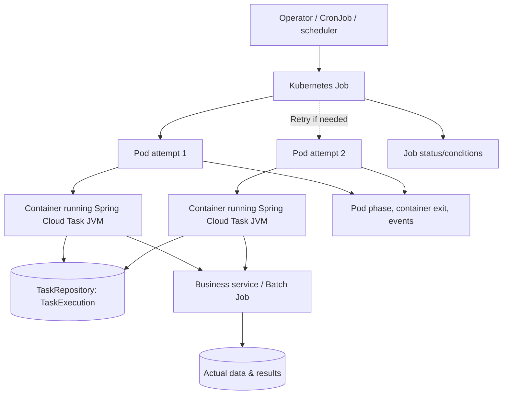
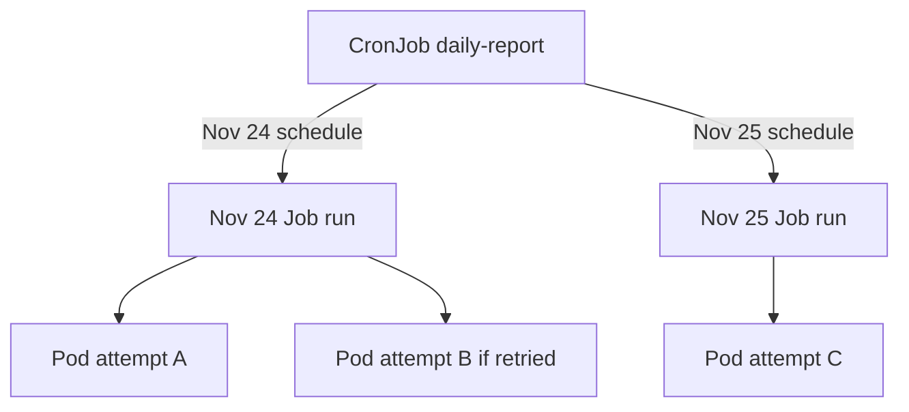

# Reconciling Pod, Job, and TaskExecution States

## 1. Why reconcile three status sources?

**Spring Cloud Task** is a framework for Spring Boot applications with a finite runtime: start up, accept arguments, execute business logic, and exit. When backed by a database, `TaskRepository` persists a **`TaskExecution`** for each framework-managed run, capturing start time, end time, exit code, and error details.

When deployed as a **Kubernetes Job**, two additional Kubernetes resource layers exist:

- **Job**: the controller tracking Pod completion/failure counts and driving toward desired completions per configured policies.
- **Pod**: the execution environment running one or more containers. Kubernetes records the Pod phase, per-container states, waiting/termination reasons, and process exit codes.

These layers answer distinct questions:

| Question | Source to inspect | Limitation of that source |
| --- | --- | --- |
| Did Kubernetes create a Pod and how did it exit? | **Pod** (`status.phase`, `containerStatuses`, events, logs) | Does not prove business data is right |
| Did the Kubernetes run satisfy completion conditions? | **Job** (`status.active/succeeded/failed`, `conditions`) | May reflect multiple retry Pods; does not mirror `TaskExecution` directly |
| How did Spring Cloud Task record a run? | **`TaskExecution`** in `TaskRepository` | May be missing if the JVM crashed pre-bootstrap or couldn't write end metadata |
| Did reports/orders/files truly complete? | **Business tables and output evidence** | Not proven solely by any status from the three layers above |

For example, Kubernetes Job `daily-report-20261124` has a Pod stuck in `ImagePullBackOff`. Because the task never ran, the Spring Cloud Task database has **no new row**. Conversely, a Pod might finish business writes and then receive `SIGKILL` before the framework writes `END_TIME`: Kubernetes sees an abnormal container termination, yet part or all of the business data already committed.

**Lesson objective:** know how to read Pod → Job → `TaskExecution` → business outputs along a shared correlation key, spot seemingly contradictory states, and make safe retry/remediation decisions when running Spring Cloud Task on Kubernetes or similar orchestrators.

## 2. Architecture and single-run lifecycle



One Kubernetes Job can create **multiple Pods** due to retries, replacements, or parallelism. A Pod **does not always produce exactly one** `TaskExecution`: a Pod failing before Spring Boot starts creates none; a container could launch multiple JVMs if a custom entrypoint does so; a Pod can include sidecars. Under this lesson's recommended pattern, each Pod runs **one primary task container executing one JVM once**, so each attempt reaching the framework normally yields its own `TaskExecution`.

### Distinguishing Kubernetes Job from Spring Batch Job

The word **Job** carries two easily confused meanings in this ecosystem:

| Term | System | Example | Key metadata |
| --- | --- | --- | --- |
| Kubernetes **Job** | Kubernetes `batch/v1` | `daily-report-20261124` | Kubernetes API: `Job.status`, Pod status |
| Spring Batch **Job** | Spring Batch (if used) | `importOrdersJob` | `BATCH_JOB_INSTANCE`, `BATCH_JOB_EXECUTION` |
| Spring Cloud **`TaskExecution`** | Spring Cloud Task | `executionId = 415` | `TASK_EXECUTION` |

A Kubernetes Job can launch a Spring Cloud Task, which in turn can launch a Spring Batch Job. **Never** use Spring Batch's `JOB_EXECUTION_ID` as the Kubernetes Job name, and never equate `TaskExecution.executionId` with Pod UID. When Spring Batch is present, reconciliation must also include `JobRepository` and Step checkpoints.

## 3. Exact meaning of each status

### 3.1. Pod phase and container states

`Pod.status.phase` is a Pod-level summary taking one of these values:

| Pod phase | Interpretation | What else to check |
| --- | --- | --- |
| `Pending` | Pod accepted, but at least one container is not created/started yet | Scheduling, `ImagePullBackOff`, Secrets, volumes, quotas, init containers |
| `Running` | Pod bound to a node with containers running/restarting; does not mean business work finished | `containerStatuses[*]`, app logs, `TaskExecution` |
| `Succeeded` | All regular containers exited cleanly | Exit code of the **task container**, Job status, and target data |
| `Failed` | At least one container failed or was terminated by the system on error | `terminated.exitCode`, `reason`, `message`, Pod events |
| `Unknown` | Kubernetes cannot determine Pod state | Node, kubelet, network, controller, and infra logs |

Note: `ImagePullBackOff` and `CrashLoopBackOff` are typically **container waiting reasons/states**, not official `Pod.phase` values. The summary `STATUS` column printed by `kubectl get pods` often surfaces container reasons and **need not equal `Pod.status.phase`**.

When investigating, inspect the **primary task container's status**, not Pod phase alone. A Pod with a sidecar might stay `Running` after the Java container exited; conversely, a Pod marked failed because of an auxiliary container might not reflect Java's business outcome.

`exitCode = 0` usually means the main Java process/container exited cleanly at the OS level. `exitCode != 0` can stem from exceptions, misconfiguration, `OOMKilled`, system signals, or launcher-defined codes. **Exit codes do not prove external partners confirmed every off-DB side effect.**

### 3.2. Kubernetes Job status and conditions

For standard Jobs, key fields include:

- `status.active`: number of active Pods tracked by the controller.
- `status.succeeded`: count of Pods reaching `Succeeded`.
- `status.failed`: count of Pods recorded as `Failed`.
- `status.conditions`: conditions such as `Complete`, `Failed`, or transitional states depending on Kubernetes version.
- `spec.completions`, `spec.parallelism`, `spec.backoffLimit`, `spec.activeDeadlineSeconds`: completion target, concurrency, retry budget, and deadline.

With `completions: 1` and `parallelism: 1`, a single `Succeeded` Pod allows the Job to reach `Complete` once the controller reconciles. If the first attempt fails and the second succeeds, **the Job can finish `Complete` while still showing `status.failed > 0`**. That is not contradictory: counters record previously failed Pods.

Never treat `status.succeeded = 0` as proof the Job failed; it may still be `Pending`/`Active`. Likewise, do not treat one `Failed` Pod as the **whole Job being `Failed`** while retries remain. Inspect both `conditions` and all Pods belonging to the Job.

### 3.3. Spring Cloud Task `TaskExecution`

The default `TaskRepository` schema uses `TASK_EXECUTION` with fields:

| Field | Meaning |
| --- | --- |
| `TASK_EXECUTION_ID` | Execution identifier managed by `TaskRepository` |
| `TASK_NAME` | Logical task name, normally stable across attempts |
| `START_TIME`, `END_TIME` | Start and end timestamps recorded by the framework |
| `EXIT_CODE` | Exit code recorded via framework execution/exit mapping |
| `EXIT_MESSAGE`, `ERROR_MESSAGE` | Additional outcome/error details |
| `EXTERNAL_EXECUTION_ID`, `PARENT_TASK_EXECUTION_ID` | External/parent–child correlation metadata when used |

`TaskExecution` is **not** Kubernetes Pod status. If the JVM fails to build `ApplicationContext`, cannot reach `TaskRepository`, lacks metadata tables, or is killed too early, the `TASK_EXECUTION` row may be absent or lack `END_TIME`/final exit code. That does not invalidate Kubernetes logs and events.

## 4. Using a correlation key to link all three layers cleanly

When a Job retries, Kubernetes spawns a new Pod; `Pod.metadata.name` and `Pod.metadata.uid` change. `TASK_EXECUTION_ID` also changes across framework-initialized Java runs. Therefore, **never join logs, Jobs, and `TaskExecution` solely by nearby timestamps**.

A straightforward strategy is assigning a **stable business `runKey` for the whole logical request** and propagating it to every observability source:

1. **Kubernetes Job:** label or annotate with `runKey`, alongside namespace, Job name, and UID.
2. **Pod:** capture Pod name and Pod UID from the Kubernetes Downward API; Pods link back to the Job via `ownerReferences`/labels.
3. **Spring Cloud Task app:** pass `--app.run-key=...` and emit structured logs containing `runKey`, Pod UID, `TASK_EXECUTION_ID` (once assigned), and task name.
4. **Business data:** persist `runKey` or a business idempotency key in output tables with matching unique constraints/transactions.

| ID | Stability scope | Changes when Kubernetes spawns a retry Pod? |
| --- | --- | --- |
| Business/scheduler `runKey` | **Same logical request** | **Must stay constant** |
| Kubernetes Job name/UID | One Kubernetes Job object | Constant across attempts of the same Job; recreated Jobs get a new UID |
| Pod name/UID | One specific Pod | Yes |
| `TASK_EXECUTION_ID` | One execution in **one `TaskRepository`** | Usually gets a fresh ID per JVM/task launch |
| Spring Batch `JobExecution` ID | One Batch Job execution (if used) | Governed by `JobRepository`; distinct from Task ID |

A constant `runKey` **does not deliver exactly-once execution on its own**. It simply lets every layer speak about the same request. You still need business locks, unique constraints, checkpoints, transactions, and/or external idempotency for safe retries.

### What if `TaskExecution` does not exist yet?

Preserve the **Job UID, Pod UID, container state, events, and platform logs** as evidence of pre-bootstrap failure. Never insert a fake `TaskExecution` marked succeeded just to fill a gap. You can record an external audit entry noting the deployment request failed before Java initialized.

## 5. Sample Spring Cloud Task application for deployment

The example uses Spring Boot with Spring Cloud Task **without Spring Batch** so you can focus on Pod/Job/`TaskExecution` relationships. An `ApplicationRunner` reads `runKey`, prints Pod metadata for tracing, and simulates errors via arguments. No real business mutations run in the sample runner.

### 5.1. Dependencies and `application.yml`

In a Maven project using compatible Spring Boot/Spring Cloud versions via BOMs:

```xml
<dependencies>
    <dependency>
        <groupId>org.springframework.cloud</groupId>
        <artifactId>spring-cloud-starter-task</artifactId>
    </dependency>
    <dependency>
        <groupId>org.springframework.boot</groupId>
        <artifactId>spring-boot-starter-jdbc</artifactId>
    </dependency>
    <dependency>
        <groupId>org.postgresql</groupId>
        <artifactId>postgresql</artifactId>
        <scope>runtime</scope>
    </dependency>
</dependencies>
```

`src/main/resources/application.yml`:

```yaml
spring:
  application:
    name: daily-report-task
  main:
    web-application-type: none
  datasource:
    url: ${TASK_DB_URL}
    username: ${TASK_DB_USER}
    password: ${TASK_DB_PASSWORD}
  cloud:
    task:
      name: daily-report-task
      initialize-enabled: false
```

`initialize-enabled: false` **assumes the official `TASK_*` schema has already been migrated**; against an empty database, the task cannot create `TaskExecution` rows. To correlate across multiple Pods, use a **shared persistent database**: `jdbc:h2:mem:` inside each Pod creates isolated per-Pod databases and provides no centralized history.

### 5.2. Runner: one JVM launch per attempt

Create `DeploymentTaskApplication.java`:

```java
package com.example.deployment;

import java.util.List;

import org.springframework.boot.ApplicationArguments;
import org.springframework.boot.ApplicationRunner;
import org.springframework.boot.SpringApplication;
import org.springframework.boot.autoconfigure.SpringBootApplication;
import org.springframework.cloud.task.configuration.EnableTask;
import org.springframework.context.annotation.Bean;

@EnableTask
@SpringBootApplication
public class DeploymentTaskApplication {

    public static void main(String[] args) {
        SpringApplication.run(DeploymentTaskApplication.class, args);
    }

    @Bean
    ApplicationRunner runOnce() {
        return args -> {
            String runKey = required(args, "app.run-key");
            String podName = System.getenv().getOrDefault("POD_NAME", "local");
            String podUid = System.getenv().getOrDefault("POD_UID", "unknown");
            System.out.printf("RUN_START runKey=%s pod=%s podUid=%s%n",
                    runKey, podName, podUid);

            // Intentional failure demo: do not use in production.
            if ("true".equalsIgnoreCase(optional(args, "demo.fail"))) {
                throw new IllegalStateException("Simulated error inside task");
            }

            // Real app calls a transactional/idempotent business service.
            System.out.printf("RUN_DONE runKey=%s pod=%s%n", runKey, podName);
        };
    }

    private static String required(ApplicationArguments args, String name) {
        String value = optional(args, name);
        if (value == null || value.isBlank()) {
            throw new IllegalArgumentException("Missing argument --" + name);
        }
        return value;
    }

    private static String optional(ApplicationArguments args, String name) {
        if (!args.containsOption(name)) {
            return null;
        }
        List<String> values = args.getOptionValues(name);
        if (values == null || values.size() != 1 || values.get(0) == null) {
            throw new IllegalArgumentException("Exactly one value required for --" + name);
        }
        return values.get(0);
    }
}
```

`runKey`, Pod name, and Pod UID appear in **application logs**. To add `TASK_EXECUTION_ID` to logs, register a `TaskExecutionListener` or `@BeforeTask`/`@AfterTask` bean, noting listeners run only once Spring Cloud Task enters its lifecycle. If the framework fails pre-bootstrap, Kubernetes logs remain mandatory evidence.

### 5.3. Listener adding `TaskExecution` ID to logs

Create `TaskExecutionAudit.java` (in the same package for component scanning):

```java
package com.example.deployment;

import org.slf4j.Logger;
import org.slf4j.LoggerFactory;
import org.springframework.cloud.task.listener.annotation.AfterTask;
import org.springframework.cloud.task.listener.annotation.BeforeTask;
import org.springframework.cloud.task.listener.annotation.FailedTask;
import org.springframework.cloud.task.repository.TaskExecution;
import org.springframework.stereotype.Component;

@Component
public class TaskExecutionAudit {

    private static final Logger log = LoggerFactory.getLogger(TaskExecutionAudit.class);

    @BeforeTask
    public void onStart(TaskExecution execution) {
        log.info("TASK_START taskExecutionId={} taskName={} podUid={}",
                execution.getExecutionId(), execution.getTaskName(),
                System.getenv().getOrDefault("POD_UID", "unknown"));
    }

    @FailedTask
    public void onFailure(TaskExecution execution, Throwable error) {
        log.error("TASK_FAILED taskExecutionId={} errorType={}",
                execution.getExecutionId(), error.getClass().getSimpleName());
    }

    @AfterTask
    public void onEnd(TaskExecution execution) {
        log.info("TASK_END taskExecutionId={} exitCode={}",
                execution.getExecutionId(), execution.getExitCode());
    }
}
```

This is an **observability hook**, not a place for mandatory business logic. Avoid heavy HTTP or SQL work inside listeners: if a listener throws, it can disrupt the task lifecycle. Logs must never contain tokens, passwords, personal payloads, or sensitive arguments. `@AfterTask` can observe state before final repository persistence completes; verify via SQL **after the process exits**.

## 6. Sample Kubernetes Job: one Pod at a time

Assume namespace `batch-lab` and Kubernetes Secret `task-db-credentials` **already exist** (keys: `url`, `username`, `password`), along with image `registry.example.com/demo/daily-report-task:1.0.0` containing the Java runtime and JAR at `/app/app.jar`. Below is an **illustrative** manifest—adapt image/resources/namespace for your environment:

```yaml
apiVersion: batch/v1
kind: Job
metadata:
  name: daily-report-20261124
  namespace: batch-lab
  labels:
    app.kubernetes.io/name: daily-report-task
    ops.example.com/run-key: daily-report-2026-11-24
spec:
  completions: 1
  parallelism: 1
  backoffLimit: 1
  activeDeadlineSeconds: 900
  template:
    metadata:
      labels:
        app.kubernetes.io/name: daily-report-task
        ops.example.com/run-key: daily-report-2026-11-24
    spec:
      restartPolicy: Never
      terminationGracePeriodSeconds: 30
      containers:
        - name: task
          image: registry.example.com/demo/daily-report-task:1.0.0
          command: ["java", "-jar", "/app/app.jar"]
          args:
            - "--app.run-key=daily-report-2026-11-24"
            - "--demo.fail=false"
          env:
            - name: POD_NAME
              valueFrom:
                fieldRef:
                  fieldPath: metadata.name
            - name: POD_UID
              valueFrom:
                fieldRef:
                  fieldPath: metadata.uid
            - name: TASK_DB_URL
              valueFrom:
                secretKeyRef:
                  name: task-db-credentials
                  key: url
            - name: TASK_DB_USER
              valueFrom:
                secretKeyRef:
                  name: task-db-credentials
                  key: username
            - name: TASK_DB_PASSWORD
              valueFrom:
                secretKeyRef:
                  name: task-db-credentials
                  key: password
          resources:
            requests:
              cpu: "100m"
              memory: "256Mi"
            limits:
              cpu: "500m"
              memory: "512Mi"
```

**Explaining these deliberate choices:**

- `completions: 1`, `parallelism: 1`: requires one Pod completion while creating at most one active Pod at a time per spec, matching a single-run task lab.
- `restartPolicy: Never`: container failure fails the Pod attempt; the Job controller can spawn a **new Pod** subject to `backoffLimit` and cluster state. Each new Pod is another chance to create an extra `TaskExecution`.
- `backoffLimit: 1`: caps controller-accepted failures before marking the Job failed; **offers no guarantee** that only one business side effect occurred.
- `activeDeadlineSeconds: 900`: Kubernetes Job-level deadline that can terminate the Job/Pod upon expiration; the app must tolerate incomplete shutdowns.
- `POD_NAME` and `POD_UID`: Kubernetes Downward API injects Pod identity into env vars so logs correlate with `TaskExecution`.
- `ops.example.com/run-key`: static label enabling lookups by business request; contains no sensitive data.
- `command` and `args`: valid only for images placing Java and the JAR at those paths; adapt if your image provides a custom entrypoint. Never wrap Java in a script that always exits `0`, as that hides failures from Kubernetes.

Never place passwords directly in manifests, command-line arguments, or annotations. Tune resource limits against real workloads; getting `OOMKilled` due to undersized limits is not a data-ingestion logic bug.

### Testing with a standalone Job

Save the manifest outside this guide, e.g., as `daily-report-job.yaml`, and apply with granted Kubernetes permissions:

```bash
kubectl -n batch-lab apply -f daily-report-job.yaml
kubectl -n batch-lab get job daily-report-20261124 -w
```

Running `kubectl apply` on an existing Job is not a standard restart mechanism: many Pod template fields are immutable once a Job exists. To run **a new request**, create a Job with a fresh name/UID and explicit business `runKey`; to retry **the same request**, inspect prior status and side effects first to prevent duplicate processing. Never arbitrarily delete a running Job just to tweak YAML.

## 7. Verification workflow: Kubernetes first, TaskRepository second

### 7.1. Inspecting the Job and completion conditions

```bash
kubectl -n batch-lab get jobs
kubectl -n batch-lab describe job daily-report-20261124
kubectl -n batch-lab get job daily-report-20261124 -o yaml
```

In JSON/YAML output, check `status.active`, `status.succeeded`, `status.failed`, `status.conditions`, `spec.completions`, `spec.parallelism`, and `spec.backoffLimit`. `describe` surfaces events such as Pod creation failures, quota exhaustion, or controller errors. Seeing Job `Complete` is **not enough** to conclude business invariants hold.

### 7.2. Listing **all** Pod attempts for the Job

```bash
kubectl -n batch-lab get pods \
  -l batch.kubernetes.io/job-name=daily-report-20261124 \
  -o wide
```

`batch.kubernetes.io/job-name` is the label set by the Kubernetes Job controller in modern releases. On older clusters/objects, check `job-name` or verify `metadata.ownerReferences` points to **the exact Job UID**. If two Pods appear, inspect both: the earlier Pod may be `Failed` and the later one `Succeeded` while the Job ultimately reads `Complete`.

Inspecting a specific Pod:

```bash
kubectl -n batch-lab describe pod <pod-name>
kubectl -n batch-lab get pod <pod-name> -o yaml
```

In the Pod YAML, inspect `status.phase`, `status.containerStatuses[*].state`, `lastState`, `restartCount`, `terminated.exitCode`, `terminated.reason`, `containerID`, and events. With `restartPolicy: Never`, a Kubernetes Job retry spawns a **different Pod**, so `kubectl logs --previous` on the newer Pod **does not replace** inspecting logs of the earlier failed Pod.

### 7.3. Collecting logs from the right Pod and container

```bash
# Specific Pod from the Job's list:
kubectl -n batch-lab logs pod/<pod-name> -c task --timestamps

# Use --previous only when the container restarted inside the SAME Pod:
kubectl -n batch-lab logs pod/<pod-name> -c task --previous --timestamps
```

`kubectl logs job/daily-report-20261124` works for quick checks, yet whenever a Job spans multiple Pods, **list and read logs for every Pod** so failed attempts are never overlooked. If Pods were garbage-collected or removed by TTL, logs may already be gone from the API; rely on centralized log collection with adequate retention.

### 7.4. Reconciling `TaskExecution` in PostgreSQL

When Spring Cloud Task uses the default schema on a version-matched persistent database, query:

```sql
SELECT TASK_EXECUTION_ID,
       TASK_NAME,
       START_TIME,
       END_TIME,
       EXIT_CODE,
       EXIT_MESSAGE,
       ERROR_MESSAGE
FROM TASK_EXECUTION
WHERE TASK_NAME = 'daily-report-task'
ORDER BY START_TIME DESC, TASK_EXECUTION_ID DESC;
```

In the example, use `RUN_START runKey=... podUid=...` and `TASK_START taskExecutionId=... podUid=...` logs to join **Pod UID** with **`TaskExecution` ID**; use the `run-key` label or `--app.run-key` argument to tie attempts back to the request. For frequent SQL reporting, maintain a **separate business correlation table** holding `run_key`, `task_execution_id`, `pod_uid`, `job_uid`, and verification state rather than altering the framework's `TASK_EXECUTION` schema.

Spring Cloud Task includes an execution-parameters table in supported configurations/schemas; parameter rows aid tracing, yet **never assume sensitive arguments are persisted or safe to search**. Dedicated correlation keys and structured logs are far more reliable than matching records solely by adjacent start timestamps.

If no matching row appears, first verify **JDBC URL/schema, profile, credentials, and migrations**, then check whether the Pod failed in `ImagePullBackOff`, `CreateContainerConfigError`, `CrashLoopBackOff`, or early Java startup before `TaskRepository` ran. Never conclude "the task was never requested" just because `TASK_EXECUTION` has no row.

## 8. Reconciliation matrix for common scenarios

| Kubernetes Pod / container | Kubernetes Job | `TaskExecution` | Diagnosis to verify |
| --- | --- | --- | --- |
| Pod `Pending`, container `ImagePullBackOff` | `Active`/not `Complete`, or heading toward deadline failure | **No** new row | Failed to pull image; Java never started; check registry, auth, tag |
| Pod `Pending`, missing Secret or volume | Job incomplete | **No** new row | Pre-bootstrap environment failure; inspect Pod events |
| Pod `Running`, JVM still working | Job `active > 0` | `START_TIME` present, `END_TIME` may be null | Normal while task runs; check logs and elapsed time |
| Pod `Succeeded`, main container exit `0` | Job `Complete` | `END_TIME` set, `EXIT_CODE=0` | Technical success; still verify business outputs |
| Pod `Failed`, container non-`0` exit | Job still retrying, not `Failed` yet | One attempt shows `EXIT_CODE!=0` | Check subsequent Pods; do not declare entire Job failed yet |
| Pod attempt 1 `Failed`, attempt 2 `Succeeded` | Job ends `Complete`, `failed > 0` may remain | **Two** executions if both JVMs entered Task | Valid controller retry; verify idempotency |
| Pod `OOMKilled` | Job may retry then `Complete` or `Failed` | `END_TIME` may be missing | JVM forcibly terminated; metadata update didn't complete |
| Pod `Succeeded` yet task DB has `EXIT_CODE!=0` | Job may show `Complete` | Task recorded failure despite container exit `0` | Check entrypoint/script swallowing exit codes, error mapping |
| Pod `Failed` after business commit | Job may show `Failed` | Failure or null `END_TIME` | Data may already be complete; reconcile before retrying |
| Pod/Job already deleted | No Kubernetes objects left to query | Task history may remain | Relies on centralized logs, deployment audits, aligned retention |

This matrix is an **interpretive guide**, not states guaranteed to appear simultaneously. Kubernetes and databases update **asynchronously**, so during transitions you may see a Job whose condition has not flipped after its Pod exited, or a `TaskExecution` still missing `END_TIME` at query time. Wait a short observation window before concluding, and record timestamps/UIDs of retrieved facts.

### Classic pitfall: Job `Complete` while one Pod `Failed`

Suppose `backoffLimit` permits retries:

1. Pod A launches the JVM; task `executionId=501` imports 850/1,000 orders and fails.
2. Kubernetes spawns Pod B; task `executionId=502` launches with the **same `runKey`**.
3. B uses business keys/checkpoints to process only the remaining 150 orders and exits `0`.
4. The Kubernetes Job reaches `Complete` because one Pod succeeded, even though Pod A stays `Failed` and `TaskExecution` 501 retains its failure record.

This is **expected behavior when retries are designed properly**. However, if B re-imports all 1,000 orders without idempotency, Job `Complete` masks duplicate writes; verify actual data rather than trusting `Complete` alone.

## 9. CronJob, retries, timeouts, and concurrency limits

On scheduled workloads, Kubernetes **CronJob** spawns Kubernetes **Job**s, which in turn spawn Pods. One day can produce multiple Pod attempts for one Job. A CronJob can also launch the next schedule's Job while an earlier Job is still running, depending on policy.



- `CronJob.spec.concurrencyPolicy: Forbid` prevents overlapping schedules from **that same CronJob**; it does not block manual Jobs or another CronJob.
- `Job.spec.parallelism > 1` runs multiple Pods **concurrently inside one Job**; if each Pod executes the same full import, duplicate-write risk is high unless partitioning/locks/idempotency are built in.
- `Job.spec.backoffLimit` controls Kubernetes-level retries; `spring.cloud.task.single-instance-enabled` is a task-name lock (requiring Spring Integration and a shared lock store) and **does not replace** Job or CronJob policies.
- `Job.spec.activeDeadlineSeconds` can terminate a Job mid-flight; retries after deadlines must inspect old worker state and partial data.
- Never use `TaskExecution` ID as an idempotency key: every retry can generate a new ID; rely on `runKey`, business keys, or stable transaction keys.

When running Spring Batch, a separate restart layer exists: matching `Job` name plus **identifying `JobParameters`** identifies the exact `JobInstance` to resume from checkpoints. Kubernetes retrying a Pod **does not automatically make Spring Batch resume the failed Step**. Inspect `JobRepository` and ensure consistent Batch parameters across attempts.

## 10. Safe diagnostic workflow when states disagree

When one source reports success while another reports failure, follow this order:

1. **Identify the request:** record `runKey`, cluster, namespace, Kubernetes Job name/UID, and expected time window. Avoid looking at a similarly named Job in another namespace.
2. **Inspect the Job:** check `conditions`, `active/succeeded/failed`, `backoffLimit`, deadline, and events. Confirm whether the Job reached a terminal condition or is still transitioning.
3. **List every Pod for that Job UID:** inspect phase, main-container exit code/reason, init containers, sidecars, creation timestamps, and per-attempt logs.
4. **Link to Spring Cloud Task:** extract Pod UID from `TASK_START` logs and query `TASK_EXECUTION` in the same metadata store; find any incomplete or failed executions. If no ID exists, investigate pre-bootstrap errors.
5. **If Spring Batch is present, inspect Job/Step state:** check `BATCH_JOB_EXECUTION`, `BATCH_STEP_EXECUTION`, checkpoints, and identifying parameters to avoid restarting the wrong instance.
6. **Reconcile outputs:** verify committed database rows, files and checksums, external API receipts, or business status tables. Distinguish "technically finished task" from "accurately completed business request".
7. **Decide retry/remediation:** relaunch only once prior processes have stopped or infrastructure permits, business locks/idempotency are intact, and the remaining work scope is clear. Bound backoff and attempts.
8. **Record findings:** log UIDs, execution IDs, root cause, and actions taken in the operational logbook; never manually edit framework rows to make history look clean.

### Common errors and remedies

| Symptom | Possible cause | First check |
| --- | --- | --- |
| `kubectl get job` stays `Active` while Pod is `Pending` long | Scheduling failure, image pull, missing Secret/volume, or quota | `kubectl describe pod`, Job/Pod events |
| Job `Failed` with zero `TaskExecution` rows | JVM never started, wrong JDBC/schema, bootstrap crash | Container logs, Pod reason, and Spring startup logs |
| `TaskExecution` `EXIT_CODE=0` yet Pod `Failed` | JVM errored post-callback, auxiliary container failed, or OS signal | Main-container exit code, sidecar/init containers, post-Task-end logs |
| Pod `Succeeded`, `TaskExecution` missing `END_TIME` | Metadata write error, queried wrong DB, or eventual update | `TaskRepository` logs, DB URL/schema, observation timing |
| Job `Complete` yet business data missing | Task returned false success, swallowed errors, or weak completion check | Reconciliation SQL, business logs, prior attempts |
| Single Kubernetes Job has multiple `TaskExecution`s | Pod retries, multiple JVMs in image, or task relaunches | Pod UIDs, Job UID, and startup logs |
| Failed Pod missing after retries | Pod/Job cleanup or tight history limits | Centralized logs, events, TTL/history settings |
| Scheduler spawned multiple Jobs for the same day | CronJob overlap/missed triggers or manual runs | CronJob events, schedule, `runKey`, concurrency policy |
| Two Pods mutated the same business record | Parallelism without partitioning/idempotency | Job `parallelism`, business locks, unique constraints |
| Task `EXIT_CODE` differs from container exit code | Wrapper script dropped exit code, mismatched error mapping | Image entrypoint, `exec`, shell exit status, Task logs |

**Never use `kubectl delete pod` or `DELETE FROM TASK_EXECUTION` as default error fixes.** Kubernetes may simply recreate the Pod under the Job controller, while deleting metadata destroys audit evidence. To truly stop processing, act on the orchestrator object, verify no valid process remains active, and assess all committed side effects.

## 11. Designing observability and history preservation

Kubernetes Pods and Jobs may expire via TTL/retention; `TaskRepository` may live longer; business data follows its own lifecycle. To investigate incidents weeks later, persist at least:

- Stable `runKey`, cluster, namespace, Kubernetes Job UID, Pod UID, and main container name.
- Scheduling/start timestamps, container start times, terminated exit codes/reasons, Job conditions, and key events.
- `TASK_EXECUTION_ID`, `TASK_NAME`, `START_TIME`, `END_TIME`, `EXIT_CODE`, `ERROR_MESSAGE`; plus Spring Batch IDs/statuses if used.
- Artifact version (immutable image digest/tag), config version, and non-sensitive business arguments.
- Output evidence: business keys, processed counts/ID sets, checksums, external receipts, and reconciliation outcomes.

Build dashboards tracking **Jobs failing to launch Pods**, **Pods failing prior to `TaskExecution` creation**, **stale un-finalized `TaskExecution`s**, **Jobs `Complete` with failed business reconciliation**, **Pod attempts per Job**, and **retry rates**. A dashboard reading only `TaskRepository` misses `ImagePullBackOff` and missing-Secret failures.

When logs carry IDs from multi-tenant environments, enforce read RBAC, proper retention, and keep PII/secrets out of labels and CLI arguments. Injecting a Kubernetes Secret via environment variables does not stop an app from accidentally logging its value.

## 12. Self-check exercises

1. Explain why **Kubernetes Job**, **Pod**, and **`TaskExecution`** are not three names for the same run. State conditions under which one Job produces multiple Pods and multiple `TaskExecution`s.
2. Deploy the sample Job manifest with `--demo.fail=false` in a prepared lab namespace/DB. Use `kubectl get job`, `get pods`, `describe`, `logs`, and SQL to collect all three status layers.
3. Create a **new** Job with `--demo.fail=true` in the lab. Observe `backoffLimit`, Pod attempt count, logs, and `TaskExecution` rows (if created). Why does one `Failed` Pod not prove the entire Job `Failed`?
4. Intentionally specify a nonexistent image tag in a test environment. Predict Pod reason, Job status, and whether `TASK_EXECUTION` appears. Why is querying `TaskRepository` alone insufficient to catch this error?
5. Cap container RAM too low to simulate `OOMKilled` **only if permitted in your lab environment**. Observe Pod `terminated.reason` and confirm `END_TIME` may remain missing.
6. Inspect two Pods from a retried Job; compare `Pod UID`, `TASK_EXECUTION_ID`, `runKey`, and Job UID. Which ID must stay stable for business correctness?
7. Suppose a Job shows `Complete` yet the report is missing partial data. Design SQL checks or checksum/unique-key rules to detect this and retry without duplicating writes.
8. For a CronJob, compare `concurrencyPolicy: Forbid` with Job `backoffLimit` and Spring Cloud Task single-instance locking. What distinct problems does each address?
9. When a Pod runs a Spring Batch Job, clarify differences among Kubernetes Job UID, `TASK_EXECUTION_ID`, `BATCH_JOB_EXECUTION.JOB_EXECUTION_ID`, and identifying `JobParameters`.
10. Design a runbook handling a case where TTL deleted the Kubernetes Job while `TaskRepository` and business data remain. Which extra logs/labels/UIDs do you need for traceability?

After this lesson, you should be able to **systematically reconcile Pod → Kubernetes Job → `TaskExecution` → business outputs**, recognize missing `TaskExecution` rows caused by pre-bootstrap errors, multiple attempts from retries, and timeouts/forced kills, and preserve correlation keys, logs, and metadata for safe scheduled or on-demand Spring Cloud Task operations.

## 13. References

- [Kubernetes — Pod Lifecycle](https://kubernetes.io/docs/concepts/workloads/pods/pod-lifecycle/): Pod phases, container states, termination reasons, and restarts.
- [Kubernetes — Jobs](https://kubernetes.io/docs/concepts/workloads/controllers/job/): Job status, conditions, retry/backoff, completions, and parallelism.
- [Kubernetes — CronJob](https://kubernetes.io/docs/concepts/workloads/controllers/cron-jobs/): schedules and CronJob concurrency policies.
- [Kubernetes — Downward API](https://kubernetes.io/docs/concepts/workloads/pods/downward-api/): exposing Pod metadata via environment variables.
- [Spring Cloud Task Reference Guide](https://docs.spring.io/spring-cloud-task/reference/): `TaskExecution`, `TaskRepository`, and lifecycle listeners.
- [Spring Cloud Task — Repository Schema](https://docs.spring.io/spring-cloud-task/reference/appendix-task-repository-schema.html): default `TaskRepository` metadata tables.
- [Spring Batch Reference](https://docs.spring.io/spring-batch/reference/): `JobExecution`, `StepExecution`, checkpoints, and restarts when integrating Batch.

Examples in this lesson are educational guides rather than drop-in runbooks for every cluster. Prior to production rollout, verify your **Kubernetes, Spring Cloud Task, Spring Boot, JDBC driver, and DDL versions**, and validate retry policies, retention, permissions, and business outcomes in a safe test environment.
