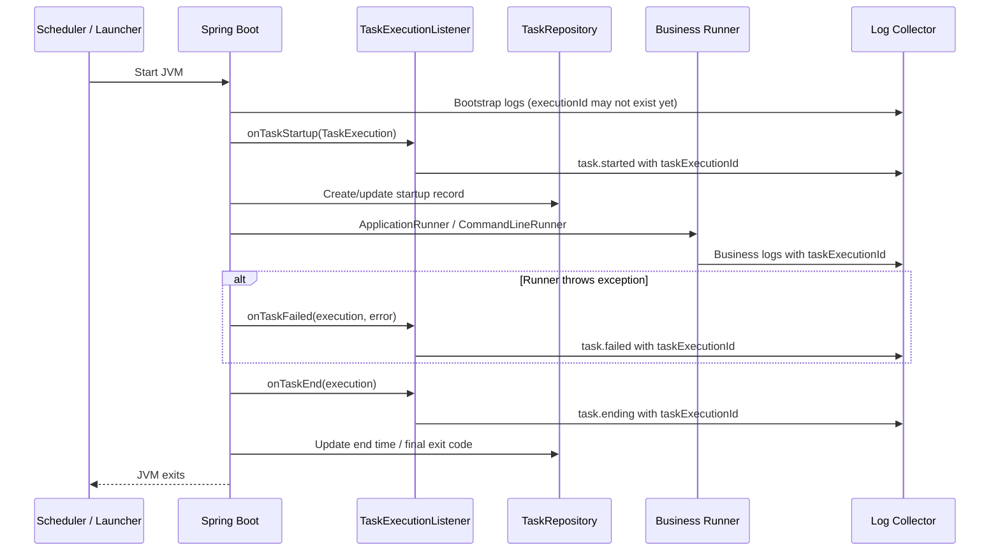
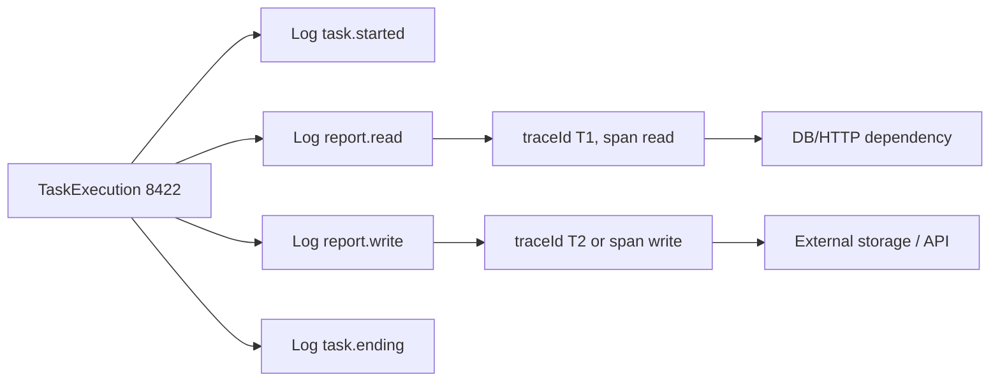
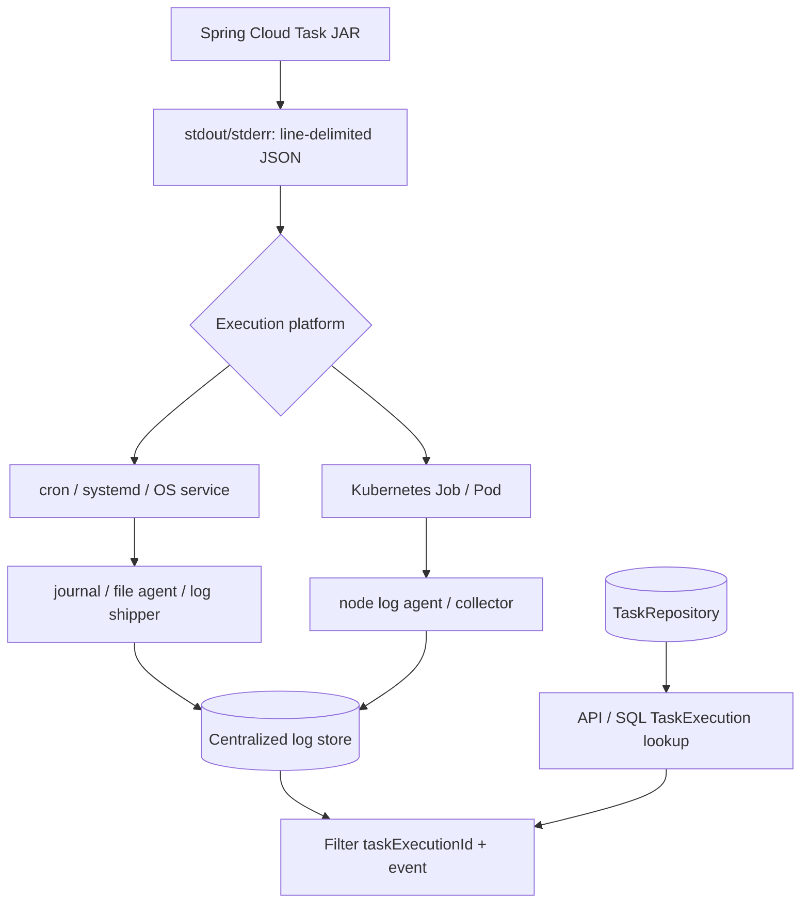

# Structured Logging and Correlation with executionId

## Lesson Objectives

**SPRING_CLOUD_TASK (Spring Cloud Task)** builds **short-lived** Spring Boot applications: they accept parameters, perform work, and then terminate. The framework records metadata for each run in `TaskRepository`, making it possible to track `TaskExecution`, exit codes, errors, and results. These runs can be triggered by cron, manual requests, or an orchestration platform, and may contain one or more Spring Batch Jobs.

In the **Observability** chapter, the key question is not just "Did the Task run?" but: **how do we find every log line belonging to one specific run, even when multiple runs share the same Task name and multiple processes run close together in time?** This lesson uses **structured logging** and `TaskExecution.executionId` as the correlation key to answer that question.

After this lesson, you will be able to:

- Distinguish Spring Cloud Task's `executionId` from `requestId`, scheduler ID, Pod ID, `traceId`, and Spring Batch's `JobExecution.id`.
- Design a consistent JSON log schema with event names, error severity, run ID, and timestamps.
- Configure Spring Boot 3.4+ structured logging or use a log pattern in versions without this built-in feature.
- Use `TaskExecutionListener`, SLF4J `MDC`, and `ApplicationRunner` to include the execution ID in logs while preventing context leaks across runs.
- Understand the limitations of `ThreadLocal`/MDC when handling `@Async`, worker threads, or Spring Batch multi-threaded Steps.
- Query centralized logs and reconcile them with `TASK_EXECUTION`, scheduler logs, process status, and `JobExecution`.
- Differentiate observability via logs, metrics, and distributed tracing without putting high-cardinality IDs into metric labels.
- Test cases involving missing execution IDs, Task startup failures, metadata persistence failures, or abrupt kills.

## 1. Why Traditional Logs Are Not Enough

Suppose `daily-report-task` runs at 02:00 to generate a report for `2026-11-23`, while an operator also clicks "rerun" at 02:01. Plain-text logs look like this:

```text
02:00:00 INFO  Start report
02:01:00 INFO  Start report
02:01:15 ERROR Query failed
02:01:17 INFO  Report finished
```

It is unclear which run produced the error line; nor does the "finished" line prove the actual outcome succeeded. Adding the Task name is still not enough, because both processes share the **same name**.

A structured log carries dedicated fields:

```json
{
  "@timestamp": "2026-11-23T02:01:15.123Z",
  "log": {"level": "ERROR"},
  "service": {"name": "daily-report-task"},
  "taskName": "daily-report-task",
  "taskExecutionId": "8422",
  "businessDate": "2026-11-23",
  "event": "report.query_failed",
  "errorType": "DataAccessException",
  "message": "Failed to read report data source"
}
```

This is a **sample designed for this lesson** illustrating an ECS + MDC shape; not all of this JSON is generated automatically by Spring Boot. Keys such as `taskExecutionId`, `businessDate`, and `event` must be added by the application. When your log collector supports JSON, you can filter `taskExecutionId = "8422"` to retrieve the exact lines with that ID without running regexes across entire messages.

### Two Core Rules

1. **Each log record should be a single complete JSON object** containing a timestamp, severity, service, and event name; exceptions can be stored in a dedicated field by the log encoder.
2. **`executionId` is the correlation key for a single Task run**, not the identifier for an entire business workflow; each rerun can receive a new ID.

## 2. Identifiers to Distinguish

In a real system, multiple IDs may exist at the same time:

| Field | Issued by | When to use | Does it replace `taskExecutionId`? |
| --- | --- | --- | --- |
| `taskExecutionId` | Spring Cloud Task `TaskRepository`. | Group logs of **one Task application run**. | **It is the primary key in this lesson.** |
| `taskName` | Configuration/`TaskNameResolver`. | Group the same kind of task. | **No**; multiple runs share the same name. |
| `businessDate` | Business parameter. | Group runs processing the same date, including retries. | **No**; a single date may run multiple times. |
| `requestId` | Issued by API or scheduler. | Trace a launch request and prevent duplicate invocations. | **No**; a single request may have multiple attempts. |
| `launchId`, `podUid`, or platform Job ID | Spring Cloud Deployer/Kubernetes/OS. | Trace infrastructure resources and status. | **No**; this ID differs from TaskRepository. |
| `externalExecutionId` | Passed into the Task by the launch platform. | Store an infrastructure ID in Task metadata. | **No**; it is a supplementary correlation field. |
| `traceId` / `spanId` | Distributed tracing system. | Trace calls/spans across services. | **No**; a single Task may produce multiple spans/traces. |
| `jobExecutionId` | Spring Batch `JobRepository`. | Trace one Batch Job run inside the Task. | **No**; the ID belongs to a different metadata store. |

If a launcher pre-creates the `TaskExecution`, it can pass `spring.cloud.task.executionid` so the process updates the already created record. Do not pick a random number yourself and treat it as a real ID; the record must be created and committed in the proper repository. If you need to store an ID from the scheduler, Spring Cloud Task supports `spring.cloud.task.external-execution-id`.

### Field Naming Conventions

Example using **consistent** keys:

| JSON Key | Example | Notes |
| --- | --- | --- |
| `taskExecutionId` | `"8422"` | When sourced from MDC, the value is typically a **string**; normalize types in the search system. |
| `taskName` | `"daily-report-task"` | Keep aligned with `spring.cloud.task.name`. |
| `event` | `"task.started"`, `"report.generated"`, `"task.failed"` | Machine-readable name, independent of message language. |
| `businessDate` | `"2026-11-23"` | Add only when relevant; verify it contains no sensitive data. |
| `requestId` | `"req-105"` | ID issued by request/orchestrator; validate length and format. |
| `traceId`, `spanId` | Strings generated by the tracer. | Do not fabricate trace IDs when tracing is not configured. |
| `errorType` | `"SQLTransientConnectionException"` | Error type; do not log full SQL containing secret parameters. |

Do not embed `taskExecutionId` inside free-form messages using inconsistent formats such as `execution#8422`, `task-id=8422`, or `id 8422`. A single standardized field makes searching and analysis much more effective.

## 3. Task Lifecycle and When executionId Becomes Available

Spring Cloud Task provides `TaskExecutionListener` with three main callbacks:

- `onTaskStartup(TaskExecution)`: callback around startup, described in the reference documentation as running **before** the initial `TaskExecution` is saved to the repository.
- `onTaskFailed(TaskExecution, Throwable)`: callback when an unhandled exception occurs, before `onTaskEnd`.
- `onTaskEnd(TaskExecution)`: callback **before** the final state update in the repository.



This diagram illustrates the **typical logical flow** according to the Spring Cloud Task documentation; the exact order of JDBC/commit operations and certain callbacks can depend on the version. In particular, **a `task.ending` log does not guarantee that the final result has been committed to the DB**.

Logs emitted **before `TaskExecution` has an ID** (loading dependencies, selecting profiles, creating beans, `ApplicationContext` errors) may **lack `taskExecutionId`**. This is not a bug in JSON logging. To trace them, combine `requestId`, launch ID, container/Pod ID logs, hostname, timestamps, and startup exceptions. Do not assign dummy IDs such as `0` or `-1` for a non-existent execution.

If the JVM is killed abruptly or the metadata database loses connectivity, the final callback may never run, `END_TIME` may remain null, and the final logs may be missing. Scheduler results and process status are always mandatory complementary sources.

## 4. Enabling JSON Logging in Spring Boot

Starting with **Spring Boot 3.4**, Spring Boot provides built-in structured logging, including `ecs`, `gelf`, and `logstash`. You can select the console or file format with:

```yaml
# application-prod.yml, example for Spring Boot 3.4+ with a supported logger
spring:
  application:
    name: daily-report-task
  main:
    web-application-type: none
  datasource:
    url: ${TASK_DB_URL}
    username: ${TASK_DB_USER}
    password: ${TASK_DB_PASSWORD}
  cloud:
    task:
      name: daily-report-task
      initialize-enabled: false

logging:
  structured:
    format:
      console: ecs
    ecs:
      service:
        name: daily-report-task
        environment: ${APP_ENV:prod}
  level:
    root: INFO
    com.example.report: INFO
```

This configuration applies when `TaskRepository` uses a PostgreSQL/DB with an already migrated schema and a compatible default logging setup. `logging.structured.format.console=ecs` writes JSON logs to stdout; `logging.structured.format.file=ecs` is also supported if there is a reason to write to a file. In containers, it is usually best to **write to stdout/stderr** so the platform agent collects logs, avoiding file management inside short-lived containers.

With Spring Boot's ECS encoder, key/value pairs in **SLF4J MDC** are also included in the JSON output. Therefore, putting `taskExecutionId` into MDC with proper scoping adds the same field across many business log lines without concatenating the ID into every message. You can use the fluent logging API `addKeyValue(…)` for key-values on a **single log event**.

**Two version caveats:**

1. Do not copy the `logging.structured.format.console` property into Spring Boot 3.3 or earlier and expect it to work; older versions usually require configuring a Logback/Log4j2 JSON encoder compatible with that version.
2. If the application has a custom `logback-spring.xml` or `log4j2-spring.xml`, custom appenders may bypass the default structured logging configuration. Verify the encoder/layout as documented for your Spring Boot version.

### Text Pattern Approach for Legacy Systems

Before rolling out a JSON encoder, you can still improve searchability with MDC in text logs:

```yaml
# Text log approach with Logback; do not use simultaneously as a JSON formatter.
logging:
  pattern:
    level: "%5p taskExecutionId=%X{taskExecutionId:-unknown}"
```

Depending on the Spring Boot version's default pattern, this field appears near the log level; the exact format is determined by the logging system. This is **not true structured JSON logging**: the log collector may still have to parse strings. When upgrading, prefer one shared JSON convention rather than each service emitting a different log pattern.

## 5. Using TaskExecutionListener to Capture executionId

The listener is the right place to learn **the ID assigned by Spring Cloud Task to the run**, because it receives `TaskExecution` directly. However, MDC is a **ThreadLocal**: do not simply call `MDC.put(…)` in the startup callback and assume every subsequent thread will inherit it automatically.

The following example stores the current ID in a small component, while logs inside **each callback** explicitly open and close MDC. This sample assumes **one TaskExecution per ApplicationContext**, which matches a typical Spring Cloud Task process:

```java
package com.example.report.observability;

import java.util.concurrent.atomic.AtomicReference;

import org.slf4j.Logger;
import org.slf4j.LoggerFactory;
import org.slf4j.MDC;
import org.springframework.cloud.task.listener.TaskExecutionListener;
import org.springframework.cloud.task.repository.TaskExecution;
import org.springframework.stereotype.Component;

@Component
public class TaskLogContext implements TaskExecutionListener {

    private static final Logger log =
            LoggerFactory.getLogger(TaskLogContext.class);

    private final AtomicReference<Long> currentId =
            new AtomicReference<>();

    public Long currentExecutionId() {
        return currentId.get();
    }

    @Override
    public void onTaskStartup(TaskExecution execution) {
        currentId.set(execution.getExecutionId());
        try (MDC.MDCCloseable id = MDC.putCloseable(
                "taskExecutionId",
                Long.toString(execution.getExecutionId()));
             MDC.MDCCloseable name = MDC.putCloseable(
                "taskName", execution.getTaskName())) {
            log.info("event=task.started");
        }
    }

    @Override
    public void onTaskFailed(TaskExecution execution, Throwable error) {
        try (MDC.MDCCloseable id = MDC.putCloseable(
                "taskExecutionId",
                Long.toString(execution.getExecutionId()))) {
            String errorType = error == null
                    ? "Unknown" : error.getClass().getSimpleName();
            log.error("event=task.failed errorType={}", errorType);
        }
    }

    @Override
    public void onTaskEnd(TaskExecution execution) {
        try (MDC.MDCCloseable id = MDC.putCloseable(
                "taskExecutionId",
                Long.toString(execution.getExecutionId()))) {
            log.info("event=task.ending exitCodeAtCallback={}",
                    execution.getExitCode());
        } finally {
            currentId.set(null);
        }
    }
}
```

`TaskExecution.getExecutionId()` returns a `long` in the documented Spring Cloud Task API. `MDC.putCloseable` belongs to SLF4J and returns an auto-closeable handle; `try-with-resources` prevents leaving the ID value on a reused thread. `AtomicReference` only passes the ID within **a single Task JVM**, not as a distributed registry or duplicate-run prevention mechanism.

### Why Callbacks Should Only Log

`onTaskFailed` and `onTaskEnd` sit close to error handling and Task metadata update paths. If you call a remote API, send an email, or write to business tables inside a listener and that operation fails, it can make shutdown harder to diagnose. Keep callbacks lightweight, do not throw errors just because an auxiliary logger or metric sink is unreachable, and **do not alter `exitCode` to mask the original exception**.

According to the documentation, `onTaskEnd` runs before the final status update; therefore, the example names the key `exitCodeAtCallback` rather than a `finalExitCode` field that looks already confirmed. The final outcome must be reconciled afterward from `TaskRepository` and the process exit status.

Do not interpret a `task.ending` log as "the Task definitely completed": it only proves the callback ran. If the application fails before creating the `ApplicationContext`, even this listener may never be invoked.

## 6. Putting executionId into ApplicationRunner Logs

In a runner, starting and ending an **explicit MDC scope** is safer than relying on leftover MDC state from a listener. Example using `TaskLogContext` from the previous section:

```java
package com.example.report;

import java.time.LocalDate;
import java.util.List;

import com.example.report.observability.TaskLogContext;
import org.slf4j.Logger;
import org.slf4j.LoggerFactory;
import org.slf4j.MDC;
import org.springframework.boot.ApplicationRunner;
import org.springframework.context.annotation.Bean;
import org.springframework.context.annotation.Configuration;

@Configuration(proxyBeanMethods = false)
public class ReportRunnerConfiguration {

    private static final Logger log =
            LoggerFactory.getLogger(ReportRunnerConfiguration.class);

    @Bean
    ApplicationRunner reportRunner(
            TaskLogContext context,
            ReportService service) {
        return arguments -> {
            List<String> days =
                    arguments.getOptionValues("businessDate");
            if (days == null || days.size() != 1) {
                throw new IllegalArgumentException(
                        "Requires --businessDate=yyyy-MM-dd");
            }
            LocalDate day = LocalDate.parse(days.get(0));

            Long id = context.currentExecutionId();
            if (id == null) {
                throw new IllegalStateException(
                        "TaskExecution has not been initialized yet");
            }

            try (MDC.MDCCloseable taskId = MDC.putCloseable(
                    "taskExecutionId", id.toString());
                 MDC.MDCCloseable taskName = MDC.putCloseable(
                    "taskName", "daily-report-task");
                 MDC.MDCCloseable businessDay = MDC.putCloseable(
                    "businessDate", day.toString())) {

                log.info("event=report.started");
                service.generate(day);
                log.info("event=report.generated");
            }
        };
    }
}
```

`ReportService` is the project's business service; the example assumes `generate(LocalDate)` actually generates the report and **throws an exception on failure**. Do not move `service.generate(…)` into a listener because business side effects need their own transactions, idempotency, and retry policies.

When logging on the same thread within the `try` scope, the JSON encoder can add `taskExecutionId`, `taskName`, and `businessDate` to lines emitted by the runner/service. `try-with-resources` closes the context even when `generate` throws an exception, preventing IDs from leaking into subsequent processing.

**Warning:** if an exception is thrown after MDC has closed, another framework's logger might no longer have `taskExecutionId`. To keep correlating the root cause, the `onTaskFailed` listener logs using `TaskExecution`, and the log collector should retain `requestId`/launch ID/Pod ID from before initialization.

## 7. Organizing Meaningful Log Events

Use stable event names and concise log messages, separating key/value data:

| Event | Level | What to log | What NOT to log |
| --- | --- | --- | --- |
| `task.started` | INFO | Task ID, Task name, build version, environment. | Full arguments containing passwords or tokens. |
| `report.started` | INFO | Business date, logical data source, request ID. | Dynamic SQL containing customer data. |
| `report.read.completed` | INFO | `rowsRead`, read duration. | Individual order contents. |
| `report.write.completed` | INFO | `rowsWritten`, controlled output location. | Full payloads containing sensitive information. |
| `task.failed` | ERROR | Error type, business error code, execution ID. | Public stack traces outside authorized access boundaries. |
| `task.ending` | INFO | Listener completion milestone, exit code at callback. | Claims that metadata is already committed. |
| `task.reconciled` | INFO/WARN | Result reconciled from DB/scheduler. | Concluding success solely from seeing START/END logs. |

If using SLF4J 2.x, you can attach key-values **per log event**:

```java
log.atInfo()
   .addKeyValue("event", "report.read.completed")
   .addKeyValue("rowsRead", 1200)
   .addKeyValue("durationMs", 320)
   .log("Input data reading completed");
```

The fluent logging API requires a compatible SLF4J version and backend; Spring Boot structured logging supports exporting key-values in documented formatters. If your application version does not support it, you can still use standard parameterized logging, but verify how the log collector parses it.

### Avoid Repeating the Same Information in Too Many Forms

For example, **do not** put `taskExecutionId` in MDC, manually append it to the message, and also add another `execution_id` field with the same value in JSON. A consistent schema reduces storage cost, avoids discrepancies, and simplifies queries.

JSON logs typically need a UTC/ISO-8601 timestamp, log level, logger, service name, taskName, taskExecutionId (once available), event, duration, and error type. Do not dump all business data into a single unstructured `message` field.

## 8. MDC Is ThreadLocal: Asynchronous Work Needs Context Propagation

`MDC` in common logging backends is bound to the **current thread**. When a Task uses `@Async`, `CompletableFuture`, an executor, parallel streams, or a Spring Batch multi-threaded Step, the executing thread may **lack** `taskExecutionId` even though the runner thread set MDC.

**Do not assume** that `InheritableThreadLocal` or setting MDC once in a listener automatically handles reused thread pools. You must actively propagate and clean up context:

```java
package com.example.report.observability;

import java.util.Map;

import org.slf4j.MDC;
import org.springframework.context.annotation.Bean;
import org.springframework.context.annotation.Configuration;
import org.springframework.scheduling.concurrent.ThreadPoolTaskExecutor;

@Configuration(proxyBeanMethods = false)
public class MdcExecutorConfiguration {

    @Bean("taskExecutor")
    ThreadPoolTaskExecutor taskExecutor() {
        ThreadPoolTaskExecutor executor = new ThreadPoolTaskExecutor();
        executor.setCorePoolSize(2);
        executor.setMaxPoolSize(4);
        executor.setQueueCapacity(50);
        executor.setTaskDecorator(task -> {
            Map<String, String> submitted = MDC.getCopyOfContextMap();
            return () -> {
                Map<String, String> previous =
                        MDC.getCopyOfContextMap();
                try {
                    if (submitted == null) {
                        MDC.clear();
                    } else {
                        MDC.setContextMap(submitted);
                    }
                    task.run();
                } finally {
                    if (previous == null) {
                        MDC.clear();
                    } else {
                        MDC.setContextMap(previous);
                    }
                }
            };
        });
        executor.initialize();
        return executor;
    }
}
```

This example only propagates **MDC** from the submitting thread to tasks run on **this specific executor**. It does not configure `@EnableAsync` on its own, nor does it apply to other executors or threads created directly by third-party libraries. `TaskDecorator` must be attached to the executor actually used by `@Async`/Spring Batch; context propagation is captured **at task submission time**.

If the application uses **Micrometer Tracing/Observation**, copying MDC alone is not enough to propagate trace/span context accurately. Spring Boot supports `ContextPropagatingTaskDecorator` or version-appropriate propagation configurations to transfer observation context across executors. Choose one unified approach and test it; do not accidentally copy an old trace ID into an operation that does not belong to that trace.

### With Spring Batch

If a Task runs Spring Batch:

- `TaskExecution ID` applies to the **entire application**; Batch Steps may run on different threads.
- `JobExecution.id` identifies **one Job run**; `StepExecution.id` identifies an individual Step run.
- You can additionally put `jobExecutionId` and `stepExecutionId` into MDC **within the exact callback/thread** of a Batch `JobExecutionListener` or `StepExecutionListener`, and remember to clean up the context.
- If using chunk workers, partitioning, or separate worker JVMs, you must deliberately pass IDs/correlation via metadata, parameters, or messages. The manager JVM's MDC does not automatically appear in a worker JVM.

`TaskBatchExecutionListener` can store the `TASK_TASK_BATCH` relationship between `TaskExecution` and `JobExecution` when Spring Cloud Task–Batch integration is configured. Querying that association table helps locate all Batch logs for the right Task, even when one Task runs multiple Jobs.

## 9. Distinguishing taskExecutionId and traceId

Distributed tracing via Micrometer/Zipkin/OpenTelemetry answers a **different** question: "Which services did a call traverse, how long did it take, and which span failed?"

| Field | Scope | Where should it appear? |
| --- | --- | --- |
| `taskExecutionId` | One Spring Cloud Task application run. | Primary Task logs; `TASK_EXECUTION` table. |
| `traceId` | One trace of a multi-service operation chain. | Logs/spans if tracing is configured and context is active. |
| `spanId` | One child operation within a trace. | Corresponding logs/spans. |
| `requestId` | Request from caller/scheduler. | Launcher and Task logs, if passed safely. |
| `businessDate` | Business unit to process. | Business logs/metadata, not a tracing ID. |

In Spring Boot with Micrometer Tracing, `traceId` and `spanId` can be added to MDC and log correlation strings, but **tracing does not automatically provide `taskExecutionId`**. A Task may call multiple services and generate multiple traces/spans; you must set the execution ID separately if your goal is to trace the entire Task lifecycle.



Do not emit `taskExecutionId` as a per-item metric label or generate millions of tag values; it is a **high-cardinality** identifier. Logs and tracing attributes can carry the ID for drill-down; metric labels should stay bounded to finite dimensions such as `taskName`, `outcome`, `environment`, or normalized error types.

## 10. Correlating Logs with TaskRepository Using SQL

`TaskRepository` stores durable history when using JDBC. With the default Spring Cloud Task schema, the `TASK_EXECUTION` table holds `TASK_EXECUTION_ID`, `TASK_NAME`, `START_TIME`, `END_TIME`, `EXIT_CODE`, `EXIT_MESSAGE`, and several external correlation fields.

Query an execution by the ID found in the logs:

```sql
SELECT TASK_EXECUTION_ID,
       TASK_NAME,
       START_TIME,
       END_TIME,
       EXIT_CODE,
       EXIT_MESSAGE,
       EXTERNAL_EXECUTION_ID,
       PARENT_TASK_EXECUTION_ID
FROM TASK_EXECUTION
WHERE TASK_EXECUTION_ID = 8422;
```

A newly started execution already has `START_TIME`, while `END_TIME` may remain null while running. Immediately after a `task.ending` log appears, querying the DB **might not yet show the final update**. Retry with bounded backoff or use tooling that inspects committed state.

Example finding Tasks missing an end time past an allowed duration (PostgreSQL syntax):

```sql
SELECT TASK_EXECUTION_ID,
       TASK_NAME,
       START_TIME,
       END_TIME
FROM TASK_EXECUTION
WHERE END_TIME IS NULL
  AND START_TIME < CURRENT_TIMESTAMP - INTERVAL '30 minutes'
ORDER BY START_TIME;
```

**Do not automatically treat this query's output as a list of still-running Tasks.** These are **candidates to investigate**. A Task may have been killed, lost DB connectivity at shutdown, or failed early; compare platform logs, process/Pod state, and business outputs.

### When Combining with Spring Batch

If the Task–Batch integration library created links in `TASK_TASK_BATCH`, query:

```sql
SELECT TASK_EXECUTION_ID, JOB_EXECUTION_ID
FROM TASK_TASK_BATCH
WHERE TASK_EXECUTION_ID = 8422;
```

Then look up `JobExecution` in `BATCH_JOB_EXECUTION` and `StepExecution` in `BATCH_STEP_EXECUTION` using the corresponding IDs. If Task and Batch use **two separate metadata databases**, do not assume cross-DB SQL joins will work; query them separately and join them in your investigation tooling.

**Limitations:** these SQL queries assume the default tables/columns of a compatible Spring Cloud Task schema, and PostgreSQL for interval syntax. If using a custom table prefix, dedicated schema, or another SQL dialect, adjust accordingly.

## 11. Centralizing Logs from cron, systemd, Containers, and Kubernetes

A Spring Cloud Task JAR can finish in a few seconds. Without durable log collection, operators **cannot retrieve** logs simply because the process no longer exists.



| Environment | How logs are collected | Risks to address |
| --- | --- | --- |
| Linux cron | Redirect stdout/stderr to rotated files or forward via journal/agent. | Unbounded log file growth; missing write permissions; loss on host replacement. |
| systemd timer | `journalctl -u daily-report.service` and journald forwarding. | Local retention may be short; host failure can lose logs. |
| Windows Task Scheduler | Appropriate file/event/log agent; `Last Run Result` is only an OS-level signal. | Failures before the JVM starts may not produce application logs. |
| Kubernetes Job | Container stdout/stderr logs, node-level collector, or cluster logging stack. | Pods are deleted after TTL/cleanup; checking `kubectl logs` late may yield no data. |
| Spring Cloud Data Flow/Deployer | Platform logs and launch/execution metadata. | Launch ID is not automatically the same as TaskExecution ID; correlation is required. |

Example checking logs on Linux:

```bash
journalctl -u daily-report.service --since "2026-11-23 01:50"
```

Example with Kubernetes (**illustrative** Job/namespace names):

```bash
kubectl get jobs -n reporting
kubectl logs job/daily-report-20261123 -n reporting
```

These commands only show logs **still retained by the platform**. To query across multiple runs/systems after a Pod/Job is cleaned up, ship logs to a centralized store before retention expires. When analyzing, filter on `taskExecutionId` in the **JSON field**; if no ID exists yet (bootstrap failure), also filter by request ID, Pod UID, launch ID, or time window.

### Illustrative Queries in a Log Search Tool

**Pseudo-query** examples, not required syntax for Elastic/Loki/Splunk:

```text
service.name == "daily-report-task"
AND taskExecutionId == "8422"
ORDER BY @timestamp ASC
```

Find errors for the same execution:

```text
taskExecutionId == "8422"
AND log.level IN ("ERROR", "WARN")
```

Depending on the backend, fields may be renamed, prefixed, or converted to numeric types. Before building dashboards, inspect the actual JSON, index mapping, and ingest policies; do not deploy this pseudo-syntax to production as a verified query.

## 12. Security, Cost, and Log Retention Policies

Structured logging speeds up queries, but it is not automatically secure. `TaskExecution` can hold arguments and errors. `TASK_EXECUTION_PARAMS` metadata may store parameters passed via the command line; logs can also accidentally print SQL or user details.

### Data Protection Rules

1. **Never log passwords/tokens/connection strings containing credentials**, even at DEBUG or inside exception messages.
2. Do not dump all command-line arguments into logs; select only vetted safe fields.
3. Use exception types/error codes for aggregation. Store full stack traces only in access-restricted logging systems with proper retention and redaction.
4. Do not treat `executionId` as a secret or auth token: log/Task APIs must enforce caller authorization.
5. Avoid putting emails, phone numbers, or customer payloads into `taskName`, `requestId`, or metric labels.
6. Apply retention matching audit requirements, scrub sensitive data, and encrypt transport from the log agent to the backend.

### Cost and Performance

A Task emitting 100,000 log lines for 100,000 items can incur high costs, especially when running daily. Usually you should:

- Log by **processing milestone/chunk cycle**, total item counts, and duration instead of per record.
- Use `INFO` for start/finish, `WARN` for recoverable issues, and `ERROR` for actionable failures; enable `DEBUG` selectively, never across the whole framework in production.
- Do not use `taskExecutionId` or `requestId` as Prometheus/Micrometer labels because their cardinality is very high.
- Keep JSON as one line per event; avoid progress output that emits multi-line fragments without shared metadata.

## 13. Signals Beyond Logs: Metrics and Tracing

Logs are **event data**; metrics track **counts/trends**; traces record **paths and durations of spans**. The three channels complement each other.

| Signal | Example | Purpose | Limitation |
| --- | --- | --- | --- |
| Log | `event=task.failed`, `taskExecutionId=8422` | Investigate a specific run. | Depends on log retention and ID propagation. |
| Counter metric | `task_runs_total{taskName, outcome}` | Count successful/failed runs. | Do not use execution ID as a label. |
| Timer/histogram metric | `task_duration_seconds{taskName, outcome}` | Inspect p95/p99 run duration. | Short-lived apps may exit before Prometheus scrapes them. |
| Trace | `traceId` and DB/HTTP spans. | Find bottlenecks across services. | May be sampled; does not replace Task metadata. |
| Task metadata | `TASK_EXECUTION` | Verify history by ID, time, and exit code. | May be missing if context failed to initialize or DB failed. |

For **short-lived Task applications**, do not simply expose `/actuator/prometheus` and expect Prometheus to pull during every run. You may need an appropriate collector/export path, or aggregate statistics from TaskRepository and logs. If using push-style metrics, handle stale state, distinguish retries, and pick durable storage.

## 14. Diagnosing Difficult Cases

| Symptom | Possible cause | How to check |
| --- | --- | --- |
| Some logs lack `taskExecutionId` | Bootstrap logs before listener; missing MDC; different thread. | Check timing, thread, callbacks, and context propagation path. |
| All logs are plain text despite `ecs` | Spring Boot before 3.4 or custom Logback appender ignoring formatter. | Verify Boot version, dependencies, and encoder/layout. |
| Logs from `@Async` lose the ID | MDC is ThreadLocal and executor lacks propagation. | Test `TaskDecorator` on the right executor; add parallel task tests. |
| Run B logs carry Run A's ID | MDC not cleaned up or thread pool reused. | Restore context with `try-with-resources`/`finally`; do not store MDC globally. |
| `task.ending` logged, `END_TIME` still null | Callback runs before DB update; DB error or kill after callback. | Check repository, process exit, and update error logs. |
| Error logged, yet `EXIT_CODE=0` | Exception caught and swallowed, or Batch Job failure not propagated to Task. | Check runner, Batch status, and exit code rules. |
| JobExecution exists, logs lack Task link | Missing context propagation or `TASK_TASK_BATCH`. | Inspect JobRepository, TaskBatchExecutionListener, and worker IDs. |
| Old logs not found | Pod deleted, rotation/retention too short, or collector missed them. | Check centralized logging system and shipper process. |
| Two runs on the same day have mixed logs | Filtered only by `taskName`/`businessDate` without execution ID. | Filter by `taskExecutionId`; keep `requestId` to link attempts. |
| Task dies before creating `TaskExecution` | Bootstrap failure, missing JAR/secret/DB. | Search by launch ID/Pod, timestamp, and scheduler logs. |

A common observability pitfall is **catching an exception in the runner, only calling `log.error(…)`, and returning normally**. Then the logs show ERROR while the framework may exit the Task with a success exit code. Handle exceptions according to the business contract: recover legitimately, or let critical errors propagate so the orchestrator sees the failure.

## 15. Log Correlation Test Matrix

| Scenario | Action | Expected verification |
| --- | --- | --- |
| Successful run | One Task with a valid `businessDate`. | Runner logs share the same `taskExecutionId` as the `TASK_EXECUTION` record. |
| Same-day rerun | Run two Task JVMs sequentially. | Two distinct `executionId` values; logs do not mix by ID. |
| Two parallel Tasks | Launch the same `taskName` in two processes. | Each process carries its own ID; loggers never borrow each other's ID. |
| Business error | `ReportService.generate` throws an exception. | `task.failed` logged with execution ID; Task metadata records failure if DB is alive. |
| Early bootstrap error | Intentionally misconfigure bean/DB. | Execution ID may be absent; logs remain traceable via Pod/launch ID. |
| Final metadata update error | Disconnect DB after runner starts in test. | Final log appears, yet DB remains uncommitted; no false success reported. |
| `@Async` | Run service on thread pool. | ID appears with proper `TaskDecorator`; absent if propagation is missing. |
| Reused thread pool | Submit two different jobs to the same executor. | No MDC lingers from the previous job. |
| Spring Batch Job | Linked Job/Step and TaskExecution. | Can trace Task → JobExecution → Step and worker logs. |
| JSON encoder | Inspect one stdout line under production profile. | Valid parseable JSON with timestamp, level, service, and expected MDC fields. |
| Sensitive data handling | Pass secret via config source in a test environment with redaction. | Secret does not appear in logs or exposed arguments metadata. |
| Crash/kill | Force-stop Task after startup. | Final logs/metadata may be missing; orchestrator still detects incomplete run. |

Do not merely assert that a string `taskExecutionId=8422` appears somewhere in the logs. Tests should verify **parseable fields**, the exact execution, no cross-thread/cross-run mixing, and that the Task table uses the expected database/schema.

## 16. Comprehensive Hands-On Lab

**Scenario:** `daily-report-task` is triggered by a Kubernetes CronJob or systemd timer at 02:00. Each day may also have manual reruns. Operators need to open a dashboard, pick a `TaskExecution ID`, view logs for that single run, and reconcile Batch/report status.

1. Create a Spring Cloud Task with `@EnableTask` and an `ApplicationRunner` that reads `--businessDate=yyyy-MM-dd` and calls a simulated `ReportService`.
2. Create `TaskLogContext implements TaskExecutionListener`; log `task.started`, `task.failed`, and `task.ending` with `TaskExecution.getExecutionId()`.
3. In the runner, put `taskExecutionId`, `taskName`, and `businessDate` into SLF4J MDC using `putCloseable`; guarantee cleanup on both success and exception.
4. If using Spring Boot 3.4+, enable `logging.structured.format.console=ecs`; on older versions, configure a compatible JSON encoder or MDC text pattern for comparison.
5. Run one successful execution and one failing execution; ingest the JSON logs into your centralized store and look them up by the execution ID seen in `TASK_EXECUTION`.
6. Run two executions for the same `businessDate` and verify querying by `businessDate` returns both, whereas querying by `taskExecutionId` returns only one run.
7. Using an executor with `TaskDecorator`, perform asynchronous work; prove that MDC is propagated at submission time and restored after the task finishes.
8. If using Spring Batch, log `JobExecution ID`/`StepExecution ID` and reconcile with `TASK_TASK_BATCH`; distinguish Task runs from Job runs.
9. Intentionally break `ApplicationContext` initialization and kill the JVM mid-run; practice investigating via launch ID/Pod ID when execution ID does not exist yet or final metadata is incomplete.
10. Write at least three dashboard queries: (a) logs by execution ID, (b) Tasks missing `END_TIME` past a threshold, and (c) failure counts by Task name/day, **without** using execution ID as a metric label.

**Completion criteria:** JSON logs have a stable schema, execution ID stays consistent from listener to runner/service, MDC never leaks across threads/runs, runs are queryable via TaskRepository, and the runbook handles both pre-execution-ID failures and missing final events/logs.

## 17. References

- [Spring Cloud Task — Features and TaskExecutionListener](https://docs.spring.io/spring-cloud-task/reference/features.html): Task lifecycle, `TaskRepository`, startup/failure/end callbacks, and external IDs.
- [TaskExecution API](https://docs.spring.io/spring-cloud-task/docs/current/apidocs/org/springframework/cloud/task/repository/TaskExecution.html): `getExecutionId()`, `getTaskName()`, `getExitCode()`, and metadata fields.
- [TaskExplorer API](https://docs.spring.io/spring-cloud-task/docs/current/apidocs/org/springframework/cloud/task/repository/TaskExplorer.html): looking up an execution by ID and JobExecution associations.
- [Spring Cloud Task — Task Repository Schema](https://docs.spring.io/spring-cloud-task/docs/current/reference/html/appendix-task-repository-schema.html): `TASK_EXECUTION`, `TASK_TASK_BATCH` tables, and metadata columns.
- [Spring Boot — Logging and Structured Logging](https://docs.spring.io/spring-boot/reference/features/logging.html): ECS/GELF/Logstash, JSON console/file, MDC fields, and encoders.
- [Spring Boot — Observability / Context Propagation](https://docs.spring.io/spring-boot/reference/actuator/observability.html): ThreadLocal, tracing context, and `ContextPropagatingTaskDecorator`.
- [Spring Boot — Tracing / Logging Correlation IDs](https://docs.spring.io/spring-boot/reference/actuator/tracing.html): `traceId`, `spanId`, and correlation via MDC.

Application examples are illustrative and based on documented APIs. Verify the **exact versions** of Spring Boot, Spring Cloud Task, SLF4J, and your logging backend before using in production; verifying metadata commit timing, propagation, and JSON format requires integration tests.

## Key Takeaways

- **`taskExecutionId` identifies a single Spring Cloud Task run**. Task name or business date cannot replace this ID, since multiple runs may share the same name/date.
- Structured logging separates `timestamp`, `level`, `event`, and `taskExecutionId` into **searchable fields**, instead of merely concatenating them into the message.
- `TaskExecutionListener` supplies the ID for lifecycle logs, yet the end callback **does not prove TaskRepository has committed the final state**.
- `MDC` is thread-scoped; open/close it cleanly by scope and propagate it explicitly across executors/Spring Batch workers. Never let an old ID leak into another run.
- Spring Boot **3.4+** includes built-in structured JSON logging; older versions require compatible logging solutions. Tracing `traceId` is distinct from Task `executionId`.
- When a Task fails initialization or is killed, logs may lack execution IDs or completion lines; always cross-check scheduler, platform, and database records.
- Use execution ID to **filter logs**, never as a high-cardinality metric label. Keep logs safe, minimize sensitive data, and verify business outcomes separately.
