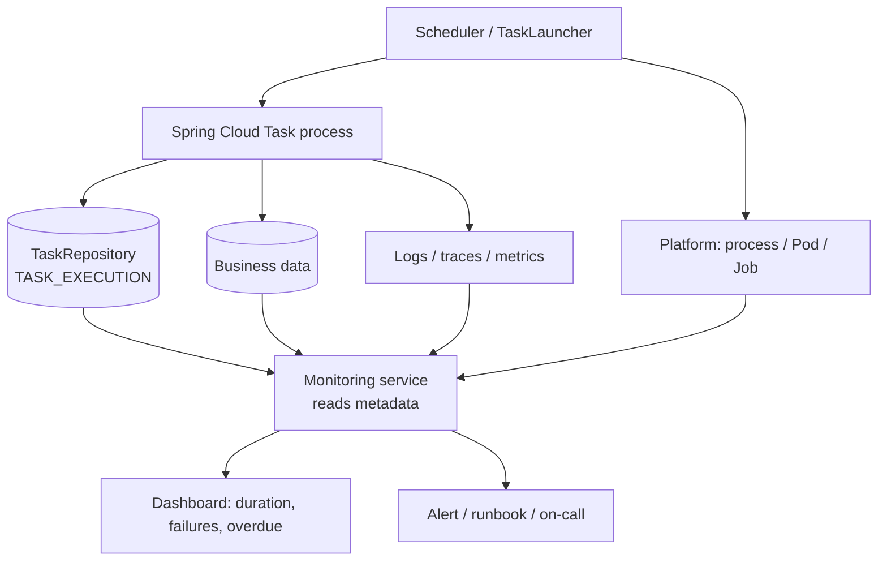

# Tracking Duration, Failure Rate, and Overdue Tasks

A **Spring Cloud Task** application does not run continuously like a web service: it **starts up, performs finite work, records metadata via `TaskRepository`, and then exits**. When a task is invoked by cron, a Kubernetes Job, or Spring Cloud Data Flow, the operational question is not just "Did the JVM exit?" but also:

- How long does each revenue reconciliation run take? Is it slower than last week?
- Among completed runs with known outcomes, what percentage failed?
- Is a currently running task exceeding its allowed processing time?
- The 02:00 schedule arrived, yet **no task started**—how do we detect this?
- If the metadata database has not recorded `END_TIME` yet while the Pod has already died, should we immediately rerun it?

This lesson in the **Observability** chapter shows how to build three indicator groups: **duration**, **failure rate**, and **overdue/SLA**. We use `TaskExecution` in the database as the historical source, combined with metrics, logs, scheduler info, and process/container status to obtain an accurate picture. The running example is the `dailyReconcile` task, which runs per business date and uses PostgreSQL to store metadata and process revenue reports.

After this lesson, you will be able to define metric formulas, write SQL queries for dashboards, build alert rules with sensible thresholds and sample counts, understand how to collect metrics from short-lived applications, and design safe runbooks when tasks are slow or fail.

## 1. Which Data Source Answers Which Question?

| Source | Primary information | Limitations |
| --- | --- | --- |
| **`TaskRepository` / `TaskExecution`** | Name, execution ID, `START_TIME`, `END_TIME`, `EXIT_CODE`, error message | Record may be missing on early startup failure; end time may not be updated if the JVM is killed. |
| **Scheduler / launcher** | Scheduled time, launch invocations, process creation request result | An accepted launch **does not prove** the task processed successfully. |
| **OS / Kubernetes / Cloud Foundry** | Process, Job/Pod, creation/run times, exit code, OOM, timeout, image-pull error | Container success does not prove all business data is correct; Pods may be cleaned up by TTL. |
| **Logs, tracing, Micrometer metrics** | Processing stages, per-runner/Step latency, exceptions, and external service calls | Metrics may not be exported before the process dies; logs/traces require a collector backend. |
| **Business database / files** | Written reports, reconciled records, idempotency keys | Does not by itself report the full Task lifecycle state. |

To evaluate a run, correlate sources using **`TaskExecution.executionId`**, task name, run timestamp, and business **correlation/request ID**. When using Spring Batch, also include `JobExecution`/`StepExecution`. **Do not use the execution ID as an idempotency key**: when retrying the same job, Spring Cloud Task typically creates a new ID.



**Key takeaway:** A good dashboard distinguishes **observed state**, **unknown state**, and **inferred state**. Do not turn "missing `END_TIME`" into "running" without checking infrastructure state.

## 2. Metadata Fields to Understand Before Computing Metrics

The common JDBC metadata table of Spring Cloud Task is `TASK_EXECUTION`:

| Column | Meaning | Impact on metrics |
| --- | --- | --- |
| `TASK_EXECUTION_ID` | Unique ID of a **recorded run** | Used to prevent double-counting when a collector re-scans data. |
| `TASK_NAME` | Logical task name | Groups metrics for the same workload. |
| `START_TIME` | Timestamp when the framework recorded Task startup | Starting mark for calculating recorded task duration. |
| `END_TIME` | Timestamp when the framework recorded Task completion | `NULL` does not guarantee the task is still alive. |
| `EXIT_CODE` | Exit code per application/Spring Boot mechanism | Typically `0` for success, non-`0` for failure; may be `NULL` while unfinished. |
| `EXIT_MESSAGE` / `ERROR_MESSAGE` | Description of outcome or error cause | Used for investigation; avoid exposing sensitive data publicly. |
| `EXTERNAL_EXECUTION_ID` | Infrastructure execution ID if supplied | Correlates with Job/Pod/process when needed. |
| `LAST_UPDATED` (if present in schema) | Metadata update timestamp | **Do not assume this is a heartbeat** of a running task. |

Column names, constraints, and schema details can vary by version. The SQL examples below use **PostgreSQL** and the standard metadata table for illustration; verify the DDL for your exact Spring Cloud Task version before applying.

### Metadata Duration Differs from Pod Lifetime

Typically, observed duration from the repository is:

```text
task_duration = END_TIME - START_TIME
```

This is the **Task lifecycle duration recorded by the framework**; it does not necessarily include image pull time, Pod creation, JVM startup before the context is ready, post-callback shutdown, or time the Pod spent in Pending state.

If the goal is **SLA from scheduler trigger to business result availability**, include `requested_at`/`launched_at` from the scheduler or orchestrator to compute:

```text
end_to_end_latency = business_result_ready_at - scheduled_fire_at
launch_latency     = task_start_time - launch_requested_at
```

Do not substitute repository `START_TIME` for `scheduled_fire_at` and claim you have measured end-to-end latency.

## 3. Defining the Three Core Metrics and Classification Rules

### 3.1. Execution Duration

For a run that **has valid `START_TIME` and `END_TIME` values**:

```text
duration_seconds = (END_TIME - START_TIME) / 1 second
```

Metrics to keep per `TASK_NAME`:

- **Latest duration**: useful for verifying a specific run.
- **Median (p50)**: reflects typical behavior, less skewed by a few very slow runs.
- **p95/p99**: helps detect the tail of the duration distribution, but is only stable with enough samples.
- **Average and sample count**: easy to compute and should be shown together; an average alone can hide occasional extreme slowdowns.
- **Duration threshold breach count**: e.g., completed successfully but took more than 20 minutes.

Analyze **successes and failures separately**: a run that crashes after 2 seconds lowers the overall average duration even when successful runs remain too slow.

### 3.2. Failure Rate

Define consistently over **runs that ended within a time window**. For example, over 7 days:

```text
known_completed = count of TaskExecutions with non-NULL END_TIME and EXIT_CODE
failed          = count within known_completed with non-zero EXIT_CODE
failure_rate    = 100 * failed / known_completed  (%)
```

**Do not include runs with `END_TIME = NULL` in the denominator** and implicitly treat them as successes. Likewise, if `END_TIME` is present while `EXIT_CODE = NULL`, place those in a separate **unknown** bucket to avoid artificially underreporting the failure rate.

Example: in 24 hours there are **92 successes**, **5 failures**, and **3 runs with `END_TIME` set but `EXIT_CODE` unknown**. The failure rate over known outcomes is `5 / (92 + 5) ≈ 5.15%`. The three unknown runs must be displayed separately and investigated.

**Exit code policy belongs to the application.** Many schedulers treat any non-`0` code as failure; if your business defines a code meaning "no data available but acceptable," explicitly classify it as success, failure, or neutral before computing rates. The SQL examples below use the standard convention **`0 = success`, `<> 0 = failure`**.

### 3.3. Overdue Tasks

"Overdue" has at least **three** distinct meanings:

| Type | How to identify | What does alerting need? |
| --- | --- | --- |
| **Running overdue** | Has `START_TIME`, no `END_TIME`, exceeded `max_run_duration` | Check whether the process/Pod is still alive and inspect DB state before concluding. |
| **Completed but slow** | Has both timestamps, `END_TIME - START_TIME` exceeds SLA | Feed into p95 analysis, trace slow stage and load. |
| **Missed schedule / never launched** | Past `scheduled_fire_at + allowed_lateness` with no matching launch/`TaskExecution` | **Must cross-check scheduler/launcher** because TaskRepository may have no record. |

A task still processing at 40 minutes against a 30-minute SLA requires a **running overdue** alert. A task that takes 40 minutes and then finishes successfully is an **occurred SLA breach**; the failure rate may still be `0%`. That is why duration/SLA and failure rate must be measured **independently**.

## 4. SQL to Inspect Recent Runs

With PostgreSQL and a populated `TASK_EXECUTION` table, inspect the 50 most recent runs:

```sql
SELECT
    TASK_EXECUTION_ID,
    TASK_NAME,
    START_TIME,
    END_TIME,
    EXIT_CODE,
    CASE
        WHEN START_TIME IS NULL THEN 'UNKNOWN_START'
        WHEN END_TIME IS NULL THEN 'NO_END_RECORDED'
        WHEN EXIT_CODE IS NULL THEN 'UNKNOWN_EXIT_CODE'
        WHEN EXIT_CODE = 0 THEN 'SUCCESS'
        ELSE 'FAILURE'
    END AS OBSERVED_STATE,
    CASE
        WHEN START_TIME IS NOT NULL
         AND END_TIME IS NOT NULL
         AND END_TIME >= START_TIME
        THEN ROUND(
            EXTRACT(EPOCH FROM (END_TIME - START_TIME))::numeric, 2
        )
        ELSE NULL
    END AS DURATION_SECONDS
FROM TASK_EXECUTION
WHERE TASK_NAME = 'dailyReconcile'
ORDER BY TASK_EXECUTION_ID DESC
LIMIT 50;
```

Note that the derived column alias `OBSERVED_STATE` is **computed by the query**, not an official status stored by Spring Cloud Task. The value `NO_END_RECORDED` **only means no end timestamp has been observed yet**—the task could still be running or could have died without updating metadata.

If any record has `END_TIME < START_TIME`, do not chart negative durations; flag a data anomaly and check system clocks. Ideally, synchronize timezones and clocks across nodes, databases, and monitoring backends.

## 5. SQL to Compute p50, p95, and Average Duration

For **successful runs in the last 7 days**, query:

```sql
SELECT
    TASK_NAME,
    COUNT(*) AS SUCCESS_RUNS,
    ROUND(
        AVG(EXTRACT(EPOCH FROM (END_TIME - START_TIME)))::numeric,
        2
    ) AS AVG_SECONDS,
    ROUND(
        (
            PERCENTILE_CONT(0.50) WITHIN GROUP (
                ORDER BY EXTRACT(
                    EPOCH FROM (END_TIME - START_TIME)
                )::double precision
            )
        )::numeric,
        2
    ) AS P50_SECONDS,
    ROUND(
        (
            PERCENTILE_CONT(0.95) WITHIN GROUP (
                ORDER BY EXTRACT(
                    EPOCH FROM (END_TIME - START_TIME)
                )::double precision
            )
        )::numeric,
        2
    ) AS P95_SECONDS
FROM TASK_EXECUTION
WHERE END_TIME >= CURRENT_TIMESTAMP - INTERVAL '7 days'
  AND END_TIME < CURRENT_TIMESTAMP
  AND START_TIME IS NOT NULL
  AND END_TIME >= START_TIME
  AND EXIT_CODE = 0
GROUP BY TASK_NAME
ORDER BY TASK_NAME;
```

**Limitations to understand:**

- `PERCENTILE_CONT` is an analytical function supported by PostgreSQL; other databases may require different syntax.
- This query **includes only successful runs**. To observe failure durations, build a separate chart rather than mixing them without annotation.
- **p95 is meaningful only with enough samples**. For a once-daily task, p95 across seven samples fluctuates heavily; consider a 30-day window or per-run SLA checks.
- The window filters by **`END_TIME`** so a task that starts on one day and finishes the next is not counted in two separate periods.
- A long-running task still in progress does not enter completed-duration statistics until it finishes; you must have an independent **running overdue** alert.

## 6. SQL to Compute Failure Rate While Keeping Unknown Results Separate

Count runs **with `END_TIME` populated** over 7 days:

```sql
SELECT
    TASK_NAME,
    COUNT(*) AS ENDED_RUNS,
    COUNT(*) FILTER (WHERE EXIT_CODE = 0) AS SUCCEEDED,
    COUNT(*) FILTER (WHERE EXIT_CODE <> 0) AS FAILED,
    COUNT(*) FILTER (WHERE EXIT_CODE IS NULL) AS UNKNOWN_EXIT,
    ROUND(
        100.0
        * (COUNT(*) FILTER (WHERE EXIT_CODE <> 0))
        / NULLIF(
            COUNT(*) FILTER (WHERE EXIT_CODE IS NOT NULL), 0
        ),
        2
    ) AS FAILURE_PERCENT
FROM TASK_EXECUTION
WHERE END_TIME >= CURRENT_TIMESTAMP - INTERVAL '7 days'
  AND END_TIME < CURRENT_TIMESTAMP
GROUP BY TASK_NAME
ORDER BY TASK_NAME;
```

`NULLIF(..., 0)` avoids division-by-zero if the window contains no runs with a known exit code. In that case `FAILURE_PERCENT` evaluates to `NULL`, meaning **insufficient data**, not `0%`.

For a once-daily task, a failure rate of `1/2 = 50%` can misrepresent long-term reliability because the sample size is too small. Dashboards should display **success count, failure count, unknown count, and total samples**, not just the percentage.

### Why `EXIT_CODE = 0` Alone Cannot Guarantee Business Success

If a runner swallows an exception and returns normally, Spring Boot can exit with `0` even though no report was produced. When business acceptance criteria exist—such as "output file appeared," "totals balance," or "completion marker recorded"—add an independent **business success indicator** in the business database or via a reliable event.

## 7. SQL to Find Overdue Tasks

### 7.1. Still Missing an End Time After 30 Minutes

```sql
SELECT
    TASK_EXECUTION_ID,
    TASK_NAME,
    START_TIME,
    EXTRACT(
        EPOCH FROM (CURRENT_TIMESTAMP - START_TIME)
    ) / 60.0 AS AGE_MINUTES
FROM TASK_EXECUTION
WHERE TASK_NAME = 'dailyReconcile'
  AND START_TIME IS NOT NULL
  AND END_TIME IS NULL
  AND START_TIME < CURRENT_TIMESTAMP - INTERVAL '30 minutes'
ORDER BY START_TIME;
```

The result lists **records older than 30 minutes whose metadata has no end time yet**, not a list of Pods guaranteed to still be running. The monitoring system must **verify platform state** using `EXTERNAL_EXECUTION_ID`, Job/Pod name, or correlation ID before declaring "the task is hung."

Specifically:

- Pod is still `Running` and logs show progress → likely a slow workload, I/O contention, or overly tight SLA threshold.
- Pod is `Failed`/`OOMKilled` while metadata has not finished → likely a **stale TaskExecution**.
- Pod was already cleaned up by TTL and infrastructure history is gone → state is **unknown**; rely on centralized logs and business markers.
- No `TaskExecution` exists → the task may **never have launched or failed too early to write metadata**; cross-check the scheduler.

### 7.2. Completed Runs That Breached the SLA

Suppose the duration SLA is **20 minutes**:

```sql
SELECT
    TASK_EXECUTION_ID,
    TASK_NAME,
    START_TIME,
    END_TIME,
    EXIT_CODE,
    ROUND(
        EXTRACT(EPOCH FROM (END_TIME - START_TIME))::numeric
        / 60, 2
    ) AS DURATION_MINUTES
FROM TASK_EXECUTION
WHERE TASK_NAME = 'dailyReconcile'
  AND START_TIME IS NOT NULL
  AND END_TIME IS NOT NULL
  AND END_TIME >= START_TIME
  AND END_TIME - START_TIME > INTERVAL '20 minutes'
  AND END_TIME >= CURRENT_TIMESTAMP - INTERVAL '7 days'
ORDER BY END_TIME DESC;
```

This query retains both success and failure exit codes to show which kind of run exceeded the SLA. If you only care about **SLA for successful runs**, add `AND EXIT_CODE = 0`. Do not confuse "Job ran too long" with "Job failed."

### 7.3. Missing Scheduled Run

Suppose the scheduler triggers `dailyReconcile` daily at **02:00**, allowing a maximum start delay of **15 minutes**. After 02:15, if no run appears for that cycle, investigate the scheduler/launcher. Check metadata for a **specific time window**:

```sql
SELECT COUNT(*) AS STARTED_IN_WINDOW
FROM TASK_EXECUTION
WHERE TASK_NAME = 'dailyReconcile'
  AND START_TIME >= TIMESTAMP '2026-11-24 02:00:00'
  AND START_TIME <  TIMESTAMP '2026-11-24 02:15:00';
```

**This is only a time-window check on metadata**; it does not replace querying the scheduler to see whether the trigger fired or the launch request failed. If the JVM failed to build the `ApplicationContext` or the metadata database was unavailable, no row may exist even though the scheduler attempted a launch.

In production, the 02:00 boundary must be evaluated in the **business timezone**. Store `scheduled_fire_at`, `launch_requested_at`, and `business_date` in the orchestration layer to detect missed schedules accurately, including across daylight saving transitions or retries spilling into the next day.

## 8. Recommended SLI/SLO Suite and Dashboard Layout

No single SLA fits every task. The following examples are **sample targets** that must be calibrated to historical data, criticality, and run frequency:

| Metric | Definition | Illustrative target | When breached |
| --- | --- | --- | --- |
| **Completion success rate** | Runs ending with code `0` / ended runs with known code | ≥ 99% over 30 days, sufficient samples | Open error investigation; assess impact on the data cycle. |
| **p95 duration** | p95 of successful runs with two valid timestamps | Under 20 minutes with sufficient samples | Check input volume, DB, resources, and external waits. |
| **Running overdue** | Empty `END_TIME` and metadata age over 30 minutes | 0 unexplained occurrences | Check platform state before killing/retrying. |
| **Schedule freshness** | On-time start after each scheduled trigger | Starts within 15 minutes after 02:00 | Check scheduler, launcher, image/secrets/network. |
| **Last successful run age** | Time elapsed since the most recent `EXIT_CODE=0` run | No more than 26 hours for a daily schedule | Check missed schedules, failed Jobs, or stale metadata. |
| **Unknown/stale executions** | Records missing exit code/end timestamp past investigation threshold | Zero backlog past operational SLA | Reconcile DB, logs, and Pod/Job state. |

### How to Organize the Dashboard

<svg xmlns="http://www.w3.org/2000/svg" width="690" height="300" viewBox="0 0 690 300" role="img" aria-label="Spring Cloud Task observability dashboard layout">
  <rect x="4" y="4" width="682" height="292" rx="14" fill="#f7f9fc" stroke="#c9d5e5"/>
  <text x="23" y="30" font-family="Arial,sans-serif" font-size="18" font-weight="bold" fill="#27374d">Task observability · dailyReconcile</text>
  <rect x="20" y="48" width="203" height="80" rx="9" fill="#e9f5ed" stroke="#9abdaa"/>
  <rect x="243" y="48" width="203" height="80" rx="9" fill="#fff3e3" stroke="#dcc49d"/>
  <rect x="466" y="48" width="203" height="80" rx="9" fill="#eaf1ff" stroke="#a5b9dd"/>
  <g font-family="Arial,sans-serif" fill="#27374d">
    <text x="34" y="72" font-size="13">Last success</text>
    <text x="34" y="104" font-size="22" font-weight="bold">02:12</text>
    <text x="257" y="72" font-size="13">Failure rate · 30d</text>
    <text x="257" y="104" font-size="22" font-weight="bold">2 / 30</text>
    <text x="480" y="72" font-size="13">p95 success duration</text>
    <text x="480" y="104" font-size="22" font-weight="bold">14 min</text>
  </g>
  <rect x="20" y="145" width="315" height="126" rx="9" fill="#ffffff" stroke="#ccd7e6"/>
  <rect x="354" y="145" width="315" height="126" rx="9" fill="#ffffff" stroke="#ccd7e6"/>
  <text x="35" y="169" font-family="Arial,sans-serif" font-size="14" font-weight="bold" fill="#27374d">Duration by run</text>
  <text x="369" y="169" font-family="Arial,sans-serif" font-size="14" font-weight="bold" fill="#27374d">Overdue / unknown list</text>
  <path d="M38 245 L76 218 L112 226 L148 203 L184 214 L220 181 L258 204 L309 190" fill="none" stroke="#537cae" stroke-width="3"/>
  <line x1="35" y1="252" x2="316" y2="252" stroke="#d6dfe8"/>
  <g font-family="Arial,sans-serif" font-size="12" fill="#44536a">
    <text x="369" y="193">#105 · not ended · 42 min</text>
    <text x="369" y="217">#099 · Pod Failed · needs reconciliation</text>
    <text x="369" y="241">02:00 · no run seen today</text>
  </g>
</svg>

*The layout and numbers above are illustrative, not live data from a running system.*

The dashboard should include **filters by environment, task name, time range, and outcome**. Always show the **sample count** and the collector's last refresh timestamp so viewers know that a "green" chart might simply mean telemetry has stopped arriving.

## 9. Using Micrometer/Observation When Supported by the Framework

In recent versions of Spring Cloud Task with **Micrometer Observation** support, the official documentation lists observations/metrics such as:

| Observation/metric name | Type | Meaning |
| --- | --- | --- |
| `spring.cloud.task` | Timer | Observes completed task duration. |
| `spring.cloud.task.active` | Long task timer | Observes currently active task duration. |
| `spring.cloud.task.runner` | Timer | Observes runner execution time. |
| `spring.cloud.task.runner.active` | Long task timer | Currently active runner. |

Observations also provide attributes such as `spring.cloud.task.name`, `spring.cloud.task.status`, and execution identifiers depending on conventions and version. Metric names **after export to a backend** may be normalized, given unit suffixes, or have dots converted to underscores; do not assume `spring.cloud.task` always appears verbatim in Prometheus.

**Version note:** Metric names and activation may differ between Spring Cloud Task 3.x and 5.x. Check the [Observability reference](https://docs.spring.io/spring-cloud-task/reference/observability.html) for your exact release train, `ObservationRegistry`/`MeterRegistry` beans, registry exporters, and your collection pipeline. Simply adding `spring-boot-starter-actuator` **does not guarantee** Prometheus receives metrics without the right registry, export endpoint, or delivery path.

### Short-Lived Tasks Are Poorly Suited to Scrape-Only Monitoring

A task that finishes in a few seconds may exit before Prometheus scrapes `/actuator/prometheus`. With `web-application-type: none`, the application also does not open a standard Actuator HTTP endpoint for scraping. Therefore, consider:

1. **A continuously running monitoring service**: periodically scans `TaskRepository` and computes/exports aggregate metrics to the backend. Best for **duration, failure rate, and stale tasks**.
2. **Centralized logs/traces**: capture runtime and error details with correlation IDs, even after containers are cleaned up.
3. **Pushing outcome metrics for service-level batch jobs**: use Pushgateway only when it fits the Prometheus model and has stale-data cleanup rules.
4. **Scraping long-running tasks**: supplement with CPU, heap, DB pool, or long task timer metrics when a process runs long enough and has an appropriate endpoint/agent.

Per Prometheus guidance, **Pushgateway is suitable only for certain service-level batch jobs**, not as a default for every Pod/Job. Pushgateway **does not automatically delete time series when a worker dies**; using labels containing `executionId` or per-run Pod names easily creates lingering stale series and cardinality explosion.

### Designing a Durable Exporter from TaskRepository

A separate, continuously running service can:

```text
Every 1–5 minutes:
  1. Read TASK_EXECUTION using a read-only account.
  2. Compute windowed duration / failure rate / last success.
  3. Query unfinished runs exceeding the SLA.
  4. Cross-check platform sources for suspected stale executions.
  5. Export aggregate metrics to Prometheus or dashboards.
```

Examples of **custom metric names designed by you**, not built-in Spring Cloud Task metric names:

```text
batch_task_success_runs_7d{task_name="dailyReconcile"} 96
batch_task_failure_runs_7d{task_name="dailyReconcile"} 4
batch_task_duration_p95_seconds{task_name="dailyReconcile"} 842
batch_task_overdue_observed{task_name="dailyReconcile"} 1
batch_task_last_success_timestamp_seconds{task_name="dailyReconcile"} ...
```

The values above are illustrative; in production, clearly document whether each metric is a **query-window gauge** or an event-based counter to prevent misinterpretation. Never increment a counter **every time the same record is polled**: deduplicate by `TASK_EXECUTION_ID` or publish windowed aggregates strictly as gauges.

**Avoid high-cardinality labels** in the metrics backend: use `task_name`, `environment`, `result`, and perhaps `tenant_group` if bounded. Never attach every `request_id`, `execution_id`, user account, or individual business date to metric time series; keep those IDs in logs/traces and link from dashboards to detail records.

## 10. Lifecycle Logging with `TaskExecutionListener`

To investigate individual runs, you can add **structured lifecycle logs** using `TaskExecutionListener`. This is a supporting tool and **does not replace committed records** in `TaskRepository`.

Example `TaskLifecycleLog.java`:

```java
package com.example.task;

import org.slf4j.Logger;
import org.slf4j.LoggerFactory;
import org.springframework.cloud.task.listener.TaskExecutionListener;
import org.springframework.cloud.task.repository.TaskExecution;
import org.springframework.stereotype.Component;

@Component
public class TaskLifecycleLog implements TaskExecutionListener {
    private static final Logger log =
        LoggerFactory.getLogger(TaskLifecycleLog.class);

    @Override
    public void onTaskStartup(TaskExecution taskExecution) {
        log.info(
            "event=task_start task={} executionId={}",
            taskExecution.getTaskName(),
            taskExecution.getExecutionId()
        );
    }

    @Override
    public void onTaskEnd(TaskExecution taskExecution) {
        log.info(
            "event=task_end task={} executionId={} exitCode={}",
            taskExecution.getTaskName(),
            taskExecution.getExecutionId(),
            taskExecution.getExitCode()
        );
    }

    @Override
    public void onTaskFailed(
            TaskExecution taskExecution, Throwable throwable) {
        log.error(
            "event=task_failed task={} executionId={} errorType={}",
            taskExecution.getTaskName(),
            taskExecution.getExecutionId(),
            throwable.getClass().getSimpleName()
        );
    }
}
```

Spring Cloud Task invokes `onTaskStartup`, `onTaskFailed`, and `onTaskEnd` at the corresponding lifecycle points. **Callbacks can execute before the repository commits its update**, so a `task_end` log line does not prove `END_TIME` was saved successfully. If the JVM receives `SIGKILL` or fails before initializing the context, callbacks may not run at all.

Do not let log/metric shipping errors inside a listener disrupt business logic unexpectedly; throwing an exception from a callback can fail the Task flow or affect other listeners. Also never log passwords, raw CLI arguments, or personal data. For tracing, keep `trace_id`/`request_id` inside a controlled logging pipeline.

## 11. Designing Practical Alerts

A sample alert configuration for `dailyReconcile` running daily at **02:00** and typically finishing in 10–15 minutes:

| Condition | Illustrative threshold | Severity | First action |
| --- | --- | --- | --- |
| No run started after schedule | Past **02:15** with no record and no launcher confirmation | Warning/Critical depending on business impact | Check scheduler, launch request, and startup errors. |
| Missing `END_TIME` | Metadata age over **30 minutes** | Warning | Check whether Pod/process is alive, logs, and DB state. |
| Ended with non-`0` code | **Single failure** for critical tasks | Critical | Inspect error message, logs, committed data, and retry conditions. |
| Rising failure rate | `>5%` over 7 days **and** at least 20 known completions | Warning | Inspect error patterns, group by release version/data source. |
| Rising p95 duration | `>20 minutes` with sufficient samples | Warning | Compare load, Batch Steps, DB queries, CPU/memory. |
| No recent successful run | `>26 hours` for a daily task | Critical | Check both failed scheduled runs and missed schedules. |
| Stale collector | Failed to scrape/poll data for >2 polling cycles | Warning | Check read permissions on TaskRepository, DB, and exporter. |

For a task that runs only **once per day**, a **single-failure** rule and **last success age** are usually more practical than "5% failure rate in 1 hour" because that window may contain only 0–1 runs. A task running every minute is a better fit for rolling-window failure rates.

**Prevent alert storms:** group alerts by task/environment, add brief confirmation windows where appropriate, tier severities, and avoid firing hundreds of alerts from individual partitions/workers sharing one root cause. However, do not set overly long debounce delays that mask incidents in critical financial jobs.

## 12. Handling Overdue Tasks Without Duplicate Retries

A standard procedure when the exporter reports `TaskExecution #105` with `END_TIME = NULL` after 42 minutes:

1. **Identify the run:** record `TASK_EXECUTION_ID`, `TASK_NAME`, `START_TIME`, secret-scrubbed business parameters, and correlation ID.
2. **Check infrastructure:** inspect the Kubernetes Job/Pod or local process using `EXTERNAL_EXECUTION_ID`, resource name, timestamp, and logs.
3. **If still running:** check CPU, memory, DB locks, upstream APIs, and Batch Step progress; distinguish **making slow progress** from **hung**.
4. **If already dead:** determine death timestamp, OS exit code, `OOMKilled`/timeout reason, and why metadata failed to update.
5. **Verify business data:** have revenue tables/reports/files committed? Is there an idempotency key for that `business-date`?
6. **Decide:** wait longer, stop via a supported mechanism, fix the defect, or retry with limits/backoff. Before retrying, confirm the old worker can no longer produce duplicate side effects.
7. **Record post-incident notes:** document root cause and tune timeouts, capacity, SQL, alerts, or schedule policies.

When using Kubernetes, helpful commands in an authorized environment:

```bash
kubectl get jobs -n finance
kubectl get pods -n finance
kubectl describe job reconcile-20261124 -n finance
kubectl logs job/reconcile-20261124 -n finance
```

Namespace and job names are illustrative only; do not infer `TASK_EXECUTION_ID` from them. If the Pod was already removed by TTL, inspect **centralized logs**, Kubernetes event history if retained, and TaskRepository.

**Do not manually edit `TASK_EXECUTION.END_TIME` or `EXIT_CODE`** just to make a dashboard report "done"; manual metadata edits can hide incidents, corrupt history, and distort SLA analytics. If your organization operates an official metadata reconciliation tool, enforce strict controls, audit logging, and clear separation between infrastructure-derived states and framework-written records.

## 13. When a Task Contains a Spring Batch Job

A Spring Cloud Task can run one or more Batch Jobs. To find **which layer caused a slowdown**, distinguish:

| Level | Repository | What to track |
| --- | --- | --- |
| **Task application** | `TaskRepository` | `TaskExecution` duration, exit code, stale execution. |
| **Batch Job** | `JobRepository` | `JobExecution`, `BatchStatus`, `ExitStatus`, total Job duration. |
| **Batch Step/chunk** | `JobRepository` | `StepExecution`, read/write/skip item counts, checkpoints, and per-Step duration. |
| **Platform** | Kubernetes/local process | Schedule/Pod scheduling wait, CPU/memory, restarts, exits. |

For example, a Task runs for 18 minutes, of which the Batch Step `readTransactions` spends 15 minutes waiting on a DB query. Task p95 alerts detect the degradation; `StepExecution` data and query timings pinpoint the bottleneck.

A `JobExecution` can fail even when runner code does not throw an exception outward. Without propagating Batch failure status to the application exit code, `TaskExecution` can falsely report success. Inspect `JobExecution#getStatus()`/`ExitStatus` and establish clear failure-propagation rules.

SQL to inspect Steps for a specific JobExecution:

```sql
SELECT
    STEP_EXECUTION_ID,
    JOB_EXECUTION_ID,
    STEP_NAME,
    STATUS,
    START_TIME,
    END_TIME,
    READ_COUNT,
    WRITE_COUNT,
    READ_SKIP_COUNT,
    PROCESS_SKIP_COUNT,
    WRITE_SKIP_COUNT
FROM BATCH_STEP_EXECUTION
WHERE JOB_EXECUTION_ID = 700
ORDER BY STEP_EXECUTION_ID;
```

**Schema note:** Common Spring Batch versions store skip counts by type in `READ_SKIP_COUNT`, `PROCESS_SKIP_COUNT`, and `WRITE_SKIP_COUNT`, rather than a combined `SKIP_COUNT` column. When you want total skips, sum those three columns:

```sql
SELECT
    STEP_EXECUTION_ID,
    STEP_NAME,
    READ_SKIP_COUNT
      + PROCESS_SKIP_COUNT
      + WRITE_SKIP_COUNT AS TOTAL_SKIPS
FROM BATCH_STEP_EXECUTION
WHERE JOB_EXECUTION_ID = 700;
```

Both queries are illustrative. Verify table/column names against actual DDL and consider using `JobExplorer` to avoid SQL dialect coupling. With remote partitioning, a single Job can have multiple worker `StepExecution` rows; aggregate by Job/partition and avoid double-counting on retries.

## 14. Common Observability Pitfalls

| Pitfall | Consequence | Fix |
| --- | --- | --- |
| Computing failure rate over all records, including active ones | Artificially lowers failure rate | Use ended runs with known exit codes; show unknown runs separately. |
| Measuring duration only from completed runs | Fails to catch hung tasks | Add a running-overdue query and platform state checks. |
| Treating `END_TIME = NULL` as "running" | Misreports killed Pods | Check launcher, Job/Pod state, and logs. |
| Treating a missing record as "scheduler didn't run" | Misses startup failures before metadata creation | Monitor schedule fires/launch requests independently. |
| Only scraping metrics from a 5-second process | Misses runs completely | Use a persistent collector, logs, or controlled pushing. |
| Putting `execution_id` in every Prometheus label | Cardinality grows with every run | Use low-cardinality labels; keep granular IDs in logs/traces. |
| Treating code `0` as proof of valid report data | Misses swallowed exceptions | Add business outcome indicators and test failure paths. |
| Alerting critically on p95 over 3 runs | Noisy due to tiny sample size | Display sample count, pick an appropriate window, or use per-run SLAs. |
| Pushgateway without cleanup | Retains stale metrics from dead tasks | Clean up per convention and avoid per-pod identities for service-level batches. |
| Retrying immediately upon seeing overdue | Two workers may write duplicate data | Verify the old process is gone and use idempotency/business locks. |

## 15. Hands-On Lab and Self-Check

Practice with a **test PostgreSQL database**, a finite Spring Cloud Task, and a version-appropriate `TASK_EXECUTION` table:

1. Run `dailyReconcile` three times: a fast success, a simulated failure, and a slow success. Query each run's duration, `END_TIME`, and `EXIT_CODE`.
2. Build a 7-day report showing `SUCCEEDED`, `FAILED`, `UNKNOWN_EXIT`, and `FAILURE_PERCENT`. Explain why unknown runs must not be assumed successful.
3. Compute `AVG_SECONDS`, `P50_SECONDS`, and `P95_SECONDS` for successful runs. Add one very slow run and describe its effect on each metric.
4. Run the 30-minute running-overdue query against a test record with `END_TIME = NULL`. Check actual JVM/Pod status before classifying it as "running" or "stale."
5. Assume a daily 02:00 schedule. Design a "not started after 02:15" check combining **scheduler + TaskRepository**, covering cases where the JVM dies before connecting to the DB.
6. Add `TaskLifecycleLog` to emit `task_start`, `task_failed`, and `task_end`. Why is a `task_end` log not proof that metadata committed?
7. Design a collector running every 5 minutes with a **read-only** account against TaskRepository. Define gauge metrics, label cardinality, DB disconnect retries, and a stale-collector alert.
8. If using Micrometer, verify whether `spring.cloud.task`/`spring.cloud.task.runner` observations exist in your actual framework version and which export mechanism captures results from short-lived tasks.
9. With a multi-Step Spring Batch Job, identify the slowest Step via `BATCH_STEP_EXECUTION`; compare total Step time against Task duration.
10. Write a runbook for when a Kubernetes Job is `Failed` while `TaskExecution` still lacks `END_TIME`. List the business evidence to check before retrying.

**Review questions:**

- Does duration from `END_TIME - START_TIME` capture image pull time and scheduler queue latency?
- Which set of runs should serve as the denominator for failure rate?
- Why must **running overdue**, **completed SLA breach**, and **missed schedule** be tracked separately?
- For a once-daily task, which alert is more reliable: 5-minute failure rate or "no successful run in 26 hours"?
- Does Pushgateway automatically delete metrics for a Pod when the Pod dies?
- Can you conclude a Task failed or did no work solely because `END_TIME` is null?
- When a Task contains a Spring Batch Job, which metadata store reveals which Step is slow?

**Key takeaway:** Spring Cloud Task observability requires **clear measurement definitions** and **multi-source correlation**. `TaskRepository` measures **recorded duration, failure rate, and overdue runs**; the scheduler shows whether the job fired on time; the platform reveals the actual process/container state; and business data confirms committed impact. Only after reconciling those sources should you decide to kill, rerun, or adjust SLAs.

**Official references:**

- [Spring Cloud Task — Observability](https://docs.spring.io/spring-cloud-task/reference/observability.html): Task and runner observations/metrics.
- [Spring Cloud Task — Features](https://docs.spring.io/spring-cloud-task/reference/features.html): `TaskExecution`, `TaskRepository`, and `TaskExecutionListener`.
- [Spring Cloud Task — Task Repository Schema](https://docs.spring.io/spring-cloud-task/docs/current/reference/html/appendix-task-repository-schema.html): `TASK_EXECUTION` table and metadata fields.
- [Prometheus — Instrumentation: Batch Jobs](https://prometheus.io/docs/practices/instrumentation/): useful metrics for finite batch jobs.
- [Prometheus — When to Use Pushgateway](https://prometheus.io/docs/practices/pushing/): Pushgateway limitations and stale time-series management.
