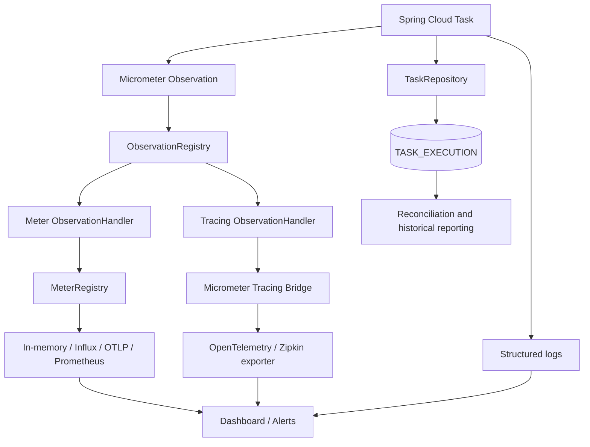

# Micrometer Observation and Required Dependencies

## 1. Goal: Making a Short-Lived Task Observable

**Spring Cloud Task** builds Spring Boot applications that perform a finite piece of work and then exit: importing files, aggregating reports, syncing data, or running a Spring Batch Job. Each run is described by **`TaskExecution`** and persisted via **`TaskRepository`**. From the database, we can inspect when the task started, when it ended, its exit code, and error details.

However, historical records only answer part of the operational questions. Administrators also need to know:

- Average duration, p95/p99, and latency degradation trends for the task.
- Success/failure counts grouped by workload and time window.
- Which task is currently running too long, and which processing step is causing the delay.
- Which external services or database queries a single run invoked.
- If a task is killed before recording its result, how to reconcile it with logs and the orchestration platform.

**Micrometer Observation** is the unified model for recording operations as **metrics** and, when a tracer is configured, **traces**. Spring Cloud Task integrates with Micrometer to create observations for the task lifecycle and optionally for `ApplicationRunner`/`CommandLineRunner`.

This lesson is part of the **Observability** section of the `SPRING_CLOUD_TASK` module, focusing on **Micrometer Observation and required dependencies**, rather than equating observations with TaskRepository or assuming that adding a single dependency makes every metric appear on a dashboard automatically.

After this lesson, you will be able to:

1. Distinguish **logs**, **metrics**, **traces**, and **TaskExecution metadata**.
2. Choose the right `spring-boot-starter-actuator` dependency, a `MeterRegistry` for exporting metrics, and a tracing bridge/exporter when traces are needed.
3. Enable `spring.cloud.task.observation.enabled=true` for runners.
4. Know the observation names, timers, and spans published by Spring Cloud Task.
5. Use `ObservationRegistry` to measure a business operation inside a task.
6. Verify measurements with `SimpleMeterRegistry` and `TaskRepository` queries.
7. Choose a telemetry export strategy for **short-lived** processes to avoid data loss from missed scrapes or delayed pushes.
8. Control cardinality, prevent sensitive data leaks, manage storage costs, and understand common monitoring pitfalls.

## 2. Four Telemetry Signals That Do Not Replace Each Other

| Signal source | Example data | Purpose |
| --- | --- | --- |
| **TaskRepository** | `TaskExecution`: ID, name, `START_TIME`, `END_TIME`, `EXIT_CODE` | History of **a single run** and the outcome stored by the framework in the database. |
| **Logs** | "Starting order import", stack traces, run identifiers | Investigating incidents and specific business steps. |
| **Metrics** | `spring.cloud.task` timer, run counts, average duration | Aggregating measurements over time, dashboards, and alerts. |
| **Traces** | `spring.cloud.task` span, `spring.cloud.task.runner` span, downstream calls | Analyzing execution paths and durations across multiple stages and systems. |



**`ObservationRegistry` is not a database**: it coordinates `ObservationHandler` instances. Handlers can record timers in a `MeterRegistry` or create spans through Micrometer Tracing. **`MeterRegistry` also does not automatically mean "data has been shipped to a server"**; a default registry may simply hold measurements in JVM memory.

Crucially for Spring Cloud Task: a process can finish in a few hundred milliseconds. If metrics merely wait for an HTTP scrape or a periodic export interval, measurements can vanish with the JVM even though `TaskRepository` still keeps the record.

## 3. How Observation Works in Spring Cloud Task

According to the **Spring Cloud Task 3.2** documentation, the framework publishes two primary observations:

| Scope | Observation/timer name | Active metric | Span when tracing is enabled |
| --- | --- | --- | --- |
| **TaskExecution** lifecycle | `spring.cloud.task` | `spring.cloud.task.active` | `spring.cloud.task` |
| An `ApplicationRunner` or `CommandLineRunner` | `spring.cloud.task.runner` | `spring.cloud.task.runner.active` | `spring.cloud.task.runner` |

`spring.cloud.task` and `spring.cloud.task.runner` are **timers**; the `.active` variants are **long task timers** for in-progress operations. Names displayed in the target backend may be transformed according to naming conventions: for example, Prometheus typically replaces dots with underscores and adds unit/type suffixes.

### 3.1. Enabling Observation for Runners

Set:

```yaml
spring:
  cloud:
    task:
      observation:
        enabled: true
```

In properties format:

```properties
spring.cloud.task.observation.enabled=true
```

This property is specifically documented by Spring Cloud Task to **enable observations for `ApplicationRunner` and `CommandLineRunner`**. Declare it explicitly rather than guessing default values across library versions. To emit **actual metrics**, you need Micrometer infrastructure from Actuator and a registry; to emit **traces**, add a tracing bridge/exporter.

`spring.cloud.task.observation.enabled` is **not** `spring.cloud.task.enabled`, does not create repository tables, and does not run the task a second time. It governs instrumentation only.

### 3.2. Metadata and Tags

Spring Cloud Task documentation lists tags such as:

| Tag | Meaning |
| --- | --- |
| `spring.cloud.task.name` | Task name. |
| `spring.cloud.task.status` | Status such as `success` or `failure`. |
| `spring.cloud.task.exit.code` | Exit code, meaningful once the final outcome is known. |
| `spring.cloud.task.execution.id` | Run ID. |
| `spring.cloud.task.runner.bean-name` | Bean name of the executing runner. |

Tags related to Cloud Foundry or external/parent executions may also appear depending on the environment and conventions. **Do not assume every tag has a value at every moment.** In particular, the documentation notes that tags added **after an observation starts** may not appear on `.active` metrics.

A tag classified by the documentation as *low cardinality* is not automatically safe in terms of time-series volume in your production backend: **`execution.id` grows with every run**, so storing it on long-lived metrics can create excessive time series. Inspect your backend and filter/drop high-churn tags where appropriate.

### 3.3. Observations Differ from Listener Callbacks

`@BeforeTask`, `@AfterTask`, and `@FailedTask` are lifecycle callbacks typically used for logging, auditing, or adjusting `exitMessage`. Micrometer Observation measures execution intervals and feeds metrics/traces. They can coexist, but neither replaces the other.

If a runner catches an exception and does not rethrow it, both execution tracking and observations may see a "successful" run even though the business operation failed. Error propagation and exit-code policies must be sound starting from the business layer.

## 4. Which Dependencies Are Actually Required?

**Start from actual needs—do not blindly add every observability library.**

| Goal | Primary dependency | Notes |
| --- | --- | --- |
| Task and JDBC metadata | `spring-cloud-starter-task`, `spring-boot-starter-jdbc`, JDBC driver | Requires a database and TaskRepository schema. |
| Micrometer Observation + Actuator | `spring-boot-starter-actuator` | Auto-configures `ObservationRegistry`, `MeterRegistry`, and appropriate handlers. |
| In-memory metrics for learning/testing | `SimpleMeterRegistry` from Micrometer | Actuator falls back to a simple registry when no other backend is present. Lost when JVM exits. |
| Influx metrics export | `micrometer-registry-influx` | Requires Influx endpoint/credentials and export interval; short jobs risk exiting before flush. |
| OTLP metrics export | `micrometer-registry-otlp` | Requires an OTLP metrics collector and `management.otlp.metrics.export.*` configuration. |
| Prometheus scrape metrics | `micrometer-registry-prometheus` | Requires an HTTP endpoint alive long enough to scrape; not directly suitable for short tasks. |
| Tracing via OpenTelemetry | `micrometer-tracing-bridge-otel` and `opentelemetry-exporter-otlp` | Requires an OTLP tracing collector; adding a metrics registry alone does not create traces. |
| Automatic `@Observed` annotation | `spring-boot-starter-aop` and `management.observations.annotations.enabled` | Applied via AOP; AOP is unnecessary if you invoke `ObservationRegistry` directly. |

**`micrometer-observation`** is the core API; in examples using `spring-boot-starter-actuator`, this dependency is typically brought in transitively via Spring Boot dependency management. Avoid pinning arbitrary Micrometer versions that drift from the BOM.

**`micrometer-tracing` does not automatically mean an active exporter**. In Spring Boot 3.4, a common stack is **Micrometer Tracing bridge → OpenTelemetry SDK → OTLP exporter**. Pick one compatible tracing path; do not mix OpenTelemetry and Brave bridges arbitrarily.

### 4.1. Minimal Dependencies for the Hands-On Lab

The Maven snippet below uses **Actuator and in-memory metrics only**, requiring no external monitoring server while learning.

```xml
<dependency>
    <groupId>org.springframework.cloud</groupId>
    <artifactId>spring-cloud-starter-task</artifactId>
</dependency>
<dependency>
    <groupId>org.springframework.boot</groupId>
    <artifactId>spring-boot-starter-jdbc</artifactId>
</dependency>
<dependency>
    <groupId>org.springframework.boot</groupId>
    <artifactId>spring-boot-starter-actuator</artifactId>
</dependency>
<dependency>
    <groupId>com.h2database</groupId>
    <artifactId>h2</artifactId>
    <scope>runtime</scope>
</dependency>
```

### 4.2. Add Only the Backend Dependencies Needed at Deployment

Export metrics via OTLP:

```xml
<dependency>
    <groupId>io.micrometer</groupId>
    <artifactId>micrometer-registry-otlp</artifactId>
    <scope>runtime</scope>
</dependency>
```

Export traces via OpenTelemetry/OTLP:

```xml
<dependency>
    <groupId>io.micrometer</groupId>
    <artifactId>micrometer-tracing-bridge-otel</artifactId>
</dependency>
<dependency>
    <groupId>io.opentelemetry</groupId>
    <artifactId>opentelemetry-exporter-otlp</artifactId>
</dependency>
```

These snippets are **optional add-ons**, not minimal dependencies for the in-memory/H2 lab build. Maven should resolve versions from the compatible Spring Boot/Spring Cloud BOMs rather than hardcoding stray Micrometer versions.

## 5. Sample Application: Observing a Report-Generation Task

This example uses **Java 17**, **Spring Boot 3.4.5**, **Spring Cloud 2024.0.2**, file-based H2, and Actuator. This is a matching-generation stack for illustration; for other projects, use a release train verified to be compatible with your Spring Boot version.

```text
observed-task/
├── pom.xml
└── src/main/
    ├── java/com/example/observedtask/
    │   ├── ObservedTaskApplication.java
    │   └── DailyReportRunner.java
    └── resources/
        ├── application.yml
        └── application-init.yml
```

### 5.1. Complete `pom.xml`

```xml
<?xml version="1.0" encoding="UTF-8"?>
<project xmlns="http://maven.apache.org/POM/4.0.0"
         xmlns:xsi="http://www.w3.org/2001/XMLSchema-instance"
         xsi:schemaLocation="http://maven.apache.org/POM/4.0.0 https://maven.apache.org/xsd/maven-4.0.0.xsd">
    <modelVersion>4.0.0</modelVersion>

    <parent>
        <groupId>org.springframework.boot</groupId>
        <artifactId>spring-boot-starter-parent</artifactId>
        <version>3.4.5</version>
        <relativePath/>
    </parent>

    <groupId>com.example</groupId>
    <artifactId>observed-task</artifactId>
    <version>0.0.1-SNAPSHOT</version>

    <properties>
        <java.version>17</java.version>
    </properties>

    <dependencyManagement>
        <dependencies>
            <dependency>
                <groupId>org.springframework.cloud</groupId>
                <artifactId>spring-cloud-dependencies</artifactId>
                <version>2024.0.2</version>
                <type>pom</type>
                <scope>import</scope>
            </dependency>
        </dependencies>
    </dependencyManagement>

    <dependencies>
        <dependency>
            <groupId>org.springframework.cloud</groupId>
            <artifactId>spring-cloud-starter-task</artifactId>
        </dependency>
        <dependency>
            <groupId>org.springframework.boot</groupId>
            <artifactId>spring-boot-starter-jdbc</artifactId>
        </dependency>
        <dependency>
            <groupId>org.springframework.boot</groupId>
            <artifactId>spring-boot-starter-actuator</artifactId>
        </dependency>
        <dependency>
            <groupId>com.h2database</groupId>
            <artifactId>h2</artifactId>
            <scope>runtime</scope>
        </dependency>
    </dependencies>

    <build>
        <plugins>
            <plugin>
                <groupId>org.springframework.boot</groupId>
                <artifactId>spring-boot-maven-plugin</artifactId>
            </plugin>
        </plugins>
    </build>
</project>
```

`spring-boot-starter-actuator` creates `ObservationRegistry` and `MeterRegistry`, and registers the Meter ObservationHandler when appropriately configured. Without an external registry, Spring Boot can use an in-memory simple registry, which is enough to inspect self-recorded measurements during a sample run.

### 5.2. Configuring `application.yml`

```yaml
spring:
  application:
    name: observed-task
  main:
    web-application-type: none
  datasource:
    url: jdbc:h2:file:./data/observed-db;DB_CLOSE_ON_EXIT=FALSE
    driver-class-name: org.h2.Driver
    username: sa
    password: ""
  cloud:
    task:
      name: observed-task
      initialize-enabled: false
      closecontext-enabled: true
      observation:
        enabled: true

management:
  observations:
    key-values:
      application: observed-task
```

Key configuration points:

- `spring.cloud.task.observation.enabled=true` turns on runner instrumentation per the Spring Cloud Task documentation.
- `spring.main.web-application-type=none` avoids starting an unnecessary web server.
- `closecontext-enabled=true` lets the Spring context close when the task completes, suited for finite processes.
- `management.observations.key-values.application` adds a shared **low-cardinality** tag to observations. Do not set execution IDs or account numbers as common tags.
- `initialize-enabled=false` expects TaskRepository tables to already exist during normal runs.

Create `src/main/resources/application-init.yml` to **initialize the schema only on the first test run**:

```yaml
spring:
  cloud:
    task:
      initialize-enabled: true
```

File-based H2 persists metadata after the JVM exits. `./data/observed-db` is resolved relative to the current working directory, so use the same working directory when running the app and connecting an SQL client. In production, use durable PostgreSQL/MySQL with schema migrations rather than running initialization DDL from every replica.

### 5.3. Application Class

Create `ObservedTaskApplication.java`:

```java
package com.example.observedtask;

import org.springframework.boot.SpringApplication;
import org.springframework.boot.autoconfigure.SpringBootApplication;
import org.springframework.cloud.task.configuration.EnableTask;

@SpringBootApplication
@EnableTask
public class ObservedTaskApplication {

    public static void main(String[] args) {
        SpringApplication.run(ObservedTaskApplication.class, args);
    }
}
```

### 5.4. Runner Using `ObservationRegistry`

Create `DailyReportRunner.java`:

```java
package com.example.observedtask;

import java.time.LocalDate;
import java.util.List;

import io.micrometer.core.instrument.MeterRegistry;
import io.micrometer.core.instrument.Timer;
import io.micrometer.observation.Observation;
import io.micrometer.observation.ObservationRegistry;
import org.springframework.boot.ApplicationArguments;
import org.springframework.boot.ApplicationRunner;
import org.springframework.stereotype.Component;

@Component
public class DailyReportRunner implements ApplicationRunner {

    private final ObservationRegistry observationRegistry;
    private final MeterRegistry meterRegistry;

    public DailyReportRunner(
            ObservationRegistry observationRegistry,
            MeterRegistry meterRegistry) {
        this.observationRegistry = observationRegistry;
        this.meterRegistry = meterRegistry;
    }

    @Override
    public void run(ApplicationArguments args) {
        List<String> values = args.getOptionValues("report-date");
        if (values == null || values.size() != 1) {
            throw new IllegalArgumentException(
                    "Requires one parameter --report-date=yyyy-MM-dd");
        }

        LocalDate date = LocalDate.parse(values.get(0));

        Observation.createNotStarted("report.generate", observationRegistry)
                .lowCardinalityKeyValue("report.type", "daily")
                // Included in traces only; DO NOT use as a high-cardinality
                // metric tag across individual report dates.
                .highCardinalityKeyValue("report.date", date.toString())
                .observe(() -> {
                    System.out.println("[RUN] Generating report " + date);

                    if (args.containsOption("fail")) {
                        throw new IllegalStateException(
                                "Simulated report generation error");
                    }

                    long checksum = 0;
                    for (int i = 0; i < 100_000; i++) {
                        checksum += i;
                    }
                    System.out.println("[RUN] Completed, checksum=" + checksum);
                });

        // report.generate has just ended; we can read our custom timer.
        // The timer wrapping Spring Cloud Task's runner ITSELF may
        // only complete after run() returns.
        Timer timer = meterRegistry.find("report.generate")
                .tags("report.type", "daily")
                .timer();

        if (timer != null) {
            System.out.println("[METRIC] report.generate count="
                    + timer.count()
                    + ", totalSeconds="
                    + timer.totalTime(java.util.concurrent.TimeUnit.SECONDS));
        }
    }
}
```

This snippet uses **`ObservationRegistry`** directly without needing `@Observed` or AspectJ. When an `Observation` starts and stops, Micrometer invokes the configured observation handlers to record metrics and optionally create trace spans.

Two tag types are illustrated:

- `lowCardinalityKeyValue("report.type", "daily")`: few distinct values, safe for grouping metrics.
- `highCardinalityKeyValue("report.date", date.toString())`: varies by date, attached to traces when tracing is enabled; should not create separate metric series per day.

If the runner throws an exception inside `observe(...)`, the observation still closes and can attach error details; the exception continues propagating so Spring Cloud Task records the failure. The custom `report.generate` `Timer` is queried **after the inner observation block finishes**. By contrast, Spring Cloud Task's `spring.cloud.task.runner` wraps the runner and stops only after `run()` returns, so **do not expect to read the final runner timer while still inside `run()`**.

## 6. Running the Lab and Inspecting Measurements

### 6.1. Packaging and Initializing the Lab Database

From inside the `observed-task` directory:

```bash
mkdir -p data
mvn clean package

java -jar target/observed-task-0.0.1-SNAPSHOT.jar \
  --spring.profiles.active=init \
  --report-date=2026-11-24
```

On PowerShell, create the directory with `New-Item -ItemType Directory -Force data` and place all Java arguments on a single line.

Sample business and metric output:

```text
[RUN] Generating report 2026-11-24
[RUN] Completed, checksum=4999950000
[METRIC] report.generate count=1, totalSeconds=...
```

`totalSeconds` depends on machine speed; do not expect a fixed number. `count=1` reflects one `report.generate` observation completed **within the current JVM**, not a cumulative total across separate JVM runs.

### 6.2. Normal Run and Failing Run

Once the schema exists, drop the `init` profile:

```bash
java -jar target/observed-task-0.0.1-SNAPSHOT.jar \
  --report-date=2026-11-25

java -jar target/observed-task-0.0.1-SNAPSHOT.jar \
  --report-date=2026-11-26 --fail
```

The second run produces a normal `TaskExecution`. The `--fail` run throws `IllegalStateException`, so it skips printing the metric line at the end of `run()`, yet the observation still closes during exception handling as long as the JVM executes normal unwinding.

Check the Java process exit code after the error (Bash: `echo $?`, PowerShell: `$LASTEXITCODE`) along with logs. Do not treat "the metric line wasn't printed" as proof that instrumentation failed; on the error path, code after `observe(...)` simply never executes.

### 6.3. Reconciling via TaskRepository

After the JAR exits, connect to H2 JDBC `jdbc:h2:file:./data/observed-db` from the same working directory (or use an absolute path), username `sa`, empty password.

```sql
SELECT TASK_EXECUTION_ID,
       TASK_NAME,
       START_TIME,
       END_TIME,
       EXIT_CODE,
       ERROR_MESSAGE
FROM TASK_EXECUTION
ORDER BY TASK_EXECUTION_ID DESC;
```

After running all three executions, expect `TaskExecution` rows for every run that reached repository creation, along with exit codes for the success and failure paths. If the application context fails **before TaskRepository writes the initial record**, no row may exist for that attempt.

```sql
SELECT TASK_NAME,
       COUNT(*) AS RUN_COUNT,
       SUM(CASE WHEN EXIT_CODE = 0 THEN 1 ELSE 0 END) AS SUCCESS_COUNT,
       SUM(CASE WHEN EXIT_CODE IS NOT NULL AND EXIT_CODE <> 0
                THEN 1 ELSE 0 END) AS FAILURE_COUNT
FROM TASK_EXECUTION
GROUP BY TASK_NAME;
```

This SQL query enables **historical reconciliation** even when a task is too short for a metrics registry to flush data externally. It does not replace real-time charts or distributed tracing, but serves as a durable complementary layer.

## 7. Exporting Metrics for Short-Lived Tasks: Enabling Actuator Alone Is Not Enough

**SimpleMeterRegistry stores metrics only in JVM memory**. For a process that exits right after running `ApplicationRunner`, measurements in memory are lost when the JVM shuts down. Therefore, building time-series dashboards requires choosing the right export strategy.

| Export method | Pros | Risks for finite tasks |
| --- | --- | --- |
| SimpleMeterRegistry | Easy for learning/testing, no backend required | Exists only in-process; no history after exit. |
| `/actuator/prometheus` scraped by Prometheus | Standard for long-running services | If the task has no web server or exits before a scrape cycle, Prometheus sees nothing. |
| Prometheus Pushgateway | Holds batch job metrics for Prometheus to scrape after exit | Requires proper push setup and stale metric cleanup; depends on Prometheus client support/version. |
| Push registries like Influx, OTLP | Sends directly to a backend without exposing a task HTTP endpoint | Many registries push on a periodic `step`; a fast task may exit before the first flush. |
| Structured logs + TaskRepository | Easily collected by the platform and preserves run history | Queries/reconciliation need their own pipeline; does not replace histograms or tracing. |

### 7.1. Why `/actuator/prometheus` Does Not Work Automatically

In this example, `spring.main.web-application-type=none`. Adding Actuator **does not imply an HTTP server exists**, so there is no HTTP endpoint for Prometheus to scrape.

Even if an HTTP server is enabled and `/actuator/prometheus` is exposed, a task living only a few seconds can exit **before Prometheus scrapes it**. Do not keep the JVM artificially open just waiting for a scrape; that breaks task lifecycle semantics and wastes resources.

### 7.2. Version-Specific Pushgateway Support

**Spring Boot 3.4** includes Prometheus Pushgateway integration for short-lived batch apps, though its documentation explicitly notes that Pushgateway auto-configuration supports only the **legacy Prometheus simpleclient**. If choosing this path, you need:

```xml
<dependency>
    <groupId>io.micrometer</groupId>
    <artifactId>micrometer-registry-prometheus-simpleclient</artifactId>
    <scope>runtime</scope>
</dependency>
<dependency>
    <groupId>io.prometheus</groupId>
    <artifactId>simpleclient_pushgateway</artifactId>
</dependency>
```

Then configure pushing:

```yaml
management:
  prometheus:
    metrics:
      export:
        pushgateway:
          enabled: true
          base-url: http://pushgateway.internal:9091
```

This is a **version-constrained option**, not a mandatory requirement of Micrometer Observation. Verify network connectivity, permissions, job/instance grouping labels, push behavior, and stale series deletion policies. On newer Spring Boot/Micrometer releases, re-read the Pushgateway documentation for that exact version rather than assuming those two `simpleclient` dependencies remain supported.

### 7.3. Exporting OTLP Metrics or Influx

To ship metrics over OTLP, add `micrometer-registry-otlp` (shown in the dependency section) and configure the collector URL:

```yaml
management:
  otlp:
    metrics:
      export:
        url: http://otel-collector.internal:4318/v1/metrics
```

Similarly, `micrometer-registry-influx` requires an Influx endpoint and credentials. `StepMeterRegistry`-based registries may export on a **periodic interval**, meaning an ultra-fast task may exit before finishing delivery. Test against a real backend and verify figures at the collector; never rely solely on `[METRIC]` logs from `SimpleMeterRegistry`.

When every single run must be accounted for, prefer **TaskRepository + a long-lived metric aggregation service**, or a publisher with verified flush/retry behavior on shutdown, rather than hoping a short process's periodic export timer fires in time.

## 8. Adding Tracing When You Need Visibility Into Internal Steps

Traces show the execution path of a single run across multiple spans: Task start, `ApplicationRunner`, custom computation blocks, and instrumented HTTP/database calls.

### 8.1. Tracing Dependencies for Spring Boot 3.4

In addition to Actuator:

```xml
<dependency>
    <groupId>io.micrometer</groupId>
    <artifactId>micrometer-tracing-bridge-otel</artifactId>
</dependency>
<dependency>
    <groupId>io.opentelemetry</groupId>
    <artifactId>opentelemetry-exporter-otlp</artifactId>
</dependency>
```

Illustrative endpoint configuration:

```yaml
management:
  tracing:
    sampling:
      probability: 1.0
  otlp:
    tracing:
      endpoint: http://otel-collector.internal:4318/v1/traces
```

`management.tracing.sampling.probability=1.0` is for **testing**, when you want to capture every trace. In production, tune the sampling rate to traffic, cost, and diagnostic needs. If the app calls external APIs, use auto-configured/instrumented HTTP clients and propagate context properly; enabling `ObservationRegistry` alone does not automatically stitch custom HTTP clients into one trace.

### 8.2. Practical Spans and Tags

Per Spring Cloud Task 3.2 documentation, the primary span names are `spring.cloud.task` and `spring.cloud.task.runner`. You will also get the `report.generate` span from our sample code when tracing is configured.

```text
Trace: a report-task run (illustrative)
└── spring.cloud.task
    └── spring.cloud.task.runner
        └── report.generate
            └── (HTTP/DB spans if instrumented)
```

This span tree **illustrates hierarchy conceptually**; actual parent/child relationships depend on observation scopes, context propagation configuration, and where the framework version starts spans. Do not treat the diagram as proof that all spans appear automatically.

A Task may execute work on another thread or via `CompletableFuture`; trace context does not automatically cross arbitrary custom thread pools. For async work, use Spring/Micrometer-supported context propagation and ensure the runner awaits required async work before exiting.

**Traces also risk data loss on fast exit**: exporters commonly batch spans or ship on background threads. Test shutdown/flush behavior, timeouts, and collector reachability; do not treat the presence of a `traceId` in logs as proof that the span reached the backend.

## 9. Is `@Observed` Required?

No, it is optional. The sample used the `ObservationRegistry` API directly. If you prefer to instrument a Spring bean method with an annotation:

```java
import io.micrometer.observation.annotation.Observed;
import org.springframework.stereotype.Service;

@Service
public class ReportService {

    @Observed(name = "report.validate",
              lowCardinalityKeyValues = {"report.type", "daily"})
    public void validate() {
        // Validate input before generating the report.
    }
}
```

In Spring Boot 3.4, for `@Observed` to be processed via AOP, add:

```xml
<dependency>
    <groupId>org.springframework.boot</groupId>
    <artifactId>spring-boot-starter-aop</artifactId>
</dependency>
```

and:

```properties
management.observations.annotations.enabled=true
```

If the annotated method is invoked **within the same object** via `this.validate()`, the Spring AOP proxy may be bypassed; invoke through a Spring bean proxy or use `ObservationRegistry` directly for internal logic. Avoid placing `@Observed` on a method already instrumented by the framework if doing so creates **duplicate observations**.

**Do not add AOP just to enable `spring.cloud.task.observation.enabled`.** Spring Cloud Task's built-in auto-instrumentation and the application-level `@Observed` annotation are two separate mechanisms.

## 10. Tags, Cardinality, and Data Safety

Examples of relatively safe tags for metrics:

| Tag | Example | Rationale |
| --- | --- | --- |
| `task.name` | `daily-report` | Bounded set of names if the system controls task definitions. |
| `task.status` | `success`, `failure` | Small, stable value set. |
| `environment` | `staging`, `production` | Easy grouping by environment. |
| `runner.bean` | `dailyReportRunner` | Fixed number of beans per application. |

Information that **should NOT be used as metric tags**:

- `taskExecutionId` or `spring.cloud.task.execution.id`: changes on every run.
- `customerId`, `orderId`, or continuously generated file paths/names.
- URLs containing query strings, request IDs, or random trace IDs.
- Passwords, access tokens, email addresses, or personal data.

If a framework version's convention puts the execution ID into timer tags, you can use a `MeterFilter` to strip high-cardinality tags:

```java
import io.micrometer.core.instrument.config.MeterFilter;
import org.springframework.context.annotation.Bean;
import org.springframework.context.annotation.Configuration;

@Configuration(proxyBeanMethods = false)
class MetricsCardinalityConfiguration {

    @Bean
    MeterFilter removePerExecutionMetricTag() {
        return MeterFilter.ignoreTags("spring.cloud.task.execution.id");
    }
}
```

This only affects **metric tags** passing through the Micrometer registry; it does not remove IDs from `TaskRepository`. Verify the actual naming/tag conventions before applying; if other unbounded tags exist, constrain them separately.

High-cardinality details can be helpful in **traces** for per-run debugging, but must still comply with privacy and retention policies. High-cardinality tags are never a place to store secrets.

## 11. Combining Metrics and SQL for Alerting

A strong operational dashboard does not merely count Task runs; it connects metrics with the scheduler, logs, and repository.

| Operational question | Appropriate data source | Alerting suggestion |
| --- | --- | --- |
| Has the task been failing frequently lately? | `spring.cloud.task` timer with status tag and/or SQL `EXIT_CODE` | Rising failure rate within a time window. |
| Which runner is slow? | `spring.cloud.task.runner` timer | p95/p99 above threshold **when backend has histograms/sufficient samples**. |
| Is a task running too long right now? | Long task timer `.active`, scheduler, and `START_TIME` | Elapsed time exceeds SLA; verify whether process is alive or dead. |
| Task stopped emitting metrics? | Registry/exporter/collector logs + TaskRepository | Distinguish telemetry failure from business failure. |
| Report generation step slow? | `report.generate` observation and spans | Compare step duration against total runner time. |
| Task killed before saving `END_TIME`? | Scheduler/pod status, logs, database | Reconcile state; never assume `END_TIME IS NULL` means running. |

Example SQL counting runs and failures using H2 metadata:

```sql
SELECT TASK_NAME,
       COUNT(*) AS TOTAL,
       SUM(CASE WHEN EXIT_CODE = 0 THEN 1 ELSE 0 END) AS SUCCESS_COUNT,
       SUM(CASE WHEN EXIT_CODE IS NOT NULL AND EXIT_CODE <> 0
                THEN 1 ELSE 0 END) AS FAILURE_COUNT
FROM TASK_EXECUTION
GROUP BY TASK_NAME;
```

**p95/p99 do not magically appear just because you created a timer**: the backend needs histograms or detailed distributions, configured SLOs, and enough samples. For infrequently executed tasks, inspecting individual `TaskExecution` records is often more meaningful than a low-sample percentile.

If a CronJob must run once daily yet **no run occurs today**, looking only at timer error counts will not catch it. You must combine scheduler signals or compare expected schedules against repository records.

## 12. Common Errors and Troubleshooting

| Symptom | Possible cause | Check and fix |
| --- | --- | --- |
| Cannot inject `ObservationRegistry` | Missing Actuator/observability auto-configuration or custom context excluding beans | Check `spring-boot-starter-actuator`, auto-config, and dependency versions. |
| `TaskExecution` exists, no `spring.cloud.task.runner` metric | Runner observation property disabled or missing registry/handler | Verify `spring.cloud.task.observation.enabled`, Actuator classpath, and startup logs. |
| Metrics lost after JVM exit | Only using `SimpleMeterRegistry` | Use a persistent backend/publisher or aggregate TaskRepository with a long-lived collector. |
| Cannot reach `/actuator/prometheus` | Task is non-web or endpoint not exposed | Do not assume Tasks expose HTTP; choose push/external collection for short batches. |
| OTLP registry present, no metrics in backend | Wrong collector URL or task exits before export cycle | Verify `management.otlp.metrics.export.url`, flush behavior, and network. |
| Metrics appear, no traces | Missing tracing bridge/exporter, sampling, or collector | Check `micrometer-tracing-bridge-otel`, `opentelemetry-exporter-otlp`, and sampling. |
| `@Observed` creates no observation | Annotations/AOP disabled or self-invocation | Enable property + AOP, call through bean proxy, or use the API directly. |
| Too many time series | Execution ID, filename, or customer ID used as metric tag | Use low-cardinality tags, `MeterFilter`, and monitor backend cost. |
| Metric names differ from docs | Backend naming normalization | Look up the Micrometer name in code and map to normalized backend names. |
| Active timer lacks status/exitCode | Final tags are only added after observation starts | Understand long task timer limits; use completed timers or repository for final outcomes. |
| `traceId` in logs, missing in Collector | Exporter did not flush or network/shutdown error | Check delivery path, exporter batching, and JVM shutdown lifecycle. |
| Runner reports success, business work failed | Code swallowed exception or async worker did not finish | Propagate errors, await futures, and verify exit codes/metadata. |

When diagnosing, follow this order: **Task ran → TaskRepository wrote execution → ObservationRegistry bean exists → framework created observation → MeterRegistry/tracing handler received it → exporter sent it → backend ingested it → dashboard queries the exact metric/tag**. This prevents tweaking dashboard configs when a dependency is actually missing.

## 13. Safe Operations in Containers and Spring Batch

### 13.1. Tasks Running on Kubernetes Job/CronJob

With Kubernetes `Job`, each Pod may run a short-lived JVM; in-memory state disappears once the Pod is garbage-collected. You should:

1. Use a durable, backed-up TaskRepository metadata database.
2. Collect stdout/stderr into cluster-wide logging, not just local container files.
3. Configure intentional timeouts, retries, and `backoffLimit`; ensure business logic is idempotent.
4. Choose a metrics export strategy suited to short tasks; test a Pod that actually finishes before a scrape interval.
5. For tracing, test collector delivery, propagation, and shutdown even when the Job fails.
6. Correlate Job/Pod events with `TaskExecution` via identifying metadata/logs, without creating per-Pod-UID metric labels.

### 13.2. When a Task Runs Spring Batch

Spring Batch maintains its own `JobRepository`, `JobExecution`, and `StepExecution`. Task observations **do not replace** item read/write/retry/skip counts or per-Step status.

| Scope | Source of truth |
| --- | --- |
| Entire application | `TaskExecution` and `spring.cloud.task` observation. |
| Single runner | `spring.cloud.task.runner`. |
| Batch Job/Step | `JobExecution`, `StepExecution`, and Batch or custom business instrumentation. |
| Domain-specific logic like order validation | Custom `orders.validate` observation, business metrics/SQL. |

If a Batch Job fails without the runner propagating that status, the Task may still exit with a success code. When using `spring-cloud-task-batch`, check settings such as `spring.cloud.task.batch.fail-on-job-failure` and ensure the task waits for asynchronous Batch Jobs to complete.

## 14. Hands-On Exercises

### Exercise 1: Verify Dependencies and Observation

1. Create the `observed-task` project and add Actuator as shown in the example.
2. Run with the `init` profile against a fresh H2 database and a valid `--report-date` argument.
3. Observe `report.generate` and inspect `TASK_EXECUTION`.
4. Temporarily remove `spring-boot-starter-actuator` and explain `ObservationRegistry`'s role in the sample configuration.
5. Disable `spring.cloud.task.observation.enabled`; distinguish framework default instrumentation from custom observations created in code.

### Exercise 2: Failure Path

Run again with `--fail`. Inspect logs, exit code, and `TaskExecution`; explain why the `[METRIC]` line in the example is not printed after the exception is thrown, and why you still need to check the backend to confirm whether the observation was exported.

### Exercise 3: Short Tasks and Exporters

Run a task that finishes in under one second, then choose one strategy: Prometheus Pushgateway, OTLP metrics registry, or a collector reading `TaskRepository`. Describe how you verify data **actually arrived** and your strategy to avoid losing metrics on JVM exit.

### Exercise 4: Cardinality

Suppose 50,000 runs occur per day, each attaching `taskExecutionId` and `customerId` to a timer. Analyze how many time series can be created and move those identifiers to traces/logs or the database, keeping only low-cardinality metric tags.

### Review Questions

1. What kind of data does `TaskRepository` store that metrics do not necessarily retain?
2. How does `ObservationRegistry` differ from `MeterRegistry`?
3. Which property enables observations for `ApplicationRunner`/`CommandLineRunner`?
4. What three distinct roles do `spring-boot-starter-actuator`, a metrics registry, and a tracing bridge/exporter play?
5. What are the names of the two timers and two long task timers published by Spring Cloud Task 3.2?
6. Why might `spring.cloud.task.runner` not be finished yet when you query the registry right inside `ApplicationRunner.run()`?
7. Why is `/actuator/prometheus` unsuitable for every few-hundred-millisecond task?
8. When is `spring-boot-starter-aop` needed for `@Observed`, and when is it not?
9. Why should execution IDs not become long-lived metric tags?
10. When a Task runs a Spring Batch Job, what additional metadata levels must be observed?

**Key takeaway:** Spring Cloud Task persists **TaskExecution** to a repository for durable history; Micrometer **Observation** produces signals that can become **metrics** and **traces**. Start with `spring-boot-starter-actuator`, set `spring.cloud.task.observation.enabled=true` for runners, and pick registries/tracing bridges as needed. For finite processes, instrumentation working locally **does not guarantee telemetry reached external backends**: test your exporters, design bounded-cardinality tags, and always reconcile TaskRepository with logs and the scheduler.

## References

- [Spring Cloud Task 3.2 — Features](https://docs.spring.io/spring-cloud-task/reference/3.2/features.html): enabling runner observations and Actuator/metrics/tracing dependencies.
- [Spring Cloud Task 3.2 — Observability](https://docs.spring.io/spring-cloud-task/reference/3.2/observability.html): timer names, long task timers, spans, and standard tags.
- [Spring Boot 3.4 — Observability](https://docs.spring.io/spring-boot/3.4/reference/actuator/observability.html): `ObservationRegistry`, high/low cardinality, and `@Observed`.
- [Spring Boot 3.4 — Metrics](https://docs.spring.io/spring-boot/3.4/reference/actuator/metrics.html): `MeterRegistry`, simple registry, OTLP, and version-specific Pushgateway support.
- [Spring Boot 3.4 — Tracing](https://docs.spring.io/spring-boot/3.4/reference/actuator/tracing.html): Micrometer Tracing, OpenTelemetry, and OTLP exporter dependencies.
- [Micrometer Observation](https://docs.micrometer.io/micrometer/reference/observation/introduction.html): `Observation`, `ObservationHandler`, and observation design.
