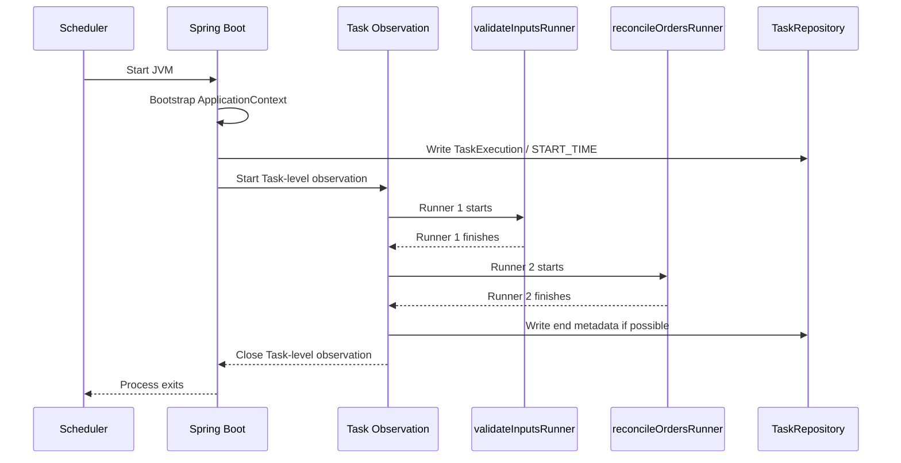
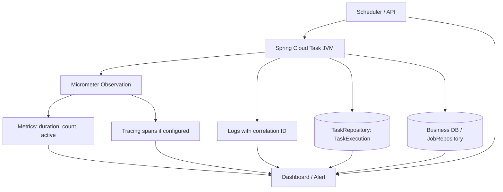

# The `spring.cloud.task` and `spring.cloud.task.runner` Measurements

## 1. Why Does a Finite Task Application Still Need Metrics?

In the **Observability** chapter of **Spring Cloud Task**, we operate short-lived Spring Boot applications: they start on a schedule or on demand, process data, persist execution outcomes to `TaskRepository`, and then exit. This "run-to-completion and exit" behavior introduces an observability challenge unlike continuous HTTP services: **the process can terminate before the monitoring system scrapes its metrics**.

Suppose `order-reconciliation` runs 300 times each night. The Task database records each run with `TASK_EXECUTION_ID`, `START_TIME`, `END_TIME`, and `EXIT_CODE`. Yet operators also want to know:

- Average Task duration and slow-run trends.
- Execution time of **each runner** inside the application to pinpoint slow stages.
- How many jobs are currently active at the moment of inspection.
- Failure rate by task name and shifts after a new release deployment.
- When a Task is abruptly killed, why a metrics dashboard might miss that run even though the runtime reported an error.

Spring Cloud Task integrates **Micrometer Observation** to time the Task lifecycle and the execution of `ApplicationRunner`/`CommandLineRunner` beans. The official documentation defines two observations named `spring.cloud.task` and `spring.cloud.task.runner`; each observation exposes a **timer** and a **long task timer** for in-progress execution.

After this lesson, you will be able to:

1. Distinguish `spring.cloud.task`, `spring.cloud.task.active`, `spring.cloud.task.runner`, and `spring.cloud.task.runner.active`.
2. Explain how Task-level timing differs from runner-level timing.
3. Understand tags such as `spring.cloud.task.name`, `spring.cloud.task.status`, and `spring.cloud.task.runner.bean-name`.
4. Configure Micrometer/Actuator with a metrics registry suited to short-lived applications.
5. Identify **high cardinality**, delayed exports, killed tasks, and discrepancies between metrics and `TaskRepository`.
6. Design dashboards, alerts, and tests for scheduled Tasks, retries, and Spring Batch integration.

> **Version scope:** Observation names and keys in this lesson are aligned with the Spring Cloud Task Observability reference. Registry/exporter configuration, Micrometer setup, and backend metric names may differ across Spring Boot/Spring Cloud Task versions and storage backends. Do not mix versions arbitrarily; verify dependencies, release-train docs, and actual emitted metrics.

## 2. The Four Built-In Measurements and Their Meanings

Per the Spring Cloud Task Observability documentation:

| Observation / measurement name | Micrometer type | What does it measure? | When is it useful? |
| --- | --- | --- | --- |
| `spring.cloud.task` | `Timer` | Duration of an observed Task execution | Aggregating duration, count, and failures by task |
| `spring.cloud.task.active` | `LongTaskTimer` | Elapsed time and count of **currently running** Tasks | Finding Tasks running longer than normal right now |
| `spring.cloud.task.runner` | `Timer` | Execution duration of a runner bean | Comparing cost across runners in the same app |
| `spring.cloud.task.runner.active` | `LongTaskTimer` | **Currently running** runner beans | Detecting an abnormally stalled runner |

The two groups use distinct conventions:

- `spring.cloud.task` and `spring.cloud.task.active` are defined by `DefaultTaskExecutionObservationConvention`, centered on `TaskExecutionObservation`.
- `spring.cloud.task.runner` and `spring.cloud.task.runner.active` are defined by `DefaultTaskObservationConvention`, centered on `TaskDocumentedObservation` in runner configuration.

These are **metric/observation names**, not configuration properties. Setting `spring.cloud.task.runner=true` in YAML is not how you enable metrics. Similarly, `spring.cloud.task` in this table is not the name of a repository metadata table.

### How Timer Differs from LongTaskTimer

**`Timer`** records the duration of completed executions. Depending on your registry and distribution settings, you can analyze **recorded count**, **total time**, max time, and histograms/percentiles if enabled.

**`LongTaskTimer`** reflects **in-flight** work: how many tasks are still running right now and their elapsed time. It is not a standalone historical store. Once a Task finishes or the process vanishes, active data may no longer be sampled. Never infer from `active=0` on a backend that no Task ran today.

Micrometer uses **nanoseconds** as its internal base time unit, while the backend determines display units; Prometheus typically uses **seconds**. When comparing dashboards, verify the unit and converted metric name before setting alert thresholds.

## 3. Timing Boundaries: Task and Runner Do Not Measure the Same Span

Consider an application with two runners:

1. `validateInputsRunner` validates arguments and permissions.
2. `reconcileOrdersRunner` reads, processes, and writes business data.

A logical sequence:



This diagram illustrates **measurement scope**, not a rigid absolute ordering of callbacks/commits between `TaskExecutionObservation`, the `TaskRepository` lifecycle, and Spring Boot across all versions. The key point: **the Task-level timer covers a wider scope than work inside a single runner**; the runner timer measures only while that runner is executing.

Consequently:

- `spring.cloud.task` answers "How long did the framework observe this Task run?"
- `spring.cloud.task.runner` answers "How long did this runner bean execute?"
- A single Task can contain **multiple runners**, so do not assume one Task produces exactly one runner data point.
- The sum of runner times **does not necessarily equal** Task-level duration: framework overhead, listeners, out-of-runner activity, and timing boundary differences exist.
- The Task timer does not measure end-to-end latency **from scheduler trigger to Pod creation**. Queue/provisioning time occurs **before the process and Task start** and must be tracked in the scheduler/deployer.

### Illustrative Numeric Example

Suppose the scheduler takes 20 seconds to provision a Pod, JVM bootstrap takes 4 seconds, the validation runner takes 0.2 seconds, business processing takes 25 seconds, and final metadata persistence takes a small amount of time. Dashboards might show:

| Measurement | Example value | Explanation |
| --- | ---: | --- |
| Scheduler → Pod ready latency | 20 s | **Not** measured by `spring.cloud.task` |
| `spring.cloud.task.runner` for `validateInputsRunner` | 0.2 s | Single runner |
| `spring.cloud.task.runner` for `reconcileOrdersRunner` | 25 s | Business runner |
| `spring.cloud.task` | Roughly the Task lifecycle covered by the observation | May differ from the sum of runners |
| Request-to-result time | Provisioning + startup + processing + shutdown | Requires multiple observability sources |

Do not subtract `spring.cloud.task - spring.cloud.task.runner` and treat it as an exact **startup time** metric. When an app has multiple runners, async work, or custom callbacks, that subtraction can mislead you.

## 4. Tags (Key Values) Published by Spring Cloud Task

Current documentation lists several keys on Task-level observations, including:

| Task-level tag | Meaning |
| --- | --- |
| `spring.cloud.task.name` | Task name |
| `spring.cloud.task.status` | Observation status, e.g., `success` or `failure` |
| `spring.cloud.task.execution.id` | Internal `TaskExecution` ID |
| `spring.cloud.task.exit.code` | Exit code recorded by the Task |
| `spring.cloud.task.external.execution.id` | ID assigned by an external orchestrator, if present |
| `spring.cloud.task.parent.execution.id` | Parent Task ID if configured |
| `spring.cloud.task.cf.app.id` / `spring.cloud.task.cf.app.name` | Cloud Foundry app info when applicable |
| `spring.cloud.task.cf.app.version` / `spring.cloud.task.cf.instance.index` | Cloud Foundry version/instance index |
| `spring.cloud.task.cf.org.name` / `spring.cloud.task.cf.space.id` / `spring.cloud.task.cf.space.name` | Cloud Foundry organization/space info |

The convention documentation lists these keys in a **low-cardinality** table, yet you should not assume **every key has low variance in your own system**. `execution.id` and `external.execution.id` can change **on every run**; when exported as metric labels, time-series counts can grow rapidly.

Runner observations have one signature key:

```text
spring.cloud.task.runner.bean-name
```

This key holds the **runner bean name** executed by Spring Cloud Task, letting you distinguish runners. It is not automatically a Java method name, not necessarily a Spring Batch Job/Step name, and **not `TASK_EXECUTION_ID`**.

### Late-Added Tags and `*.active`

Spring Cloud Task's Micrometer documentation warns that **key values added after an observation starts** may **not appear** on `spring.cloud.task.active` or `spring.cloud.task.runner.active`. For instance, exit code/status is only meaningful once the run ends.

Therefore:

- Do not build active-task alerts requiring `spring.cloud.task.exit.code`.
- Do not assume a running Task "lacks an exit code" is an error: before completion, `EXIT_CODE` in the repository is normally empty.
- Do not expect all Task-level labels on `runner.active`: official runner conventions specify `runner.bean-name` and do not guarantee Task tags appear on runner metrics.
- Verify **effective labels** in your actual exporter/backend before writing PromQL or dashboards.

## 5. Enabling Observability in a Spring Cloud Task Application

Spring Cloud Task integrates with **Micrometer Observation**. The feature documentation instructs adding:

1. `spring-boot-starter-actuator` for Spring Boot observability integration.
2. A **registry implementation** such as OTLP, Influx, or Prometheus when exporting metrics externally.
3. **Micrometer Tracing** if you want spans/traces, along with a compatible tracing bridge/exporter.

Example **Maven dependencies snippet** (assuming your project already manages compatible Spring Boot and Spring Cloud BOMs):

```xml
<dependencies>
    <dependency>
        <groupId>org.springframework.cloud</groupId>
        <artifactId>spring-cloud-starter-task</artifactId>
    </dependency>
    <dependency>
        <groupId>org.springframework.boot</groupId>
        <artifactId>spring-boot-starter-actuator</artifactId>
    </dependency>
    <dependency>
        <groupId>io.micrometer</groupId>
        <artifactId>micrometer-registry-otlp</artifactId>
        <scope>runtime</scope>
    </dependency>
    <dependency>
        <groupId>org.postgresql</groupId>
        <artifactId>postgresql</artifactId>
        <scope>runtime</scope>
    </dependency>
</dependencies>
```

This is **not a complete `pom.xml`**: you still need version management, build plugins, datasource settings, and Task metadata schema setup. If you use a different registry, pick the right dependency instead of adding unused registries.

### Sample Configuration with OTLP Metrics

On a Spring Boot version supporting the corresponding OTLP metric properties, a sample configuration looks like:

```yaml
spring:
  application:
    name: reconciliation-task
  main:
    web-application-type: none
  datasource:
    url: jdbc:postgresql://localhost:5432/task_metadata
    username: task_user
    password: ${TASK_DB_PASSWORD}
  cloud:
    task:
      name: reconciliation-task

management:
  otlp:
    metrics:
      export:
        url: http://otel-collector:4318/v1/metrics
        step: 5s
```

The URL and `step` assume a configured collector reachable on your internal network; they **do not guarantee** every Spring Boot version shares identical properties or that the exporter flushes every metric on ultra-short tasks. Check registry docs for your **exact version** and test end-to-end from the Java process to the backend. `spring.main.web-application-type=none` preserves the non-web Task model; it also means no public HTTP endpoint is opened for Prometheus scraping.

### Why `management.metrics.*` Is Not `spring.cloud.task.*`

- `spring.cloud.task.name` and properties under that namespace configure how Spring Cloud Task operates.
- Spring Boot's `management.*` configures **Actuator, registries, and how Micrometer data is exported**.
- `spring.cloud.task.runner` is an **observation/metric name**, not a Spring Boot property that enables the runner timer.

The link between **framework instrumentation** and an **exporter** has two halves: having an observation inside the app does not mean data has reached Prometheus, OpenTelemetry Collector, or your dashboard.

## 6. Java Example: A Measurable Runner

The following application runs a short task and supports simulating errors. Spring Cloud Task automatically instruments runners under proper observability setup; the example **avoids creating a duplicate Timer of the same name** to prevent double-counting.

```java
package com.example.observability;

import java.time.LocalDate;
import java.util.List;

import org.slf4j.Logger;
import org.slf4j.LoggerFactory;
import org.springframework.boot.ApplicationRunner;
import org.springframework.boot.SpringApplication;
import org.springframework.boot.autoconfigure.SpringBootApplication;
import org.springframework.cloud.task.configuration.EnableTask;
import org.springframework.context.annotation.Bean;

@SpringBootApplication
@EnableTask
public class TaskMetricsApplication {
    private static final Logger log =
            LoggerFactory.getLogger(TaskMetricsApplication.class);

    public static void main(String[] args) {
        SpringApplication.run(TaskMetricsApplication.class, args);
    }

    @Bean("reconcileOrdersRunner")
    ApplicationRunner reconcileOrdersRunner() {
        return args -> {
            List<String> dates = args.getOptionValues("business-date");
            if (dates == null || dates.size() != 1) {
                throw new IllegalArgumentException(
                        "Requires --business-date=yyyy-MM-dd");
            }
            LocalDate date = LocalDate.parse(dates.get(0));
            log.info("Starting reconciliation {}", date);

            // Simulates processing time only; use a real service in production.
            Thread.sleep(1_000);

            if (args.containsOption("fail")) {
                throw new IllegalStateException(
                        "Simulated reconciliation error for " + date);
            }
            log.info("Reconciliation completed {}", date);
        };
    }
}
```

When the framework and registry are configured properly, the runner observation can carry `spring.cloud.task.runner.bean-name=reconcileOrdersRunner`. The `spring.cloud.task.runner` Timer measures the duration of this runner invocation. The `spring.cloud.task` Timer captures the TaskExecution scope per Spring Cloud Task's instrumentation.

Test run:

```bash
java -jar task-metrics-demo.jar --business-date=2026-11-24

# Intentional failure to compare metrics/TaskRepository.
java -jar task-metrics-demo.jar --business-date=2026-11-24 --fail
```

**Do not assume** every `java -jar` run exports metrics to the backend automatically. A task finishing in roughly one second may **exit before a 5-second export step**; check shutdown flush behavior, exporter/collector latency, and how the platform manages process lifecycle. Even if the exporter fails to deliver metrics, `TaskRepository` can still record `TaskExecution` normally.

### When Multiple Runners Exist

If an application registers `validateRunner` and `reconcileOrdersRunner`, Spring Boot invokes them in framework-determined order. Each instrumented runner can emit a `spring.cloud.task.runner` data point with its own `runner.bean-name`.

**The total count of runner observations can exceed the number of TaskExecutions.** One Task having multiple runners does not mean multiple processes ran. When an earlier runner throws an unhandled exception, later runners may not run, so their metrics **will not appear** for that failed attempt.

## 7. Reading Timers: count, sum, max, and Histograms

A Micrometer `Timer` stores information about **the durations of observed executions**. Depending on the registry, you may encounter these quantities:

| Quantity | How to interpret | What to avoid |
| --- | --- | --- |
| `count` | Number of completed, recorded Timer calls | Do not assume it equals `TASK_EXECUTION` row counts if exports fail |
| `total time / sum` | Total duration of recorded calls | Do not confuse seconds and nanoseconds |
| `max` | Maximum value within the registry's decaying window | Do not assume it is an all-time historical max |
| Histogram buckets | Duration distribution when histograms are enabled | Do not assume every registry exports buckets by default |
| Percentiles | Estimated P50/P95/P99 with sufficient data and config | Do not compute reliable P95 from a handful of sparse short tasks |

If `count=20` and `sum=240s` in an observed dataset, the average duration of that dataset is `240 / 20 = 12s`. Yet **this is the average of recorded samples**, not necessarily every run in the repository.

### Example Metric Names After Backend Conversion

Micrometer names instruments in Java using dots, while **Prometheus typically converts them to underscores with unit suffixes**, such as:

```text
spring.cloud.task
  -> spring_cloud_task_seconds_count
  -> spring_cloud_task_seconds_sum

spring.cloud.task.runner
  -> spring_cloud_task_runner_seconds_count
  -> spring_cloud_task_runner_seconds_sum
```

These Prometheus names are **common conversion examples**, not a promise that every backend/version emits those exact strings. Inspect actual data in your exporter/collector to verify series names, labels, and units before writing queries or alerts.

If histograms are not enabled, do not build `histogram_quantile(...)` panels over nonexistent buckets. Before enabling histograms, evaluate storage cardinality and retention across thousands of task names.

## 8. Reading `*.active`: In-Progress Work, Not History

Long task timers help observe:

- How many Tasks are **currently active** at measurement time.
- Elapsed time of still-unfinished Tasks.
- Similarly, active runners and their elapsed times by `runner.bean-name`.

Suppose a reconciliation Task runs for 45 minutes: if the backend can still receive telemetry while the process runs, `spring.cloud.task.active` can detect that it exceeded a threshold. Once the Task finishes, a LongTaskTimer does not turn into a historical record saying "the task ran 45 minutes"—that belongs to the completed Timer or TaskRepository.

**Important warning:** For finite Task applications, the backend may capture very few active samples or none at all:

1. The Task is too short to hit a metric export cycle.
2. The collector/backend did not receive data before the process exited.
3. Active metrics are valid only while the observation is open.
4. The JVM was killed and skipped normal cleanup/shutdown.
5. Key values such as status/exit code are added **after start** and are absent from `*.active`.

Therefore, never rely solely on `spring.cloud.task.active` to count truly running Tasks across a cluster; combine Kubernetes/Deployer workload counts with open Task metadata. If a Pod stops reporting active metrics, check the **runtime** instead of assuming it completed.

## 9. Exporting Metrics from Short-Lived Apps: Pull or Push?

### 9.1. Why Standard Prometheus Scraping Easily Misses Tasks

Prometheus normally **pulls** metrics from an HTTP endpoint on a periodic schedule. If a Task runs for 2 seconds while the scrape interval is 15 seconds, a process can start and exit **between two scrapes**. Data for that run will never be collected, even though the Timer existed in the JVM.

A `web-application-type=none` app also does not open an HTTP port for scraping. Setting `management.endpoints.web.exposure.include=prometheus` without a web server **does not make an endpoint reachable**.

### 9.2. Available Collection Approaches

| Collection approach | Strengths | Weaknesses / what to verify |
| --- | --- | --- |
| HTTP pull from the Task process | Simple when Tasks run long enough and expose an endpoint | Short Tasks can exit before scraping |
| Push/step registry (OTLP, Influx, StatsD depending on stack) | Can push telemetry while the Task runs | Requires interval/flush tuning, retries, collector, and network handling |
| Collector/agent receiving process telemetry | Offloads part of delivery from the app | Pipeline must receive data before process exit |
| Structured logs + centralized pipeline | Logs remain collectable after exit if runtime retains them | Does not replace timers/histograms; log loss risks exist |
| `TaskRepository` + periodic queries | Durable Task history when DB is healthy | Does not replace real-time monitoring or per-runner detail |
| Scheduler/platform metrics | Captures queued/running/failed workload states | Does not report in-JVM per-runner durations |

Do not assume **Pushgateway is automatically the best default** for every short job. When using Prometheus Pushgateway, manage grouping-key lifecycles and delete stale series so finished jobs do not appear still active; review Prometheus guidance and infrastructure policies.

### 9.3. Setting Concrete "Metrics Exported" Test Criteria

Test Tasks running for 1 second, 5 seconds, and 60 seconds, checking:

1. Whether the backend receives **at least one completed measurement** for the Task.
2. Whether it receives the matching `runner` timer.
3. End-to-end latency from Task exit until metrics appear on the dashboard.
4. When the Task fails, whether metrics reflect the right status and publish expected tags.
5. When the JVM is forcefully killed, which runs **lack metrics** yet still appear in runtime status or the Job/Task Repository.

If a setup fails these checks, do not base critical alerts solely on exporter metrics.

## 10. High Cardinality: Why Per-Run IDs Should Not Be Dashboard Labels Everywhere

Spring Cloud Task documentation lists `spring.cloud.task.execution.id`, `spring.cloud.task.external.execution.id`, and other IDs as observation keys. These are valuable when attached to **traces or logs**, yet when exported as metric labels, they tend to have nearly as many distinct values as **the total number of Task runs**.

For example, 20,000 TaskExecutions per day with unique IDs means the `execution.id` label alone creates roughly 20,000 distinct series per metric—and multiplied across task name, status, instance, version, and histogram buckets, series counts grow dramatically. This increases memory usage, cardinality charges, and query cost.

A layered strategy:

- **Aggregate metrics:** keep managed task names, status, environment, and stable runner names with bounded values.
- **Logs/traces:** carry `TASK_EXECUTION_ID`, `externalExecutionId`, request ID, and correlation ID for per-run investigation.
- **Task database:** store TaskExecutions and outcomes for long-term traceability.
- **Business audit:** store processed, succeeded, and failed record counts per business requirements.

### Example Filtering Tags in the Micrometer Metrics Layer

If system policy prohibits **putting per-run IDs into metric labels**, register a `MeterFilter` (standard Micrometer API):

```java
import io.micrometer.core.instrument.config.MeterFilter;
import org.springframework.context.annotation.Bean;
import org.springframework.context.annotation.Configuration;

@Configuration(proxyBeanMethods = false)
public class MetricsCardinalityConfiguration {
    @Bean
    MeterFilter omitPerExecutionIdsFromMetrics() {
        return MeterFilter.ignoreTags(
                "spring.cloud.task.execution.id",
                "spring.cloud.task.external.execution.id",
                "spring.cloud.task.parent.execution.id");
    }
}
```

This snippet illustrates filtering **metric tags**; it does not remove those fields from `TaskExecution` or guarantee their removal from **tracing spans**. Test its effect against a real registry, because filters, naming conventions, meter registration, and configuration order can affect results. Do not strip operational tags that dashboards depend on.

**Never take `taskName` directly from untrusted input.** If a task name embeds a `requestId`/`tenantId`, cardinality still explodes even after ignoring `execution.id`. Use a bounded catalog of task names while keeping per-request identifiers in traces, logs, and the database.

### Telemetry Security

Task names, arguments, exit messages, and especially external execution IDs can occasionally leak sensitive data if poorly designed. Never place tokens, passwords, personal emails, or full business payloads into labels; they get replicated and stored across multiple backends. Enforce retention policies, RBAC, TLS, and environment-appropriate export limits.

## 11. Metrics, Traces, Logs, and TaskRepository Complement Each Other



| Observability source | Answers well | Cannot fully answer alone |
| --- | --- | --- |
| `spring.cloud.task` Timer | Duration/count of observed and exported Tasks | Business impact; Tasks killed before export |
| `spring.cloud.task.runner` Timer | Which runner bean consumed time | Pre-JVM startup time, external queue time |
| `*.active` LongTaskTimer | Tasks/runners active at sample time | Complete history after process exit |
| Tracing spans | Execution flow/correlation in a sampled trace | Every run if dropped by sampling or export failure |
| TaskRepository | Task ID history, start/end, exit code, and error notes | Per-runner duration, live Pod state |
| JobRepository (Spring Batch) | Job/step/chunk status, checkpoints, item counts | Every Task run or container state |
| Scheduler/container runtime | Requested/queued/running/terminated, exit status, kill reason | Detailed domain-service outcome |
| Business audit | Completeness and data correctness | Why the JVM failed bootstrap or never created a TaskExecution |

With Spring Batch, **Spring Cloud Task's runner Timer is not a Step timer**. A single runner can launch one or more Batch Jobs, or return before an async job finishes. To pinpoint a slow step, use **Spring Batch** metadata/observability; never guess the slowest step from `runner.bean-name`.

### Correlating Logs with TaskExecution

A `TaskExecutionListener` can log the ID at Task start/end:

```java
import org.slf4j.Logger;
import org.slf4j.LoggerFactory;
import org.springframework.cloud.task.listener.TaskExecutionListener;
import org.springframework.cloud.task.repository.TaskExecution;
import org.springframework.stereotype.Component;

@Component
public class TaskTraceLogListener implements TaskExecutionListener {
    private static final Logger log =
            LoggerFactory.getLogger(TaskTraceLogListener.class);

    @Override
    public void onTaskStartup(TaskExecution execution) {
        log.info("taskExecutionId={}, taskName={}, phase=start",
                execution.getExecutionId(), execution.getTaskName());
    }

    @Override
    public void onTaskEnd(TaskExecution execution) {
        log.info("taskExecutionId={}, taskName={}, phase=end",
                execution.getExecutionId(), execution.getTaskName());
    }

    @Override
    public void onTaskFailed(TaskExecution execution, Throwable exception) {
        log.error("taskExecutionId={}, phase=failed",
                execution.getExecutionId(), exception);
    }
}
```

This listener demonstrates **message-level structured logging**, and is not guaranteed to run if the JVM is killed. In production, use lifecycle-managed MDC/trace context to attach IDs across all logs, cleaning up context properly to avoid cross-task or cross-tenant leaks on shared threads.

## 12. Querying TaskRepository to Reconcile Missing Metrics

In Spring Cloud Task's standard JDBC metadata database, query recent runs:

```sql
SELECT TASK_EXECUTION_ID,
       TASK_NAME,
       START_TIME,
       END_TIME,
       EXIT_CODE,
       EXTERNAL_EXECUTION_ID
FROM TASK_EXECUTION
WHERE TASK_NAME = 'reconciliation-task'
ORDER BY TASK_EXECUTION_ID DESC
LIMIT 50;
```

Example computing duration from metadata in PostgreSQL:

```sql
SELECT TASK_EXECUTION_ID,
       EXTRACT(EPOCH FROM (END_TIME - START_TIME))
           AS recorded_duration_seconds,
       EXIT_CODE
FROM TASK_EXECUTION
WHERE TASK_NAME = 'reconciliation-task'
  AND START_TIME IS NOT NULL
  AND END_TIME IS NOT NULL
ORDER BY TASK_EXECUTION_ID DESC
LIMIT 50;
```

This is **duration derived from two repository timestamps**, not guaranteed to match Micrometer's `spring.cloud.task` measurement exactly. Framework recording moments and observation boundaries can differ. The SQL also filters out Tasks with null `END_TIME`; a null field **does not prove the process is still running**.

### Reconcile Three Facts Before Reporting "Lost Metrics"

1. Does `TASK_EXECUTION` have a row? If not, the app may have failed **before TaskRepository created metadata** or used a different datasource.
2. Does the runtime confirm the Pod/process ran and exited? If killed, the registry may never have had a chance to close/flush the Timer.
3. Did the collector/exporter receive the measurement? If not, inspect networking, metric names, tag filters, and intervals.

When TaskRepository and the runtime show execution while the metrics backend does not, that is **likely a telemetry incident**, not necessarily a failure of the Task to run.

## 13. Designing Dashboards and Alerts

A practical dashboard for scheduled Tasks should cover:

| Metric group | Recommended source | How it is used |
| --- | --- | --- |
| Completed Tasks by name/status | `spring.cloud.task` Timer supplemented by TaskRepository | Detect abnormal failure rates or run volumes |
| Average and percentile duration | Timer/histogram with sufficient samples, or repository for historical stats | Detect regressions after deployment |
| Slow runners | `spring.cloud.task.runner` by `runner.bean-name` | Pinpoint expensive Java phases |
| Tasks active too long | `spring.cloud.task.active` + runtime/DB status | Verified stuck/timeout alerts |
| Missed schedule | Expected schedule vs launch requests/TaskRepository | Alert when no new `TaskExecution` appeared |
| Killed/OOM workers | Kubernetes/Deployer runtime | Classify infra failures; avoid blind retries |
| Failed Batch Job/Step | JobRepository/Batch metrics | Distinguish batch failures from Task exit code 0 |
| Missing business reconciliation data | Domain DB/audit | Distinguish technical success from business success |

### Illustrative Alert Thresholds

These thresholds are **starting examples**, not default Spring Cloud Task SLOs:

- Alert when `daily-reconciliation` has no completed run before the 03:00 business deadline.
- Alert if P95 duration exceeds 20 minutes **and sufficient exported metric samples exist**.
- Alert if the same job hits three consecutive failed retries within 2 hours.
- Alert if TaskRepository holds a row missing `END_TIME` for too long **and runtime confirms the process is gone**.
- Alert when export failure rates or telemetry gaps rise even though the scheduler shows completed Tasks.

Never apply a single short threshold across all Task types: a 5-second report generator and a 5-million-row processing job have completely different duration distributions. Scope dashboards and alerts by task name or stable job category with explicit SLOs.

### Illustrative PromQL Examples

Use only after metrics are exported and **exact series/label names are confirmed**:

```promql
# Count of completed tasks observed over 1 hour.
sum(increase(spring_cloud_task_seconds_count[1h]))

# Total recorded duration over 1 hour.
sum(increase(spring_cloud_task_seconds_sum[1h]))
```

These expressions assume **long-lived, continuously scraped time series** with the corresponding Micrometer naming conversion. Across hundreds of short Task processes, a series might hold **only one sample** before disappearing, making `increase`/`rate` unreliable. Test your pipeline/backend before using PromQL for run counts or failure rates; when exact run counts matter, reconcile `TaskRepository` or a durably designed counter pipeline.

## 14. Tracing Spans: Same Observation Names, Different Purpose

Spring Cloud Task also documents spans named:

```text
spring.cloud.task
spring.cloud.task.runner
```

Spans reconstruct **the path of a single execution**, whereas metrics aggregate across many runs. To see traces in your backend, configure a Micrometer Tracing bridge/exporter and suitable sampling. Enabling Actuator alone does not send traces to your tracing backend.

A trace can carry Task ID, status, and timings; however, when **sampling** drops a trace or the exporter fails, that attempt's trace may be absent. `TaskRepository` remains the right place to list executions recorded by the framework. Do not use trace IDs as business keys for duplicate-retry prevention.

For tasks calling external APIs or launching Spring Batch, context propagation across threads and processes is not always automatic: separately launched worker containers need explicit correlation/trace context propagation. Never assume a Task-level span automatically covers every remotely invoked child process.

## 15. Common Troubleshooting Scenarios

| Symptom | Possible causes | Investigation path |
| --- | --- | --- |
| `spring.cloud.task` missing | Missing Actuator/registry, version lacking instrumentation, exporter failure | Check dependencies, `ObservationRegistry`, backend, and version docs |
| `spring.cloud.task` present, `runner` missing | No instrumented runner, runner never executed, config/version difference | Check `ApplicationRunner`/`CommandLineRunner` beans and logs |
| Timer count lower than `TaskExecution` count | Task too short, export failure, or killed processes | Reconcile DB, runtime, and collector step/flush |
| `spring.cloud.task.active` lacks exit code | Tag is only added as observation progresses/ends | Do not require exit code on active metrics |
| Dashboard generates too many time series | `execution.id`/`external.execution.id` used as labels | Strip IDs from metrics; keep IDs in logs/traces/DB |
| Metric Task duration differs from SQL | Different measurement/timestamp boundaries or missing samples | Compare timelines and versions; do not force numbers to match |
| Killed Task absent from Timer | Observation never stopped or exporter did not flush | Inspect Pod/process status and `TaskRepository` |
| P95 shows 0 or no data | Missing histogram, too few samples, or wrong query | Check registry buckets, labels, and time range |
| `runner.bean-name` changed after deploy | Bean renamed via refactor or config change | Keep stable runner names and update dashboards |
| Task exited 0 yet report missing | Swallowed exception or unfinished async work | Check business audit, Batch status, and process exit status |

When debugging, raise log levels carefully while protecting secrets. Never push raw arguments or exception payloads into metric labels; they are hard to purge and get replicated across collectors/backends.

## 16. Hands-On Verification of Each Measurement

Using the sample app from Section 6 and a test backend/collector:

1. **Successful Task:** run with `--business-date=2026-11-24`, inspect `TASK_EXECUTION`, and locate the `spring.cloud.task` Timer in the backend.
2. **Runner metric:** locate `spring.cloud.task.runner` with tag `spring.cloud.task.runner.bean-name=reconcileOrdersRunner`; confirm its duration approximates the simulated runner sleep.
3. **Failed Task:** run again with `--fail`; compare `TaskExecution.EXIT_CODE` with actual status/tags without guessing from process exit status alone.
4. **Active metric:** increase simulated processing time to 60 seconds in test and observe `spring.cloud.task.active` and `spring.cloud.task.runner.active` while the runner is still running.
5. **Ultra-short Task:** run faster than the exporter interval, count missed metrics, and tune pipeline/flush settings per registry documentation.
6. **Killed process:** force-stop mid-run; reconcile runtime status, metadata `END_TIME`, and the likely absence of the completed Timer.
7. **Cardinality:** run multiple executions with changing execution IDs and count series per tag; apply `MeterFilter.ignoreTags` and compare.
8. **Multiple runners:** add a second valid `ApplicationRunner`, verify `runner.bean-name` distinguishes them, and verify total runner data points differ from Task count.
9. **Spring Batch:** if the Task launches a Job, inspect `JobExecution`/`StepExecution` separately to find what failed rather than reading only the runner timer.
10. **End-to-end trace:** pick a single run and align TaskExecution ID, Pod/container ID, logs, trace (if sampled), metrics, and business outcome.

### Self-Check Questions

1. How do the timing boundaries of `spring.cloud.task` differ from `spring.cloud.task.runner`?
2. What Micrometer instrument type are the `*.active` metrics, and why are they not durable history?
3. When a Task has three `ApplicationRunner` beans, does the whole Task produce exactly one runner measurement?
4. Why can `TaskRepository` show a run that is completely missing from the metrics backend?
5. Which key captures the runner bean name? Should `TASK_EXECUTION_ID` be used as a bean name?
6. Why might `spring.cloud.task.exit.code` be absent from `spring.cloud.task.active`?
7. Even though the docs list `execution.id` in a low-cardinality table, why must you evaluate actual series growth?
8. Are Actuator and a Prometheus endpoint enough to scrape a 2-second Task?
9. Why should you not subtract `spring.cloud.task - spring.cloud.task.runner` as an exact startup time?
10. If a Batch Job fails while the Task exits with code 0, which metadata stores must be reconciled?
11. Which observability signals can be missing when a Task receives `SIGKILL`?
12. When a requirement states "never miss a run," which source can reconcile gaps when metrics or traces are missing?

## 17. References

- [Spring Cloud Task — Observability: Metrics and Spans](https://docs.spring.io/spring-cloud-task/reference/observability.html): `spring.cloud.task`, `spring.cloud.task.active`, `spring.cloud.task.runner`, and `spring.cloud.task.runner.active`.
- [Spring Cloud Task — Features: Enable Task Metrics](https://docs.spring.io/spring-cloud-task/reference/features.html).
- [Spring Boot — Observability](https://docs.spring.io/spring-boot/reference/actuator/observability.html).
- [Spring Boot — Metrics](https://docs.spring.io/spring-boot/reference/actuator/metrics.html).
- [Micrometer — Timers](https://docs.micrometer.io/micrometer/reference/concepts/timers.html) and [Long Task Timers](https://docs.micrometer.io/micrometer/reference/concepts/long-task-timers.html).
- [Prometheus — When to Use the Pushgateway](https://prometheus.io/docs/practices/pushing/).

**Key takeaway:** `spring.cloud.task` measures Task duration at the observation level; `spring.cloud.task.runner` measures runner bean execution time. The `*.active` variants are **long task timers** for in-flight work, not durable history. For short-lived Spring Cloud Tasks, **timely collection/export** matters just as much as enabling Micrometer. Keep metric label cardinality bounded, store granular IDs in logs/traces/`TaskRepository`, and always cross-check runtime status, exit codes, and business outcomes so missing telemetry never misleads you.
