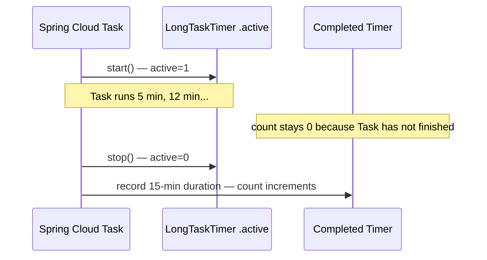
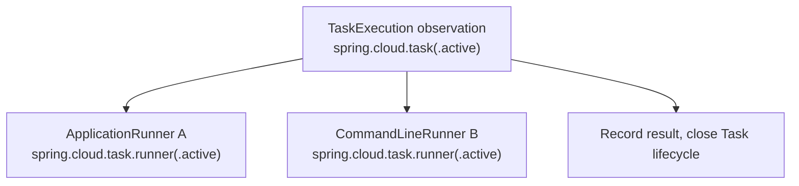
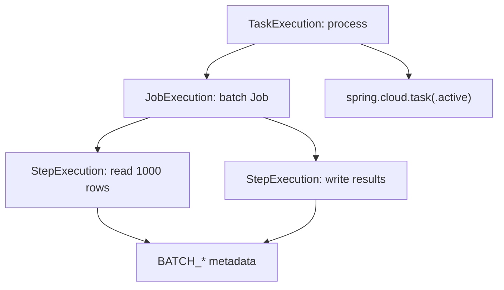

# Distinguishing Active vs. Completed Measurements

## 1. Why Distinguish Between Two Measurement Moments?

**Spring Cloud Task** is used to develop Spring Boot applications that run for a finite duration: start up, accept arguments, perform work, record lifecycle state in `TaskRepository`, and exit. A Task may run on a schedule or on demand, handle errors, coordinate with Spring Batch, and be orchestrated by Kubernetes Jobs, cron, or another deployment platform.

In operations, two questions are easily conflated:

- **How many Tasks are running right now, and how long have they been running?**
- **How many Tasks completed over the past hour, how many succeeded/failed, and how long did each take?**

The first question concerns **work still in progress** (*in-flight*). The second concerns **finished executions** (*completed*). Both are essential observability signals, yet they are collected and aggregated differently.

For example, suppose a Task starts at 02:00 and is still running at 02:20. If a dashboard displays only the durations of **completed** runs, this slow Task has **not yet contributed to duration metrics**. Concluding "average runtime is still 5 minutes, everything is healthy" can be dangerously wrong.

Conversely, if you only monitor active Tasks, when a Task fails at minute 12 its active count drops back to 0. Having zero active Tasks **does not mean it completed successfully**.

Learning objectives:

1. Explain the meaning of `LongTaskTimer`, `Timer`, `Counter`, and `Gauge` in the context of finite Tasks.
2. Distinguish the official metrics `spring.cloud.task.active` and `spring.cloud.task`, as well as `spring.cloud.task.runner.active` and `spring.cloud.task.runner`.
3. Understand update timing, active counts, completed durations, and tags available only after work finishes.
4. Configure Micrometer/Actuator appropriately for your Spring Cloud Task version; recognize Prometheus scraping limits for short-lived apps.
5. Combine metrics, traces, logs, `TaskRepository`, and orchestrator state to track successes, failures, and crashes.
6. Design business metrics, dashboards, alerts, and test procedures that avoid misleading numbers during retries or concurrent runs.

## 2. Two Lifecycle Measurement Groups

### 2.1. Active (In-Flight) Measurements

Active measurements describe **work that has started but has not yet finished**. They typically answer:

- How **many** executions are currently active?
- What is the total elapsed time across all active executions?
- How long has the longest currently running execution been running?
- Is any Task hung or abnormally exceeding its deadline?

A Micrometer `LongTaskTimer` is designed for this kind of observation: it tracks open samples and reports **active task count**, total elapsed duration of still-running work, and the maximum duration within that active set.

### 2.2. Completed Measurements

Completed measurements record **each execution that finished through the normal measurement path**. They typically answer:

- How **many times** did the Task finish in the observation window?
- What was the total duration of completed runs?
- Does the duration distribution exceed the SLO?
- What is the success/failure ratio among recorded completions?

A standard Micrometer `Timer` records duration when a sample is **stopped**. From Timer data, the backend can provide counts, total time, max, and histograms/percentiles depending on configuration. When counting a non-timed business event, a `Counter` is more suitable.

### 2.3. Direct Comparison

| Criterion | `LongTaskTimer` / active | `Timer` / completed |
| --- | --- | --- |
| When is data available? | Immediately once a sample starts and the backend observes it | Does not increment count for a new run while still running |
| While Task is running | Active count > 0; active elapsed duration grows | In-flight run is not yet recorded in completed count/duration |
| When sample closes | Active count drops; sample's active duration disappears | Count increments and completed duration is recorded |
| Useful for hung-Task alerts | Yes, if metrics are collected while running | Insufficient if relying solely on completed durations |
| Useful for completed-run stats | Not directly | Yes |
| If process is killed abruptly | Final zero/drop may not be exported | Completed sample may never be recorded |
| If process exits and vanishes | Process's active metrics disappear | In-memory metrics do not persist long-term unless exported |

**Key takeaway:** Active is **not** the total number of historical Task runs. Completed is **not** the number of Tasks running right now.

## 3. Single-Task Timeline: Why Watching Only a Timer Misses Slow Tasks

Suppose the `nightly-import` Task runs for 15 minutes. For clarity, the table below shows measurements **within a single live registry**:

| Time | State | Active tasks | LongTaskTimer: elapsed active time | Timer: completed count |
| --- | --- | ---: | --- | ---: |
| 02:00 | Task just started | 1 | Near 0 min | 0 |
| 02:05 | Processing | 1 | ~5 min | 0 |
| 02:12 | Still processing | 1 | ~12 min | 0 |
| 02:15 | Task finishes and sample closes | 0 | No active samples | 1 |



The two stop calls in the diagram only illustrate **logical state transitions**; actual callbacks are executed by Observation/Micrometer according to the implementation. When a Task fails yet the observation path still closes, the Timer can still record a duration with an error tag. Timers measure **observed run duration**, not only successful runs.

Never look at `active=0` after 02:15 and conclude no run happened today. Conversely, never look at `completed count=0` at 02:12 and conclude the Task never started.

### 3.1. When Multiple Tasks Run Concurrently

Suppose in a continuously observed system:

- Instance A has been running for 2 minutes.
- Instance B has been running for 7 minutes.
- Instance C just finished after 4 minutes.

At this moment:

```text
active_count        = 2
active_duration_sum ≈ 9 minutes (A + B)
active_max_duration ≈ 7 minutes
completed_count increases by 1 from C
completed_duration records 4 minutes from C
```

This is a **logical aggregation** example. Each Spring Cloud Task is typically a separate process with its own `MeterRegistry`; getting a system-wide view requires aggregating metrics from all processes in a backend. Never assume one Task process can see metrics from another Task process.

## 4. Official Metrics of Spring Cloud Task

The Spring Cloud Task **Observability** documentation publishes two metric pairs:

| Meter name in Micrometer | Type | What it tracks | When is it meaningful? |
| --- | --- | --- | --- |
| `spring.cloud.task.active` | **Long task timer** | Lifecycle of a Task execution | While the Task observation is active |
| `spring.cloud.task` | **Timer** | Lifecycle of a Task execution | Once the Task observation finishes |
| `spring.cloud.task.runner.active` | **Long task timer** | Execution of a runner bean | While the runner observation is active |
| `spring.cloud.task.runner` | **Timer** | Execution of a runner bean | Once the runner observation finishes |

These are **Micrometer-level meter names**, not guaranteed verbatim series strings in Prometheus/OTLP/Influx. Backends may normalize dots to underscores, change units, or append `_seconds_count` / `_active_count`. Always inspect the actual metrics emitted by your exporter.

### 4.1. Task Observation and Runner Observation Differ in Scope

A Spring Cloud Task can contain an `ApplicationRunner`, a `CommandLineRunner`, or multiple runner beans:



For each execution:

- `spring.cloud.task(.active)` tracks the **Task lifecycle**, close to the scope of a `TaskExecution`.
- `spring.cloud.task.runner(.active)` tracks **runner execution time**; metrics are distinguished by tags such as `spring.cloud.task.runner.bean-name`.
- When multiple runners exist, runner counts can exceed Task counts. Do not use completed runner counts as completed Task counts.
- If a runner launches a `CompletableFuture` and returns immediately, the runner metric may stop **before** required background work finishes. To measure accurately, await completion and preserve exceptions.

In a well-designed application, a runner returns only after required steps finish or have been safely handed off to another durable system per the business contract.

### 4.2. Availability Depends on Version and Dependencies

The names above come from the Spring Cloud Task Observability docs for Observation-enabled release trains. **Do not assume** an older Spring Cloud Task version automatically emits these exact four metrics. Verify your actual dependencies, Spring Boot/Micrometer versions, `ObservationRegistry` registration, and registry/exporter settings.

Spring Cloud Task documentation instructs adding `spring-boot-starter-actuator`, a metrics registry if exporting metrics, and Micrometer Tracing if exporting traces. Without an active `MeterRegistry`/Observation handler, these four metrics may appear differently or not be exported as expected.

## 5. What Numbers Does a LongTaskTimer Provide?

### 5.1. Active Count

`activeTasks()` is the number of currently open samples **in a given registry**. If the registry has one unclosed sample:

```text
activeTasks = 1
```

If a process is killed, its registry can vanish without emitting a final `0`. If Pushgateway still retains old metrics, you may even see stale active counts that are no longer true. Therefore, active counts must be paired with live process/Pod signals and last-scrape age.

### 5.2. Active Duration

A LongTaskTimer's `duration(...)` typically reflects the **sum of current elapsed durations across all open samples**. With three active samples, this is the sum—**not** the duration of one specific Task.

### 5.3. Active Maximum Duration

`max(...)` reports the largest elapsed duration among **currently running samples**. This is usually the right signal for alerting on hung or overtime jobs. However, backends normalize measurement types differently; verify how your exporter represents `max`.

### 5.4. Do Not Confuse LongTaskTimer with a Live-Process Gauge

A `LongTaskTimer` stays open as long as the **Observation/Sample** remains unclosed; it does not actively ping to check whether the JVM is truly alive, still connected to the database, or deadlocked. Nor can it measure runs that failed before initializing Micrometer.

At multi-Pod scale, combine it with:

- Kubernetes `Active`, `Running`, and `Pending` Job/Pod counts.
- `TaskExecution` rows with `START_TIME` set and `END_TIME` null.
- Application heartbeats/checkpoints for long jobs.
- Deadlines and container kill/quota status.

## 6. Completed Timer: Count, Total Time, and Distribution

### 6.1. Count Increments When Measurement Stops

Micrometer `Timer` tracks how many durations have been recorded. With Observations, the Timer is normally updated when the Observation **stops**. Thus `spring.cloud.task`'s `Timer.count()` reflects the number of **Task observations that reached measurement stop**, not automatically the total number of Tasks started in the database.

Timers can also record **failed** completions if the exception path still stops the observation. To compute failure rates, you need an outcome/status tag or separate signals from `TaskRepository`.

### 6.2. Total Time and Mean Duration

If three Tasks finished in 2, 4, and 9 minutes:

```text
completed_count = 3
completed_total_time = 15 minutes
completed_mean_time = 15 / 3 = 5 minutes
```

**Do not** compare this number directly against the active duration of a Task currently running at 20 minutes and conclude the current Task "only takes 5 minutes." The mean of completed runs is **biased** whenever a very slow run is still in progress.

### 6.3. Percentiles and Histograms Are Not Always Present

Whether a Timer exports `p95`/`p99` or histogram buckets depends on distribution statistics configuration and backend support. Never assume every `Timer` exposes percentiles by default.

With Prometheus, histograms allow aggregating durations across instances when configured and collected properly. Avoid computing percentiles over very few Tasks in short windows; with sparse samples, p99 does not reflect true stability.

### 6.4. Do Not Use Timer Counts as Processed Business Periods

One Task may run twice for the same `businessDate` due to a retry; two completed Timer samples **do not mean** two distinct business periods succeeded. Business periods must be tracked by business key in a dedicated result/checkpoint table.

## 7. Tags at Start Time vs. Completion Time

### 7.1. Why Do Active Metrics Have Fewer Tags?

Micrometer Observation can attach `KeyValues` at start, during execution, or at stop. Micrometer/Spring Cloud Task docs explicitly note: **KeyValues added after an Observation starts may not appear on `*.active` metrics**.

Example:

```text
02:00 observation.start()
      knows taskName = orders-import
      exitCode and status unknown yet

02:07 processing throws error
      status = failure
      exitCode decided after error handling

02:07 observation.stop()
      Completed Timer can carry status and exitCode
      Active LongTaskTimer does not necessarily carry those tags
```

Do not write PromQL checking "whether an active Task has `status=failure`" to detect failing in-flight Tasks. While the Task is **still running**, the final outcome **does not exist yet**; that tag may be completely absent on active metrics.

### 7.2. Tags Spring Cloud Task Can Emit

The Observability docs list keys such as:

| KeyValue | Meaning |
| --- | --- |
| `spring.cloud.task.name` | Logical Task name |
| `spring.cloud.task.execution.id` | Task run ID |
| `spring.cloud.task.external.execution.id` | ID provided by the deployment platform |
| `spring.cloud.task.parent.execution.id` | Link to parent Task (if any) |
| `spring.cloud.task.exit.code` | Recorded exit code |
| `spring.cloud.task.status` | `success` or `failure` |
| `spring.cloud.task.runner.bean-name` | Corresponding runner bean |

The exact list and attachment timing depend on the version/convention in use. Cloud Foundry environments may include additional app/org/space/instance keys. **Never attach tags containing sensitive information** to metrics.

### 7.3. Mind Cardinality

Every distinct combination of tag values can spawn a **new time series**. Tags prone to cardinality explosion include:

- `TaskExecutionId` / request ID changing on every run.
- Customer ID, order ID, or `businessDate` with unbounded distinct values.
- Full exception messages, SQL statements, or parameterized URLs.
- Ephemeral filenames or ever-changing Pod/instance names.

Framework conventions may list execution IDs, yet when designing **custom metrics**, favor bounded tags: `task_name`, `pipeline`, `environment`, `status`, `dependency`. Put granular IDs into **logs/traces/TaskRepository** and correlate via controlled fields.

If default metrics produce excessive cardinality for your backend, evaluate `MeterFilter` or custom conventions for your version. Never strip tags arbitrarily before checking dashboard, tracing, and alerting dependencies.

## 8. Enabling Observability in a Spring Cloud Task App

### 8.1. Core Dependencies

In a project using compatible Spring Boot/Spring Cloud BOMs, add Actuator:

```xml
<dependency>
    <groupId>org.springframework.boot</groupId>
    <artifactId>spring-boot-starter-actuator</artifactId>
</dependency>
```

If exporting to Prometheus:

```xml
<dependency>
    <groupId>io.micrometer</groupId>
    <artifactId>micrometer-registry-prometheus</artifactId>
</dependency>
```

These are supplemental dependencies, not a complete `pom.xml`. Spring Cloud Task starter, JDBC driver, repository schema, and backend environment must be configured separately. Avoid pinning arbitrary Micrometer versions outside Spring Boot's BOM; dependency artifacts and exporter property names can vary across Boot generations.

### 8.2. Configuring a Finite Application

Example `application.yml`:

```yaml
spring:
  application:
    name: orders-import-task
  main:
    web-application-type: none
  datasource:
    url: ${TASK_DB_URL:jdbc:postgresql://localhost:5432/taskdb}
    username: ${TASK_DB_USER:task_user}
    password: ${TASK_DB_PASSWORD}
  cloud:
    task:
      initialize-enabled: false
      closecontextEnabled: true

management:
  metrics:
    tags:
      application: orders-import-task
      environment: ${APP_ENV:dev}
```

Explanation:

- `web-application-type: none` suits finite Tasks that do not need an HTTP server.
- `initialize-enabled: false` assumes `TASK_*` tables are already migrated with version-appropriate DDL.
- `closecontextEnabled: true` closes the Spring context once the Task completes; the app must still manage executors/resources it creates.
- The common tags here have **bounded value sets**; never add business IDs or API tokens.

**Important:** This configuration **does not expose an HTTP endpoint** for Prometheus scraping because there is no web server. Actuator and the registry can collect metrics in-process, yet you still need an **export strategy** suited to short lifetimes to retain data across runs.

### 8.3. Inspecting Metrics via Actuator When Troubleshooting

In an **application that has a web server** with Actuator endpoints enabled, `/actuator/metrics` lets you inspect Micrometer meter names, such as:

```text
/actuator/metrics
/actuator/metrics/spring.cloud.task
/actuator/metrics/spring.cloud.task.active
/actuator/metrics/spring.cloud.task.runner
/actuator/metrics/spring.cloud.task.runner.active
```

These are **diagnostic examples when the process is alive and endpoints are actually exposed**, not four default URLs guaranteed on every Task. Spring Boot does not expose all endpoints publicly by default; apply authentication and network restrictions if exposing them.

Do not enable a web server solely to wait for Prometheus to scrape a few-second Task and leave the JVM alive after the Runner exits. That defeats the finite-application model unless lifecycle semantics are deliberately designed for it.

## 9. Java Example: Instrumenting Active and Completed Work Yourself

Suppose you want to measure **a custom business operation**, such as importing order data, rather than only framework lifecycle metrics. Choose **`app.orders.import.*`** to avoid colliding with default `spring.cloud.task.*` meters.

### 9.1. Application with an ApplicationRunner

```java
import io.micrometer.core.instrument.LongTaskTimer;
import io.micrometer.core.instrument.MeterRegistry;
import io.micrometer.core.instrument.Timer;
import org.springframework.boot.ApplicationRunner;
import org.springframework.context.annotation.Bean;
import org.springframework.context.annotation.Configuration;

@Configuration
public class ImportMetricsConfiguration {

    @Bean
    ApplicationRunner ordersRunner(
            OrdersImportService service, MeterRegistry registry) {
        return args -> {
            LongTaskTimer activeTimer = LongTaskTimer
                    .builder("app.orders.import.active")
                    .description("Duration of imports still running")
                    .tag("pipeline", "orders")
                    .register(registry);

            LongTaskTimer.Sample active = activeTimer.start();
            Timer.Sample completed = Timer.start(registry);
            String outcome = "success";

            try {
                long imported = service.importPendingOrders();
                registry.counter(
                        "app.orders.import.rows",
                        "pipeline", "orders",
                        "result", "imported"
                ).increment(imported);
            } catch (RuntimeException ex) {
                outcome = "failure";
                throw ex;
            } finally {
                active.stop();
                completed.stop(
                        Timer.builder("app.orders.import.duration")
                                .description("Duration of each import")
                                .tag("pipeline", "orders")
                                .tag("outcome", outcome)
                                .register(registry));
            }
        };
    }
}
```

`OrdersImportService` is a business service to implement in your project. This example assumes the service returns only after completing required work and throws `RuntimeException` on unacceptable errors.

**Why two meters?**

- `app.orders.import.active` increments the active sample count from `activeTimer.start()` until `active.stop()`.
- `app.orders.import.duration` records a completed duration **after** `completed.stop(...)` is called.
- `app.orders.import.rows` counts imported records; it is a **business Counter** and does not replace Task execution status.
- `outcome` has only two values (`success`/`failure`) to bound cardinality. It is attached to the **completed Timer**, not used to filter active metrics when the outcome is not yet known.

This code **is not** an exit-code controller: when the service throws `RuntimeException`, the runner rethrows so Spring Boot/Spring Cloud Task can record failure. Swallowing exceptions causes metrics and business status to falsely report success.

### 9.2. Understanding the Limits of `finally`

`finally` runs when a Java thread exits normally or via a catchable exception. If the JVM receives `SIGKILL`, crashes, hits severe OOM, or loses host power, **there is no guarantee `finally` will execute**.

In those cases:

- The completed Timer `app.orders.import.duration` may **never record a sample**.
- The LongTaskTimer can vanish with the process without sending a final zero active count.
- Previously committed business data still persists.
- `TaskExecution` may still lack `END_TIME`.

Therefore, **never use completed Timer counts as the total number of Tasks actually launched**. High reliability requires reconciling launcher/Job/Pod state and `TaskRepository`.

### 9.3. Avoid Measuring the Same Event Twice Without Clear Naming

Because Spring Cloud Task already provides framework metrics, do not register `spring.cloud.task` inside a Runner to time your service: you risk duplicate series, mixed units, or ambiguity around startup/shutdown inclusion. Keep `app.*` for **business** work; `spring.cloud.task.*` belongs to the **framework**.

## 10. Micrometer Experiment: Observing Count Increment Only After `stop()`

The following snippet uses `SimpleMeterRegistry` to demonstrate semantics without needing Spring Cloud Task or Prometheus:

```java
import io.micrometer.core.instrument.LongTaskTimer;
import io.micrometer.core.instrument.Timer;
import io.micrometer.core.instrument.simple.SimpleMeterRegistry;

public class TimerSemanticsDemo {
    public static void main(String[] args) {
        try (SimpleMeterRegistry registry =
                     new SimpleMeterRegistry()) {

            LongTaskTimer active =
                    LongTaskTimer.builder("demo.work.active")
                            .register(registry);
            Timer completed =
                    Timer.builder("demo.work.duration")
                            .register(registry);

            LongTaskTimer.Sample current = active.start();
            Timer.Sample sample = Timer.start(registry);

            System.out.println(active.activeTasks()); // 1
            System.out.println(completed.count());    // 0

            current.stop();
            sample.stop(completed);

            System.out.println(active.activeTasks()); // 0
            System.out.println(completed.count());    // 1
        }
    }
}
```

`activeTasks()` and `count()` illustrate the difference **within the same process**. This experiment does not need `Thread.sleep(...)`; to test elapsed time growth, use a mock clock or controlled waits in tests.

`SimpleMeterRegistry` is great for experiments and unit tests; it **does not durably ship data to monitoring backends**. Closing the registry at the end frees resources.

## 11. The Hardest Problem: Tasks That Exit Too Fast to Be Scraped

### 11.1. Why Prometheus Pull Easily Misses Runs

Prometheus normally calls `/actuator/prometheus` periodically, e.g., every 15 or 30 seconds. A Task:

1. Starts at 12:00:01.
2. Runs for 3 seconds.
3. Exits at 12:00:04.

If Prometheus scrapes before the Task starts and next after the Task dies, **there is no moment where the process can be scraped**. Even though the Timer recorded a sample at the end of the Runner, that metric sits only in memory and can be lost when the JVM exits.

Do not solve this by **artificially keeping the process alive for 60 extra seconds** just to be scraped, unless that is a deliberate architectural decision. Choose an observability mechanism suited to finite workloads.

### 11.2. Measurement Export Options

| Solution | Best suited for | Limitations |
| --- | --- | --- |
| Direct Prometheus scrape | Tasks running long enough with an exposed endpoint | Short Tasks can vanish between scrapes |
| Prometheus Pushgateway | Selected **service-level batch jobs** needing to publish final results | Must clean up stale series; poor primary active source for dead processes |
| OTLP/StatsD/external push registry | Backends accepting metrics over push protocols | Must flush before process exit; behavior varies by registry |
| `TaskRepository` + external collector | Durable execution history and run-count queries | DB rows are not automatically realtime metrics; must handle dead/stale processes |
| Logs/traces shipped to collector | Investigating individual runs, IDs, and root causes | Traces can be sampled/dropped; does not replace a job ledger |
| Scheduler/Job status | Detecting missed launches, Pending state, kills, exit codes | Insufficient to confirm individual committed business rows |

**Practical recommendation:** Prefer sourcing real-time active metrics from **live Tasks or live infrastructure**, while long-term completion stats should come from a **durable source**: `TaskRepository`, a business ledger, or an exporter with verified delivery of final outcomes.

### 11.3. Pushgateway Must Be Used Within Scope

Prometheus documentation notes Pushgateway fits **certain service-level batch jobs**, not as a blanket replacement for the pull model across every process. Pushgateway **does not automatically delete series** when a process dies. Pushing metrics with labels like `instance=pod-random-id` leaves stale data behind, making dead Tasks look active.

In Spring Boot versions supporting Pushgateway, typical configuration uses:

```yaml
management:
  prometheus:
    metrics:
      export:
        pushgateway:
          enabled: true
```

You must add the **Pushgateway dependency matching your Spring Boot version**, URL/credentials, and post-Task series cleanup rules. For instance, newer Spring Boot generations may use `io.prometheus:prometheus-metrics-exporter-pushgateway`, whereas older Boot versions used a different client. Never copy dependencies from another generation without checking the matching docs.

**Never push `active=1` and leave it indefinitely** in Pushgateway as if it represented currently running processes. To count truly active Tasks, use live infrastructure state or a well-defined heartbeat/expiry mechanism.

### 11.4. Recording the Latest Completion Timestamp

For batch jobs, some operational metrics matter more than cumulative counts:

```text
last_success_timestamp_seconds
last_attempt_timestamp_seconds
last_completed_timestamp_seconds
business_period_backlog
last_completed_business_date
```

These are **custom suggested metric names**, not built-in Spring Cloud Task metrics. Timestamps should use consistent epoch seconds; business dates can be stored in a ledger and exposed numerically or charted from business data. Avoid using `businessDate` as a continuously changing metric label unless cardinality impact is explicitly justified.

For daily schedules, alerting on "no successful run in the last 26 hours" is usually far more direct than checking active Task counts at 09:00.

## 12. What Durable Data Does TaskRepository Provide?

`TaskRepository` stores each Task run in `TaskExecution`. With PostgreSQL and the common default schema:

| Field | Meaning |
| --- | --- |
| `TASK_EXECUTION_ID` | Unique execution ID |
| `TASK_NAME` | Logical Task name |
| `START_TIME` | Timestamp when framework recorded startup |
| `END_TIME` | Recorded completion timestamp, if available |
| `EXIT_CODE` | Task exit code |
| `EXIT_MESSAGE` / `ERROR_MESSAGE` | Outcome and error details, if recorded |

**Unlike an in-memory Timer**, repository data survives JVM termination. Still, the repository is not "absolute truth": if a process is killed or the DB misses the final update, `END_TIME` remains null; if the Task fails before initializing the repository, no row exists at all.

### 12.1. Listing Tasks That May Still Be Running

```sql
SELECT TASK_EXECUTION_ID,
       TASK_NAME,
       START_TIME,
       END_TIME,
       EXIT_CODE
FROM TASK_EXECUTION
WHERE END_TIME IS NULL
ORDER BY START_TIME;
```

This returns the set of **"no recorded end yet," NOT** the set guaranteed to be alive. Correlate with process/Pod state and heartbeats if available. Never delete rows or fake `END_TIME` just to reset a dashboard to 0.

### 12.2. Listing Completed Executions

```sql
SELECT TASK_EXECUTION_ID,
       TASK_NAME,
       START_TIME,
       END_TIME,
       EXIT_CODE,
       ERROR_MESSAGE
FROM TASK_EXECUTION
WHERE END_TIME IS NOT NULL
ORDER BY END_TIME DESC
LIMIT 30;
```

This SQL approximates **completed executions** in the repository. Yet `END_TIME IS NOT NULL` only shows end metadata was written—it does not guarantee business acceptance criteria were met. Check exit codes **and business data**.

### 12.3. Calculating Duration of Ended Runs

```sql
SELECT TASK_EXECUTION_ID,
       TASK_NAME,
       EXTRACT(EPOCH FROM (END_TIME - START_TIME))
           AS duration_seconds,
       EXIT_CODE
FROM TASK_EXECUTION
WHERE START_TIME IS NOT NULL
  AND END_TIME IS NOT NULL
  AND END_TIME >= START_TIME
ORDER BY END_TIME DESC
LIMIT 30;
```

`EXTRACT(EPOCH FROM ...)` uses PostgreSQL syntax. This is **duration from repository timestamps**, which will not necessarily match `spring.cloud.task` down to the millisecond because Observation start/stop points and database writes occur at different times. The query also excludes runs without `END_TIME`; a null field **does not prove a process is still running**.

### 12.4. Summarizing Ended Runs vs. Missing END_TIME

```sql
SELECT TASK_NAME,
       COUNT(*) AS executions_recorded,
       COUNT(*) FILTER (
           WHERE END_TIME IS NULL
       ) AS without_end_time,
       COUNT(*) FILTER (
           WHERE END_TIME IS NOT NULL
       ) AS ended,
       COUNT(*) FILTER (
           WHERE END_TIME IS NOT NULL
             AND EXIT_CODE = 0
       ) AS ended_with_zero_exit,
       COUNT(*) FILTER (
           WHERE END_TIME IS NOT NULL
             AND EXIT_CODE <> 0
       ) AS ended_with_nonzero_exit
FROM TASK_EXECUTION
WHERE START_TIME >= CURRENT_TIMESTAMP - INTERVAL '7 days'
GROUP BY TASK_NAME
ORDER BY TASK_NAME;
```

This is a metadata reporting query and **does not replace** tracking processed business periods. If `EXIT_CODE` can be null or custom-mapped, include an explicit unknown-outcome bucket instead of dropping rows from totals.

## 13. A Record Missing END_TIME Is Not Necessarily Active

Scenario:

```text
02:00  Task A starts, START_TIME is saved
02:04  Task A commits 500 records
02:06  Node loses power; JVM never runs final callbacks
02:10  Kubernetes confirms Pod is dead
09:00  TASK_EXECUTION.END_TIME is still NULL
```

If a dashboard counts every row with `END_TIME IS NULL` as "running," it will show Task A active for 7 hours even though the Pod is dead. Conversely, relying solely on in-process active gauges makes the Task vanish and erases the incident trail.

A sound design distinguishes:

1. **Active observed:** LongTaskTimer samples seen by the exporter **recently**.
2. **In-flight according to orchestrator:** Job/Pod/process still Running/Pending per the orchestrator.
3. **Open according to repository:** `END_TIME IS NULL`.
4. **Suspected stale:** repository remains open while orchestrator confirms the process is gone past an inspection threshold.
5. **Unknown:** inconclusive due to disconnect, missing logs, or unsynchronized state.

The first three sets **do not overlap identically**. During incident handling, preserve uncertain states rather than silently converting everything to `FAILED` or `COMPLETED`.

## 14. Comparing Outcomes Across Framework, Process, and Business Data

| State | LongTaskTimer active | Completed Timer | TaskRepository | Orchestrator |
| --- | --- | --- | --- | --- |
| Runner processing | active=1 if observed while running | No sample yet for this run | Has `START_TIME`, no `END_TIME` | Pod Running |
| Runner succeeded | Sample closed | Records duration and success status | Usually has `END_TIME`, exit code 0 | Job typically Succeeded |
| Runner threw RuntimeException | Closes if error path still unwinds | May record failure duration | Framework attempts to save error | Job typically Failed |
| Error before TaskRepository | May never be created | May never be created | May have no row | Process/Job failed |
| JVM received `SIGKILL` | No reliable stop sample | May lose final sample | `END_TIME` may remain `NULL` | Pod Failed/terminated |
| Process killed after commit | Final sample may be lost | May not record | End timestamp may be missing | Cannot tell how much business data committed |
| Job never created by scheduler | None | None | None | Inspect CronJob/scheduler |

**Never trigger a retry based on a single metric.** Before rerunning, verify the old process has stopped, check committed data, confirm idempotency, and inspect `JobRepository` if using Spring Batch.

## 15. Active Metrics vs. Completed Metrics on Dashboards

### 15.1. Two Distinct Dashboard Areas

A dashboard for `orders-import-task` can be split into:

**Currently Active**

- Active Task count by name and environment.
- Longest-running Task and count exceeding duration thresholds.
- Running/Pending Job/Pod counts.
- Count of `TaskExecution` rows missing `END_TIME` and suspected stale items.

**Completed**

- Succeeded/failed completion counts over 1h, 24h, and 7d windows.
- Total duration, mean, and p95/p99 (when valid histograms exist).
- Most recent successful completion timestamp.
- Completed business periods, backlog, and valid/failed/skipped record counts.

Never compare **current total active time** directly against **mean completed duration** without clarifying units, scope, and sample sets.

### 15.2. Illustrative PromQL Formulas

When your exporter uses standard Prometheus naming, you **may** see series such as:

```promql
# Completed Timer: recorded completions in 1 hour
sum(increase(spring_cloud_task_seconds_count[1h]))
```

```promql
# LongTaskTimer: active samples at scrape time
sum(spring_cloud_task_active_active_count)
```

These are **illustrative examples, not guaranteed series names**. Micrometer/Prometheus apply naming and unit conversions; measurement names, tags, and suffixes vary by registry/version. Inspect `/actuator/prometheus` on your actual version or check ingested series names before using PromQL in production.

Additional caveats:

- `increase(...)` on a Timer counts only samples that **finished and were observed by the exporter**, excluding unfinished runs.
- `sum(active_count)` on Pushgateway can include **stale values** unless series are properly deleted.
- `rate` or `increase` can miss samples when Tasks are shorter than the scrape interval.
- Results should not replace repository records when exact per-run auditing is required.

### 15.3. The "Zero Active Means Healthy" Fallacy

In a nightly system running 1 Task, **active=0** is normal most of the day. Yet if the controller skipped yesterday's schedule, active is still 0—looking identical to a healthy day. Therefore also track:

```text
expected_business_periods
completed_business_periods
last_success_timestamp
unprocessed_period_backlog
```

These are **custom metric ideas**. They answer "did the expected data arrive on time?" instead of only "is a process running right now?"

## 16. Alerting: Matching the Right Signal to Each Incident

| Goal | Appropriate signal | Misleading alert to avoid |
| --- | --- | --- |
| Task running too long | Max active duration + Job/Pod Running | Completed Timer showing a great p95 while one Task hangs |
| Scheduled Task never launched | Expected-period ledger + scheduler Jobs/events | Searching only inside `TaskExecution` |
| Task failed | `TaskExecution`, Pod exit code, completed outcome metric | Watching active simply drop to 0 |
| Task vanished/crashed | Overdue `END_TIME NULL` + confirmed dead process | Assuming `END_TIME NULL` always means Running |
| Data missing on time | `last_success`, business-period backlog | Counting completed runs without checking `businessDate` |
| Duplicate retries | Business keys, unique counts, reconciliation | Believing each `TaskExecutionId` represents a distinct period |
| Multiple workers processing simultaneously | Active Job count + locks/leases + data checks | Relying on per-process active metrics to guarantee cluster-wide exclusivity |

A reliable alerting strategy usually combines:

1. **Workload SLA/SLO:** the prior day's data period must complete before the cutoff hour.
2. **Execution deadline:** a Task must not exceed its designed runtime budget.
3. **Failure detection:** detect both failed Jobs and Jobs never created.
4. **Safe recovery:** bounded retries without duplicate side effects.

Never use default metric `executionId` tags to spawn millions of distinct alerts. Group alerts by task/environment and link out to logs/traces/`TaskRepository` for per-run investigation.

## 17. Spring Batch: Distinguishing Active Tasks from Step Progress

When a Spring Cloud Task runs Spring Batch, `JobRepository` also tracks `JobExecution` and `StepExecution`:



| Signal | What does it measure? | Cannot replace |
| --- | --- | --- |
| `spring.cloud.task.active` | Active Task execution observation | Rows committed by a Step |
| `spring.cloud.task` | Completed Task duration | Individual Batch Step statuses |
| `JobExecution.STATUS` | Whether the Batch Job completed | Overall JVM or Pod status |
| `StepExecution.READ_COUNT` / `WRITE_COUNT` | Batch read/write progress | Number of Task launches |
| `TaskExecution.END_TIME` | Task metadata end timestamp | Confirmation of all external non-DB side effects |

A Task can remain active after Step A finishes and while Step B is failing. A `FAILED` Job does not roll back earlier committed chunks. To display **business progress** on dashboards, use processed counts, expected totals, or Batch checkpoints rather than estimating progress from elapsed time.

### 17.1. Querying Steps to Check Progress

```sql
SELECT JOB_EXECUTION_ID,
       STEP_EXECUTION_ID,
       STEP_NAME,
       STATUS,
       READ_COUNT,
       WRITE_COUNT,
       FILTER_COUNT,
       COMMIT_COUNT,
       ROLLBACK_COUNT
FROM BATCH_STEP_EXECUTION
ORDER BY STEP_EXECUTION_ID DESC
LIMIT 30;
```

Column names follow the standard Spring Batch JDBC schema; verify against your exact DDL. `READ_COUNT` and `WRITE_COUNT` update at chunk/commit boundaries, not microsecond-by-microsecond like a live gauge. Never assume `WRITE_COUNT` equals the number of messages acknowledged by a downstream Kafka or API receiver.

### 17.2. Job Failures Must Map to Task Outcomes

If a Batch Job fails while the Runner simply logs and exits cleanly, the Task can appear successful. Enforce a policy mapping Batch failures to Task/process exit status, such as `spring.cloud.task.batch.fail-on-job-failure` on supported versions. Also reconcile **Task** completed Timers with Batch metadata by Job/Task ID.

## 18. What Do Traces and Logs Add to Metrics?

### 18.1. Metrics Answer "How Much"; Traces and Logs Answer "Why"

- **Metrics:** active Tasks, completion counts, durations, error counts, backlog.
- **Traces/spans:** which APIs a Task called, which step was slow, and latency breakdown.
- **Logs:** error messages, stack traces, non-sensitive arguments, and current processing stage.
- **TaskRepository/JobRepository:** execution identifiers and status queryable after process exit.

Spring Cloud Task publishes `spring.cloud.task` and `spring.cloud.task.runner` spans in its Observability docs. Exporting traces requires Micrometer Tracing and an appropriate exporter/collector. **Never assume 100% of traces arrive**, because sampling, buffering, network issues, and abrupt Task exits can drop spans.

### 18.2. Correlating a Single Execution

Structured log example:

```json
{
  "event": "orders-import-progress",
  "task_name": "orders-import",
  "task_execution_id": 4821,
  "business_date": "2026-11-23",
  "processed": 9500,
  "expected": 10000,
  "elapsed_seconds": 105,
  "trace_id": "example-trace-id"
}
```

Values above are **illustrative**, not automatically emitted by Spring Cloud Task. In multi-threaded apps, actively propagate correlation context across threads. Avoid logging passwords, tokens, personal data, or raw SQL containing secrets.

Detailed IDs like `task_execution_id` belong in logs/traces for drill-down, not as labels on every custom time series.

## 19. Runbook: Active Metric Vanished While Task Has No END_TIME

**Scenario:** at 02:15 the dashboard no longer shows `spring.cloud.task.active` for a Task, while `TASK_EXECUTION.END_TIME` is null.

Response steps:

1. **Check Pod/process state.** Verify whether it is Running, Pending, Terminated, OOMKilled, deadline-killed, or resource-missing.
2. **Verify the exporter.** Was the metric dropped due to registry/collector errors, missed scrapes, label changes, or series expiration?
3. **Inspect TaskRepository.** Read `START_TIME`, `END_TIME`, `EXIT_CODE`, and `ERROR_MESSAGE`, without treating `END_TIME NULL` as proof of life.
4. **Check logs and traces.** Find the last processed timestamp, stack traces, and correlation IDs.
5. **Verify business data.** How many records committed; might external non-DB actions have already succeeded?
6. **Check JobRepository** if running Spring Batch: which checkpoints committed, can the Job restart, or is an execution stale?
7. **Decide on a controlled retry.** Rerun only after confirming the old process is no longer running concurrently and idempotency is safe.
8. **Fix observability plumbing.** If metrics routinely disappear on short Task exits, switch to durable sources or proper push/export pipelines rather than arbitrarily keeping processes alive.

**Never delete `TaskExecution` rows or fabricate `END_TIME`** to tidy up a dashboard. When an approved recovery procedure requires updating metadata, verify business data first and maintain an audit trail.

## 20. Common Measurement Misreadings

| Symptom | Misinterpretation | Correct interpretation and action |
| --- | --- | --- |
| Timer count is 0 while Task has run for 20 minutes | "No Job has run" | Completed Timer ignores **in-flight** runs; check LongTaskTimer/Pod |
| Active is 0 after a Task fails | "Task succeeded" | Active also drops to 0 on failure; check completed status/exit code |
| `*.active` lacks `status` tag | "Framework failed to record outcome" | Tag may only be added after `Observation.start()` |
| Process exited yet no completed metric | "Application never ran" | May be due to kill or metric not exported before exit |
| `END_TIME IS NULL` persists | "Job is definitely still running" | Process may be dead; verify backend/runtime |
| Pushgateway shows active=1 the next day | "Task has been running since yesterday" | Likely stale series; check grouping keys and cleanup |
| Completed Timer doubled | "Two business periods completed" | Likely two retries of the **same period** |
| Runner timer stopped early | "The entire Task must be done" | Runner may have returned before async work or Task cleanup |
| Percentiles not shown | "Timer isn't working" | Histograms/percentiles may be disabled or lack samples |
| Prometheus name changed after Boot upgrade | "Framework lost the metric" | Check naming conventions, registry, and version |
| Default metrics create too many series | "Need to add executionId to every label" | Do the opposite: bound cardinality and keep IDs in logs/traces |
| CronJob created no Job yet dashboard is silent | "Everything is healthy" | No `TaskExecution` exists; reconcile against **expected schedule** |

## 21. Observability Test Matrix

| Test | How to run in test environment | What to verify |
| --- | --- | --- |
| Active while running | Let Runner sleep for a controlled 20–30 seconds | LongTaskTimer sample appears while Task is active |
| Normal completion | Runner returns without error | Active drops, Timer records duration, `TaskRepository` sets `END_TIME` |
| Unhandled exception | Runner throws `IllegalStateException` | Failure signal appears, duration recorded if observation stops, appropriate exit code |
| Process killed | Force-stop against test DB | Do not trust final sample; detect via Pod/`TaskRepository` |
| Task shorter than scrape interval | Run Task for a few seconds | Confirm pull scraping can miss metrics |
| Multiple runners | Define two non-overlapping runners | Runner timer count differs from Task timer count |
| Multiple processes | Launch two independent Tasks | Per-process metrics aggregate properly in backend |
| Pre-repository failure | Misconfigure DB in test environment | `TaskExecution` and Task meters may be absent |
| Stale Pushgateway | Let Task finish without grouping cleanup | Identify stale series and cleanup rules |
| Tag timing | Add key only when observation stops | `*.active` likely lacks the final key |
| Spring Batch retry | Fail mid-chunk, restart properly | Compare `JobExecution`, `StepExecution`, Task, and metrics |
| Missed schedule | Pause scheduler in test | Expected-period ledger flags missing run despite empty `TaskRepository` |

Never use production data to simulate process kills or database failures. Run tests in isolated namespaces/databases with cleanup procedures.

## 22. Applied Exercises

**Exercise 1 — Reading both clocks.** A Task has been running for 25 minutes while the `spring.cloud.task` Timer dashboard shows only a single 3-minute completion from yesterday. Why can you not conclude the current Task only takes 3 minutes? Name the metrics or data sources to inspect.

**Exercise 2 — Timeline reconciliation.** Trace a timeline where Task A runs 7 minutes, Task B runs 12 minutes, and Task C fails after 2 minutes. Determine active count, active max duration, and completed observation count at minutes 5, 8, and 13.

**Exercise 3 — Runner vs. Task.** A Task has two `ApplicationRunner` beans running sequentially. Explain why `spring.cloud.task.runner` can have 2 samples while `spring.cloud.task` has 1.

**Exercise 4 — End-of-life tags.** An observation starts before `exitCode` is known, then hits an SQL error. Why might `spring.cloud.task.active` lack the error tag? Describe how to inspect the error using the completed Timer and `TaskRepository`.

**Exercise 5 — Micrometer programming.** Run `TimerSemanticsDemo` and inspect `LongTaskTimer.activeTasks()` before/after `stop()` along with `Timer.count()`. Add a failure case that still stops the sample and compare counts.

**Exercise 6 — Short Task.** A Task runs for only 4 seconds while Prometheus scrapes every 30 seconds. Explain why metrics can be lost and compare `TaskRepository`, a collector, and Pushgateway.

**Exercise 7 — Crash.** A Pod is OOM-killed, `TASK_EXECUTION.END_TIME` is null, and active metrics disappear. Propose a runbook to distinguish a dead process from dropped exporter telemetry, then decide how to retry safely.

**Exercise 8 — Business date.** The 23/11 Job runs twice due to a retry. The completed Timer shows two samples, while the business ledger shows only one `COMPLETED` `businessDate`. Explain why both facts are consistent.

**Exercise 9 — Alerting.** Build a dashboard/alerting setup for a nightly Task that must finish before 06:00. Pick at least one active signal, one completed signal, and one expected-schedule ledger signal; explain missed-schedule detection.

**Exercise 10 — Cardinality.** A team adds `orderId` as a Counter label across 10 million orders. Analyze the impact and propose storing granular IDs in logs/traces instead of meter labels.

## 23. Principles to Remember

1. **`LongTaskTimer` reflects in-flight work; `Timer` reflects durations of finished measurements.** Never use Timer counts to detect still-running hung Tasks.
2. **Spring Cloud Task publishes two meter pairs**: `spring.cloud.task(.active)` for the Task and `spring.cloud.task.runner(.active)` for runners on Observation-enabled versions.
3. **Tags known only at Task completion may be absent on `*.active`**; never filter active metrics by exit code or final status as a mandatory condition.
4. **Completed Timers record only samples that actually stop**; crashes/kills can prevent final metrics from being sent.
5. **Finite Tasks easily vanish before the next Prometheus scrape**; design an appropriate export strategy and durable history source.
6. **Pushgateway retains stale series without cleanup**; never treat stale active series as live processes.
7. **`END_TIME IS NULL` does not guarantee a Task is still running**. Reconcile `TaskRepository`, Pod/process state, and logs.
8. **TaskExecution, JobExecution, and business outcomes are distinct**; verify all three before retrying or declaring a data period complete.
9. **Metrics should use low-cardinality tags**, keeping execution IDs, order IDs, and error details in logs/traces/repositories.
10. **Effective alerting combines active duration, completed outcomes, and expected schedules**, rather than watching a single chart.

## References

- [Spring Cloud Task — Observability](https://docs.spring.io/spring-cloud-task/reference/observability.html): the four meters `spring.cloud.task`, `spring.cloud.task.active`, `spring.cloud.task.runner`, and `spring.cloud.task.runner.active`, keys, and spans.
- [Spring Cloud Task — Features](https://docs.spring.io/spring-cloud-task/reference/features.html): Task lifecycle, metric integration, and `TaskRepository`.
- [Spring Boot — Metrics](https://docs.spring.io/spring-boot/reference/actuator/metrics.html): Actuator, Prometheus, Pushgateway, exporters, and metric endpoints.
- [Micrometer — Long Task Timers](https://docs.micrometer.io/micrometer/reference/concepts/long-task-timers.html): active count, active duration sum, and max duration.
- [Micrometer — Observation Components](https://docs.micrometer.io/micrometer/reference/observation/components.html): Timer on stop, LongTaskTimer on start, and tag constraints.
- [Prometheus — When to Use the Pushgateway](https://prometheus.io/docs/practices/pushing/): Pushgateway scope and stale metric risks.
- [Prometheus — Instrumentation Best Practices](https://prometheus.io/docs/practices/instrumentation/): batch job measurements and last-success timestamps.
- [Spring Batch — Reference](https://docs.spring.io/spring-batch/reference/): `JobRepository`, `JobExecution`, `StepExecution`, and checkpoints.
- [Kubernetes — Job](https://kubernetes.io/docs/concepts/workloads/controllers/job/): Pod/Job states, retries, and deadlines.
- [Spring Boot — Externalized Configuration](https://docs.spring.io/spring-boot/reference/features/external-config.html): managing Task properties and secrets.
