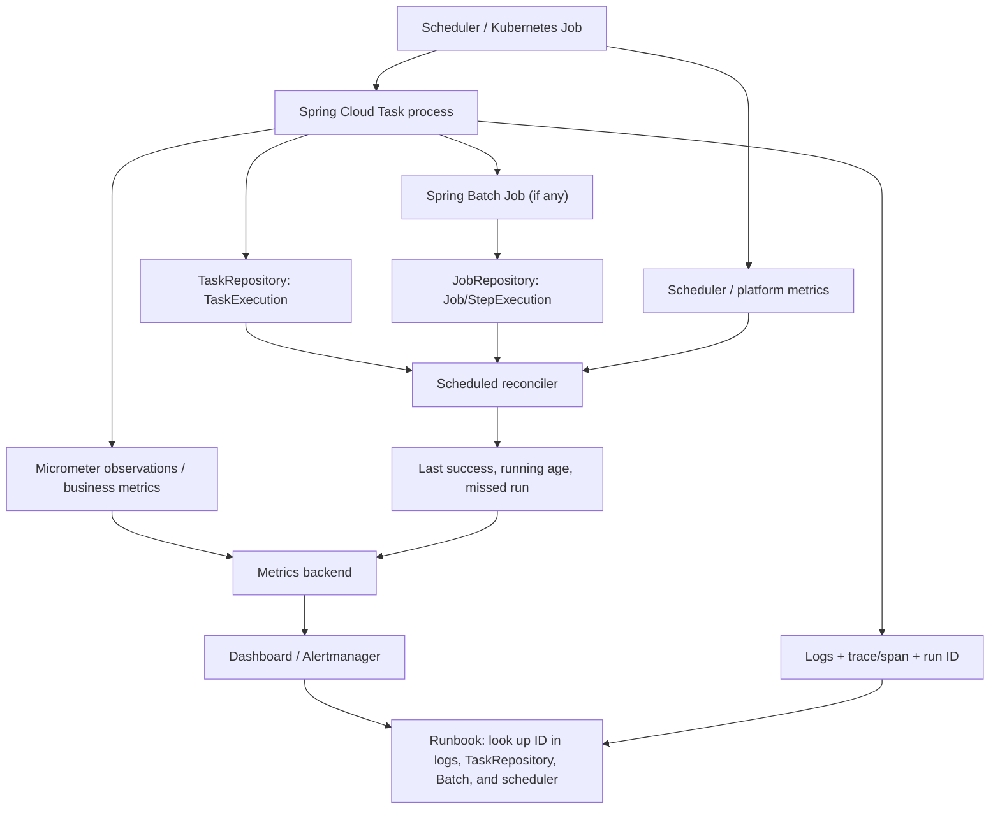

# Designing Metric Tags and Per-Run Alerting in Spring Cloud Task

## 1. The Problem: How Do You Monitor a Task That Runs a Few Minutes a Day?

**Spring Cloud Task** builds Spring Boot applications that run for a finite period: start up, accept arguments, execute work, and exit. `TaskRepository` can persist each run as a `TaskExecution` containing `taskName`, `startTime`, `endTime`, `exitCode`, `exitMessage`, and error details. A Task can run on a schedule, on demand, or launch a Spring Batch Job; in production, it is commonly packaged as a Kubernetes Job or short-lived process.

Consider an `invoice-import` Task scheduled daily at 01:00:

- Today the Task runs for 8 minutes and exits cleanly.
- Tomorrow the Job never launches due to a scheduler error. There is no new `TaskExecution` and no failure event from the application.
- The day after, the Task runs for 45 minutes instead of 8; it has not errored yet, yet it has breached its 02:00 completion SLA.
- Another time the Job is killed for out-of-memory: `TaskRepository` still has `END_TIME IS NULL`, while the Kubernetes Pod shows reason `OOMKilled`.
- When an operator gets paged, they need to know **which Task**, **which run**, **what error**, and **which data may have been processed**, yet the metrics backend must avoid exploding into millions of time series.

Therefore, observability design is not just "slapping IDs onto every metric." You must combine **metrics for detection and alerting by stable groups**, **logs/traces to investigate a specific run**, **`TaskRepository`/`JobRepository` to reconcile durable outcomes**, and **the scheduler to detect missed schedules**.

After this lesson in the **Observability** chapter, you will be able to:

1. Choose appropriate metrics and tags for Spring Cloud Task while controlling **cardinality**.
2. Use `taskExecutionId`/`jobExecutionId` to look up a single run without turning them into high-cost metric labels.
3. Collect metrics from **short-lived** processes with an appropriate pipeline.
4. Define SLIs/SLOs and alerts for failures, overruns, missed schedules, and telemetry dropouts.
5. Write Micrometer examples, PromQL rules, reconciliation SQL, and incident runbooks.

## 2. Four Complementary Data Sources



| Source | Where is it strong? | Limitations to remember |
| --- | --- | --- |
| **Micrometer metrics** | Counting events, timing durations, trends, large-scale alerting | Short-lived process counters can vanish before scraping; ID labels inflate cardinality |
| **TaskRepository** | Persisting history of each `TaskExecution` for outcome and timing inspection | Very early crashes may leave no row; `END_TIME IS NULL` does not prove the process is alive |
| **Spring Batch `JobRepository`** | Tracking `JobExecution`, `StepExecution`, read/write/skip counts, checkpoints | Batch `FAILED` does not automatically force a non-zero Task exit code |
| **Logs / traces** | Pinpointing a specific run, querying by ID, inspecting exceptions and dependencies | Does not replace aggregate SLIs; must scrub secrets and enforce retention |
| **Scheduler / Kubernetes** | Knowing expected fire times, whether a Pod was created, exit codes, kill reasons | Does not fully verify business success if the app swallows errors |

**Observability must work in both directions:** from an aggregate alert, locate **one specific run**; from a `TaskExecutionId`, locate related logs, traces, `JobExecution`, and actual business results.

## 3. Built-In Observations of Spring Cloud Task

Spring Cloud Task integrates **Micrometer Observation**. When an application includes Spring Boot Actuator and an appropriate Micrometer registry (plus a tracing bridge/exporter if needed), the framework provides observations around the Task lifecycle:

| Observation / logical name | Type | Meaning |
| --- | --- | --- |
| `spring.cloud.task` | Timer | Duration of a Task execution |
| `spring.cloud.task.active` | Long task timer | In-flight active duration |
| `spring.cloud.task.runner` | Timer | Duration of a Task runner invocation |
| `spring.cloud.task.runner.active` | Long task timer | In-flight active runner |

In Spring Cloud Task's observability documentation, keys such as `spring.cloud.task.name`, `spring.cloud.task.status` (success/failure), `spring.cloud.task.exit.code`, `spring.cloud.task.execution.id`, and `spring.cloud.task.external.execution.id` appear in the observation attributes table. On traces, execution IDs are valuable; **on a metrics backend, an ID incrementing on every run is a high-cardinality value**, even though framework docs list it among observation key values.

> **Core principle:** "Provided as a key by the framework" does not mean "put that key's raw values onto every production metric series." Weigh run frequency, environments, error branches, histogram bucket counts, and your backend's time-series budget.

Attributes added **after an observation starts** may not appear on `*.active` metrics. Therefore, never infer final outcomes from a running long task timer; final status is reliable only after the lifecycle closes and the repository persists its record.

Metric names exported to Prometheus may undergo **syntax conversion** (dots to underscores, adding `_seconds`, `_count`, or `_sum` suffixes depending on meter type). Examples in the PromQL section below use **custom metric names confirmed in the illustrative pipeline**, without assuming they appear automatically merely from adding Actuator.

### 3.1. Dependency Setup

Maven example for a Task with Micrometer and Prometheus export, assuming Spring Boot/Spring Cloud BOMs are **already imported in the project**:

```xml
<dependencies>
    <dependency>
        <groupId>org.springframework.cloud</groupId>
        <artifactId>spring-cloud-starter-task</artifactId>
    </dependency>
    <dependency>
        <groupId>org.springframework.boot</groupId>
        <artifactId>spring-boot-starter-actuator</artifactId>
    </dependency>
    <dependency>
        <groupId>io.micrometer</groupId>
        <artifactId>micrometer-registry-prometheus</artifactId>
        <scope>runtime</scope>
    </dependency>
</dependencies>
```

For OTLP or Influx backends, swap in the matching registry from your BOM. If you need traces, add a **Micrometer Tracing bridge** and exporter supported by your OpenTelemetry/Zipkin stack; Actuator alone does not ship spans to a trace backend.

Do not keep an HTTP server running forever just to expose `/actuator/prometheus` for a Task. Pull-based endpoints work only if the process lives long enough or a longer-lived exporter collects them; Section 7 explains how to export metrics for short Jobs.

## 4. Tag Design: Low-Cardinality Labels, Identifiers Elsewhere

**Cardinality** is the number of distinct label combinations a metric generates. For example:

```text
task_name: 12 values
environment: 3 values
outcome: 3 values
failure_class: 6 values

Theoretical maximum: 12 x 3 x 3 x 6 = 648 metric combinations.
If a new task_execution_id is added on every run (100,000 values)
the potential number of series grows enormously.
```

If the metric is a histogram with many buckets, total series multiply further by every bucket. Actual series counts also depend on active tag combinations, app versions, namespaces, and how the backend indexes metadata. Therefore, **never turn per-run IDs into metric labels** just to put a clickable link on a dashboard.

### 4.1. Tag Classification Table

| Tag / attribute | Put in metrics? | Rationale / alternative location |
| --- | --- | --- |
| `task_name` | **Yes, if names are stable and governed** | Enables comparing Task types; avoid embedding UUIDs or dates in names |
| `environment` | Yes | Small set such as `dev`/`staging`/`production` |
| `outcome` | Yes | Bounded enum `success`/`failure`/`unknown` |
| `failure_class` | Yes, when normalized | Small set such as `input`/`database`/`downstream`/`timeout`/`other` |
| `worker_role` / `component` | Yes if bounded | `manager`/`worker` or stable step name |
| `region` | Yes when truly needed | Only if the region set is bounded |
| `exit_code` | With caution | If many distinct codes exist, fold into `outcome` or error groups |
| `task_execution_id` | **No** | Logs/traces, `TaskRepository`, drill-down URLs |
| `job_execution_id` / `step_execution_id` | **No** | Logs/traces, `JobRepository` |
| `external_execution_id` / `trace_id` / `span_id` | **No** | Tracing or structured logs |
| `pod_name` / `container_id` | Not on custom business metrics | Use Kubernetes metadata/logs; infra telemetry has its own labels |
| `tenant_id` / `customer_id` / `order_id` | Usually no | Cardinality, security, and access control; keep in business data |
| `business_date` or exact timestamps | No | Spawns a new label every day; use sample time/metadata |
| `exception_message` / `error_message` | **No** | Unbounded values and may contain sensitive info |

Every tag must have a **bounded value dictionary and an owner**. A dynamic `task_name` like `invoice-import-20261124-4812` is high-cardinality even though the key name looks innocent.

### 4.2. Keeping Framework Observations from Inflating Series

Micrometer supports `MeterFilter.ignoreTags(...)` to drop tags that should not enter the metrics registry. Example configuring a policy to **strip per-run IDs**:

```java
package com.example.observability;

import io.micrometer.core.instrument.config.MeterFilter;
import org.springframework.context.annotation.Bean;
import org.springframework.context.annotation.Configuration;

@Configuration(proxyBeanMethods = false)
public class TaskMetricTagPolicy {

    @Bean
    MeterFilter dropPerRunIdsFromMetrics() {
        return MeterFilter.ignoreTags(
            "spring.cloud.task.execution.id",
            "spring.cloud.task.external.execution.id",
            "spring.cloud.task.parent.execution.id"
        );
    }
}
```

`MeterFilter` transforms only **metrics** on the registry where it is registered; it does not remove IDs from `TaskRepository` and is not a PII filter for logs/traces. The configuration above applies registry-wide; use it only after confirming the dropped keys are not relied upon by another critical metric. When preserving framework observations intact is necessary for compatibility, build a custom `ObservationConvention` or drop labels at the collector/backend after verifying APIs for your version.

After deploying, inspect endpoint/export output to confirm **no series remain keyed by `taskExecutionId` or `externalExecutionId`**. Configuring a filter without verifying actual series counts is not enough.

## 5. Custom Metric Contract for Finite Tasks

Alongside automatic observations, an application can define **business** metrics with stable labels. The names below are **illustrative conventions**, not metrics generated automatically by Spring Cloud Task:

| Logical name in Micrometer | Type | Recommended tags | How to interpret |
| --- | --- | --- | --- |
| `batch_task_runs` | Counter | `task_name`, `environment`, `outcome`, `failure_class` | Count of runs reaching the recorded completion branch in runner code |
| `batch_task_business_duration` | Timer | Same bounded tag set | Business processing duration measured inside the runner |
| `batch_task_records_processed` | Counter | `task_name`, `environment`, `result` | Records processed/written per business rules |
| `batch_task_last_success_timestamp_seconds` | Gauge **synthesized from durable state** | `task_name`, `environment` | Unix timestamp of the most recent successful run |
| `batch_task_last_finish_timestamp_seconds` | Gauge from durable store | `task_name`, `environment` | Unix timestamp of the most recent ended run |
| `batch_task_running_age_seconds` | Gauge from reconciler | `task_name`, `environment` | Age of a truly active run, reconciled with scheduler |
| `batch_task_expected_run_timestamp_seconds` | Gauge from schedule | `task_name`, `environment` | Next or latest expected schedule timestamp per definition |

**Distinguish measurement sources:** the first three metrics can be emitted by running code, yet if the process is very short, the exporter may not collect them in time. The remaining four gauges should come from a **long-lived monitoring service** reading `TaskRepository` and schedules—never an in-JVM gauge that vanishes after a few seconds.

For counters, a Micrometer name `batch_task_runs` exported to Prometheus typically appears as `batch_task_runs_total`. Timer `batch_task_business_duration` can produce `batch_task_business_duration_seconds_count` and `..._sum`. **Verify exact exported names** before writing PromQL.

### 5.1. Defining `outcome` and `failure_class`

| Value | Definition |
| --- | --- |
| `outcome=success` | Runner exited normally and business steps met acceptance criteria |
| `outcome=failure` | Runner threw an exception and the signal propagated to the lifecycle |
| `outcome=unknown` | Insufficient evidence to confirm success/failure (typically assigned by reconciler) |
| `failure_class=none` | No error |
| `failure_class=input` | Invalid parameters or input data format |
| `failure_class=database` | DB connection, timeout, or data processing error |
| `failure_class=downstream` | Unavailable API/broker/dependency |
| `failure_class=timeout` | Exceeded configured time budget |
| `failure_class=other` | Other error, avoiding new labels per exception class |

If a Batch Job inside the runner has `BatchStatus.FAILED` yet code swallows the error and returns normally, runner metrics may record `success` **falsely**. Propagate Batch Job status to the Task (for example, setting `spring.cloud.task.batch.fail-on-job-failure=true` where supported, or checking `JobExecution.status` and throwing in the runner).

## 6. Java Micrometer Example: Stable Tags Inside ApplicationRunner

The example below uses Java 17+, Spring Boot, and a compatible Spring Cloud Task version. It measures **processing inside the runner**, not full JVM startup time. Tags use a small bounded set; per-run IDs are logged separately.

```java
package com.example.invoice;

import java.time.LocalDate;

import io.micrometer.core.instrument.MeterRegistry;
import io.micrometer.core.instrument.Tags;
import io.micrometer.core.instrument.Timer;
import org.slf4j.Logger;
import org.slf4j.LoggerFactory;
import org.springframework.boot.ApplicationRunner;
import org.springframework.boot.SpringApplication;
import org.springframework.boot.autoconfigure.SpringBootApplication;
import org.springframework.cloud.task.configuration.EnableTask;
import org.springframework.context.annotation.Bean;
import org.springframework.dao.DataAccessException;

@SpringBootApplication
@EnableTask
public class InvoiceTaskApplication {

    private static final Logger log =
        LoggerFactory.getLogger(InvoiceTaskApplication.class);

    public static void main(String[] args) {
        SpringApplication.run(InvoiceTaskApplication.class, args);
    }

    @Bean
    ApplicationRunner invoiceRunner(
            InvoiceImportService importer,
            MeterRegistry metrics) {
        return arguments -> {
            String taskName = "invoice-import"; // Stable name set.
            String environment = "production"; // Example; read from real config.
            String outcome = "success";
            String failureClass = "none";
            Timer.Sample sample = Timer.start(metrics);

            try {
                // Business date should come from validated arguments in production.
                importer.importFor(LocalDate.of(2026, 11, 24));
            } catch (Exception ex) {
                outcome = "failure";
                failureClass = classify(ex);
                log.error(
                    "Invoice import failed; class={}",
                    failureClass,
                    ex
                );
                throw ex; // Preserve error signal so Task/Kubernetes detects failure.
            } finally {
                Tags tags = Tags.of(
                    "task_name", taskName,
                    "environment", environment,
                    "outcome", outcome,
                    "failure_class", failureClass
                );

                sample.stop(Timer.builder("batch_task_business_duration")
                    .description("Business processing time of a task run")
                    .tags(tags)
                    .register(metrics));

                metrics.counter("batch_task_runs", tags).increment();
            }
        };
    }

    private static String classify(Exception ex) {
        if (ex instanceof IllegalArgumentException) {
            return "input";
        }
        if (ex instanceof DataAccessException) {
            return "database";
        }
        return "other";
    }

    public interface InvoiceImportService {
        void importFor(LocalDate date) throws Exception;
    }
}
```

This class requires a **real `InvoiceImportService` bean** in the app; it does not include invoice import logic, datasource, or schema. `LocalDate.of(2026, 11, 24)` is only a simulated parameter. In production, parse the date from `ApplicationArguments`, never hardcode it, and never put the date into a metric label.

Intentional limitations:

1. The counter increments when the **runner passes through `finally`**. It misses failures occurring before the runner (image pull, Spring bootstrap, missing Secret/DB) or processes killed by `SIGKILL`. An external reconciler must cover that gap.
2. `outcome` relies on runner exceptions. If code catches and swallows business errors, metrics report inaccurately—that is an application success-contract defect.
3. This Timer does not replace the framework's `spring.cloud.task` observation: it measures only `importer.importFor(...)` and surrounding runner code.
4. Passed `tags` remain **four bounded dimensions**; `taskExecutionId`, exception messages, filenames, and `businessDate` never become tags.
5. **Recording a meter inside the JVM does not guarantee it is exported out of the process** before the JVM closes. Choose an export pipeline as described next.

### 6.1. Logging Per-Run IDs Without Increasing Cardinality

Example `TaskExecutionListener` used solely for structured logging, without altering exit codes or exit messages:

```java
package com.example.observability;

import org.slf4j.Logger;
import org.slf4j.LoggerFactory;
import org.springframework.cloud.task.listener.TaskExecutionListener;
import org.springframework.cloud.task.repository.TaskExecution;
import org.springframework.stereotype.Component;

@Component
public class TaskRunLogListener implements TaskExecutionListener {
    private static final Logger log =
        LoggerFactory.getLogger(TaskRunLogListener.class);

    @Override
    public void onTaskStartup(TaskExecution execution) {
        log.atInfo()
            .addKeyValue("task_execution_id", execution.getExecutionId())
            .addKeyValue("task_name", execution.getTaskName())
            .log("Task started");
    }

    @Override
    public void onTaskFailed(
            TaskExecution execution, Throwable error) {
        log.atError()
            .addKeyValue("task_execution_id", execution.getExecutionId())
            .addKeyValue("task_name", execution.getTaskName())
            .addKeyValue("error_class",
                error.getClass().getSimpleName())
            .setCause(error)
            .log("Task failed");
    }

    @Override
    public void onTaskEnd(TaskExecution execution) {
        log.atInfo()
            .addKeyValue("task_execution_id", execution.getExecutionId())
            .addKeyValue("task_name", execution.getTaskName())
            .log("Task end callback");
    }
}
```

`log.atInfo().addKeyValue(...)` is the SLF4J 2.x API included in modern Spring Boot stacks. For key–value pairs to render as JSON fields, your Logback/Log4j2 backend and encoder/collector must be configured accordingly. This snippet does not guarantee every console config prints key–values as JSON automatically.

**`onTaskEnd` runs before final completion metadata is persisted**, so a "Task end callback" log does not mean the repository row already holds its final `endTime`. Never use this callback to emit "all results committed" when transactional attestation is required. For durable audit events, use an outbox or an independent reconciler.

## 7. Collecting Metrics from Short-Lived Tasks

A 4-second Task can start and exit between two Prometheus scrapes (typically tens of seconds apart). Therefore, **exposing an Actuator endpoint alone is insufficient**. Three main approaches exist:

| Approach | Best suited when | What to control |
| --- | --- | --- |
| **Continuous `TaskRepository` → metrics reconciler** | You want durable SLIs for scheduled Tasks, including missed runs or crashes | Reconcile DB/scheduler, avoid double-counting, manage retention and lag |
| **Prometheus Pushgateway** for batch/service-level jobs | Tasks are too short to scrape and job groups are bounded | Low-cardinality grouping keys, shutdown push, stale metrics, avoid treating per-Pod resets as cluster totals |
| **OTLP / agent / collector** | Using OpenTelemetry or a push-capable backend | Flush/export before shutdown, retries/buffering, overhead limits, avoid assuming delivery succeeded |

### 7.1. A Durable Reconciler Is the Foundation for Scheduled Alerting

Design a **continuously running** service:

1. Knows the **expected schedule** of each Task from the scheduler or a config registry.
2. Periodically reads `TaskRepository`, `JobRepository` if the Task runs Batch, and Kubernetes/scheduler state.
3. Normalizes each run by `(repository, taskExecutionId)`; when retries produce multiple `TaskExecution` rows, tracks each attempt separately.
4. Emits **gauges** `last_success_timestamp_seconds`, `last_finish_timestamp_seconds`, `running_age_seconds`, and low-cardinality summary metrics.
5. Persists a durable watermark/offset if converting history into counters so it never re-increments on every poll or exporter restart.
6. Links alerts/dashboards to logs by `TaskExecutionId` without putting IDs into series labels.

Example SQL querying stats by Task name, assuming the default JDBC schema:

```sql
SELECT
    TASK_NAME,
    COUNT(*) AS TOTAL_RUNS,
    SUM(CASE
        WHEN END_TIME IS NOT NULL AND EXIT_CODE = 0 THEN 1
        ELSE 0
    END) AS SUCCEEDED_RUNS,
    SUM(CASE
        WHEN END_TIME IS NOT NULL AND EXIT_CODE <> 0 THEN 1
        ELSE 0
    END) AS FAILED_RUNS,
    MAX(CASE
        WHEN END_TIME IS NOT NULL AND EXIT_CODE = 0
        THEN END_TIME
        ELSE NULL
    END) AS LAST_SUCCESS_TIME,
    MAX(END_TIME) AS LAST_FINISH_TIME
FROM TASK_EXECUTION
WHERE TASK_NAME IN ('invoice-import', 'invoice-reconcile')
GROUP BY TASK_NAME;
```

**Before converting timestamps to Unix seconds**, verify which timezone the DB timestamp columns represent. `LocalDateTime` carries no offset; never slap `Z` onto it and treat it as UTC without an explicit storage convention.

This query **cannot detect missed launches** without knowing the expected schedule, and can miss crashes lacking `END_TIME`. Reconcile scheduler records, timeouts, and Pod state. For Batch Jobs, also check `BATCH_JOB_EXECUTION.STATUS` so you never falsely count a run as successful when a Batch Job failed while the Task still exited `0` due to configuration.

### 7.2. Pushgateway: Pushing Metrics at Completion

Spring Boot Actuator supports Prometheus Pushgateway with a compatible registry and dependency. Example adding the Maven dependency for modern Spring Boot:

```xml
<dependency>
    <groupId>io.prometheus</groupId>
    <artifactId>prometheus-metrics-exporter-pushgateway</artifactId>
</dependency>
```

**Illustrative** configuration:

```yaml
management:
  prometheus:
    metrics:
      export:
        pushgateway:
          enabled: true
          address: pushgateway.monitoring.svc:9091
          job: invoice_import
          grouping-key:
            environment: production
          push-rate: 1m
          shutdown-operation: push
```

`shutdown-operation: push` attempts a push on normal context shutdown; Spring Boot's default is typically `none`. This snippet omits network/TLS security, Service DNS, and registry dependencies; do not copy verbatim to production.

**Pushgateway-specific warnings:**

- Never put `taskExecutionId`, Kubernetes Pod UID, or timestamps into the **grouping key**. Every run would spawn a new group that is hard to clean up, driving unbounded series growth.
- `(job=invoice_import, environment=production)` is a stable group. Two overlapping runs can **overwrite data under the same grouping key**; coordinate retries/locking or aggregate from the repository.
- Pushgateway **retains** old metrics until overwritten or administratively deleted; a metric's presence **does not prove a Task just ran**. Pair with a last-success timestamp gauge or schedule reconciler.
- An in-JVM Counter **resets to 0 whenever a new Pod boots**. If each Pod pushes its own counter overwriting the same group, `increase(...)` on that series **no longer reflects accurate long-term cumulative runs**. For system-wide counters, aggregate durably from `TaskRepository`/events with deduplication, or use an appropriately designed metrics backend.
- `SIGKILL`, `OOMKilled`, or network drops can prevent shutdown pushes. The reconciliation pipeline must still catch failures from Kubernetes/`TaskRepository`.

Never use `Pushgateway` as a substitute for an audit store or guaranteed event queue. To track "last successful run" reliably across hundreds of runs, a **long-lived monitor service** deriving gauges from durable storage is much easier to verify.

### 7.3. With OTLP/Collector, Account for Export Timing

Micrometer's OTLP registry can send metrics to an OpenTelemetry Collector/backend; tracing via the Micrometer Tracing bridge is configured separately. **Step/periodic export** registries push on a schedule; ultra-short Tasks can exit before a periodic export tick fires.

Before relying on it for "every single run" metrics, verify:

1. Whether the registry/exporter performs a **final flush or publish at shutdown** in your exact pinned version.
2. Timeouts, retries, and error handling when the network or Collector is unavailable.
3. Whether the Collector buffers reliably without dropping samples as Pods terminate.
4. That trace sampling settings are not mistaken for metric counting rates.
5. That a DB/scheduler reconciler still covers cases where the Task **never starts**.

## 8. Choosing SLIs and SLOs for Scheduled Tasks

A Task that "runs successfully every day" must define success by **outcomes and deadlines**, not merely metric presence.

| SLI | Operational question | Appropriate data source |
| --- | --- | --- |
| **Success rate** | Out of N ended runs, how many succeeded? | `TaskRepository` + Batch `JobRepository`, aggregate exporter |
| **Freshness / last success** | How long since the last successful run? | Gauge from `TaskRepository`, reconciled with schedule |
| **Deadline compliance** | Did the Task finish before the committed cutoff time? | Scheduler expected time + durable end timestamp |
| **Runtime** | How long did each run take? Any overruns? | Timers + `startTime`/`endTime` and scheduler timestamps |
| **Stuck run** | Has a running Task exceeded its valid timeout? | Pod/Job + `TaskRepository` reconciler |
| **Data completeness** | Were all N expected rows processed, or did batch skip too many? | Business metrics, Batch read/write/skip counts |
| **Telemetry integrity** | Did logs/metrics/exports fail, or did the app never run? | Independent monitoring pipeline and scheduler |

**Hypothetical** SLO example, not a Spring Cloud Task default:

- `invoice-import` is scheduled daily at 01:00 in the agreed operational timezone.
- **99% of scheduled runs over 30 days** must finish successfully before 02:00.
- Every valid run must complete in under **40 minutes**.
- Alert if no new success occurs within **26 hours**. Thresholds slightly over 24 hours provide buffer for schedule jitter and retries, not a universal rule.

**Success rate over executed runs never catches missed schedules.** If a Task fails to launch for an entire week, the denominator is 0; zero errors on a dashboard does not mean the system is healthy. You must have a dedicated SLI anchored to the **expected schedule**.

### 8.1. Distinguishing Run vs. Attempt

A Kubernetes Job can spawn multiple Pods due to `backoffLimit`. Each Pod starting the app can create a distinct `TaskExecution`. If the scheduler also retries at schedule level, multiple Kubernetes Jobs may exist for **one business period**.

Before computing success rates, define the unit:

- **Attempt-level:** ratio of successful `TaskExecution` runs over all ended `TaskExecution` runs.
- **Scheduled-run-level:** for each schedule slot/`businessDate`, whether **at least one valid completion** occurred before the deadline.
- **Job-level:** whether a Batch `JobInstance` reached completion under its restart policy.

With retries, attempt-level metrics may show multiple failures while scheduled-run-level still meets the SLO; conversely, an attempt succeeding after the deadline still violates the timeliness SLO.

To alert "per run," use a **correlation ID** such as `(environment, task_name, scheduled_time, business_key)` in your operational store to group attempts, without putting those high-cardinality values into Prometheus labels.

## 9. Prometheus / Alertmanager Alert Examples

The rules below assume your system runs a **long-lived exporter** publishing:

- `batch_task_last_success_timestamp_seconds` (gauge from `TaskRepository`),
- `batch_task_runs_total` (**durably accumulated** counter, not a per-Pod resetting counter),
- `batch_task_running_age_seconds` (gauge from scheduler + repository).

These **do not appear automatically** just from adding `spring-cloud-starter-task` or the `ApplicationRunner` code in Section 6. Before applying, verify in Prometheus UI that the metric names, labels, and sample data actually exist.

### 9.1. Last Success Older Than Threshold

```yaml
groups:
  - name: batch-task-alerts
    rules:
      - alert: InvoiceImportLastSuccessTooOld
        expr: |
          time() -
          batch_task_last_success_timestamp_seconds{
            task_name="invoice-import",
            environment="production"
          } > 93600
        for: 10m
        labels:
          severity: warning
          service: billing-batch
        annotations:
          summary: "Invoice import has not succeeded in over 26 hours"
          description: "Check expected schedule, TaskRepository, Kubernetes Job, and last run."
```

`93600` seconds equals 26 hours. This rule relies on the latest success timestamp **verified by the exporter**. It does not itself pinpoint the cause: whether the Job never launched, is running slow, or failed.

**If the series does not exist, the subtraction produces no value for that series and the alert will not fire.** Therefore pair it with a missing-series rule, while accounting for an onboarding grace period for new Tasks.

### 9.2. Missing Metric for a Critical Task

```yaml
groups:
  - name: batch-task-telemetry
    rules:
      - alert: InvoiceImportSuccessMetricMissing
        expr: |
          absent(
            batch_task_last_success_timestamp_seconds{
              task_name="invoice-import",
              environment="production"
            }
          ) == 1
        for: 15m
        labels:
          severity: warning
        annotations:
          summary: "No last-success data for invoice-import"
          description: "Check exporter, datasource, permissions, retention, and onboarding status."
```

`absent(...)` detects telemetry that has not appeared; **it is not enough to conclude the Task failed**. If an exporter stops updating while stale samples remain cached in a push system or another gateway, monitor freshness timestamps and exporter health separately as well.

### 9.3. Recent Failure Within One Hour

```promql
sum by (task_name, environment) (
  increase(batch_task_runs_total{
    task_name="invoice-import",
    environment="production",
    outcome="failure"
  }[1h])
) > 0
```

This expression works **when the counter is continuously, durably aggregated and deduplicated**; do not blindly apply it to per-JVM counters overwritten in Pushgateway on Pod restarts. You can use `for: 0m` for fast detection or replace it with an event-driven alert when the reconciler sees a `FAILED` `TaskExecution`. Routing rules should distinguish input errors needing manual fixes from infrastructure outages requiring immediate paging.

### 9.4. Task Running Too Long

```promql
batch_task_running_age_seconds{
  task_name="invoice-import",
  environment="production"
} > 2400
```

`2400` seconds equals 40 minutes. This gauge must reflect runs confirmed **genuinely active** after reconciling scheduler/Pod state; querying `END_TIME IS NULL` alone can keep reporting a Task as "running" long after its Pod died.

**Never use a 5-minute p99 latency window to evaluate a once-daily Job**: with tiny sample counts, percentiles mislead. For infrequent Tasks, the latest run duration and last-success freshness are usually far more meaningful than short-window percentile histograms.

### 9.5. Alert Grouping and Noise Suppression

Group and route alerts by **`task_name`, `environment`, and severity**, never by `taskExecutionId`. One failed Task can generate dozens of logs and traces, yet the on-call engineer needs one alert linked to a runbook. Alertmanager handles grouping and repeat intervals; your audit store retains every individual attempt for drill-down.

Set thresholds by schedule and business impact:

| Scenario | Suggested severity (example) | Suggested action |
| --- | --- | --- |
| Daily reporting Job has no new success past deadline | Critical if blocking financial reporting | Check scheduler → `TaskRepository` → business data |
| One attempt failed then retry succeeded on time | Warning or ticket logged | Investigate error trend; avoid repeat paging |
| Batch skipped more records than threshold | Warning/Critical per business limit | Inspect skip counts and input data |
| Missing metrics due to broken exporter | Warning and monitoring-team alert | Restore telemetry pipeline; do not assume Task failed |
| Runtime exceeds threshold while Job still running | Early Warning, Critical near deadline | Inspect Pod, DB locks, Batch Steps, and timeouts |

## 10. Alert Handling Workflow: From Shared Tags to a Specific Run

An alert carrying only `task_name=invoice-import` and `environment=production` is still enough to **find the exact run** if your dashboard/runbook queries the repository.

### 10.1. SQL to Look Up the Latest Runs

```sql
SELECT
    TASK_EXECUTION_ID,
    TASK_NAME,
    START_TIME,
    END_TIME,
    EXIT_CODE,
    EXIT_MESSAGE,
    CASE
        WHEN ERROR_MESSAGE IS NULL THEN 'NO'
        ELSE 'YES'
    END AS HAS_ERROR
FROM TASK_EXECUTION
WHERE TASK_NAME = :taskName
ORDER BY START_TIME DESC, TASK_EXECUTION_ID DESC;
```

Paginate/limit in your query service instead of returning full history. `EXIT_MESSAGE` and `ERROR_MESSAGE` can contain internal details; general dashboards should display normalized reason codes, restricting full stack traces to authorized roles.

### 10.2. Reconciling with Batch and the Scheduler

If the Task uses Spring Batch with metadata linking configured, query:

```sql
SELECT
    t.TASK_EXECUTION_ID,
    t.EXIT_CODE AS TASK_EXIT_CODE,
    b.JOB_EXECUTION_ID,
    j.STATUS AS BATCH_STATUS,
    j.EXIT_CODE AS BATCH_EXIT_STATUS
FROM TASK_EXECUTION t
JOIN TASK_TASK_BATCH b
  ON b.TASK_EXECUTION_ID = t.TASK_EXECUTION_ID
JOIN BATCH_JOB_EXECUTION j
  ON j.JOB_EXECUTION_ID = b.JOB_EXECUTION_ID
WHERE t.TASK_EXECUTION_ID = :taskExecutionId;
```

**`BATCH_JOB_EXECUTION.EXIT_CODE` holds an `ExitStatus` string, whereas `TASK_EXECUTION.EXIT_CODE` is a numeric code**. If the Batch Job is `FAILED` while the Task exit code is `0`, inspect Batch-to-Task status propagation. The `TASK_TASK_BATCH` table is useful only when Task–Batch metadata integration is actually configured.

### 10.3. Short Runbook

1. **Confirm the alert and expected window:** Task schedule, timezone, deadline, and whether the run was manual or scheduled.
2. **Check scheduler/Kubernetes Job:** was a Job/Pod created? Is the Pod Running, `Failed`, `OOMKilled`, or `DeadlineExceeded`?
3. **Check `TaskRepository`:** does a `TaskExecution` exist for the latest attempt? Is `END_TIME` null because it is running or because the process died?
4. **Check Batch `JobRepository`:** if Jobs/Steps exist, check `BatchStatus`, `ExitStatus`, checkpoints, and item counts.
5. **Drill down by ID:** use `taskExecutionId`, `externalExecutionId`, `jobExecutionId`, or trace ID to open exact logs/traces. Never guess with ambiguous business dates when IDs exist.
6. **Verify side effects:** were rows, files, or messages already committed/sent? Never retry while the old process is still writing data.
7. **Classify error and decide rerun:** retry with backoff for transient errors; fix inputs for data errors; use Batch restart and idempotency to avoid duplicate work.
8. **Reconcile telemetry:** if the Task succeeded yet an alert still fired, inspect the exporter, Pushgateway, metric freshness, and scrape path.

## 11. When Observed Data Contradicts Reality

| Symptom | Possible explanation | Fix |
| --- | --- | --- |
| No metrics after a 2-second Job | JVM exited before scrape/export tick | Use DB reconciler, shutdown push, or suitable collector |
| `batch_task_runs_total` suddenly drops | Counter reset on new Pod/JVM or overwritten in Pushgateway | Never treat per-Pod counters as durable totals; move to aggregator |
| Explosion of `spring_cloud_task...` series | Unbounded execution ID/pod/business date tags | Filter high-cardinality tags; measure real cardinality |
| Tasks show `END_TIME IS NULL` daily | Process killed before completion or repository update failed | Reconcile scheduler; alert on orphaned/incomplete runs per policy |
| Batch Job `FAILED` yet metric says `outcome=success` | Runner swallowed error or Batch status unpropagated | Fix Batch→Task mapping and reconcile metadata |
| Dashboard shows fresh last success despite skipped run | Pushgateway holds stale gauge or exporter timezone mismatch | Cross-check expected schedule and DB timestamps |
| Error alert fired with zero logs | Pod deleted, short log retention, or missing correlation | Ship centralized logs, attach execution ID, tune retention |
| Metric delivery failures break the Task | Instrumentation/exporter throws into business path | Make observability best-effort; use an outbox for mandatory audits |
| Timer works yet duration is suspiciously low | Measures only runner, excluding startup or async Jobs | Verify Timer scope and await all async work |
| SLO stays green with zero runs | Success rate measures only executed runs | Add missed-schedule / last-success freshness alerts |

### Safety and Privacy

Although per-run IDs should stay out of metric labels, they remain access-controlled data in logs, traces, and `TaskRepository`. Never print passwords, tokens, customer details, or raw CLI arguments. When building drill-down links, enforce environment/tenant authorization and avoid putting confidential IDs into public URLs. Apply separate retention policies for metrics, logs, traces, Task metadata, and business data.

## 12. Hands-On Exercises

### Exercise 1 — Cardinality Math

Suppose there are 20 Tasks, 3 environments, 3 outcomes, and 6 `failure_class` values. Calculate the maximum label combinations for one metric; then add `taskExecutionId` across 50,000 runs and explain why cost spikes. Redesign the tag table using only bounded values.

### Exercise 2 — Micrometer Configuration

Build a Java Task with an `ApplicationRunner` and a `MeterFilter.ignoreTags` bean dropping `spring.cloud.task.execution.id` and external IDs from metrics. Verify in exporter output that series retain only `task_name`, `environment`, `outcome`, `failure_class`, and reasonable infra tags.

### Exercise 3 — Missed Scheduled Task

A Task is scheduled daily at 01:00, yet today the scheduler created no Job. Why can `increase(batch_task_runs_total{outcome="failure"}[24h])` equal 0 even though the system breached its SLO? Propose an alert using `last_success_timestamp_seconds` and expected schedule.

### Exercise 4 — Three Retry Attempts

A Kubernetes Job spawns three Pod attempts: the first two fail, and the third succeeds before the deadline. Compare attempt-level vs. scheduled-run-level SLIs; count the exact `TaskExecution` rows and explain how they link back to one business period.

### Exercise 5 — Pushgateway and Stale Data

A Task pushes metrics under grouping key `(job, environment)`. The next day the Task does not run. Why can the metric still appear in Pushgateway? Design a durably sourced last-success gauge and a missed-schedule alert.

### Exercise 6 — Investigating a Batch Failure

A Batch Job inside a Task has `BatchStatus.FAILED`, yet `TaskRepository` records `EXIT_CODE=0`. Use SQL and logs to find why, fix error propagation, and verify the `outcome` counter reflects subsequent runs accurately.

### Self-Check Questions

1. When should `taskExecutionId` go into logs/traces instead of metric tags?
2. Why is `spring.cloud.task.active` not guaranteed to carry every tag determined only at Task completion?
3. Is `TaskExecution.END_TIME IS NULL` enough to conclude a Pod is still running?
4. Why is an in-JVM counter inside a short-lived Kubernetes Job not equivalent to a durable total run count?
5. What is the difference between a "recent failure" alert and a "no on-time success" alert?
6. If you want per-run alerts without inflating metric cardinality, which stores should hold the correlation ID?
7. Why does an alert on `time() - last_success` also require an `absent(...)` alert?
8. When should an incident page immediately vs. open a warning/ticket?

**Completion criteria:** You can design a metric/tag table with bounded cardinality, instrument runners with Micrometer, put execution IDs into logs/traces and `TaskRepository` for drill-down, choose a safe export path for short-lived Tasks, define alerts for failures/overruns/missed runs, and follow a runbook separating business errors from telemetry failures.

## Official References

- [Spring Cloud Task — Observability](https://docs.spring.io/spring-cloud-task/reference/observability.html): `spring.cloud.task`, `spring.cloud.task.active`, and observation tags.
- [Spring Cloud Task — Features](https://docs.spring.io/spring-cloud-task/reference/features.html): `TaskExecution` lifecycle, Actuator/Micrometer integration, and `TaskRepository`.
- [Spring Boot — Metrics](https://docs.spring.io/spring-boot/reference/actuator/metrics.html): Micrometer registries, Prometheus Pushgateway for short-lived batches.
- [Micrometer — Meter Filters](https://docs.micrometer.io/micrometer/reference/concepts/meter-filters.html): `ignoreTags`, tag limits, and transformations.
- [Prometheus — Instrumentation Best Practices](https://prometheus.io/docs/practices/instrumentation/): metrics suited to batch jobs and last-success timestamps.
- [Prometheus — Pushing Metrics](https://prometheus.io/docs/instrumenting/pushing/): Pushgateway usage and grouping behavior.
- [Prometheus — Alerting Rules](https://prometheus.io/docs/prometheus/latest/configuration/alerting_rules/): `expr`, `for`, labels, and annotations.
- [Spring Batch — Reference Documentation](https://docs.spring.io/spring-batch/reference/): `JobRepository`, Job/Step statuses, and restart handling.
