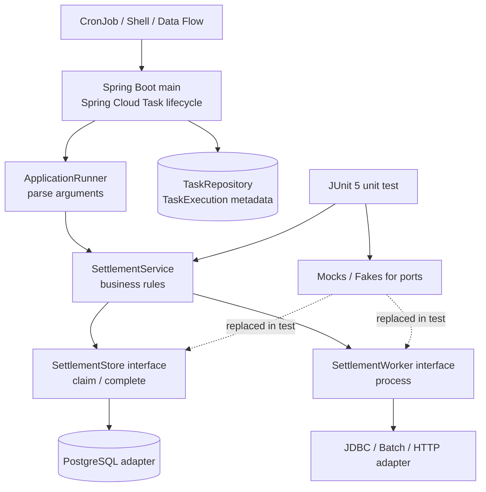

# Unit Testing Business Services Independently of the Runner

## Learning Objectives

After this lesson, you will be able to:

- Explain why the **business service** of a Spring Cloud Task application should be tested **without starting `SpringApplication` or `ApplicationRunner`**.
- Clearly separate responsibilities between the argument/runner layer, the business-rule execution layer, and the adapters accessing the database, HTTP, Spring Batch, or message broker.
- Write unit tests with **JUnit Jupiter (JUnit 5)** and **Mockito** to verify the happy path, invalid input, already-processed state, concurrent processing, and dependency failures.
- Use an in-memory fake adapter when you need to test **state across multiple calls**, rather than always mocking every interaction.
- Prove that critical exceptions are **propagated** rather than swallowed, preventing the Task or operating system from reporting a false success.
- Identify the limits of unit tests: they do not prove JDBC transactions, database locking, `@Transactional` proxy configuration, `TaskRepository`, or JVM exit codes.
- Build a multi-layer testing matrix to ensure the Task runs finitely, records metadata accurately, and can be safely re-run when combined with Spring Batch or a scheduler.

> **Context:** This lesson belongs to the **Testing** chapter of the **SPRING_CLOUD_TASK** module. A Spring Cloud Task is a finite-lived Spring Boot application that records the timing, status, and result of each execution in `TaskRepository`. Although a Task may run on a schedule or on demand, **core business rules should not depend on how the process is launched**. As a result, most behavior can be verified quickly and repeatably without opening a database or spinning up containers.

## 1. The Problem: Unit Tests Should Not Run the Entire Task Application

Consider a `daily-settlement-task` application that reconciles transactions by `businessDate` and `region`. In real execution:

1. A scheduler or operator runs `java -jar daily-settlement-task.jar --business-date=2026-11-24 --region=apac`.
2. Spring Boot creates the `ApplicationContext` and Spring Cloud Task registers a `TaskExecution`.
3. `ApplicationRunner` parses the two input arguments.
4. `SettlementService` applies the business rules: preventing duplicate processing, running the settlement, and recording the completed status.
5. Adapters access PostgreSQL, external APIs, or a Spring Batch Job.
6. The framework records the Task result if the repository is still reachable; the JVM terminates with the configured exit code.

A unit test for the rule "**if the settlement batch has already completed, do not process it again**" does not need to execute all six steps. It only needs to instantiate `SettlementService` with controllable test doubles and invoke the business method directly.

### Separating Testing Layers

| Test Type | Primary Target | Requires Spring Context? | Requires Database/Broker? |
| --- | --- | --- | --- |
| **Business service unit test** | Functions/methods and business rules. | **No.** | **No.** |
| `ApplicationRunner` unit test | Converting CLI arguments into business requests; propagating errors. | Usually no. | No. |
| JDBC adapter integration test | Real SQL, transactions, constraints, locking, and migrations. | Can use Spring test context. | Usually has a real test database. |
| Spring Cloud Task integration test | `TaskRepository`, `TaskExecution`, and lifecycle. | Yes. | Usually has a metadata database. |
| End-to-end/process test | `main`, JVM exit code, Docker/Kubernetes, and service interactions. | Yes, in a child process. | Depends on the system, usually has test services. |

**Common mistake:** using `@SpringBootTest` for every test, waiting for Spring Boot to initialize the Task and connect to a database on every run. This approach is slow, sensitive to environment configuration, and makes it hard to pinpoint whether a failure lies in business rules or in startup infrastructure.

Unit tests should focus on **input contract -> business decision -> required interactions/return value**. The remaining integration layers are tested separately, not skipped.

## 2. Design: Runner on the Outside, Service in the Center, Infrastructure at the Edges



In the diagram, a **unit test** only cares about `SettlementService` and the dependency ports it calls. It does not need to create `ApplicationRunner`, open HTTP ports, connect to `TaskRepository`, or initialize a database.

### Responsibility Separation

| Component | Should Contain | Should Not Contain |
| --- | --- | --- |
| `main` / Spring Boot configuration | Spring bootstrap, lifecycle, bean wiring, process exit code. | Calculation rules, direct API calls per transaction. |
| `ApplicationRunner` | Reading and syntactically validating arguments, converting to `SettlementKey`, calling the service. | SQL, idempotency algorithms, large processing loops, scattered `System.exit` calls. |
| `SettlementService` | Deciding whether to run/already completed/in progress, orchestrating business logic, checking invariants. | Dependencies on `ApplicationArguments`, `TaskExecution`, or Pod names. |
| `SettlementStore` | Contract for managing state and results by business key. | Java/Spring details of the runner. |
| `SettlementWorker` | Contract for executing the identified unit of work. | CLI option parsing logic. |
| Production adapters | SQL, Spring Batch `JobLauncher`, HTTP client, transactions, technical retries. | Overriding the service's decision on business completion rules. |

**Key principle:** Spring Cloud Task's `executionId` identifies **a single run**, not a settlement batch. When a scheduler retries, the Task may receive a new `executionId` while still processing the same `(businessDate, region)`. Therefore, the service should use the **business key** as the unit of idempotency rather than passing `TaskExecution` throughout the codebase.

## 3. Sample Problem: Daily and Regional Settlement

Business requirements for the example:

- Each `(businessDate, region)` pair has at most **one valid completed result**.
- If no run exists yet, the service can claim processing rights and ask the worker to execute.
- If the settlement batch is already `COMPLETED`, calling it again must return the completed status **without re-executing side effects**.
- If the batch is currently being processed by another worker, it must not run concurrently.
- If the worker fails or the completed status cannot be recorded, the service must **not return a false `COMPLETED` result**.
- `processedCount` cannot be negative.
- All of the above behaviors must be testable without creating an `ApplicationContext`.

For simplicity, the example uses **ports** consisting of a `SettlementStore` and a `SettlementWorker`. In a real implementation, `SettlementStore.claim(...)` must be **atomic across concurrent processes**, and `SettlementWorker` must be designed for safe re-execution or rely on checkpoints. Unit tests alone do not guarantee these two infrastructure properties.

## 4. Domain Model: Explicit Keys and Results

### 4.1. Business Key

```java
package com.example.settlement.domain;

import java.time.LocalDate;
import java.util.Objects;

public record SettlementKey(LocalDate businessDate, String region) {

    public SettlementKey {
        Objects.requireNonNull(businessDate, "businessDate");
        Objects.requireNonNull(region, "region");
        if (region.isBlank()) {
            throw new IllegalArgumentException("region must not be blank");
        }
    }
}
```

`SettlementKey` is a plain Java object. It has no dependencies on Spring, `TaskExecution`, `JobExecution`, or CLI data. The `LocalDate` value is deterministic in unit tests; avoid using `LocalDate.now()` without good reason.

In production systems, `region` should be normalized consistently (for example, lowercase, or validated against an allowlist of region codes). Avoid treating `APAC` and `apac` as two distinct keys if the business treats them as the same region.

### 4.2. Processing Claim Contract

```java
package com.example.settlement.domain;

public enum ClaimResult {
    ACQUIRED,           // Allowed to perform a new execution.
    ALREADY_COMPLETED,  // A valid result already exists from a prior run.
    IN_PROGRESS         // Another process currently holds the processing claim.
}
```

```java
package com.example.settlement.domain;

public interface SettlementStore {

    ClaimResult claim(SettlementKey key);

    void complete(SettlementKey key, long processedCount);
}
```

**Contract semantics:** `claim(...)` returns **the outcome of an atomic decision**, not merely the result of an unlocked `SELECT` followed later by an `INSERT`. Production adapters must use unique constraints, locking/leases, or an appropriate equivalent mechanism.

`complete(...)` is only called after the worker returns a valid result; it must reject completing with invalid ownership or invalid state at the infrastructure layer. Unit tests verify that the service **calls it at the right time**, while integration tests must prove that the SQL adapter upholds the contract under concurrency.

### 4.3. Work Execution Contract

```java
package com.example.settlement.domain;

@FunctionalInterface
public interface SettlementWorker {

    long process(SettlementKey key);
}
```

In production, the adapter may call PostgreSQL, a Batch Job, or an external API. In unit tests, you only need a mock or lambda returning the number of processed records.

**Caution:** A worker that calls a payment API and times out may not know whether the remote side executed the request or not. Do not assume `process(...)` is idempotent simply because the method has a simple name; you must design idempotency keys, retry policies, and reconciliation mechanisms according to the actual API contract.

### 4.4. Semantic Results

```java
package com.example.settlement.domain;

public enum SettlementStatus {
    COMPLETED,
    ALREADY_COMPLETED
}
```

```java
package com.example.settlement.domain;

public record SettlementResult(
        SettlementStatus status,
        long processedCount
) {}
```

Each `public` example in this lesson should be placed in **its own `.java` file matching the type name** when added to a project; do not put multiple `public` top-level types in the same file.

`ALREADY_COMPLETED` is an idempotent outcome verified in the store, not a separate Spring Cloud Task exit code. Depending on policy, the runner may treat this case as a business success because no further action is required.

## 5. Writing `SettlementService` Independently of the Runner

```java
package com.example.settlement.domain;

import java.util.Objects;

public final class SettlementService {

    private final SettlementStore store;
    private final SettlementWorker worker;

    public SettlementService(
            SettlementStore store,
            SettlementWorker worker) {
        this.store = Objects.requireNonNull(store, "store");
        this.worker = Objects.requireNonNull(worker, "worker");
    }

    public SettlementResult execute(SettlementKey key) {
        Objects.requireNonNull(key, "key");

        ClaimResult claim = Objects.requireNonNull(
                store.claim(key), "claim result");

        return switch (claim) {
            case ALREADY_COMPLETED ->
                    new SettlementResult(
                            SettlementStatus.ALREADY_COMPLETED, 0);

            case IN_PROGRESS ->
                    throw new IllegalStateException(
                            "Settlement is already in progress: " + key);

            case ACQUIRED -> {
                long count = worker.process(key);
                if (count < 0) {
                    throw new IllegalStateException(
                            "processedCount must be non-negative");
                }

                store.complete(key, count);
                yield new SettlementResult(
                        SettlementStatus.COMPLETED, count);
            }
        };
    }
}
```

Unit-test-friendly characteristics:

1. The constructor accepts both dependencies via interfaces; mocks or fakes can be passed directly.
2. The logic does not call `SpringApplication.run(...)`, `System.exit(...)`, `TaskExplorer`, `JobRepository`, or SQL.
3. It does not read the system clock, environment variables, or scheduler parameters; all required data resides in `SettlementKey`.
4. Decision rules are expressed through `ClaimResult` and `SettlementStatus`, making assertions straightforward.
5. Exceptions from `worker.process(...)` or `store.complete(...)` **are not swallowed**. Unit tests can verify the exact failure path.

### A Limitation Worth Stating Explicitly

The example above **has no lease-release mechanism when the worker fails**, no retry or cleanup for `IN_PROGRESS`, and no shared transaction spanning both ports. Those are design decisions required in production adapters/orchestration: lease expiration, `FAILED` state, transaction boundaries, external API outcome verification, and state transition rules.

**Do not treat this class as a complete production implementation simply because its unit tests pass.** The goal of this lesson is to demonstrate that a core business service can be tested independently.

## 6. Spring Wiring Is Only a Thin Layer

In a real application, the Spring container can construct `SettlementService` via configuration:

```java
package com.example.settlement.config;

import com.example.settlement.domain.SettlementService;
import com.example.settlement.domain.SettlementStore;
import com.example.settlement.domain.SettlementWorker;
import org.springframework.context.annotation.Bean;
import org.springframework.context.annotation.Configuration;

@Configuration(proxyBeanMethods = false)
public class SettlementConfiguration {

    @Bean
    SettlementService settlementService(
            SettlementStore store,
            SettlementWorker worker) {
        return new SettlementService(store, worker);
    }
}
```

Spring only performs **dependency injection**: selecting the `SettlementStore` and `SettlementWorker` adapters registered by the application. Unit tests can call `new SettlementService(fakeStore, fakeWorker)` directly without instantiating beans from this `@Configuration`.

### The Runner Operates Only at the Boundary

```java
package com.example.settlement.task;

import java.time.LocalDate;
import java.util.List;

import com.example.settlement.domain.SettlementKey;
import com.example.settlement.domain.SettlementService;
import org.springframework.boot.ApplicationArguments;
import org.springframework.boot.ApplicationRunner;
import org.springframework.stereotype.Component;

@Component
public final class SettlementRunner implements ApplicationRunner {

    private final SettlementService service;

    public SettlementRunner(SettlementService service) {
        this.service = service;
    }

    @Override
    public void run(ApplicationArguments args) {
        String date = requiredOption(args, "business-date");
        String region = requiredOption(args, "region");

        service.execute(new SettlementKey(
                LocalDate.parse(date), region));
    }

    private static String requiredOption(
            ApplicationArguments args, String name) {
        List<String> values = args.getOptionValues(name);
        if (values == null || values.size() != 1
                || values.get(0).isBlank()) {
            throw new IllegalArgumentException(
                    "Exactly one --" + name + "=value is required");
        }
        return values.get(0);
    }
}
```

This is an **input adapter**, not the place to decide whether re-execution is allowed. When arguments are invalid, the runner throws an exception; when business logic fails, the exception from the service propagates out of the runner. This avoids the risk of the runner **catching the error and merely logging it**, which would cause the Task/process to report a false success.

The Spring Cloud Task application's `main` method may use `SpringApplication.exit(context)` and `System.exit(code)` to return an exit code to the operating system, but unit tests for `SettlementService` **should not call `main`**.

## 7. Testing Dependencies: JUnit 5 and Mockito

The examples use Java 17+ and Spring Boot 3.x API style. If your project uses a newer Spring Boot/Spring Cloud release, use the compatible BOM and verify the JUnit/Mockito APIs for your actual stack.

In Maven, an application with Spring Boot dependency management can add:

```xml
<dependency>
    <groupId>org.springframework.boot</groupId>
    <artifactId>spring-boot-starter-test</artifactId>
    <scope>test</scope>
</dependency>
```

`spring-boot-starter-test` typically provides JUnit Jupiter, Mockito, AssertJ, and other testing utilities managed by the BOM. Most unit tests in this lesson use only JUnit Jupiter and Mockito; adding the test starter **does not mean you must use `@SpringBootTest`**.

Corresponding Gradle example for a Spring Boot project with dependency management:

```groovy
dependencies {
    testImplementation 'org.springframework.boot:spring-boot-starter-test'
}

tasks.named('test') {
    useJUnitPlatform()
}
```

If the project manages JUnit/Mockito manually instead of using the Boot starter, declare the test engine, `mockito-junit-jupiter`, and appropriate dependencies. **Do not mix arbitrary library versions** if the project BOM already manages them.

Suggested directory structure:

```text
src/main/java/com/example/settlement/
  domain/
    SettlementKey.java
    ClaimResult.java
    SettlementStore.java
    SettlementWorker.java
    SettlementStatus.java
    SettlementResult.java
    SettlementService.java
  config/
    SettlementConfiguration.java
  task/
    SettlementRunner.java

src/test/java/com/example/settlement/domain/
  SettlementServiceTest.java
  SettlementServiceFakeTest.java
```

The test directory mirrors the package of the unit under test. There is no need to copy `Application.java` or create a Spring context per test just to instantiate `SettlementService`.

## 8. Unit Testing with Mockito: The Happy Path

Use `@ExtendWith(MockitoExtension.class)` so JUnit creates mocks and injects them into the service. Do not use `@SpringBootTest`, `@MockBean`, or `@MockitoBean` because this test **does not create a Spring ApplicationContext**.

```java
package com.example.settlement.domain;

import java.time.LocalDate;

import org.junit.jupiter.api.Test;
import org.junit.jupiter.api.extension.ExtendWith;
import org.mockito.InOrder;
import org.mockito.InjectMocks;
import org.mockito.Mock;
import org.mockito.junit.jupiter.MockitoExtension;

import static org.junit.jupiter.api.Assertions.assertEquals;
import static org.mockito.Mockito.inOrder;
import static org.mockito.Mockito.verify;
import static org.mockito.Mockito.when;

@ExtendWith(MockitoExtension.class)
class SettlementServiceTest {

    private static final SettlementKey KEY = new SettlementKey(
            LocalDate.of(2026, 11, 24), "apac");

    @Mock
    SettlementStore store;

    @Mock
    SettlementWorker worker;

    @InjectMocks
    SettlementService service;

    @Test
    void completesAfterAcquiringBusinessKey() {
        when(store.claim(KEY)).thenReturn(ClaimResult.ACQUIRED);
        when(worker.process(KEY)).thenReturn(12L);

        SettlementResult result = service.execute(KEY);

        assertEquals(SettlementStatus.COMPLETED, result.status());
        assertEquals(12L, result.processedCount());

        InOrder order = inOrder(store, worker);
        order.verify(store).claim(KEY);
        order.verify(worker).process(KEY);
        order.verify(store).complete(KEY, 12L);
    }
}
```

**Why is this test effective?**

- `KEY` is fixed and does not depend on the current date.
- `store.claim(KEY)` is controlled to return `ACQUIRED`; no database is queried.
- `worker.process(KEY)` returns `12L`; no HTTP or Batch Job is invoked.
- It verifies both the **outcome** and the **critical ordering**: claim must happen before processing, and complete is called only after successful processing.
- Execution time is typically very fast because Spring does not boot and no connections are opened.

### Avoid Over-Specifying Implementation Details

`InOrder` is useful here because **the claim -> process -> complete sequence is a business invariant**. Do not call `verifyNoMoreInteractions(...)` in every test for calls that do not matter to the contract; doing so can break tests during valid refactorings even when the business outcome remains correct.

Prefer asserting **outputs, state, and meaningful side effects**, and only verify interactions when the interaction itself provides the required guarantee.

## 9. Testing the Already-Processed Case: Never Re-Run the Worker

A new Task run with a different `executionId` but the same `(businessDate, region)` can arrive after a scheduler retry. If the store reports that it has already completed, the service must avoid running the worker again.

Add a test:

```java
@Test
void skipsWhenSettlementWasAlreadyCompleted() {
    when(store.claim(KEY))
            .thenReturn(ClaimResult.ALREADY_COMPLETED);

    SettlementResult result = service.execute(KEY);

    assertEquals(
            SettlementStatus.ALREADY_COMPLETED, result.status());
    assertEquals(0L, result.processedCount());

    verify(store).claim(KEY);
    verifyNoInteractions(worker);
    verify(store, never()).complete(any(), anyLong());
}
```

Additional static imports needed:

```java
import static org.mockito.ArgumentMatchers.any;
import static org.mockito.ArgumentMatchers.anyLong;
import static org.mockito.Mockito.never;
import static org.mockito.Mockito.verifyNoInteractions;
```

**Significance:** This unit test proves that the service **does not invoke the worker** when the `SettlementStore` port reports that the business key is already completed. It **does not prove** that the JDBC implementation of `claim(...)` reads/returns accurately under concurrency; that requires a separate integration test.

A common design flaw is using `TaskExecution.executionId` for duplicate checks. Because every retry gets a new ID, tests must use a **stable business key** to detect replays, not per-process IDs.

## 10. Testing When Another Execution Is in Progress

When another scheduler or operator accidentally triggers a Task for the same day, the store may return `IN_PROGRESS`.

```java
@Test
void failsFastWhenAnotherExecutionOwnsTheKey() {
    when(store.claim(KEY))
            .thenReturn(ClaimResult.IN_PROGRESS);

    IllegalStateException error = assertThrows(
            IllegalStateException.class,
            () -> service.execute(KEY));

    assertTrue(error.getMessage().contains("in progress"));
    verifyNoInteractions(worker);
    verify(store, never()).complete(any(), anyLong());
}
```

Add static imports `assertThrows` and `assertTrue` from JUnit Jupiter. This test verifies the **no-concurrent-execution** policy.

However, there are two valid business handling strategies depending on requirements:

- **Fail-fast:** throw an exception so the scheduler can decide whether to retry later or alert on overlapping runs.
- **Return an in-progress status:** the service returns a meaningful `IN_PROGRESS` result and the runner translates it into an appropriate operational status.

This lesson chooses fail-fast for the example. Do not assume `IN_PROGRESS` is always a technical error; it depends on system policy. Whichever approach is chosen, the unit test must explicitly state the expected outcome rather than implicitly treating it as success.

## 11. Testing Worker Failure: Never Record a False `COMPLETED`

If an API fails or a Spring Batch Job does not complete, the service **must not call `store.complete(...)`**.

```java
@Test
void propagatesWorkerFailureWithoutCompleting() {
    when(store.claim(KEY)).thenReturn(ClaimResult.ACQUIRED);
    IllegalStateException cause =
            new IllegalStateException("payment API unavailable");
    when(worker.process(KEY)).thenThrow(cause);

    IllegalStateException actual = assertThrows(
            IllegalStateException.class,
            () -> service.execute(KEY));

    assertSame(cause, actual);
    verify(store).claim(KEY);
    verify(worker).process(KEY);
    verify(store, never()).complete(any(), anyLong());
}
```

Add `assertSame` from JUnit Jupiter.

**Value of this test:** It proves that the code **does not catch the exception, log it, and return success**. When the runner does not swallow the exception, the error propagates to Spring Boot/Spring Cloud Task and causes the process to fail.

**Limitation:** This test does not prove that the operating system actually receives a non-zero exit code or that `TaskRepository` records `ERROR_MESSAGE`. Those two behaviors require process/integration tests, especially when the Task is killed or the metadata database is unavailable.

### Why Not Automatically Mark `FAILED` in a `catch` Block in This Example?

When a worker calls an external system and times out, it may be impossible to tell whether the operation succeeded on the remote side. Automatically writing `FAILED` and blindly retrying can cause duplicate side effects. You need an explicit policy: `FAILED_RETRYABLE`, `UNKNOWN`, lease expiry, or reconciliation, depending on the business domain.

In unit tests, verify that **errors are propagated** and **completion is not falsely claimed**; testing failure state transitions belongs in dedicated tests for services/adapters with explicit state-transition contracts.

## 12. Testing Invalid Worker Results and Status-Write Failures

Aside from exceptions during processing, the worker's return value itself can be invalid. In the example, the processed record count cannot be negative:

```java
@Test
void rejectsNegativeProcessedCount() {
    when(store.claim(KEY)).thenReturn(ClaimResult.ACQUIRED);
    when(worker.process(KEY)).thenReturn(-1L);

    assertThrows(IllegalStateException.class,
            () -> service.execute(KEY));

    verify(store, never()).complete(any(), anyLong());
}
```

Case where the worker succeeds, but `store.complete(...)` fails to persist:

```java
@Test
void doesNotReportSuccessWhenCompletionWriteFails() {
    when(store.claim(KEY)).thenReturn(ClaimResult.ACQUIRED);
    when(worker.process(KEY)).thenReturn(5L);

    IllegalStateException dbError =
            new IllegalStateException("metadata write failed");
    doThrow(dbError).when(store).complete(KEY, 5L);

    IllegalStateException actual = assertThrows(
            IllegalStateException.class,
            () -> service.execute(KEY));

    assertSame(dbError, actual);
    verify(worker).process(KEY);
    verify(store).complete(KEY, 5L);
}
```

Add static import `org.mockito.Mockito.doThrow`.

An important distinction: this test confirms the service **does not return a success result** when status persistence fails. However, the worker may already have performed **side effects outside the database** before `complete(...)` failed. A subsequent retry must rely on idempotency/checkpoints; you cannot use this unit test as proof that "all effects were rolled back".

### Testing Input Validation Before Calling Dependencies

```java
@Test
void rejectsNullKeyBeforeCallingDependencies() {
    assertThrows(NullPointerException.class,
            () -> service.execute(null));

    verifyNoInteractions(store, worker);
}

@Test
void rejectsBlankRegionAtDomainBoundary() {
    assertThrows(IllegalArgumentException.class,
            () -> new SettlementKey(
                    LocalDate.of(2026, 11, 24), " "));

    verifyNoInteractions(store, worker);
}
```

This tests the `SettlementKey` contract, avoiding reliance on the CLI parser to enforce every domain invariant.

## 13. Testing with Fakes Instead of Mocks: Observing Multiple Calls

Mockito works well for testing a single execution path and verifying interactions. However, when you want to test **two consecutive calls with the same business key**, a stateful fake is often easier to understand.

### Simple In-Memory Fake Store

```java
package com.example.settlement.domain;

import java.util.HashMap;
import java.util.HashSet;
import java.util.Map;
import java.util.Set;

final class InMemorySettlementStore implements SettlementStore {

    private final Set<SettlementKey> inProgress = new HashSet<>();
    private final Map<SettlementKey, Long> completed = new HashMap<>();

    @Override
    public ClaimResult claim(SettlementKey key) {
        if (completed.containsKey(key)) {
            return ClaimResult.ALREADY_COMPLETED;
        }
        if (inProgress.contains(key)) {
            return ClaimResult.IN_PROGRESS;
        }
        inProgress.add(key);
        return ClaimResult.ACQUIRED;
    }

    @Override
    public void complete(SettlementKey key, long processedCount) {
        if (!inProgress.remove(key)) {
            throw new IllegalStateException(
                    "No active claim for: " + key);
        }
        completed.put(key, processedCount);
    }

    long completedCount(SettlementKey key) {
        return completed.get(key);
    }
}
```

This is a **test double**, not a production adapter. It uses `HashMap`/`HashSet`, which are **not thread-safe**, and lacks transactions, leases, or atomicity across concurrent processes. In single-threaded unit tests, this is intentional so we can observe rules across multiple calls.

### Testing Re-Runs Without Duplicate Processing

```java
package com.example.settlement.domain;

import java.time.LocalDate;
import java.util.concurrent.atomic.AtomicInteger;

import org.junit.jupiter.api.Test;

import static org.junit.jupiter.api.Assertions.assertEquals;

class SettlementServiceFakeTest {

    @Test
    void sameBusinessKeyIsProcessedOnlyOnce() {
        SettlementKey key = new SettlementKey(
                LocalDate.of(2026, 11, 24), "apac");
        InMemorySettlementStore store =
                new InMemorySettlementStore();
        AtomicInteger calls = new AtomicInteger();

        SettlementWorker worker = ignored -> {
            calls.incrementAndGet();
            return 7L;
        };

        SettlementService service =
                new SettlementService(store, worker);

        SettlementResult first = service.execute(key);
        SettlementResult second = service.execute(key);

        assertEquals(SettlementStatus.COMPLETED, first.status());
        assertEquals(
                SettlementStatus.ALREADY_COMPLETED, second.status());
        assertEquals(1, calls.get());
        assertEquals(7L, store.completedCount(key));
    }
}
```

This test clarifies **service-level idempotency**: calling the service twice with the same key will not invoke the worker a second time once the store records completion. However, when two JVMs run concurrently in production, this fake cannot replace an integration test with database unique constraints, transactions, and locks.

### Fake vs. Mock: Choose Based on Your Goal

| What to Verify | Usually Best Choice |
| --- | --- |
| Whether the worker was called, or `complete` was called after failure | Mockito `verify`. |
| Sequence of claim -> process -> complete | Mockito `InOrder`. |
| Whether two `execute` calls with the same key cause duplicate runs | Stateful fake. |
| Multiple states `PENDING/IN_PROGRESS/COMPLETED` across an action sequence | State-modeling fake. |
| Whether SQL `claim` is atomic when 20 processes run concurrently | Real-DB integration test, not just fakes/mocks. |
| Whether `JobRepository` receives a Batch `JobExecution` | Spring Batch integration test. |

Do not force every test to use Mockito. A small, readable fake that respects the contract often tests behavior better than dozens of consecutive `when(...)` lines.

## 14. Testing Pure Logic for Dates, Regions, and Thresholds

Pure rules such as calculating business dates, partitioning data, or skip thresholds should be placed in **pure functions** or simple components, avoiding dependencies on `ApplicationArguments` and wall-clock time.

Example business-date rule:

```java
package com.example.settlement.domain;

import java.time.LocalDate;

public final class BusinessDatePolicy {

    public boolean canSettle(
            LocalDate requested, LocalDate currentDate) {
        return !requested.isAfter(currentDate);
    }
}
```

Unit test:

```java
@ParameterizedTest
@CsvSource({
        "2026-11-23,2026-11-24,true",
        "2026-11-24,2026-11-24,true",
        "2026-11-25,2026-11-24,false"
})
void evaluatesBusinessDatePolicy(
        LocalDate requested,
        LocalDate currentDate,
        boolean expected) {
    BusinessDatePolicy policy = new BusinessDatePolicy();
    assertEquals(expected,
            policy.canSettle(requested, currentDate));
}
```

In JUnit Jupiter, `@CsvSource` provides strings by default; **argument conversion supports common types** such as `LocalDate`, though you should verify the converter in your JUnit version. If you want to avoid relying on implicit conversion, declare `String` parameters and call `LocalDate.parse(...)` inside the test body.

In particular, if the business rule depends on "today" or the schedule's time zone, pass a `Clock`/`LocalDate` into the policy. Do not scatter `LocalDate.now()` across services because tests can flake at midnight, across DST transitions, or when CI runs in a different time zone.

### Table-Driven Tests Instead of Duplicated Test Methods

When there are many boundary values, `@ParameterizedTest` keeps tests concise and produces clear failure messages per case. However, do not combine **unrelated rules** into one huge test; each test name should describe one clear business behavior.

## 15. What Do Unit Tests Prove If the Service Uses `@Transactional`?

This is a critical boundary for Spring Cloud Task, because a Task often writes business data to a business database while also maintaining a separate `TaskRepository`.

Suppose a production adapter/service has:

```java
@Transactional(transactionManager = "businessTransactionManager")
public void saveSettlement(SettlementKey key) {
    jdbcTemplate.update("UPDATE settlement_runs SET ...", ...);
    // Update related business tables.
}
```

When a unit test invokes the method on **an object created via `new` or `@InjectMocks`**, you only execute **the Java code inside the method**. There is no Spring proxy or transaction interceptor, so it:

- Does not prove `@Transactional` actually starts, commits, or rolls back a transaction.
- Does not prove the right `businessTransactionManager` is selected when the application has multiple `DataSource`s.
- Does not prove the database enforces unique constraints, transaction isolation, or row locks.
- Does not prove rollback occurs on checked exceptions or exceptions caught in an inner layer.
- Does not prove that writing `TASK_EXECUTION` and business data belong to the same transaction (they usually use independent transactions).

**Therefore, do not name a test `rollsBackDatabaseOnFailure` if there is no real database or transaction.** A unit test can be named `doesNotInvokeCompleteAfterWorkerFailure`, while rollback must be verified by an integration test.

### A Sensible Transaction Testing Strategy

1. **Unit test:** the service does not call `complete` when `worker` throws an exception.
2. **Integration test with test PostgreSQL:** the adapter actually rolls back on error; the unique constraint blocks two claims for the same key.
3. **Spring Task integration test:** a single run records `TASK_EXECUTION` accurately on success/failure while the repository is available.
4. **Process test:** the JVM/container exit code reflects the failure path; do not rely on `ERROR` logs to guess.
5. **Resilience test:** simulate a crash after business commit but before metadata update, verifying idempotent retry.

Only with all these layers do you gain substantial evidence of safe operation when the Task runs on schedule or on demand.

## 16. Testing the Runner Separately Without Mixing It into Service Tests

When you need to verify CLI arguments, `SettlementRunner` can be unit tested independently:

```java
package com.example.settlement.task;

import com.example.settlement.domain.SettlementKey;
import com.example.settlement.domain.SettlementService;
import org.junit.jupiter.api.Test;
import org.springframework.boot.DefaultApplicationArguments;

import static org.mockito.Mockito.mock;
import static org.mockito.Mockito.verify;

class SettlementRunnerTest {

    @Test
    void forwardsCliParametersAsDomainKey() throws Exception {
        SettlementService service = mock(SettlementService.class);
        SettlementRunner runner = new SettlementRunner(service);

        runner.run(new DefaultApplicationArguments(
                "--business-date=2026-11-24",
                "--region=apac"));

        verify(service).execute(
                new SettlementKey(
                        java.time.LocalDate.of(2026, 11, 24),
                        "apac"));
    }
}
```

**Note on mocking:** Earlier examples declared `SettlementService` as `final`. Mockito in modern configurations can mock `final` classes via the inline mock maker, but this capability must be verified against your Mockito/JDK version. To avoid relying on mocking `final` classes, you can:

- Define a `SettlementUseCase` interface containing `execute(SettlementKey)` and have `SettlementService` implement it; inject the interface into the runner and mock the interface.
- Or use a real fake use case and assert the key received.
- Or, if design allows, omit `final` and keep unit tests using standard class mocks.

This is an important distinction between **testable design** and **relying on advanced mocking features**. In larger systems, a use-case port decouples the runner layer from concrete classes.

### What Does the Runner Test Not Prove?

The `SettlementRunner` test only proves that the parser calls the service with the right input and does not hide errors. It **does not** prove that:

- Spring Boot created the runner bean in the runtime context.
- `TaskRepository` recorded a `TaskExecution`.
- `main` returns a non-zero exit code if the runner throws an exception.
- Batch Job/Step tables reflect the appropriate state.

Those behaviors belong in integration/process tests and should not be mixed into business-service unit tests.

## 17. Testing `ApplicationRunner` and the Service: Catching Swallowed Exceptions

A runner like the following can easily cause a scheduler to report false success:

```java
@Override
public void run(ApplicationArguments args) {
    try {
        service.execute(parseKey(args));
    } catch (Exception ex) {
        log.error("Settlement failed", ex);
        // Does not rethrow and does not set a failure exit code.
    }
}
```

You can unit test the runner to catch this bug without starting Spring:

```java
@Test
void propagatesFailureFromUseCase() {
    SettlementUseCase useCase = mock(SettlementUseCase.class);
    SettlementRunner runner = new SettlementRunner(useCase);

    SettlementKey key = new SettlementKey(
            LocalDate.of(2026, 11, 24), "apac");
    doThrow(new IllegalStateException("upstream unavailable"))
            .when(useCase).execute(key);

    assertThrows(IllegalStateException.class,
            () -> runner.run(new DefaultApplicationArguments(
                    "--business-date=2026-11-24",
                    "--region=apac")));
}
```

This is an **architectural variant** with a `SettlementUseCase` interface, not a snippet to copy directly into the runner that accepts `SettlementService` in Section 6. If you choose this variant, declare the interface:

```java
public interface SettlementUseCase {
    SettlementResult execute(SettlementKey key);
}
```

and update `SettlementService implements SettlementUseCase`, with the `SettlementRunner` constructor/field accepting `SettlementUseCase`. A project should choose **one consistent wiring style** rather than mixing both variants verbatim.

This test verifies the **input adapter**; the primary unit tests for `SettlementService` must still assert the business failure reasons. Do not merely check whether `log.error` was called, because logging alone does not alter the exit code.

## 18. The Spring Batch Case: Separating Business Rules from `JobLauncher`

If `SettlementWorker` in production runs a Spring Batch Job:

```java
public long process(SettlementKey key) {
    JobParameters parameters = ...; // Put the business key into JobParameters.
    JobExecution execution = jobLauncher.run(job, parameters);

    if (execution.getStatus() != BatchStatus.COMPLETED) {
        throw new IllegalStateException(
                "Batch Job did not complete: " + execution.getStatus());
    }

    return ...; // Record count from a reliable data source or report.
}
```

This is **adapter-oriented pseudocode**, not a standalone compilable method: it needs imports, handling for checked exceptions from `JobLauncher`, and actual result computation. If the launcher runs asynchronously, the adapter must **wait for the Job to finish** before evaluating its status.

Unit tests for `SettlementService` do not need to create a `JobRepository`, Job, or Step. Simply configure a mock `SettlementWorker`:

- When the worker succeeds, the service calls `store.complete`.
- When the worker throws an error because Batch `FAILED`, the service does not call `store.complete`.
- When the business key is already completed, the service does not call the worker/`JobLauncher` again.

**Batch adapters and framework interactions must be tested separately** to prove `JobExecution`/`StepExecution` are accurate, `JobParameters` mapping supports restarts meaningfully, and failure status propagates to Task/process exit codes. `TaskExecution.executionId` differs from `JobExecution.id`, and neither ID should be used as the deduplication business key.

## 19. Testing Services with External Dependencies: Keeping Tests Deterministic

A good unit test for a finite task should not depend on:

- Real network, API response times, or PostgreSQL availability.
- `LocalDate.now()`, the default time zone, or `Thread.sleep(...)`.
- Random events or uncontrolled `UUID.randomUUID()`.
- Actual broker/scheduler retry counts or thread scheduling order.
- `System.getenv(...)` or Spring profiles on the CI machine.
- A `TaskRepository`/`JobRepository` leftover from a previous test run.

To test retry rules at the service level, model the **policy** as a controllable dependency; use a fake `Clock`, a controllable executor, a fake API, or a mock response sequence.

Example of a **decision-path** unit test that does not pretend to simulate the entire infrastructure:

```java
@Test
void doesNotInvokeWorkerForDuplicateBusinessKey() {
    when(store.claim(KEY))
            .thenReturn(ClaimResult.ALREADY_COMPLETED);

    service.execute(KEY);

    verifyNoInteractions(worker);
}
```

If you want to verify attempt counts, timeouts, exponential backoff, or retries after network errors, write dedicated tests for the retry policy component and integration tests at the HTTP/client boundary. Running `Thread.sleep` across hundreds of unit tests is both slow and makes CI timing flaky.

### Injecting `Clock` or Explicit Timestamps

If the business rule is "do not process future dates", you can write:

```java
public final class DateValidator {

    private final Clock clock;

    public DateValidator(Clock clock) {
        this.clock = clock;
    }

    public void validate(LocalDate requested) {
        LocalDate today = LocalDate.now(clock);
        if (requested.isAfter(today)) {
            throw new IllegalArgumentException(
                    "Future businessDate is not allowed");
        }
    }
}
```

Test with `Clock.fixed(...)`, independent of the CI run date:

```java
Clock clock = Clock.fixed(
        Instant.parse("2026-11-24T00:00:00Z"),
        ZoneOffset.UTC);

DateValidator validator = new DateValidator(clock);

assertDoesNotThrow(() ->
        validator.validate(LocalDate.of(2026, 11, 24)));

assertThrows(IllegalArgumentException.class, () ->
        validator.validate(LocalDate.of(2026, 11, 25)));
```

You will need to import `java.time.Clock`, `Instant`, `LocalDate`, `ZoneOffset`, and the JUnit assertions. `ZoneOffset.UTC` is only an example time zone choice; the actual business date must align with the time zone agreed upon with the scheduler and operations team.

## 20. Minimum Unit Test Matrix for `SettlementService`

| Case | `store.claim` | `worker.process` | Expected Result | `store.complete` |
| --- | --- | --- | --- | --- |
| First run succeeds | `ACQUIRED` | Returns `12` | `COMPLETED(12)` | Called once with `12`. |
| Already completed | `ALREADY_COMPLETED` | Not called | `ALREADY_COMPLETED(0)` | Not called. |
| Currently in progress | `IN_PROGRESS` | Not called | Exception per policy. | Not called. |
| Worker fails | `ACQUIRED` | Throws exception | Exception propagated. | Not called. |
| Worker returns negative count | `ACQUIRED` | Returns `-1` | Invariant exception. | Not called. |
| Completion write fails | `ACQUIRED` | Returns `5` | Completion error propagated. | Called but failed. |
| Null key | Not called | Not called | Input exception. | Not called. |
| Blank region | Not called | Not called | Exception in `SettlementKey`. | Not called. |
| Two runs with same key (sequential fake) | `ACQUIRED` then `ALREADY_COMPLETED` | Once only | Second run does not re-process. | Once only. |

This is the **core behavior matrix**. Tests for database concurrency, rollback, timing, restartability, and exit codes must be added at the appropriate layers.

### An Anti-Pattern Example When Testing

```java
@Test
void doEverything() {
    // Boot the entire Spring application.
    // Create Task + Batch tables.
    // Call the real payment API.
    // Verify the container exited with code 0.
    // ...
}
```

Such a test may be a valid **end-to-end scenario** in an appropriate environment, but it is **not a unit test for `SettlementService`**. When it fails, it is hard to tell whether the bug is in test data, connectivity, transactions, Task lifecycle, or business rules.

## 21. How to Run the Test Suite

When a project configures JUnit 5 with Maven or Gradle, reference commands include:

```bash
# Run tests by class name without booting Spring Boot.
./mvnw -Dtest=SettlementServiceTest test

# Or Gradle:
./gradlew test --tests '*SettlementServiceTest'
```

These are **illustrative commands for learners to practice**; they were not executed during the authoring of this lesson. Class names and paths must match your real project and have a properly configured test engine.

When enabling test coverage, do not target only a line-coverage percentage. A test suite that checks `COMPLETED` when the worker returns a positive number while ignoring **swallowed exceptions** can still achieve high coverage while missing critical bugs.

Practical quality indicators:

- Tests exist for every policy branch and critical invariant.
- Tests exist for dependency failures and status-write failures.
- Tests exist for invalid inputs and boundary values.
- Tests exist for duplicate-processing prevention with the same business key.
- Unit tests have no dependency on real network, DB, or wall-clock time.
- Tests run independently without requiring ordering or shared mutable state.
- Failing tests produce messages that tell the maintainer **which rule was violated**.

## 22. Common Pitfalls When Designing Spring Cloud Task Unit Tests

| Symptom | Root Cause | Fix |
| --- | --- | --- |
| Tests require a Task database to run | The service directly calls `TaskRepository` or bootstraps `SpringApplication`. | Separate the business service from the runner/metadata repository; inject ports. |
| Every test uses `@SpringBootTest` and runs slowly | Mixing unit tests with integration tests. | Use JUnit + Mockito/fakes for logic; reserve real contexts for integration tests. |
| Tests pass even though the service swallows exceptions | Only asserting logs or omitting failure-path checks. | Use `assertThrows`, `verify(..., never())`, and test exit codes at the process layer. |
| Retries create duplicate data | Using `executionId` as the business key or lacking atomic locking in the store. | Use `(businessDate, region)` and integration test transactions/unique constraints. |
| Unit test for rollback "passes" yet the DB still commits | Testing an object directly without going through a `@Transactional` proxy. | Run integration tests with a real transaction manager and database. |
| Tests break when logging order changes | Verifying too many calls that are not part of the contract. | Assert state and business-meaningful interactions. |
| Tests occasionally fail in CI at midnight | Using `LocalDate.now()` or the default time zone. | Inject `Clock` or fixed dates. |
| Mockito cannot mock a `final` class in some environments | Incompatible mock maker/JDK/Mockito version. | Use a use-case interface or fake; verify your actual Mockito configuration. |
| Fake tests miss concurrent execution bugs | A `HashMap` fake is single-threaded only. | Test concurrency with a real database and multiple transactions/processes. |
| Batch Job `FAILED` yet service tests still pass | Mock worker always succeeds; Batch adapter is untested. | Test `JobExecution` mapping in adapter/integration tests and process exit codes. |
| Test calls `System.exit` and terminates the test JVM | Calling `main` instead of the service/runner. | Test logic in-process; test exit codes via a subprocess. |
| Tests break across Spring Boot versions | Using unnecessary test annotations or auto-configuration. | Keep unit tests pure Java and pin dependencies via the BOM. |

## 23. Practice Exercises

### Exercise 1 — Separate the Service from the Runner

Given an `ApplicationRunner` that combines argument parsing, SQL, HTTP calls, and state decisions, split it into `SettlementRunner`, `SettlementService`, `SettlementStore`, and `SettlementWorker`. Write tests proving the service can be instantiated via `new` without a Spring context.

### Exercise 2 — Test Happy Path and Deduplication

Use Mockito to test `ACQUIRED` -> worker returns `15` -> `complete` is called. Use a fake to invoke the service twice with the same `SettlementKey`; verify the worker executes only once.

### Exercise 3 — Test Failures and False Success

Configure `worker.process(...)` to throw `IllegalStateException`. Write a test ensuring the service does not call `complete` and propagates the exception. Then write a runner that intentionally catches the error and returns; add a test to detect that the runner violates the failure-reporting rule.

### Exercise 4 — Transaction Boundaries

Create a JDBC adapter using PostgreSQL, `@Transactional`, and a unique constraint on `(businessDate, region)`. Write an integration test with two concurrent threads/transactions to verify `claim` grants ownership to only one process. Explain why a single-threaded fake cannot replace this test.

### Exercise 5 — Clock and Time Zones

Write `BusinessDatePolicy` using an injected `Clock`. Test the current date, the previous date, and the next date according to the application time zone. Run the tests under different system time zones and confirm the results remain unchanged.

### Exercise 6 — Failed Batch Job

Write a `SettlementWorker` adapter using Spring Batch `JobLauncher`; if `JobExecution.status != COMPLETED`, fail the call. Test the adapter separately, then mock the worker in `SettlementService` unit tests to confirm completion is not marked when Batch fails.

### Exercise 7 — End-to-End Test Matrix

Design a test suite from service -> runner -> `TaskRepository` -> process/container covering success, invalid arguments, worker failure, and scheduler retry. Clearly specify **which tests require no Spring**, which require a database, and which require a subprocess/container; list the distinct outcomes that must be verified.

## Key Takeaways

- **Business service unit tests** should instantiate classes via constructors using mocks/fakes, **without** depending on `ApplicationRunner`, `SpringApplication.run`, or `TaskRepository`.
- **The runner is an input adapter**, responsible for translating arguments and propagating results; **the service** owns business rules and idempotency.
- **A business key** (such as `businessDate + region`) enables replay detection; `TaskExecution.executionId` only identifies a single Task run.
- Critical tests must cover **no duplicate processing**, **no false completion after an exception**, and **no success returned when status persistence fails**.
- Unit tests do not prove `@Transactional`, database transactions, locks/unique constraints, the Spring Batch repository, or JVM exit codes; those guarantees require integration/process tests.
- The more independent tests are from wall-clock time, network, and containers, the faster, more reliable, and easier to diagnose they will be when they fail.

## References

- [Spring Cloud Task — Reference Documentation](https://docs.spring.io/spring-cloud-task/reference/)
- [Spring Cloud Task — Features and TaskRepository](https://docs.spring.io/spring-cloud-task/reference/features.html)
- [Spring Cloud Task — Batch Integration](https://docs.spring.io/spring-cloud-task/reference/batch.html)
- [Spring Boot — Testing](https://docs.spring.io/spring-boot/reference/testing/index.html)
- [Spring Framework — Testing](https://docs.spring.io/spring-framework/reference/testing.html)
- [JUnit 5 — User Guide](https://junit.org/junit5/docs/current/user-guide/)
- [Mockito — Official Site](https://site.mockito.org/)
- [Testcontainers for Java — Documentation](https://java.testcontainers.org/)
