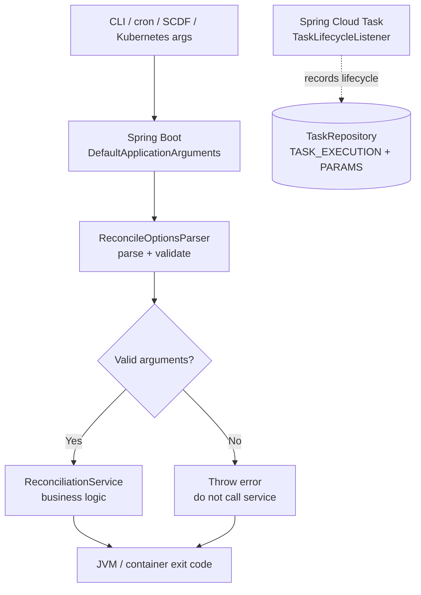

# Testing Argument Parsing and Validation

## Learning Objectives

In the **Testing** chapter of the **Spring Cloud Task** module, this lesson focuses on an easily overlooked class of bugs: **an application receives invalid command-line arguments yet still starts processing data**. A finite-lived task running on a schedule, via a Kubernetes Job, Spring Cloud Data Flow, or on demand typically accepts a business date, record count, dry-run flag, partner ID, and operational options. If parsing fails or validation is skipped, the task can update the wrong data period, run duplicates, or report a false success.

After this lesson, you will be able to:

- Distinguish Spring Boot's **raw arguments**, **option arguments**, and **non-option arguments**, and understand how they are passed into `ApplicationRunner`.
- Test **missing**, **empty**, **duplicate**, **wrong-type**, **out-of-range**, and **valid** states using `DefaultApplicationArguments`.
- Design a parser/validator separated from business logic, using explicit types and testable exceptions.
- Write JUnit 5 and Mockito unit tests to guarantee invalid arguments **never invoke the service**.
- Write `@SpringBootTest(args = ...)` integration tests and understand the limits of testing failures that break context startup.
- Run smoke tests against an executable JAR, verifying the **exit code** and the `TaskExecution` record in the database.
- Distinguish Spring Cloud Task/Spring Boot arguments from **Spring Batch `JobParameters`**, especially identifying parameters and restart testing.
- Protect secrets and avoid assuming data in `TASK_EXECUTION_PARAMS` has already been validated or encrypted.

## 1. The Problem: One Bad Argument Can Cause Major Damage

Suppose a `rental-reconcile` application runs at the end of the day to reconcile vehicle rental transactions:

```bash
java -jar rental-reconcile.jar \
  --businessDate=2026-11-23 \
  --maxItems=500 \
  --dryRun
```

The application has the following contract:

| Argument | Required? | Type and Constraints | Meaning |
| --- | --- | --- | --- |
| `--businessDate=yyyy-MM-dd` | Yes | Valid ISO date, e.g. `2026-11-23` | Data date to reconcile |
| `--maxItems=500` | No | Integer in range `1..10000`, default `1000` | Maximum number of records in a single run |
| `--dryRun` | No | **Valueless** flag | Check/simulate only, do not write business data |

The following commands **must not be treated as equivalent**:

```text
--businessDate=2026-11-23
--businessDate=2026-02-29
--businessDate
--businessDate=
--businessDate=2026-11-23 --businessDate=2026-11-24
--maxItems=-1
--maxItems=100000
--maxItems=abc
--dryRun=false
```

`2026-02-29` does not exist because 2026 is not a leap year. A bare `--businessDate` carries no value. Two different date arguments are **ambiguous** and must not arbitrarily pick the first or last value. `--dryRun=false` carries a string value, unlike the bare `--dryRun` flag accepted by the example contract.

**Principle:** argument validation must complete **before accessing external systems or writing business data**. If input conditions fail, the application must report a clear error, return a non-zero exit code via the runtime mechanism, and skip the main processing step.

## 2. Processing Layers and Where to Place Tests



| Layer | Responsibility | Appropriate Test Type |
| --- | --- | --- |
| Spring Boot argument parser | Distinguish `--key=value`, `--flag`, and arguments without `--` | Unit test with `DefaultApplicationArguments` |
| Business parser | Required, unique, date/number types, bounds, flags | Pure Java JUnit 5, parameterized tests |
| Runner | Call parser **before service**, do not swallow errors | Mockito + verify no side effects |
| Spring context | Bean configuration, arguments from `@SpringBootTest` | Integration test with isolated datasource |
| Spring Cloud Task | Create/update `TaskExecution`, record arguments, exit code | Real launch test and `TaskRepository` query |
| Orchestrator | Pass arguments accurately, read exit code, bounded retries | Smoke/E2E test on JAR or container |

You do not need a real database for every invalid `businessDate` case. **Most parsing bugs should be caught in milliseconds by unit tests**, leaving only a few representative cases to verify the full path through Spring Boot, `TaskRepository`, and the OS process.

## 3. Understanding `ApplicationArguments` Properly

Spring Boot provides the `org.springframework.boot.ApplicationArguments` interface and its `DefaultApplicationArguments` implementation. `ApplicationRunner.run(ApplicationArguments args)` receives parsed arguments; `CommandLineRunner.run(String... args)` receives raw strings.

Key APIs:

| API | Result |
| --- | --- |
| `getSourceArgs()` | Original string array passed to `SpringApplication.run(...)` |
| `getOptionNames()` | Set of option names prefixed with `--` |
| `containsOption("dryRun")` | `true` if `--dryRun` or `--dryRun=...` is present |
| `getOptionValues("businessDate")` | List of option values, or `null` if absent |
| `getNonOptionArgs()` | Strings not parsed as `--option` |

### 3.1. Four Mandatory States to Distinguish

Per the Spring Boot Javadoc, `getOptionValues("name")` has these states:

| Sample Command | `getOptionValues(...)` | Meaning |
| --- | --- | --- |
| Without `--businessDate` | `null` | **Missing** option |
| `--businessDate` | Empty list `[]` | **Option name present without a value** |
| `--businessDate=2026-11-23` | `["2026-11-23"]` | One value present |
| `--businessDate=2026-11-23 --businessDate=2026-11-24` | Two values | **Duplicated** |

For the `--dryRun` flag, an empty list satisfies **the contract**, whereas for `businessDate`, it is **an error**. Therefore, **do not write a single simple `containsOption(...)` check for all argument types**.

### 3.2. `--key=value` Differs from `--key value`

For example:

```bash
java -jar rental-reconcile.jar --maxItems 500
```

With default parsing syntax, `--maxItems` may be treated as an option **without a value**, while `500` becomes a **non-option argument**. Do not assume the API will automatically pair them into the number `500`. To avoid differences across shells and frameworks, define the CLI contract using `--maxItems=500`.

In the pure Task example below, all business arguments use `--key=value` or the `--dryRun` flag. When integrating the Spring Batch auto-launcher, `businessDate=...` **without `--`** carries a different meaning; see Section 10.

### 3.3. Never Log All Raw Arguments

`getSourceArgs()` is helpful for debugging, but it can contain passwords, tokens, sensitive paths, or customer data. Spring Cloud Task can also persist arguments into `TASK_EXECUTION_PARAMS`; therefore, **never pass secrets on the command line** just for launch convenience. Use a secret store/secure environment variables and restrict metadata read permissions.

## 4. Designing a Unit-Testable Parser

We create three classes:

1. `ReconcileOptions`: **validated**, immutable business values.
2. `ReconcileOptionsParser`: parses and validates inputs only, **no DB connections**.
3. `ReconcileRunner`: calls the parser before calling the service.

Examples use **Java 17**, Spring Boot 3.x, and a BOM-compatible Spring Cloud Task release. The snippets represent separate files in the same `com.example.rentaltask` package.

### 4.1. Immutable DTO

File `src/main/java/com/example/rentaltask/ReconcileOptions.java`:

```java
package com.example.rentaltask;

import java.time.LocalDate;

public record ReconcileOptions(
        LocalDate businessDate,
        int maxItems,
        boolean dryRun) {
}
```

By application contract, only code that passes through the parser should construct and forward this DTO to business logic. A Java record does not automatically validate values if constructed elsewhere; if the DTO sits at a shared system security boundary, you can add a **compact constructor** to enforce invariants or restrict how the DTO is instantiated.

### 4.2. Parser and Validator

File `src/main/java/com/example/rentaltask/ReconcileOptionsParser.java`:

```java
package com.example.rentaltask;

import java.time.LocalDate;
import java.time.format.DateTimeFormatter;
import java.time.format.DateTimeParseException;
import java.util.List;

import org.springframework.boot.ApplicationArguments;
import org.springframework.stereotype.Component;

@Component
public class ReconcileOptionsParser {

    private static final int DEFAULT_MAX_ITEMS = 1000;
    private static final int MAX_ALLOWED_ITEMS = 10000;

    public ReconcileOptions parse(ApplicationArguments args) {
        String rawDate = singleValue(args, "businessDate", true);
        String rawMaxItems = singleValue(args, "maxItems", false);

        LocalDate businessDate;
        try {
            businessDate = LocalDate.parse(
                    rawDate, DateTimeFormatter.ISO_LOCAL_DATE);
        } catch (DateTimeParseException ex) {
            throw new IllegalArgumentException(
                    "businessDate must be a valid ISO yyyy-MM-dd date", ex);
        }

        int maxItems = DEFAULT_MAX_ITEMS;
        if (rawMaxItems != null) {
            try {
                maxItems = Integer.parseInt(rawMaxItems);
            } catch (NumberFormatException ex) {
                throw new IllegalArgumentException(
                        "maxItems must be an integer", ex);
            }
        }

        if (maxItems < 1 || maxItems > MAX_ALLOWED_ITEMS) {
            throw new IllegalArgumentException(
                    "maxItems must be within 1..10000");
        }

        List<String> dryRunValues = args.getOptionValues("dryRun");
        if (dryRunValues != null && !dryRunValues.isEmpty()) {
            throw new IllegalArgumentException(
                    "dryRun is a flag that takes no value; use --dryRun");
        }

        return new ReconcileOptions(
                businessDate, maxItems, dryRunValues != null);
    }

    private static String singleValue(
            ApplicationArguments args,
            String name,
            boolean required) {
        List<String> values = args.getOptionValues(name);

        if (values == null) {
            if (required) {
                throw new IllegalArgumentException(
                        "Missing argument --" + name + "=...");
            }
            return null;
        }

        if (values.size() != 1
                || values.get(0) == null
                || values.get(0).isBlank()) {
            throw new IllegalArgumentException(
                    "Argument --" + name
                    + " must appear exactly once and have a value");
        }

        return values.get(0);
    }
}
```

**Key design points:**

- The parser **does not call a DB, REST API, or message broker**.
- `singleValue` distinguishes `null` (absent), `[]` (option present without value), multiple values (duplicate), and blank strings.
- `LocalDate.parse(..., ISO_LOCAL_DATE)` catches non-existent calendar dates like `2026-02-29` and malformed strings.
- `Integer.parseInt` catches type errors; a separate check validates the `1..10000` range and integer overflow.
- `--dryRun` is accepted, while `--dryRun=true` or `--dryRun=false` are both rejected under **this illustrative contract**.
- Error messages describe only **the argument name and constraint**, without printing raw values; this reduces the risk of leaking sensitive data in logs/`ERROR_MESSAGE`.

The parser above **does not reject unknown options**, because Spring Boot also accepts operational options like `--spring.profiles.active=...` or `--spring.datasource.url=...`. If business policy forbids unknown options, clearly define the **business argument namespace** and allowed infrastructure options before enabling strict checking.

### 4.3. Validation Scope of the Parser

In this example, the parser validates **syntax and static bounds**. It does not check whether the date is in the future, whether a partner is authorized for that date, whether the snapshot period is closed, or whether another run is in progress.

Those belong to **business validation**, which usually requires services and system state. If a constraint depends on "today", inject `java.time.Clock` (or supply an explicit test timestamp), and **do not call `LocalDate.now()` directly in code you want to test deterministically**.

## 5. Runner: Validate Before Doing Work

File `ReconcileRunner.java`:

```java
package com.example.rentaltask;

import org.springframework.boot.ApplicationArguments;
import org.springframework.boot.ApplicationRunner;
import org.springframework.stereotype.Component;

@Component
public class ReconcileRunner implements ApplicationRunner {

    private final ReconcileOptionsParser parser;
    private final ReconciliationService service;

    public ReconcileRunner(
            ReconcileOptionsParser parser,
            ReconciliationService service) {
        this.parser = parser;
        this.service = service;
    }

    @Override
    public void run(ApplicationArguments args) {
        ReconcileOptions options = parser.parse(args);
        service.reconcile(options);
    }
}
```

Service interface and simple demo implementation:

```java
package com.example.rentaltask;

public interface ReconciliationService {
    void reconcile(ReconcileOptions options);
}
```

```java
package com.example.rentaltask;

import org.springframework.stereotype.Service;

@Service
public class DemoReconciliationService
        implements ReconciliationService {

    @Override
    public void reconcile(ReconcileOptions options) {
        if (options.dryRun()) {
            System.out.println("DRY_RUN: " + options.businessDate());
            return;
        }

        // Demo: replace with actual reconciliation and data commit logic.
        System.out.println("DEMO_ONLY: " + options.businessDate());
    }
}
```

**Do not use the `DEMO_ONLY` stub to conclude that business reconciliation succeeded in production.** A real service must verify transaction counts, data constraints, transactions, and idempotency before returning normally.

In the runner, **do not catch `IllegalArgumentException`, merely log it, and return normally**. If validation errors are ignored, Spring Boot may consider the runner complete and record a success exit code. For a Task, let the exception follow Spring Boot/Spring Cloud Task's standard error path, then verify the exit code and metadata in integration tests.

## 6. Unit Testing the Parser with JUnit 5

### 6.1. Testing Dependencies

If the project uses the Spring Boot Maven parent and a compatible Spring Cloud BOM, add:

```xml
<dependency>
    <groupId>org.springframework.boot</groupId>
    <artifactId>spring-boot-starter-test</artifactId>
    <scope>test</scope>
</dependency>
```

This starter provides JUnit Jupiter, assertions, and Mockito (aligned with the Spring Boot branch). To unit test the parser, you **do not need to start a Spring ApplicationContext**, database, or child JVM.

Spring Boot provides `DefaultApplicationArguments` to instantiate `ApplicationArguments` directly in tests:

```java
ApplicationArguments args = new DefaultApplicationArguments(
        "--businessDate=2026-11-23",
        "--maxItems=500",
        "--dryRun");
```

### 6.2. Testing the Happy Path and Defaults

File `src/test/java/com/example/rentaltask/ReconcileOptionsParserTest.java`:

```java
package com.example.rentaltask;

import java.time.LocalDate;

import org.junit.jupiter.api.Test;
import org.springframework.boot.DefaultApplicationArguments;

import static org.junit.jupiter.api.Assertions.assertEquals;
import static org.junit.jupiter.api.Assertions.assertFalse;
import static org.junit.jupiter.api.Assertions.assertTrue;

class ReconcileOptionsParserTest {

    private final ReconcileOptionsParser parser =
            new ReconcileOptionsParser();

    @Test
    void parsesValidDateCountAndDryRun() {
        ReconcileOptions result = parser.parse(
                new DefaultApplicationArguments(
                        "--businessDate=2026-11-23",
                        "--maxItems=500",
                        "--dryRun"));

        assertEquals(LocalDate.of(2026, 11, 23),
                     result.businessDate());
        assertEquals(500, result.maxItems());
        assertTrue(result.dryRun());
    }

    @Test
    void usesDefaultMaxItemsAndDryRunFalse() {
        ReconcileOptions result = parser.parse(
                new DefaultApplicationArguments(
                        "--businessDate=2026-11-23"));

        assertEquals(1000, result.maxItems());
        assertFalse(result.dryRun());
    }
}
```

Note that `@Test` comes from **JUnit Jupiter** (`org.junit.jupiter.api.Test`); do not mix legacy JUnit 4 annotations. Both tests verify the **normalized output**, not just `assertNotNull(...)`.

### 6.3. Parameterized Tests for Invalid Inputs

A test class for malformed or missing date arguments:

```java
package com.example.rentaltask;

import org.junit.jupiter.api.Test;
import org.junit.jupiter.params.ParameterizedTest;
import org.junit.jupiter.params.provider.ValueSource;
import org.springframework.boot.DefaultApplicationArguments;

import static org.junit.jupiter.api.Assertions.assertThrows;

class ReconcileOptionsValidationTest {

    private final ReconcileOptionsParser parser =
            new ReconcileOptionsParser();

    @ParameterizedTest
    @ValueSource(strings = {
            "--businessDate",
            "--businessDate=",
            "--businessDate=2026-02-29",
            "--businessDate=not-a-date"
    })
    void rejectsInvalidBusinessDate(String option) {
        assertThrows(
                IllegalArgumentException.class,
                () -> parser.parse(
                        new DefaultApplicationArguments(option)));
    }

    @Test
    void rejectsMissingRequiredDate() {
        assertThrows(
                IllegalArgumentException.class,
                () -> parser.parse(
                        new DefaultApplicationArguments()));
    }

    @Test
    void rejectsDuplicateBusinessDate() {
        assertThrows(
                IllegalArgumentException.class,
                () -> parser.parse(
                        new DefaultApplicationArguments(
                                "--businessDate=2026-11-23",
                                "--businessDate=2026-11-24")));
    }
}
```

**Note:** `@ValueSource` passes **one** option per test invocation; do not use `@CsvSource` to pack comma-separated strings without a clear reason. For duplicate options, construct `DefaultApplicationArguments` from **two elements**.

### 6.4. Numeric Bounds, Flags, and Edge Variants

```java
package com.example.rentaltask;

import org.junit.jupiter.api.Test;
import org.junit.jupiter.params.ParameterizedTest;
import org.junit.jupiter.params.provider.ValueSource;
import org.springframework.boot.DefaultApplicationArguments;

import static org.junit.jupiter.api.Assertions.assertEquals;
import static org.junit.jupiter.api.Assertions.assertThrows;

class ReconcileOptionsBoundaryTest {

    private final ReconcileOptionsParser parser =
            new ReconcileOptionsParser();

    @ParameterizedTest
    @ValueSource(strings = {
            "--maxItems=",
            "--maxItems=0",
            "--maxItems=-1",
            "--maxItems=10001",
            "--maxItems=abc",
            "--maxItems=999999999999999999999"
    })
    void rejectsInvalidMaxItems(String option) {
        assertThrows(IllegalArgumentException.class,
                () -> parser.parse(
                        new DefaultApplicationArguments(
                                "--businessDate=2026-11-23",
                                option)));
    }

    @ParameterizedTest
    @ValueSource(strings = {
            "--maxItems=1",
            "--maxItems=10000"
    })
    void acceptsBoundaries(String option) {
        ReconcileOptions result = parser.parse(
                new DefaultApplicationArguments(
                        "--businessDate=2026-11-23",
                        option));

        int expected = Integer.parseInt(
                option.substring("--maxItems=".length()));
        assertEquals(expected, result.maxItems());
    }

    @Test
    void rejectsFlagWithExplicitValue() {
        assertThrows(IllegalArgumentException.class,
                () -> parser.parse(
                        new DefaultApplicationArguments(
                                "--businessDate=2026-11-23",
                                "--dryRun=false")));
    }

    @Test
    void rejectsDuplicateMaxItems() {
        assertThrows(IllegalArgumentException.class,
                () -> parser.parse(
                        new DefaultApplicationArguments(
                                "--businessDate=2026-11-23",
                                "--maxItems=50",
                                "--maxItems=100")));
    }
}
```

With `maxItems=1` and `maxItems=10000`, the test checks **valid boundaries**. With `0` and `10001`, it checks **invalid boundaries**. The very long numeric string also tests `Integer.parseInt` overflow.

### 6.5. Essential Test Matrix

| Case | Input | Expected Outcome |
| --- | --- | --- |
| Minimal valid | `--businessDate=2026-11-23` | Correct date, default maxItems, dryRun false |
| Full valid | `--businessDate=2026-11-23 --maxItems=500 --dryRun` | All three fields match |
| Missing date | No `businessDate` | Validation fails |
| Valueless date | `--businessDate` or `--businessDate=` | Validation fails |
| Non-existent date | `--businessDate=2026-02-29` | Validation fails |
| Duplicate date option | Two `--businessDate` options | Validation fails |
| Out-of-bounds number | `--maxItems=0`, `10001` | Validation fails |
| Wrong type/overflow | `--maxItems=abc` or very long digits | Validation fails |
| Two `maxItems` values | `--maxItems=1 --maxItems=2` | Validation fails |
| Bare flag | `--dryRun` | dryRun true |
| Flag with value | `--dryRun=true`/`false` | Validation fails per contract |
| Malformed command syntax | `--maxItems 500` | `maxItems` option has no value; validation fails |

**Do not test only a single happy path**: duplicate option bugs commonly arise when an orchestrator merges default arguments with user arguments, and date errors frequently come from locale/time-zone formatting or manual entry.

## 7. Unit Testing the Runner: Invalid Arguments Must Never Invoke Business Logic

Testing the parser alone is not enough: the runner could still **call the service before parsing** or swallow exceptions. Use Mockito to verify the order of responsibilities:

```java
package com.example.rentaltask;

import java.time.LocalDate;

import org.junit.jupiter.api.Test;
import org.springframework.boot.DefaultApplicationArguments;

import static org.junit.jupiter.api.Assertions.assertThrows;
import static org.mockito.Mockito.mock;
import static org.mockito.Mockito.verify;
import static org.mockito.Mockito.verifyNoInteractions;

class ReconcileRunnerTest {

    private final ReconcileOptionsParser parser =
            new ReconcileOptionsParser();

    private final ReconciliationService service =
            mock(ReconciliationService.class);

    private final ReconcileRunner runner =
            new ReconcileRunner(parser, service);

    @Test
    void validArgumentsInvokeServiceExactlyOnce() {
        runner.run(new DefaultApplicationArguments(
                "--businessDate=2026-11-23",
                "--maxItems=50",
                "--dryRun"));

        verify(service).reconcile(new ReconcileOptions(
                LocalDate.of(2026, 11, 23),
                50,
                true));
    }

    @Test
    void invalidDateNeverInvokesService() {
        assertThrows(IllegalArgumentException.class,
                () -> runner.run(
                        new DefaultApplicationArguments(
                                "--businessDate=2026-02-29")));

        verifyNoInteractions(service);
    }

    @Test
    void missingDateNeverInvokesService() {
        assertThrows(IllegalArgumentException.class,
                () -> runner.run(
                        new DefaultApplicationArguments(
                                "--maxItems=100")));

        verifyNoInteractions(service);
    }
}
```

Mockito's `verify(...)` checks that the service is called with the exact **parsed object** (records compare by value). `verifyNoInteractions(...)` protects the most critical requirement: **invalid input must never write or trigger business logic**.

Do not simply mock `ReconcileOptionsParser` to always return a valid object in every unit test; that misses validation bugs. Here the **real** parser is used, and only the service is mocked.

### 7.1. Extending the Test: Service Failures Must Exit the Runner

If the service throws an exception, the Runner should let the framework observe the failure instead of silently reporting success:

```java
@Test
void serviceFailureIsPropagated() {
    ReconciliationService failingService = options -> {
        throw new IllegalStateException("Simulated storage error");
    };
    ReconcileRunner failingRunner = new ReconcileRunner(
            new ReconcileOptionsParser(), failingService);

    assertThrows(IllegalStateException.class,
            () -> failingRunner.run(
                    new DefaultApplicationArguments(
                            "--businessDate=2026-11-23")));
}
```

This is an **additional test method** placed inside a test class with the appropriate JUnit and Spring Boot imports. Unit tests only prove the exception is propagated; they **do not yet prove the JVM exit code or that `TaskRepository` recorded it correctly**—those belong in the next testing layer.

## 8. `@SpringBootTest(args = ...)` Integration Tests

Spring Boot provides the `args` attribute on `@SpringBootTest` to pass **application arguments** into the test context. This is suitable for verifying wiring between Spring Boot, the runner, and Spring Cloud Task under a test configuration.

### 8.1. Application Entry Point

File `ReconcileTaskApplication.java`:

```java
package com.example.rentaltask;

import org.springframework.boot.SpringApplication;
import org.springframework.boot.autoconfigure.SpringBootApplication;
import org.springframework.cloud.task.configuration.EnableTask;

@SpringBootApplication
@EnableTask
public class ReconcileTaskApplication {

    public static void main(String[] args) {
        SpringApplication.run(ReconcileTaskApplication.class, args);
    }
}
```

Ensure you have compatible Spring Cloud Task, JDBC/H2, and Spring Boot/Spring Cloud versions. If using `spring-cloud-starter-task`, the core Maven dependencies are:

```xml
<dependencies>
    <dependency>
        <groupId>org.springframework.cloud</groupId>
        <artifactId>spring-cloud-starter-task</artifactId>
    </dependency>
    <dependency>
        <groupId>com.h2database</groupId>
        <artifactId>h2</artifactId>
        <scope>runtime</scope>
    </dependency>
    <dependency>
        <groupId>org.springframework.boot</groupId>
        <artifactId>spring-boot-starter-test</artifactId>
        <scope>test</scope>
    </dependency>
</dependencies>
```

This is a dependency snippet, not a complete `pom.xml`. Use the appropriate Spring Boot parent/BOM and Spring Cloud release train instead of arbitrarily pinning the Task starter version individually.

### 8.2. Testing That Arguments Are Injected and Parsed Correctly

```java
package com.example.rentaltask;

import java.time.LocalDate;

import org.junit.jupiter.api.Test;
import org.springframework.beans.factory.annotation.Autowired;
import org.springframework.boot.ApplicationArguments;
import org.springframework.boot.test.context.SpringBootTest;

import static org.junit.jupiter.api.Assertions.assertEquals;
import static org.junit.jupiter.api.Assertions.assertTrue;

@SpringBootTest(
    classes = ReconcileTaskApplication.class,
    webEnvironment = SpringBootTest.WebEnvironment.NONE,
    args = {
        "--businessDate=2026-11-23",
        "--maxItems=500",
        "--dryRun"
    },
    properties = {
        "spring.application.name=reconcile-args-test",
        "spring.cloud.task.closecontext-enabled=false",
        "spring.datasource.url=jdbc:h2:mem:reconcile_args_test;DB_CLOSE_DELAY=-1",
        "spring.cloud.task.initialize-enabled=true"
    }
)
class ReconcileTaskArgumentsIntegrationTest {

    @Autowired
    ApplicationArguments arguments;

    @Autowired
    ReconcileOptionsParser parser;

    @Test
    void bootPassesArgumentsToTheParser() {
        ReconcileOptions options = parser.parse(arguments);

        assertEquals(LocalDate.of(2026, 11, 23),
                     options.businessDate());
        assertEquals(500, options.maxItems());
        assertTrue(options.dryRun());
    }
}
```

Important notes:

- `@SpringBootTest`'s `args` **are passed to `SpringApplication`** in the test context, not merely synthesized into a dummy array.
- `webEnvironment = NONE` avoids starting an HTTP server, fitting a CLI Task application.
- `closecontext-enabled=false` is used in **integration tests** to keep the context open for the `@Test` method. This differs from a production Task, which should terminate after its runner finishes.
- H2 `mem` is an **isolated store inside the test JVM** and cannot be used to inspect history after the JVM exits.
- Because `ReconcileRunner` is a real bean, **it will run during context bootstrap**. The example uses `--dryRun` to avoid writing business data; real environments should mock/stub external integrations or run against an isolated test database.

**Do not use `@SpringBootTest(args = "--businessDate=bad")` expecting the `@Test` method to execute and catch the exception with `assertThrows`.** The runner throws the exception while **SpringApplication is starting up**, so the context may fail *before* JUnit invokes the test method. To test validation failures, prefer parser/runner unit tests or an intentional JAR/process launch that asserts the exit code.

### 8.3. Testing Metadata via Repository: Check at the Right Time

In a real Task context, Spring Cloud Task can create `TaskExecution` before the runner and update the outcome when startup/runner lifecycle completes. The default table names are `TASK_EXECUTION` and `TASK_EXECUTION_PARAMS`.

When writing repository-querying integration tests, ensure:

1. You query the right **Task DataSource**, not the business database by mistake.
2. The runner has finished and the lifecycle mechanism has updated metadata; check `endTime` according to **the exact version/callback**.
3. You do not merely query "the latest row" when multiple tests/contexts share the same Task name.
4. You do not mutate `TaskExecution` or insert fake records in tests just to assert that the lifecycle ran.

If the goal is to verify **records written after the process exits**, a separate JAR test is clearest because it does not depend on how long the test framework keeps the context alive.

## 9. JAR Smoke Test: Process Outcome and `TaskRepository`

Passing unit tests that return exceptions do not prove that **the shell, Docker, or CronJob** actually receives a non-zero exit code. To test orchestrator integration, launch the actual packaged artifact.

### 9.1. Packaging and Running the Success Case

```bash
./mvnw clean package
java -jar target/rental-reconcile-0.0.1-SNAPSHOT.jar \
  --businessDate=2026-11-23 --maxItems=100 --dryRun
printf 'JVM exit=%s\n' "$?"
```

The JAR name is illustrative; substitute your project's actual `artifactId` and `version`. In Bash, `$?` must be read **immediately after Java**; any intervening command overwrites it. On PowerShell, use `$LASTEXITCODE` for native executables; on Windows CMD, use `%ERRORLEVEL%`.

### 9.2. Running Failure Cases

```bash
set +e
java -jar target/rental-reconcile-0.0.1-SNAPSHOT.jar \
  --businessDate=2026-02-29 --dryRun
bad_date_exit=$?

java -jar target/rental-reconcile-0.0.1-SNAPSHOT.jar \
  --businessDate=2026-11-23 --maxItems=0 --dryRun
bad_count_exit=$?

printf 'invalid-date=%s invalid-count=%s\n' \
  "$bad_date_exit" "$bad_count_exit"
```

If the parser throws `IllegalArgumentException` and the exception is not swallowed, both runs **are expected to exit with non-zero codes**. Do not hardcode a specific code like `12` unless the application configures an `ExitCodeExceptionMapper`/`ExitCodeGenerator` and you have verified how that Spring Boot/Spring Cloud Task version maps exceptions.

A simple Bash smoke test:

```bash
if [ "$bad_date_exit" -eq 0 ]; then
  echo "FAIL: invalid date returned exit code 0"
  exit 1
fi

if [ "$bad_count_exit" -eq 0 ]; then
  echo "FAIL: invalid maxItems returned exit code 0"
  exit 1
fi

echo "PASS: invalid arguments did not report success"
```

`set +e` temporarily prevents the script from aborting immediately on a non-zero Java exit if the outer shell runs with `set -e`. If the command pipes through `tee` to capture logs, use Bash's `set -o pipefail` or inspect `PIPESTATUS` so you do not mistakenly read `tee`'s success code.

### 9.3. Why a Parsing Error Might Have No `TaskExecution`

If validation happens **inside `ApplicationRunner`**, Spring Cloud Task has usually initialized the context and created a `TaskExecution` before the runner runs. However, if the datasource is misconfigured, a bean fails during initialization, or validation runs inside an early `@Bean`, **the context may fail before bootstrap completes**, leaving Spring Cloud Task with **no record** for that run.

Therefore, a thorough test checks **both sides**:

| State | JVM Exit Code | Repository |
| --- | --- | --- |
| Valid parser, runner finishes normally | Expected `0` | Completed `TaskExecution` |
| Invalid parser, runner exception propagates | Expected non-zero | Usually has an error record if lifecycle started |
| DataSource/config error before lifecycle | Expected non-zero | May have **no** new record |
| JVM killed/OOM before final update | May be signal/container code | May have `END_TIME = NULL` |

Do not use "no row found in `TASK_EXECUTION`" as proof that the runner **was never launched**; correlate with logs and orchestrator status.

### 9.4. Querying Metadata After the JAR Exits

To read history across multiple Java invocations, use a **persistent database** such as PostgreSQL or file-based H2 in a learning environment. Local application example:

```yaml
spring:
  application:
    name: rental-reconcile
  main:
    web-application-type: none
  datasource:
    url: jdbc:h2:file:./data/reconcile-task
    driver-class-name: org.h2.Driver
    username: sa
    password: ""
  cloud:
    task:
      closecontext-enabled: true
      initialize-enabled: true
```

In a demo, the Task schema matching your version must be created on the first run. Once tables/schemas exist, switch to controlled migrations and set `initialize-enabled: false` if you do not want the framework re-initializing on startup. **Do not open the same H2 file concurrently from multiple independent processes** in unsupported modes; use a database server in production.

After Java exits and your SQL client connects to **the right database**:

```sql
SELECT
    TASK_EXECUTION_ID,
    TASK_NAME,
    START_TIME,
    END_TIME,
    EXIT_CODE,
    ERROR_MESSAGE
FROM TASK_EXECUTION
WHERE TASK_NAME = 'rental-reconcile'
ORDER BY TASK_EXECUTION_ID DESC;
```

And view the arguments of a specific run:

```sql
SELECT
    TASK_EXECUTION_ID,
    TASK_PARAM
FROM TASK_EXECUTION_PARAMS
WHERE TASK_EXECUTION_ID = 42;
```

`42` is an illustrative ID; replace it with the actual ID. A single execution can have multiple rows in `TASK_EXECUTION_PARAMS`. This table stores **the Task's argument strings**—it does not certify that they are valid or encrypted. Business validation must still occur in the parser/service.

## 10. When a Task Runs Spring Batch: Test `JobParameters` Separately

A common mistake when moving from a plain `ApplicationRunner` to a **Spring Batch Job inside Spring Cloud Task** is applying the wrong argument syntax.

### 10.1. Two Different Argument Paths

| Command | How Spring Boot Interprets It | With Batch Auto-Launcher |
| --- | --- | --- |
| `--businessDate=2026-11-23` | Spring `Environment` / `ApplicationArguments` option | **Not automatically** a Batch `JobParameter` |
| `businessDate=2026-11-23` | Non-option argument | Typically converted into a **`JobParameter`** |
| `--spring.batch.job.name=reconciliationJob` | Spring Boot property selecting the Job | Not a Job business parameter |
| `businessDate=2026-11-23,java.lang.String,true` | Non-option using Batch 5 `DefaultJobParametersConverter` syntax | String `JobParameter`, **identifying=true** |

Spring Boot's default Batch launcher receives `JobParameters` from **non-option arguments**. Spring Boot documentation emphasizes not using the `--` prefix to pass `JobParameters` through this launcher. If you write a custom `JobLauncher` or use another launcher, the contract may differ.

### 10.2. Identifying Parameters and Restarts

Spring Batch identifies a **JobInstance** by Job name and the set of `JobParameters` marked **identifying**. In Java:

```java
JobParameters params = new JobParametersBuilder()
        .addString("businessDate", "2026-11-23", true)
        .addString("operator", "nightly", false)
        .toJobParameters();
```

This snippet illustrates the Spring Batch 5.x API; import `org.springframework.batch.core.JobParameters` and `org.springframework.batch.core.JobParametersBuilder`.

Changing `operator` (non-identifying) **does not create a new JobInstance**. Changing `businessDate` (identifying) creates a different JobInstance. When a failed job needs to restart on the same instance, keep the identifying parameters identical and **re-supply any desired non-identifying parameters** on the new launch.

### 10.3. Unit Testing the Batch Parameter Contract

```java
import org.junit.jupiter.api.Test;
import org.springframework.batch.core.JobParameters;
import org.springframework.batch.core.JobParametersBuilder;

import static org.junit.jupiter.api.Assertions.assertEquals;
import static org.junit.jupiter.api.Assertions.assertFalse;
import static org.junit.jupiter.api.Assertions.assertTrue;

class BatchParameterContractTest {

    @Test
    void businessDateIdentifiesJobInstance() {
        JobParameters parameters = new JobParametersBuilder()
                .addString("businessDate", "2026-11-23", true)
                .addString("operator", "nightly", false)
                .toJobParameters();

        assertEquals("2026-11-23",
                     parameters.getString("businessDate"));
        assertTrue(parameters.getParameter(
                "businessDate").isIdentifying());
        assertFalse(parameters.getParameter(
                "operator").isIdentifying());
    }
}
```

This is a unit test for **`JobParameters` constructed in Java**; it does not verify Spring Boot's **CLI -> `JobParameters`** conversion mechanism. To test the launcher, run a real Batch Job with non-option arguments, inspect `BATCH_JOB_INSTANCE`/`BATCH_JOB_EXECUTION_PARAMS`, and verify identity and restart behavior.

### 10.4. Testing That Failures Do Not Start a New Instance Unintentionally

In an integration/E2E test with a persistent `JobRepository`:

1. Run `reconciliationJob businessDate=2026-11-23` and intentionally cause the Job to become `FAILED`.
2. Fix the root cause and re-run with **the same** identifying parameters.
3. Verify there is **one `JobInstance`**, **two `JobExecution`s**, and `StepExecution`s following restart semantics.
4. Try adding a new identifying `run.id`; verify that if the launcher uses this parameter, a **new `JobInstance`** is created—unlike a restart.

Do not run restart tests with an in-memory H2 database recreated on every JVM launch: the repository loses prior metadata, preventing you from verifying true restart semantics.

## 11. Testing Schedules, Containers, and Spring Cloud Data Flow

### 11.1. Argument Sources

| Source | Common Pitfalls | Recommended Tests |
| --- | --- | --- |
| Shell/CLI | Missing `=`, improper quoting, duplicate options | Capture `ApplicationArguments` and run JAR smoke tests |
| Docker `CMD`/`ENTRYPOINT` | Shell wrapper swallows Java exit code or drops args | `docker run image --businessDate=...` and check `ExitCode` |
| Kubernetes Job `args` | Splitting `--key=value` into `"--key", "value"` | Manifest validation, logs, Pod exit code |
| CronJob | Hardcoded business date; re-runs old date every day | Test date resolution against schedule and time zone |
| Spring Cloud Data Flow task launch | Default properties and user arguments overlap | Test duplicate options and trace `TaskExecution` params |
| Spring Batch launcher | Passing `--businessDate` instead of `businessDate` | Test `JobParameters` and `JobInstance` |

### 11.2. Docker and Kubernetes: Verification Principles

The Dockerfile should keep Java as the primary process:

```dockerfile
FROM eclipse-temurin:21-jre
WORKDIR /app
COPY target/rental-reconcile-0.0.1-SNAPSHOT.jar /app/app.jar
ENTRYPOINT ["java", "-jar", "/app/app.jar"]
```

Run:

```bash
docker run --rm rental-reconcile:test \
  --businessDate=2026-11-23 --dryRun
printf 'Container exit=%s\n' "$?"
```

The image name is illustrative; build and tag it first. In a Kubernetes Job, `args: ["--businessDate=2026-11-23", "--dryRun"]` passes through to Java when `ENTRYPOINT` is configured properly. Test failure cases as well and read `status.containerStatuses[].state.terminated.exitCode`. **`kubectl apply` returning `0` does not mean the Task succeeded**.

For scheduled runs, define an explicit **business date** contract; if a CronJob hardcodes `--businessDate=2026-11-23`, every subsequent day will process the exact same date. To keep tests independent of time zones, extract date determination into a service using `Clock` and unit test across day boundaries.

## 12. Common Testing Mistakes

| Symptom | Root Cause | Fix |
| --- | --- | --- |
| Parser accepts `--businessDate` with no value | Only checking `containsOption` | Verify `getOptionValues` has exactly one non-blank element |
| Parser silently picks the first date when given two | Calling `values.get(0)` without checking size | Reject duplicates or define an explicit policy |
| Invalid date test does not fail | Using only regex `\d{4}-\d{2}-\d{2}` | Use `LocalDate.parse` to validate calendar dates |
| `--maxItems=0` is accepted | Checking integer type only | Add `1..10000` range validation |
| `--dryRun=false` is interpreted as `dryRun=true` | Checking `containsOption` without checking values | Define a clear contract: bare flag vs. valued boolean |
| Unit tests pass yet data is still written on bad args | Runner calls service before validation | Mockito `verifyNoInteractions` for invalid args |
| `@SpringBootTest` fails before entering `@Test` | Runner fails during bootstrap | Test invalid inputs via parser unit tests or E2E process tests |
| Test context closes too early | `spring.cloud.task.closecontext-enabled=true` | Set `false` in integration tests that need the context open |
| No `TASK_EXECUTION` found after startup failure | Failure occurred before Task lifecycle started | Inspect logs, exit code, and datasource; do not rely solely on DB |
| JAR fails yet shell test reports success | Reading `$?` after `echo`/`tee` | Capture exit code immediately after Java or use `pipefail` |
| Batch Job runs the wrong period | Confusing non-option arguments with Environment properties | Test `JobParameters`, identifying flags, and the launcher |
| Retry creates a new `JobInstance` | Changing an identifying parameter such as `run.id` | Keep identity constant if restart is intended |
| Test suite affects production data | Integration test points to production datasource | Use isolated test DBs, test profiles, and dedicated secrets |
| Logs/metadata leak tokens | Passing secrets in arguments or logging `getSourceArgs` | Use secret managers, mask data, and restrict access |
| Test context runs the task multiple times unexpectedly | Spring Boot invokes runners during context startup | Use `--dryRun`, mock services, or isolate test configuration |

## 13. Three-Layer Testing Strategy

**Layer 1 — Unit (fast, run frequently):**

- Test `DefaultApplicationArguments` and the parser across all boundary cases.
- Verify the Runner never invokes the service on invalid arguments.
- Parser tests use fixed values with no dependency on wall-clock date, DB, network, or files.
- Every CLI contract change adds tests; for example, adding `--partnerId` requires missing/duplicate/malformed tests.

**Layer 2 — Integration (fewer, isolated):**

- `@SpringBootTest(args = ...)` with H2/test database and `dryRun`.
- Verify bean injection, properties, Task listeners, and schema if applicable.
- When Batch is used, test the `JobParameters` converter and repository for restarts.
- Do not test startup exceptions by putting `assertThrows` inside a test method if the context cannot start.

**Layer 3 — Process/E2E (run on CI before release):**

- Package the executable JAR and run both valid and invalid commands.
- Read the **direct JVM/container** exit code, inspect logs, and check `TaskExecution`/Batch `JobExecution` where applicable.
- Test missing DB, misconfigured broker, timeouts, and process kills in an isolated environment.
- Verify business outcomes and idempotency rather than merely observing `EXIT_CODE=0`.

### 13.1. Production Readiness Checklist

1. **CLI contract is explicitly documented**: names, types, required/optional, defaults, bounds, flags, and errors.
2. **Every constraint has unit tests**: missing, blank, duplicate, wrong type, invalid date, overflow, numeric bounds.
3. **Runner causes no side effects on invalid inputs**: verified with mocks and integration tests as needed.
4. **Failures propagate**: never swallow exceptions to return `0`.
5. **Argument passing is verified on every target runtime**: Bash, PowerShell, Docker, Kubernetes, and SCDF where applicable.
6. **`TaskRepository` and exit codes are reconciled**: understand cases where context fails before writing a row.
7. **Spring Batch identity is not altered unintentionally**: test identifying vs. non-identifying `JobParameters`.
8. **No secrets in CLI arguments**; do not print raw arguments in public logs.
9. **Timeouts and idempotency are in place**: bad data does not proceed, and retries do not duplicate writes.

## 14. Self-Assessment Questions

**1. How does `getOptionValues("businessDate")` returning `null` differ from returning `[]`?**

> `null` means the option is absent from args; `[]` means the option is present without a value. For a required date argument, both must be rejected, but the diagnostic messages differ.

**2. Why shouldn't you rely solely on `containsOption("dryRun")`?**

> Because `containsOption` also returns `true` for `--dryRun=false`. If the contract accepts only a bare flag, you must verify the value list is empty.

**3. Can `--businessDate=2026-02-29` pass a format regex?**

> Yes. A regex like `yyyy-MM-dd` does not detect non-existent calendar dates. `LocalDate.parse` with ISO format catches calendar errors.

**4. Do passing parser unit tests prove Docker returns a non-zero code on invalid params?**

> No. You must run the executable JAR/container to verify the exception/exit-code path and actual entrypoint.

**5. Why might `@SpringBootTest(args = "...invalid...")` never reach the test method?**

> Because Spring Boot executes `ApplicationRunner` during context initialization; an exception from the runner fails bootstrap before JUnit calls the test method.

**6. When running a Batch Job with `--businessDate=...`, does it automatically become a `JobParameter`?**

> No. With Spring Boot's default Batch auto-launcher, Job parameters are typically non-option `businessDate=...` arguments, whereas `--businessDate=...` is an Environment property.

**7. What happens if you change an identifying `run.id` when retrying a failed Batch Job?**

> It can create a new `JobInstance` instead of restarting the previous instance from its checkpoint. Keep identifying parameters unchanged if you intend to restart.

**8. Should you assert a specific exit code like `12` for every `IllegalArgumentException`?**

> Only if the application explicitly configures a specific error-code mapping and tests verify it at runtime. Otherwise, the minimum criterion for invalid arguments is a **non-zero exit code**.

**9. Why must you never pass a password in `--password=...` when running a Task?**

> Arguments can appear in process lists, logs, and `TASK_EXECUTION_PARAMS`. Use secret management instead of command-line arguments.

## Key Takeaways

- **Syntax parsing** and **business validation** are distinct steps; both must complete before any side effects occur.
- `DefaultApplicationArguments` enables accurate unit testing of `null` / `[]` / single-value / multi-value semantics.
- **A pure parser and separate Runner** keep tests fast, clear, and guarantee the service is never called on invalid input.
- `@SpringBootTest(args = ...)` verifies wiring/context with valid arguments; failures that break startup are better tested with unit or E2E process tests.
- **Exit codes, `TaskRepository`, and Batch `JobRepository` are distinct observation points** that must be cross-checked in full-system testing.
- **Batch `JobParameters` differ from Spring Boot option arguments**; identifying parameters control `JobInstance` and restart behavior.
- Safe operations require **no secrets in CLI args, boundary testing, idempotency, and verification of business outcomes**.

## References

1. [Spring Boot 3.5 — `ApplicationArguments`: API and option values semantics](https://docs.spring.io/spring-boot/3.5/api/java/org/springframework/boot/ApplicationArguments.html)
2. [Spring Boot 3.5 — `DefaultApplicationArguments`: creating instances for unit tests](https://docs.spring.io/spring-boot/3.5/api/java/org/springframework/boot/DefaultApplicationArguments.html)
3. [Spring Boot 3.5 — `@SpringBootTest`: `args` attribute](https://docs.spring.io/spring-boot/3.5/api/java/org/springframework/boot/test/context/SpringBootTest.html)
4. [Spring Boot 3.5 — Testing Spring Boot Applications: Using Application Arguments](https://docs.spring.io/spring-boot/3.5/reference/testing/spring-boot-applications.html)
5. [Spring Boot 3.5 — SpringApplication: ApplicationRunner, CommandLineRunner, arguments](https://docs.spring.io/spring-boot/3.5/reference/features/spring-application.html)
6. [Spring Cloud Task 3.3 — Features: lifecycle, TaskRepository, and configuration](https://docs.spring.io/spring-cloud-task/reference/3.3/features.html)
7. [Spring Cloud Task — Task repository schema and TASK_EXECUTION_PARAMS](https://docs.spring.io/spring-cloud-task/docs/current/reference/html/)
8. [Spring Boot 3.5 — Batch Applications: CLI args and restarts](https://docs.spring.io/spring-boot/3.5/how-to/batch.html)
9. [Spring Batch 5 — Running a Job, `JobParameters`, and identifying flags](https://docs.spring.io/spring-batch/reference/job/running.html)
