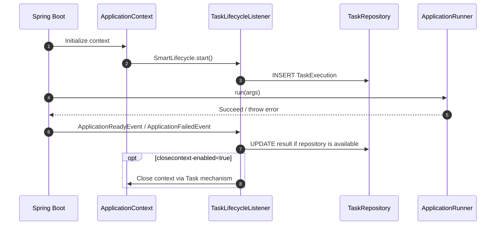
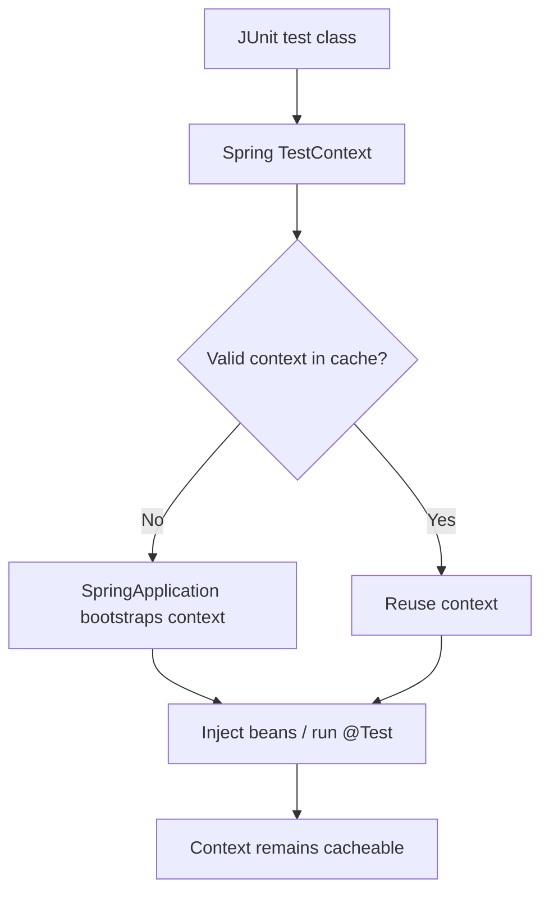

# Keeping `ApplicationContext` Appropriate When Testing Spring Cloud Task

## 1. Why Are Context Lifecycle Issues Common When Testing Spring Cloud Task?

Spring Cloud Task is well suited for building **finite-lived applications that run and terminate**: importing data, reconciling transactions, generating reports, or running Spring Batch jobs. Spring Cloud Task infrastructure creates and updates a `TaskExecution` in `TaskRepository` when the Spring Boot application starts and finishes. This lets operators know which runs succeeded, failed, or terminated abnormally.

However, Spring tests usually operate differently. When using `@SpringBootTest`, the Spring Test Framework builds an `ApplicationContext`, injects beans into the test class, runs multiple `@Test` methods, and may **cache the context** for reuse across compatible tests. Tests expect the context to remain active long enough to read beans and run assertions.

A conflict arises when the Task application is configured to **automatically close `ApplicationContext` immediately after runners finish**. A test launch can unfold as follows:

1. `@SpringBootTest` builds the Task application context.
2. `TaskLifecycleListener` creates a start record in `TaskRepository`.
3. Spring Boot invokes `ApplicationRunner` or `CommandLineRunner`.
4. Spring Cloud Task updates the execution outcome.
5. If `spring.cloud.task.closecontext-enabled=true` is enabled, the Task may close the context.
6. Spring Test prepares to inject/use beans or reuse the context, only to find the context already closed.

This lesson in the **Testing** chapter of the `SPRING_CLOUD_TASK` module explains how to **keep `ApplicationContext` appropriate during testing** while controlling runners, databases, execution state, and how to test a real Task process.

After this lesson, you will be able to:

- Explain context lifecycles from the perspectives of Spring Boot, Spring Test, and Spring Cloud Task.
- Override `spring.cloud.task.closecontext-enabled=false` **within test scope** without altering production behavior.
- Separate unit tests, slice tests, integration tests, and real process tests.
- Prevent `ApplicationRunner` or Spring Batch jobs from executing unintended business work during test bootstrap.
- Verify `TaskExecution` records using a test data source without polluting production.
- Understand the effects of context caching, `@DirtiesContext`, and `@Transactional`.
- Test failure paths, JVM exit codes, retries, and idempotency at the right boundaries.

## 2. Two Lifecycles: Spring Cloud Task and Spring Test

### 2.1. Spring Cloud Task Tracks Application Lifecycle

An application with `@EnableTask` or equivalent Task infrastructure configuration uses `TaskLifecycleListener` to persist metadata. After `ApplicationContext` bootstraps successfully, the Task records the start timestamp **before runners execute**. When synchronous runners finish or the application enters the failure path, the framework attempts to record completion details.



`TaskExecution` represents **one application run**, not a separate record per `@Test` method, service call, or `Runnable`. If the JVM dies before context bootstrap, no metadata may exist; if killed with `kill -9`, the record may be missing `endTime`.

### 2.2. Spring Test Expects the Context to Stay Alive

`@SpringBootTest` uses `SpringApplication` to build an `ApplicationContext` with Spring Boot features. The Spring TestContext Framework maintains a **context cache**, allowing multiple test methods and even multiple test classes with compatible configurations to share a single context.



If the Task closes the context right after the runner finishes, the "context can be reused" expectation can break. Therefore, adjust the lifecycle **to match the test's goal** rather than altering business logic just to make tests pass.

## 3. The Central Property: `spring.cloud.task.closecontext-enabled`

The following property controls **whether Spring Cloud Task actively closes the context upon completion**:

```yaml
spring:
  cloud:
    task:
      closecontext-enabled: false
```

In Spring Cloud Task lines with corresponding configuration documentation, **the default value is `false`**. Production applications may set `true` to proactively close the context once work completes; this helps when remaining threads or resources prevent the application from exiting cleanly on its own.

| Value | Meaning | Appropriate Scenario |
| --- | --- | --- |
| `false` | Spring Cloud Task does not proactively close the context after runners finish | `@SpringBootTest` needing to inject beans, run assertions, and reuse the context |
| `true` | Spring Cloud Task may close the context after completion and metadata update | Production Task runs needing to close resources in order to terminate |
| Unspecified | Uses the default configuration of the version in use | Only rely on defaults after verifying the actual configuration |

**What `false` does NOT mean:**

- **It does not disable the Task lifecycle.** `TaskRepository` may still write `TaskExecution` as soon as the test context bootstraps.
- **It does not disable runners.** `ApplicationRunner` and `CommandLineRunner` can still execute business logic.
- **It does not disable Spring Batch auto-launch.** Separate configuration is needed if Batch jobs are present.
- **It does not clean up test data.** Transactions and side effects may already have committed.
- **It does not prove the production JVM exits cleanly.** An open test context and a real process are two different boundaries.

Use the kebab-case property name `spring.cloud.task.closecontext-enabled` in modern examples; older docs may show different naming forms. Cross-check against **the Spring Cloud Task version** managed by your project's BOM.

## 4. Choose the Test Scope Before Choosing Context Configuration

| Test Type | Needs Spring Context? | Can Create `TaskExecution`? | What It Verifies |
| --- | --- | --- | --- |
| **Pure JUnit / Mockito unit** | No | No | Validation, business rules, mappings, idempotency |
| **Slice test / small bean test** | Partial context only | Depends on loaded config; usually no Task lifecycle needed | JDBC/JPA, bean conditions, small configs |
| **`@SpringBootTest`** | Nearly full Boot context | Yes, if Task infrastructure is enabled and repository works | Wiring, runners, startup arguments, `TaskRepository` |
| **Subprocess/E2E** | Real JVM and context | Yes, if the application bootstraps successfully | OS exit code, logs, shutdown, metadata, and output data |

Validating a `businessDate` **should not take several seconds booting Spring Boot**. Conversely, to verify `TaskRepository` persists a record during bootstrap, use real integration instead of mocking the entire framework.

### 4.1. Questions That Determine Test Type

- "Does the parser reject malformed dates?" -> unit test.
- "Is the runner bean registered when the flag is enabled?" -> small config/context test.
- "On startup, does `TaskRepository` have metadata with the right name?" -> integration test with a test database.
- "When the JAR exits with an error, what exit code does the scheduler see?" -> subprocess/E2E.
- "Does a Kubernetes restart cause duplicate writes?" -> multi-run integration/workflow test with persistent data.

**Do not use one giant `@SpringBootTest` to replace every testing level**; doing so increases runtime, side-effect risk, and makes failures harder to isolate.

## 5. Designing a Task Application Whose Test Behavior Is Controllable

Consider a `daily-import` application that processes a `businessDate` parameter and calls an import service. So tests do not hit real APIs, the runner is gated by an application property and business work sits behind an interface easy to replace with a fake.

### 5.1. An Illustrative Java Application

```java
import java.time.LocalDate;
import java.util.List;

import org.springframework.boot.ApplicationRunner;
import org.springframework.boot.SpringApplication;
import org.springframework.boot.autoconfigure.SpringBootApplication;
import org.springframework.boot.autoconfigure.condition.ConditionalOnProperty;
import org.springframework.cloud.task.configuration.EnableTask;
import org.springframework.context.annotation.Bean;
import org.springframework.stereotype.Component;

@SpringBootApplication
@EnableTask
public class DailyImportTaskApplication {

    public static void main(String[] args) {
        SpringApplication.run(DailyImportTaskApplication.class, args);
    }

    @Bean
    @ConditionalOnProperty(
        prefix = "app.task",
        name = "run-on-startup",
        havingValue = "true",
        matchIfMissing = true
    )
    ApplicationRunner importRunner(ImportOperation operation) {
        return args -> {
            List<String> values = args.getOptionValues("businessDate");
            if (values == null || values.size() != 1) {
                throw new IllegalArgumentException(
                    "Must pass --businessDate=yyyy-MM-dd");
            }

            LocalDate date = LocalDate.parse(values.get(0));
            operation.importFor(date);
        };
    }
}

interface ImportOperation {
    void importFor(LocalDate businessDate);
}

@Component
class DefaultImportOperation implements ImportOperation {
    @Override
    public void importFor(LocalDate date) {
        // Illustrative; replace with actual data import processing.
        System.out.println("Importing data for date " + date);
    }
}
```

Here:

- `@EnableTask` enables Task tracking infrastructure.
- `app.task.run-on-startup` is a **custom application-defined property**, not a standard Spring Cloud Task property.
- When omitted, `matchIfMissing=true` ensures the runner runs in normal execution paths.
- Smoke tests can set `app.task.run-on-startup=false` to skip business execution.
- Runner integration tests set `true` and swap `ImportOperation` with a fake before Spring Boot invokes the runner.

### 5.2. Illustrative Production Configuration

```yaml
spring:
  application:
    name: daily-import-worker
  main:
    web-application-type: none
  cloud:
    task:
      name: daily-import
      closecontext-enabled: true
  datasource:
    url: ${TASK_DB_URL}
    username: ${TASK_DB_USER}
    password: ${TASK_DB_PASSWORD}
app:
  task:
    run-on-startup: true
```

`closecontext-enabled: true` is an **example production choice**, not a requirement for every application. Tests override `false` **within test scope**, without modifying the production file. Database variables must be supplied from a secret manager or appropriate environment—never commit credentials into source.

## 6. Smoke Test: Keeping the Context Open and Suppressing Business Runners

### 6.1. `@SpringBootTest` with Direct Overrides

The example uses in-memory H2 to isolate test data; include compatible `spring-boot-starter-test`, H2, and JDBC dependencies.

```java
import static org.assertj.core.api.Assertions.assertThat;

import org.junit.jupiter.api.Test;
import org.springframework.beans.factory.annotation.Autowired;
import org.springframework.boot.test.context.SpringBootTest;
import org.springframework.context.ConfigurableApplicationContext;

@SpringBootTest(
    classes = DailyImportTaskApplication.class,
    webEnvironment = SpringBootTest.WebEnvironment.NONE,
    properties = {
        "spring.cloud.task.closecontext-enabled=false",
        "app.task.run-on-startup=false",
        "spring.batch.job.enabled=false",
        "spring.cloud.task.name=daily-import-context-test",
        "spring.cloud.task.initialize-enabled=true",
        "spring.datasource.url=jdbc:h2:mem:daily_import_smoke;DB_CLOSE_DELAY=-1",
        "spring.datasource.driver-class-name=org.h2.Driver"
    }
)
class DailyImportContextTest {

    @Autowired
    ConfigurableApplicationContext context;

    @Test
    void contextRemainsActive() {
        assertThat(context.isActive()).isTrue();
        assertThat(context.getBean(DailyImportTaskApplication.class))
            .isNotNull();
    }
}
```

Each property has a specific role:

| Property | Why Set in Test |
| --- | --- |
| `closecontext-enabled=false` | Keeps the context available for Spring Test and assertions |
| `app.task.run-on-startup=false` | Prevents the runner from importing real data during bootstrap |
| `spring.batch.job.enabled=false` | Prevents auto-launching Batch jobs if Batch is integrated |
| `spring.cloud.task.name=...-test` | Distinguishes test metadata |
| `initialize-enabled=true` | Demonstrates Task schema initialization in the **H2 test database** |
| `spring.datasource.url=jdbc:h2:mem:...` | Isolates metadata storage from real environments |
| `WebEnvironment.NONE` | Avoids starting a web server for a finite Task |

**Note:** the test context may still create **a `TaskExecution`** because Spring Cloud Task infrastructure remains active. Only the business runner is disabled. If your goal is purely testing business logic, use unit tests instead of paying the overhead of the full Task.

### 6.2. `@TestPropertySource` as an Alternative

```java
@SpringBootTest(
    classes = DailyImportTaskApplication.class,
    webEnvironment = SpringBootTest.WebEnvironment.NONE
)
@TestPropertySource(properties = {
    "spring.cloud.task.closecontext-enabled=false",
    "app.task.run-on-startup=false",
    "spring.batch.job.enabled=false"
})
class ImportWithPropertySourceTest {
    // Inject beans and write @Test once an appropriate test datasource is configured.
}
```

The snippet above only illustrates the **override technique**; it is not a standalone database-backed test, because the datasource must still be provided by another profile or test configuration. Do not copy this snippet alone expecting an H2 schema automatically.

### 6.3. A Note on `@SpringBootTest` and `main`

In Spring Boot, `@SpringBootTest` normally initializes the context **via `SpringApplication`** without calling the application's `main` method by default. If `main` also executes `SpringApplication.exit(...)` and `System.exit(...)`, standard context tests **are not** proof that those calls behave properly on a real JVM.

Do not casually enable invoking `main` inside tests if `main` calls `System.exit(...)`: it can terminate the entire test runner JVM.

## 7. Testing the Real Runner: Swap Collaborators Before Startup

A smoke test with the runner disabled cannot verify that the runner reads `businessDate` and calls the right business logic. To test the real execution path, provide a **fake bean** ready before Boot invokes the runner.

### 7.1. Recording Fake

```java
import java.time.LocalDate;
import java.util.concurrent.atomic.AtomicReference;

final class RecordingImportOperation implements ImportOperation {
    private final AtomicReference<LocalDate> last =
        new AtomicReference<>();

    @Override
    public void importFor(LocalDate date) {
        last.set(date);
    }

    LocalDate lastDate() {
        return last.get();
    }
}
```

### 7.2. Integration Test with `@TestConfiguration`

```java
import static org.assertj.core.api.Assertions.assertThat;

import java.time.LocalDate;
import org.junit.jupiter.api.Test;
import org.springframework.beans.factory.annotation.Autowired;
import org.springframework.boot.test.context.SpringBootTest;
import org.springframework.boot.test.context.TestConfiguration;
import org.springframework.context.annotation.Bean;
import org.springframework.context.annotation.Import;
import org.springframework.context.annotation.Primary;

@SpringBootTest(
    classes = DailyImportTaskApplication.class,
    webEnvironment = SpringBootTest.WebEnvironment.NONE,
    args = "--businessDate=2026-11-23",
    properties = {
        "spring.cloud.task.closecontext-enabled=false",
        "spring.cloud.task.name=daily-import-runner-test",
        "spring.cloud.task.initialize-enabled=true",
        "spring.datasource.url=jdbc:h2:mem:daily_import_runner;DB_CLOSE_DELAY=-1",
        "spring.datasource.driver-class-name=org.h2.Driver",
        "app.task.run-on-startup=true",
        "spring.batch.job.enabled=false"
    }
)
@Import(DailyImportRunnerTest.FakeConfig.class)
class DailyImportRunnerTest {

    @Autowired
    RecordingImportOperation operation;

    @Test
    void runnerUsesCommandLineDate() {
        assertThat(operation.lastDate())
            .isEqualTo(LocalDate.of(2026, 11, 23));
    }

    @TestConfiguration(proxyBeanMethods = false)
    static class FakeConfig {
        @Bean
        @Primary
        RecordingImportOperation recordingImportOperation() {
            return new RecordingImportOperation();
        }
    }
}
```

The fake is registered **before the runner executes**. `@Primary` causes `ApplicationRunner` to inject the fake instead of `DefaultImportOperation`. Thus, the test observes the parsed argument without touching real APIs or business databases.

**Timing warning:** `ApplicationRunner` executes **during context bootstrap, before `@Test` and usually before `@BeforeEach`**. Consequently, stubbing a mock in `@BeforeEach` may be too late if the runner uses that stub right at startup.

Different Spring Boot/Spring Framework versions support `@MockBean` or `@MockitoBean`; when behavior must be ready **before** the runner runs, configuring a fake via `@TestConfiguration` is often clearer.

## 8. Business Unit Tests: No Spring Context Needed

A large share of Task logic testing should be plain Java unit tests. Example date-parsing policy:

```java
import java.time.LocalDate;

public final class ImportDatePolicy {

    public LocalDate parse(String value) {
        if (value == null || value.isBlank()) {
            throw new IllegalArgumentException("Missing processing date");
        }
        LocalDate date = LocalDate.parse(value);
        if (date.isAfter(LocalDate.of(2100, 1, 1))) {
            throw new IllegalArgumentException("Date out of range");
        }
        return date;
    }
}
```

JUnit 5 test:

```java
import static org.junit.jupiter.api.Assertions.assertEquals;
import static org.junit.jupiter.api.Assertions.assertThrows;

import java.time.LocalDate;
import org.junit.jupiter.api.Test;

class ImportDatePolicyTest {
    private final ImportDatePolicy policy = new ImportDatePolicy();

    @Test
    void validDate() {
        assertEquals(LocalDate.of(2026, 11, 23),
                     policy.parse("2026-11-23"));
    }

    @Test
    void invalidDate() {
        assertThrows(IllegalArgumentException.class,
                     () -> policy.parse(""));
    }
}
```

These tests do not depend on a datasource, metadata schema, `@EnableTask`, or `closecontext-enabled`. That makes them fast, easy to run in parallel, and much clearer when diagnosing failures.

## 9. Verifying `TaskRepository` Without Touching the Production Database

A `@SpringBootTest` with `@EnableTask` can **write metadata during bootstrap itself**. Therefore, every full-context test must use a **test DB** and a valid schema.

### 9.1. Example Querying Task Records via JDBC

```java
import static org.assertj.core.api.Assertions.assertThat;

import org.junit.jupiter.api.Test;
import org.springframework.beans.factory.annotation.Autowired;
import org.springframework.boot.test.context.SpringBootTest;
import org.springframework.jdbc.core.JdbcTemplate;

@SpringBootTest(
    classes = DailyImportTaskApplication.class,
    webEnvironment = SpringBootTest.WebEnvironment.NONE,
    properties = {
        "spring.cloud.task.closecontext-enabled=false",
        "spring.cloud.task.name=daily-import-metadata-test",
        "spring.cloud.task.initialize-enabled=true",
        "app.task.run-on-startup=false",
        "spring.batch.job.enabled=false",
        "spring.datasource.url=jdbc:h2:mem:daily_import_metadata;DB_CLOSE_DELAY=-1",
        "spring.datasource.driver-class-name=org.h2.Driver"
    }
)
class TaskRepositoryMetadataTest {

    @Autowired
    JdbcTemplate jdbcTemplate;

    @Test
    void metadataExistsForStartedTask() {
        Integer count = jdbcTemplate.queryForObject(
            """
            SELECT COUNT(*)
              FROM TASK_EXECUTION
             WHERE TASK_NAME = 'daily-import-metadata-test'
            """,
            Integer.class);

        assertThat(count).isNotNull().isGreaterThanOrEqualTo(1);
    }
}
```

Table and column names must match the Spring Cloud Task schema of the version under test. If the test uses H2, ensure the corresponding schema initialization script runs; `initialize-enabled=true` is used here for **learning/test environments**, not as a production recommendation.

**Why not assert exactly "one row per `@Test`"?** Because the Task lifecycle runs when **the context bootstraps**, and Spring Test can reuse contexts. Multiple test methods sharing one context **do not automatically create multiple `TaskExecution`s**.

### 9.2. Testcontainers for a Production-Like Database

H2 can differ from PostgreSQL/MySQL in SQL dialect, transaction isolation, sequences, and migrations. When you need to test repository concurrency, schema migrations, or deadlock handling, run integration tests against **the same DBMS as production** using Testcontainers or an isolated test database.

Depending on your Spring Boot version, use `@ServiceConnection` or `@DynamicPropertySource` to supply JDBC connections from the container. Always initialize the Task/Batch schema via version-matched scripts/migrations; do not assume an external database already contains the schema.

### 9.3. Never Let CI Point to a Production URL by Mistake

Environment variables such as `TASK_DB_URL` or `SPRING_DATASOURCE_URL` may be inherited from the environment. **If a test context boots against a production URL, the framework can write a `TaskExecution` before any `@Test` method even runs.** Runners could even execute real business operations.

Ensure CI configuration uses a dedicated DB, restricted test credentials, never reuses production credentials, and validates target URLs before launching integration tests.

## 10. Context Caching, `@DirtiesContext`, and Recorded Task Counts

Spring Test caches contexts by the combination of configuration classes, active profiles, properties, and other cache-key factors.

| Test Behavior | Consequence |
| --- | --- |
| Multiple `@Test` methods in one class | Usually share **one context**; runners do not re-run per method |
| Two classes with compatible configs | Can share one cached context |
| Changing properties/profiles/test configs | Creates a separate context -> Task bootstraps another time |
| `@DirtiesContext` | Marks context non-reusable -> next test triggers re-initialization |
| Test mutates bean state | Cached context retains state across tests; reset carefully |
| `closecontext-enabled=true` | Task may close the context unexpectedly for TestContext |

**Do not slap `@DirtiesContext` onto every test just to clean data**. It increases bootstrap overhead and creates unnecessary `TaskExecution` rows. When you need test isolation, prefer separate databases/schemas, properly scoped transactions, or controlled data cleanup.

### 10.1. `@Transactional` on `@Test` Does Not Roll Back Runner Startup

A `@Transactional` test method normally starts a transaction for the test method itself. However, `ApplicationRunner` already executed **during bootstrap**, before the test method began.

Therefore, changes committed inside the runner **are not automatically rolled back** just because the test carries `@Transactional`. `TaskRepository` may also use its own transaction. When testing Tasks, manage setup/cleanup and test databases explicitly instead of relying on a method annotation to undo all startup side effects.

## 11. Avoiding Side Effects from Runners and Spring Batch

Startup runners can:

- Call payment APIs or external services.
- Write to business databases.
- Send emails or messages.
- Create large files in `/tmp`.
- Launch Spring Batch Jobs.
- Register threads/`TaskExecutor`s that keep the context alive.

When you only need a smoke test, use an **application-defined flag** such as `app.task.run-on-startup=false`. When you want to test the real runner, replace collaborators with fake beans and use test data.

With Spring Batch, `spring.batch.job.enabled=false` helps prevent tests from auto-launching `Job`s at startup. **It does not disable Spring Cloud Task**, and it does not replace integration tests proving jobs succeed or fail properly.

When your goal is to test `spring.cloud.task.batch.fail-on-job-failure`, intentionally enable the integrated job/runner in a dedicated test and verify `JobExecution.BatchStatus`, Task outcomes, and process exit codes as required.

Never "fix" a test by catching all exceptions in the runner and returning normally. That causes the Task to record success while business processing actually failed.

## 12. Testing Failure Paths: Context Errors vs. Business Errors

There are two distinct situations:

1. **Error in a business method:** unit tests can invoke the method and call `assertThrows(...)` directly.
2. **Error in a runner during bootstrap:** `@SpringBootTest` may fail **before JUnit ever calls `@Test`**. A standard test class is not the right tool to assert that the context itself failed to build.

For example, if the runner reads `--businessDate=invalid` and throws `DateTimeParseException`, `@SpringBootTest(args="--businessDate=invalid")` causes Spring Test to report a context-loading failure; a test method using `assertThrows` **never runs**.

Appropriate ways to test this:

- Invoke the parser or business service directly in unit tests.
- Start a `SpringApplication` explicitly in a dedicated test when testing the bootstrap path itself.
- Run the actual JAR in a **subprocess** when verifying OS exit codes and post-exit metadata.

Do not run bootstrap-failure experiments on a cached context shared with other tests.

## 13. Verifying Real JVM Exit Codes with `ProcessBuilder`

`@SpringBootTest` can verify `ApplicationContext` and `TaskRepository`, but **it does not prove the actual JVM exit code**. To verify the contract with schedulers/Kubernetes, launch the application as a separate process.

The following test harness assumes the JAR is already built, the test database/schema is prepared, and the environment configuration **contains no production secrets**:

```java
import static org.junit.jupiter.api.Assertions.assertEquals;
import static org.junit.jupiter.api.Assertions.assertTrue;

import java.nio.file.Files;
import java.nio.file.Path;
import java.util.concurrent.TimeUnit;

import org.junit.jupiter.api.Test;

class TaskProcessExitTest {

    @Test
    void successReturnsZero() throws Exception {
        Path jar = Path.of("build/libs/daily-import-task.jar");
        Path log = Files.createTempFile("task-e2e-", ".log");

        ProcessBuilder pb = new ProcessBuilder(
            "java", "-jar", jar.toAbsolutePath().toString(),
            "--businessDate=2026-11-23");
        pb.redirectErrorStream(true);
        pb.redirectOutput(log.toFile());

        // Must override connection variables with a dedicated test database.
        pb.environment().put(
            "SPRING_CLOUD_TASK_CLOSECONTEXT_ENABLED", "true");

        Process p = pb.start();
        try {
            boolean done = p.waitFor(30, TimeUnit.SECONDS);
            if (!done) {
                p.destroyForcibly();
                p.waitFor();
            }

            assertTrue(done, "Task exceeded timeout");
            assertEquals(0, p.exitValue());
        } finally {
            if (p.isAlive()) {
                p.destroyForcibly();
            }
            Files.deleteIfExists(log);
        }
    }
}
```

This is a **reference skeleton** and cannot run as-is without the JAR artifact and test database. Verify the artifact exists, ensure the child process environment **does not inherit production datasources/credentials**, configure an appropriate startup profile, and include cleanup logic.

Failure-path tests can pass an invalid date and assert a non-zero code. However, the exact numeric code depends on `main`, `SpringApplication.exit(...)`, `ExitCodeGenerator`, and how your Spring Boot version translates exceptions. **Never assume every exception produces the exact same exit code across all environments.**

More importantly, subprocess tests should also query `TaskRepository` and test business data to verify real outcomes, not just the OS exit code.

## 14. When a Task Combines Spring Batch and a Separate Repository

A Spring Cloud Task application can run Spring Batch. In that case, there are two metadata models:

| Repository | Records | What to Test |
| --- | --- | --- |
| Spring Cloud Task `TaskRepository` | `TaskExecution` | Application lifecycle, start/end/exitCode |
| Spring Batch `JobRepository` | `JobExecution`, `StepExecution` | Job/step status, checkpoints, read/write/skip counts |

If a test only checks wiring of business beans, disabling Batch auto-launch with `spring.batch.job.enabled=false` can make sense. If a test aims to prove Batch actually runs, you must **execute the job against a test DB** with controlled `JobParameters`, verifying `BatchStatus` and `ExitStatus` rather than concluding an active context implies job success.

To test `spring.cloud.task.batch.fail-on-job-failure=true`, use the integrated runner path and configure `BatchStatus.FAILED` to propagate to the Task outcome. Keep this test **separate from smoke tests**, because it intentionally fails at startup and can cause `@SpringBootTest` to fail before a test method starts.

For remote partitioning tests, the manager and workers are **separate processes**; a single in-JVM context test cannot substitute for testing shared `JobRepository`/`TaskRepository` access, worker restarts, or business-data idempotency.

## 15. Troubleshooting Common Failures

| Symptom | Possible Cause | Fix |
| --- | --- | --- |
| Context is inactive when tests use beans | Task closes context after runner finishes | Set `spring.cloud.task.closecontext-enabled=false` in tests |
| Test calls real API before `@Test` starts | Runner executes during bootstrap | Disable runner with test flag or pre-register fake bean |
| Test creates a `TaskExecution` even with runner off | Task lifecycle is still active | Often expected; use a dedicated test DB |
| Fewer rows than `@Test` methods | Context is cached and reused | Do not assume one method equals one `TaskExecution` |
| More rows than expected | Context recreated due to profile/property/`@DirtiesContext` | Check cache keys and DB isolation |
| `@Transactional` does not roll back startup writes | Runner/`TaskRepository` committed before the test method | Use dedicated DB/cleanup; decouple runner |
| Mockito stub in `@BeforeEach` ignored by runner | Stub configured after bootstrap | Use a fake via `@TestConfiguration` before startup |
| Context test fails due to Batch job | Batch auto-launches on Spring Boot startup | Disable Batch auto-launch in smoke tests |
| Startup failure test never reaches `assertThrows` | Context fails bootstrap so `@Test` never runs | Unit test logic or run subprocess test |
| E2E process fails before writing `TaskExecution` | Missing schema/secret/classpath | Check logs, process exit code, and test datasource |
| Test records appear in production database | Test context inherited prod URL/credentials | Lock down profiles, URLs, and test secrets |
| Tests are too slow | Using `@SpringBootTest` for everything | Increase unit/slice tests, reduce context churn |
| Test JVM terminates abruptly | Test calls `main` containing `System.exit` | Avoid calling `main` in JVM tests; use subprocesses |

## 16. Safe Test Suite Design Checklist

- [ ] Classify each test as unit, slice, context integration, or process-level.
- [ ] For finite Task `@SpringBootTest`s, use `WebEnvironment.NONE` when no web server is needed.
- [ ] For tests needing an open context, override `spring.cloud.task.closecontext-enabled=false` **only in tests**.
- [ ] Do not confuse `closecontext-enabled=false` with disabling Task lifecycle or runners.
- [ ] Control every `ApplicationRunner`/`CommandLineRunner` that has side effects.
- [ ] Use fake beans registered **before bootstrap** when testing runners.
- [ ] Disable Spring Batch auto-launch in non-Batch tests, and enable it intentionally where needed.
- [ ] Keep test `DataSource`s completely separate from production; match schema/migrations to the target version.
- [ ] Do not assume one `@Test` creates one `TaskExecution` due to context caching.
- [ ] Do not assume `@Transactional` on tests rolls back startup writes.
- [ ] Use `@DirtiesContext` only when a fresh context is genuinely necessary.
- [ ] Test startup failures and exit codes via subprocesses or standalone runners.
- [ ] Include timeouts, log capture, and safe cleanup in process E2E tests.
- [ ] Test database failures, retries, concurrency, and idempotency using test data.
- [ ] Verify business outcomes directly rather than relying solely on `TaskExecution.exitCode`.

## 17. Exercises and Self-Check Questions

**Exercise A — Context closes too early.**

Production sets `spring.cloud.task.closecontext-enabled=true`. A `@SpringBootTest` needs to inject a service and invoke multiple methods, but the context is closed. Fix the test without modifying production.

**Hint:** use `@SpringBootTest(properties = "spring.cloud.task.closecontext-enabled=false")` or `@TestPropertySource`. Then control the runner and datasource to avoid side effects.

**Exercise B — Runner calls external service right at startup.**

You use `@MockBean` or `@MockitoBean` and stub it in `@BeforeEach`, yet the real API was already called beforehand. Why?

**Hint:** the runner executes during bootstrap, before `@BeforeEach`. Register a test fake via `@TestConfiguration`/`@Primary`, or disable the runner with a property in smoke tests.

**Exercise C — Three test methods, one Task record.**

A test class has three `@Test` methods sharing one `@SpringBootTest` context. Why might there be only one `TaskExecution`?

**Hint:** the Task writes metadata during context bootstrap; Spring Test reuses the context across methods.

**Exercise D — Input error during bootstrap.**

You want to assert that `--businessDate=abc` causes the Task application to return a non-zero exit code. Should you use a standard `@SpringBootTest` and put `assertThrows` inside `@Test`?

**Hint:** no; the context may fail before JUnit runs the test method. Use parser unit tests and a separate subprocess E2E test to verify OS exit codes.

**Exercise E — Test data does not roll back.**

The runner committed data as soon as the context booted. Afterwards, a `@Transactional` test method rolls back, yet the data remains. Why?

**Hint:** the runner ran before the test method's transaction; use an isolated DB and proper cleanup.

**Question 1.** Does `closecontext-enabled=false` disable `TaskRepository`?

**Question 2.** Does `ApplicationRunner` normally run before or after a `@Test` method?

**Question 3.** What does `@DirtiesContext` change, and is it the best way to clean the DB for every test?

**Question 4.** A Spring Batch `JobExecution` reports `FAILED`, yet `@SpringBootTest` still starts up. Does that prove the Task recorded failure?

**Question 5.** If a Task is killed before context bootstrap succeeds, is a `TASK_EXECUTION` row guaranteed to exist?

**Answer hints:** (1) No, it only prevents automatic context closing; (2) Before, during bootstrap; (3) It invalidates the context cache and forces re-bootstrap, without automatically replacing DB cleanup; (4) No, you must verify Batch/Task error propagation; (5) No, correlate logs with process/platform status.

## 18. Summary and References

**Keeping `ApplicationContext` appropriate when testing Spring Cloud Task** means aligning the Task lifecycle with Spring Test's expectations: for `@SpringBootTest` suites that reuse contexts and inject beans after runners finish, typically set **`spring.cloud.task.closecontext-enabled=false` within test scope**. Production can enable auto-closing if needed to shut down processes cleanly.

Even when the context stays open, **the Task lifecycle can still write metadata, runners can still run, Batch jobs can still launch, and committed writes do not auto-roll back**. Therefore, a solid strategy combines fast unit tests, controlled context smoke tests, integration tests using dedicated test repositories, and subprocess E2E tests when real JVM exit codes are required. With Spring Batch or retries, always verify data state and idempotency rather than just asserting an active context.

**Official references:**

- [Spring Cloud Task — Features, Closing the Context](https://docs.spring.io/spring-cloud-task/reference/features.html)
- [Spring Cloud — Spring Cloud Task Configuration Properties](https://docs.spring.io/spring-cloud/docs/current/reference/html/configprops.html)
- [Spring Boot — Testing Spring Boot Applications](https://docs.spring.io/spring-boot/reference/testing/spring-boot-applications.html)
- [Spring Framework — TestContext Caching](https://docs.spring.io/spring-framework/reference/testing/testcontext-framework/ctx-management/caching.html)
- [Spring Framework — @DirtiesContext](https://docs.spring.io/spring-framework/reference/testing/annotations/integration-spring/annotation-dirtiescontext.html)
- [Spring Batch — Testing](https://docs.spring.io/spring-batch/reference/testing.html)
