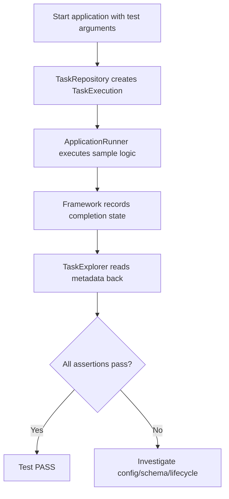

# Verifying `TaskExecution` and Arguments via `TaskExplorer`

## 1. Why Test Execution Metadata?

A **Spring Cloud Task** application is a Spring Boot program that performs finite-lived work: receiving a request, executing business logic, and terminating. When backed by a database-persisted `TaskRepository`, the framework records metadata for each run as a **`TaskExecution`**, including the execution ID, task name, start/end timestamps, exit code, error message, and **command-line argument list**.

During testing, seeing a `Task completed` log line or an `ApplicationRunner` reaching its end is **not enough** to guarantee metadata was persisted accurately. A misconfigured `DataSource`, missing schema, or failure in the completion phase can leave audit metadata inaccurate or incomplete. When a task is invoked via cron, a Kubernetes Job, Spring Cloud Data Flow, or Spring Batch, inspecting execution history becomes even more critical because each run is a separate process.

**`TaskExplorer`** is the dedicated API for **reading and querying `TaskExecution` history**. This lesson focuses on verifying execution details and persisted arguments using JUnit and an H2 database for the lab, then extends those checks to JAR and scheduler executions.

Example test target for an order import task:

```text
Task name: orders-import-test
Arguments: --import.date=2026-11-24
           --request.id=partner-a-2026-11-24

Expected:
  TaskExecution has a valid executionId
  taskName = orders-import-test
  startTime and endTime are populated once finished
  exitCode = 0 when the run completes normally
  arguments contains the exact two passed arguments
```

The `executionId` is assigned by the repository and **should never be hardcoded to 1**. Nor should a `TaskExecution` ID be used as a business deduplication key: a single business request may be retried multiple times, receiving a different ID each time.

## 2. `TaskRepository` and `TaskExplorer` Have Distinct Roles

| Component | Responsibility | Should It Be Used in Tests? |
| --- | --- | --- |
| `TaskRepository` | Creates and updates `TaskExecution` state | Dedicated tests for writes/transactions, or let the framework manage it in integration tests |
| **`TaskExplorer`** | Reads by execution ID, task name, pagination, and Batch association queries | **Primary API** for asserting persisted metadata |
| `TaskExecution` | Represents a single execution and its persisted attributes | Inspect `getExecutionId()`, `getTaskName()`, `getArguments()`, etc. |
| `ApplicationRunner` / `CommandLineRunner` | Receives arguments and calls business use cases when the task runs | Test argument handling, error propagation, and business outcomes |
| `JdbcTemplate`/SQL | Inspects metadata tables and target data directly | Helpful for cross-checking schemas or investigating discrepancies |
| Scheduler / Kubernetes Job | Launches the process and decides retries | Separately test schedules, timeouts, attempt counts, and infrastructure signals |

`TaskExplorer` resides in the **`org.springframework.cloud.task.repository`** package, with `SimpleTaskExplorer` as a common implementation. In a standard Spring Cloud Task setup, the framework provides repository/explorer beans wired to the configured `DataSource` and `TaskConfigurer`; **you do not need to re-implement SQL metadata queries just to inspect history**.

### Essential `TaskExplorer` Methods

| API | Result and Purpose |
| --- | --- |
| `getTaskExecution(long executionId)` | Returns a `TaskExecution` by ID, or `null` if not found |
| `getLatestTaskExecutionForTaskName(String name)` | Run with the latest `START_TIME` for the task name (may **still be running**) |
| `findTaskExecutionsByName(String name, Pageable pageable)` | `Page<TaskExecution>` for inspecting executions by name |
| `findAll(Pageable pageable)` | `Page<TaskExecution>` across all runs with pagination bounds |
| `getTaskExecutionCountByTaskName(String name)` | Execution count for a given task name |
| `getTaskExecutionCount()` | Total number of executions in the repository |
| `getRunningTaskExecutionCount()` | Number of executions the repository considers still running |
| `getTaskNames()` | List of recorded task names |
| `getJobExecutionIdsByTaskExecutionId(long id)` | Batch `JobExecution` IDs linked to a `TaskExecution`, if integrated |
| `getTaskExecutionIdByJobExecutionId(long jobExecutionId)` | Task ID linked to a Batch job execution, or `null` if none |

**Note on API naming:** in the Spring Cloud Task 3.x API, arguments are retrieved via **`TaskExecution.getArguments()`**, after fetching the `TaskExecution` from `TaskExplorer`. Do not invent guessed names like `TaskExplorer.getTaskExecutionArgs(id)`; no such method exists in the current Javadoc interface.

```java
TaskExecution execution = taskExplorer.getTaskExecution(executionId);
if (execution != null) {
    List<String> commandLineArguments = execution.getArguments();
}
```

`getArguments()` returns a **`List<String>` containing the command-line arguments passed to the application**, not a `Map<String,String>` of bound Spring Boot properties. To verify `--import.date=2026-11-24`, check for that exact string in the list; verifying that the value parsed into a `LocalDate` belongs in `ApplicationRunner`/service tests.

## 3. What to Assert on a `TaskExecution`



| Attribute | Assertion for a **Successfully Completed** Run | What to Avoid |
| --- | --- | --- |
| `executionId` | Valid assigned ID; retrieves the same record back | `assertEquals(1L, ...)` when the database may hold prior data |
| `taskName` | Matches configured logical task name | Confusing with class name, JAR name, or `spring.application.name` |
| `startTime` | Non-`null` | Treating a larger ID as proof of earlier/later start time |
| `endTime` | Non-`null`, not earlier than `startTime` | Expecting `endTime` **while the runner is still executing** |
| `exitCode` | Equals `Integer.valueOf(0)` for normal completion | Primitive comparison when the field may be `null` |
| `arguments` | Contains the arguments passed via CLI | Expecting every environment variable/YAML property to appear in the list |
| `errorMessage` | Typically `null`/empty on error-free runs | Using `errorMessage` as the sole source of truth for business state |

**Timing of reads matters.** Spring Cloud Task writes start metadata when the lifecycle starts and updates the outcome after runners complete or on framework-handled failures. If a test queries **inside the `ApplicationRunner` of that same run**, final `END_TIME`/`EXIT_CODE` values may not exist yet. Integration tests should **run the application first and query metadata after `SpringApplication.run(...)` returns**, or await child process completion in multi-process tests.

If the JVM receives `SIGKILL`, loses power, or fails before `ApplicationContext` forms, the framework cannot guarantee a complete record. A row missing `END_TIME` alone is not proof that the process is still alive.

## 4. Setting Up the Lab: Spring Cloud Task and H2

Examples use **Java 17+**, JUnit Jupiter, Spring Boot, and a **compatible Spring Cloud Task** line. Use the Spring Cloud BOM matching your project's Spring Boot version; do not arbitrarily mix starters from different release trains.

### 4.1. Maven Dependencies

```xml
<!-- Project already configures Spring Boot parent/BOM and Spring Cloud BOM. -->
<dependencies>
    <dependency>
        <groupId>org.springframework.cloud</groupId>
        <artifactId>spring-cloud-starter-task</artifactId>
    </dependency>
    <dependency>
        <groupId>org.springframework.boot</groupId>
        <artifactId>spring-boot-starter-jdbc</artifactId>
    </dependency>
    <dependency>
        <groupId>com.h2database</groupId>
        <artifactId>h2</artifactId>
        <scope>runtime</scope>
    </dependency>
    <dependency>
        <groupId>org.springframework.boot</groupId>
        <artifactId>spring-boot-starter-test</artifactId>
        <scope>test</scope>
    </dependency>
</dependencies>
```

`spring-boot-starter-test` provides JUnit Jupiter and common assertion libraries. `spring-cloud-starter-task` provides the Task lifecycle and `TaskExplorer` API. `spring-boot-starter-jdbc`/H2 provides a lightweight test database. In a **single-JVM test**, in-memory H2 avoids external DB dependencies; however, **never use two JVMs with two `mem:` H2 URLs pretending they share metadata**.

### 4.2. Task Configuration

`src/main/resources/application.yml`:

```yaml
spring:
  application:
    name: orders-import-app
  main:
    web-application-type: none
  datasource:
    driver-class-name: org.h2.Driver
    url: jdbc:h2:mem:orders_task_demo;DB_CLOSE_DELAY=-1
    username: sa
    password: ""
  cloud:
    task:
      name: orders-import-task
      initialize-enabled: true
```

`spring.main.web-application-type: none` keeps the application from starting a web server. `initialize-enabled: true` is suitable for labs when the framework initializes the `TASK_*` schema matching the library version; on a new database, check logs and DDL if tables are not created. **This is not a production configuration**: production environments should use a persistent RDBMS, controlled migrations, and least-privilege accounts.

### 4.3. The Finite-Lived Application Under Test

Create `src/main/java/com/example/tasktest/OrdersImportTaskApplication.java`:

```java
package com.example.tasktest;

import java.time.LocalDate;
import java.util.List;

import org.springframework.boot.ApplicationArguments;
import org.springframework.boot.ApplicationRunner;
import org.springframework.boot.SpringApplication;
import org.springframework.boot.autoconfigure.SpringBootApplication;
import org.springframework.cloud.task.configuration.EnableTask;
import org.springframework.context.annotation.Bean;

@EnableTask
@SpringBootApplication
public class OrdersImportTaskApplication {

    public static void main(String[] args) {
        SpringApplication.run(OrdersImportTaskApplication.class, args);
    }

    @Bean
    ApplicationRunner runImport() {
        return args -> {
            String dateText = required(args, "import.date");
            LocalDate date = LocalDate.parse(dateText); // validate ISO yyyy-MM-dd
            String requestId = required(args, "request.id");

            // Demo: does not write real business data yet.
            System.out.printf("IMPORT_OK date=%s request=%s%n", date, requestId);
        };
    }

    private static String required(ApplicationArguments args, String key) {
        List<String> values = args.getOptionValues(key);
        if (values == null || values.size() != 1 ||
                values.get(0) == null || values.get(0).isBlank()) {
            throw new IllegalArgumentException("Missing or invalid --" + key);
        }
        return values.get(0);
    }
}
```

Business logic is simulated only with `System.out` so the exercise stays focused on **tracing `TaskExecution` and arguments**. In a real application, the runner should call a transactional/idempotent business service and throw an error if the request cannot be completed—never catch and ignore exceptions just to return exit code 0.

## 5. Integration Testing with `TaskExplorer`

`@SpringBootTest` is not required for this example. We use **`SpringApplicationBuilder` inside a JUnit test**, running a real application context with in-memory H2, waiting for `run(...)` to return, and then retrieving the `TaskExplorer` bean from the context to inspect metadata.

Because the test uses **one context inside one JVM**, H2 `mem:` and the `TaskExplorer` bean share the same repository with no cross-JVM file-lock conflicts. A dedicated task name `orders-import-test` and dedicated test JDBC URL keep the test independent of manual runs.

Create `src/test/java/com/example/tasktest/TaskExplorerIntegrationTest.java`:

```java
package com.example.tasktest;

import static org.junit.jupiter.api.Assertions.assertEquals;
import static org.junit.jupiter.api.Assertions.assertNotNull;
import static org.junit.jupiter.api.Assertions.assertNull;
import static org.junit.jupiter.api.Assertions.assertTrue;

import org.junit.jupiter.api.Test;
import org.springframework.boot.WebApplicationType;
import org.springframework.boot.builder.SpringApplicationBuilder;
import org.springframework.cloud.task.repository.TaskExecution;
import org.springframework.cloud.task.repository.TaskExplorer;
import org.springframework.context.ConfigurableApplicationContext;
import org.springframework.data.domain.Page;
import org.springframework.data.domain.PageRequest;

class TaskExplorerIntegrationTest {

    @Test
    void verifiesExecutionAndCommandLineArguments() {
        String taskName = "orders-import-test";
        String dateArg = "--import.date=2026-11-24";
        String requestArg = "--request.id=partner-a-2026-11-24";

        try (ConfigurableApplicationContext context =
                new SpringApplicationBuilder(OrdersImportTaskApplication.class)
                        .web(WebApplicationType.NONE)
                        .properties(
                                "spring.datasource.url="
                                    + "jdbc:h2:mem:task_explorer_it;DB_CLOSE_DELAY=-1",
                                "spring.cloud.task.name=" + taskName,
                                "spring.cloud.task.initialize-enabled=true")
                        .run(dateArg, requestArg)) {

            TaskExplorer explorer = context.getBean(TaskExplorer.class);

            // Read after all ApplicationRunners have finished.
            TaskExecution execution =
                    explorer.getLatestTaskExecutionForTaskName(taskName);

            assertNotNull(execution, "TaskExecution must be persisted");
            assertTrue(execution.getExecutionId() > 0);
            assertEquals(taskName, execution.getTaskName());
            assertNotNull(execution.getStartTime());
            assertNotNull(execution.getEndTime());
            assertTrue(!execution.getEndTime().isBefore(
                    execution.getStartTime()));
            assertEquals(Integer.valueOf(0), execution.getExitCode());

            assertNotNull(execution.getArguments());
            assertTrue(execution.getArguments().contains(dateArg));
            assertTrue(execution.getArguments().contains(requestArg));

            // Re-read the exact execution by ID without relying on a hardcoded ID.
            TaskExecution byId =
                    explorer.getTaskExecution(execution.getExecutionId());
            assertNotNull(byId);
            assertEquals(execution.getExecutionId(), byId.getExecutionId());
            assertEquals(execution.getArguments(), byId.getArguments());

            // Query by name; always paginate rather than reading unbounded results.
            Page<TaskExecution> page = explorer.findTaskExecutionsByName(
                    taskName, PageRequest.of(0, 10));
            assertTrue(page.getContent().stream()
                    .anyMatch(e -> e.getExecutionId() == execution.getExecutionId()));
            assertTrue(explorer.getTaskExecutionCountByTaskName(taskName) >= 1);

            // Contract behavior of TaskExplorer when the ID does not exist.
            assertNull(explorer.getTaskExecution(Long.MAX_VALUE));
        }
    }
}
```

### Understanding Each Group of Assertions

1. **Real context:** `SpringApplicationBuilder` boots the application as a Task, triggering framework lifecycle and runners rather than merely calling a service method in a unit test.
2. **Execution ID:** reads the ID from the actual persisted record without assuming what number `TASK_SEQ` starts at.
3. **Task name:** `spring.cloud.task.name` in the test overrides the default from `application.yml`; `TASK_NAME` must reflect the effective configuration.
4. **Timestamps and exit code:** asserts `endTime`/`exitCode` only after `run(...)` returns from a successful launch. Verifies `endTime` is not before `startTime` without relying on a specific machine clock.
5. **Arguments:** `getArguments()` must contain the exact `--import.date` and `--request.id` strings passed at launch. Do not assert argument ordering when ordering is irrelevant to the business logic.
6. **Lookup by ID and by name:** both `getTaskExecution(id)` and `findTaskExecutionsByName(...)` return the recorded execution, catching mismatched names or wrong repository wiring.
7. **`null` when missing:** verifies Javadoc-documented behavior, distinct from throwing errors due to missing schemas or lost DB connectivity.

The test can be run with `mvn test` in a project configured with Maven/JDK and a compatible BOM. This lesson **does not ask you** to run build commands against production. If a Spring Cloud Task version has different lifecycle or auto-initialization behavior, consult that artifact's Javadoc and inspect logs/schema rather than relaxing assertions just to make tests pass.

### Why Not Check Immediately Inside a Standard `@SpringBootTest`?

A `@SpringBootTest` targeting the Spring Cloud Task application itself may **create a `TaskExecution` for the test context**, and by the time the JUnit method executes, that run's lifecycle may be in a different state than expected. Reading "latest task" without knowing which task just started easily causes broken assertions. `SpringApplicationBuilder` above makes **when it runs and when you read** explicit, though you must ensure tests do not run concurrently against the same H2 URL and task name.

For parallel CI execution, give each test its own H2 database name and `taskName`, or use Testcontainers with a database server supporting concurrency. Never share a fixed in-memory H2 database across all test workers and expect `getLatest...` to always return your own attempt.

## 6. Cross-Checking `TaskExplorer` Against SQL Tables

Under Spring Cloud Task's default schema, **`TASK_EXECUTION`** stores run details while **`TASK_EXECUTION_PARAMS`** stores associated command-line arguments. On H2/PostgreSQL, you can query:

```sql
SELECT TASK_EXECUTION_ID, TASK_NAME,
       START_TIME, END_TIME, EXIT_CODE,
       EXIT_MESSAGE, ERROR_MESSAGE
FROM TASK_EXECUTION
WHERE TASK_NAME = 'orders-import-test'
ORDER BY TASK_EXECUTION_ID DESC;

SELECT p.TASK_EXECUTION_ID, p.TASK_PARAM
FROM TASK_EXECUTION_PARAMS AS p
JOIN TASK_EXECUTION AS t
  ON t.TASK_EXECUTION_ID = p.TASK_EXECUTION_ID
WHERE t.TASK_NAME = 'orders-import-test'
ORDER BY p.TASK_EXECUTION_ID, p.TASK_PARAM;
```

In a single-JVM test using H2 `mem:`, **the database only lives inside the running JVM**. You can obtain `JdbcTemplate` from the test context to run these queries **before the test JVM exits**, or switch to a file-based H2/Testcontainers database to inspect later with an external client. Launching a separate JVM with the same `mem:` JDBC URL will **not** see the previous database.

Additional check inside the test while `context` is still open:

```java
JdbcTemplate jdbc = context.getBean(JdbcTemplate.class);

Long count = jdbc.queryForObject("""
        SELECT COUNT(*)
        FROM TASK_EXECUTION_PARAMS
        WHERE TASK_EXECUTION_ID = ?
        """, Long.class, execution.getExecutionId());

assertNotNull(count);
assertTrue(count >= 2L);
```

This snippet runs inside **the same test method** above after obtaining `context` and `execution`; import `org.springframework.jdbc.core.JdbcTemplate`. It only verifies that at least two parameters were persisted for that run and does not replace checking **values** via `TaskExecution.getArguments()`.

**Do not merely count parameters:** the framework or deployer/platform may add additional arguments; some arguments may repeat or vary by launch method. The test objective is verifying that the **required** business arguments are present and parsed properly, not forcing the total parameter count to always equal two.

## 7. Testing Failed Runs and Edge Cases

A trustworthy test suite tests more than the happy path. Build additional scenarios against an isolated test database:

| Scenario | Expected Check via `TaskExplorer` | What Else to Inspect |
| --- | --- | --- |
| Valid input | Right name, full arguments, `endTime`, and success exit code | Actual business outcome |
| Missing `--request.id` | Runner throws error; if lifecycle reached persistence, execution shows error state | Process exception, logs, schema |
| Invalid ISO `--import.date` | Runner fails in `LocalDate.parse` | Version-specific `errorMessage`/exit code |
| Changed `spring.cloud.task.name` | Explorer returns history under the **final effective** task name | Property source configuration and `TaskNameResolver` |
| Two runs with same name | Two distinct execution IDs in the same repository | Did business request avoid duplicate processing? |
| Long-running runner | `endTime`/`exitCode` may still be unset | JVM/pod still alive, query timing |
| JVM `kill -9` | Execution may lack `END_TIME`; completion callbacks not guaranteed | Kubernetes Pod/Job status and infrastructure logs |
| Error before `ApplicationContext` creation | Possibly no execution record | Spring Boot startup logs, missing dependency/schema |
| Task launched by scheduler | `arguments` includes args actually received by task | Did scheduler pass the right date and request ID? |

When testing `ApplicationRunner` failures, **never assume** every error returns the exact same code or writes complete metadata across all versions. Spring Boot maps exit codes, Spring Cloud Task handles `ApplicationFailedEvent`, and pre-bootstrap failures can occur before repository writes happen. Assert what the version's contract guarantees and cross-check logs and process exit status in a real integration test.

### Controlled Failure Testing Workflow

1. Use a **persistent test database** (PostgreSQL Testcontainers or sequential file-based H2) with a version-matched schema initialized.
2. Launch a JAR **as a child process** with `--import.date=bad-date`, capturing exit code and logs; never pass passwords on the CLI.
3. Wait for the process to actually terminate. Then use a verification application/client connected to **the same** `TaskRepository` to query `TaskExplorer` by name, execution ID, or a recorded correlation key.
4. Verify `getArguments()` still reflects the invalid input if the framework persisted the run; check `endTime`, `exitCode`, and `errorMessage` according to the version's failure policy.
5. If no `TaskExecution` exists, distinguish pre-bootstrap errors from DB/schema errors before concluding the framework dropped data.

In a **two-JVM** setup, avoid `jdbc:h2:mem:...` for sharing results. File-based H2 accessed concurrently by two JVMs also has file-locking limits; a database server like PostgreSQL/Testcontainers is far better suited for scheduler or multi-process tests.

## 8. Testing Arguments: Do Not Confuse CLI Args with `Environment` Configuration

Spring Boot supports many configuration sources: `application.yml`, profiles, environment variables, system properties, command-line arguments, and runtime-injected secrets. `TaskExecution.getArguments()` represents only the **command-line arguments** received when the task ran. It is **not a snapshot of the entire `Environment`**.

| How Data Is Provided | Example | Expect It in `getArguments()`? |
| --- | --- | --- |
| CLI argument | `--import.date=2026-11-24` | **Yes**, if the CLI argument was passed to the task |
| CLI argument | `--request.id=partner-a-2026-11-24` | **Yes** |
| `application.yml` | `spring.cloud.task.name: orders-import-task` | **No**, unless also supplied via CLI |
| Environment variable | `TASK_DB_URL=jdbc:postgresql://...` | **No**, that is an Environment variable |
| Kubernetes Secret via env | `TASK_DB_PASSWORD` | **No**, when supplied via environment; never log or put in CLI |
| Spring Batch `JobParameters` | `businessDate=2026-11-24` | **Not by default**; this is `JobRepository` metadata, distinct from task CLI arguments |

To verify *effective configuration values*, write a dedicated test reading `Environment.getProperty(...)` or `@ConfigurationProperties` beans at the right time. To verify **the runner parses correctly and invokes the service properly**, write runner/service unit or integration tests. Inspecting `TaskExplorer.getTaskExecution(id).getArguments()` proves that the **launch argument trace** was persisted, not that every property bound correctly.

### Avoid Storing Secrets in `TaskExecution` Arguments

Command-line arguments can be saved to `TASK_EXECUTION_PARAMS` and appear in process lists, logs, or dashboards depending on the platform. **Never pass passwords, tokens, API keys, personal data, or sensitive details via `--...` and then test that they were saved.** Supply those via secret management or properly restricted environment variables, and never echo them verbatim in error messages.

Even `request.id`, if tied to real customers, should use a non-identifying correlation ID. Restrict read access to metadata tables and enforce retention/archival aligned with data policies.

## 9. Testing in Scheduled Environments and with Spring Batch

### Scheduler and Kubernetes Job

A Kubernetes **Job** may retry and spawn multiple Pods if an earlier Pod fails. When each Pod boots a Spring Cloud Task JVM far enough for the framework to run, you can end up with **multiple `TaskExecution`s** for the same `request.id`. `TaskExplorer` helps inspect history, but to correlate each execution with a specific Pod, also log the `Pod UID` and execution ID from a listener, or write a separate correlation table.

Verify these concerns at the right layer:

- **Kubernetes:** Was the Pod created, what was the container exit code, is the Kubernetes Job `Complete`/`Failed` or still retrying?
- **Spring Cloud Task:** Does `TaskExecution` exist, how do `endTime`/`exitCode` reflect the run, and do `arguments` contain the right date and request ID?
- **Business data:** Were orders/reports written accurately without duplicates after retries?

`getLatestTaskExecutionForTaskName` selects **the most recently started run**, not "the most recently finished" or "the last successful run". When analyzing a specific attempt, use the captured execution ID or correlation key rather than picking `latest` simply by task name.

### Spring Batch

If a Spring Cloud Task application launches a Spring Batch Job, you may need to verify the Task-Batch link:

```java
// Populated only when Task-Batch integration actually records the link.
Set<Long> jobExecutionIds =
        taskExplorer.getJobExecutionIdsByTaskExecutionId(taskExecutionId);

Long taskExecutionIdFromBatch =
        taskExplorer.getTaskExecutionIdByJobExecutionId(jobExecutionId);
```

This snippet illustrates the API and assumes valid `taskExecutionId`, `jobExecutionId`, `import java.util.Set;`, and a `taskExplorer` bean. `TASK_TASK_BATCH` (Task-Batch link), `BATCH_JOB_EXECUTION`, and `BATCH_STEP_EXECUTION` use distinct metadata mechanisms; if integration is unconfigured or unlinked, the `Set` may be empty and the mapped ID may be `null`.

**Do not use `TaskExplorer` as a substitute for Spring Batch's `JobExplorer`**. `TaskExplorer` verifies task runs and CLI arguments, while Batch's `JobExplorer`/`JobRepository` provides job instances, identifying `JobParameters`, step statuses, and checkpoints. When proving chunk processing is correct, inspect both Batch metadata and actual target data.

## 10. Common Pitfalls When Testing `TaskExplorer`

| Symptom | Possible Cause | How to Check / Fix |
| --- | --- | --- |
| `NoSuchBeanDefinitionException: TaskExplorer` | Task config not enabled, starter/version mismatch, or test context lacks a `DataSource` | Verify `@EnableTask`, dependencies, `TaskConfigurer`, and autoconfiguration logs |
| `getTaskExecution(id)` returns `null` | ID missing from queried DB, wrong schema/prefix, or ID from another repository | Check JDBC URL, `TASK_EXECUTION`, table prefix, and actual ID |
| `getLatestTaskExecutionForTaskName(name)` returns `null` | Task name differs from expected or no execution created yet | Check `spring.cloud.task.name`, `TaskNameResolver`, and DB name |
| `getArguments()` lacks expected parameter | Supplied via env/YAML, bad syntax, or test didn't pass CLI args | Check actual args passed to `SpringApplicationBuilder.run(...)` |
| `endTime` or `exitCode` is `null` | Queried while runner is still running or JVM stopped before completion | Wait for completion; check logs, process/Pod, and repository |
| Flaky pass/fail under parallel runs | Shared H2 URL/task name, querying another test's "latest" | Give each test its own DB/namespace; query by specific ID when possible |
| H2 `mem:` shows no results in another CLI | Each JVM has its own in-memory H2 instance | Use PostgreSQL/Testcontainers or sequential file-based DB |
| Table `TASK_EXECUTION_PARAMS` does not exist | Schema not initialized, wrong dialect/version, or wrong prefix | Verify migrations and version-matched Spring Cloud Task scripts |
| `EXIT_CODE=0` yet business report is wrong | Runner swallowed error or lacked business reconciliation | Test service, outputs, transactions, and idempotency separately |
| Tests break after switching profile | Task name or `DataSource` altered by profile/property source | Print non-sensitive config, query correct metadata, and check overrides |

### Quick Investigation Checklist

1. Confirm you are **connected to the right database** containing the `TaskRepository` schema, not a fresh `mem:` H2 in another JVM.
2. Check `TASK_EXECUTION.TASK_NAME`, `TASK_EXECUTION_ID`, and `START_TIME` to see whether an execution was created.
3. Check `TASK_EXECUTION_PARAMS` to see which CLI strings were actually persisted; never include secrets in shared queries or logs.
4. Once the task finishes, use `TaskExplorer.getTaskExecution(executionId)` to re-read that exact ID and check `END_TIME` and `EXIT_CODE`.
5. Reconcile Pod/Job status if applicable along with business outcomes instead of checking only one `TaskExecution` field.

## 11. Practice Exercises and Self-Check Questions

1. Run the integration test in Section 5. Explain why `execution.getExecutionId() > 0` is safer than `execution.getExecutionId() == 1` when the database already contains data.
2. Change `--import.date=2026-11-24` to `--import.date=2026-11-25` and update the assertions. Why does `getArguments()` store **CLI strings** instead of `LocalDate`?
3. Change the task name in the test via `spring.cloud.task.name`. Query `getLatestTaskExecutionForTaskName` with the old name and the new name; when does it return `null`?
4. Add assertions for `findTaskExecutionsByName` with `PageRequest.of(0, 1)` and `PageRequest.of(1, 1)` after two runs in one repository. Why shouldn't you rely on ordering when multiple tasks run concurrently?
5. Use `JdbcTemplate` to count `TASK_EXECUTION_PARAMS` rows for the exact execution ID and compare against `getArguments()`. What extra arguments might a framework or deployer inject?
6. Deliberately trigger a failure by omitting `--request.id` against a **test database**, then query back. Explain the difference between a runner error, a pre-context error, and potentially missing metadata.
7. Supply one property via `application.yml` and one via CLI. Which appears in `getArguments()`? Write a separate `Environment` test for the property not passed via CLI.
8. A Kubernetes Job retries and creates two Pods with the same `request.id` but two `TaskExecution` IDs. Propose a way to correlate logs/Pod UID with execution IDs and verify data idempotency.
9. For a Spring Cloud Task triggering a Spring Batch Job, use `TaskExplorer`'s linking API to locate the `JobExecution` ID if present; then explain what Step details require `JobExplorer`.
10. Build a CI checklist for a scheduled task covering: task name, CLI args, `START_TIME`, `END_TIME`, `EXIT_CODE`, errors, schema/DB, business outcome, parameter security, and retryability.

By the end of this lesson, you should know how to **use `TaskExplorer` properly to look up `TaskExecution`**, verify names, IDs, timestamps, exit codes, and especially **arguments via `getArguments()`**; understand why you must wait for task completion before asserting final metadata; distinguish CLI arguments from `Environment`; and safely coordinate testing across `TaskRepository`, business outcomes, Spring Batch, and schedulers.

## 12. References

- [Javadoc `TaskExplorer`](https://docs.spring.io/spring-cloud-task/docs/current/apidocs/org/springframework/cloud/task/repository/TaskExplorer.html): `getTaskExecution`, `getLatestTaskExecutionForTaskName`, `findTaskExecutionsByName`, and Task-Batch lookup APIs.
- [Javadoc `TaskExecution`](https://docs.spring.io/spring-cloud-task/docs/current/apidocs/org/springframework/cloud/task/repository/TaskExecution.html): `getExecutionId`, `getTaskName`, `getArguments`, `getStartTime`, `getEndTime`, `getExitCode`.
- [Spring Cloud Task — Features](https://docs.spring.io/spring-cloud-task/docs/current/reference/html/features.html): task lifecycle, metadata, and exit codes.
- [Spring Cloud Task — Repository Schema](https://docs.spring.io/spring-cloud-task/docs/current/reference/html/appendix-task-repository-schema.html): `TASK_EXECUTION`, `TASK_EXECUTION_PARAMS`, `TASK_TASK_BATCH`, and schema requirements.
- [Spring Boot — Testing](https://docs.spring.io/spring-boot/reference/testing/): running applications in test contexts and integration testing options.
- [Spring Batch — JobRepository and JobExplorer](https://docs.spring.io/spring-batch/reference/): distinguishing Task metadata from Batch Job/Step metadata.

These examples illustrate a finite, repeatable testing approach within one JVM using H2. For CI and production, choose **compatible Spring Boot/Spring Cloud Task versions, official schemas, and isolated databases**, and verify actual values in the target deployment environment instead of assuming every failure or run produces complete metadata.
