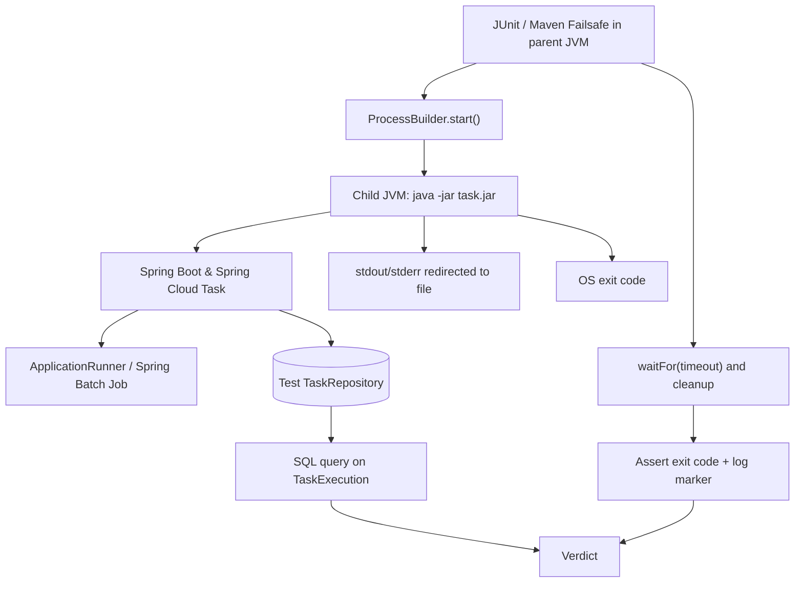
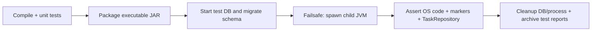

# Testing Exit Codes with an Independent JAR Process

## Lesson Objectives

**SPRING_CLOUD_TASK (Spring Cloud Task)** helps build **finite-lived** Spring Boot applications that receive arguments, perform work, and terminate. Each run can be tracked in `TaskRepository` via a `TaskExecution`, including timestamps, error details, and exit code. A Task can be invoked via cron, on demand, or with Spring Batch for batch processing. The first signal a scheduler typically observes is **the Java process exit code**.

In the **Testing** chapter, this lesson explains how to verify **the actual exit code of an executable JAR running inside a fresh JVM**. Unit tests calling a runner method directly cannot replace this test: only a real process exercises full bootstrap, listeners, context shutdown, error handling, and returning a code to the operating system.

After completing this lesson, you will be able to:

- Distinguish **OS exit code**, `TaskExecution.exitCode`, and Spring Batch `BatchStatus`/`ExitStatus`.
- Build a test fixture JAR with predictable success and business-failure scenarios.
- Run manually via `java -jar` and capture exit codes on POSIX shells and PowerShell.
- Use `ProcessBuilder` in JUnit 5 to spawn an independent JVM, pass arguments and environment variables, capture logs, and wait with a timeout.
- Verify not only the exit code, but also log markers and `TASK_EXECUTION` metadata to avoid false-green tests.
- Properly handle missing JARs, database errors, hanging runtimes, killed processes, and failed Batch Jobs.
- Integrate process-level tests into Maven Failsafe/CI after packaging the JAR.

## 1. Why Runner Unit Tests Are Not Enough

A unit test such as:

```java
reportRunner.run(applicationArguments);
```

can confirm that business logic throws `IllegalArgumentException`, yet it does not execute `SpringApplication.main`, load the full `ApplicationContext`, or **spawn a new operating system process**. It does not prove that:

- The executable JAR contains all required classes/dependencies and runs on the target Java runtime.
- Profiles and CLI arguments are forwarded properly by Spring Boot to `ApplicationRunner`.
- Spring Cloud Task persists `TaskExecution` and propagates failure codes through the standard lifecycle.
- `ExitCodeGenerator`/`ExitCodeExceptionMapper`, listeners, `ApplicationFailedEvent`, and Boot interact as expected.
- No non-daemon threads, schedulers, or web servers prevent the JVM from exiting on its own.
- A `FAILED` Spring Batch Job actually causes the **Task process** to return a non-zero exit code.
- An early failure terminates the process **before `TaskRepository` creates a record**.

Process-level testing invokes the JAR with `ProcessBuilder` and reads `Process.exitValue()`, mirroring how cron, systemd, or Kubernetes observes the Java process.



**Key distinction:** `Process.exitValue()` is the **child JVM's** exit code, whereas `TaskExecution.getExitCode()` is the data the framework **attempted to persist** in the repository. Reliable testing measures and reconciles both.

## 2. Three State Layers to Verify

| Layer | Source | Meaning | Limitations |
| --- | --- | --- | --- |
| **OS exit code** | `$?` (POSIX), `$LASTEXITCODE` (PowerShell), `Process.exitValue()` (Java). | Code returned when the child process exited. | Does not tell whether business data is accurate; kill codes depend on OS/wrapper. |
| **`TaskExecution.exitCode`** | `TaskRepository` and `TASK_EXECUTION` table. | Run outcome recorded by Spring Cloud Task. | May be missing on early startup failures, DB loss, or JVM kill. |
| Batch **`JobExecution`** | `JobRepository`, `BATCH_JOB_EXECUTION`, `BATCH_STEP_EXECUTION`. | Actual state of the Batch Job/Step. | Not automatically identical to the Task exit code. |

Expectations for a simple Task without custom exit code mapping:

| Scenario | OS Exit Code | Task Metadata | What Else to Reconcile |
| --- | --- | --- | --- |
| Runner succeeds | Usually `0`. | Usually `EXIT_CODE=0` with `END_TIME`. | Actual business output. |
| Runner throws uncaught exception | Non-zero, typically `1`. | Error state if DB is still reachable. | Error came from the **expected runner branch**. |
| JAR does not exist | Non-zero. | **No** new `TaskExecution`. | Launcher error, not a business error. |
| Cannot reach Task DB at bootstrap | Usually non-zero. | Record may be absent. | Connection URL, migrations, startup logs. |
| JVM killed or timed out | Depends on OS/signal. | May lack `END_TIME`/final exit code. | Scheduler status and already-written output. |
| Spring Batch Job `FAILED` | **May still be `0`** if Batch failure is not mapped to Task. | Task may record `0`. | `JobExecution`/`ExitStatus`. |

**Never assert only "non-zero" for intentional business-failure scenarios.** If the JAR path is wrong or metadata tables are missing, the test also gets a non-zero exit code without ever running the runner. Require a **log marker for the branch under test**, and verify metadata according to each scenario's preconditions.

## 3. Creating an Executable JAR as a Test Fixture

A sample application supports two scenarios: `success` completes normally, and `business-fail` throws an intentional error.

```java
package com.example.exitprobe;

import java.util.List;
import org.slf4j.Logger;
import org.slf4j.LoggerFactory;
import org.springframework.boot.ApplicationRunner;
import org.springframework.boot.SpringApplication;
import org.springframework.boot.autoconfigure.SpringBootApplication;
import org.springframework.cloud.task.configuration.EnableTask;
import org.springframework.context.annotation.Bean;

@SpringBootApplication
@EnableTask
public class ExitProbeTaskApplication {

    private static final Logger log =
            LoggerFactory.getLogger(ExitProbeTaskApplication.class);

    public static void main(String[] args) {
        SpringApplication.run(ExitProbeTaskApplication.class, args);
    }

    @Bean
    ApplicationRunner exitProbeRunner() {
        return args -> {
            List<String> values =
                    args.getOptionValues("probe.scenario");
            if (values == null || values.size() != 1) {
                throw new IllegalArgumentException(
                        "PROBE_INVALID_SCENARIO");
            }

            switch (values.get(0)) {
                case "success" -> {
                    log.info("PROBE_RUNNER_ENTERED scenario=success");
                    log.info("PROBE_BUSINESS_SUCCESS");
                }
                case "business-fail" -> {
                    log.info("PROBE_RUNNER_ENTERED scenario=business-fail");
                    throw new IllegalStateException(
                            "PROBE_BUSINESS_FAILURE");
                }
                default -> throw new IllegalArgumentException(
                        "PROBE_UNKNOWN_SCENARIO");
            }
        };
    }
}
```

This is a **test fixture**, not real report processing. Markers like `PROBE_RUNNER_ENTERED` and `PROBE_BUSINESS_FAILURE` distinguish an intentional failure **inside the runner** from failures before the runner is ever invoked.

### Configuring the `process-test` Profile

```yaml
# application-process-test.yml
spring:
  application:
    name: exit-probe-task
  main:
    web-application-type: none
  datasource:
    url: ${TASK_TEST_DB_URL}
    username: ${TASK_TEST_DB_USER}
    password: ${TASK_TEST_DB_PASSWORD}
  cloud:
    task:
      name: exit-probe-task
      initialize-enabled: false
      closecontext-enabled: true
```

`initialize-enabled: false` assumes the Spring Cloud Task schema **has already been migrated** in the test database before tests start. `web-application-type: none` prevents starting a web server; `closecontext-enabled: true` lets the Task close its context via the supported mechanism. If the application creates custom non-daemon threads, close them cleanly.

Never pass passwords as command-line arguments because `TASK_EXECUTION_PARAMS` may persist arguments. Supply credentials through securely provisioned CI environment variables, and never point this test at a production database.

### Manual Test on Linux/macOS

```bash
java -jar target/exit-probe-task.jar \
  --spring.profiles.active=process-test \
  --probe.scenario=success
code=$?
printf 'exit=%s\n' "$code"
```

After packaging the executable JAR and preparing the DB, expect marker `PROBE_BUSINESS_SUCCESS` and `exit=0`. For failure:

```bash
java -jar target/exit-probe-task.jar \
  --spring.profiles.active=process-test \
  --probe.scenario=business-fail
code=$?
printf 'exit=%s\n' "$code"
```

Expect marker `PROBE_BUSINESS_FAILURE` and a **non-zero** exit code. Under default mapping, many setups return `1`, but assert against **your application's contract and pinned framework release** rather than assuming every exception forces code `1`.

On PowerShell:

```powershell
& java -jar target/exit-probe-task.jar --spring.profiles.active=process-test --probe.scenario=business-fail
$code = $LASTEXITCODE
Write-Host "exit=$code"
```

On POSIX shells, `$?` must be captured immediately after Java, before another `echo` or `grep`; on PowerShell, `$LASTEXITCODE` holds the native process exit code, distinct from the boolean `$?`. A shell wrapper running `echo "done"` after Java can accidentally return `0` even when Java failed. If a wrapper script is unavoidable, preserve the code using `exec java -jar ...` or `exit "$code"`.

## 4. JUnit 5: Spawning a Child JVM with `ProcessBuilder`

`ProcessBuilder` accepts a **token list** rather than a single shell-parsed command string. This ensures JAR paths containing spaces remain **one argument** and gives full control over the child process environment.

This test example:

- Reads the JAR path from the `task.jar` system property provided by Maven Failsafe.
- Uses the Java binary matching the JUnit JVM.
- Assigns a unique Task name per attempt to avoid metadata collisions during parallel CI runs.
- Redirects both stderr and stdout to a test log file.
- Waits up to 60 seconds, terminating the process if it hangs.
- Verifies the *runner-entered* marker alongside the real OS exit code.

```java
package com.example.exitprobe;

import java.nio.charset.StandardCharsets;
import java.nio.file.Files;
import java.nio.file.Path;
import java.util.List;
import java.util.UUID;
import java.util.concurrent.TimeUnit;
import org.junit.jupiter.api.Test;
import org.junit.jupiter.api.io.TempDir;
import static org.junit.jupiter.api.Assertions.*;

class ExitProbeProcessIT {

    @TempDir
    Path logs;

    record RunResult(int exitCode, String output, String taskName) {}

    private RunResult runJar(String scenario) throws Exception {
        String configuredJar = System.getProperty("task.jar");
        assertNotNull(configuredJar, "Missing -Dtask.jar");
        Path jar = Path.of(configuredJar).toAbsolutePath();
        assertTrue(Files.isRegularFile(jar),
                "JAR not found: " + jar);

        String java = Path.of(
                System.getProperty("java.home"), "bin",
                System.getProperty("os.name").startsWith("Windows")
                        ? "java.exe" : "java").toString();

        String taskName = "exit-probe-" + UUID.randomUUID();
        Path logFile = logs.resolve("child-" + scenario + ".log");
        ProcessBuilder builder = new ProcessBuilder(
                List.of(java, "-jar", jar.toString(),
                        "--spring.profiles.active=process-test",
                        "--spring.cloud.task.name=" + taskName,
                        "--probe.scenario=" + scenario));

        for (String variable : List.of(
                "TASK_TEST_DB_URL", "TASK_TEST_DB_USER",
                "TASK_TEST_DB_PASSWORD")) {
            assertNotNull(builder.environment().get(variable),
                    "Missing environment variable: " + variable);
        }

        builder.redirectErrorStream(true);
        builder.redirectOutput(logFile.toFile());
        Process process = builder.start();
        try {
            if (!process.waitFor(60, TimeUnit.SECONDS)) {
                process.destroy();
                if (!process.waitFor(3, TimeUnit.SECONDS)) {
                    process.destroyForcibly();
                    process.waitFor();
                }
                fail("JAR timed out after 60 seconds; log:\n" +
                        Files.readString(logFile,
                                StandardCharsets.UTF_8));
            }
            return new RunResult(
                    process.exitValue(),
                    Files.readString(logFile, StandardCharsets.UTF_8),
                    taskName);
        } finally {
            if (process.isAlive()) {
                process.destroyForcibly();
            }
        }
    }

    @Test
    void successReturnsZero() throws Exception {
        RunResult result = runJar("success");
        assertTrue(result.output().contains(
                "PROBE_RUNNER_ENTERED scenario=success"));
        assertTrue(result.output().contains("PROBE_BUSINESS_SUCCESS"));
        assertEquals(0, result.exitCode(), result.output());
    }

    @Test
    void businessFailureReturnsNonZero() throws Exception {
        RunResult result = runJar("business-fail");
        assertTrue(result.output().contains(
                "PROBE_RUNNER_ENTERED scenario=business-fail"));
        assertTrue(result.output().contains("PROBE_BUSINESS_FAILURE"));
        assertNotEquals(0, result.exitCode(), result.output());
    }
}
```

**Execution note:** the child JVM takes time to load the context and connect to the DB. Choose a timeout appropriate for CI and actual startup latency rather than an overly short timeout that causes flakiness. On timeout, the test must **fail** and clean up the process; a still-running process has no valid exit code to assert.

### Why Redirect Logs to a File?

Per the Java API, a process's stdout and stderr default to two pipes. If pipes are left unread and the process writes heavily, buffers can fill and block the process. Combining `redirectErrorStream(true)` with `redirectOutput(logFile)` prevents that deadlock and preserves logs for CI. When logs contain sensitive details, **never** upload raw logs to public storage.

`ProcessBuilder` does not invoke a shell automatically either. Do not write:

```java
// Wrong usage: the full command string is not an executable path.
new ProcessBuilder("java -jar exit-probe-task.jar --probe.scenario=success");
```

Pass discrete tokens as in the fixture. Never build shell command strings from untrusted input and never put passwords on the command line.

## 5. Passing Database Connections to an Independent JVM

The parent JVM and child JVM **do not share a heap**, so an in-memory H2 instance inside the parent JVM cannot be queried by the child JVM by default. To verify `TaskExecution`, use a **network-accessible** database such as a test PostgreSQL instance.

If using Testcontainers, pass the started container's JDBC URL, username, and password into `ProcessBuilder`'s environment:

```java
// Example variables supplied by a PostgreSQL Testcontainers fixture:
builder.environment().put("TASK_TEST_DB_URL", jdbcUrl);
builder.environment().put("TASK_TEST_DB_USER", dbUsername);
builder.environment().put("TASK_TEST_DB_PASSWORD", dbPassword);
```

These `jdbcUrl`, `dbUsername`, and `dbPassword` values come from your test fixture; they are **not** automatically populated. Run Task schema migrations **before spawning** and configure `spring.cloud.task.initialize-enabled=false` so concurrent processes do not race to create tables.

Use a unique UUID-based `taskName` as in the fixture. Afterward, query metadata using a prepared statement:

```sql
SELECT TASK_EXECUTION_ID,
       TASK_NAME,
       START_TIME,
       END_TIME,
       EXIT_CODE,
       EXIT_MESSAGE
FROM TASK_EXECUTION
WHERE TASK_NAME = :taskName
ORDER BY TASK_EXECUTION_ID DESC;
```

`:taskName` is a named placeholder supported by query helpers; raw JDBC `PreparedStatement` uses `?`. After a successful process, expect one row with `EXIT_CODE=0` and a non-null `END_TIME`. For runner failures, expect a failure status **if the repository is reachable and the error flowed through the lifecycle**. For missing JARs or very early bootstrap errors, there may be **no rows at all**.

Do not treat `TaskExecution.exitCode` as the expected value for the OS exit code and claim "the two values match": tests need **independent expected codes** derived from the application contract, asserting each source separately. Metadata may also remain unfinished if the process was killed.

## 6. Adding JDBC Assertions to the Test

The following example method can be added to `ExitProbeProcessIT` in Section 4, using the test PostgreSQL JDBC driver and the already-imported JUnit assertion methods:

```java
import java.sql.Connection;
import java.sql.DriverManager;
import java.sql.PreparedStatement;
import java.sql.ResultSet;

void assertTaskExecutionInDatabase(
        String taskName, int expectedExitCode) throws Exception {

    try (Connection connection = DriverManager.getConnection(
            System.getenv("TASK_TEST_DB_URL"),
            System.getenv("TASK_TEST_DB_USER"),
            System.getenv("TASK_TEST_DB_PASSWORD"));
         PreparedStatement statement = connection.prepareStatement(
            "SELECT EXIT_CODE, END_TIME FROM TASK_EXECUTION " +
            "WHERE TASK_NAME = ?")) {

        statement.setString(1, taskName);
        try (ResultSet result = statement.executeQuery()) {
            assertTrue(result.next(),
                    "No TaskExecution found for " + taskName);

            int code = result.getInt("EXIT_CODE");
            assertFalse(result.wasNull(), "EXIT_CODE has not been recorded");
            assertEquals(expectedExitCode, code);
            assertNotNull(result.getTimestamp("END_TIME"));

            assertFalse(result.next(),
                    "Multiple executions found for the same test name");
        }
    }
}
```

This is a **standalone method snippet**: when copying, place the `import` statements at the top of the Java file and the method inside the JUnit class. It can be called right after `runJar(…)` returns:

```java
// Inside successReturnsZero():
assertTaskExecutionInDatabase(result.taskName(), 0);

// Inside businessFailureReturnsNonZero():
// Assert 1 only after verifying this release's contract produces 1.
assertTaskExecutionInDatabase(result.taskName(), 1);
```

**Note:** the code `1` in the failure case reflects a previously verified default configuration, not a universal rule for every exception or custom mapper. If you mapped an error to `10`, update the assertion accordingly and verify the **OS exit code separately**. Do not use a missing-DB failure test to assert `EXIT_CODE=1`, since no record may exist at all.

If you use `TaskExplorer` in a separate metadata-reading service, you can call `getTaskExecution(long executionId)` instead of SQL, though you first need the real execution ID. Querying by a unique per-test task name is a test lookup technique, not a general-purpose API for mapping a launcher ID to a `TaskExecution` ID.

### Why Not Share In-Memory H2 Between Two JVMs?

With `jdbc:h2:mem:taskdb`, each process generally gets its own isolated in-memory database. The parent test JVM and child JVM see **two separate databases**, so tests cannot cross-check metadata. You can use H2 server mode properly or a shared Testcontainers/PostgreSQL database; for systems running PostgreSQL/MySQL in production, matching the production DBMS also uncovers schema, transaction, and dialect bugs.

Never allow integration tests to run against a production URL. CI should enforce an environment/schema allowlist before running migrations, deleting data, or testing failure modes.

## 7. Custom Exit Codes: `ExitCodeGenerator` and `ExitCodeExceptionMapper`

In real applications, schedulers may need to distinguish invalid arguments, transient errors, and unrecoverable errors. Spring Boot provides `ExitCodeGenerator` and `ExitCodeExceptionMapper`, while Spring Cloud Task provides mechanisms to record the run's exit code and exit message.

Example exception carrying a business-contract exit code:

```java
package com.example.exitprobe;

import org.springframework.boot.ExitCodeGenerator;

public class InvalidReportInputException
        extends RuntimeException implements ExitCodeGenerator {

    public InvalidReportInputException(String message) {
        super(message);
    }

    @Override
    public int getExitCode() {
        return 10;
    }
}
```

When such an exception travels through Spring Boot's managed error path, the framework can use `getExitCode()` during exit event handling; Spring Cloud Task also has `TaskExecution` exit-code mapping logic. **Process-level testing remains mandatory** to verify whether code `10` actually reaches the OS or appears only in metadata on your exact release/framework stack.

For applications that need to return a computed exit code **after `SpringApplication.run(…)` succeeds**, Spring Boot documentation illustrates:

```java
// Use only when intentionally designing an exit-code contract
// and you understand the context lifecycle.
System.exit(SpringApplication.exit(
        SpringApplication.run(MyApplication.class, args)));
```

`SpringApplication.exit(context)` processes `ExitCodeGenerator`s and closes the context; `System.exit(…)` returns the computed code to the OS. Never call `System.exit(…)` from inside an `ApplicationRunner` or listener just to "force an exit code", as it risks cutting off final metadata writes, cleanup, or transactions.

### Be Careful with Failing Callbacks

Spring Cloud Task documents specific rules for exceptions thrown from `TaskExecutionListener`:

- An error from `onTaskStartup` can terminate the Task run with exit code `1`.
- Errors from `onTaskFailed`/`onTaskEnd` can take their exit code from `ExitCodeEvent`, `ExitCodeGenerator`, or default to `1` depending on the failure path.
- `ExitCodeExceptionMapper` **cannot override** exit codes from exceptions thrown by these listener callbacks per the documented behavior.

Do not simulate business errors by throwing exceptions from `@AfterTask` just to produce an exit code. Keep errors inside the runner/service where they belong, and test listener errors separately if the application defines custom callbacks.

### Which Codes Should You Use?

| Illustrative Code | Project-Defined Meaning | Suggested Orchestration Policy |
| ---: | --- | --- |
| `0` | Success per business contract. | Record completion. |
| `10` | Invalid arguments; input needs fixing. | Do not blindly retry. |
| `20` | Recoverable external service error. | Bounded retry with backoff. |
| `30` | Data precondition violation. | Halt downstream steps and inspect. |

This is **not** a default Spring Cloud Task exit-code list. On POSIX systems, shell-visible exit codes have range limits and special conventions for signal-terminated processes; Windows represents exit codes differently. For custom codes, pick values supported by your platform/scheduler, test through the real wrapper, and document the contract in deployment docs.

## 8. Spring Batch: Job `FAILED` Yet Process Still Returns `0`

A mandatory case requiring dedicated tests is a Task application running Spring Batch. `JobExecution` and `TaskExecution` are two separate objects:

- `BatchStatus.FAILED` reflects an incomplete Batch Job.
- `TaskExecution.exitCode` reflects the Task result from the application lifecycle.
- The OS exit code is the process outcome observed by the scheduler.

Spring Cloud Task documentation notes that under default behavior in certain Boot/Batch setups, a Job can be `FAILED` while the Task still returns `0`. To propagate Batch failure status into the Task exit code on the supported integration path, enable:

```yaml
spring:
  cloud:
    task:
      batch:
        fail-on-job-failure: true
```

When a Job returns `BatchStatus.FAILED`, the integration mechanism can set a non-zero Task exit code (default `1` or via an appropriate `ExitCodeGenerator`). If you write a custom `JobLauncher` or launch Jobs asynchronously, do not assume this property automatically fixes every path; measure it with the real JAR.

| Test | Batch Status | Expected Verification |
| --- | --- | --- |
| Batch completes | `COMPLETED` | OS `0`, valid Task metadata, accurate output. |
| Batch fails with `fail-on-job-failure=false` | `FAILED` | OS and Task may both be `0`; explicitly document the discrepancy. |
| Batch fails with `fail-on-job-failure=true` | `FAILED` | On the supported integration path, OS/Task exit is non-zero. |
| Step dies when JVM is killed | May remain `STARTED`/`FAILED` without final update. | OS code depends on platform; metadata may be incomplete. |
| Batch fails to start due to bad `JobRepository` | `JobExecution` may not exist. | Inspect bootstrap logs; do not treat as a Step failure. |

When using `TaskBatchExecutionListener` and the `TASK_TASK_BATCH` table, cross-check the link between both repositories:

```sql
SELECT TASK_EXECUTION_ID, JOB_EXECUTION_ID
FROM TASK_TASK_BATCH
WHERE TASK_EXECUTION_ID = :taskExecutionId;
```

`:taskExecutionId` is a query tool parameter. Never assume the two IDs are equal; `JobExecution` has its own namespace and ID sequence. On restarts, a single `JobInstance` can produce multiple `JobExecution`s.

## 9. Integrating with Maven Failsafe and CI

Process-level testing requires a **packaged executable JAR**. In Maven, name classes `*IT.java` for Maven Failsafe and run them during the `integration-test`/`verify` phases after `package`.

Example `plugins` section in `pom.xml`:

```xml
<build>
    <plugins>
        <!-- Spring Boot plugin must be configured to build an
             executable/repackaged JAR during the package lifecycle. -->
        <plugin>
            <groupId>org.springframework.boot</groupId>
            <artifactId>spring-boot-maven-plugin</artifactId>
        </plugin>

        <plugin>
            <groupId>org.apache.maven.plugins</groupId>
            <artifactId>maven-failsafe-plugin</artifactId>
            <version>3.6.1</version>
            <configuration>
                <systemPropertyVariables>
                    <task.jar>${project.build.directory}/${project.build.finalName}.jar</task.jar>
                </systemPropertyVariables>
            </configuration>
            <executions>
                <execution>
                    <goals>
                        <goal>integration-test</goal>
                        <goal>verify</goal>
                    </goals>
                </execution>
            </executions>
        </plugin>
    </plugins>
</build>
```

The `spring-boot-maven-plugin` snippet above **does not by itself guarantee** every POM produces an executable JAR: the `repackage` goal must be configured, usually inherited from the Spring Boot parent; in POMs managing plugins manually, configure the appropriate goal. If the JAR uses a classifier or custom `finalName`, update the `task.jar` system property.

Run after preparing the test database and migrations:

```bash
mvn verify
```

With Maven Failsafe, invoke `verify` rather than stopping at `integration-test` so `post-integration-test` cleanup and report verification still run. `mvn test` executes **before `package`**, when the JAR for the code under test has not been built yet.

With Gradle, the same principle applies: `integrationTest` must depend on `bootJar`, receive the artifact path from build outputs, use a deterministic Java runtime/test fixtures, and collect reports. DSL syntax and task names vary across Gradle/Spring Boot versions; verify against the plugins in use.

### CI Pipeline Diagram



In CI, preserve log files when tests fail. Because `@TempDir` may be cleaned up automatically after a test, **copy failure logs** to a reports directory with a defined retention policy before uploading artifacts. Never upload credentials or the entire environment. Enforce timeouts at both the process level and CI job level so a hanging child process cannot stall a runner indefinitely.

## 10. Essential Test Matrix

| ID | Scenario | What to Verify | False Conclusions to Avoid |
| --- | --- | --- | --- |
| T01 | Valid JAR, runner succeeds | OS `0`, success marker, Task DB shows exit `0`. | "Success log exists" means business output is definitely right. |
| T02 | Runner throws uncaught error | OS non-zero, runner-entered marker, Task DB shows error if reachable. | Every non-zero code means the runner failed. |
| T03 | Missing `--probe.scenario` | `PROBE_INVALID_SCENARIO` marker, non-zero code. | Input error is indistinguishable from missing schema. |
| T04 | JAR path does not exist | Launcher fails to open JAR; no new `TaskExecution`. | The framework created a Task record. |
| T05 | Wrong Java version/dependencies | JVM/classloading log, non-zero code. | Business logic executed. |
| T06 | Wrong DB URL/credentials | Bootstrap/task repository error; `TaskExecution` may not exist. | An exit code was committed in the DB. |
| T07 | Missing `TASK_EXECUTION` table | SQL/bootstrap error; runner marker may be absent. | Failure is a business error. |
| T08 | Runner or thread hangs | `waitFor(timeout)` expires, cleanup runs, test fails. | A valid OS exit code existed before termination. |
| T09 | Process killed mid-run | Process actually stops; metadata may lack completion fields. | Exit code `137` is a cross-OS contract. |
| T10 | `onTaskStartup` throws error | Runner does not run; exit code follows listener/Task lifecycle. | Arbitrary listener codes can be mapped via `ExitCodeExceptionMapper`. |
| T11 | Batch Step `FAILED`, property off | Compare Batch `FAILED` with Task potentially `0`. | Checking OS exit code alone is enough. |
| T12 | Batch Step `FAILED`, property on | OS/Task non-zero on supported integration paths. | Property automatically fixes custom launchers. |
| T13 | Two processes run close together | Inspect execution IDs, locks/isolation, and outputs. | Two processes with the same `taskName` share one `TaskExecution`. |
| T14 | Crash after partial output write | Reconcile committed data and idempotency. | Retry is always safe just because the exit code was non-zero. |

### Timeout and Kill Must Be Dedicated Tests

For example, `ProcessBuilder.waitFor(60, TimeUnit.SECONDS)` returning `false` means **there is no exit code yet**. The test must terminate the process and fail due to timeout. Never turn `destroyForcibly()` into a "business" exit code to assert.

On POSIX systems, shells typically represent `SIGKILL` as `128 + 9 = 137`, but this is not a cross-platform contract; Windows represents codes differently. For `SIGTERM`, Spring Boot runs shutdown hooks and Spring Cloud Task has specific rules for updating exit codes. Verify empirically rather than hardcoding one OS code across all platforms.

To test timeout/kill behavior, add a dedicated `hang` scenario to the fixture and bound the process lifetime in the test harness. **Never** put infinite loops or huge sleeps in tests without guaranteed cleanup.

## 11. Avoiding False-Green Tests and Flakiness

**Wrong JAR path yet non-zero assertion passes.** Verify the JAR file exists before spawning, and check markers proving the runner actually executed.

**Unread stderr blocks the JVM.** Use `redirectErrorStream(true)` and redirect to a file, or drain both streams concurrently. Never wait on a process while ignoring the output it produces.

**A Java process finishes yet the Task DB has no record.** This could be a bootstrap failure, wrong profile, or the Task connecting to **a different database**. SQL assertions must inspect the right schema rather than relying only on logs.

**Using "yesterday" makes tests time-dependent.** Fix `businessDate`, use immutable fixture data, and set an explicit test time zone.

**Two tests share a Task name or output path.** Use UUID-based Task names, isolated input/output directories, and disable parallelism where the metadata store or locks do not support it.

**Wrapper scripts mask exit codes.** A shell script may return the exit code of a trailing log command instead of Java. Test `java -jar` directly first, then add tests for the production wrapper if cron/systemd invokes one.

**Checking only the OS code while forgetting Batch.** A Job may fail while the runner swallowed the exception or returned normally. Tests must check `JobExecution` status.

**Checking only metadata while forgetting business output.** A Task exit `0` only reflects code-contract completion; it does not prove the report processed the right record count. Assert business invariants, checksums, or unique keys too.

### A Useful Verification Contract

```text
PASS =
    child_terminated_within_timeout
    AND expected_runner_marker_found
    AND actual_OS_exit_code_matches_scenario
    AND TaskExecution_matches_expected_state
    AND business_output_is_correct
    AND (if Batch) JobExecution_matches_expected_status
```

Not every test requires all conditions: a missing-JAR test **intentionally** verifies no `TaskExecution` exists; a runner-failure test must prove the runner ran. The key is knowing **which layer is under test** and preventing failures in another layer from accidentally making an assertion pass.

## 12. Recording Evidence and Security

A test report should capture:

```text
scenario=business-fail
testTaskName=exit-probe-<uuid>
artifact=target/exit-probe-task.jar
processExitCode=<actual>
runnerEntered=true
taskExecutionId=<id or missing>
taskExitCode=<value or missing>
taskEndTime=<value or null>
batchJobExecutionId=<id if any>
logFile=<path of test log>
```

Never record `TASK_TEST_DB_PASSWORD`, tokens, full JDBC URLs containing credentials, or sensitive arguments in reports. Spring Cloud Task can persist command-line arguments in metadata; use a secret manager or protected environment variables, and never let tests enable debug logging of passwords on public CI.

If tests delete data after runs, include a guard confirming the JDBC URL belongs to a **test** system. Never run destructive migrations or cleanups against unverified connections, and avoid using credentials with broader privileges than tests require.

## 13. Comprehensive Practice Exercise

**Scenario:** `daily-report-task` runs on cron, can be re-run manually, and sometimes uses Spring Batch. CI must prove the application returns accurate exit codes so the scheduler knows whether to retry or alert.

1. Create a Spring Cloud Task fixture supporting `success` and `business-fail` as in Section 3; run the JAR manually to observe exit codes.
2. Provision a test PostgreSQL database and migrate the Spring Cloud Task schema; provide `TASK_TEST_DB_URL`, `TASK_TEST_DB_USER`, and `TASK_TEST_DB_PASSWORD`.
3. Write `ExitProbeProcessIT` using `ProcessBuilder`, UUID Task names, log redirection, timeouts, and cleanup.
4. Assert OS `0` on success, OS non-zero on failure, alongside markers confirming the runner entered.
5. Query `TASK_EXECUTION` by test name; verify `EXIT_CODE` and `END_TIME`, and distinguish missing-metadata errors.
6. Create an invalid-argument scenario and a wrong-JAR-path test; show both return non-zero while only the argument error entered the runner.
7. Test a hanging process with cleanup; confirm the test does not hang CI or leave orphan processes.
8. Add custom exception mapping with a contract-defined code; verify both the OS code and metadata rather than guessing from interface names.
9. If Spring Batch is present, make a Step return `FAILED`, run with `fail-on-job-failure=false` and then `true`; compare all three state layers.
10. Integrate with `mvn verify`, save failure reports/logs, ensure DB teardown, and keep secrets out of logs.
11. Verify that two consecutive runs over the same data produce no duplicate side effects; an exit code is a failure signal, **not a substitute** for idempotency.

**Acceptance criteria:** tests run the executable JAR in a **separate JVM** and measure real OS exit codes; pre-bootstrap errors and business errors are distinguished; `TaskRepository`/Batch `JobRepository` are reconciled; timeouts leave no hanging processes; and no production data is touched.

## 14. References

- [Spring Cloud Task — Features and Mapping Exit Codes](https://docs.spring.io/spring-cloud-task/reference/features.html): `TaskExecution.exitCode`, `ExitCodeExceptionMapper`, and listener errors.
- [Spring Cloud Task — Batch Job Exit Codes](https://docs.spring.io/spring-cloud-task/reference/batch.html): `spring.cloud.task.batch.fail-on-job-failure` and Batch statuses.
- [Spring Boot — SpringApplication: Application Exit](https://docs.spring.io/spring-boot/reference/features/spring-application.html): `ExitCodeGenerator`, `SpringApplication.exit(…)`, and `System.exit(…)`.
- [Java — ProcessBuilder](https://docs.oracle.com/en/java/javase/21/docs/api/java.base/java/lang/ProcessBuilder.html): process arguments, environment, stdin/stdout/stderr.
- [Java — Process](https://docs.oracle.com/en/java/javase/21/docs/api/java.base/java/lang/Process.html): `waitFor(timeout, unit)`, `exitValue()`, `destroy()`, and `destroyForcibly()`.
- [Maven Failsafe Plugin — Usage](https://maven.apache.org/surefire/maven-failsafe-plugin/usage.html): integrating `integration-test` and `verify`.
- [Maven — Build Lifecycle](https://maven.apache.org/guides/introduction/introduction-to-the-lifecycle.html): `package`, `integration-test`, `post-integration-test`, and `verify`.
- [Spring Batch — Reference](https://docs.spring.io/spring-batch/reference/): `JobExecution`, `BatchStatus`, `ExitStatus`, and restarts.

The Java examples use Java 17+, JUnit 5, and standard Spring Boot/Spring Cloud Task APIs; **they were not compiled or executed during the authoring of this lesson**. Before adopting them, pin compatible versions and run actual tests to confirm exit codes and metadata on your target JDK and OS.

## Key Takeaways

- **Calling `ApplicationRunner.run(…)` is not equivalent to running the executable JAR.** To test real exit codes, use `ProcessBuilder` to run `java -jar` in a **child JVM**.
- `Process.exitValue()`, `TaskExecution.exitCode`, and `JobExecution` belong to **three distinct layers**; reconcile them rather than assuming they are always identical.
- For failure scenarios, never assert only non-zero: require runner markers and metadata verification so a broken JAR or DB cannot pass tests accidentally.
- Wait with a **timeout**, redirect stdout/stderr, and clean up processes. A process that has not terminated **has no valid exit code**.
- The JAR must be packaged before integration tests; use Maven Failsafe up to the `verify` phase to test the artifact and clean up in the right lifecycle phase.
- The test database must be reachable from **both parent and child JVMs**; in-memory H2 across two JVMs does not share data.
- When a Batch Job is `FAILED` yet the Task returns `0`, check `fail-on-job-failure` and how the Job is launched; safe retries still require business idempotency.
