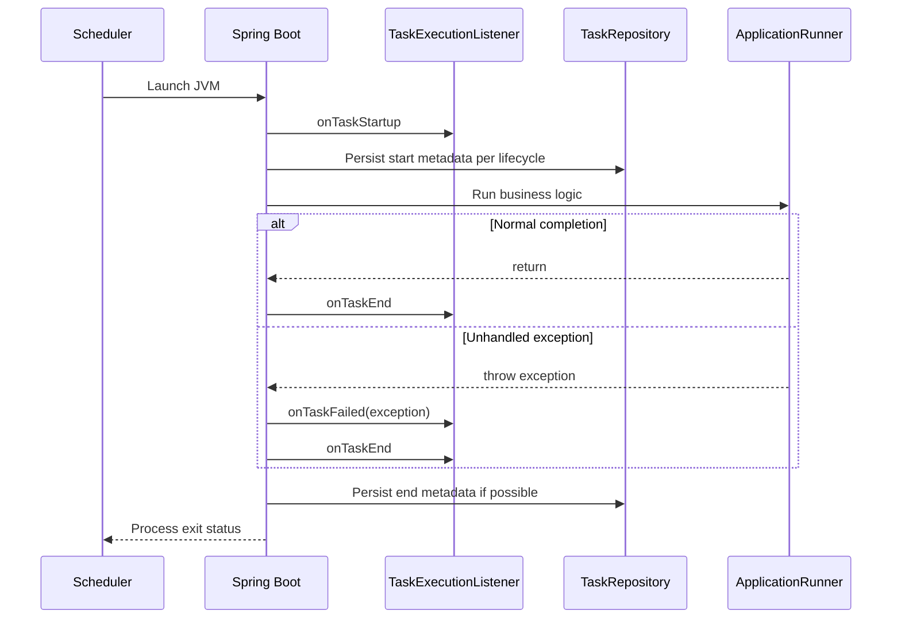
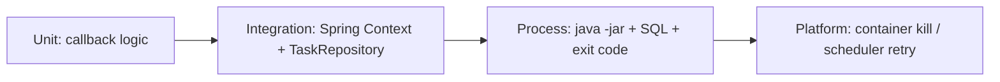

# Testing Listeners and Exceptions at Each Lifecycle Stage

## 1. Why Test the Full Lifecycle, Not Just Business Services?

In the **Testing** chapter of **Spring Cloud Task**, we test a finite-lived Spring Boot application: starting up, receiving arguments, executing business logic, saving results into `TaskRepository`, and terminating. For scheduled or on-demand tasks, failures do not occur only in data-processing code. They can also happen **before `TaskExecution` is created**, inside the **startup listener**, midway through an `ApplicationRunner`, inside **failed/end listeners**, during **repository updates**, or when a container is forcibly terminated.

For example, a reconciliation task might transfer 9,000 of 10,000 records to an external system, and then `onTaskEnd` fails while writing an audit log. If the scheduler sees a non-zero exit code and automatically re-runs the entire job, duplicate records may be created. Conversely, if business code swallows an exception and returns normally, `TaskRepository` may record success even though the business outcome failed.

**The goal of this lesson** is to design a test suite that verifies exact behavior at *each failure boundary* while separating three questions:

- **Which callbacks actually ran**, in what order, and what state did the listener observe?
- **What did `TaskRepository` ultimately record**: does the row exist, and what are `EXIT_CODE`/`END_TIME`/`ERROR_MESSAGE`?
- **What did the orchestrator receive**: process exit status, runtime status, retry eligibility, and business side effects?

After this lesson, you will be able to:

1. Write unit tests for logic inside `TaskExecutionListener` and methods annotated with `@BeforeTask`, `@AfterTask`, and `@FailedTask`.
2. Build an integration test matrix covering success, runner failure, failures in all three callbacks, and bootstrap/database errors.
3. Verify the ordering of `onTaskStartup`, `onTaskFailed`, and `onTaskEnd` without relying on guesswork or wall-clock delays.
4. Understand exception handling, exit codes, and `exitMessage` rules when a listener throws.
5. Test via an **independent Java process** so failures do not break the test runner's Spring Context.
6. Reconcile repository records, process status, scheduler state, and business data before permitting retries.

> **Version scope:** APIs, Task Repository schemas, and error-handling behavior can vary across Spring Cloud Task / Spring Boot releases. This lesson uses listener names and mechanisms described in Spring Cloud Task documentation; dependencies and sample code must be verified against your project's pinned compatible versions. Examples intentionally target test environments and **fault injection must never be enabled in production**.

## 2. Task Lifecycle Stages and Callbacks

Spring Cloud Task provides `TaskExecutionListener` with three methods:

| Callback | When It Is Invoked | What to Verify |
| --- | --- | --- |
| `onTaskStartup(TaskExecution)` | During the Task tracking startup phase, near metadata creation/persistence | Callback fires for valid runs; passed data is accurate; do not assume the DB row is already committed |
| `onTaskFailed(TaskExecution, Throwable)` | When an **unhandled** exception occurs in the Task lifecycle flow; before the end callback | Matching `Throwable`, failure signal preserved, no sensitive data leaked |
| `onTaskEnd(TaskExecution)` | Before updating final Task metadata in the repository | End callback runs on framework-handled paths; `exitMessage` is valid |

Corresponding annotations:

| Interface Method | Bean Annotation |
| --- | --- |
| `onTaskStartup` | `@BeforeTask` |
| `onTaskFailed` | `@FailedTask` |
| `onTaskEnd` | `@AfterTask` |

According to the Spring Cloud Task reference documentation, **`onTaskFailed` runs before `onTaskEnd`** when the application throws an unhandled exception. On successful runs, the normal path is `onTaskStartup -> onTaskEnd`. <u>Do not turn these two sequences into universal guarantees for every failure</u>: the JVM may die before end callbacks execute, or the context may fail before listener infrastructure is initialized.

A small version-documentation note: the *reference guide* describes `onTaskStartup` as occurring before persisting `TaskExecution`, whereas some Javadoc versions describe the callback as running after persistence. Therefore, **never write a test assuming a database query inside `onTaskStartup` is guaranteed to see the metadata row**; assert persisted state **after the process finishes and the repository commits**, matching your actual runtime version.



The diagram illustrates *logical relationships between callbacks*, not the absolute statement/transaction order of every release. Nor does it depict `ApplicationContext` initialization **before** Task infrastructure is ready.

## 3. Test Matrix by Failure Origin

| Scenario | `onTaskStartup` | `onTaskFailed` | `onTaskEnd` | What to Verify After Execution |
| --- | --- | --- | --- | --- |
| Runner finishes normally | Yes | No | Yes | Task records success, `exitMessage`, process status |
| Runner throws unhandled exception | Yes | Yes | Yes | Error recorded, `EXIT_CODE`, non-zero process status per mapping |
| Runner catches exception and returns | Yes | **No, because error was swallowed** | Yes | Catch "false success" via business audit |
| `onTaskStartup` throws exception | Yes up to throw | Failure/end callbacks attempted by framework per listener rules | May run during error handling | Exit code 1 on standard path; inspect Task row and other listeners |
| `onTaskFailed` throws exception | Yes | Yes up to throw | Later-stage callbacks still handled by framework mechanism | Verify both original business error and listener error |
| `onTaskEnd` throws exception | Yes | Depends on prior error | Yes up to throw | Listener error, exit code, and final metadata; do not assume business rollback |
| Bean/DS/schema fails **very early** in bootstrap | Not guaranteed | Not guaranteed | Not guaranteed | `TaskExecution` may **not exist**; inspect startup logs |
| `TaskRepository` loses connection at completion | Possibly | Depends on scenario | Possibly | `END_TIME`/`EXIT_CODE` may remain un-updated |
| `SIGKILL`/OOM or sudden container loss | Possibly | Not guaranteed | Not guaranteed | Runtime reports failure; metadata may be left open |

The word "possibly" is intentional: **how far Task initialization progressed, error type, and commit timing** determine which callbacks and metadata actually appear. The test suite should collect logs, record events, and query the DB instead of forcing a single assumption across all failures.

### Three Result Layers Must Be Asserted Separately

| Layer | Example Assertion | Meaning |
| --- | --- | --- |
| Listener | Received `startup, failed, end` in expected sequence | Verifies callback lifecycle |
| `TaskRepository` | Record has matching `EXIT_CODE`, `END_TIME`, `ERROR_MESSAGE` | Verifies metadata persistence |
| OS/scheduler | `java -jar` returns non-zero exit status on failure paths | Verifies signal seen by orchestrator |

A test that only uses Mockito to invoke the three listener methods **cannot prove** Spring Cloud Task invokes them at the right time. A test that only sees `EXIT_CODE=1` in the DB **does not prove** the launcher or shell wrapper returned code 1 to Kubernetes.

## 4. Three-Layer Testing Strategy

### Layer 1: Unit Testing Listener Logic

Instantiate the listener like a plain Java class, pass a fake or mocked `TaskExecution`, and verify messages, logging/recording behavior, and exceptions the listener may throw. No Spring Context or database is needed.

**Benefit:** fast, cleanly isolates your logic. **Limitation:** callback ordering is driven manually by the test, not by the real framework.

### Layer 2: Integration Testing with a Real Context and Repository

Boot Spring Boot with `@EnableTask`, `spring-cloud-starter-task`, a metadata datasource, and version-matched schema; verify the listener is registered, the runner actually executes, and `TaskExecution` is created/updated. You can use PostgreSQL Testcontainers or a prepared test database as long as metadata persists long enough to be read.

**Benefit:** verifies wiring and transactions. **Limitation:** `@SpringBootTest` can invoke `ApplicationRunner` right when the context starts. Intentionally failing the runner inside the test JVM itself can cause the test framework to fail **before executing `@Test` methods**.

### Layer 3: Black-Box Process Testing

Run the `java -jar` artifact in a **child process**, passing options to inject failures at each stage and collecting:

- Exit status of the Java process.
- Logs with callback markers and timestamps.
- `TaskExecution` rows in the test's metadata database.
- Business outcomes in the test schema/output.

**This layer is essential** for testing startup failures, context-breaking listener errors, OS exit codes, and OS signals. Give each scenario its own task name/DB namespace so parallel CI runs never mix history.



You do not need to run every process/chaos test on every fast local build. Run unit tests continuously, integration tests in CI, and real DB/Pod kill tests in controlled test environments.

## 5. Building a Test Application That Supports Stage-Based Fault Injection

The following example introduces a property **exclusively for test environments**:

```text
demo.fail-stage=none | runner | startup-listener | failed-listener | end-listener
```

It lets you reproduce failures at different stages without editing source code between tests. However, keep fault-injection code out of production artifacts or ensure it is registered only under an internal test profile.

### 5.1. Sample Spring Cloud Task Application

```java
package com.example.tasktesting;

import java.time.LocalDate;
import java.util.List;

import org.slf4j.Logger;
import org.slf4j.LoggerFactory;
import org.springframework.boot.ApplicationRunner;
import org.springframework.boot.SpringApplication;
import org.springframework.boot.autoconfigure.SpringBootApplication;
import org.springframework.cloud.task.configuration.EnableTask;
import org.springframework.context.annotation.Bean;
import org.springframework.core.env.Environment;

@SpringBootApplication
@EnableTask
public class LifecycleTestTaskApplication {
    private static final Logger log =
            LoggerFactory.getLogger(LifecycleTestTaskApplication.class);

    public static void main(String[] args) {
        SpringApplication.run(LifecycleTestTaskApplication.class, args);
    }

    @Bean
    ApplicationRunner lifecycleTestRunner(Environment environment) {
        return args -> {
            List<String> values = args.getOptionValues("business-date");
            if (values == null || values.size() != 1) {
                throw new IllegalArgumentException(
                        "Exactly one --business-date=yyyy-MM-dd is required");
            }

            LocalDate date = LocalDate.parse(values.get(0));
            log.info("PROBE RUNNER businessDate={}", date);

            if ("runner".equals(
                    environment.getProperty("demo.fail-stage", "none"))) {
                throw new IllegalStateException(
                        "Simulated error in ApplicationRunner");
            }

            log.info("PROBE BUSINESS_SUCCESS businessDate={}", date);
        };
    }
}
```

The `ApplicationRunner` bean is invoked by Spring Boot after context initialization. If it throws an uncaught exception, Boot/Cloud Task's `ApplicationFailedEvent` path can trigger failure callbacks. In corresponding integration setups, `TaskRepository` attempts to persist the exit code and error message.

### 5.2. Listener That Marks Callbacks and Injects Faults

```java
package com.example.tasktesting;

import org.slf4j.Logger;
import org.slf4j.LoggerFactory;
import org.springframework.cloud.task.listener.TaskExecutionListener;
import org.springframework.cloud.task.repository.TaskExecution;
import org.springframework.core.env.Environment;
import org.springframework.stereotype.Component;

@Component
public class FaultInjectionTaskListener implements TaskExecutionListener {
    private static final Logger log =
            LoggerFactory.getLogger(FaultInjectionTaskListener.class);

    private final Environment environment;

    public FaultInjectionTaskListener(Environment environment) {
        this.environment = environment;
    }

    @Override
    public void onTaskStartup(TaskExecution execution) {
        log.info("PROBE CALLBACK=startup task={}", execution.getTaskName());
        execution.setExitMessage("STARTUP_SEEN");
        maybeFail("startup-listener");
    }

    @Override
    public void onTaskFailed(TaskExecution execution, Throwable cause) {
        log.info("PROBE CALLBACK=failed cause={}",
                cause.getClass().getSimpleName());
        execution.setExitMessage("FAILURE_SEEN");
        maybeFail("failed-listener");
    }

    @Override
    public void onTaskEnd(TaskExecution execution) {
        log.info("PROBE CALLBACK=end task={}", execution.getTaskName());
        // Do not unconditionally write 'SUCCESS' into exitMessage:
        // the end callback also runs after a failure path.
        maybeFail("end-listener");
    }

    private void maybeFail(String phase) {
        if (phase.equals(
                environment.getProperty("demo.fail-stage", "none"))) {
            throw new IllegalStateException(
                    "Simulated error at " + phase);
        }
    }
}
```

`PROBE CALLBACK=...` markers let process tests verify ordering without `Thread.sleep`. The listener **does not generate `TaskExecutionId`**, does not execute direct SQL updates, and does not call `System.exit`. `exitMessage` is set on the callback argument object, which the framework can persist to the repository according to the version's contract.

**Never put critical side effects in a listener** such as sending payments or writing non-idempotent summaries. Callbacks can run during error handling; if a callback itself throws an exception, failure diagnostics become even more complex. Business side effects belong in services with explicit transactions and idempotency.

### 5.3. Metadata Database Configuration

Example `application-test.yml`, assuming PostgreSQL and a version-matched Task Repository schema already migrated:

```yaml
spring:
  main:
    web-application-type: none
  datasource:
    url: jdbc:postgresql://localhost:5432/task_listener_test
    username: task_test
    password: ${TASK_TEST_DB_PASSWORD}
  cloud:
    task:
      name: lifecycle-probe
```

Required dependencies include `spring-cloud-starter-task`, Spring Boot starters, the JDBC driver, plus `spring-boot-starter-test` for JUnit 5/Mockito. Choose a Spring Cloud version compatible with Spring Boot and never mix schemas/JDBC DAOs from different generations. `spring.cloud.task.name` can be overridden at test launch to isolate scenarios.

## 6. Unit Testing: Testing the Listener Without Starting Spring

First test the **pure logic**: when a callback is invoked with a `TaskExecution` and an exception, what message does the listener set and when does it throw?

JUnit 5 + Mockito:

```java
import static org.junit.jupiter.api.Assertions.assertDoesNotThrow;
import static org.junit.jupiter.api.Assertions.assertThrows;
import static org.mockito.Mockito.mock;
import static org.mockito.Mockito.verify;
import static org.mockito.Mockito.when;

import org.junit.jupiter.api.Test;
import org.springframework.cloud.task.repository.TaskExecution;
import org.springframework.mock.env.MockEnvironment;

class FaultInjectionTaskListenerTest {

    @Test
    void startupMarksExecutionWithoutThrowing() {
        var environment = new MockEnvironment()
                .withProperty("demo.fail-stage", "none");
        var listener = new FaultInjectionTaskListener(environment);
        TaskExecution execution = mock(TaskExecution.class);
        when(execution.getTaskName()).thenReturn("lifecycle-probe");

        assertDoesNotThrow(() -> listener.onTaskStartup(execution));
        verify(execution).setExitMessage("STARTUP_SEEN");
    }

    @Test
    void failureReceivesThrowableAndMarksExitMessage() {
        var listener =
                new FaultInjectionTaskListener(new MockEnvironment());
        TaskExecution execution = mock(TaskExecution.class);

        listener.onTaskFailed(
                execution, new IllegalStateException("business failed"));

        verify(execution).setExitMessage("FAILURE_SEEN");
    }

    @Test
    void startupListenerCanBeMadeToThrow() {
        var environment = new MockEnvironment()
                .withProperty("demo.fail-stage", "startup-listener");
        var listener = new FaultInjectionTaskListener(environment);
        TaskExecution execution = mock(TaskExecution.class);
        when(execution.getTaskName()).thenReturn("lifecycle-probe");

        assertThrows(IllegalStateException.class,
                () -> listener.onTaskStartup(execution));
    }

    @Test
    void endListenerCanBeMadeToThrow() {
        var environment = new MockEnvironment()
                .withProperty("demo.fail-stage", "end-listener");
        var listener = new FaultInjectionTaskListener(environment);
        TaskExecution execution = mock(TaskExecution.class);
        when(execution.getTaskName()).thenReturn("lifecycle-probe");

        assertThrows(IllegalStateException.class,
                () -> listener.onTaskEnd(execution));
    }
}
```

**Limitation of this example:** the test calls callbacks **directly**. It does not verify whether Spring Cloud Task publishes `ApplicationFailedEvent`, which callback arrives first, whether task metadata commits, or what exit code the process returns. Only integration/process tests verify the real execution path.

## 7. Testing Callback Ordering with Evidence Instead of Guesswork

On an error-free run, expected logs along the typical Task flow look like:

```text
PROBE CALLBACK=startup
PROBE RUNNER
PROBE BUSINESS_SUCCESS
PROBE CALLBACK=end
```

When the runner throws an unhandled exception:

```text
PROBE CALLBACK=startup
PROBE RUNNER
PROBE CALLBACK=failed
PROBE CALLBACK=end
```

These are **expected sequences for the standard flow**, not captured log output executed in this lesson. Framework log lines may appear between markers. When asserting, filter logs by the `PROBE` prefix and compare appearance order rather than asserting the entire output has only four lines.

When multiple listeners exist, ordering **across listeners for the same callback** must be verified against your current version and registration/ordering rules. Never write tests that depend on Java file order or class names. In particular, one listener throwing an exception can prevent remaining listeners **in that same phase** from executing.

### Do Not "Save" Callback Data in `static` Variables

A process-level test suite spawning separate JVMs cannot read a `static List` inside a child JVM that already exited. Instead, use:

- Structured logs with a correlation ID to verify marker sequences.
- A dedicated test audit table if durable evidence is needed.
- Process runner and repository inspection utilities.
- Unit tests with an in-memory recorder when testing pure Java logic.

If using an audit database, ensure audit/logging failures **do not break** business outcomes unless system requirements mandate strict auditing with an explicit transaction policy.

## 8. Testing the Difference Between Runner Errors and Listener Errors

### 8.1. Unhandled Runner Error

Run:

```bash
java -jar lifecycle-probe.jar \
  --spring.profiles.active=test \
  --business-date=2026-11-24 \
  --demo.fail-stage=runner
```

What to verify: the `failed` callback fires before `end`; `TaskRepository` records error details if still reachable; the process signals failure to the orchestrator under the appropriate configuration. `ExitCodeExceptionMapper` may be used by Spring Boot/Task to classify **non-listener** errors per version; verify the exact number rather than assuming `1`.

### 8.2. Caught and Ignored Error

Change the runner logic in a test environment to:

```java
try {
    businessService.process();
} catch (IllegalStateException error) {
    log.error("Business failed, but runner will return normally", error);
    // Does not rethrow, does not set error state.
}
```

If the runner completes normally, `onTaskFailed` may **not be called** and the Task may record a success exit code. This experiment proves **`log.error` is not a framework failure signal**. That is why business outcomes must be asserted alongside Task metadata.

### 8.3. Error in `onTaskStartup`

```bash
java -jar lifecycle-probe.jar \
  --spring.profiles.active=test \
  --business-date=2026-11-24 \
  --demo.fail-stage=startup-listener
```

Per Spring Cloud Task documentation, an exception in `onTaskStartup` sets the application exit code to **`1`** on the standard path. The framework routes through error handling to invoke failure/end-phase callbacks, but do not assume all beans were initialized or all data committed if the error happened very early. Check log markers, process exit code, **and** the presence/update of the Task row in the database.

### 8.4. Error in `onTaskFailed`

To enter `onTaskFailed`, an unhandled error must occur first—for instance, the runner throwing an exception. Passing only `--demo.fail-stage=failed-listener` in the sample app leaves the runner succeeding, so the failed callback **never runs** and you haven't tested that scenario.

You can adjust fault injection to provide **two independent fault switches**, such as adding `demo.fail-runner=true` and throwing inside the runner when enabled:

```java
if (environment.getProperty(
        "demo.fail-runner", Boolean.class, false)) {
    throw new IllegalStateException("Simulated business error");
}
```

Then run:

```bash
java -jar lifecycle-probe.jar \
  --spring.profiles.active=test \
  --business-date=2026-11-24 \
  --demo.fail-runner=true \
  --demo.fail-stage=failed-listener
```

Now two errors coexist: **the original runner error** and **the error thrown by the failure-handling callback**. Tests must capture both, check `onTaskEnd` if the framework continues invoking it, and inspect the final `ERROR_MESSAGE`/process status. A listener should never mask the original business failure.

### 8.5. Error in `onTaskEnd`

```bash
java -jar lifecycle-probe.jar \
  --spring.profiles.active=test \
  --business-date=2026-11-24 \
  --demo.fail-stage=end-listener
```

The runner may have already finished its work **before** `onTaskEnd` threw an exception. A non-zero process code here does not necessarily mean business work failed to execute. Inspect the repository and domain DB; if money was transferred or messages were sent, retries must be idempotent.

> The initial sample had only a single `demo.fail-stage` value. When a test needs **both** a runner failure and a listener failure, split them into two independent switches or dedicated configuration profiles. Do not assume one string property can select two stages at once.

## 9. Exceptions in Listeners: Rules Commonly Tested Incorrectly

Spring Cloud Task documentation specifies:

1. If a `TaskExecutionListener` throws an exception in **a callback**, execution of remaining listeners **for that callback** stops. Other callback phases are still attempted by the framework according to lifecycle rules.
2. For errors in `onTaskStartup`, the default application exit code path is `1`.
3. For errors in `onTaskFailed` or `onTaskEnd`, the exit code is determined from sources such as `ExitCodeEvent` or exceptions implementing `ExitCodeGenerator` where applicable, with framework defaults. **Do not hardcode `1` in tests for every case** if the application uses custom generators or events.
4. **`ExitCodeExceptionMapper` cannot be used to override exit codes produced by exceptions thrown inside the three listener methods themselves**. This differs from standard runner error classification.

| Where the Exception Originates | Can `ExitCodeExceptionMapper` Apply on the Standard Path? | What to Test |
| --- | --- | --- |
| `ApplicationRunner` or Boot-managed logic | Yes, depending on Boot/Task mechanism and version | Error code, `Throwable` chain, `TaskRepository`, process |
| `onTaskStartup` | **Not usable to override this listener error** | Startup exit code, remaining callbacks invoked, metadata |
| `onTaskFailed` | **Not usable to override this listener error** | Secondary error, end callback, final state |
| `onTaskEnd` | **Not usable to override this listener error** | Final code, already-written business outcome, metadata |
| JVM `SIGKILL` | Java exception mappers no longer run | Runtime status, pre-kill logs, unclosed metadata |

Never call `System.exit(...)` inside a listener just to "force a test failure", as that can block shutdown/repository updates and alter the very behavior under test.

### When Multiple Listeners Set `exitMessage`

Spring Cloud Task allows calling `TaskExecution.setExitMessage(...)` in callbacks. The documentation specifies **phase precedence**:

1. `onTaskEnd` (highest).
2. `onTaskFailed`.
3. `onTaskStartup`.

If `onTaskEnd` sets a new message, it can overwrite the message supplied by `onTaskFailed`. Therefore, **never blindly set `SUCCESS` in `onTaskEnd`**—this callback also runs on the failure path. The following annotated method sets a fallback summary only when appropriate:

```java
import org.springframework.cloud.task.listener.annotation.AfterTask;
import org.springframework.cloud.task.repository.TaskExecution;
import org.springframework.stereotype.Component;

@Component
class FinalMessageListener {
    @AfterTask
    public void finalMessage(TaskExecution execution) {
        if (execution.getExitMessage() == null) {
            execution.setExitMessage("Task finished");
        }
    }
}
```

This illustrative snippet **should not be registered concurrently** with other listeners just to probe ordering without controlling bean order. Test phase precedence in a deterministic test setup, and assert the **final persisted value**—not just that the method was called.

## 10. Testing `@BeforeTask`, `@FailedTask`, and `@AfterTask` Annotations

In addition to the interface, Spring Cloud Task supports annotation-based listener methods on beans:

```java
import org.springframework.cloud.task.listener.annotation.BeforeTask;
import org.springframework.cloud.task.listener.annotation.AfterTask;
import org.springframework.cloud.task.listener.annotation.FailedTask;
import org.springframework.cloud.task.repository.TaskExecution;
import org.springframework.stereotype.Component;

@Component
public class AnnotatedTaskProbe {
    @BeforeTask
    public void before(TaskExecution execution) {
        // Inspect run-start metadata.
    }

    @FailedTask
    public void failed(TaskExecution execution, Throwable cause) {
        // Do not swallow errors or log sensitive data.
    }

    @AfterTask
    public void after(TaskExecution execution) {
        // End phase also runs after failures.
    }
}
```

In integration tests, verify:

- The bean is actually picked up by Spring Boot component scanning.
- Method signatures match the annotation contract (especially `Throwable` on `@FailedTask`).
- You did not accidentally apply both the listener interface and annotations **for the same logic**, causing callbacks to execute twice.
- Annotated methods run in the expected phases and exceptions inside them are handled appropriately.
- Adding another listener can change execution order; if ordering is an explicit requirement, enforce and test it per your version.

Calling `before(...)` directly in a unit test does not test **annotated listener registration**. Only integration/process tests prove the framework discovered the annotations.

## 11. Testing as a Real Process: Capturing Exit Codes and Logs

In Bash on Linux/macOS, run each scenario with the same artifact, changing the Task name per run for clarity:

```bash
# Success.
java -jar lifecycle-probe.jar \
  --spring.profiles.active=test \
  --spring.cloud.task.name=probe-success \
  --business-date=2026-11-24 \
  --demo.fail-stage=none
echo "exit=$?"

# Runner error.
java -jar lifecycle-probe.jar \
  --spring.profiles.active=test \
  --spring.cloud.task.name=probe-runner-failure \
  --business-date=2026-11-24 \
  --demo.fail-stage=runner
echo "exit=$?"
```

In PowerShell:

```powershell
java -jar lifecycle-probe.jar --spring.profiles.active=test `
  --spring.cloud.task.name=probe-runner-failure `
  --business-date=2026-11-24 --demo.fail-stage=runner
$LASTEXITCODE
```

Capture the exit status **immediately after the Java command**, before running other shell commands; when invoked through Maven/Gradle wrappers or multi-step scripts, the wrapper's status may differ from the Java process status. When `SpringApplication.run` fails during startup, code calling `SpringApplication.exit(context)` after `run` returns may not execute; tests must observe the real OS exit code.

### JUnit 5: Black-Box Process Test Example

Once **the artifact is built by a separate pipeline step**, a Java test can launch it:

```java
import static org.junit.jupiter.api.Assertions.assertNotEquals;
import static org.junit.jupiter.api.Assertions.assertTrue;

import java.nio.file.Path;
import java.util.Locale;
import java.util.concurrent.TimeUnit;

import org.junit.jupiter.api.Test;

class TaskProcessTest {
    @Test
    void unhandledRunnerFailureReachesProcessBoundary() throws Exception {
        String executable = System.getProperty("os.name")
                .toLowerCase(Locale.ROOT).contains("win")
                ? "java.exe" : "java";
        String java = Path.of(
            System.getProperty("java.home"), "bin", executable).toString();
        String jar = System.getProperty("task.test.jar");
        if (jar == null) {
            throw new IllegalStateException(
                    "Missing -Dtask.test.jar=<absolute-path-to-built-jar>");
        }

        ProcessBuilder builder = new ProcessBuilder(
            java, "-jar", jar,
            "--spring.profiles.active=test",
            "--spring.cloud.task.name=probe-process-failure",
            "--business-date=2026-11-24",
            "--demo.fail-stage=runner");
        builder.redirectErrorStream(true);
        builder.inheritIO();

        Process process = builder.start();
        boolean finished = process.waitFor(45, TimeUnit.SECONDS);
        if (!finished) {
            process.destroyForcibly();
            process.waitFor();
        }
        assertTrue(finished, "Task exceeded test timeout");
        assertNotEquals(0, process.exitValue(),
                "Unhandled exception must propagate to process exit");
    }
}
```

The example above illustrates **process-boundary assertions**, not a complete standalone test. It requires `task.test.jar` to be supplied by the build pipeline, an accessible test datasource, initialized schema, and secrets provided via environment variables. Give each test run a **unique task name** (for example, appending a UUID) and limit parallel execution. In real suites, also capture log markers, clean up OS-appropriate process subtrees, and query the repository after exit.

**Never call `System.exit` inside the JVM running JUnit.** Testing exit codes via `ProcessBuilder` or a dedicated integration harness is far safer.

## 12. Asserting Metadata After the Process Terminates

Against a JDBC metadata database with the default Spring Cloud Task schema, query:

```sql
SELECT TASK_EXECUTION_ID,
       TASK_NAME,
       START_TIME,
       END_TIME,
       EXIT_CODE,
       EXIT_MESSAGE,
       ERROR_MESSAGE
FROM TASK_EXECUTION
WHERE TASK_NAME = :taskName
ORDER BY TASK_EXECUTION_ID DESC
LIMIT 1;
```

`:taskName` is a named parameter for `NamedParameterJdbcTemplate`/matching SQL clients. Avoid `SELECT MAX(TASK_EXECUTION_ID)` **across the entire database** if other tests create `TaskExecution`s concurrently.

Separate assertions by condition:

| Condition | Expected Assertion |
| --- | --- |
| Success | Scenario row exists, valid `START_TIME`/`END_TIME`, exit code per policy |
| Runner throws | Error marker and non-success exit code when repository is reachable |
| Startup listener throws | Check row presence/absence and error/exit code per version; do not assert immediate commit inside callback |
| Failed/end listener throws | Verify listener error does not turn into a "false success"; check final message |
| Very early error / DB unavailable | Row may be absent; test still checks logs and process status |
| Forced kill | If row exists with `END_TIME IS NULL`, conclude "completion not recorded", not that process is still alive |

### Example Using `JdbcTemplate` in Tests

```java
import java.util.List;
import java.util.Map;

import org.springframework.jdbc.core.namedparam.NamedParameterJdbcTemplate;

public final class TaskExecutionAssertions {
    private final NamedParameterJdbcTemplate jdbc;

    public TaskExecutionAssertions(NamedParameterJdbcTemplate jdbc) {
        this.jdbc = jdbc;
    }

    public List<Map<String, Object>> findExecutions(String taskName) {
        return jdbc.queryForList("""
            SELECT TASK_EXECUTION_ID, TASK_NAME, START_TIME,
                   END_TIME, EXIT_CODE, EXIT_MESSAGE, ERROR_MESSAGE
            FROM TASK_EXECUTION
            WHERE TASK_NAME = :taskName
            ORDER BY TASK_EXECUTION_ID DESC
            """, Map.of("taskName", taskName));
    }
}
```

This is merely a **read helper**; instantiate `NamedParameterJdbcTemplate` bound to the test datasource and write JUnit assertions per scenario. Use a test datasource that persists across both **child process** execution and **test runner** verification. An in-memory H2 database inside the test JVM **is not shared automatically** with the child task JVM, even if both configure the exact same URL.

When asserting `EXIT_CODE=1` for a specific error, base it on **your verified mapper contract and version**, rather than asserting generically that every `Throwable` maps to `1`. The integer `EXIT_CODE` in Task differs from Spring Batch's string exit code.

## 13. Testing `TaskRepository` Connection Failures at Two Points

### 13.1. Database Unavailable Before Launch

Test by misconfiguring the URL/credentials or stopping the DB **before spawning the process**:

- The JVM may fail before `TaskExecution` is created.
- `onTaskStartup` may never run if listener/context infrastructure is not ready.
- Do not demand `TaskExplorer` return a `TaskExecution` when metadata cannot be persisted.
- Assert **process failure and root-cause logs** at the runtime layer.

### 13.2. Database Loses Connectivity at Completion

Let the task process and commit business data, then drop the metadata connection before the `END_TIME`/`EXIT_CODE` update phase:

- Business work may have succeeded while `TaskRepository` failed to record completion.
- The end listener may have executed, yet the metadata update transaction still fails.
- The scheduler may see a failure status and trigger an automatic retry.
- Test DB recovery and **reconciliation** against business data before permitting a re-run.

This requires fault injection into **test infrastructure** such as PostgreSQL Testcontainers/Toxiproxy or a network proxy—do not simulate it merely with `throw new SQLException(...)` in the business service. Service errors and repository errors sit at different boundaries.

### Distinctions Tests Must Enforce

```text
No TaskExecution
  != Task was never requested by scheduler
  != Workload was never created
  != Business logic definitely did not execute

END_TIME IS NULL
  != Task is definitely still running
```

If `TaskRepository` and the business database live in two separate datasources, never assume a single transaction can roll back both. Protect retries with business keys, idempotency, and audit trails.

## 14. Testing Killed Processes and Timeouts

One of the most critical scenarios **where listeners receive no Java exception** is process death due to `SIGKILL`, `OOMKilled`, host shutdown, or forced container termination. Java callbacks and shutdown hooks **are not guaranteed** to run.

Controlled test scenario:

1. Launch a sufficiently long-running Task with a `RUNNER_STARTED` marker and test data carrying an idempotency key.
2. Wait until the repository shows `START_TIME` or the runtime reports the process has started.
3. Forcibly terminate the process/container in the test environment (never on production data).
4. Record the exit code and termination reason from the runtime (e.g., Pod state).
5. Query `TaskRepository`: `END_TIME` may be blank; `onTaskFailed` and `onTaskEnd` markers may be missing.
6. Reconcile business records committed prior to termination.
7. Retry only under a policy verified not to duplicate side effects.

Do not assert `EXIT_CODE=137` always means OOM: on some systems it corresponds to `SIGKILL`, so check **the container runtime's termination reason**. This is a black-box/chaos test and cannot be simulated equivalently by throwing a `RuntimeException`.

### Testing Timeouts

Client-side timeouts may not stop the worker. If a launcher's HTTP call times out while Kubernetes has already created the Pod, an immediate retry request can create a **second Pod**. Tests must verify that the orchestrator enters an `UNKNOWN`/reconciliation state and searches for existing workloads by correlation ID before re-launching.

A Task can also terminate cleanly technically while business work remains incomplete if the runner triggers an asynchronous job and returns too early. This case requires testing **completion-wait** conditions for the background job or worker.

## 15. When a Task Integrates Spring Batch: Test Both Repositories

Spring Cloud Task tracks **application runs**; Spring Batch tracks **`JobInstance`**, **`JobExecution`**, and **`StepExecution`**. When a runner invokes `JobLauncher`, Batch failures may not bubble up to the Task layer if the application swallows errors or uses an async launcher.

| Scenario | `TaskRepository` | `JobRepository` | Critical Assertion |
| --- | --- | --- | --- |
| Job completes | Task can finish successfully | `JobExecution=COMPLETED` | Business outcome succeeds |
| Job `FAILED` and runner throws | Task should receive failure signal | `JobExecution=FAILED` | Task/process does not report false success |
| Job `FAILED` yet runner returns | Task may record exit code `0` | `JobExecution=FAILED` | Test catches mapping bug |
| Job restarts after failure | May be a new `TaskExecution` | New `JobExecution`, possibly same `JobInstance` | Checkpoint and identifying parameters remain stable |
| Task killed while Batch is running | Task metadata may stay open | `StepExecution` may remain `STARTED` | Check runtime/`JobRepository` before retrying |

Spring Cloud Task provides `spring.cloud.task.batch.fail-on-job-failure` to surface Batch failures at the Task layer in supported integration flows. When writing a custom runner or using an async `JobLauncher`, verify whether the property applies properly. A **Batch fail -> Task fail -> non-zero process exit** test must run against real configuration rather than assuming the property handles everything.

Additionally, `TASK_TASK_BATCH` (when using the integration listener module) can link `TASK_EXECUTION_ID` to `JOB_EXECUTION_ID`. It aids traceability, **without automatically guaranteeing consistent exit codes across both systems**.

## 16. Avoiding Flaky and Environment-Sensitive Tests

### 16.1. Isolate Metadata Between Tests

Never run multiple scenarios with the same `spring.cloud.task.name` and use `ORDER BY TASK_EXECUTION_ID DESC LIMIT 1` claiming "that's the row just created" if CI can run tests in parallel. Instead:

- Generate a unique Task name per test (append a UUID in test environments).
- Use dedicated PostgreSQL containers/schemas/databases per scenario group.
- Pass a correlation ID in `externalExecutionId` or a dedicated audit table where supported by your version.
- Clean test data via controlled migrations/resets—never wipe shared environment Task tables.

### 16.2. Do Not Rely on Fixed Sleeps

Never write `Thread.sleep(2000)` and then assert a listener ran. For async tests, await a **bounded-timeout condition** such as a log marker, DB row appearance, or Pod reaching a terminal phase. Failing tests should print enough diagnostic detail upon timeout.

### 16.3. Test Contexts Can Be Cached

`@SpringBootTest` caches `ApplicationContext` instances. Mutating static fields or changing system properties between test methods can leak stale failure state into later tests. For scenarios that launch the application with varying arguments and measure exit codes, **separate processes** are usually much clearer than forcing one cached test context through crash scenarios.

### 16.4. Distinguish Contract Assertions from Version-Dependent Behavior

| Should Be Tested as a Contract | Must Be Verified per Version/Config |
| --- | --- |
| Unhandled runner errors produce failure signals at appropriate layers | Exact exit code for every exception type |
| `onTaskFailed` runs before `onTaskEnd` on framework-supported error paths | DB row presence/commit timing inside startup callback |
| `@BeforeTask`/`@AfterTask`/`@FailedTask` are discovered by the framework | Exact invocation order across multiple listeners |
| Listener errors are not silently swallowed | Precedence among `ExitCodeEvent`/`ExitCodeGenerator` |
| Retries do not duplicate business data | Callback behavior when the JVM dies before startup phase |
| Task metadata and process exit are reconciled | How different releases' schemas/DAOs persist `ERROR_MESSAGE` |

### 16.5. Never Put Secrets in Exceptions or Logs

`TaskExecution` can persist exception messages/stack traces on failure. Never throw exceptions containing passwords, tokens, customer payloads, or secret connection strings just for testing. Use dummy values, restrict access to logs/repositories, and verify sensitive data never lands in `EXIT_MESSAGE` or `ERROR_MESSAGE`.

## 17. Full-Lifecycle Testing Checklist

A checklist before putting a Task on a real schedule:

1. **Normal success:** startup/end markers appear, repository persists final metadata, process reports success.
2. **Uncaught runner error:** failed marker appears before end, Task records failure if DB is up, process returns failure signal.
3. **Caught error then return:** tests detect business failure even if the framework records exit code 0.
4. **Startup listener throws:** runner is not assumed to have run; check error callbacks, exit code, and metadata.
5. **Failed listener throws:** produce both original and secondary errors; verify the original error is not lost.
6. **End listener throws:** business work already ran and may need retry; verify idempotency policy.
7. **Multiple listeners:** verify which callbacks run or skip when an earlier listener throws; avoid relying on implicit ordering.
8. **Annotated listeners:** confirm `@BeforeTask`, `@FailedTask`, and `@AfterTask` are genuinely registered.
9. **Exit message precedence:** confirm the end phase can overwrite failed/startup messages when set explicitly.
10. **Metadata database failures:** test pre-startup and completion-time outages; handle missing rows or blank `END_TIME`.
11. **Forced kill:** verify runtime status and business data even when end callbacks never fire.
12. **Spring Batch (if present):** reconcile `BatchStatus`, `TaskExecution.EXIT_CODE`, and process exit status.
13. **Retry workflow:** no duplicate side effects, bounded attempts, backoff, and correlation IDs.
14. **CI isolation:** databases, task names, input snapshots, and logs never collide across test cases.
15. **No information leaks:** logs, exit messages, and error messages contain no secrets.

## 18. Practice Exercises

**Exercise 1 — Three callbacks:** using `FaultInjectionTaskListener`, run the success and runner-throw scenarios. Record the `PROBE` marker order, locate the `TaskExecution` row, and explain all three layers: callbacks, repository, and process.

**Exercise 2 — Startup listener error:** set `demo.fail-stage=startup-listener`. Observe the exit code, remaining callbacks executed, and check when the Task row is persisted. Compare against documentation for your exact project version.

**Exercise 3 — Error inside failed listener:** use two independent switches to trigger a runner error and an `onTaskFailed` error. How do you preserve the **original business error** in logs so the secondary error does not hide the root cause?

**Exercise 4 — Final message:** set `exitMessage` in startup, failed, and end phases. Run a failing Task and inspect the final value in `TASK_EXECUTION.EXIT_MESSAGE`; why is writing `SUCCESS` inside `onTaskEnd` dangerous?

**Exercise 5 — Repository failure:** interrupt a test database mid-run. Why can committed business data coexist with a blank `END_TIME`? Design a safe retry workflow.

**Exercise 6 — Process testing:** write a JUnit `ProcessBuilder` test with a timeout and unique Task name. Assert the OS exit code when the runner throws, then query the repository by `TASK_NAME`. When might repository assertions need polling/retries?

**Exercise 7 — Batch:** create a `FAILED` `JobExecution` without throwing in the runner. Check the Task exit code and whether the scheduler gets the right signal; then fix the logic to propagate Batch outcomes to the Task.

**Exercise 8 — Container kill:** run a task with an idempotency-keyed write step and forcibly kill it after partial commit. Use runtime status and DB state to distinguish "no longer running" from "completion metadata not yet written".

### Self-Check Questions

1. When an unhandled exception occurs in a runner, which callback typically runs before `onTaskEnd`?
2. Why is a unit test calling `onTaskFailed` directly insufficient to prove `ApplicationFailedEvent` actually triggers the listener?
3. If an `onTaskStartup` listener throws an exception, are remaining listeners for that same callback guaranteed to run?
4. Why cannot `ExitCodeExceptionMapper` override the exit code thrown by `onTaskEnd` itself?
5. If `onTaskEnd` unconditionally writes `exitMessage="SUCCESS"`, what can happen when the runner failed earlier?
6. Does catching an `ApplicationRunner` exception and returning normally trigger `onTaskFailed`?
7. Why shouldn't you use `@SpringBootTest` with an intentionally crashing runner and expect `@Test` to always execute?
8. Which callbacks and metadata fields can be missed when a JVM is killed before finishing?
9. Why does an in-memory H2 database inside the test JVM not automatically share data with `java -jar` launched via `ProcessBuilder`?
10. If `TaskRepository` records `EXIT_CODE=0` while `JobRepository` reports `FAILED`, which integration contract must you inspect?
11. Why do parallel tests require unique task names or separate databases?
12. A listener fails to write an audit log after business work already committed: why must the orchestrator avoid blind retries?

## 19. References

- [Spring Cloud Task — Features: Task Execution Listener, Exceptions, and Exit Messages](https://docs.spring.io/spring-cloud-task/reference/features.html).
- [Spring Cloud Task — `TaskExecutionListener` API](https://docs.spring.io/spring-cloud-task/docs/current/apidocs/org/springframework/cloud/task/listener/TaskExecutionListener.html).
- [Spring Cloud Task — `@BeforeTask`/`@AfterTask`/`@FailedTask` Annotations](https://docs.spring.io/spring-cloud-task/docs/current/apidocs/org/springframework/cloud/task/listener/annotation/package-summary.html).
- [Spring Boot — Testing](https://docs.spring.io/spring-boot/reference/testing/index.html).
- [Spring Boot — Application Exit](https://docs.spring.io/spring-boot/reference/features/spring-application.html).
- [Spring Batch — Testing](https://docs.spring.io/spring-batch/reference/testing.html).
- [JUnit 5 — User Guide](https://junit.org/junit5/docs/current/user-guide/) and [Testcontainers — PostgreSQL](https://java.testcontainers.org/modules/databases/postgres/).

**Key takeaway:** Testing Spring Cloud Task must cover **before metadata exists, listener startup, runner processing, failed/end callbacks, repository persistence, and abrupt process disappearance**. Unit tests prove callback logic; integration tests verify wiring and repository behavior; process and platform tests reveal real exit statuses, kills, and retries. Always cross-check `TaskRepository`, runtime state, and business outcomes, because **a listener exception does not necessarily mean business work produced no side effects**.
