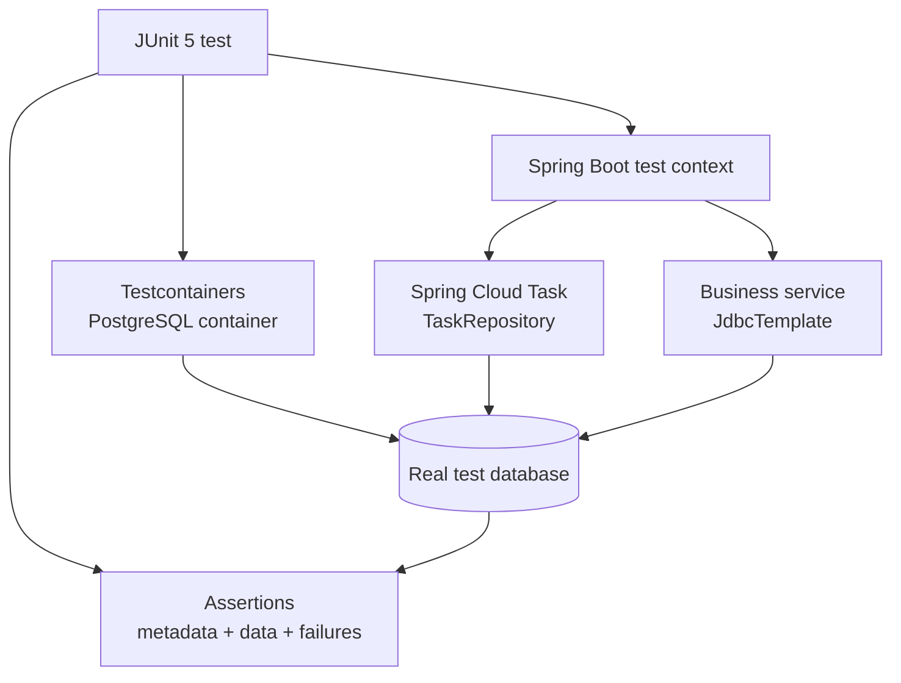
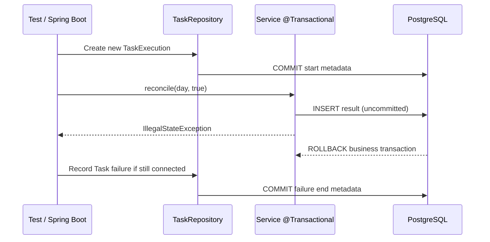

# Testing JDBC and Schemas with Testcontainers

A finite-lived **Spring Cloud Task** application typically records execution metadata into **`TaskRepository`**: task name, start/end timestamps, exit code, and arguments. When executing scheduled or on-demand workloads, the application also reads/writes business data and sometimes coordinates with **Spring Batch**. A test suite that only mocks `TaskRepository` or uses H2 can pass green yet miss SQL syntax issues, column types, sequences, transaction semantics, or migration bugs that happen on production PostgreSQL.

In the **Testing** chapter, this lesson shows how to use **Testcontainers** to spin up a real, ephemeral PostgreSQL instance for Spring Cloud Task integration tests. The goal is not merely testing JDBC connectivity, but verifying that **metadata tables are created properly**, a real `TaskExecution` is persisted, business outcomes commit, transactions roll back when expected, and configuration/schema mismatches are caught early.

After this lesson, you will be able to:

- Distinguish unit tests, JDBC integration tests, Task lifecycle tests, and schema/migration tests.
- Use `PostgreSQLContainer` with JUnit 5 and `@DynamicPropertySource` or `@ServiceConnection` to wire Spring Boot.
- Verify `TASK_EXECUTION`, `TASK_EXECUTION_PARAMS`, and key constraints on PostgreSQL.
- Build an application-context-level end-to-end test verifying both metadata and business data.
- Understand why a `@Test`-level rollback **does not** test commits from an independent Task execution.
- Test failures, idempotency, re-runs, and Flyway/Liquibase-managed schemas; design CI pipelines with safe container runtimes.

## 1. Why Test JDBC Against a Real Database?

Spring Cloud Task interacts with metadata tables via JDBC whenever an appropriate `DataSource` is configured. Several classes of bugs stay hidden behind mocks or substitute databases:

| Concern | What Mocks/H2 May Miss | What PostgreSQL via Testcontainers Verifies |
| --- | --- | --- |
| SQL syntax | `ON CONFLICT`, type casts, PostgreSQL functions | Real SQL executed by the target driver and database |
| Data types | `BIGINT`, `TIMESTAMP`, `VARCHAR` limits, `NUMERIC` | Platform-accurate column types, precision, and constraints |
| Execution IDs | ID generators/sequences may behave differently | PostgreSQL schema's `TASK_EXECUTION_ID` generation mechanism |
| Transactions | Simulated commit/rollback differs from JDBC behavior | Real transactions via `PlatformTransactionManager` and PostgreSQL driver |
| Schema | Hand-rolled "close-enough" test tables | Version-matched DDL/migrations and schema drift detection |
| Concurrency | Mocks have no lock contention | Unique constraints, locks, and retries on a real database |
| Startup | Context with mocked repository still boots | Startup actually hits the DB/schema and persists metadata |

**Testcontainers is not a simulated database**: it runs real PostgreSQL inside a container while preserving test isolation and allowing fresh databases per test class or suite. Host ports are mapped **dynamically**, eliminating any dependency on a pre-installed PostgreSQL at `localhost:5432`.



**Scope boundary:** Testcontainers verifies interactions with **a real database**, but does not replace network/Kubernetes CronJob testing, secret rotation, external messaging systems, production performance, or power-loss recovery.

## 2. Choose the Right Testing Level

| Level | Target | Recommended Tooling |
| --- | --- | --- |
| **Unit test** | Parsing `business-date`, pure calculations, error rules | JUnit + mocks; fast, no Docker |
| **JDBC repository integration** | SQL, constraints, transactions, data types | `JdbcTemplate` + PostgreSQL Testcontainers |
| **Task lifecycle integration** | Framework creates/completes `TaskExecution` when runner runs | `@SpringBootTest` + PostgreSQL Testcontainers + real repository |
| **Schema/migration test** | Complete DDL, metadata tables, columns/sequences/indexes, version compatibility | Fresh container + Flyway/Liquibase or official DDL scripts |
| **Launch/process test** | Java exit code, process termination, CLI arg passing, timeouts | Run executable JAR in a **separate process** against container DB |
| **Platform E2E** | Real Job/Pod, retries, resource limits, logging | Staging Kubernetes/launcher environment |

A `@SpringBootTest` running `ApplicationRunner` inside **the test JVM** can verify Task lifecycle and JDBC metadata; it **does not automatically test** the OS exit code from `java -jar` or how Kubernetes restarts containers. Never conflate these layers into a single "production-tested" claim.

## 3. Before Writing Tests: Pick Consistent Versions

Examples in this lesson use **Java 17+, Spring Boot 3.x, compatible Spring Batch/JDBC, and Spring Cloud Task 3.x**, paired with **JUnit 5** and **Testcontainers 1.x**. This is an **illustrative version family**, not a mandate to pick arbitrary versions from each family. Use the Spring Cloud BOM compatible with the Boot version your project actually runs.

In a `pom.xml` already declaring Spring Boot parent/dependency management, the Spring Cloud BOM, and `spring-boot-maven-plugin`, dependencies may look like:

```xml
<dependencies>
    <!-- Run Spring Cloud Task and JDBC -->
    <dependency>
        <groupId>org.springframework.cloud</groupId>
        <artifactId>spring-cloud-starter-task</artifactId>
    </dependency>
    <dependency>
        <groupId>org.springframework.boot</groupId>
        <artifactId>spring-boot-starter-jdbc</artifactId>
    </dependency>
    <dependency>
        <groupId>org.postgresql</groupId>
        <artifactId>postgresql</artifactId>
        <scope>runtime</scope>
    </dependency>

    <!-- Test -->
    <dependency>
        <groupId>org.springframework.boot</groupId>
        <artifactId>spring-boot-starter-test</artifactId>
        <scope>test</scope>
    </dependency>
    <dependency>
        <groupId>org.testcontainers</groupId>
        <artifactId>junit-jupiter</artifactId>
        <scope>test</scope>
    </dependency>
    <dependency>
        <groupId>org.testcontainers</groupId>
        <artifactId>postgresql</artifactId>
        <scope>test</scope>
    </dependency>
</dependencies>
```

**Note on Testcontainers 2.x:** Maven coordinates for some modules changed; for example, PostgreSQL 2.x uses `org.testcontainers:testcontainers-postgresql` instead of 1.x's `org.testcontainers:postgresql`. Do not mix syntax or dependencies across major lines; let the BOM manage versions and verify module coordinates. Similarly, when upgrading to Spring Boot 4.x/newer Spring Cloud Task, verify APIs and starter names before copying.

### Infrastructure Prerequisites

The developer workstation or CI runner must have a **container runtime reachable by Testcontainers**, permission to start containers, and ability to pull the PostgreSQL image. Docker Desktop/Docker Engine is common; CI may provide an organization-approved runtime. Do not assume `mvn test` works in environments without container permissions.

Never place production passwords in tests. Container test usernames and passwords are **ephemeral test credentials**, generated for isolation and destroyed when tests finish.

## 4. Understand the `TaskRepository` Schema Before Testing

Spring Cloud Task ships **database-specific DDL schemas**. For a standard JDBC repository:

| Component | Role |
| --- | --- |
| `TASK_EXECUTION` | Stores `TASK_EXECUTION_ID`, `TASK_NAME`, `START_TIME`, `END_TIME`, `EXIT_CODE`, and completion metadata |
| `TASK_EXECUTION_PARAMS` | Stores input arguments for a run |
| `TASK_SEQ` / version-specific ID generator | Allocates execution IDs; details may vary by database/version |
| `TASK_TASK_BATCH` | Links a `TaskExecution` to a Spring Batch `JobExecution` when integration is enabled |
| `TASK_LOCK` | Used for single-instance locking in supported versions/configurations |

**Do not hand-write a stripped-down `TASK_EXECUTION` table** with only three columns and treat it as a valid schema. The framework may access sequences/tables, additional columns, or parameter tables at startup; tests will misrepresent production if DDL does not match your Spring Cloud Task release.

Key property:

```properties
spring.cloud.task.initialize-enabled=true
```

When enabled, Spring Cloud Task can initialize the schema on a compatible `DataSource` via supported mechanisms. It is handy for testing **"can the framework create tables and persist `TaskExecution` on a clean PostgreSQL?"**. In production, this is normally set to `false`, with schemas provisioned beforehand via Flyway/Liquibase.

When using **multiple `DataSource`s**, do not assume auto-initialization picks the metadata datasource automatically; explicitly configure `TaskConfigurer` and your migration strategy. Tests must mirror **the same topology and transaction manager** as production if the goal is validating datasource routing.

## 5. Sample Application: A Task Writing Business Data

To demonstrate the lifecycle, build a `reconcile-task` application with two parts:

1. `ApplicationRunner` parsing `--business-date=YYYY-MM-DD` and an optional `--simulate-rollback` flag.
2. A JDBC service writing a daily reconciliation result to PostgreSQL with a **unique key** to prevent duplicate writes on retry.

### 5.1. Dedicated Business Table for the Test

File `src/test/resources/sql/business-schema.sql`:

```sql
CREATE TABLE IF NOT EXISTS reconciliation_result (
    business_date DATE PRIMARY KEY,
    total_amount NUMERIC(18, 2) NOT NULL,
    source_count INTEGER NOT NULL
);
```

This is a **test business schema**, not a replacement for Spring Cloud Task DDL. When testing production migrations, use **real migrations** to create this table rather than relying only on SQL under `src/test/resources`.

### 5.2. Transactional and Idempotent JDBC Service

Create `src/main/java/com/example/reconcile/ReconciliationService.java`:

```java
package com.example.reconcile;

import java.math.BigDecimal;
import java.sql.Date;
import java.time.LocalDate;

import org.springframework.jdbc.core.JdbcTemplate;
import org.springframework.stereotype.Service;
import org.springframework.transaction.annotation.Transactional;

@Service
public class ReconciliationService {
    private final JdbcTemplate jdbc;

    public ReconciliationService(JdbcTemplate jdbc) {
        this.jdbc = jdbc;
    }

    @Transactional
    public void reconcile(LocalDate day, boolean simulateRollback) {
        jdbc.update("""
            INSERT INTO reconciliation_result
                (business_date, total_amount, source_count)
            VALUES (?, ?, ?)
            ON CONFLICT (business_date) DO NOTHING
            """,
            Date.valueOf(day),
            new BigDecimal("1500000.00"),
            2
        );

        if (simulateRollback) {
            throw new IllegalStateException("Simulated rollback error");
        }
    }
}
```

In this example, `ON CONFLICT (business_date) DO NOTHING` plus the `PRIMARY KEY` ensure **same-day retries** never commit two result rows. The amount `1500000.00` is illustrative rather than a real reconciliation algorithm. Recalculating when source data changes requires explicit versioning or a dedicated reprocessing workflow.

`@Transactional` applies only when the service is invoked **through its Spring bean proxy**. Manual `new ReconciliationService(...)`, internal `this` self-calls, or the wrong transaction manager can cause tests to behave unexpectedly.

### 5.3. Spring Cloud Task Application

Create `src/main/java/com/example/reconcile/ReconcileTaskApplication.java`:

```java
package com.example.reconcile;

import java.time.LocalDate;
import java.util.List;

import org.springframework.boot.ApplicationArguments;
import org.springframework.boot.ApplicationRunner;
import org.springframework.boot.SpringApplication;
import org.springframework.boot.autoconfigure.SpringBootApplication;
import org.springframework.cloud.task.configuration.EnableTask;
import org.springframework.context.annotation.Bean;

@SpringBootApplication
@EnableTask
public class ReconcileTaskApplication {

    public static void main(String[] args) {
        SpringApplication.run(ReconcileTaskApplication.class, args);
    }

    @Bean
    ApplicationRunner runReconciliation(ReconciliationService service) {
        return args -> {
            List<String> values = args.getOptionValues("business-date");
            if (values == null || values.size() != 1
                    || values.get(0) == null || values.get(0).isBlank()) {
                throw new IllegalArgumentException(
                    "Must provide --business-date=YYYY-MM-DD"
                );
            }

            LocalDate date = LocalDate.parse(values.get(0));
            boolean fail = args.containsOption("simulate-rollback");
            service.reconcile(date, fail);
        };
    }
}
```

On the happy path, once `ApplicationRunner` finishes, Spring Cloud Task updates `TaskExecution` with end timestamp and exit code. On the failure path, an exception in the runner fails the application and the framework attempts to record error metadata. If `ApplicationContext` fails to start or the database loses connectivity, **no completed record** may exist—this requires dedicated testing.

**Never call `System.exit(...)` inside `ApplicationRunner`**: doing so can kill the JUnit test JVM or bypass metadata-update callbacks. If production needs to pass an exit code to a launcher, handle it at the `main`/Spring Boot exit lifecycle boundary and test it with a **process test**.

## 6. Integration Testing with `@Testcontainers` + `@DynamicPropertySource`

This section uses **JUnit 5, Spring Boot Test, and `PostgreSQLContainer`**. A `static` container has its lifecycle tied to the test class; Testcontainers provides the URL, username, and password **after starting the container**, removing the need for fixed ports.

Create `src/test/java/com/example/reconcile/TaskRepositoryPostgresTest.java`:

```java
package com.example.reconcile;

import static org.junit.jupiter.api.Assertions.assertEquals;
import static org.junit.jupiter.api.Assertions.assertNotNull;

import java.sql.Date;
import java.util.Map;

import org.junit.jupiter.api.Test;
import org.springframework.beans.factory.annotation.Autowired;
import org.springframework.boot.test.context.SpringBootTest;
import org.springframework.jdbc.core.JdbcTemplate;
import org.springframework.test.context.DynamicPropertyRegistry;
import org.springframework.test.context.DynamicPropertySource;
import org.testcontainers.containers.PostgreSQLContainer;
import org.testcontainers.junit.jupiter.Container;
import org.testcontainers.junit.jupiter.Testcontainers;

@Testcontainers
@SpringBootTest(
    classes = ReconcileTaskApplication.class,
    webEnvironment = SpringBootTest.WebEnvironment.NONE,
    args = "--business-date=2026-11-24",
    properties = {
        "spring.cloud.task.name=reconcileIntegrationTest",
        "spring.cloud.task.initialize-enabled=true",
        "spring.cloud.task.closecontextEnabled=false",
        "spring.sql.init.mode=always",
        "spring.sql.init.schema-locations=classpath:sql/business-schema.sql"
    }
)
class TaskRepositoryPostgresTest {

    @Container
    static final PostgreSQLContainer<?> POSTGRES =
        new PostgreSQLContainer<>("postgres:16-alpine")
            .withDatabaseName("task_it");

    @DynamicPropertySource
    static void datasource(DynamicPropertyRegistry registry) {
        registry.add("spring.datasource.url", POSTGRES::getJdbcUrl);
        registry.add("spring.datasource.username", POSTGRES::getUsername);
        registry.add("spring.datasource.password", POSTGRES::getPassword);
    }

    @Autowired
    JdbcTemplate jdbc;

    @Test
    void taskExecutionHasStartEndAndSuccessExitCode() {
        Map<String, Object> row = jdbc.queryForMap("""
            SELECT TASK_EXECUTION_ID, START_TIME, END_TIME, EXIT_CODE
            FROM TASK_EXECUTION
            WHERE TASK_NAME = ?
            ORDER BY TASK_EXECUTION_ID DESC
            LIMIT 1
            """, "reconcileIntegrationTest");

        assertNotNull(row.get("TASK_EXECUTION_ID"));
        assertNotNull(row.get("START_TIME"));
        assertNotNull(row.get("END_TIME"));
        assertEquals(0, ((Number) row.get("EXIT_CODE")).intValue());
    }

    @Test
    void businessResultWasCommitted() {
        Integer count = jdbc.queryForObject("""
            SELECT COUNT(*)
            FROM reconciliation_result
            WHERE business_date = ?
            """,
            Integer.class,
            Date.valueOf("2026-11-24")
        );

        assertEquals(1, count);
    }

    @Test
    void taskSchemaTablesExist() {
        Integer tableCount = jdbc.queryForObject("""
            SELECT COUNT(*)
            FROM information_schema.tables
            WHERE table_schema = current_schema()
              AND table_name IN (
                'task_execution', 'task_execution_params'
              )
            """, Integer.class);

        assertEquals(2, tableCount);
    }
}
```

### Why Does This Test Measure What Matters?

1. `@Container` and `@Testcontainers` manage a real PostgreSQL instance for the test class.
2. `@DynamicPropertySource` supplies `spring.datasource.*` to Spring Boot using **the container's actual mapped port and credentials**. No production database is touched.
3. `@SpringBootTest(args = ...)` builds the application context and executes `ApplicationRunner` with a valid business date.
4. `spring.cloud.task.initialize-enabled=true` tests **Task schema** creation on an empty PostgreSQL instance; `spring.sql.init.schema-locations` creates **the test business table**.
5. `spring.cloud.task.closecontextEnabled=false` keeps the context open for Spring Test rather than letting Spring Cloud Task close it immediately after the runner finishes.
6. After the runner completes and the framework updates metadata, the test queries JDBC directly to confirm **`TASK_EXECUTION` has start/end timestamps and exit code 0**.
7. A separate test verifies the committed business result—checking **real side effects**, not merely that the runner was invoked.

**Execution note:** when a test boots the real application, `ApplicationRunner` executes **while the Spring context is loading**, before `@Test` methods run. Always pass valid inputs in `@SpringBootTest(args=...)`. Never write a `@Test` method with `assertThrows` expecting to catch a runner exception that already happened **before the test method started**.

### Why Not Annotate This Test Class with `@Transactional`?

Putting `@Transactional` on a `@Test` causes Spring Test to roll back **the test method's** transaction when the test ends. However, `ApplicationRunner` ran during startup, outside the test method's transaction, and the service runs in its own transaction. Therefore, `@Transactional` on the test method **does not roll back commits made by the runner**.

This test uses an **ephemeral `PostgreSQLContainer` and dedicated schema**, cleaning up by destroying the container rather than relying on test-method rollbacks. With multiple tests sharing a context, ensure they do not overwrite the same business keys or run concurrently without isolation.

## 7. Schema Testing: Do Not Ask Only "Do the Tables Exist?"

A table can exist and still **mismatch the schema expected by the framework**. Include these checks:

| Check | Example Question | Why It Matters |
| --- | --- | --- |
| Table and schema names | Are `TASK_EXECUTION` and `TASK_EXECUTION_PARAMS` in the expected schema? | Wrong `search_path` or table prefix prevents the framework from finding tables. |
| Column types | Is `TASK_EXECUTION_ID` a `BIGINT`, and `EXIT_CODE` the right numeric type? | Type mismatches may fail only on large values. |
| ID generation | Do two runs get distinct, non-colliding IDs? | ID sequences/tables need proper DDL and concurrency safety. |
| Lifecycle writes | Are `START_TIME` and `END_TIME` persisted? | Confirms Spring Cloud Task callbacks actually write metadata. |
| Arguments | Are arguments stored within actual schema limits? | Affects traceability and risks secret exposure in metadata. |
| Versioned migrations | Does the auto-created schema on an empty DB match deployed scripts? | Prevents green tests via auto-init while production DDL differs. |
| Database privileges | Can the runtime user execute required SELECT/INSERT/UPDATE without superuser? | Catches permission errors before production deployment. |

Example column inspection via `information_schema`:

```sql
SELECT
    column_name,
    data_type,
    is_nullable
FROM information_schema.columns
WHERE table_schema = current_schema()
  AND table_name = 'task_execution'
  AND column_name IN (
      'task_execution_id', 'task_name',
      'start_time', 'end_time', 'exit_code'
  )
ORDER BY column_name;
```

If the application configures `spring.cloud.task.tablePrefix`, table names differ from defaults; adjust every verification SQL query to match the real prefix and schema. **Never alter schemas based on guesswork**—take DDL directly from the Spring Cloud Task artifact/version you are running.

### Inspecting Run Arguments

Spring Cloud Task can persist arguments passed to the application in `TASK_EXECUTION_PARAMS`. For example:

```sql
SELECT p.TASK_EXECUTION_ID, p.TASK_PARAM
FROM TASK_EXECUTION_PARAMS p
JOIN TASK_EXECUTION t
  ON t.TASK_EXECUTION_ID = p.TASK_EXECUTION_ID
WHERE t.TASK_NAME = 'reconcileIntegrationTest'
ORDER BY p.TASK_EXECUTION_ID;
```

Verify in your test environment that `--business-date=2026-11-24` appears when passed via the corresponding argument mechanism. **Do not use this query to assume every property is automatically saved**: how arguments are captured depends on the launch path and framework. Never pass passwords or tokens via command-line arguments since they can surface in metadata, shell history, and logs.

## 8. Testing Schemas Managed by Flyway/Liquibase

The previous section set `spring.cloud.task.initialize-enabled=true` to verify **auto-initialization on an empty database**. However, if production uses migrations, that **is not a production schema test**.

For a migration test profile:

1. Start a **fresh/clean** `PostgreSQLContainer`.
2. Run **the exact migrations used in production**: Flyway, Liquibase, or version-controlled SQL scripts covering both release-matched `TaskRepository` DDL and business DDL.
3. Set `spring.cloud.task.initialize-enabled=false`.
4. Launch the application/task and verify it creates/updates `TaskExecution` against **the migrated schema**.
5. Verify post-migration state has no drift, missing columns, broken sequences, or wrong prefixes/permissions.

Sample Flyway test configuration **when your project already includes Flyway and a compatible driver**:

```yaml
spring:
  cloud:
    task:
      initialize-enabled: false
  flyway:
    enabled: true
    locations: classpath:db/migration
```

Here `db/migration` must contain **real migrations** (version-controlled by the project), not only a demo business table. Flyway executes migrations during Spring context startup before repositories or runners touch tables, provided dependencies, auto-configuration, and initialization ordering are configured correctly for your version.

**Never accidentally enable both auto-init and migrations**, as that can create tables twice or mask missing-schema bugs. For migration tests, set `spring.sql.init.mode=never` unless a separate SQL initializer is intentionally used.

### Deliberate Failure Test When Schema Is Missing

A valuable negative test: spin up a `PostgreSQLContainer` **without running init DDL**, set `spring.cloud.task.initialize-enabled=false`, and launch a JDBC-backed Task. The expected result is that **startup or `TaskExecution` persistence fails**, rather than silently falling back to an in-memory repository and passing.

When testing **context-startup failure**, do not use a standard `@SpringBootTest` expecting `@Test` to execute. Instead, launch the application **programmatically** inside the test against an isolated context/database and wrap it in `assertThrows`, or use context-failure test utilities. Never run negative tests that break the schema used by your main test class.

## 9. Testing Retries and Idempotency

Re-running a job for the same day via a scheduler normally creates a **new `TaskExecution`**, yet must never write duplicate business outcomes.

In our sample application, retrying `--business-date=2026-11-24` hits `ON CONFLICT DO NOTHING`. Because `business_date` is the primary key of `reconciliation_result`, we expect:

| Run | `TaskExecution` | Business Data |
| --- | --- | --- |
| Run 1 | New metadata, completes successfully | Inserts one row for 2026-11-24 |
| Same-day retry | New metadata, completes successfully if error-free | **Still one row** for 2026-11-24 |
| Different day run | New metadata | Inserts one row for the new day |

To test **two real startups**, launch two application contexts or processes against the same database container and the same identifying business input, rather than merely calling `service.reconcile(...)` twice inside one context. Tests must verify both that **the `TaskExecution` count increments** and that **the result row count stays unchanged**.

### Relaunch Pattern Using `SpringApplicationBuilder`

Once the container and schema exist from an earlier setup, you can launch **a second context** programmatically:

```java
// Place inside a @Test method of a Testcontainers test class
// where POSTGRES is already running and the schema is ready.
try (var context = new org.springframework.boot.builder.SpringApplicationBuilder(
        ReconcileTaskApplication.class)
        .web(org.springframework.boot.WebApplicationType.NONE)
        .properties(
            "spring.datasource.url=" + POSTGRES.getJdbcUrl(),
            "spring.datasource.username=" + POSTGRES.getUsername(),
            "spring.datasource.password=" + POSTGRES.getPassword(),
            "spring.cloud.task.name=reconcileIntegrationTest",
            "spring.cloud.task.initialize-enabled=false",
            "spring.cloud.task.closecontextEnabled=false",
            "spring.sql.init.mode=never"
        )
        .run("--business-date=2026-11-24")) {
    // ApplicationRunner has already run inside SpringApplication.run(...).
}
```

Then query:

```sql
SELECT COUNT(*)
FROM TASK_EXECUTION
WHERE TASK_NAME = 'reconcileIntegrationTest';

SELECT COUNT(*)
FROM reconciliation_result
WHERE business_date = DATE '2026-11-24';
```

When asserting in tests, compare **the `TaskExecution` count before and after the second startup** to assert an increment of `1`, rather than hardcoding a total count from a database that may hold earlier runs. The business row count for that date must remain `1`. This proves **metadata records every attempt** while **business state is protected across retries**.

**Note on context caching:** if you define multiple `@SpringBootTest` classes, Spring Test may cache/reuse contexts. Each `@Test` method does not equal one context startup. If you need to test *per-launch* behavior, spawn a fresh process/context or structure fixtures explicitly rather than assuming every test method re-runs the Task.

## 10. Testing Rollbacks and Runner Failures

The `--simulate-rollback` flag makes the service insert a row and throw `IllegalStateException` while the transaction is open. With the right transaction manager, **the failed date's business row is not committed**. Meanwhile, Spring Cloud Task can still persist a failed `TaskExecution` because Task metadata runs in its own lifecycle transaction.



**To test the failure path, never load `@SpringBootTest(args = "--simulate-rollback")` expecting `@Test` to assert on it**: `ApplicationRunner` can fail context startup **before the test method is ever invoked**.

Instead, use a test driver that launches the context programmatically, catches the exception, and queries the container database over an existing connection. Example **test skeleton** (place inside a class providing the container, `JdbcTemplate`, and test schema):

```java
assertThrows(Exception.class, () ->
    new SpringApplicationBuilder(ReconcileTaskApplication.class)
        .web(WebApplicationType.NONE)
        .properties(
            "spring.datasource.url=" + POSTGRES.getJdbcUrl(),
            "spring.datasource.username=" + POSTGRES.getUsername(),
            "spring.datasource.password=" + POSTGRES.getPassword(),
            "spring.cloud.task.name=reconcileIntegrationTest",
            "spring.cloud.task.initialize-enabled=false",
            "spring.sql.init.mode=never"
        )
        .run(
            "--business-date=2026-11-25",
            "--simulate-rollback"
        )
);

Integer rows = jdbc.queryForObject("""
    SELECT COUNT(*) FROM reconciliation_result
    WHERE business_date = DATE '2026-11-25'
    """, Integer.class);

assertEquals(0, rows);
```

Imports required for this skeleton: `org.junit.jupiter.api.Assertions.assertThrows`, `org.springframework.boot.builder.SpringApplicationBuilder`, and `org.springframework.boot.WebApplicationType`. If the test method interacts with multiple contexts or transactions, ensure no concurrent test processes the same business date.

To verify Task failure status, query `TASK_EXECUTION` for **the newly launched run** and assert `END_TIME` and a non-zero `EXIT_CODE` **when the application created metadata and the framework managed to persist completion**. Do not claim this is guaranteed for every startup error; sometimes the context dies before the repository is ready, leaving no row.

### Scenarios Worth Testing

| Case | Business Expectation | Metadata Expectation |
| --- | --- | --- |
| Success | Commits data for day A | `TaskExecution` ends with code `0` |
| Retry on day A | No duplicate rows created | **New** `TaskExecution` recorded |
| Exception before commit | Rolls back data for day B | Failed `TaskExecution` if framework can update |
| Missing `--business-date` | No data written | Runner failure; metadata may record failure completion |
| Wrong PostgreSQL credentials | Connection fails | `TaskExecution` may be absent due to early context failure |
| Missing Task schema with auto-init off | No metadata written | Reproduces startup/repository failure |
| Wrong column type / missing column | Fails when writing `TaskExecution` | Test catches migration drift vs. DDL |
| Two concurrent runs on the same day | No duplicates thanks to unique constraint | Two distinct run IDs if both create metadata |

**Never "fix" a test by swallowing exceptions** in the runner. If the application failed, tests must observe the error and verify rollback rather than forcing everything to return success.

## 11. Multiple `DataSource`s and Spring Batch

In production, one database may hold Spring Cloud Task metadata while another holds business data; adding Spring Batch can introduce a separate `JobRepository` and Step transaction manager.

```text
Spring Cloud Task test
  ├─ taskMetadataDataSource -> TaskRepository -> TASK_EXECUTION
  ├─ businessDataSource     -> ReconciliationService -> reconciliation_result
  └─ batchDataSource       -> JobRepository -> BATCH_JOB_EXECUTION ...
```

Tests should verify:

1. `TaskConfigurer` points to **the right metadata datasource** and its transaction manager.
2. Business services use `businessTransactionManager` matching the provisioned connection.
3. Spring Batch's `JobRepository` uses the proper schema and `Step`s select the intended transaction manager.
4. Rolling back the business DB **does not roll back an already-committed `TaskExecution`**, even when the task fails.

With multiple datasources, spin up **two `PostgreSQLContainer`s** or use two isolated test databases/schemas, wiring each property set via `@DynamicPropertySource`. Never point every datasource at one shared container if the test aims to catch **misrouted datasource configuration**.

**With Spring Batch**, also test `BATCH_JOB_INSTANCE`, `BATCH_JOB_EXECUTION`, `BATCH_STEP_EXECUTION`, `JobParameters`, restartability, and checkpoint state. `TaskExecution` is an **application-level** record and does not replace Batch's `JobExecution`.

## 12. `@ServiceConnection`: A Cleaner Alternative

Starting in **Spring Boot 3.1+**, Spring Boot can derive **service connection details** directly from Testcontainers, reducing manual URL/username/password wiring.

With `org.springframework.boot:spring-boot-testcontainers` and a compatible environment, you can write:

```java
import org.springframework.boot.testcontainers.service.connection.ServiceConnection;
import org.testcontainers.containers.PostgreSQLContainer;
import org.testcontainers.junit.jupiter.Container;
import org.testcontainers.junit.jupiter.Testcontainers;

@Testcontainers
@SpringBootTest(
    classes = ReconcileTaskApplication.class,
    args = "--business-date=2026-11-24"
)
class TaskWithServiceConnectionTest {

    @Container
    @ServiceConnection
    static PostgreSQLContainer<?> postgres =
        new PostgreSQLContainer<>("postgres:16-alpine");

    // @Test: verify TaskExecution and business data.
}
```

This **replaces only the JDBC property wiring** of `@DynamicPropertySource`; a complete test still needs schemas/migrations, context-closing settings, business data setup, and assertions. **Do not combine `@DynamicPropertySource` and `@ServiceConnection` for the same `DataSource` without understanding precedence.**

Comparison:

| Approach | Advantages | When to Choose |
| --- | --- | --- |
| `@DynamicPropertySource` | Explicit, flexible for multiple datasources/custom properties | When mapping multiple URLs/credentials or using Boot versions prior to service connections |
| `@ServiceConnection` | Minimal boilerplate; Boot auto-generates connection details for supported modules | Boot 3.1+ and straightforward topologies with a single PostgreSQL datasource |
| Testcontainers JDBC `jdbc:tc:...` | Concise for certain JDBC-only tests | When testing datasources without directly managing container lifecycle |

**Version compatibility is mandatory.** Imports, dependencies, and supported features can change across major Spring Boot releases. Do not treat annotations as one-to-one replacements for full Spring Cloud Task startup logic.

## 13. Running Tests in CI/CD

With a class named `TaskRepositoryPostgresTest` ending in `Test`, Maven Surefire typically discovers and runs it via:

```bash
./mvnw test
```

On Windows:

```powershell
.\mvnw.cmd test
```

If you name classes `*IT`, Maven Surefire **will not run them automatically** during the `test` phase; configure Maven Failsafe and run `verify` or your suite convention. Avoid reporting "integration tests passed" just because Maven succeeded when the classes were never discovered.

### CI Checklist

- The runner has a container runtime accessible to Testcontainers, with sufficient CPU/memory for both PostgreSQL and the JVM.
- The runner can pull PostgreSQL images from an organization-approved registry; **pin the image/version** to match production or an approved test baseline.
- Never use production databases or real credentials; CI containers are ephemeral.
- Use **isolated** databases/schemas and never reuse prior state when testing migrations.
- Never hardcode host port `5432`: read the JDBC URL/port supplied by Testcontainers.
- Set sensible container startup timeouts; distinguish Docker/registry errors from SQL assertion failures.
- Archive test reports/logs on failure, **without attaching secrets** or dumping the full environment.
- Avoid parallelizing tests that mutate the same schema/container; when running in parallel, enforce distinct keys and proper isolation.
- Verify the build actually discovered and ran the expected test count—never bypass with `-DskipTests`.

A typical pipeline runs **unit tests first**, then **Testcontainers JDBC/schema tests**, and finally tests involving Kafka, Kubernetes, or staging environments. The database container in CI is a **compatibility test tool**, not part of the deployed artifact.

## 14. Common Testing Failures

| Symptom | Possible Cause | Fix |
| --- | --- | --- |
| `Could not find a valid Docker environment` | Runtime not running or lacks permissions | Check Docker/CI runner and permissions; never swap to H2 just to get a green build. |
| `Connection refused` to `localhost:5432` | Test hardcoded URL/port instead of container mapping | Use `POSTGRES.getJdbcUrl()` / `@ServiceConnection`. |
| `relation "task_execution" does not exist` | Task schema not initialized/migrated, wrong datasource/schema | Check `initialize-enabled`, DDL, and `search_path`. |
| `TASK_SEQ` or ID generator error | Migration missing version-specific table/sequence | Use official DDL and test real ID allocation on Postgres. |
| `NoUniqueBeanDefinitionException` with multiple datasources | `TaskConfigurer`/`JdbcTemplate` selection ambiguous | Use `@Qualifier`, dedicated transaction managers, and test real topology. |
| `@SpringBootTest` fails before `@Test` | Runner requires arguments or threw at startup | Provide valid `args`; launch context programmatically for negative tests. |
| `END_TIME` missing right after startup | Callback unfinished, context/DB error, or poorly timed assertion | Wait for the right milestone, check framework events and logs; never mask races with `Thread.sleep`. |
| `@Transactional` on test makes test falsely "green" | Test method rolled back while startup runner already committed in its own tx | Verify data **post-commit** with fresh JDBC queries and isolated fixtures. |
| Test passes on H2 but fails on Postgres | SQL dialect, type, or constraint differences | Run PostgreSQL Testcontainers matching a supported version. |
| Duplicate runs alter row counts | Reused context/container or parallel execution | Use distinct keys, clean fixtures, and before/after comparisons. |
| Retry test writes two result rows | Missing unique constraint/idempotency | Add constraints and test two real launches. |
| Spring Batch Job runs unexpectedly during test | `spring.batch.job.enabled` or auto-run | Disable auto-run and launch Jobs explicitly in tests. |

### Never Use `@SpringBootTest` as Proof of the OS Exit Code

`@SpringBootTest` runs inside the test runner's JVM. If you need to test that `java -jar` returns non-zero on failure, write a separate **process-level integration test** using `ProcessBuilder` (or an organization-supported harness), pass test database URLs/credentials via environment variables, wait with a timeout, and assert `exitValue()`.

Never put `System.exit(...)` directly on a code path executed by `@SpringBootTest`, because it can terminate the entire Maven/JUnit JVM. Likewise, never point process-level tests at production Docker/databases or leave orphan child processes running when a test fails.

## 15. Practice Exercises and Self-Check Questions

Perform these steps against an **ephemeral PostgreSQL container** without touching real databases:

1. Use Testcontainers to start PostgreSQL 16 and wire the datasource with `@DynamicPropertySource`. Why shouldn't you hardcode `localhost:5432`?
2. Enable `spring.cloud.task.initialize-enabled=true` on an empty DB; verify `TASK_EXECUTION`, `TASK_EXECUTION_PARAMS`, and ID generation work.
3. Run `@SpringBootTest` with `--business-date=2026-11-24`; verify `START_TIME`, `END_TIME`, `EXIT_CODE=0`, and one row in `reconciliation_result`.
4. Trigger a second startup for the same date and verify **`TaskExecution` increments by one** while business data does not duplicate.
5. Run `--simulate-rollback` for a different date inside a programmatically created context; why is no row retained in the business table for that date?
6. Disable Task schema auto-init on a clean database. Design a negative test verifying startup fails when DDL is missing.
7. Add real Flyway migrations and run the test with `initialize-enabled=false`. Prove your production schema supports `TaskRepository`.
8. If you have two datasources, create two separate containers or databases. Intentionally bind `TaskConfigurer` to the wrong datasource and analyze which test catches it.
9. Try `@ServiceConnection` on a supported Spring Boot version and compare it with `@DynamicPropertySource` for clarity and extensibility.
10. Configure CI to run `*Test` and `*IT` classes in the proper phases; verify test reports show real JDBC/schema assertions actually executed.

**Review questions:**

- What does Testcontainers verify that mocking `TaskRepository` or using H2 cannot guarantee?
- Why shouldn't you create a stripped-down `TASK_EXECUTION` table and call it an integration test?
- Does `spring.cloud.task.initialize-enabled=true` test production migrations? Why or why not?
- Why can the runner execute **before `@Test` methods** in `@SpringBootTest`?
- Which `TaskExecution` fields change on retry, and which key must stay stable to prevent duplicate processing?
- Does putting `@Transactional` on a test method automatically roll back data written by the runner at startup?
- When the JVM is killed before updating metadata, can `@SpringBootTest` alone test that entire behavior?
- When Spring Batch is used, why must `JobRepository` be tested separately from `TaskRepository`?

**Key takeaway:** JDBC and schema testing for **Spring Cloud Task** must run against **a real database and version-matched DDL**. `Testcontainers` lets you spin up isolated PostgreSQL instances, inject dynamic connection details, and simultaneously verify **`TaskExecution` metadata** and **committed business data**. Test success, rollback, retry, and schema migration paths separately; keep process/platform tests at the right boundary so a context test is never mistaken for a real deployment.

**Official references:**

- [Spring Boot — Testcontainers](https://docs.spring.io/spring-boot/reference/testing/testcontainers.html): `@ServiceConnection` and `@DynamicPropertySource`.
- [Testcontainers for Java — JUnit 5](https://java.testcontainers.org/test_framework_integration/junit_5/): `@Testcontainers`, `@Container`, and container lifecycle.
- [Testcontainers — PostgreSQL Module](https://java.testcontainers.org/modules/databases/postgres/): `PostgreSQLContainer` and JDBC URLs.
- [Spring Cloud Task — Task Repository Schema](https://docs.spring.io/spring-cloud-task/reference/appendix-task-repository-schema.html): metadata tables/fields and Batch links.
- [Spring Cloud Task — Features](https://docs.spring.io/spring-cloud-task/reference/features.html): `TaskRepository`, schema initialization, lifecycle, and listeners.
