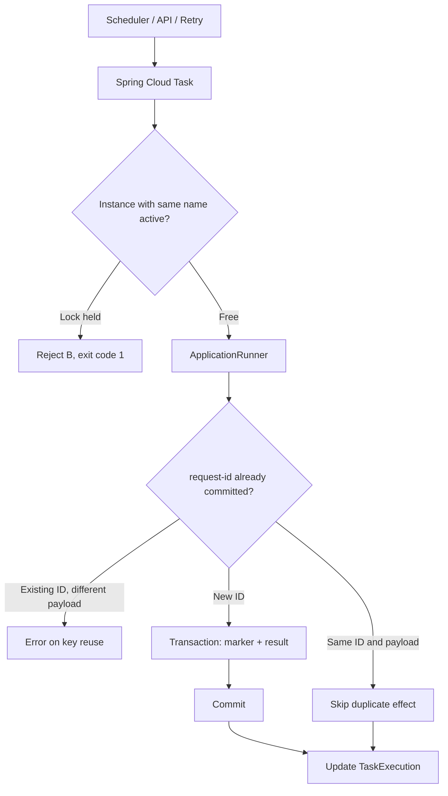

# Testing Lock Contention and Duplicate Processing

## 1. Problem Statement and Objectives

A **Spring Cloud Task** application runs a finite unit of work and terminates. The framework stores execution history in **`TaskRepository`** as `TaskExecution` records: task name, start/end timestamps, arguments, errors, and exit codes. A Task may be triggered by a scheduler, API, Kubernetes Job, or Spring Cloud Data Flow.

When retries and multiple processes are involved, two distinct issues must be separated:

- **Lock contention:** Two processes attempt to run the same task simultaneously. If only one active instance of the task is allowed, the second process must be blocked.
- **Duplicate processing:** The same business request is re-submitted after a previous run completed, or after a timeout/crash. Even if the two runs do not overlap in time, the second run must not apply duplicate side effects.

**A single-instance lock does not automatically provide exactly-once semantics. Idempotency is what prevents business effects from being applied twice.** This lesson in the **Testing** chapter of the `SPRING_CLOUD_TASK` module verifies both layers of protection together.

The running example is `daily-report-task`: each command carries `--request-id` and `--report-day`, and at most one report result is persisted for that request ID. We will:

1. Test two **real JVMs** sharing one PostgreSQL instance and one task name.
2. Prove `single-instance-enabled=true` causes process B to be rejected while A holds the lock.
3. Verify a subsequent run is permitted after A finishes.
4. Use a **unique constraint + transaction** to prevent duplicates when locking is disabled or requests retry sequentially.
5. Distinguish failures **before commit** from failures **after commit**.
6. Use JUnit 5, Testcontainers, and SQL assertions to test contention at the data layer.
7. Understand the impact of TTL, process crashes, DB connectivity, Spring Batch, and Kubernetes schedulers.

## 2. Three Protection Layers and Test Criteria

| Layer | What It Prevents | What It Does Not Guarantee |
| --- | --- | --- |
| `spring.cloud.task.single-instance-enabled` | Two processes with the **same Task name** overlapping when both participate in the shared lock. | Prevents an old request from being re-run **after** the lock is released. |
| Business key/idempotency | The same `request-id` producing two database results. | Does not inherently block two JVMs burning CPU/API calls prior to the write step. |
| Scheduler `concurrencyPolicy`/rate limit | Overlapping launches initiated by **that scheduler**. | Manual triggers/other sources and cross-system retries. |



Recommended test matrix:

| ID | Scenario | Expected Result |
| --- | --- | --- |
| C1 | A and B share name, DB, and single-instance lock, overlapping | A enters runner; B never enters runner and exits `1`. |
| C2 | B starts **after A completes** | B is allowed to run. |
| C3 | Different names or different DBs | Task lock does not block across them; misconfiguration if contention was expected. |
| D1 | Same request ID invoked sequentially twice | One result; second call returns `created=false`. |
| D2 | Multiple threads/JVMs with same request ID without Task lock | Unique constraint still creates only one result. |
| D3 | Failure inside DB transaction | Marker and result both roll back; retry can recreate them. |
| D4 | DB committed, runner fails afterward | Retry does not create a second result. |
| D5 | Reusing request ID for a different report day | Rejected due to payload mismatch. |
| F1 | JVM killed/TTL expires | Controlled recovery without two live workers writing simultaneously. |

**Never draw conclusions from a single log line or exit code alone.** Correlate `TASK_LOCK`, `TASK_EXECUTION`, process/container status, and business tables together.

## 3. Spring Cloud Task JDBC Locking

Spring Cloud Task can restrict a task name to a single active instance:

```yaml
spring:
  cloud:
    task:
      name: daily-report-task
      single-instance-enabled: true
      single-instance-lock-check-interval: 500
      single-instance-lock-ttl: 300000
```

Per Spring Cloud Task 3.2 documentation:

- `single-instance-enabled=false` is the default; it must be enabled on **all** runs participating in the lock.
- While A is running, B with the same task name and lock enabled is rejected with **exit code `1`**.
- Requires two Spring Integration dependencies: `spring-integration-core` and `spring-integration-jdbc`.
- The database must contain **`TASK_LOCK`** per the Spring Cloud Task schema script. Do not confuse it with `INT_LOCK` from an application-defined Spring Integration `JdbcLockRegistry`.
- `TaskRepository` records execution history; `TASK_LOCK` coordinates locking. `END_TIME IS NULL` is not a mutex.

The two timing properties above are in **milliseconds**: a `500` check interval and a `300000` (5-minute) TTL. A TTL shorter than task runtime lets the lock expire while A is still working. An overly long TTL delays retries after a crash. Never assume built-in locks auto-renew indefinitely without verifying the exact mechanism and version.

**Do not test contention using two H2 in-memory databases:** each JVM gets its own isolated database. Two JVMs concurrently opening the same embedded H2 file may fail due to **H2 file locking** rather than Task business locking. Use a shared PostgreSQL/MySQL server or PostgreSQL Testcontainers.

## 4. Sample Spring Boot Project

Examples use **Java 17**, **Spring Boot 3.4.5**, **Spring Cloud 2024.0.2**, and PostgreSQL. When changing versions, pick a compatible Boot-Cloud release train and re-verify `TaskRepository` DDL.

```text
task-concurrency-test/
├── pom.xml
└── src/
    ├── main/
    │   ├── java/com/example/tasktest/
    │   │   ├── TaskTestApplication.java
    │   │   ├── OnceOnlyReportService.java
    │   │   └── DailyReportRunner.java
    │   └── resources/application.yml
    └── test/
        ├── java/com/example/tasktest/IdempotencyIntegrationTest.java
        └── resources/schema-business.sql
```

### 4.1. Maven `pom.xml`

```xml
<?xml version="1.0" encoding="UTF-8"?>
<project xmlns="http://maven.apache.org/POM/4.0.0"
         xmlns:xsi="http://www.w3.org/2001/XMLSchema-instance"
         xsi:schemaLocation="http://maven.apache.org/POM/4.0.0 https://maven.apache.org/xsd/maven-4.0.0.xsd">
    <modelVersion>4.0.0</modelVersion>

    <parent>
        <groupId>org.springframework.boot</groupId>
        <artifactId>spring-boot-starter-parent</artifactId>
        <version>3.4.5</version>
        <relativePath/>
    </parent>

    <groupId>com.example</groupId>
    <artifactId>task-concurrency-test</artifactId>
    <version>0.0.1-SNAPSHOT</version>

    <properties>
        <java.version>17</java.version>
    </properties>

    <dependencyManagement>
        <dependencies>
            <dependency>
                <groupId>org.springframework.cloud</groupId>
                <artifactId>spring-cloud-dependencies</artifactId>
                <version>2024.0.2</version>
                <type>pom</type>
                <scope>import</scope>
            </dependency>
        </dependencies>
    </dependencyManagement>

    <dependencies>
        <dependency>
            <groupId>org.springframework.cloud</groupId>
            <artifactId>spring-cloud-starter-task</artifactId>
        </dependency>
        <dependency>
            <groupId>org.springframework.boot</groupId>
            <artifactId>spring-boot-starter-jdbc</artifactId>
        </dependency>
        <dependency>
            <groupId>org.springframework.integration</groupId>
            <artifactId>spring-integration-core</artifactId>
        </dependency>
        <dependency>
            <groupId>org.springframework.integration</groupId>
            <artifactId>spring-integration-jdbc</artifactId>
        </dependency>
        <dependency>
            <groupId>org.postgresql</groupId>
            <artifactId>postgresql</artifactId>
            <scope>runtime</scope>
        </dependency>
        <dependency>
            <groupId>org.springframework.boot</groupId>
            <artifactId>spring-boot-starter-test</artifactId>
            <scope>test</scope>
        </dependency>
        <dependency>
            <groupId>org.testcontainers</groupId>
            <artifactId>junit-jupiter</artifactId>
            <scope>test</scope>
        </dependency>
        <dependency>
            <groupId>org.testcontainers</groupId>
            <artifactId>postgresql</artifactId>
            <scope>test</scope>
        </dependency>
    </dependencies>

    <build>
        <plugins>
            <plugin>
                <groupId>org.springframework.boot</groupId>
                <artifactId>spring-boot-maven-plugin</artifactId>
            </plugin>
        </plugins>
    </build>
</project>
```

`spring-integration-core` and `spring-integration-jdbc` enable single-instance locking. Testcontainers/JUnit tests transactions against PostgreSQL; **two-JVM testing** still requires a dedicated test outside the JUnit transaction suite.

### 4.2. `application.yml` Configuration

```yaml
spring:
  application:
    name: daily-report-task
  main:
    web-application-type: none
  datasource:
    url: ${TASK_DB_URL:jdbc:postgresql://localhost:5432/task_testing}
    username: ${TASK_DB_USER:task_user}
    password: ${TASK_DB_PASSWORD:}
  cloud:
    task:
      name: daily-report-task
      initialize-enabled: false
      single-instance-enabled: true
      single-instance-lock-check-interval: 500
      single-instance-lock-ttl: 300000
      closecontext-enabled: true
```

Before running the JAR outside tests, ensure the PostgreSQL `task_testing` database and user exist, and the Spring Cloud Task schema (`TASK_EXECUTION`, `TASK_LOCK`, sequences, and related tables) has been created using the **version-matched script** via migrations/DBA. Setting `initialize-enabled=false` prevents two instances starting together from racing on DDL.

`TASK_DB_URL`, `TASK_DB_USER`, and `TASK_DB_PASSWORD` come from environment variables or a secret manager. Never put passwords in source code or task arguments because `TaskRepository` can persist arguments.

### 4.3. PostgreSQL Business Schema

Create two dedicated tables **in the new practice database** via migration/SQL client. For integration tests, place the same DDL in `src/test/resources/schema-business.sql`:

```sql
CREATE TABLE processed_request (
    request_id VARCHAR(80) PRIMARY KEY,
    report_day DATE NOT NULL,
    created_at TIMESTAMPTZ NOT NULL DEFAULT CURRENT_TIMESTAMP
);

CREATE TABLE report_output (
    request_id VARCHAR(80) PRIMARY KEY
        REFERENCES processed_request(request_id),
    report_day DATE NOT NULL,
    generated_rows INTEGER NOT NULL,
    created_at TIMESTAMPTZ NOT NULL DEFAULT CURRENT_TIMESTAMP
);
```

This is the **business schema**, not the `TaskRepository` schema. Each `request_id` has at most one marker and one output row. In real workloads, also compare a payload/report-day fingerprint on existing keys so two different requests sharing an ID are never silently treated as identical.

### 4.4. Application and Transactional Service

`TaskTestApplication.java`:

```java
package com.example.tasktest;

import org.springframework.boot.SpringApplication;
import org.springframework.boot.autoconfigure.SpringBootApplication;
import org.springframework.cloud.task.configuration.EnableTask;

@SpringBootApplication
@EnableTask
public class TaskTestApplication {

    public static void main(String[] args) {
        SpringApplication.run(TaskTestApplication.class, args);
    }
}
```

`OnceOnlyReportService.java`:

```java
package com.example.tasktest;

import java.sql.Date;
import java.time.LocalDate;

import org.springframework.jdbc.core.JdbcTemplate;
import org.springframework.stereotype.Service;
import org.springframework.transaction.annotation.Transactional;

@Service
public class OnceOnlyReportService {

    private final JdbcTemplate jdbc;

    public OnceOnlyReportService(JdbcTemplate jdbc) {
        this.jdbc = jdbc;
    }

    @Transactional
    public boolean writeOnce(
            String requestId, LocalDate day, boolean failBeforeCommit) {

        int inserted = jdbc.update(
                "INSERT INTO processed_request (request_id, report_day) "
                + "VALUES (?, ?) "
                + "ON CONFLICT (request_id) DO NOTHING",
                requestId, Date.valueOf(day));

        if (inserted == 0) {
            LocalDate existingDay = jdbc.queryForObject(
                    "SELECT report_day FROM processed_request "
                    + "WHERE request_id = ?",
                    (rs, row) -> rs.getDate(1).toLocalDate(),
                    requestId);
            if (!day.equals(existingDay)) {
                throw new IllegalArgumentException(
                        "Duplicate request-id with different report-day");
            }
            return false;
        }

        jdbc.update(
                "INSERT INTO report_output "
                + "(request_id, report_day, generated_rows) "
                + "VALUES (?, ?, ?)",
                requestId, Date.valueOf(day), 1);

        if (failBeforeCommit) {
            throw new IllegalStateException(
                    "Simulated error before commit");
        }
        return true;
    }
}
```

In PostgreSQL, `INSERT ... ON CONFLICT (request_id) DO NOTHING` uses the primary-key constraint to prevent two transactions from creating duplicate markers. When two transactions race, one waits for the other to finish and observes the corresponding outcome. Once the marker insert succeeds, both the result and marker commit inside **a single `@Transactional`**.

Guarantees required:

1. `writeOnce(...)` is called **from another runner bean**, passing through the Spring transaction proxy. Self-invoking `this.writeOnce(...)` from the same class can bypass the proxy.
2. `IllegalStateException` is a runtime exception and triggers transaction rollback by default; neither marker nor result commits.
3. Once committed, a retry with the same ID/day returns `false` and writes no extra output.
4. Same ID with a different day is rejected. With multiple business fields, persist a payload hash or request version to match against.
5. Ensure these business effects **reside within the same PostgreSQL transaction**. If sending emails, payments, or Kafka messages outside the DB, SQL rollback cannot undo external side effects; use an outbox or target-side idempotency.

### 4.5. Runner with a Synchronization Marker for Contention Testing

`DailyReportRunner.java`:

```java
package com.example.tasktest;

import java.time.LocalDate;
import java.util.List;

import org.springframework.boot.ApplicationArguments;
import org.springframework.boot.ApplicationRunner;
import org.springframework.boot.autoconfigure.condition.ConditionalOnProperty;
import org.springframework.stereotype.Component;

@Component
@ConditionalOnProperty(
        name = "app.runner.enabled",
        havingValue = "true",
        matchIfMissing = true)
public class DailyReportRunner implements ApplicationRunner {

    private final OnceOnlyReportService service;

    public DailyReportRunner(OnceOnlyReportService service) {
        this.service = service;
    }

    private String required(ApplicationArguments args, String name) {
        List<String> values = args.getOptionValues(name);
        if (values == null || values.size() != 1) {
            throw new IllegalArgumentException(
                    "Exactly one --" + name + " argument is required");
        }
        return values.get(0);
    }

    @Override
    public void run(ApplicationArguments args) throws Exception {
        String id = required(args, "request-id");
        LocalDate day = LocalDate.parse(required(args, "report-day"));
        String rawSeconds = args.containsOption("work-seconds")
                ? required(args, "work-seconds") : "0";
        int seconds = Integer.parseInt(rawSeconds);

        if (!id.matches("[A-Za-z0-9_-]{1,80}")
                || seconds < 0 || seconds > 120) {
            throw new IllegalArgumentException("Invalid arguments");
        }

        // Print only after the Task has entered ApplicationRunner.
        System.out.println("RUNNER_STARTED requestId=" + id);
        System.out.flush();

        try {
            Thread.sleep(seconds * 1000L);
        } catch (InterruptedException interrupted) {
            Thread.currentThread().interrupt();
            throw interrupted;
        }

        boolean created = service.writeOnce(
                id, day, args.containsOption("fail-in-transaction"));
        System.out.println("BUSINESS_DONE created=" + created);

        if (args.containsOption("fail-after-commit")) {
            throw new IllegalStateException(
                    "Simulated error after database commit");
        }
    }
}
```

`RUNNER_STARTED` serves as a **synchronization point**. When A prints this line and enters `Thread.sleep()`, launching B genuinely tests lock contention instead of accidentally arriving after A has already finished.

The `fail-in-transaction` and `fail-after-commit` flags are strictly for **isolated testing**; never allow production users to toggle fault-injection switches.

## 5. Testing Two JVMs Against One PostgreSQL Instance

Prerequisites: Maven/Java 17, running PostgreSQL server, Task schema + business tables created, two terminals sharing the same datasource config and `spring.cloud.task.name`.

Build the JAR in **the sample project**:

```bash
mvn clean package
```

### 5.1. C1: A Runs, B Is Rejected

**Terminal A:**

```bash
java -jar target/task-concurrency-test-0.0.1-SNAPSHOT.jar \
  --request-id=LOCK-A --report-day=2026-11-24 \
  --work-seconds=25
```

Wait to see:

```text
RUNNER_STARTED requestId=LOCK-A
```

**Terminal B**, while A is still running:

```bash
java -jar target/task-concurrency-test-0.0.1-SNAPSHOT.jar \
  --request-id=LOCK-B --report-day=2026-11-24 \
  --work-seconds=0
```

Expected outcome per Spring Cloud Task documentation: B is rejected because `daily-report-task` is already running, returns **exit code `1`**, and never prints `RUNNER_STARTED requestId=LOCK-B`. A finishes with exit code `0`, creating a business record for `LOCK-A` and **none** for `LOCK-B`.

**Do not assume the rejected instance B will always have a complete `TaskExecution` record**: rejection can occur earlier than metadata persistence. Combine logs, exit codes, and business data.

### 5.2. C2: B Runs After A Finishes

Once A completes and releases the lock, re-run B's command. Now B enters the runner and writes `LOCK-B`. Thus you verify **both rejection and permission**; a test where B always fails could simply indicate a broken DB.

### 5.3. Creating Controlled Overlap in Bash

Instead of `sleep 1` and hoping A has started, wait for the log marker:

```bash
java -jar target/task-concurrency-test-0.0.1-SNAPSHOT.jar \
  --request-id=LOCK-A2 --report-day=2026-11-24 \
  --work-seconds=25 > a.log 2>&1 &
pid_a=$!

ready=false
for i in $(seq 1 100); do
  if grep -q "RUNNER_STARTED requestId=LOCK-A2" a.log; then
    ready=true
    break
  fi
  if ! kill -0 "$pid_a" 2>/dev/null; then break; fi
  sleep 0.2
done

if [ "$ready" != true ]; then
  echo "A never entered runner: test setup failed"
  wait "$pid_a"
  exit 2
fi

java -jar target/task-concurrency-test-0.0.1-SNAPSHOT.jar \
  --request-id=LOCK-B2 --report-day=2026-11-24 \
  --work-seconds=0 > b.log 2>&1
code_b=$?
wait "$pid_a"
code_a=$?
printf "A=%s B=%s\n" "$code_a" "$code_b"
```

Expect `A=0`, `B=1`, and B's log showing an **already running** reason. **Observing `B=1` alone is insufficient** because missing tables, lost connections, or wrong passwords can also exit with `1`. If A never hits the synchronization point, treat the run as *setup failed*, not a passing lock test.

### 5.4. Running with PowerShell

On Windows, you can use two terminals: run A in the first, wait for `RUNNER_STARTED`, then run B in the second. To script it:

```powershell
$jar = (Resolve-Path ".\target\task-concurrency-test-0.0.1-SNAPSHOT.jar").Path
$a = Start-Process -FilePath "java" -PassThru -NoNewWindow -ArgumentList @("-jar", $jar, "--request-id=LOCK-A3", "--report-day=2026-11-24", "--work-seconds=25") -RedirectStandardOutput ".\a-out.log" -RedirectStandardError ".\a-err.log"

# Wait until a-out.log contains RUNNER_STARTED before running B.
for ($i = 0; $i -lt 100; $i++) {
    if (Select-String -Path ".\a-out.log" -Pattern "RUNNER_STARTED requestId=LOCK-A3" -Quiet -ErrorAction SilentlyContinue) { break }
    Start-Sleep -Milliseconds 200
}

& java -jar $jar --request-id=LOCK-B3 --report-day=2026-11-24 --work-seconds=0
$codeB = $LASTEXITCODE
Wait-Process -Id $a.Id
$a.Refresh()
$codeA = $a.ExitCode
"A=$codeA B=$codeB"
```

This is a sample script; verify that A's log **actually contains** `RUNNER_STARTED` before launching B (otherwise the test is invalid), and check B's log for the lock-contention message.

## 6. SQL Verification of Each Mechanism

### 6.1. Lock State

While A is running, connect to **the same PostgreSQL**:

```sql
SELECT LOCK_KEY, REGION, CLIENT_ID, CREATED_DATE
FROM TASK_LOCK;
```

This is Spring Cloud Task's lock table. `LOCK_KEY` does not necessarily contain the literal task name; avoid guessing ownership solely from a key string. Never manually delete lock rows while a process may still be executing.

### 6.2. `TaskExecution`

```sql
SELECT TASK_EXECUTION_ID,
       TASK_NAME,
       START_TIME,
       END_TIME,
       EXIT_CODE,
       ERROR_MESSAGE
FROM TASK_EXECUTION
WHERE TASK_NAME = 'daily-report-task'
ORDER BY TASK_EXECUTION_ID DESC;
```

`TaskRepository` stores execution history, not locking coordination. `END_TIME IS NULL` can mean the task is running **or** the task was killed before writing final status.

### 6.3. Business Effects

```sql
SELECT request_id, report_day, generated_rows, created_at
FROM report_output
WHERE request_id IN ('LOCK-A', 'LOCK-B');

SELECT request_id, COUNT(*) AS occurrences
FROM report_output
GROUP BY request_id
HAVING COUNT(*) > 1;
```

Because `request_id` is the primary key, the duplicate-check query must return zero rows. However, **a primary key cannot protect you** if the same business request receives **two different request IDs**; keep idempotency identifiers stable across retries.

### 6.4. C3: Intentionally Disabling Locking to Test Idempotency

In a **separate** test, set `--spring.cloud.task.single-instance-enabled=false` on **both** processes, pass **the same** `--request-id=RACE-001` and date, and launch them simultaneously.

```sql
SELECT COUNT(*) AS marker_count
FROM processed_request
WHERE request_id = 'RACE-001';

SELECT COUNT(*) AS output_count
FROM report_output
WHERE request_id = 'RACE-001';
```

Expect both counts to be `1`, with one process logging `created=true` and the other `created=false`. This test proves **unique constraint + transaction**, not Task locking.

## 7. Testing Duplicate Processing and Commit States

### 7.1. D1: Same Request Run Sequentially Twice

```bash
java -jar target/task-concurrency-test-0.0.1-SNAPSHOT.jar \
  --request-id=RETRY-001 --report-day=2026-11-24

java -jar target/task-concurrency-test-0.0.1-SNAPSHOT.jar \
  --request-id=RETRY-001 --report-day=2026-11-24
```

The first run logs `BUSINESS_DONE created=true`; the second logs `BUSINESS_DONE created=false`. There can be **two `TaskExecution`s**, yet only **one `report_output`**. A valid Task execution does not imply the task must produce a new business side effect.

### 7.2. D3: Failure **Before Commit**

```bash
java -jar target/task-concurrency-test-0.0.1-SNAPSHOT.jar \
  --request-id=TX-FAIL-001 --report-day=2026-11-24 \
  --fail-in-transaction
```

`@Transactional` wraps both the marker and the result in one transaction. When the service throws `IllegalStateException`, expect:

```sql
SELECT COUNT(*) FROM processed_request
WHERE request_id = 'TX-FAIL-001';

SELECT COUNT(*) FROM report_output
WHERE request_id = 'TX-FAIL-001';
```

Both equal `0`. Re-run with the same ID without the failure flag: now the transaction commits and both tables have one row.

### 7.3. D4: Failure **After Commit**

```bash
java -jar target/task-concurrency-test-0.0.1-SNAPSHOT.jar \
  --request-id=AFTER-COMMIT-001 --report-day=2026-11-24 \
  --fail-after-commit
```

The service already committed before the runner threw the exception. Therefore **the Task can report failure while business data is already persisted**. On retry:

```bash
java -jar target/task-concurrency-test-0.0.1-SNAPSHOT.jar \
  --request-id=AFTER-COMMIT-001 --report-day=2026-11-24
```

Expect `created=false` and `COUNT(*)=1` in `report_output`. This is the most critical scenario for retryable workflows: **a Task failure does not guarantee all side effects rolled back**.

### 7.4. D5: Reusing an ID with a Different Payload

After `RETRY-001` is recorded for `2026-11-24`, try the same `request-id` with `--report-day=2026-11-25`. The service detects the stored ID belongs to a different date and throws `IllegalArgumentException`. Never silently treat two requests with differing payloads as the same success.

### 7.5. Anti-Pattern: Check-Then-Insert

```java
if (!repository.existsByRequestId(requestId)) {
    createReportAndSendNotifications();
    repository.saveMarker(requestId);
}
```

Two processes can both read "does not exist" and both generate reports **before** either saves the marker. `synchronized` in Java only protects a single JVM. Use **unique constraint + atomic INSERT + transaction** in the database, plus dedicated idempotency/outbox mechanisms for external side effects.

## 8. JUnit 5 + Testcontainers: Testing Contention at the Database

The process tests in Section 5 verify **the framework's single-instance lock**. To independently test unique constraints and rollbacks, use **PostgreSQL Testcontainers** and have multiple threads invoke the service simultaneously.

### 8.1. Test Setup

Create `src/test/resources/schema-business.sql` with the `processed_request` and `report_output` DDL from Section 4.3. Each test suite starts a **fresh** PostgreSQL container, so the schema can be initialized once via the SQL initializer.

`@DynamicPropertySource` overrides the datasource URL with the PostgreSQL container URL. In the service test, disable the business runner via `app.runner.enabled=false` so the Spring Boot context does not demand `--request-id`, and disable Task locking to verify idempotency independently of single-instance locking.

### 8.2. `IdempotencyIntegrationTest.java`

```java
package com.example.tasktest;

import static org.assertj.core.api.Assertions.assertThat;
import static org.junit.jupiter.api.Assertions.assertThrows;

import java.time.LocalDate;
import java.util.UUID;
import java.util.concurrent.Callable;
import java.util.concurrent.CountDownLatch;
import java.util.concurrent.ExecutorService;
import java.util.concurrent.Executors;
import java.util.concurrent.Future;
import java.util.concurrent.TimeUnit;

import org.junit.jupiter.api.Test;
import org.springframework.beans.factory.annotation.Autowired;
import org.springframework.boot.test.context.SpringBootTest;
import org.springframework.jdbc.core.JdbcTemplate;
import org.springframework.test.context.DynamicPropertyRegistry;
import org.springframework.test.context.DynamicPropertySource;
import org.testcontainers.containers.PostgreSQLContainer;
import org.testcontainers.junit.jupiter.Container;
import org.testcontainers.junit.jupiter.Testcontainers;

@Testcontainers
@SpringBootTest(properties = {
        "app.runner.enabled=false",
        "spring.cloud.task.closecontext-enabled=false",
        "spring.cloud.task.single-instance-enabled=false",
        "spring.cloud.task.initialize-enabled=true",
        "spring.sql.init.mode=always",
        "spring.sql.init.schema-locations=classpath:schema-business.sql"
})
class IdempotencyIntegrationTest {

    @Container
    static final PostgreSQLContainer<?> db =
            new PostgreSQLContainer<>("postgres:16-alpine");

    @DynamicPropertySource
    static void databaseProperties(DynamicPropertyRegistry registry) {
        registry.add("spring.datasource.url", db::getJdbcUrl);
        registry.add("spring.datasource.username", db::getUsername);
        registry.add("spring.datasource.password", db::getPassword);
    }

    @Autowired
    OnceOnlyReportService service;

    @Autowired
    JdbcTemplate jdbc;

    private int count(String table, String id) {
        return jdbc.queryForObject(
                "SELECT COUNT(*) FROM " + table + " WHERE request_id = ?",
                Integer.class, id);
    }

    @Test
    void sameRequestSequentiallyCreatesOneResult() {
        String id = "seq-" + UUID.randomUUID();
        LocalDate day = LocalDate.of(2026, 11, 24);

        assertThat(service.writeOnce(id, day, false)).isTrue();
        assertThat(service.writeOnce(id, day, false)).isFalse();
        assertThat(count("processed_request", id)).isEqualTo(1);
        assertThat(count("report_output", id)).isEqualTo(1);
    }

    @Test
    void twoThreadsRaceButOnlyOneCreatesResult() throws Exception {
        String id = "race-" + UUID.randomUUID();
        LocalDate day = LocalDate.of(2026, 11, 24);
        CountDownLatch start = new CountDownLatch(1);

        Callable<Boolean> attempt = () -> {
            start.await();
            return service.writeOnce(id, day, false);
        };

        ExecutorService pool = Executors.newFixedThreadPool(2);
        try {
            Future<Boolean> a = pool.submit(attempt);
            Future<Boolean> b = pool.submit(attempt);
            start.countDown();

            long createdCount = 0;
            if (a.get(20, TimeUnit.SECONDS)) createdCount++;
            if (b.get(20, TimeUnit.SECONDS)) createdCount++;

            assertThat(createdCount).isEqualTo(1);
            assertThat(count("processed_request", id)).isEqualTo(1);
            assertThat(count("report_output", id)).isEqualTo(1);
        } finally {
            pool.shutdownNow();
        }
    }

    @Test
    void failureBeforeCommitRollsBackAndRetrySucceeds() {
        String id = "rollback-" + UUID.randomUUID();
        LocalDate day = LocalDate.of(2026, 11, 24);

        assertThrows(IllegalStateException.class,
                () -> service.writeOnce(id, day, true));
        assertThat(count("processed_request", id)).isZero();
        assertThat(count("report_output", id)).isZero();

        assertThat(service.writeOnce(id, day, false)).isTrue();
        assertThat(count("report_output", id)).isEqualTo(1);
    }

    @Test
    void reuseRequestIdWithDifferentPayloadFails() {
        String id = "mismatch-" + UUID.randomUUID();
        LocalDate day = LocalDate.of(2026, 11, 24);

        assertThat(service.writeOnce(id, day, false)).isTrue();
        assertThrows(IllegalArgumentException.class,
                () -> service.writeOnce(id, day.plusDays(1), false));
        assertThat(count("report_output", id)).isEqualTo(1);
    }
}
```

**Limitations and notes:**

- Requires a working Docker engine so Testcontainers can pull the PostgreSQL image; this test is **not** a pure unit test.
- Sharing `@Container` at the class level lets tests share the suite's database; each test uses a unique ID to avoid order dependencies.
- `@SpringBootTest` starts the Spring context; `app.runner.enabled=false` disables only the sample runner. `spring.cloud.task.closecontext-enabled=false` prevents the Task from closing the context mid-test.
- `spring.cloud.task.initialize-enabled=true` and `spring.sql.init.mode=always` are only for **fresh test databases**. In production, schemas use migrations rather than concurrent auto-initialization.
- Never put `@Transactional` on the test method when observing real commits across threads. The **service's** `@Transactional` is what is under test.
- `count(...)` only accepts **test-owned constant** table names; never concatenate user-supplied table names in real applications.
- This test exercises **data idempotency**, not the built-in lock. Use Section 5 to test two JVMs.

Run in the sample project:

```bash
mvn -Dtest=IdempotencyIntegrationTest test
```

**Do not rely on a single passing run.** In CI, run race tests multiple times in a controlled way with reasonable timeouts and collect logs/schema state on failure. Do not run "unbounded stress tests" that overload PostgreSQL or container hosts.

## 9. Process Crashes, TTL, and Uncertain State

### 9.1. Forcibly Killing the JVM

In an **isolated test environment**, launch a task holding the lock and forcibly kill the process to simulate a JVM crash. Observe:

1. Does a `TaskExecution` row remain with `END_TIME IS NULL` even though the process is dead?
2. Does `TASK_LOCK` still hold lock metadata, and when can a new instance run again?
3. If the old process was killed **before commit**, did the DB roll back and allow a retry to create the result?
4. If the old process was killed **after commit**, does a retry with the same `request-id` skip rather than double-write?
5. Can an "uncertain commit" state arise if the connection drops while confirming the transaction?

**There is no guarantee `@FailedTask`, `@AfterTask`, or shutdown hooks will run on `SIGKILL`/OOM kill.** Never treat `END_TIME IS NULL` as proof the process is still alive; reconcile with scheduler/pod/process status.

**Never manually delete `TASK_LOCK` rows** to "let a retry run" before confirming the old owner has truly stopped. Doing so can let two active workers write simultaneously. To shorten wait times after crashes, tune TTL carefully—while avoiding TTL expiration while a healthy task is still running.

### 9.2. Database Errors and Uncertain Transaction Outcomes

A tricky scenario: PostgreSQL commits, yet the connection drops **before the client receives the acknowledgment**. The client cannot tell whether the transaction succeeded or failed. Therefore:

- Never treat a connection exception as proof that **no data was written**.
- Retry with **the same request ID** and let the unique constraint determine the outcome.
- Log `requestId`, timestamp, and process status without logging credentials.
- If side effects live outside the database, use an outbox/target-side idempotency and reconciliation.

Test network faults only in test/staging environments; never disconnect or kill production databases to test fault tolerance.

### 9.3. Limits of TTL

| TTL Setting | Risk |
| --- | --- |
| Shorter than valid execution duration | A is still processing when the lock expires; B can enter, causing overlap. |
| Very long | After a crash, new requests may be blocked for a long time. |
| Clock skew across nodes | Unpredictable behavior, higher risk of false rejections and overlaps. |

Choose TTL based on **p99** duration, timeouts, lock-renewal rules **actually supported by your version**, and safe retryability. `JdbcLockRegistry` exposes renewal APIs in certain Spring Integration versions, but never assume your application uses them without verifying.

## 10. Running Spring Batch and Kubernetes Job/CronJob

In applications integrating Spring Batch, separate:

| Layer | Metadata / Mechanism | Questions to Test |
| --- | --- | --- |
| Spring Cloud Task | `TASK_EXECUTION`, `TASK_LOCK` | Does it prevent two **same-named Tasks** overlapping? Are exit codes accurate? |
| Spring Batch | `BATCH_JOB_INSTANCE`, `BATCH_JOB_EXECUTION`, `BATCH_STEP_EXECUTION` | Does the same Job + identifying `JobParameters` restart per rules? |
| Business | `processed_request`, unique keys, outbox | Do retries create duplicate results or external side effects? |
| Kubernetes `CronJob` | `concurrencyPolicy: Forbid` | Does a new schedule avoid overlapping the same CronJob? |
| Kubernetes `Job` | `backoffLimit`, `restartPolicy`, Pod status | Do retries after Pod failures duplicate or drop work? |

`JobParameters` identify a `JobInstance` in Spring Batch. A completed `JobInstance` cannot be arbitrarily re-run with the exact same identifying parameters, whereas restarting a failed Job must respect Batch checkpoints. This **does not replace** idempotency if a business command receives fresh `JobParameters` on each retry.

If `JobLauncher` runs asynchronously, the runner can return before the Batch Job finishes, releasing the single-instance Task lock **too early**. Tests must verify the Task waits for Batch completion and propagates failures to the Task exit code when required. With `spring-cloud-task-batch`, `fail-on-job-failure` can be configured depending on version.

`concurrencyPolicy: Forbid` protects schedules managed by **the same CronJob** only; it does not block another API creating a Job or a differently named task touching the same business table. Combine scheduler policies, Task locking, and unique constraints.

## 11. Common Mistakes

| Symptom | Possible Cause | Fix |
| --- | --- | --- |
| B exits `1` for reasons other than locking | Wrong datasource, missing schema, startup error | Check the `already running` message, JDBC URL, and root logs. |
| B still enters runner while A runs | Different task names, different DBs/schemas, or locking off on one side | Verify effective config on **both** processes. |
| H2 reports file already locked | Embedded H2 blocks other processes | Use PostgreSQL/MySQL server to test real distributed locking. |
| `TASK_LOCK` does not exist | Missing Task schema migration | Apply official DDL matching your Spring Cloud Task version. |
| Retry writes data a second time | Generating a new request ID on every retry | Keep `requestId` stable per **business command**. |
| Two JVMs both see `exists=false` | "Check-then-insert" race condition | Switch to unique constraints and atomic insert/upsert. |
| Marker exists without output row | Operations not in one transaction or proxy bypassed | Check `@Transactional`, transaction manager, and self-invocation. |
| Task reports failure yet data exists | Failure occurred after commit | Make retries idempotent; never delete markers just because Task failed. |
| Reusing ID with different date ignored | Payload not compared | Store a payload hash or verify identifying fields. |
| Flaky concurrency test | B not guaranteed to start while A runs | Wait for `RUNNER_STARTED` or use a barrier instead of fixed `sleep`. |
| Retries blocked long after crash | Large TTL or old process didn't release lock | Inspect process, TTL, and DB state before recovery. |
| Spring Batch Job runs twice | New `JobParameters`, async launcher, external retries | Inspect `JobInstance`, Step state, and idempotency. |

## 12. Pre-Release Testing Checklist

1. **Isolation:** Test-only database with version-matched schema.
2. **At least two JVMs:** One unit test cannot prove cross-process JDBC locking.
3. **Genuine overlap:** Use `RUNNER_STARTED` sync points, timeouts, and process cleanup.
4. **Same DB and name:** Verify JDBC URL, namespace, profile, and `single-instance-enabled` on both A and B.
5. **Rejected for the right reason:** B exits `1` and logs show the lock message, not a startup error.
6. **Allowed after release:** Run test C2 confirming B runs after A finishes.
7. **Business data:** Assert `COUNT(*)`, unique constraints, transaction commits, and rollbacks.
8. **Deduplication:** Keep request IDs stable across retries and reject payload mismatches on duplicate IDs.
9. **Both failure timings:** Test failures before commit and after commit.
10. **Crash/faults:** Test TTL, DB outages, and uncertain outcomes in staging.
11. **Observability:** Collect logs, exit codes, `TaskExecution`, lock table, Pod/Job status, and business tables.
12. **Security:** Never put passwords or tokens in CLI args, logs, or Task params.

## 13. Exercises

### Exercise 1: Two JVMs

Run A with `--work-seconds=25`. Once A prints `RUNNER_STARTED`, launch B with the same task name. Record exit codes and logs for both, then re-run B after A exits. Explain why a DB connection error does not prove the lock works.

### Exercise 2: Unique Constraint

Run twice with `request-id=RETRY-EXERCISE` and verify only one `report_output` exists. Try the same ID with a different date and explain why the system must throw an error.

### Exercise 3: Before and After Commit

With ID `TX-EXERCISE`, trigger `--fail-in-transaction`, query the database, and retry. With ID `AFTER-EXERCISE`, trigger `--fail-after-commit`, inspect remaining data, and retry. Compare how both runs yield failing Task exit codes yet leave different business outcomes.

### Exercise 4: Task with Spring Batch

Suppose an import task loads 100,000 orders using Spring Batch, triggered by a Kubernetes CronJob. Design tests covering `JobParameters`, restart/skip/retry, concurrency protection, unique keys on the orders table, and reconciling `TaskExecution` <-> `JobExecution`.

### Review Questions

1. Why does single-instance locking not prevent an old request from re-running after the Task finishes?
2. Which two Spring Integration dependencies are required for single-instance locking?
3. Which two distinct problems do `TASK_LOCK` and `TASK_EXECUTION` solve?
4. How do you guarantee A actually holds the lock before testing B?
5. Why is in-memory H2 unsuitable for testing locking across two JVMs?
6. Why does `SELECT exists` followed by `INSERT` create a race condition?
7. How do unique constraints and `@Transactional` work together to protect data?
8. Can a Task fail even after the database already committed?
9. Why must a request's ID stay unchanged across retries?
10. When combining with Spring Batch, what additional states must be inspected?

**Key takeaway:** Testing **lock contention** requires independent Spring Cloud Task processes hitting **the same JDBC database**, correlated with logs and exit codes. Testing **duplicate processing** relies on unique constraints, transactions, and stable request IDs to protect data even across crashes and retries. These two protections complement each other; never rely on a single exit code or a single `TaskExecution` row as complete proof.

## References

- [Spring Cloud Task 3.2 — Features: Restricting Spring Cloud Task Instances](https://docs.spring.io/spring-cloud-task/reference/3.2/features.html): `single-instance-enabled`, Spring Integration, and lock-contention exit codes.
- [Spring Cloud Task 3.2 — Task Repository Schema](https://docs.spring.io/spring-cloud-task/reference/3.2/appendix-task-repository-schema.html): `TASK_LOCK` and `TASK_EXECUTION` tables.
- [Spring Integration 6.2 — JDBC Lock Registry](https://docs.spring.io/spring-integration/reference/6.2/jdbc/lock-registry.html): `JdbcLockRegistry`, TTL, and cross-JVM locking.
- [Spring Framework — Using `@Transactional`](https://docs.spring.io/spring-framework/reference/data-access/transaction/declarative/annotations.html): transaction proxies and rollbacks.
- [Spring Boot — Testcontainers](https://docs.spring.io/spring-boot/reference/testing/testcontainers.html): `@DynamicPropertySource` and test databases.
- [Spring Batch — Configuring a Job](https://docs.spring.io/spring-batch/reference/job/configuring-job.html): `JobInstance`, identifying `JobParameters`, and restarts.
