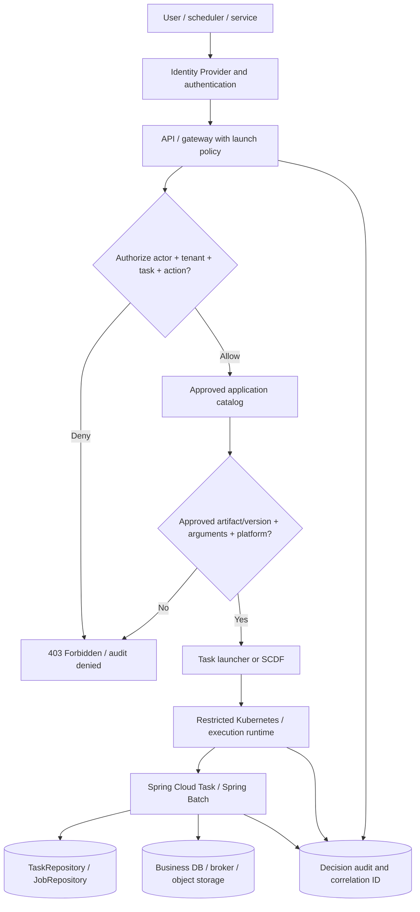
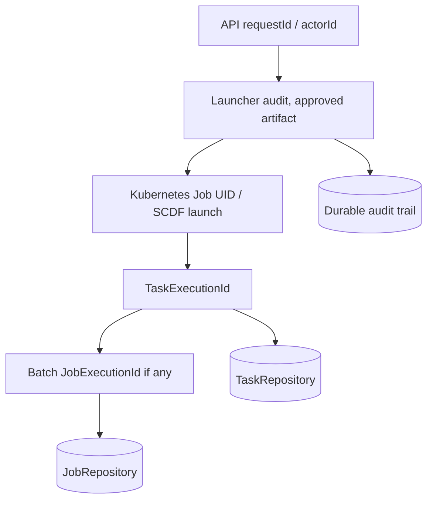

# Restricting Launch Permissions and Selecting Approved Applications

## Purpose and Context

**Spring Cloud Task** is used to run applications with a finite lifetime: starting up, performing work, saving `TaskExecution` and outcomes/exit codes to `TaskRepository`, and then terminating. A task can be launched on a schedule, by an API request, via CLI, by a Kubernetes Job/CronJob, or through **Spring Cloud Data Flow (SCDF)**; it can also integrate with **Spring Batch** to execute Jobs/Steps. Because a single launch can read customer data, call partners, write to databases, or incur infrastructure costs, **Task launch permission is a privilege with real impact**, not merely permission to view history.

Scenario: an organization has two vetted applications:

- `daily-settlement`: reconciles figures for a tenant/date and writes financial transactions.
- `invoice-export`: exports reports with read access to a subset of data.

User A is only allowed to export reports for tenant `shop-42`. If the system lets A call an API such as `POST /tasks/launch?image=<any-image>&args=<any-args>`, the user could choose the settlement application, change `spring.datasource.url`, or ask the deployer to attach different privileges. **Blocking in the UI is not enough**; every launch path must be controlled on the server side and the execution platform.

After this lesson, you will be able to:

1. Distinguish **caller authentication**, **create/launch/schedule permissions**, **approved applications**, and **data scope**.
2. Scope SCDF roles and avoid granting all roles to any logged-in user.
3. Design an **allowlist** by Task name, artifact/version/digest, and tenant; never accept arbitrary JAR/Docker image paths from callers.
4. Build a Task launch API with server-side authorization, strongly typed parameters, and **deny-by-default**.
5. Restrict **Kubernetes service accounts**, images, namespaces, Pod security, and DB/secret access.
6. Test privilege-escalation, argument-tampering, scheduler-bypass, Composed Task, and metadata-query scenarios.

> **Scope note:** Spring Cloud Task is a framework for tracking and running tasks; it **does not natively provide user-level authorization for every launch request**. This lesson examines common defense layers when combining Spring Security, SCDF 2.11.x, and Kubernetes. Always verify exact features, endpoints, roles, and settings for your deployed version; the catalog/allowlist tables in the examples are **application-defined policies**, not built-in Spring Cloud Task properties.

## 1. Threat Model: Who Can Cause What Code to Execute?



This model relies on **multiple checkpoints**, not a single `isAuthenticated()` check:

| Question | Primary Control | Policy Example |
| --- | --- | --- |
| **Who is requesting?** | OAuth2/OIDC, workload identity, valid token | Only employee accounts or trusted service accounts |
| **What can they do?** | RBAC: view, create definition, launch, schedule, delete | Role `task-launcher` cannot register artifacts |
| **Which apps can run?** | Catalog allowlist, approved app/Task definition, approved artifact | Only `invoice-export`, never `daily-settlement` |
| **On which tenant/dataset?** | ABAC / business authorization checker | A may only invoke for `shop-42` |
| **What can be passed?** | Input schema / argument allowlist | Valid `business-date`; forbid arbitrary `--spring.*` |
| **Under which infra identity?** | Kubernetes RBAC, service account, admission policy | Pod cannot escalate privileges, mount hostPath, or use privileged SA |
| **What can it read/write?** | IAM, DB grants, NetworkPolicy, secret scope | `invoice-export` only has `SELECT` on report tables |
| **Who launched it, when, outcome?** | Audit + TaskExecution + process/Job status | Actor, policy decision, workflow ID, image digest, and exit code |

**Deny by default**: whenever actor, tenant, application, artifact, or secure configuration cannot be verified, deny. Never treat knowing a **Job name** or **TaskExecution ID** as proof of authorization.

## 2. Distinguishing Role Types in SCDF

**Spring Cloud Data Flow** provides a server, Dashboard/Shell, and REST API to register Task apps, create Task definitions, launch, and schedule tasks. SCDF protects endpoints using roles; the **SCDF 2.11.3** documentation describes:

| SCDF Role | Documented Action Group |
| --- | --- |
| `ROLE_VIEW` | View lists/statuses/metadata |
| `ROLE_CREATE` | Create objects, such as Task definitions |
| `ROLE_DEPLOY` | Deploy applications and **launch Tasks** |
| `ROLE_SCHEDULE` | Create Task execution schedules |
| `ROLE_MODIFY` | Modify state/configuration on corresponding endpoints |
| `ROLE_DESTROY` | Delete objects |
| `ROLE_MANAGE` | Management/admin endpoints |

**These are endpoint-category roles; they do not automatically enforce “user A can only run Task X.”** Anyone holding `ROLE_DEPLOY` must still be constrained by a **Task/tenant selection policy** implemented by your system if the organization requires per-application authorization.

### 2.1. Warning About SCDF's Default OAuth2 Behavior

According to [SCDF 2.11.3 – Customizing Authorization](https://docs.spring.io/spring-cloud-dataflow/docs/2.11.3/reference/htmlsingle/#configuration-security-customizing-authorization), the documented configuration **assigns all roles to authenticated OAuth2 users by default** unless explicit role mappings are configured. **Enabling login is not enough to enforce least privilege**.

SCDF supports mapping OAuth scopes or group claims from an IdP to Data Flow roles. Illustrative example with provider ID `uaa` — only valid when your system actually uses that provider and those scopes are properly issued by the IdP:

```yaml
spring:
  cloud:
    dataflow:
      security:
        authorization:
          provider-role-mappings:
            uaa:
              map-oauth-scopes: true
              role-mappings:
                ROLE_CREATE: dataflow.create
                ROLE_DEPLOY: dataflow.deploy
                ROLE_DESTROY: dataflow.destroy
                ROLE_MANAGE: dataflow.manage
                ROLE_MODIFY: dataflow.modify
                ROLE_SCHEDULE: dataflow.schedule
                ROLE_VIEW: dataflow.view
```

This is a **mapping structure template**, not a complete IdP/OAuth configuration. When enabling scope mapping, the documentation requires mappings for **all seven roles**. A provider ID other than `uaa` must change the corresponding key; tokens must validate issuer/audience and claims per environment security settings. Group claims can be mapped if the IdP provides groups instead of scopes.

**Illustrative intended authorization matrix:**

| Principal | Desired Roles | Forbidden |
| --- | --- | --- |
| `auditor` | `ROLE_VIEW` | Create, launch, schedule, delete |
| `scheduler-bot` | `ROLE_SCHEDULE` per orchestration workflow | Registering arbitrary images/JARs, server admin |
| `operator` | `ROLE_VIEW`, `ROLE_DEPLOY` when approved | `ROLE_CREATE`/`ROLE_DESTROY`/registering artifacts if unneeded |
| `release-manager` | Create/update definitions/artifacts under change control | Launching financial data outside assigned scope |
| `platform-admin` | Needed admin roles, with MFA/audit | Never use admin tokens for daily schedulers |

This is a **recommended matrix**, not built-in SCDF users/roles. Do not assume `ROLE_SCHEDULE` on the SCDF API controls every way a Task can be launched; if a service can call `ROLE_DEPLOY` or directly create Kubernetes Jobs, protect **those other paths** too.

### 2.2. Blocking Bypass Paths

Authorization must be enforced **server-side** across REST API/Shell/Dashboard, not merely by hiding a “Launch” button in the UI. If you build an internal API with the rule “only run approved Tasks,” yet still let users call **SCDF REST directly** with a `ROLE_DEPLOY` token, they can go around the API and bypass the allowlist.

Architectural solution:

- Only a **trusted launcher service** is permitted to call the SCDF launch API or Kubernetes Job create API.
- Users call an **authenticated business API**; that API validates actor, tenant, task key, and arguments before invoking the launcher.
- Restrict SCDF Server network ingress and identity access; route Dashboard/admin/shell access through dedicated paths with appropriate privileges.
- Scheduler automation uses its own **machine identity**/service principal that can be audited and revoked; never reuse admin passwords/tokens.
- Anyone able to create Jobs/Pods directly on the cluster must be governed with controls equivalent to Task launch permissions; do not let them bypass the gateway.

## 3. Allowing Only Vetted Applications to Run

### 3.1. Registering an App in SCDF Does Not Create a Per-User Allowlist

SCDF has an **App Registry**: a `task` application name bound to a resource URI, such as a Maven artifact or Docker image. The Shell allows:

```text
dataflow:> app register --name invoice-export --type task --uri docker:registry.example.internal/tasks/invoice-export:2.3.1

dataflow:> task create invoice-export-prod --definition "invoice-export"

dataflow:> task launch invoice-export-prod
```

This is **illustrative SCDF Shell syntax**, assuming the app was built, scanned, approved, and authorized in the registry. Do not treat `app register` as a workflow for anyone to freely add apps. Per [SCDF – Registering and Launching Task Applications](https://docs.spring.io/spring-cloud-dataflow/docs/2.11.3/reference/htmlsingle/#spring-cloud-dataflow-task-applications), SCDF links an app name to a URI, a Task definition references the app, and `task launch` runs that definition.

**Two separate guardrails are required:**

1. **Approval/registration workflow**: only the release pipeline or authorized administrators may add new app versions to the registry. Never import huge unreviewed catalogs or use `--force` to swap the URI of a trusted app without change control.
2. **Approval/launch workflow**: an actor may only launch a **task definition** on their permitted allowlist, for their permitted tenant/platform, and with an **approved version**.

Never treat an app being registered in `App Registry` as proof that everyone with `ROLE_DEPLOY` may run it for every tenant. **The allowlist table below is an application-owned policy**.

### 3.2. Illustrative Allowlist Catalog

| Caller Request Key | Permitted SCDF Task Definition | Approved Artifact | Principal / Scope | Impact |
| --- | --- | --- | --- | --- |
| `invoice-export` | `invoice-export-prod` | `invoice-export:2.3.1`, vetted digest/SBOM | `reporting-operator`, assigned tenants | Reads data and writes CSV |
| `daily-settlement` | `settlement-prod` | `settlement:5.2.0`, vetted digest | `finance-operator`, assigned tenants | Writes transactions |
| `nightly-rebuild` | `rebuild-prod` | dedicated artifact, change ticket required | `platform-admin` with additional approval | Broad impact, strict auditing required |
| Any other name | None | None | Any regular caller | **DENY** |

**A static allowlist by name is insufficient** if a name can be repointed to a new artifact: `:latest` tags or mutable versions create a *time-of-check to time-of-use* risk. Kubernetes supports pinning **image digests `image@sha256:...`**, since a digest identifies immutable image contents. For Maven artifacts, pin versions in repositories **that forbid overwrites**, verify checksums/signatures/SBOMs, and restrict publish permissions. At launch time, verify the live definition/registry still points to the approved artifact—do not check only when creating the allowlist.

If using SCDF's **Composed Task Runner**, review **every node** and every child override mechanism, not just the parent composed Task name. A single composed task can invoke multiple distinct runtime images/identities.

### 3.3. Authorization Conditions Cannot Rely on Name Alone

A request is valid only when all conditions hold simultaneously:

```text
canLaunch(actor, request) =
    actor is authenticated
    AND actor holds launch permission
    AND appKey is in the approved catalog
    AND artifact/version/digest is currently approved
    AND actor has permission for the tenant/dataset
    AND action matches environment/platform/namespace
    AND input satisfies schema and bounds
    AND quota/concurrency/approvals permit execution
```

This is an **illustrative policy rule**, not an expression evaluated natively by Spring Cloud Task. If any condition fails, deny; audit the decision without logging secrets or sensitive payloads.

## 4. Separating “Choosing an App” from “Choosing Arguments”

**Spring Boot gives command-line `--...` properties higher precedence than environment variables and `application.yml` by default.** If an API accepts an arbitrary `arguments` string and forwards it to the Task launcher, a user could override infrastructure properties, for example:

| String callers must NOT freely supply | Risk |
| --- | --- |
| `--spring.datasource.url=...` | Redirects `TaskRepository` or business DB elsewhere |
| `--spring.datasource.username=...` / `--spring.datasource.password=...` | Credential abuse, secret exposure in process lists/metadata |
| `--spring.profiles.active=...` | Activates out-of-scope configuration profiles |
| `--spring.config.location=...` / `--spring.config.import=...` | Switches configuration sources for the JVM |
| `--spring.cloud.task.single-instance-enabled=false` | Disables concurrency restrictions if overrides are allowed |
| `--spring.cloud.task.parent-execution-id=...` | Forges parent-child Task relationships in metadata |
| `--management.endpoints.web.exposure.include=*` | Expands attack surface if the task has HTTP management endpoints |
| `deployer.<task>.*` / `app.<task>.*` accepted by SCDF on launch | Can alter platform/namespace/resources/app via deployer mechanisms |

**A blacklist of a few prefixes cannot fully solve this.** Spring Boot and SCDF have many config aliases/sources, extended plugin/deployer properties, and file import mechanisms. A much better approach is to **accept only a DTO with well-defined business fields**, map them to a fixed server-generated set of options, and lock down infrastructure configuration supplied by the deployment.

Example public API accepting:

```json
{
  "taskKey": "invoice-export",
  "tenantId": "shop-42",
  "businessDate": "2026-11-23"
}
```

It **does not** accept `image`, `artifactUri`, `command`, raw string `arguments`, `properties`, `serviceAccountName`, `namespace`, `volumeMount`, or `secretRef`. The server constructs exactly:

```text
--tenant-id=shop-42
--business-date=2026-11-23
```

You can constrain `tenantId` by an ID catalog/regex, `businessDate` within an allowed window, daily run quotas, and validate **business intent** via an idempotency key. Never concatenate input values into shell commands; pass them as an argument list to the appropriate launcher/deployer.

**Remember:** `TASK_EXECUTION_PARAMS` can persist Task arguments. Never send access tokens, passwords, or raw personal data via CLI; eliminate data exposure risks at the request-design stage.

## 5. Server-Side Example: Authentication, Authorization, and Allowlist

A sound architecture exposes a **narrow API to request Task launches**, placed in front of SCDF/Kubernetes. This endpoint is a Spring Boot application secured with Spring Security, **not the headless Spring Cloud Task itself** (Tasks typically run without an HTTP server). It can be invoked by authenticated users or schedulers holding service tokens.

### 5.1. Method Security Configuration

Spring Security enables protecting methods with `@PreAuthorize` once `@EnableMethodSecurity` is active. The snippet below uses an OAuth2 Resource Server with JWT; it assumes issuer/JWK, token validation, TLS, and network policies are configured:

```java
package com.example.launcher;

import org.springframework.context.annotation.Bean;
import org.springframework.context.annotation.Configuration;
import org.springframework.security.config.Customizer;
import org.springframework.security.config.annotation.method.configuration.EnableMethodSecurity;
import org.springframework.security.config.annotation.web.builders.HttpSecurity;
import org.springframework.security.web.SecurityFilterChain;

@Configuration
@EnableMethodSecurity
public class ApiSecurityConfiguration {

    @Bean
    SecurityFilterChain taskApiSecurity(HttpSecurity http) throws Exception {
        http.authorizeHttpRequests(auth -> auth
                    .anyRequest().authenticated())
                .oauth2ResourceServer(oauth -> oauth
                    .jwt(Customizer.withDefaults()));
        return http.build();
    }
}
```

This snippet requires Spring Security, OAuth2 Resource Server dependencies, and valid identity provider configuration. `@EnableMethodSecurity` **is not enabled automatically just by adding the Security starter**. Never treat method security as sufficient if another endpoint calls the adapter directly or if SCDF remains exposed.

In pure stateless Bearer-token APIs, **evaluate CSRF based on the actual authentication mechanism** (cookies/sessions vs. headers) before deciding on configuration. Do not disable CSRF on cookie-authenticated web UIs simply because this example uses JWT.

### 5.2. Service Checking Permissions and Catalog Before Launch

The Java code below illustrates the **policy/application layer**, without coupling to a specific `TaskLauncher`. `AuthorizedTaskPort` is a project-implemented adapter that calls SCDF/Kubernetes **using fixed identifiers** after verifying the artifact. `TenantPermissionService` must be genuinely implemented from principal, tenant, and roles; **never** use a stub returning `true` in production.

```java
package com.example.launcher;

import java.time.LocalDate;
import java.util.Map;

import org.springframework.http.HttpStatus;
import org.springframework.security.access.AccessDeniedException;
import org.springframework.security.access.prepost.PreAuthorize;
import org.springframework.security.core.Authentication;
import org.springframework.stereotype.Service;
import org.springframework.web.bind.annotation.*;
import org.springframework.web.server.ResponseStatusException;

record LaunchRequest(
        String taskKey,
        String tenantId,
        LocalDate businessDate) {}

record ApprovedTask(
        String definitionName,
        String expectedArtifactDigest) {}

record LaunchReceipt(String requestId) {}

interface TenantPermissionService {
    boolean mayLaunch(
            Authentication actor, String tenantId, String taskKey);
}

interface AuthorizedTaskPort {
    // Adapter accepts only approved definition + business fields.
    // Must verify current registry artifact matches expectedDigest.
    String launch(
            ApprovedTask approved,
            String tenantId,
            LocalDate businessDate,
            String requestedBy);
}

@Service
class ApprovedTaskService {

    // Illustrative: digests must be replaced with real approved checksums.
    private static final Map<String, ApprovedTask> CATALOG = Map.of(
            "invoice-export",
            new ApprovedTask("invoice-export-prod", "sha256:APPROVED_EXPORT_DIGEST"),
            "daily-settlement",
            new ApprovedTask("settlement-prod", "sha256:APPROVED_SETTLEMENT_DIGEST")
    );

    private final TenantPermissionService tenantPermission;
    private final AuthorizedTaskPort launcher;

    ApprovedTaskService(
            TenantPermissionService tenantPermission,
            AuthorizedTaskPort launcher) {
        this.tenantPermission = tenantPermission;
        this.launcher = launcher;
    }

    @PreAuthorize("hasAuthority('SCOPE_tasks.launch')")
    public LaunchReceipt requestLaunch(LaunchRequest req, Authentication actor) {
        if (req == null || req.taskKey() == null
                || req.tenantId() == null
                || req.businessDate() == null) {
            throw new ResponseStatusException(HttpStatus.BAD_REQUEST);
        }

        ApprovedTask approved = CATALOG.get(req.taskKey());
        if (approved == null) {
            // Do not disclose whether an internal app exists in another catalog.
            throw new AccessDeniedException("Task not permitted");
        }
        if (!tenantPermission.mayLaunch(
                actor, req.tenantId(), req.taskKey())) {
            throw new AccessDeniedException("Not permitted for tenant");
        }

        // Add validation here for date range, quota,
        // idempotency key, and approvals if business rules require.
        String requestId = launcher.launch(
                approved, req.tenantId(),
                req.businessDate(), actor.getName());

        return new LaunchReceipt(requestId);
    }
}

@RestController
@RequestMapping("/api/tasks")
class ApprovedTaskController {

    private final ApprovedTaskService service;

    ApprovedTaskController(ApprovedTaskService service) {
        this.service = service;
    }

    @PostMapping("/launch")
    @ResponseStatus(HttpStatus.ACCEPTED)
    LaunchReceipt launch(
            @RequestBody LaunchRequest request, Authentication actor) {
        return service.requestLaunch(request, actor);
    }
}
```

**How to read this example correctly:**

- `@PreAuthorize` checks scope `tasks.launch` when Spring Security maps the token scope to `SCOPE_tasks.launch`. **This scope is a gateway-specific convention**, not `dataflow.deploy` or an automatically generated SCDF role.
- `CATALOG` is an allowlist keyed by **request key**, mapping to a fixed definition. The `APPROVED_*_DIGEST` strings are **placeholders** that must be replaced with real digests approved by your release pipeline.
- `TenantPermissionService` and `AuthorizedTaskPort` are **contracts that must be implemented**. This snippet does not deploy Tasks on its own until your project provides a secure adapter bean.
- `AuthorizedTaskPort` must verify that the **live definition** points to the approved artifact/digest, pick the namespace/service account from server configuration, forward only validated `tenantId`/`businessDate`, and reject mismatches between catalog and registry.
- Checking a scope at the service layer is **a necessary condition**, not a substitute for input validation, tenant-level authorization, quotas, or isolation. Paths bypassing the service, such as SCDF REST, must also be locked down.
- For production external APIs, use bean-validated DTOs (`@NotBlank`, `@NotNull`, `@Pattern`), reject unknown fields, apply appropriate CSRF/identity controls, rate limiting, and non-leaky error responses. Validation here is simplified to highlight the **authorization flow**.

**Never** concatenate `req.taskKey()` directly into a `java -jar`/Docker URI command; never interpolate `req.tenantId()` into a shell string. The adapter itself must pass list-based arguments and accept resources strictly from the approved catalog.

## 6. Controlling Launches in Kubernetes: RBAC Is Not an Image Allowlist

When a Task runs on Kubernetes, **two service accounts have distinct responsibilities**:

- **Launcher / SCDF deployer identity**: the account able to **create/observe Kubernetes Jobs or Pods**.
- **Runtime Task Pod identity**: the account that **the Java app inside the Pod** uses if it ever calls the Kubernetes API.

Separate these two identities so a Task does not inherently gain rights to spawn other Pods/Jobs or read system secrets. For most Spring Cloud Tasks needing only a DB and broker, the runtime Pod **does not need a Kubernetes API token**.

### 6.1. Narrow Role Example for a Launcher Creating Kubernetes Jobs

This applies only to architectures where a **trusted controller directly creates Kubernetes Jobs** in namespace `batch-workloads`. In SCDF, some deployers use the Pod API rather than the Job API, so permissions must match your platform's actual resource types; do not blindly apply Job RBAC to SCDF.

```yaml
apiVersion: v1
kind: ServiceAccount
metadata:
  name: approved-task-launcher
  namespace: batch-workloads
---
apiVersion: rbac.authorization.k8s.io/v1
kind: Role
metadata:
  name: approved-task-job-launch
  namespace: batch-workloads
rules:
  - apiGroups: ["batch"]
    resources: ["jobs"]
    verbs: ["create", "get", "list", "watch"]
---
apiVersion: rbac.authorization.k8s.io/v1
kind: RoleBinding
metadata:
  name: approved-task-job-launch-binding
  namespace: batch-workloads
subjects:
  - kind: ServiceAccount
    name: approved-task-launcher
    namespace: batch-workloads
roleRef:
  kind: Role
  name: approved-task-job-launch
  apiGroup: rbac.authorization.k8s.io
```

**Security warning:** a principal with `create jobs`, even without `get secrets`, can still create Pods referencing `secretKeyRef` or `serviceAccountName`, and can run **any image** if the cluster permits it. Consequently, **RBAC at the `create jobs` level is not sufficient to enforce an image/secret/serviceAccount allowlist**. You need a trusted launcher generating manifests from approved templates **combined with admission policies**, while restricting all other workload-creation paths.

Typical admission policy checks needed:

- Allow images only from **approved registries and approved digests**.
- Allow only vetted Task runtime `serviceAccountName`s; block hostPath/privileged/excess container capabilities.
- Restrict namespaces, volume/Secret refs, service types, security contexts, and network exposure.
- Set `ResourceQuota`/`LimitRange` so a single caller cannot consume excessive CPU/memory/Pods.
- Enforce Kubernetes **Pod Security Standards** (baseline or restricted per workload), admission enforcement, and appropriate `NetworkPolicy`/egress rules.

Kubernetes provides CEL-based [ValidatingAdmissionPolicy](https://kubernetes.io/docs/reference/access-authn-authz/validating-admission-policy/), stable since v1.30, alongside admission webhooks/policy engines depending on the cluster. Policies must target the **actual resources created** (Pods, Job PodTemplates, or other controllers), not just one layer that can be bypassed. Use `failurePolicy: Fail` and `Deny` actions for mandatory policies; test bypass attempts before enabling in production.

### 6.2. Running the Task Pod with Least Privilege

Illustrative secure Pod template snippet:

```yaml
spec:
  template:
    spec:
      serviceAccountName: settlement-task-runtime
      automountServiceAccountToken: false
      restartPolicy: Never
      securityContext:
        runAsNonRoot: true
        seccompProfile:
          type: RuntimeDefault
      containers:
        - name: task
          image: registry.example.internal/tasks/settlement@sha256:REPLACE_WITH_APPROVED_DIGEST
          securityContext:
            allowPrivilegeEscalation: false
            readOnlyRootFilesystem: true
            capabilities:
              drop: ["ALL"]
          resources:
            requests:
              cpu: "200m"
              memory: "256Mi"
            limits:
              cpu: "1"
              memory: "1Gi"
```

This is a **Kubernetes Job `spec` snippet**, not a full manifest. You must create `settlement-task-runtime`, replace the image digest placeholder, mount volumes for output/temp directories if the app writes files, and confirm the image UID actually runs non-root. With `readOnlyRootFilesystem`, mount `emptyDir`/PVCs for required writable paths instead of re-enabling root privileges to work around config errors.

**Do not mount a Kubernetes API token when unneeded.** If a Task needs to read a ConfigMap, consider mounting it via deployer volume rather than granting namespace-wide `list/get`. If it must read secrets, use a properly scoped secret store/volume with a rotation policy, and never print secrets to logs.

### 6.3. Pin Image Digests and Control Artifact Provenance

`invoice-export:2.3.1` is a **tag**, which can be repointed to different bytes if the registry allows overwrites. `image@sha256:<digest>` binds the exact image content the runtime will execute; [Kubernetes Images](https://kubernetes.io/docs/concepts/containers/images/) recommends digests to guarantee versions do not drift across Pods. **A digest alone does not prove an image is safe**: you still need vulnerability scanning, provenance/signature/SBOM verification, and release-pipeline-only publishing controls.

## 7. Preventing Tasks from Escalating Privileges After Launch

**Launcher** permissions and **running Task** permissions are two independent domains. A validly launched Job can still cause damage if the Pod or application holds overly broad data privileges.

### 7.1. Restricting `TaskRepository` Database Privileges

Spring Cloud Task writes lifecycle metadata to `TaskRepository`: `TASK_EXECUTION`, `TASK_EXECUTION_PARAMS`, and related tables depending on features/version. When run with Spring Batch, `JobRepository` uses `BATCH_JOB_*`, `BATCH_STEP_*`, and `ExecutionContext` tables. When `single-instance-enabled` is enabled, the application may need write privileges on the JDBC lock table.

Database identities should be separated:

| Account | Minimal Privileges | Should NOT Have |
| --- | --- | --- |
| `task-repository-runtime` | Needed DML on migrated Task schema tables/sequences | `CREATE/DROP TABLE` across the DB, DBA privileges |
| `batch-repository-runtime` | Needed DML on Batch schema tables/sequences | Broad DB admin rights outside the repository |
| `invoice-export-reader` | `SELECT` on allowed tenant/report views/tables | `UPDATE/DELETE` on payment tables |
| `settlement-writer` | `INSERT/UPDATE` on exact business tables and needed reads | Write access across all tenants/tables |
| `schema-migration` | DDL/migrations in the approved pipeline | Never used as daily task runtime credentials |

**A single datasource** can cause Task infrastructure code and business code to share an overly broad account. For higher-risk workloads, split `DataSource`/transaction manager/repository and identities, ensuring Spring Cloud Task targets the proper metadata DB through configuration. All multi-tenant data access paths must be enforced in queries/row-level security (if used)—never trust a user-supplied `tenantId` without verifying access.

To prevent a Task from altering history or running arbitrary migrations, grant only required privileges. However, **do not withhold DML privileges the framework genuinely needs**: under-granting breaks exit code/status recording and corrupts monitoring. Check schemas and grants against **your specific library versions** instead of guessing a static table list.

### 7.2. Keeping Secrets Out of Command Lines and Catalogs

Example Boot/Cloud Task configuration inside a container:

```yaml
spring:
  application:
    name: settlement-task
  main:
    web-application-type: none
  datasource:
    url: ${TASK_DB_URL}
    username: ${TASK_DB_USER}
    password: ${TASK_DB_PASSWORD}
  cloud:
    task:
      initialize-enabled: false
```

The application receives these variables from deployment/secret store integrations with appropriate permissions. `initialize-enabled: false` assumes the schema was created via external migrations outside runtime. Never pass passwords in `--spring.datasource.password`, and never put secrets in JobParameters/Task arguments, URLs, image tags, Kubernetes Job names, or `exitMessage`.

Avoid more than just logging passwords: Spring Cloud Task can persist **arguments** in `TASK_EXECUTION_PARAMS`. Mistakenly passed sensitive values can outlive the Pod in the database and be queried by anyone allowed to view history. Restrict metadata read access and minimize retention/mask data per compliance requirements.

### 7.3. Blocking Spring Boot Configuration Overrides via Business Input

Even after the server restricts arguments to `--business-date=...` and `--tenant-id=...`, the Task should still **validate independently**:

- Use `ApplicationArguments.getOptionValues(...)`, rejecting missing or duplicate critical options.
- Parse `LocalDate` and verify the business date lies within allowed bounds.
- Validate tenant/workflow context and business keys before writing.
- Never treat a caller-supplied `spring.cloud.task.parent-execution-id` as authorization proof for a parent workflow.

When policy requires “CLI options must not override application configuration,” Spring Boot offers:

```java
public static void main(String[] args) {
    SpringApplication app =
            new SpringApplication(SettlementTaskApplication.class);
    app.setAddCommandLineProperties(false);
    app.run(args);
}
```

This is an **architectural choice**, not mandatory: Spring Boot stops adding `--...` as a property source in `Environment`, while `ApplicationArguments` remains readable in runners. **Consequence:** `--spring.profiles.active=...` and other Boot options will **no longer override configuration via CLI**. If SCDF/launchers depend on Boot CLI properties, test beforehand. Also, this mechanism **does not** block higher/other precedence sources like environment variables, Java system properties, or config imports, nor does it replace server-side launch authorization.

## 8. Schedulers, Composed Tasks, and Retries Must Follow the Same Policy

### 8.1. A Scheduler Is an Authorized Caller

A scheduler may have no interactive login UI yet launch **hundreds of runs per day**. Provision dedicated **machine identities** per application/purpose; a report-scheduling bot should never be able to trigger financial settlements or swap images.

Recommended authorization matrix example:

| Request Source | Allowed | Denied |
| --- | --- | --- |
| `report-cron-bot` | Launch `invoice-export-prod` on schedule for reporting tenants | Registering apps, choosing arbitrary artifacts, or running `settlement-prod` |
| `finance-scheduler` | `settlement-prod` within approved reconciliation windows | Creating privileged Kubernetes Pods or altering DB URLs |
| `incident-operator` | Retry an execution for assigned tenants with a ticket ID | Wildcard launching any app, deleting history |
| `platform-release-bot` | Publish scanned/approved artifact versions | Running business Jobs outside deployment pipeline/scope |

SCDF separates `ROLE_SCHEDULE` from `ROLE_DEPLOY`; however, this model governs **endpoint operations**, so a scheduler permitted to create schedules still needs business-level policy restricting definition/platform/arguments. If CronJobs exist independently of SCDF, they are **not governed by SCDF roles**: permissions to create/edit CronJobs and their controller service accounts must be controlled separately.

### 8.2. Composed Tasks: Inspect the Entire Graph

A **Composed Task Runner** can orchestrate child apps via DSL, for example:

```text
extract-task && validate-task && publish-task
```

Allowlisting only `my-approved-flow` **is not enough** if users can edit the definition/DSL, override `composedTaskArguments`, or swap a child's version. Before approving a flow:

1. Resolve **all task applications/nodes** the flow will invoke; verify each node's artifact/version/digest.
2. Verify **the caller is authorized across all actions and tenants**, not just the first node.
3. Forbid modifying the DSL/definition after approval without re-review; detect URI/image/tag changes.
4. Control **Composed Task Runner** options forwarded to children (arguments, app/deployer properties).
5. When retrying a child, use the **same business idempotency key** and verify the child remains within policy; never treat a new `TaskExecutionId` as proof of authorization.

The `parentExecutionId` relationship in `TaskRepository` is solely traceability metadata recording **who orchestrated whom**, not an authentication token. Passing `spring.cloud.task.parent-execution-id=123` does not grant parent privileges or access to another tenant's data.

### 8.3. Retries Must Not Become an Authorization Bypass

A request to “rerun TaskExecution 789” must also authenticate the caller, verify **the current app is still approved**, check tenant, artifact, current policy, and retry limits. Never blindly read old args from `TASK_EXECUTION_PARAMS` and re-execute verbatim because:

- That record may contain infrastructure settings that were later revoked.
- The artifact may have had a vulnerability discovered and been deprecated.
- The current caller may no longer hold permissions for that tenant.
- Retrying may duplicate business effects or exceed quotas.

Distinguish **“replaying valid data”** from **“launching an untrusted old version.”** To reproduce bugs, deploy into an isolated sandbox with anonymized data and explicit approval instead of reopening production privileges.

## 9. Preventing Resource Abuse and Launch Flooding

An actor authorized to launch can still cause **denial of service** or high costs by spawning thousands of valid tasks. Therefore:

- Enforce rate limits at the gateway per actor, tenant, and task key; enforce daily quotas and **concurrent execution caps**.
- Enforce CPU/memory/ephemeral storage limits, `activeDeadlineSeconds`/timeouts, concurrency, and retry budgets in the launcher/Kubernetes.
- Configure `ResourceQuota` and `LimitRange` on Task namespaces.
- Use `single-instance-enabled` when business logic forbids concurrent runs of the same Task name, while **never mistaking it for idempotency protection**. Sequential Tasks can still write duplicates.
- Reject oversized inputs, out-of-SLA date ranges, user-supplied free-form cron expressions, or unapproved “backfill entire history” requests.
- Enforce idempotency using business keys `(tenantId, businessDate, operation)`, `UNIQUE` constraints, and side-effect confirmation in DB/brokers.

Rate limits and quotas must be enforced at the **shared control layer** across all launchers. Limits enforced only in a UI will not stop a caller using the REST API or another scheduler.

## 10. Auditing: Tracing Who Requested Which Task, Which App Ran, and the Outcome

`TaskRepository` records **TaskExecution**, but does not automatically capture “who authorized it,” “which policy version allowed it,” or “which artifact digest was approved.” Maintain **separate auditing** at the gateway/launcher.

Reference audit fields:

| Field | Example | Notes |
| --- | --- | --- |
| `requestId` | `req-20261124-0001` | Server-generated correlation ID; never trust caller-supplied IDs |
| `actorId` | `user-123` / `scheduler-bot` | Non-sensitive identifier |
| `action` | `LAUNCH_TASK` | Distinguish CREATE/LAUNCH/SCHEDULE/RETRY/DELETE |
| `requestedTaskKey` | `invoice-export` | Validated public key |
| `approvedDefinition` | `invoice-export-prod` | Internal SCDF Task definition name |
| `artifactDigest` | `sha256:...` | Digest of the artifact actually executed |
| `tenantId` | `shop-42` | Subject to data access controls |
| `policyDecision` | `ALLOW` or `DENY` | Concise reason without exposing secrets |
| `policyVersion` | `policy-2026-11-24` | Identifies which rule set applied |
| `platformExecutionRef` | Kubernetes Job UID or SCDF launch ID | Links launcher to runtime |
| `taskExecutionId` | `12345` if created | May be absent if bootstrap failed |
| `exitCode` | `0`/`1`/`NULL` | Available only after execution concludes |

### 10.1. Correlating IDs Without Conflating Them



A request can fail before TaskRepository writes a record; **auditing must begin at the policy decision step**. Conversely, if network/RBAC policies are not locked down, a Task might be launched outside the gateway; dashboards should alert on **TaskExecutions missing a valid requestId/actorId**.

Never record raw access tokens, request headers, passwords, or full args in audit logs. Apply read access controls, retention policies, and immutability/append-only storage per internal compliance. For failed launches, record exception types and correlation IDs rather than full PII.

## 11. Testing Authorization and Bypass Prevention

Below is a **recommended test matrix** for a deployment placing a gateway in front of SCDF and Kubernetes. `ALLOW/DENY` outcomes are **expectations of the sample policy**, not automatic Spring Cloud Task behavior.

| # | Caller and Request | Expected | Why |
| ---: | --- | --- | --- |
| 1 | `reporting-operator`, `invoice-export`, authorized tenant | **ALLOW** | Valid scope + app + tenant + digest |
| 2 | Same user requesting `daily-settlement` | **DENY** | No permission for financial app |
| 3 | User with only SCDF `ROLE_VIEW` calling `task launch` | **DENY** | Launch requires appropriate deploy permission |
| 4 | Logged-in user with unmapped roles on permissive default SCDF config | **MUST DETECT / POLICY BUG** | Authentication does not equal least-privilege authorization |
| 5 | Payload with `taskKey=unknown-app` | **DENY** | App not in allowlist |
| 6 | Payload with `image=public-registry/unknown:latest` | **DENY** | API does not accept caller-supplied images |
| 7 | Payload with `--spring.datasource.url=...` | **DENY** | Arbitrary args rejected |
| 8 | Payload with `--spring.profiles.active=debug` | **DENY** | Runtime profile switching forbidden |
| 9 | User for `shop-42` requesting tenant `shop-43` | **DENY** | Data authorization / ABAC check |
| 10 | Approved app tag swapped to a different digest | **DENY** | Artifact no longer matches approved build |
| 11 | Actor with launch scope tries POSTing directly to SCDF | **DENY** | Network/SCDF identity blocks bypass |
| 12 | Actor tries creating an arbitrary Kubernetes Job in namespace | **DENY** | Kubernetes RBAC denies direct creation; admission protects |
| 13 | Authorized caller exceeds execution quota | **DENY / 429 per API** | Resource bounds and rate limits |
| 14 | Scheduler uses expired token or wrong audience | **DENY** | Strict token validation |
| 15 | Valid parent flow containing an unapproved child app | **DENY** | Entire graph must be vetted |
| 16 | Retry old TaskExecution whose artifact was revoked | **DENY or route to approved sandbox** | Never substitute history for current authorization |

### 11.1. What Should Integration Tests Prove?

1. **Authentication**: invalid/expired/wrong-audience tokens are rejected; no anonymous launch path exists.
2. **Authorization**: VIEW users cannot call CREATE/DEPLOY/SCHEDULE; LAUNCH users cannot register new apps.
3. **Application allowlist**: name tampering, lookalike Unicode characters, versions, URIs, and image digests are verified **canonically** before invoking the launcher.
4. **Tenant authorization**: attempt accessing another tenant's resources; never trust a tenant ID in URL/JSON if the token lacks authority.
5. **Argument validation**: pass unknown fields, `spring.*` or `deployer.*` keys, spaces/shell commands, duplicate keys, invalid/out-of-range dates; none reach the launcher.
6. **Bypass**: call SCDF REST and Kubernetes API directly with user credentials; must be blocked per policy.
7. **Runtime policy**: attempt unapproved workloads, elevated serviceAccounts, privileged/hostPath pods, and wrong namespaces; must be rejected by admission control.
8. **Audit**: every ALLOW/DENY request records `requestId`, actor, and policy version; accepted requests link through to TaskExecution.
9. **Early failure**: Tasks failing before TaskExecution creation still retain launch audits + Kubernetes process/logs without fabricating history.
10. **Side effects**: re-running with the same business key writes no duplicates; verify transactions and data locks independently of authorization.

Run attack/bypass tests **only in authorized test environments**; never use production tokens or send dangerous payloads into live systems just to “see if it blocks them.”

## 12. Common Mistakes and How to Fix Them

| Mistake | Consequence | Fix |
| --- | --- | --- |
| Enabling OAuth login and assuming SCDF defaults to least privilege | Logged-in users may receive more roles than intended | Verify scope/group mappings per version and write DENY tests |
| Hiding Launch button in UI while REST API stays open | Users can call the API directly | Enforce server-side authorization and network controls |
| Checking only Task definition name | Definition's URI/tag gets swapped or wrong-tenant app runs | Pin artifact/digest, tenant + environment policies |
| Letting callers submit free-form `arguments`/`properties` | Overrides `spring.*` and deployer configs | Accept only typed business DTOs; adapter builds fixed args |
| Sharing an admin token between release users and operators | Cannot tell who caused actions; hard to revoke | Separate principals/roles/audits; use short-lived credentials |
| Treating Kubernetes Role `create jobs` as a complete sandbox | Allows creating Pods with privileged templates/images | Enforce admission rules on images/SAs/volumes/securityContext |
| Running Task Pods under the launcher's service account | Task code can spawn additional Pods/Jobs | Separate runtime identity; disable token mount if unneeded |
| Using `:latest` instead of approved digests | Image contents change silently under the same name | Pin digests + verify provenance |
| Sharing one DB credential with global writes across all tenants | One Task can corrupt another tenant's data | Separate DB grants, RLS/tenant validation, and secret scopes |
| Recording only `TaskExecution.exitCode` without actor audit | Unknown who requested or approved the run | Audit at gateway pre-launch with correlation IDs |
| Allowing retries without checking current permissions | Reruns revoked apps/tenants/artifacts | Reauthorize fully before every attempt |
| Treating `single-instance-enabled` as authorization | Does not check who can run or for which tenant | Enforce RBAC/ABAC at gateway; locking only handles concurrency |

## 13. Scenario Exercises

**Scenario A — Launch Permission vs. App Selection Permission.** An operator holds SCDF `ROLE_DEPLOY`, but business policy allows them to run only `invoice-export-prod`. They attempt to launch `settlement-prod` via SCDF Shell. Is SCDF `ROLE_DEPLOY` sufficient to protect the application properly?

**Answer:** No. SCDF roles protect **endpoint groups**, not per-tenant or per-artifact organizational policies. You need a server-side allowlist (trusted launcher, custom policy, isolated SCDF instances/platforms, or equivalent) and must block direct SCDF REST bypasses.

**Scenario B — No Secret Read Permission, Only Job Creation.** A service account has `create jobs`, not `get secrets`. Can we assume it cannot create workloads that access arbitrary Secrets?

**Answer:** No. Workload creation rights allow referencing `secretKeyRef` or privileged service accounts inside the PodTemplate. You need admission policies, fixed templates, separated identities, and restricted Job creation rights.

**Scenario C — Version Overwrite After Approval.** The catalog permits `invoice-export:2.3.1`, but that same tag in the registry was repointed to a new image. The system checks name/version and still launches it. What is the risk?

**Answer:** Tag checks do not guarantee which bytes execute. Pin immutable image digests, verify supply-chain provenance, and reject launches if the live registry/definition differs from the approved build.

**Scenario D — CLI Arguments.** A user only authorized for report exports passes `--spring.datasource.url=jdbc:...` to an API that forwards the raw string to the launcher. What is the problem?

**Answer:** `--...` options can override default Spring Boot configuration. The user could redirect the repository or access unintended data. Accept only typed business fields in the API, build args server-side, and let deployment control infrastructure.

**Scenario E — Retrying an Old Run.** `TaskExecution 123` ran legitimately in the past, but its artifact was later revoked due to a vulnerability. A user still authorized for `taskKey` requests “retry execution 123.” Should the old args/image be rerun automatically?

**Answer:** No. Re-validate actor, tenant, artifact, policy, and quotas at **retry time**; run only currently approved images, or investigate inside an explicitly approved sandbox.

**Scenario F — Composed Task.** `reporting-flow` was approved, but one child in the graph was altered to `settlement-task` with financial write access. Is checking the parent flow name enough?

**Answer:** No. You must evaluate **the entire graph and all child apps**, requiring re-review whenever definitions or URIs change; `composedTaskArguments` input must not override policy.

## 14. Secure Deployment Checklist

- [ ] A **single trusted launch path** exists; SCDF REST and Kubernetes API cannot be used by regular users/bots to bypass policy.
- [ ] OAuth2/OIDC/workload identity validates issuer/audience, TLS, and token expiry; separate principals for schedulers, operators, and admins.
- [ ] SCDF scope/group role mappings verified; authenticated users never receive all seven roles by default.
- [ ] VIEW, CREATE, DEPLOY, SCHEDULE, DESTROY, MANAGE, and MODIFY are separated; least privilege granted and DENY paths tested.
- [ ] A **catalog allowlist** exists by task key + definition + artifact/version/digest + tenant + environment/platform, deny-by-default.
- [ ] Only the release pipeline registers/updates artifacts; operators cannot use `--force` or arbitrary URIs.
- [ ] API accepts only business DTOs—never image/JAR URIs, shell commands, arbitrary arguments, or deployer properties.
- [ ] `business-date`, tenant, idempotency, quotas, and dataset permissions are validated server-side **and** re-validated inside the Task.
- [ ] Runtime service account is separate from the launcher, with Kubernetes API tokens restricted via RBAC/NetworkPolicy/Pod Security/admission.
- [ ] Admission controls enforce image digests, namespaces, service accounts, Secret refs, volumes/hostPath, privileges, and resource limits.
- [ ] DB grants separate Task/Batch metadata and business tables; schema migrations run with separate credentials, never runtime DBA access.
- [ ] No secrets or PII placed in CLI args, TaskExecution parameters, logs, tracing tags, or audits.
- [ ] Every launch/deny/schedule/retry logs request ID, actor, policy decision/version, artifact digest, and correlation to TaskExecution.
- [ ] Composed Tasks validate **all child applications**; retries validate against current policy.
- [ ] Alerts monitor anomalous launches, resource quotas, 403s, bypass attempts, digest mismatches, TaskExecutions without audits, and duplicate side effects.
- [ ] Deny and escalation tests executed in authorized test environments before production; reviewed regularly across SCDF/Kubernetes upgrades.

## 15. Official References

1. [Spring Cloud Data Flow 2.11.3 – Customizing Authorization](https://docs.spring.io/spring-cloud-dataflow/docs/2.11.3/reference/htmlsingle/#configuration-security-customizing-authorization): the seven roles, OAuth scope/group mappings, and the warning about granting all roles to authenticated OAuth users by default.
2. [Spring Cloud Data Flow – Registering Task Applications](https://docs.spring.io/spring-cloud-dataflow/docs/2.11.3/reference/htmlsingle/#spring-cloud-dataflow-task-applications): App Registry, Task definitions, resource URIs, and launching Tasks.
3. [Spring Cloud Data Flow – Launching a Task](https://docs.spring.io/spring-cloud-dataflow/docs/2.11.3/reference/htmlsingle/#spring-cloud-dataflow-task-launching-tasks): `task launch`, application/deployer properties, and command-line arguments.
4. [Spring Security – Method Security](https://docs.spring.io/spring-security/reference/servlet/authorization/method-security.html): `@EnableMethodSecurity`, `@PreAuthorize`, and service-layer authorization checks.
5. [Spring Boot – Externalized Configuration](https://docs.spring.io/spring-boot/reference/features/external-config.html): CLI `--...` precedence and configuration sources.
6. [Spring Cloud Task – Features](https://docs.spring.io/spring-cloud-task/reference/features.html): Task lifecycle, TaskExecution, and repository management.
7. [Spring Cloud Task – Task Repository Schema](https://docs.spring.io/spring-cloud-task/reference/appendix-task-repository-schema.html): `TASK_EXECUTION` and `TASK_EXECUTION_PARAMS`.
8. [Kubernetes – Using RBAC Authorization](https://kubernetes.io/docs/reference/access-authn-authz/rbac/): Roles/RoleBindings and namespace-scoped ServiceAccount permissions.
9. [Kubernetes – Service Accounts](https://kubernetes.io/docs/concepts/security/service-accounts/): runtime/launcher identities and least privilege.
10. [Kubernetes – Validating Admission Policy](https://kubernetes.io/docs/reference/access-authn-authz/validating-admission-policy/): admission validation, policy bindings, `Deny`/`failurePolicy`.
11. [Kubernetes – Images](https://kubernetes.io/docs/concepts/containers/images/): immutable digests vs. mutable tags and pull policies.
12. [Kubernetes – Pod Security Standards](https://kubernetes.io/docs/concepts/security/pod-security-standards/): non-root, privilege escalation, volume, and capability restrictions.
13. [Spring Cloud Data Flow – Composed Tasks](https://dataflow.spring.io/docs/feature-guides/batch/composed-task/): child applications orchestrated by CTR in a graph.

**Principle to Remember:** **Permission to call an API does not imply permission to run any Task, choose any image, or override configuration.** Launch security requires **valid actor + permitted action + approved app/artifact + valid tenant/scope + constrained infrastructure + complete auditing**. Spring Cloud Task records execution history; your orchestration layer and platform must decide **who can run what and with which privileges**.
