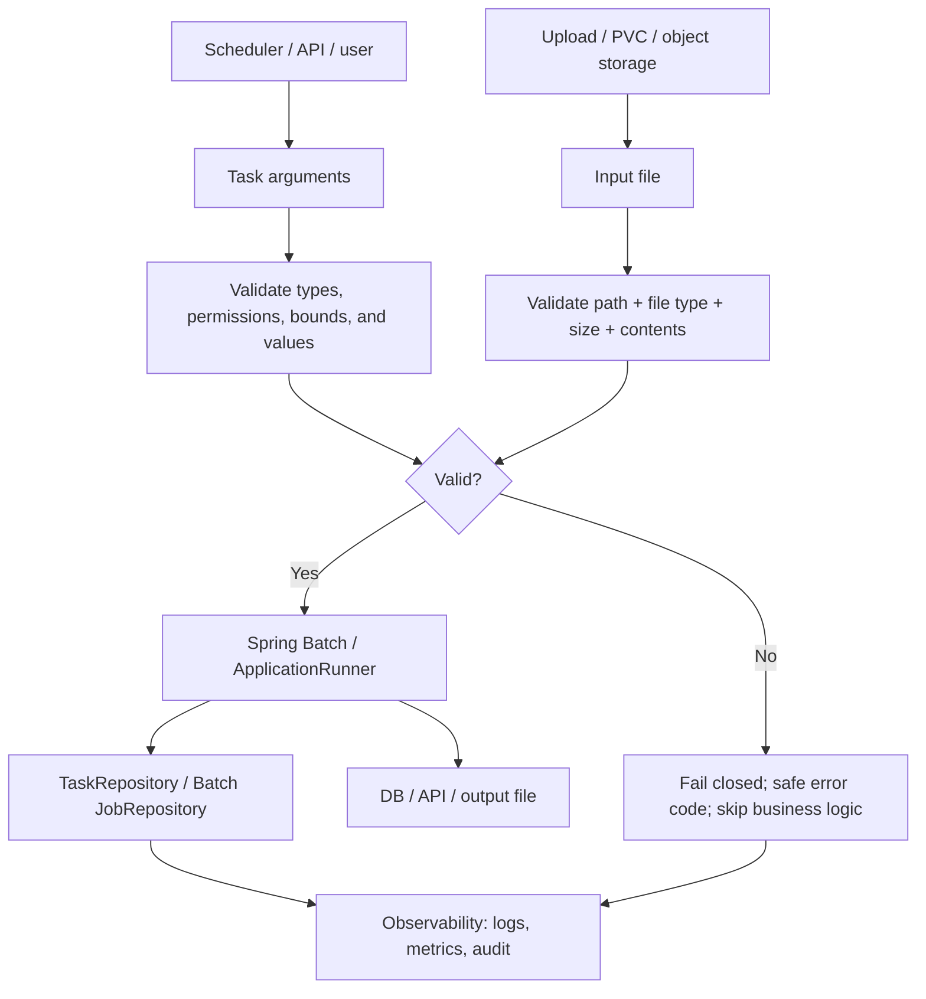

# Validating Files, Paths, and Input Data in Spring Cloud Task

## 1. Security Concerns of a Finite-Lifetime Application

**Spring Cloud Task** helps build Spring Boot applications that run for a finite duration, tracking each execution through `TaskRepository` and `TaskExecution`. A Task can run via command line, on a schedule via Kubernetes Jobs/Spring Cloud Data Flow, or on demand from another system. Many Tasks accept arguments such as report dates, customer codes, CSV file paths, or object storage locations; some Tasks invoke **Spring Batch** for batch processing.

Suppose Task `invoice-import` is permitted to read files under `/data/import`:

```text
java -jar invoice-import.jar \
  --import.path=inbox/invoices-2026-11-24.csv \
  --import.business-date=2026-11-24
```

If the application takes `import.path` from input and joins paths without validation, someone controlling the arguments or files could:

- Use `../../` to access files outside the permitted directory.
- Supply an absolute path or symbolic link to read configuration files, keys, or tokens.
- Provide an oversized file, malformed CSV records, a ZIP bomb, or corrupted payloads to exhaust RAM/CPU/disk.
- Pass an ID belonging to an unauthorized tenant, an out-of-range business date, or SQL fragments capable of altering queries.
- Pass secrets directly via CLI; Spring Cloud Task stores **launch arguments** in metadata, increasing leak risks.
- Cause the Task to log errors containing entire file contents, sensitive paths, or stack traces into log stores and operational messages.

This lesson belongs to the **Security** chapter, with the following objectives: validating **inputs**, controlling **paths**, bounding **file contents**, protecting **TaskRepository/Batch metadata**, and establishing defense layers when running Tasks on Kubernetes or other platforms.

> Principle: inputs arriving from CLI, APIs, schedulers, message brokers, object storage, file uploads, untrusted environment variables, or external storage files must all be treated as **untrusted data**, even without a public web UI.

## 2. Trust Boundary Model



| Trust Boundary | Typical Inputs | Safe Decision |
| --- | --- | --- |
| Orchestrator → Task | `--import.path`, `--business-date`, `--tenant-id` | Accept only defined keys, single properly typed values; verify permissions and value domains |
| Filesystem / object storage → Task | CSV, JSON, ZIP files, object keys | Permitted directory/bucket, content format, size and record-count limits |
| Task → DB | IDs, filters, sort orders, table names | Prepared statements, column-name allowlists, and least-privilege DB access |
| Task → external API | Target URLs, webhooks, object downloads | Permitted hosts/schemes only, SSRF blocking, timeouts, and redirect limits |
| Task → metadata / observability | Arguments, JobParameters, `exitMessage`, logs | Exclude secrets and sensitive data; use reference IDs and stable reason codes |

Validation steps should occur **before business logic writes data**. However, `onTaskStartup` or `ApplicationRunner` does not necessarily run before everything in the Spring Boot bootstrap phase: if beans already connect or write data during context creation, validation happens too late. Design bean initialization with minimal side effects, validate configuration early, and execute business work only after inputs pass validation.

## 3. Argument Contracts: Accept Only What Is Defined

A Task should publish an explicit contract:

| Parameter | Type / Constraint | Valid Value | Rejected |
| --- | --- | --- | --- |
| `import.path` | **Relative** path, max 200 chars, `.csv` extension | `inbox/day-2026-11-24.csv` | `/etc/passwd`, `../private.csv`, empty string |
| `import.business-date` | ISO `yyyy-MM-dd`; valid calendar date | `2026-11-24` | `2026-02-30`, `yesterday` |
| `import.tenant` | Code within authorized set | `billing-north` | Tenant code outside the principal's scope |
| `import.mode` | Enum | `validate` or `commit` | `execute-shell`, unknown values |
| `import.max-rows` | Bounded positive integer | `10000` | `-1` or `9999999999` |
| `import.file-id` (preferred) | Immutable ID in an internal manifest | `f_74da...` | Arbitrary unauthorized URLs/file paths |

When the input merely selects a known file, a better approach than accepting a path is accepting a **file ID / manifest ID** and mapping it to the physical storage location through an authorized database. That way the application never uses a user-supplied string directly as a filesystem path.

### 3.1. Controlled CLI Parsing

Spring Boot provides `ApplicationArguments`. For example, the parameters above are passed as `--import.path=...` and `--import.business-date=...`. When reading them, check for **missing options, duplicate options, options without values**, and format errors before touching any file.

```java
import java.time.LocalDate;
import java.time.format.DateTimeParseException;
import java.util.List;
import org.springframework.boot.ApplicationArguments;

public record ImportRequest(
        String relativePath, LocalDate businessDate) {

    public static ImportRequest parse(ApplicationArguments args) {
        String inputPath = one(args, "import.path");
        String dateText = one(args, "import.business-date");
        LocalDate date;

        try {
            date = LocalDate.parse(dateText);
        } catch (DateTimeParseException ex) {
            throw new IllegalArgumentException(
                "INVALID_BUSINESS_DATE: expected yyyy-MM-dd");
        }

        // Business policy example; adjust for real projects.
        if (date.isBefore(LocalDate.of(2020, 1, 1))
                || date.isAfter(LocalDate.of(2100, 12, 31))) {
            throw new IllegalArgumentException(
                "BUSINESS_DATE_OUT_OF_RANGE");
        }

        return new ImportRequest(inputPath, date);
    }

    private static String one(ApplicationArguments args, String name) {
        List<String> values = args.getOptionValues(name);
        if (values == null || values.size() != 1
                || values.get(0) == null || values.get(0).isBlank()) {
            throw new IllegalArgumentException(
                "INVALID_PARAMETER: " + name);
        }
        return values.get(0);
    }
}
```

**Never log `args.getSourceArgs()` verbatim.** Spring Cloud Task can persist arguments in `TASK_EXECUTION_PARAMS`. Even if validation rejects the run immediately afterward, the arguments may already be stored in metadata. Never pass `--db.password=...`, `--api.token=...`, or signed presigned URLs as CLI input; use a Secret manager, Kubernetes Secrets, workload identity, and proper credential delivery channels.

### 3.2. Environment Configuration Must Also Be Trusted

Separate two concepts:

- **Trusted deployment configuration** such as permitted root `/data/import`, provisioned database URL, and allowed bucket/host list: managed by DevOps/IaC and editable only by authorized maintainers.
- **Per-run input** such as date, file type, file ID, or tenant: must be parsed/validated and authorized.

If someone can freely edit deployments, ConfigMaps, or Secrets, they could alter the “permitted directory” itself; path-checking code does not replace RBAC and configuration governance. In multi-tenant systems, check the request's tenant **against the caller/identity's permissions**, not merely whether the tenant string matches a regex.

## 4. Directory Traversal: `normalize()` Alone Is Not Enough

`Path.normalize()` is a **lexical** operation on a path; it does not access the filesystem and cannot tell where a symbolic link points. For example:

```text
Permitted directory : /data/import
User input          : ../../etc/shadow
Naive join          : /data/import/../../etc/shadow
After normalize     : /etc/shadow
```

Even without `..`, the path `inbox/latest.csv` could be a symbolic link pointing to a file **outside** `/data/import`. Therefore, design multiple layers:

1. Accept only **relative paths** per contract; reject absolute paths, drive prefixes, or disallowed characters.
2. Reject `.` and `..` segments and anomalous paths; never use user-supplied filenames to make authorization decisions.
3. Resolve against a **fixed root from trusted configuration**, then `normalize()` and verify `Path.startsWith(root)` **by path segment** (never `String.startsWith("/data/import")`).
4. Call `toRealPath()` on both the root and existing file to resolve symbolic links; ensure the file's real path remains beneath the root's real path.
5. Verify it is a regular file, readable, has an allowed extension, and is within size limits. Open and read under enforced byte bounds.
6. Combine with **filesystem permissions and read-only volumes**. Check-then-open still has a race condition; if an adversary with write access could swap directories between checks, use secure directory-handle-relative file opens or an isolated staging architecture.

`Path.startsWith(Path)` compares path structure segment by segment, unlike string prefix checks. For instance, `/data/import-malicious` is **not** a child of `/data/import` under `Path.startsWith(Path)`.

### 4.1. `SafeInputFile` Example: Validating Paths and Limiting Byte Count

The snippet below targets Java 17+. It handles only small CSV files up to **10 MiB**, allows ASCII paths like `folder/file.csv`, and intentionally rejects symbolic links escaping the root. This is an **input file control layer**, not a complete CSV parser.

```java
package com.example.invoice;

import java.io.IOException;
import java.io.InputStream;
import java.nio.file.Files;
import java.nio.file.InvalidPathException;
import java.nio.file.LinkOption;
import java.nio.file.Path;
import java.nio.file.StandardOpenOption;

public final class SafeInputFile {

    private static final int MAX_BYTES = 10 * 1024 * 1024;
    private final Path trustedRoot;

    public SafeInputFile(Path configuredRoot) throws IOException {
        // Root configuration comes from trusted deployment; root must exist.
        this.trustedRoot = configuredRoot.toRealPath();
        if (!Files.isDirectory(trustedRoot)) {
            throw new IllegalArgumentException(
                "IMPORT_ROOT_NOT_DIRECTORY");
        }
    }

    public byte[] readCsv(String rawRelativePath) throws IOException {
        if (rawRelativePath == null
                || rawRelativePath.length() > 200
                || !rawRelativePath.matches(
                    "[A-Za-z0-9][A-Za-z0-9._/-]*")
                || rawRelativePath.contains("//")
                || rawRelativePath.endsWith("/")) {
            throw new IllegalArgumentException("INVALID_FILE_PATH");
        }

        final Path relative;
        try {
            relative = Path.of(rawRelativePath);
        } catch (InvalidPathException ex) {
            throw new IllegalArgumentException("INVALID_FILE_PATH");
        }

        if (relative.isAbsolute()) {
            throw new IllegalArgumentException("ABSOLUTE_PATH_NOT_ALLOWED");
        }

        for (Path segment : relative) {
            String name = segment.toString();
            if (name.equals(".") || name.equals("..")
                    || name.startsWith(".")) {
                throw new IllegalArgumentException("INVALID_PATH_SEGMENT");
            }
        }

        if (!relative.getFileName().toString().endsWith(".csv")) {
            throw new IllegalArgumentException("UNSUPPORTED_FILE_TYPE");
        }

        Path candidate = trustedRoot.resolve(relative).normalize();
        if (!candidate.startsWith(trustedRoot)) {
            throw new IllegalArgumentException("FILE_OUTSIDE_ALLOWED_ROOT");
        }

        // Resolve symlinks along the current path; file must exist.
        Path realFile = candidate.toRealPath();
        if (!realFile.startsWith(trustedRoot)
                || !Files.isRegularFile(
                    realFile, LinkOption.NOFOLLOW_LINKS)) {
            throw new IllegalArgumentException("UNSAFE_FILE_TARGET");
        }

        if (Files.size(realFile) > MAX_BYTES) {
            throw new IllegalArgumentException("FILE_TOO_LARGE");
        }

        // NOFOLLOW_LINKS avoids following a symlink at the final file component
        // if swapped between operations, depending on filesystem provider.
        try (InputStream in = Files.newInputStream(
                realFile,
                StandardOpenOption.READ,
                LinkOption.NOFOLLOW_LINKS)) {
            byte[] data = in.readNBytes(MAX_BYTES + 1);
            if (data.length > MAX_BYTES) {
                throw new IllegalArgumentException("FILE_TOO_LARGE");
            }
            return data;
        }
    }
}
```

**Strengths:** accepts only restricted ASCII names, `.csv` files only, blocks `..`/absolute paths, verifies canonical real paths to catch symlinks escaping the directory, and enforces size limits **both before and during reading**.

**Known limitations:**

- `toRealPath()` and `Files.newInputStream(...)` are **two separate operations**, leaving a TOCTOU (*time of check to time of use*) risk if untrusted actors can modify intermediate directories or targets concurrently. `NOFOLLOW_LINKS` on the final open does not close all races on parent directories. Secure environments require a root unmodifiable by untrusted users, files moved to app-managed staging, or relative-to-directory-handle operations (such as `SecureDirectoryStream` where supported).
- `readNBytes` bounds memory usage, yet 10 MiB still requires heap headroom. Very large files should use streaming with **total byte, record length, and row-count limits**, never unbounded `Files.readAllBytes`.
- Extension checks do not prove a file is genuinely valid CSV; contents must be validated at the parser/schema layer.
- A file could be modified mid-processing if the source remains writable; consider uploading into a **quarantine** area, scanning for malware/file validity, creating an immutable copy under a server-assigned name, and letting workers read only that snapshot.
- The regex intentionally accepts ASCII characters only. Systems needing Unicode filenames require an explicit normalization, encoding, and character-allowlist policy; never “relax” it with an ad-hoc regex.

### 4.2. Wiring the Validator into Spring Cloud Task

```java
package com.example.invoice;

import java.nio.charset.CharacterCodingException;
import java.nio.ByteBuffer;
import java.nio.charset.CodingErrorAction;
import java.nio.charset.StandardCharsets;
import java.nio.file.Path;

import org.springframework.boot.ApplicationRunner;
import org.springframework.boot.SpringApplication;
import org.springframework.boot.autoconfigure.SpringBootApplication;
import org.springframework.cloud.task.configuration.EnableTask;
import org.springframework.context.annotation.Bean;

@SpringBootApplication
@EnableTask
public class InvoiceImportTaskApplication {

    public static void main(String[] args) {
        SpringApplication.run(InvoiceImportTaskApplication.class, args);
    }

    @Bean
    SafeInputFile safeInputFile() throws Exception {
        return new SafeInputFile(Path.of("/data/import"));
    }

    @Bean
    ApplicationRunner importInvoices(SafeInputFile safeInput) {
        return args -> {
            ImportRequest request = ImportRequest.parse(args);
            byte[] bytes = safeInput.readCsv(request.relativePath());

            // Reject malformed UTF-8 sequences before passing to CSV parser.
            String csv;
            try {
                csv = StandardCharsets.UTF_8.newDecoder()
                    .onMalformedInput(CodingErrorAction.REPORT)
                    .onUnmappableCharacter(CodingErrorAction.REPORT)
                    .decode(ByteBuffer.wrap(bytes))
                    .toString();
            } catch (CharacterCodingException ex) {
                throw new IllegalArgumentException("INVALID_UTF8");
            }

            // Integration point for dedicated CSV parser + row validation.
            // Do not write business data before required validation passes.
            System.out.println(
                "Validated UTF-8 input for " + request.businessDate());
            // Import service will process csv per schema and transaction rules.
        };
    }
}
```

The `ImportRequest` and `SafeInputFile` classes from the previous sections must reside in the same module/package. This illustrative class intentionally skips DB writes and does not yet assume `csv` is valid data. Replace the end with a bounded parser and transactional/idempotent import service. For multi-GB CSV sources, do not materialize the whole file as a `String`; use a streaming parser and per-record quotas.

## 5. Content Validation: Extensions and MIME Types Are Not Enough

Renaming `payload.exe` to `invoices.csv` **does not** turn its contents into CSV. Client-supplied `Content-Type` headers can also be spoofed. File validation should layer multiple checks:

| Check | Purpose | Limitation |
| --- | --- | --- |
| Extension allowlist | Reject unsupported file types upfront | Easily spoofed |
| File signature / magic bytes (where formats have them) | Catch some renamed files | Insufficient alone; CSV has no reliable magic number |
| Dedicated parser | Verify real structure, quotes, delimiters, encoding | Must bound row count/length to prevent resource exhaustion |
| Business schema | Validate column names, types, value ranges, tenant references | Needs explicit rules, not just successful parsing |
| Quotas | Block oversized files, too many rows, or excessive errors | Must be enforced while reading, not solely from file-size metadata |
| Risk-based scanner / sandbox | Mitigate malicious files from external sources | Does not replace access controls or safe parsers |

### 5.1. CSV Example with Apache Commons CSV

This is an **illustrative parser snippet** invoked after `SafeInputFile` checks and UTF-8 decoding; add `org.apache.commons:commons-csv` at a pinned/tested version compatible with your project. Never use `line.split(",")`, because CSV values can contain quoted commas or embedded newlines inside a record.

```java
import java.io.IOException;
import java.io.StringReader;
import java.util.List;

import org.apache.commons.csv.CSVFormat;
import org.apache.commons.csv.CSVParser;

public final class InvoiceCsvValidator {
    private static final int MAX_ROWS = 50_000;
    private static final int MAX_ID_LENGTH = 64;

    public static int validate(String csvText) throws IOException {
        try (CSVParser parser = CSVFormat.RFC4180.builder()
                .setHeader()
                .setSkipHeaderRecord(true)
                .get()
                .parse(new StringReader(csvText))) {

            if (!parser.getHeaderNames().equals(
                    List.of("invoice_id", "customer_id", "amount_cents"))) {
                throw new IllegalArgumentException("INVALID_CSV_HEADER");
            }

            int count = 0;
            for (var record : parser) {
                if (++count > MAX_ROWS || record.size() != 3) {
                    throw new IllegalArgumentException("CSV_LIMIT_EXCEEDED");
                }
                String invoiceId = record.get("invoice_id");
                String customerId = record.get("customer_id");

                if (invoiceId.isBlank()
                        || invoiceId.length() > MAX_ID_LENGTH
                        || customerId.isBlank()
                        || customerId.length() > MAX_ID_LENGTH) {
                    throw new IllegalArgumentException("INVALID_ROW_DATA");
                }
                final long amount;
                try {
                    amount = Long.parseLong(record.get("amount_cents"));
                } catch (NumberFormatException ex) {
                    throw new IllegalArgumentException("INVALID_AMOUNT");
                }
                if (amount < 0 || amount > 100_000_000_000L) {
                    throw new IllegalArgumentException("AMOUNT_OUT_OF_RANGE");
                }
                // Not inserting yet: verify tenant, duplicate IDs, business date,
                // and all business invariants before persisting.
            }
            return count;
        }
    }
}
```

**Assumptions:** the CSV must contain exactly three columns in order; monetary amounts are stored as **integer cents** to avoid decimal rounding errors; the CSV library version supports the `get()` builder API. This is a **validation** step, not persistence. For files larger than the 10 MiB example, use a streaming `Reader` with memory, row-count, record-length, and byte-read limits.

Additional limits needed for production:

- `invoice_id`/`customer_id` should permit only system-defined charsets/formats (for instance, structured IDs rather than arbitrary free text).
- Check for duplicate `invoice_id` within the file and against the DB; enforce a unique constraint on the business key in storage.
- Verify `customer_id` belongs to the **authorized tenant/unit**; never treat a syntactically valid ID as authorized access.
- Guard against multi-line records or huge fields; some Spring Batch `FlatFileItemReader` versions support record-length/line limits, so confirm your version and configure bounds accordingly.
- Error caps: when using Batch skip, set an explicit `skipLimit`; never skip indefinitely over malformed or malicious data.

## 6. Archives, JSON, XML, and Resource-Exhaustion Payloads

If a Task accepts ZIP/TAR files, checking the archive filename is not enough. Attackers can embed:

- **Zip Slip**: entries like `../../secrets/token` or absolute paths on extraction; joining entries to a target directory without validation allows writing outside the permitted area.
- **Zip bomb**: a tiny archive expanding into tens of gigabytes of data, exhausting disk/CPU/RAM.
- Archives with excessive entry counts, ultra-long entry names, nested archives, or symlinks that bypass quotas.
- Duplicate filenames or malformed entries causing unintended overwrites.

**Recommended policy:** reject archives altogether if the business flow only needs CSV. When archives must be supported, cap total entry count, actual decompressed bytes, per-file size, processing time, and compression ratio; never trust uncompressed sizes declared in archive headers. When writing extracted files, use a fixed root with `normalize()`/`startsWith(Path)`, symlink checks, and no-overwrite creation rules. Symlink/hardlink handling depends on archive format and library: never assume a plain `ZipInputStream` detects all malicious metadata.

```text
Checks on an archive before allowing writes:

1. Must match an allowed archive type.
2. Maximum entry count (e.g., 100).
3. Every entry is a relative name containing no "." / ".." segments.
4. Target destination stays inside staging root; never follow symlinks.
5. Enforce decompressed byte limits per entry and overall.
6. Never overwrite files outside the permitted list.
7. Extracted member files must undergo format and schema validation again.
8. Publish/move results only after every validation step passes.
```

For XML, configure parsers to **disallow DTDs and external entities** to prevent XXE and entity expansion; for JSON, avoid unrestricted polymorphic deserialization and deeply nested objects. **Spring Batch Security Considerations** notes that files from external storage remain untrusted data, and modern readers include version-specific default protections; never disable those limits just to make a file “parse.”

## 7. URL Paths, Object Storage, and SSRF

When input is `https://...` or `s3://bucket/key`, risk shifts from local filesystem access to **network read access**:

| Received Data | What to Validate |
| --- | --- |
| HTTPS URL | HTTPS scheme only, allowlisted hosts and ports; forbid user-specified IPs/localhost/metadata services |
| Redirects | Limit or disable redirects; if enabled, validate **every hop target**, not just the initial URL |
| DNS | Guard against DNS rebinding, internal/link-local addresses, and actual socket targets; enforce egress policies |
| Object key | Bucket is allowlisted, key sits under allowed prefix/tenant; never rely on filename for authorization |
| Signed URL | The signature is a credential; never store the full URL in TaskExecution arguments, errorMessage, or logs |
| Download | Timeouts, max response size, redirect limits, and checksum/ETag verification where applicable |

**Best practice:** have the user supply a `fileId`/`objectId`, and let the Task look up an authorized internal manifest for the bucket/key and checksum. Permit outbound Task traffic only to required endpoints via network policy; never grant arbitrary URL fetching. If redirects occur or an object changes between reads, re-verify the approved object identity.

## 8. SQL Control and Business Data Integrity

A string read from a file **must never be concatenated directly into SQL**. Bad example:

```java
// Do not do this: an input field can alter SQL syntax.
String sql = "SELECT * FROM invoice WHERE customer_id = '"
    + customerId + "'";
```

Example using Spring `JdbcTemplate` with bind parameters:

```java
Long count = jdbcTemplate.queryForObject(
    "SELECT COUNT(*) FROM invoice " +
    "WHERE customer_id = ? AND business_date = ?",
    Long.class,
    customerId,
    java.sql.Date.valueOf(businessDate)
);
```

For column names, table names, or `ORDER BY` clauses, bind parameters **cannot** replace SQL identifiers. Use a **code-level allowlist** mapping an input enum to known column names; never concatenate arbitrary user strings.

Inputs must be checked for both **authorization** and **business integrity**:

- The record's tenant must belong to the execution's authorized scope.
- `businessDate` must be valid per business calendar rules, not just valid ISO syntax.
- IDs must not duplicate within the batch or collide with already-committed records.
- Currency, amount bounds, and signs must match the contract; prevent `long` overflow or unintended rounding.
- When a Task reruns after failure, unique constraints and idempotency keys protect data against duplicate processing.

**CSV formula injection:** If the system **exports** imported data to spreadsheets, values starting with `=`, `+`, `-`, or `@` can be interpreted as formulas by spreadsheet applications. Apply dedicated escaping/sanitization at the **export boundary**; do not alter raw source values in business storage unless an explicit storage rule calls for it.

## 9. Spring Batch: Resources and Restarts Must Not Bypass Validation

If the Task uses Spring Batch, `FlatFileItemReader` reads a configured `Resource` and maps each record. Spring Batch **does not decide for your application which files are safe to read**. Best practices:

1. Validate **fileId/path**, permissions, file type, size, and snapshot **before constructing the Step's Resource**.
2. Pass the already-vetted Resource to the reader (avoid creating readers directly from raw CLI paths).
3. Keep `strict=true` when the file is required; fail instead of silently continuing with zero data.
4. Configure UTF-8 encoding, strict tokenizers/line mappers, row/record-length limits, and skip limits.
5. Keep JobParameters/ExecutionContext deterministic on restart; never swap the underlying data of an old JobInstance while metadata treats it as the same run.
6. Use proper chunk transactions and DB unique constraints; Batch restarts do not roll back external side effects outside transactions.

Conceptual reader configuration snippet (exact APIs/imports may vary between Spring Batch 5 and 6):

```java
// Sketch: "validatedResource" has already passed permission, content,
// and immutable snapshot checks before reaching Spring Batch.
new FlatFileItemReaderBuilder<InvoiceRow>()
    .name("invoiceReader")
    .resource(validatedResource)
    .encoding("UTF-8")
    .strict(true)
    .lineMapper(validatedLineMapper)
    .saveState(true)
    .build();
```

**This is an illustrative configuration snippet**, not a complete Java class. For untrusted files/records, verify exact buffer/record-length limits in your Spring Batch version. `saveState(true)` enables checkpointing for stateful readers; if the file changes between restarts, checkpoints can land at wrong offsets. Use immutable checksums/ETags/manifests and re-verify on restart.

### 9.1. Batch Skip Is Not a Mechanism for Ignoring Malicious Data

`skipLimit=100` may be reasonable when business rules allow skipping a bounded number of bad rows, but it **does not** mean the parser can accept unbounded files or bypass input validation. Enforce size and scope quotas before execution; treat structural errors and oversized files as **fail-fast**, not per-line skip candidates.

### 9.2. Batch Failures Must Propagate to the Task

A Spring Batch Job ending with `BatchStatus.FAILED` does not necessarily produce a non-zero `TaskExecution.exitCode` unless the Task layer is notified. With supported Spring Cloud Task Batch integration, you can set:

```yaml
spring:
  cloud:
    task:
      batch:
        fail-on-job-failure: true
```

Or if your application launches Jobs manually, inspect `JobExecution.status` and signal failure per policy. Never let a Kubernetes Job or scheduler treat a failed-validation import as successful because code caught the error and returned normally.

## 10. Kubernetes Jobs: Restricting File and Secret Access

When running on Kubernetes, mount input volumes read-only, run non-root, and isolate scratch space. Example **`spec.template.spec` snippet** for a Job using a PVC and Secret:

```yaml
spec:
  template:
    spec:
      restartPolicy: Never
      automountServiceAccountToken: false
      securityContext:
        runAsNonRoot: true
        runAsUser: 10001
      containers:
        - name: invoice-import-task
          image: registry.example.com/batch/invoice-import:1.0.0
          args:
            - "--import.path=inbox/invoices-2026-11-24.csv"
            - "--import.business-date=2026-11-24"
          volumeMounts:
            - name: input-files
              mountPath: /data/import
              readOnly: true
            - name: scratch
              mountPath: /tmp
          env:
            - name: SPRING_DATASOURCE_PASSWORD
              valueFrom:
                secretKeyRef:
                  name: invoice-task-db
                  key: password
          securityContext:
            allowPrivilegeEscalation: false
            readOnlyRootFilesystem: true
            capabilities:
              drop:
                - ALL
          resources:
            requests:
              cpu: "250m"
              memory: "512Mi"
            limits:
              cpu: "1"
              memory: "1Gi"
      volumes:
        - name: input-files
          persistentVolumeClaim:
            claimName: invoice-import-input
        - name: scratch
          emptyDir:
            sizeLimit: 512Mi
```

**This is not a complete `Job` manifest**: `apiVersion`, `kind`, metadata, and other database settings are omitted. The PVC must be provisioned and mounted with appropriate read-only permissions; setting `volumeMounts.readOnly=true` makes only that container's mount read-only—it **does not automatically stop other writers on the same volume**. Audit PVC sharing and other Pods' permissions, especially if files arrive while workers are reading.

Additional measures:

- **Never mount `hostPath`** or node system directories for input files without explicit approved justification.
- Enforce Pod Security standards, seccomp profiles, image pinning, and minimal RBAC.
- Apply network policies allowing the Task to reach only required DB, broker, and object-store endpoints; block arbitrary outbound calls.
- Separate identities for data ingestion vs. business execution; database accounts should access only required tables with no schema admin rights.
- Set `activeDeadlineSeconds`, CPU/memory limits, and scratch quotas to cap the blast radius of malicious files causing hangs or resource exhaustion.
- If a Task receives SIGKILL, cleanup/listeners may not execute; rely on staging, expiry, and runbooks instead of assuming `finally` always runs.

## 11. TaskRepository, Logs, and Sensitive Data

Spring Cloud Task can store **arguments** in metadata along with `exitMessage` and `errorMessage`. Spring Batch likewise stores JobParameters and ExecutionContext in JobRepository. Never treat them as automatically encrypted or inaccessible vaults.

| Storage Location | What NOT to Write | What to Write |
| --- | --- | --- |
| CLI arguments / `TASK_EXECUTION_PARAMS` | Passwords, tokens, private URLs, raw PII, file contents | File IDs, dates, non-sensitive task codes |
| Batch `JobParameters` | API keys, database passwords, customer payloads | Authorized business keys / manifest IDs |
| Batch `ExecutionContext` | Millions of records, secrets, sensitive blobs | Small checkpoints, offsets, file IDs, and checksums |
| `exitMessage` | Stack traces, passwords, sensitive paths, full SQL | Short codes like `INVALID_INPUT` or `FILE_TOO_LARGE` |
| Logs | Raw files, raw arguments, exceptions containing tokens | TaskExecution ID, error category, failed row count, trace ID |
| Alert / metric labels | Filenames, tenant/customer IDs, execution IDs, raw messages | Bounded `task_name`, `environment`, `outcome`, `error_class` |

Example `TaskExecutionListener` setting a **fixed error code** so operators can classify failures without printing input data:

```java
import org.springframework.cloud.task.listener.TaskExecutionListener;
import org.springframework.cloud.task.repository.TaskExecution;
import org.springframework.stereotype.Component;

@Component
public class InputErrorListener implements TaskExecutionListener {
    @Override
    public void onTaskStartup(TaskExecution execution) {
    }

    @Override
    public void onTaskFailed(
            TaskExecution execution, Throwable error) {
        if (error instanceof IllegalArgumentException) {
            execution.setExitMessage("INVALID_INPUT");
        }
    }

    @Override
    public void onTaskEnd(TaskExecution execution) {
        // Do not overwrite exitMessage set by the failure path.
    }
}
```

**Limitation:** an `IOException` or validation failure wrapped in another exception by the framework might not surface as an outer `IllegalArgumentException`. Production systems should use a **custom exception type** (`InvalidInputException`) with consistent mapping, rather than treating every internal `IllegalArgumentException` as a user error. `errorMessage` may still capture the `Throwable` stack trace written by Spring Cloud Task on failure; therefore, restrict repository access, keep exception messages safe, and sanitize logs/monitoring.

## 12. Malicious Input Test Matrix

Use **test filesystems and test databases**; never run traversal or symlink tests in environments holding real secrets.

| Case | Input / Scenario | Expected Result |
| --- | --- | --- |
| 1 | `inbox/invoices.csv` inside root | Opened if file exists, matches allowed type and size |
| 2 | `../../private.csv` | Rejected due to traversal segment |
| 3 | `/etc/passwd` or Windows path `C:\\Windows\\...` | Rejected for absolute path / invalid format |
| 4 | `inbox/../private.csv` | Rejected for `..` even if normalization stays within root |
| 5 | `inbox/latest.csv` symlink pointing outside root | Rejected after `toRealPath()` |
| 6 | File swapped for a symlink during validation | Cannot read outside root when staging/permissions are sound; test races separately with proper setup |
| 7 | File exceeding 10 MiB | Rejected by size check or read byte cap |
| 8 | 1 KiB file expanding to millions of CSV records / huge decompression | Blocked by parser/quotas without unbounded resource consumption |
| 9 | Invalid UTF-8 bytes or invalid header | Rejected with `INVALID_UTF8` / `INVALID_CSV_HEADER` |
| 10 | Date `2026-02-30`, negative numbers, or out-of-range amount | Rejected before any DB write |
| 11 | Syntactically valid tenant without permission | Rejected by authorization, not regex |
| 12 | Job retried after partial writes | No duplicate rows thanks to idempotency / unique constraints |
| 13 | ZIP entry `../../outside.txt` or zip bomb | Rejected if archive support exists; otherwise reject all ZIPs |
| 14 | URL targeting internal host / metadata service | Rejected via allowlist, egress policy, and redirect controls |
| 15 | Secrets in CLI or JobParameters | Disallowed by deployment policy; verify metadata/logs contain no secrets |

### 12.1. Unit Test Example for Path Traversal

```java
import static org.junit.jupiter.api.Assertions.*;

import java.nio.file.Files;
import java.nio.file.Path;
import org.junit.jupiter.api.Test;
import org.junit.jupiter.api.io.TempDir;

class SafeInputFileTest {
    @TempDir Path root;

    @Test
    void acceptsSmallFileWithinRoot() throws Exception {
        Files.createDirectories(root.resolve("inbox"));
        Files.writeString(
            root.resolve("inbox/invoices.csv"),
            "invoice_id,customer_id,amount_cents\nA1,C1,100\n");
        var reader = new SafeInputFile(root);
        assertTrue(reader.readCsv("inbox/invoices.csv").length > 0);
    }

    @Test
    void rejectsTraversalAndAbsolutePath() throws Exception {
        var reader = new SafeInputFile(root);
        assertThrows(IllegalArgumentException.class,
            () -> reader.readCsv("../private.csv"));
        assertThrows(IllegalArgumentException.class,
            () -> reader.readCsv("/etc/private.csv"));
        assertThrows(IllegalArgumentException.class,
            () -> reader.readCsv("inbox/../private.csv"));
    }
}
```

Testing symlinks requires OS/filesystem privileges to create links; when unsupported, tests should be **explicitly skipped with an explanation** instead of pretending coverage. TOCTOU requires filesystem-level integration tests matching real deployment topologies. Never claim code is immune to all races based on a single unit test.

### 12.2. Pre-Operations Checklist

- [ ] Accept only required input fields, enforcing types, ranges, lengths, enums, and per-tenant permissions.
- [ ] File sources use opaque file IDs or fixed authorized roots; never accept arbitrary paths or URLs.
- [ ] Path validation checks relativity, segments, normalization, real paths, and symlinks; parent directories are unwritable by untrusted parties.
- [ ] Files have enforced limits **while reading** for size, row count, record length, field count, and parser safety.
- [ ] Quarantine/snapshots/scanning match risk level; never process files being modified concurrently.
- [ ] SQL uses bind parameters; dynamic table/column names use allowlists; all writes use transactions/idempotency.
- [ ] No secrets appear in CLI args, `TaskExecution.arguments`, JobParameters, ExecutionContext, or logs.
- [ ] Kubernetes Jobs run non-root, mount inputs read-only, enforce resource limits, and hold least-privilege DB rights.
- [ ] Validation errors surface failure to Task/Batch/scheduler rather than being swallowed into exit code 0.
- [ ] Negative input tests, retry/restart tests, and partial-write recovery runbooks are in place.

## 13. Hands-On Exercises

**Exercise 1 — Threat Model:** List every trust boundary for a Task importing CSV files from a PVC on a Kubernetes schedule. Identify who can modify arguments, the PVC, Secrets, TaskRepository, and the output DB. Propose one defense layer per boundary.

**Exercise 2 — Path Validation:** Extend `SafeInputFile` to take a root from trusted configuration. Write tests for absolute paths, traversal, symlinks escaping the root, overly long names, missing files, and oversized files. Explain the limitations of `normalize()` and `toRealPath()`.

**Exercise 3 — CSV Parser:** Build CSV fixtures with a wrong header, quoted commas, negative amounts, duplicate rows, invalid UTF-8, and an oversized record. Update the validator to reject each case cleanly without printing raw records to logs.

**Exercise 4 — Spring Batch:** Read CSVs using `FlatFileItemReader` with strict mode and record-length limits enabled. Simulate a failure after 100 rows and restart the same `JobInstance`; use business keys and unique constraints to prove no duplicates are written.

**Exercise 5 — Sensitive Arguments:** Take an example Task that previously passed an API token via `--api-token=...`. Redesign credential delivery using Secrets/workload identity, inspect TaskRepository/JobRepository, and fix logging to eliminate leaks.

**Exercise 6 — Container Hardening:** Deploy the Task as a Kubernetes Job with a read-only input volume, `runAsNonRoot`, and `readOnlyRootFilesystem`. Attempt writing to `/data/import` and verify it is denied. Verify `/tmp` has its own quota and the Pod needs no API token.

**Exercise 7 — Object Store:** Replace `import.path` with `import.file-id`, storing a manifest with tenant, bucket/key, checksum, and virus-scan status. Describe permission checks before download, actual downloaded byte caps, and checksum verification prior to import.

### Self-Assessment Questions

1. Why must a Task with no HTTP endpoints still validate every input?
2. Does `Path.normalize()` automatically detect symbolic links pointing outside the permitted directory?
3. Why is `Path.startsWith(Path)` safer than string prefix comparison?
4. Is checking `Files.size` before reading sufficient to prevent oversized files?
5. Why don't `Content-Type: text/csv` and a `.csv` extension prove valid contents?
6. Why shouldn't passwords be passed via CLI even when the Task runs in an isolated Kubernetes cluster?
7. Does `FlatFileItemReader.strict=true` replace domain schema validation and authorization checks?
8. When a Job retries after writing 400 rows, what conditions prevent duplicate writes?
9. Why must validation errors (which shouldn't be blindly retried) be distinguished from transient connectivity errors?
10. When should an entire ZIP archive be rejected instead of attempting to process its contents?

**Completion Criteria:** you can build an end-to-end validation chain from arguments to physical files and business data, explain traversal/symlink/TOCTOU risks, enforce resource bounds, keep sensitive data out of metadata, propagate errors accurately to Task/schedulers, and verify behavior with negative tests and restart tests.

## Official References

- [OWASP — Path Traversal Prevention Cheat Sheet](https://cheatsheetseries.owasp.org/cheatsheets/Path_Traversal_Prevention_Cheat_Sheet.html): preferring file IDs/allowlists and preventing traversal.
- [OWASP — File Upload Cheat Sheet](https://cheatsheetseries.owasp.org/cheatsheets/File_Upload_Cheat_Sheet.html): extension allowlists, file types, size limits, storing outside public roots, scanners, and zip bombs.
- [Java 21 — Path API](https://docs.oracle.com/en/java/javase/21/docs/api/java.base/java/nio/file/Path.html): `normalize()`, `startsWith(Path)`, and `toRealPath()`.
- [Java 21 — Files API](https://docs.oracle.com/en/java/javase/21/docs/api/java.base/java/nio/file/Files.html): `newInputStream`, `isRegularFile`, file attributes, and symlinks.
- [Java 21 — SecureDirectoryStream API](https://docs.oracle.com/en/java/javase/21/docs/api/java.base/java/nio/file/SecureDirectoryStream.html): directory-handle-relative file operations to reduce race windows where supported.
- [Spring Cloud Task — Features](https://docs.spring.io/spring-cloud-task/reference/features.html): TaskExecution arguments, exit codes, and lifecycle.
- [Spring Cloud Task — Repository Schema](https://docs.spring.io/spring-cloud-task/docs/current/reference/html/): `TASK_EXECUTION_PARAMS` and Task metadata.
- [Spring Batch — Security Considerations](https://docs.spring.io/spring-batch/reference/security.html): untrusted input, parser limits, and secret risks in JobParameters.
- [Spring Batch — FlatFileItemReader](https://docs.spring.io/spring-batch/reference/readers-and-writers/flat-files/file-item-reader.html): strict mode, tokenizers, and parse exceptions.
- [Kubernetes — Volumes](https://kubernetes.io/docs/concepts/storage/volumes/): read-only mounts and their limitations.
