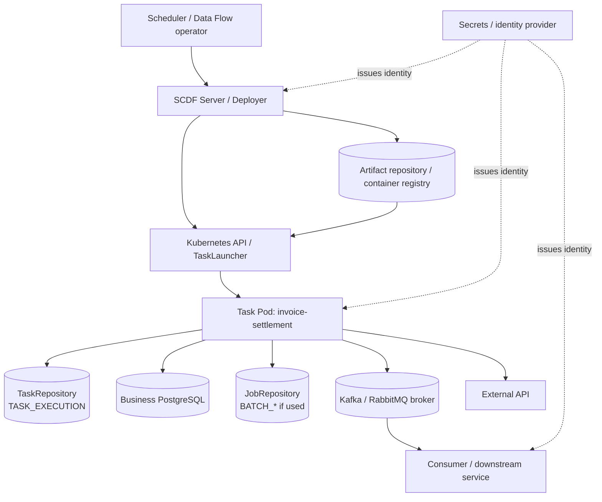

# Protecting Brokers, Artifact Repositories, and Communication Channels

## Learning Objectives

After this lesson, you will be able to:

- Identify **trust boundaries** in a finite-lifetime **Spring Cloud Task** application: Task process, message broker, artifact/container registry, Spring Cloud Data Flow/Deployer, databases, and external services.
- Distinguish **transport encryption**, **identity authentication**, **authorization**, and **artifact integrity**; explain why enabling HTTPS/TLS alone is insufficient.
- Configure Spring Cloud Stream connections to Kafka with `SASL_SSL`, truststores, and least-privilege permissions; describe the equivalent approach for RabbitMQ.
- Protect the software supply chain: control publish/pull permissions, verify image/JAR provenance, pin digests, retain SBOMs, and enforce pre-deployment checks.
- Use Kubernetes Secrets, ServiceAccounts, `imagePullSecrets`, and NetworkPolicies in a controlled manner, without leaking credentials via command-line arguments, logs, or Task metadata.
- Secure JDBC, REST APIs, and manager/worker communication channels in applications using Spring Batch/remote partitioning.
- Design credential rotation, monitoring, incident response, and negative tests to ensure **connections with invalid identities or permissions are rejected**.

> **Context:** This lesson belongs to the **Security** chapter of the **SPRING_CLOUD_TASK** module. Spring Cloud Task creates finite-lifetime Spring Boot applications that record runs and outcomes in `TaskRepository`. Tasks can be triggered on a schedule or on demand, integrate with Spring Batch, and emit events via Spring Cloud Stream. When running on Docker/Kubernetes or through Spring Cloud Data Flow, security involves more than a single database password—it covers **brokers, artifact download paths, network connections, and infrastructure identities**.

## 1. Scenario: One Task Connecting to Multiple Systems

Suppose the `invoice-settlement-task` application runs every night:

1. The orchestrator launches an image registered in the internal container registry.
2. The Task reads the list of invoices from the business PostgreSQL database.
3. The Task writes `TASK_EXECUTION`/`TASK_EXECUTION_PARAMS` to `TaskRepository`.
4. After processing, the application emits `SettlementCompleted` over Kafka; a consumer receives the event and updates reports.
5. If processed with Spring Batch, the manager/workers also use `JobRepository` and may be provisioned via a Deployer.
6. The Task finishes and returns an exit code to the Docker/Kubernetes Job.

If even a single component lacks proper protection:

- Broker without authentication: an unauthorized process can inject spoofed events or read data from topics.
- Artifact registry allowing writes from uncontrolled accounts: the Task image can be replaced before the scheduler runs.
- JDBC connecting without hostname verification: the application can send credentials and data to an untrusted host.
- Task receiving secrets via `--password=...`: the password can be persisted in `TASK_EXECUTION_PARAMS` or appear in process listings.
- Worker permitted to create Pods unrestricted: a compromised account can deploy workloads outside its granted scope.

Security therefore requires **defense in depth**, protecting data, control planes, and artifacts alike.

### Three Security Objectives

| Objective | Question to Answer | Control Examples |
| --- | --- | --- |
| **Confidentiality** | Who can read payloads or credentials? | TLS, Secrets, topic authorization, restricted logs and retention. |
| **Integrity** | Who can alter events, images, or Task results? | ACLs, image signing, digest pinning, database privileges, schema checks. |
| **Availability** | Could connection/rotation failures prevent the Task from completing? | Timeouts, bounded retries, alerts, quota controls, fallback procedures. |

**Principle:** Encrypted connections using a shared admin account are still dangerous; signed artifacts whose runner can read unrelated secrets still pose risk. Never treat one control as a substitute for the others.

## 2. Trust Boundary Diagram



Lines on this diagram **do not automatically imply TLS or authentication**. Every arrow requires an explicit security decision:

| Channel | Caller Identity | Minimum Controls to Consider |
| --- | --- | --- |
| Operator → SCDF API | User / automation account | HTTPS, OIDC/OAuth2 or supported auth, action-scoped RBAC. |
| SCDF/Deployer → Kubernetes API | ServiceAccount or workload identity | Short-lived tokens where possible, RBAC by namespace and resource type. |
| Platform → registry / artifact store | Pull identity | Registry authentication, TLS, pull permissions, integrity verification. |
| Task → `TaskRepository` | Task metadata-only DB user | JDBC TLS with server verification, required table/sequence grants. |
| Task → business DB | Business DB user | Dedicated account, minimal table privileges, TLS, transactions. |
| Task → Kafka/RabbitMQ | Producer/consumer identity | TLS, SASL/mTLS or suitable auth, topic/queue/vhost ACLs. |
| Task/worker → Batch JobRepository | Batch identity | Authorized access to shared repository, TLS, proper metadata grants. |
| Task → external API | Workload identity / service credential | HTTPS with hostname verification, narrow token scopes, timeouts. |

If the application does not use Spring Cloud Stream, **a broker is not required**. If you do not use Spring Cloud Data Flow, artifacts and Kubernetes still require protection without needing SCDF configuration.

## 3. Threat Model: Who Can Cause Impact?

An effective security review starts from actors, assets, and attack paths rather than a list of environment variables.

| Risk | Weakness | Impact | Defense |
| --- | --- | --- | --- |
| Eavesdropping on events | Broker lacks TLS or ACLs are overly broad. | Exposure of invoices, business args, or error info. | TLS + auth + ACLs + omit sensitive data. |
| Spoofing completion events | Producers share admin credentials; anyone can write to topic. | Consumers trust an outcome that never happened. | Dedicated producer, per-topic Write rights, schema/signatures if needed. |
| Image/JAR replacement | Artifact repo permits overwrites or uncontrolled tags. | Task executes untrusted code with current DB/secret privileges. | Immutable releases, signatures/provenance, digest pinning, review. |
| Credential exposure | Secrets in Git, CLI, Docker layers, logs, or `TaskExecution`. | Compromise of broker/DB/API accounts. | Secret manager, runtime injection, masking, rotation. |
| Kubernetes token theft | Pod mounts an unnecessary ServiceAccount token. | Unintended ability to call Kubernetes API. | `automountServiceAccountToken: false` when unneeded, minimal RBAC. |
| Out-of-scope network access | Pod permits egress to all addresses. | Data exfiltration or connecting to rogue endpoints. | NetworkPolicy, egress gateway, DNS/TLS verification. |
| Task relaunch abuse | Users hold unnecessary launch/override rights. | Duplicate payments, altered runtime properties, resource drain. | Authz/RBAC, argument/deploy property controls, auditing. |
| Denial of service | Unbounded broker retries, excessive Pods/pools, full DLQ. | Pipeline stalls, exhausted quotas or DB connections. | Rate limits, retry budgets, alerts, quotas. |

Prioritize boundaries by blast radius: a Task authorized to disburse funds or write ledgers needs stricter controls than one merely aggregating metrics. Yet neither should access a broker with a cluster-admin account.

## 4. Protecting Brokers: Four Foundational Layers

For Kafka or RabbitMQ, separate four questions:

1. **Transport security:** is traffic encrypted with TLS, and are the broker's certificate and hostname verified?
2. **Authentication:** how does the broker identify which workload is connecting (SASL, mTLS, username/password, or another mechanism)?
3. **Authorization:** which **topics, consumer groups, exchanges, queues, or vhosts** may the workload read or write?
4. **Operational controls:** who can create/delete topics, inspect DLQs, or alter permissions; how long are payloads retained, and are failures alerted?

TLS protects transport and verifies server identity. However, **TLS does not enforce topic authorization**. SASL authenticates the client, yet **does not prove the client is restricted to its intended topics**. ACLs must be configured on the broker or its governance plane.

### Example Authorization Model for a Task

| Account | Needed Permissions | NOT Needed |
| --- | --- | --- |
| `settlement-producer` | Write to `settlement-events` and client-required metadata/describe. | Read all topics, create/delete topics, cluster admin. |
| `settlement-projection` | Read `settlement-events` in assigned consumer group; write DLQ if designed. | Write arbitrary source business topics, read payroll topics. |
| `broker-operator` | Create topics/ACLs, operate broker per role. | Used as a Task container's credential. |
| `task-auditor` | Read filtered logs/metrics/audits. | Access raw payloads when unneeded. |

Some binders can auto-create topics/queues or DLQs. Under **least privilege**, auto-provisioning features can fail. Provision topics and ACLs via a managed infrastructure pipeline so applications require only runtime operational rights.

## 5. Kafka Example: `SASL_SSL` and Truststores

The Spring Cloud Stream Kafka binder lets you pass client security settings through `spring.cloud.stream.kafka.binder.configuration`. Official documentation illustrates `security.protocol=SASL_SSL`.

Example `application.yml` for **one Kafka binder**:

```yaml
spring:
  cloud:
    stream:
      bindings:
        settlementEvents-out-0:
          destination: settlement-events
          content-type: application/json
      kafka:
        binder:
          brokers:
            - kafka-1.internal.example:9093
            - kafka-2.internal.example:9093
          auto-create-topics: false
          configuration:
            security.protocol: SASL_SSL
            sasl.mechanism: SCRAM-SHA-512
            sasl.jaas.config: ${KAFKA_SASL_JAAS_CONFIG}
            ssl.truststore.location: /etc/task-certs/kafka-truststore.p12
            ssl.truststore.password: ${KAFKA_TRUSTSTORE_PASSWORD}
            ssl.truststore.type: PKCS12
            ssl.endpoint.identification.algorithm: HTTPS
```

**Assumptions:** The broker is configured with SCRAM-SHA-512, a TLS listener, a valid certificate chain, and ACLs for the producer account. The truststore file is mounted **read-only** by secure infrastructure; secret `KAFKA_SASL_JAAS_CONFIG` holds the matching JAAS configuration and is supplied at runtime, never committed to Git.

Illustrative JAAS value **containing no real credentials**:

```text
org.apache.kafka.common.security.scram.ScramLoginModule required username="<user>" password="<secret>";
```

The line above only demonstrates the Kafka client format; never paste real credentials into `application.yml`, `docker run ... -e` commands saved in shell history, exercises, or tickets.

### Why Understand Each Property?

| Property | Effect | Notes |
| --- | --- | --- |
| `brokers` | Bootstrap broker list. | Hostnames must match the TLS certificate. |
| `security.protocol: SASL_SSL` | Runs SASL over a TLS connection. | Avoid `SASL_PLAINTEXT` in data-sensitive environments. |
| `sasl.mechanism: SCRAM-SHA-512` | Selects the SASL mechanism configured on the broker. | Do not switch mechanisms if the server does not support them. |
| `sasl.jaas.config` | Supplies credentials/login module to the Kafka client. | Must be protected as a secret; never log verbatim. |
| `ssl.truststore.location` | Trusted CA/certificate store. | Mount the right file with read permission for non-root user. |
| `ssl.endpoint.identification.algorithm: HTTPS` | Enables standard Kafka client hostname verification. | Never disable verification as a “quick fix” for cert errors. |
| `auto-create-topics: false` | Removes runtime reliance on topic creation rights. | Topics and ACLs must be provisioned beforehand. |

**Version note:** Spring Boot/Spring Cloud Stream may adjust binding paths or configuration structure across releases. Dotted keys such as `security.protocol` sit inside the Kafka client properties map; verify at runtime against your exact version's documentation before deploying.

### What Do Kafka ACLs Require?

For an existing topic, a producer account typically needs Write permission (plus Describe/metadata permissions depending on setup), while a consumer needs Read permission on the topic and appropriate permissions for its consumer group. If a Kafka DLQ is enabled, the account may need Produce permission on the **DLQ topic**. Avoid wildcard topics/groups and admin rights.

Never give a Task admin credentials in production so it can auto-create topics just to resolve ACL errors. Separate infrastructure provisioning from finite-process runtime permissions.

### Two Kafka Clusters or Two Binders

When an application uses multiple binders, never place one shared `sasl.jaas.config`/truststore in global config assuming every cluster shares the same credentials. Define binder-specific environment/configs and credentials per cluster, each with its own ACLs.

Identify brokers by hostname + matching CA; swapping `brokers` while keeping another environment's truststore or credentials should fail authentication, and **that failure is essential protection**, not a reason to disable TLS.

## 6. RabbitMQ Example: TLS, Vhosts, and Queue Permissions

The Spring Cloud Stream Rabbit binder uses Spring Boot's `ConnectionFactory`, so RabbitMQ connection settings typically go under the `spring.rabbitmq.*` prefix.

Illustrative configuration:

```yaml
spring:
  rabbitmq:
    host: rabbit.internal.example
    port: 5671
    username: ${RABBITMQ_USER}
    password: ${RABBITMQ_PASSWORD}
    virtual-host: /settlement
    ssl:
      enabled: true
      validate-server-certificate: true
      verify-hostname: true

  cloud:
    stream:
      bindings:
        settlementEvents-out-0:
          destination: settlement.events
```

**Prerequisites:** RabbitMQ exposes a TLS listener with a trusted certificate, and the application is configured with matching trust material (JVM truststore or SSL bundle supported by the client/release). Never set `enabled: true` and ignore whether the client trusts the right CA.

RabbitMQ separates several permission dimensions:

- **vhost**: isolates exchange/queue namespaces.
- **configure**: declare/modify exchanges/queues matching a regex pattern.
- **write**: publish to matching exchanges.
- **read**: consume from matching queues.

If the binder is allowed to declare exchanges/queues automatically, `configure` rights may be required. Under strict security, pre-provision topology and grant only strictly required permission patterns.

**Do not equate Kafka ACLs one-to-one with RabbitMQ permissions**: Kafka models topics/groups and ACL resources, whereas RabbitMQ uses vhosts/exchanges/queues with distinct grant semantics. Run negative tests against a real broker rather than just reviewing `application.yml`.

## 7. Securing Payloads, Events, and DLQs

Even when the broker uses TLS, data resting **inside the broker** and DLQs can still be read by authorized readers. Sensitive payloads may also be captured in logs or admin tools.

Example **NOT to publish**:

```json
{
  "eventType": "SettlementCompleted",
  "customerFullName": "Example Person",
  "paymentCardNumber": "<redacted>",
  "accessToken": "<never-publish>"
}
```

More **minimalist example**:

```json
{
  "eventId": "settlement:2026-11-24:apac:completed:v1",
  "eventType": "SettlementCompleted",
  "eventVersion": 1,
  "businessKey": "2026-11-24:apac",
  "processedCount": 1250
}
```

A minimal payload alone does not guarantee event authenticity. Consumers still need to verify source identity via broker controls, validate schemas/event versions, and use `eventId` to guard against duplicate processing on redelivery.

For **Task lifecycle events**, Spring Cloud Task can emit `TaskExecution` events over the `task-events` channel when the corresponding Spring Cloud Stream integration is enabled. `TaskExecution` can contain arguments and error messages; do not assume this data is safe to broadcast to every consumer. Likewise, Spring Batch events can contain Job/Step metadata or sensitive values inside `ExecutionContext`.

### When Should Payloads Be Encrypted at the Application Layer?

TLS protects **in transit**; it does not stop a privileged broker operator or a misconfigured consumer with accidental ACLs from reading payloads. For highly sensitive data, consider:

- Sending only reference IDs and having consumers fetch sensitive details through an independently authorized API.
- Selectively encrypting fields using properly designed and tested key management.
- Signing or verifying messages at the application layer when the trust model among producer/broker/consumer requires it.
- Separating topics by data classification, retention, and read permissions.
- Locking down DLQs, replay endpoints, and dashboards so they do not become leak channels.

Never invent custom cryptography or embed private keys in JARs. Use standard libraries, KMS/secret managers, and formal rotation workflows.

## 8. Broker Publish Errors Must Not Hide Task Outcomes

Suppose business work has committed, but publishing the completion event fails. How to handle it depends on **how critical the event is**:

| Event Category | Priority | Sound Strategy |
| --- | --- | --- |
| *Best-effort* observability notice | Reconstructible from `TaskRepository`. | Safe logging, metrics/alerts, and reconciliation. |
| Business event triggering downstream stages | Publish intent must not be lost after commit. | Transactional outbox, dispatcher, durable retries, idempotent consumers. |
| Mandatory audit event | Requires tamper-resistant evidence. | Permissioned audit store, retention, integrity checks, and error handling. |

A problematic code snippet:

```java
try {
    streamBridge.send("settlementEvents-out-0", event);
} catch (Exception ex) {
    log.error("Publish failed", ex);
    // Logging and returning normally can falsely report Task success.
}
```

`StreamBridge.send(...)` may return a boolean indicating the message was accepted by the local send path; **never treat that boolean as proof all consumers received it**. Depending on the binder, sending can be asynchronous, with producer/broker failures occurring after the call returns.

When reliability between the business database and the broker is required, a common pattern writes an **outbox row in the same JDBC transaction** as the business update, after which a dispatcher publishes and marks it sent. Because the dispatcher can crash after the broker accepts the message but before updating the outbox, **duplicates can still occur**. Consumers must be idempotent.

`TaskRepository`, Kafka/RabbitMQ, and business databases usually have **independent transactions**. Enabling TLS on all three does not change this; transport security and business atomicity are two separate concerns.

## 9. Artifact Repositories: A Different Security Boundary from Brokers

Spring Cloud Data Flow/Deployer or deployment pipelines may reference:

- **Docker/OCI images** in a container registry, e.g., `registry.example.internal/tasks/settlement:1.4.0`.
- **JAR/Maven artifacts** in a Maven repository, e.g., `maven://...` identifiers where supported by the platform/Deployer.
- Object storage sources or artifact locations supported by the corresponding Deployer.

The risk here is the **software supply chain**: the downloaded image/JAR executes with the Task's privileges, accessing databases, brokers, and secrets. A malicious artifact can abuse all of those privileges even when brokers and DBs use strict TLS.

### Repository Protection Principles

| Control | Purpose |
| --- | --- |
| TLS to registry / artifact store | Prevent untrusted proxies from eavesdropping or tampering during download. |
| Publisher authentication | Only CI/release pipelines may publish valid artifacts. |
| Pull authentication | Only authorized workloads/namespaces may pull private images/JARs. |
| Disallow release overwrites | Published version contents remain immutable. |
| Pin image digests | Deploy the exact approved image bytes, immune to tag mutation. |
| Signatures and provenance | Verify origin, build pipeline, and integrity per policy. |
| SBOM, dependency/image scanning | Know what components enter runtime and which vulnerabilities need mitigation. |
| Registry/repository allowlist | Prevent pulling artifacts from unapproved stores. |
| Deployment property approval | Prevent running a valid artifact with excessive privileges or secrets. |

**TLS does not prove a JAR is safe**: it only authenticates the endpoint and protects bytes in transit per trust settings. **Image tags do not guarantee immutability** if the registry permits overwriting tags.

### Digest Pinning Example

Instead of only:

```yaml
image: registry.example.internal/tasks/settlement:latest
```

production should prefer approved, digest-pinned references:

```yaml
image: registry.example.internal/tasks/settlement@sha256:<actual-sha256-digest>
```

`<actual-sha256-digest>` is a **non-runnable placeholder**; replace it with the real 64-hex-character digest from your verified registry/release. When pinning a digest, runtime fetches the exact image for that digest; signature and provenance verification must still run in your pipeline/policy, because **digest pinning alone does not tell you who built the image**.

### JAR / Maven Repositories

In environments using `maven://group:artifact:version` (exact syntax depends on the Spring Cloud Deployer/SCDF release):

- Avoid mutable versions like snapshots in production unless governed by explicit policy.
- Use only repositories with TLS/certificate trust and authentication.
- Restrict CI `publish` accounts and keep them separate from `read-only` runtime pull accounts.
- Verify checksums/signatures/build provenance records per policy.
- Never embed Maven repository usernames/passwords in URIs or deployment logs.
- Ensure worker artifacts in remote partitioning receive the same controls as manager artifacts.

`maven://` resolution is not handled identically across all Kubernetes runtimes; use the artifact resolution supported by your running Deployer. Never run an untrusted JAR simply because SCDF accepts registering its URI.

## 10. Kubernetes `imagePullSecrets` and Image Pull Identities

For private container registries, Kubernetes supports `imagePullSecrets` in the Pod spec. This credential is **for the kubelet/node to pull the image**—it does not mean the application inside the Pod should reuse that credential to log into a broker.

Illustrative YAML snippet inside a `Job`:

```yaml
apiVersion: batch/v1
kind: Job
metadata:
  name: settlement-once
  namespace: batch-workloads
spec:
  template:
    spec:
      restartPolicy: Never
      imagePullSecrets:
        - name: settlement-registry-pull
      containers:
        - name: settlement
          image: registry.example.internal/tasks/settlement:1.4.0
          imagePullPolicy: IfNotPresent
```

This assumes a Secret `settlement-registry-pull` of the proper type exists **in the same namespace**. The example uses a tag for readability; real releases should pin digests or enforce approved image verification policies.

`imagePullSecrets` does not protect applications if the registry grants write rights to that same pull credential; provision a **pull-only** identity. Some clusters support node credential providers or workload identity for image pulls, in which case policies may differ from manual `imagePullSecrets`.

### Identities That Should Not Be Shared

| Identity | Scope |
| --- | --- |
| Registry pull identity | Pull only required images. |
| Kafka producer identity | Write only permitted topics. |
| RabbitMQ publisher identity | Publish only to designated exchanges in assigned vhost. |
| TaskRepository DB user | Privileges needed for Task tables/sequences. |
| Business DB user | Privileges needed for business data. |
| Kubernetes ServiceAccount | Only needed API permissions; omit token in Task Pod if unneeded. |
| SCDF operator / release account | Manage definitions/launches or publish per role. |

If a secret is compromised, separating identities limits the **blast radius** and allows independent rotation. Never use a single `admin` account to log into the registry, broker, and database.

## 11. Managing Secrets: Inject at Runtime, Never Bake into Images

Places where credentials **must NOT** appear:

- Committed `application.yml`, `Dockerfile ENV`, build-time `ARG`, or image layers.
- CLI flags `--spring.datasource.password=...`, `--spring.cloud.stream.kafka...password=...`.
- `TASK_EXECUTION_PARAMS`, `JobParameters`, `ExecutionContext`, or event payloads.
- Startup logs/environment dumps, or exceptions containing URIs with `user:password`.
- Support tickets, SCDF screenshots, or DLQ messages.
- Truststore/private key files copied permanently into release images.

Kubernetes Secrets can be injected as env vars or mounted files. **Abbreviated** example using Secret refs:

```yaml
apiVersion: batch/v1
kind: Job
metadata:
  name: settlement-secure
  namespace: batch-workloads
spec:
  template:
    spec:
      serviceAccountName: settlement-runner
      automountServiceAccountToken: false
      restartPolicy: Never
      containers:
        - name: settlement
          image: registry.example.internal/tasks/settlement:1.4.0
          env:
            - name: TASK_DB_PASSWORD
              valueFrom:
                secretKeyRef:
                  name: settlement-runtime-secrets
                  key: task-db-password
            - name: KAFKA_SASL_JAAS_CONFIG
              valueFrom:
                secretKeyRef:
                  name: settlement-runtime-secrets
                  key: kafka-jaas
          volumeMounts:
            - name: broker-ca
              mountPath: /etc/task-certs
              readOnly: true
      volumes:
        - name: broker-ca
          secret:
            secretName: settlement-broker-ca
```

This is an illustrative manifest. Add `imagePullSecrets` if required by a private registry, remaining connection properties, `securityContext`, resources, and environment-specific `NetworkPolicy`. Secrets must be provisioned/synced before the Job starts.

**Important on `automountServiceAccountToken: false`:** Use this only if **the Task Pod does not need to call the Kubernetes API directly**. Spring Cloud Data Flow Server/Deployer typically needs rights to create Jobs/Pods; a normal business Task does not need an API server token. If a Task acts as a manager invoking `KubernetesTaskLauncher` directly, review its permissions and identity provisioning carefully.

### How Secret Mounts Differ from Env Vars

- Env vars are typically populated only when the process starts; changing a Secret in Kubernetes **does not automatically alter a running JVM's environment**.
- Secret volumes can be updated by the kubelet per its sync mechanics and latency; however, the Java client must still **reload/reconnect** to pick up new certificates or credentials.
- Both env vars and Secret files can be read by code running inside the container; anyone able to execute code inside the Pod can read them. Kubernetes Secrets do not protect against an already-compromised workload.
- Never grant broad `get/list/watch secrets` RBAC to a Task's ServiceAccount just because the Task uses `secretKeyRef`; the kubelet mounts the designated Secret into the Pod.
- Apply encryption at rest for Secrets, RBAC, and lifecycle policies per cluster standards; a Secret is not an “impenetrable safe.”

**Never print all of `env` or `/proc/*/environ` while debugging**, as password variables can appear in output/logs.

## 12. Securing JDBC Connections to TaskRepository and JobRepository

Spring Cloud Task stores execution metadata in a database. Tables like `TASK_EXECUTION`, `TASK_EXECUTION_PARAMS`, and ID generators can contain timestamps, error messages, and command-line arguments. Spring Batch uses `BATCH_JOB_EXECUTION`, `BATCH_STEP_EXECUTION`, and contexts that can hold orchestration details.

Three baseline requirements:

1. **TLS with certificate chain and hostname verification**, not just “best effort” encryption.
2. **Dedicated accounts and least privilege**, separating Task repository, Batch repository, and business databases where appropriate.
3. **Schema migrations and backup/retention** managed outside Task runtime; never grant high DDL rights to workers unnecessarily.

Example PostgreSQL JDBC URL with hostname verification:

```yaml
spring:
  datasource:
    url: "jdbc:postgresql://task-db.internal.example:5432/taskdb?sslmode=verify-full&sslrootcert=/etc/task-certs/postgres-ca.crt"
    username: ${TASK_DB_USER}
    password: ${TASK_DB_PASSWORD}
  cloud:
    task:
      initialize-enabled: false
```

PostgreSQL JDBC's `sslmode=verify-full` is used when verifying both the certificate chain and the server hostname. You must mount the trusted CA, grant file read access, configure server TLS, and use a hostname matching the certificate's SAN.

**Do not treat `sslmode=require` as equivalent to `verify-full` against server spoofing**; modes carry different semantics across drivers. For MySQL, SQL Server, or other databases, use that driver's native TLS properties instead of copying PostgreSQL parameters.

### Separating DataSources When Needed

If a Task accesses both business data and metadata, use `@Qualifier` / `TaskConfigurer` appropriately to specify `taskDataSource`. Do not assume `@Primary` automatically picks the right connection everywhere.

| Source | Typically Needed Privileges | Should NOT Have |
| --- | --- | --- |
| `taskDataSource` | Read/write Task metadata, use sequence/ID generator. | Write access to payment tables. |
| `batchDataSource` (if separated) | Read/write Batch tables for JobRepository. | Database cluster admin rights. |
| `businessDataSource` | Only tables/operations needed by the Task. | Access to system passwords/secrets. |

In remote partitioning with manager/workers, configure the shared `JobRepository` per architecture; keep grants narrow yet sufficient for workers to update `StepExecution`. Do not give each Pod its own private DB and expect the manager to read Step status.

### Do Not Log Sensitive SQL Parameters

Enabling debug logging on JDBC drivers, ORMs, or HTTP clients risks printing raw bind parameter values. In production, control log levels, masking, and log access. Even `ERROR_MESSAGE` stored in TaskRepository requires retention limits and restricted `SELECT` permissions.

## 13. REST/API Connections: Verifying Servers and Scoping Tokens

A Task may call payment, configuration, or data-management APIs. For HTTP clients:

- Use **HTTPS** and hostname verification; never install `TrustAll`/`NoopHostnameVerifier` to bypass certificate errors.
- Separate tokens per environment with minimal required `scope`/audience.
- Configure connect/read/response timeouts and retry budgets; sensitive requests must include idempotency keys when retried.
- Never pass bearer tokens in query strings or log `Authorization` headers.
- Control redirects, proxies, and DNS: never forward credentials to off-policy external domains.
- Use mTLS when the trust model requires it, while still enforcing API authorization.
- Handle `401`/`403` differently from `429`/`5xx`: authorization failures should not retry endlessly.

### Spring Boot SSL Bundles

Spring Boot offers **SSL bundles** (in supported releases) to describe truststores/keystores via `spring.ssl.bundle.*`. Example trust bundle:

```yaml
spring:
  ssl:
    bundle:
      pem:
        partner-api:
          truststore:
            certificate: "file:/etc/task-certs/partner-api-ca.pem"
```

Bundles do not automatically apply to **every** HTTP client, JDBC driver, and binder. Each client component must be configured to consume that bundle or equivalent trust material per your release's API. Never confuse “declared a CA in YAML” with “every outbound connection is verifying this CA.”

For non-web applications, `server.ssl.*` only configures the server side if an embedded HTTP server is present; it does not automatically secure **outbound** connections to brokers or databases.

## 14. NetworkPolicy: Controlling Pod Egress

Even with TLS, a compromised Pod can still try reaching unnecessary endpoints if egress is open everywhere. Kubernetes `NetworkPolicy` can enforce **L3/L4 network allowlists** when your cluster CNI supports enforcement.

Example policy snippet restricting **Pods labeled `app=settlement-task`** to connect only to appropriately labeled Kafka and PostgreSQL Pods **within the same namespace**:

```yaml
apiVersion: networking.k8s.io/v1
kind: NetworkPolicy
metadata:
  name: settlement-egress
  namespace: batch-workloads
spec:
  podSelector:
    matchLabels:
      app: settlement-task
  policyTypes:
    - Egress
  egress:
    - to:
        - podSelector:
            matchLabels:
              app: kafka-broker
      ports:
        - protocol: TCP
          port: 9093
    - to:
        - podSelector:
            matchLabels:
              app: task-postgres
      ports:
        - protocol: TCP
          port: 5432
```

**Example limitation:** In many architectures, Kafka/PostgreSQL run **outside the namespace or outside the cluster**, so the `podSelector` above **will not match**. Use `namespaceSelector` combined with `podSelector`, or an egress gateway/firewall for external endpoints. This lesson does not assume your actual cluster uses these exact labels.

In addition:

- NetworkPolicy does not inspect DNS names or TLS certificates; it does not replace hostname verification and authentication.
- Once a Pod is selected by an egress policy, non-allowlisted destinations are blocked—including **DNS**, registry metadata, APIs, or observability endpoints unless explicitly permitted.
- Image pulling is typically performed by the kubelet/node, not directly as Task Pod egress under the NetworkPolicy above.
- A `podSelector` inside a policy selects Pods only within **that policy's own namespace**.
- Verify your CNI actually enforces policies; creating YAML without enforcement provides zero protection.

### Allowlist Principle: Never Open `0.0.0.0/0` as a “Quick Fix”

When broker connectivity fails after enabling NetworkPolicy, inspect DNS, routing, ports, and Pod labels. Never hastily add an allow-all egress rule. An overly broad rule erases the entire value of network segmentation.

Likewise, for brokers you must allow connections to **all brokers returned in cluster metadata**, not just the bootstrap address. A Kafka client may connect to multiple broker hosts/ports after bootstrapping; account for this in firewall/egress rules.

## 15. Protecting SCDF, Deployers, and Launch Permissions

When using **Spring Cloud Data Flow** or Spring Cloud Deployer, anyone able to create/edit Task Definitions or deployment properties can influence **which artifacts run and under which identity**.

Controls to consider:

1. Protect the Data Flow API/Dashboard/Shell with HTTPS and supported authentication; prefer individual or automation accounts over shared admin logins.
2. Separate permissions for **viewing history**, **registering artifacts**, **launch/relaunch**, **destroy/cleanup**, and **configuration admin**.
3. Control URIs/images in Task Definitions; permit artifacts only from approved registries/repositories.
4. Verify image integrity/provenance and restrict runtime property overrides per policy.
5. Restrict who can modify `deployment properties`, ServiceAccounts, namespaces, resource quotas, secret references, and volume mounts.
6. Apply Kubernetes RBAC for the Deployer/SCDF Server: grant only required resource types, namespaces, and names/labels; never give `cluster-admin` to `TaskLauncher` for convenience.
7. Monitor audit logs: who registered which artifact version, who launched with what arguments, who changed an image, and who ran cleanup/relaunch.

**Even a “Task launch-only” permission carries real business impact.** For payment Tasks, relaunching with the same `businessDate` can create duplicate transfers if the logic is not yet idempotent; protecting launch rights also protects business data.

### Manager/Worker Remote Partitioning

In Spring Cloud Task variants featuring `DeployerPartitionHandler`, a manager may invoke `TaskLauncher` to spawn multiple workers. In that setup:

- The manager has deploy rights scoped to required workers, never arbitrary Pod creation across all namespaces.
- Worker images must be pinned, provenance-verified, and launched with validated profiles/arguments.
- Workers receive credentials **scoped to partition work**, rather than copying the manager's entire secret-bearing environment.
- Manager and workers share `JobRepository` when required by architecture, while potentially holding different DB/secret permissions.
- Cap `maxWorkers`, Pod quotas, and connection pools to mitigate overload risks.
- Never launch worker artifacts from untrusted user-supplied URIs without checking source, version, and permissions.

Remote partitioning via Deployer is a **version-dependent** feature; do not assume identical classes/APIs exist across all newer Spring Cloud Task releases.

## 16. Additional Container Hardening

Broker/registry/TLS protections lose much of their value if a workload can trivially read secrets or run with excessive host privileges. For Docker/Kubernetes:

| Measure | Benefit | Limitation / Condition |
| --- | --- | --- |
| Run as non-root | Reduces impact if code is exploited. | Must grant read access to artifacts/truststores and write access to needed dirs. |
| `readOnlyRootFilesystem: true` | Limits tampering with the image filesystem. | JVM/libraries need a dedicated writable temp volume if writing files. |
| `allowPrivilegeEscalation: false` | Prevents privilege escalation inside container. | Does not replace RBAC or kernel hardening. |
| Drop Linux capabilities | Reduces OS-level capabilities. | Verify which capabilities libraries/agents require. |
| `seccompProfile: RuntimeDefault` | Applies default restricted syscall profile. | Depends on runtime support; must be tested. |
| `automountServiceAccountToken: false` | Keeps Kubernetes API tokens out of Pods when unneeded. | Do not apply to managers that directly call the API. |
| CPU/memory limits | Bounds resource consumption. | OOMs/timeouts must be handled and Tasks must be idempotent. |

Example `securityContext` for a Task Pod:

```yaml
spec:
  automountServiceAccountToken: false
  securityContext:
    runAsNonRoot: true
    runAsUser: 10001
    seccompProfile:
      type: RuntimeDefault
  containers:
    - name: settlement
      image: registry.example.internal/tasks/settlement:1.4.0
      securityContext:
        allowPrivilegeEscalation: false
        readOnlyRootFilesystem: true
        capabilities:
          drop: ["ALL"]
      volumeMounts:
        - name: tmp
          mountPath: /tmp
  volumes:
    - name: tmp
      emptyDir: {}
```

This is an **abbreviated Pod spec**, to be embedded inside a Job/CronJob manifest. `/tmp` uses a writable volume; you may want a `sizeLimit` or a different temp path configured. If the Kafka binder copies truststores or libraries create temp files, know where they write and mount an appropriate writable volume instead of reverting the whole filesystem to uncontrolled writable mode.

## 17. Rotating Credentials and Certificates Without Breaking Tasks

Finite-lifetime Spring Cloud Tasks have an advantage: each new run can read **fresh credentials** when the Pod is created. Still, challenges remain:

- Long-running multi-hour Tasks may hold Kafka/JDBC connections until old secrets expire.
- A worker manager and newly spawned workers may use **two credential generations** if rotation happens mid-job.
- Brokers/databases may need an overlap window accepting both old and new credentials simultaneously.
- New truststores must be mounted and clients must reload/reconnect; updating a Secret object does not guarantee a running JVM picked it up.
- Registry credential rotation can cause new Pods to hit `ImagePullBackOff` while existing Pods still look healthy.

### Recommended Rotation Procedure

1. Identify the component owning the secret, its permission scope, and expiration schedule.
2. Issue new credentials/certificates using an approved secret management system.
3. Verify the CA chain, SAN hostnames, protocols/ciphers, and new ACLs using a test workload.
4. Provide a controlled overlap window if the target system supports dual credentials.
5. Restart Tasks/workers as needed or trigger supported client reload mechanisms.
6. Monitor connections, publish/consume, DB queries, image pulls, exit statuses, and Task metadata.
7. Revoke old credentials after confirming all workloads have transitioned.
8. Record an audit entry of who rotated what, when, and which systems were verified.

**Never leak secrets while diagnosing rotation**: avoid running `kubectl get secret -o yaml` into logs or sharing terminal output. Verify Secret existence and references using mechanisms that do not print secret contents.

### Critical Failure Modes

If a certificate expires or new Kafka ACLs lack permissions, a Task may fail before the runner starts or when emitting its final event. Never work around a batch deadline by setting `ssl.endpoint.identification.algorithm=""`, installing `TrustAll`, or switching to `SASL_PLAINTEXT`: those disable identity checks or transport encryption.

## 18. Monitoring and Signs of Attack

Proactive protection must pair with detecting **permission errors and anomalous access**.

| Signal | What Might Be Happening | Investigation Direction |
| --- | --- | --- |
| Kafka `SaslAuthenticationException` | Wrong credential, mechanism, locked user, or unsynced rotation. | Check secret ref, broker listener, auth logs; never print passwords. |
| Kafka `TopicAuthorizationException` | Missing ACL or producer accessing wrong topic. | Check principal, topic, role, and config bindings. |
| TLS handshake / certificate error | Wrong CA, expired cert, or hostname mismatch. | Check chain, SAN, clock skew, truststore, and proxies. |
| RabbitMQ `ACCESS_REFUSED` | User lacks vhost/exchange/queue permission or bad credential. | Audit Rabbit user/vhost permissions and topology. |
| Registry `401/403` | Pull identity expired or lacks scope. | Check `imagePullSecrets` and registry permissions. |
| Kubernetes `ImagePullBackOff` | Missing image, bad credential, or registry/TLS/network failure. | Inspect Pod events, registry status, and artifact digest. |
| JDBC authentication/SSL failure | Wrong DB user/CA/hostname. | Check Task/Batch/business DB configs independently. |
| Anomalies in `TASK_EXECUTION_PARAMS` | Secrets passed via args or non-compliant launches. | Audit launch rights, parameters, logs, and audits. |
| Spike in Task launches | Relaunch abuse, duplicate schedules, or retry loops. | Check SCDF audits, Kubernetes Jobs, quotas, and business idempotency. |
| Rising consumer DLQ | Malicious/malformed payload, permission error, or downstream failure. | Inspect source, event IDs, and broker/consumer logs. |

**Do not assume every authentication failure is an attack.** Expired certificates, bad rotation, or clock skew also cause failures. Still, log events to audits and set threshold alerts to catch both misconfigurations and suspicious behavior early.

### Protecting Logs and Metadata

- Never log usernames/passwords, tokens, JAAS configs, private keys, or truststore passwords.
- Never log sensitive payloads/headers or full `ApplicationArguments` unnecessarily.
- Restrict queries on `TASK_EXECUTION_PARAMS`, `TASK_EXECUTION.ERROR_MESSAGE`, and Batch `ExecutionContext`.
- Enforce retention, masking, and access controls on centralized logs and DLQs.
- Attach `executionId`, `jobExecutionId`, and correlation IDs for traceability, never as authentication proof.

## 19. Security Testing: Rejecting Invalid Access Properly

A sound security configuration must prove both the **happy path** and that **unauthorized paths are blocked**. Never stop after checking that a Task can publish or query the database once.

### Test Matrix

| Dev/Test Scenario | Expected Outcome | Verification Source |
| --- | --- | --- |
| Valid CA + broker hostname | Kafka/Rabbit connects and performs granted action. | Broker auth logs, client logs, metrics. |
| Untrusted CA or wrong hostname | TLS handshake rejected. | TLS exceptions, broker/ingress logs. |
| Producer using consumer-only credentials | Publishing to unauthorized topic fails. | Broker ACL/error metrics. |
| Producer lacking topic-create rights | Does not auto-create topics; publish succeeds only when topic pre-exists. | Infrastructure provisioning, auth logs. |
| Valid registry pull credentials | Pod pulls exact approved image. | Events, digest, signature policy. |
| Invalid registry credentials | Image pull rejected; **no fallback image runs**. | `kubectl describe pod`, registry logs. |
| Task DB user lacking business table rights | Unauthorized query rejected. | SQL permission error. |
| Pod blocked from non-allowlisted egress | Cannot reach external endpoints outside allowlist. | NetworkPolicy enforcement, CNI logs. |
| Secret rotation | New Tasks use new secret; old secret revoked after transition. | Authorized connections and safe logs. |
| Broker down when Task finishes processing | Does not report event published if policy requires delivery. | Outbox/alerts, Task/process status. |
| Worker killed mid-Batch Step | Preserves ability to verify status and retry safely. | JobRepository, TaskRepository, logs/container exit. |

Use a dedicated test environment. Never repeatedly test bad passwords against production and lock out accounts, never revoke live production credentials just to induce errors, and never scan out-of-scope endpoints.

### Inspecting with Non-Sensitive Information

Useful Kubernetes observation commands:

```bash
# View Pod status and events without printing Secret data.
kubectl -n batch-workloads get pods -l app=settlement-task
kubectl -n batch-workloads describe pod <pod-name>

# View ServiceAccount and permissions without requiring Secret read access.
kubectl -n batch-workloads get serviceaccount settlement-runner
kubectl auth can-i create jobs \
  --as=system:serviceaccount:batch-workloads:settlement-runner \
  -n batch-workloads
```

`<pod-name>` is a placeholder. `kubectl auth can-i --as=...` requires appropriate impersonation permissions; if you lack them, use your organization's approved permission-review process instead of requesting `cluster-admin` just to run the command.

If `settlement-runner` is a **standard Task Pod that does not use the Kubernetes API**, `create jobs` should return **no**. By contrast, an SCDF/Deployer ServiceAccount may need Job/Pod creation rights strictly within its designed namespace and scope.

### Troubleshooting TLS Without Lowering Standards

- Verify DNS and SAN/CN on broker/database certificates; use real hostnames rather than IPs unless the certificate includes IP SANs.
- Confirm the CA file is mounted at the exact path and readable by the process UID.
- Check container clocks and certificate `notBefore`/`notAfter` validity windows.
- Verify Kafka `security.protocol`, mechanism, and truststore **match** the server.
- Never use options that skip certificate or hostname verification as a permanent fix.

## 20. Responding When Credentials or Artifacts Are Compromised

An incident may begin with a registry alert, broker ACL alert, or secret found in logs/Git. The response prioritizes **containment, preserving evidence, limiting impact, and recovering with trusted releases**.

1. **Assess scope:** which secrets, Tasks/workers, topics/databases/APIs, and image digests may be affected.
2. **Contain impact:** revoke exposed credentials in coordination to avoid unintended system-wide outages; restrict launches/egress where needed and authorized.
3. **Preserve evidence:** capture audit events, image digests, timestamps, Task execution IDs, JobExecution IDs, and filtered logs; never alter Task/Batch metadata to “hide errors.”
4. **Revoke and reissue:** rotate broker/DB/API/registry credentials, trust material, or signing keys proportional to exposure.
5. **Rebuild artifacts:** rebuild from trusted source, dependencies, and pipelines; scan/verify signatures and publish a new immutable release.
6. **Reconcile data:** inspect Jobs/Tasks that ran with the affected image/identity and verify business records and published events.
7. **Controlled redeployment:** reopen only necessary permissions/connections and verify both allowed and denied paths.
8. **Post-incident review:** tighten ACLs, improve scanning, rotation, alerting, and audit retention.

**Do not merely restart containers** when an image or credential is compromised. If the Task executed business operations, verify side effects across databases, brokers, and external APIs before rerunning.

## 21. Pre-Production Checklist

### Broker

- [ ] TLS enabled with hostname and CA verification; no `SASL_PLAINTEXT` or `TrustAll` in production.
- [ ] Separate producer/consumer accounts, with ACLs scoped per topic/queue/vhost and group.
- [ ] Topics/DLQs provisioned by governed pipelines; no admin permissions granted to Tasks.
- [ ] Sensitive payloads restricted, retention configured, DLQ access and replay procedures controlled.
- [ ] Appropriate delivery guarantees/retries and idempotent consumers in place.

### Artifacts and Deployment

- [ ] Artifacts pulled only from approved registries/repositories over HTTPS with minimal pull rights.
- [ ] Releases immutable, digests pinned, signatures/provenance and SBOMs verified per policy.
- [ ] Publish and pull permissions separated; never run artifacts from arbitrary URIs.
- [ ] SCDF/Deployer enforces authz/RBAC, audits launch/relaunch actions, and sets resource quotas.
- [ ] Worker artifacts/profiles hold no excess privileges and do not copy manager secrets.

### Connections and Runtime

- [ ] JDBC/HTTP/Kafka/Rabbit use TLS with server identity verification.
- [ ] Credentials injected at runtime via Secrets/workload identity; no secrets in CLI, logs, or Task metadata.
- [ ] TaskRepository, Batch JobRepository, and business DB privileges separated.
- [ ] Pods run non-root and do not auto-mount Kubernetes API tokens unless needed.
- [ ] Egress/ingress restricted, with NetworkPolicy enforcement verified.
- [ ] Rotation procedures exist and expired certs, denied ACLs, and registry pull failures have been tested.
- [ ] Logs/metrics/audits leak no secrets and retain enough history for incident investigation.

## 22. Hands-On Exercises

### Exercise 1 — Draw Trust Boundaries

Diagram Task → TaskRepository, Task → Kafka, Task → payment API, and SCDF/Deployer → registry. For each arrow, specify client identity, TLS mechanism, least-privilege grants, and where audits are stored. Describe the risks if a single admin account is reused for all of them.

### Exercise 2 — Least-Privilege Kafka

Use a **test** Kafka cluster with a `SASL_SSL` listener and topic `settlement-events`. Configure a producer with SCRAM, a truststore, and required Write/Describe rights. Try publishing with a consumer-only account; confirm the broker rejects it without elevating permissions to admin or disabling authentication.

### Exercise 3 — RabbitMQ Vhosts

Create a dedicated test vhost and restricted publisher/consumer users. Verify the publisher cannot consume from a sensitive queue. Test with a wrong CA or wrong hostname and explain how TLS errors differ from vhost permission errors.

### Exercise 4 — Secrets and Task Metadata

Write a Task accepting `--business-date` and reading its JDBC password from a Secret. Run it and query `TASK_EXECUTION_PARAMS`; prove no password appears in arguments. In an isolated test, deliberately pass a password via CLI and explain why that pattern must be eliminated.

### Exercise 5 — Image Integrity

Push two distinct images under the same tag in a test registry. Explain the risk of deploying by tag; switch to an approved release digest and run your organization's signature/provenance verification step. Prove the digest remains unchanged even when the tag is overwritten.

### Exercise 6 — Negative NetworkPolicy Tests

In a test namespace whose CNI enforces NetworkPolicy, create a Task Pod and a mock endpoint outside the allowlist. Apply an egress-restricting policy; verify external connections are blocked while Kafka/DB succeed. If DNS is also blocked, add a specific DNS rule rather than opening all egress.

### Exercise 7 — Rotation

In a test environment, rotate Kafka/JDBC credentials via Secrets, launch a new Task, and verify it uses the new secrets. Observe how an already-running Task behaves with existing connections and determine safe conditions to revoke old credentials. Write a zero-data-loss rollout checklist.

### Exercise 8 — Incident Drill

Simulate an unapproved Task image entering the test registry. Write an incident report covering image digest, publishing account, potentially affected TaskExecutions/JobExecutions, accessed topics, and revocation actions. Distinguish verified technical evidence from unconfirmed assumptions.

## Remember

- Protecting Spring Cloud Task means securing **both data planes and control planes**: brokers, artifacts, SCDF/Deployer, TaskRepository, Batch JobRepository, and external APIs.
- **TLS, authentication, and authorization are three distinct layers.** Verify certificates/hostnames and least-privilege grants, not just connectivity.
- For Kafka, `SASL_SSL` and `spring.cloud.stream.kafka.binder.configuration` configure client security; for RabbitMQ, TLS and vhost/exchange/queue permissions follow their own mechanisms.
- **Artifacts can be swapped even when broker connections are secure.** Digest pinning, immutable releases, provenance, signature verification, and registry RBAC are essential defenses.
- **Secrets must never reside in CLI arguments, images, or logs**; Task/Batch metadata tables must also be treated as access-restricted data.
- NetworkPolicy, Kubernetes RBAC, ServiceAccounts, `imagePullSecrets`, and container hardening limit blast radius without replacing application-level authorization.
- When connection or certificate errors occur, **never disable TLS verification** to force a Task to run. Safe recovery requires identifying root cause, following proper rotation, and reconciling business outcomes.

## References

- [Spring Cloud Task — Reference](https://docs.spring.io/spring-cloud-task/reference/)
- [Spring Cloud Task — Spring Cloud Stream Integration](https://docs.spring.io/spring-cloud-task/reference/stream.html)
- [Spring Cloud Stream — Kafka Binder Security Configuration](https://docs.spring.io/spring-cloud-stream/reference/kafka/kafka-binder/security-config.html)
- [Spring Cloud Stream — Kafka Binder Configuration Options](https://docs.spring.io/spring-cloud-stream/reference/kafka/kafka-binder/config-options.html)
- [Spring Cloud Stream — RabbitMQ Binder Properties](https://docs.spring.io/spring-cloud-stream/reference/rabbit/rabbit_overview/binder-properties.html)
- [Spring Boot — SSL Bundles](https://docs.spring.io/spring-boot/reference/features/ssl.html)
- [Spring Cloud Data Flow — Documentation](https://dataflow.spring.io/docs/)
- [Kubernetes — Secrets](https://kubernetes.io/docs/concepts/configuration/secret/)
- [Kubernetes — Network Policies](https://kubernetes.io/docs/concepts/services-networking/network-policies/)
- [Kubernetes — Security Checklist](https://kubernetes.io/docs/concepts/security/security-checklist/)
- [Docker — Build Security](https://docs.docker.com/build/building/secrets/)
