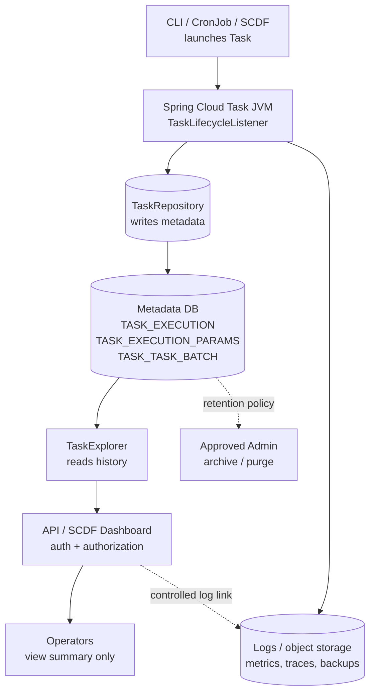
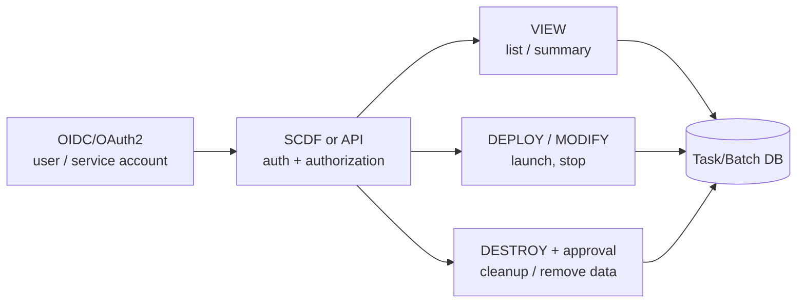
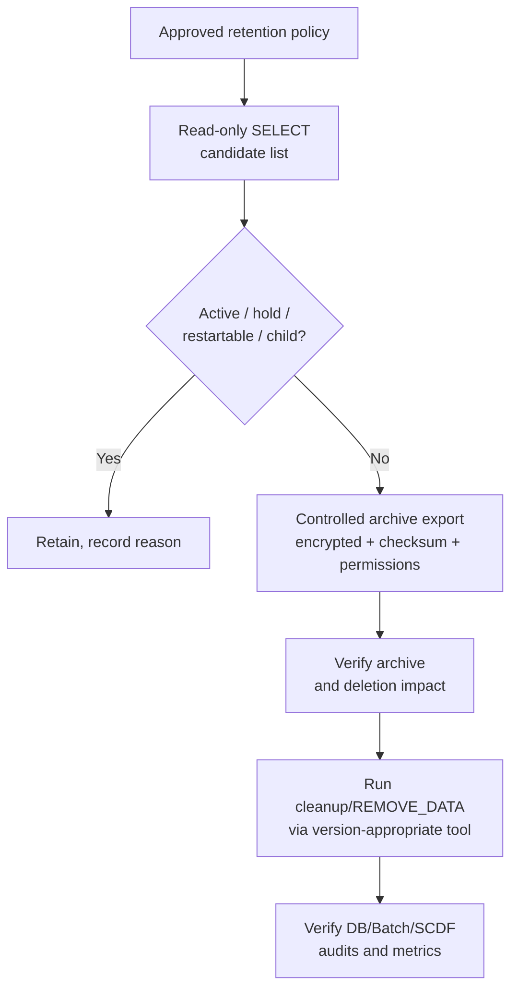

# Execution History Access Control and Data Retention Policies

## Learning Objectives

In the **Security** chapter of the **Spring Cloud Task** module, this lesson focuses on the data produced **after each finite Spring Boot application run completes**: who can view it, who can alter it, how long to keep it, and how to delete it so that information stays protected without breaking operations. This is essential when Tasks run on schedules or on demand, track statuses and outcomes in `TaskRepository`, handle failures, or coordinate with Spring Batch and Spring Cloud Data Flow.

Upon completion, you will be able to:

- Identify Spring Cloud Task metadata fields and tables capable of holding sensitive data.
- Distinguish **permissions of the process writing metadata**, **history viewing rights**, **orchestration rights**, and **deletion rights**.
- Design multi-layer access controls across databases, APIs, Spring Cloud Data Flow, logs, backups, and deployment environments.
- Present outcomes to operators through **minimal DTOs/views**, avoiding returning raw `TaskExecution` objects or stack traces.
- Define a **retention policy** with data classification, justified durations, owners, legal-hold exceptions, and deletion controls.
- Distinguish cleaning up Task execution resources from purging historical data; understand impacts on child Tasks and Spring Batch Jobs.
- Write **read-only** queries to inspect history/candidates before archiving or purging.
- Test authorization, parameter leaks, retention periods, recovery, and restartability.

## 1. Scenario: An Operational Report Can Leak Secrets

Suppose a rental platform's `rental-reconcile` application runs nightly, accepting a business date, partner code, and connection configuration. Each run creates a `TaskExecution` with timestamps, exit code, and error information. When a task fails, the support team asks to view the results to diagnose the cause.

An unsafe approach is granting all staff `SELECT *` on every `TASK_` table or returning raw `TaskExecution` JSON via an HTTP endpoint. Doing so can expose:

- Command-line argument strings, such as `--partnerId=...` or, if poorly designed, `--password=...`.
- `ERROR_MESSAGE` containing stack trace fragments, connection URLs, paths, table names, exception details, or business data values.
- `EXIT_MESSAGE` set by application code, occasionally containing messages returned by external systems.
- External identifiers, parent/child relationships, and timing showing when the organization runs which tasks.
- **Spring Batch** parameters, execution contexts, and error details if a Job is linked.

The operations team still needs to know **which Task failed, when, and whether it should be retried**. However, they do not inherently need to see raw arguments, full exceptions, or data belonging to another customer/partner.

**Security objective:** deliver **the right data to the right role for the right duration**, while retaining enough evidence to reconcile outcomes and recover from incidents.

## 2. Where Is History Stored?

Spring Cloud Task uses `TaskRepository` to record a run and `TaskExplorer` to query records. These are **metadata storage and lookup APIs**, not a complete user authorization system.



### 2.1. Key Tables

| Table | Data | Sensitivity Notes |
| --- | --- | --- |
| `TASK_EXECUTION` | ID, Task name, start/end times, exit code/message, error message, parent/external ID | `ERROR_MESSAGE`, `EXIT_MESSAGE`, and operational relationships can be sensitive |
| `TASK_EXECUTION_PARAMS` | `TASK_EXECUTION_ID` and `TASK_PARAM`: arguments of the run | **High** if the application passes PII, partner codes, or secrets via CLI |
| `TASK_TASK_BATCH` | Links `TASK_EXECUTION_ID` ↔ `JOB_EXECUTION_ID` | Reveals links to Batch metadata; critical during deletion |
| `TASK_LOCK` | Locks for single-instance mode | Not historical reports; arbitrary deletion can break orchestration |
| `TASK_SEQ` and equivalent sequence objects | Generates metadata IDs in certain databases/versions | **Not history records**; never delete for retention |

In the default Task schema, `TASK_EXECUTION` contains columns such as `START_TIME`, `END_TIME`, `EXIT_CODE`, `EXIT_MESSAGE`, `ERROR_MESSAGE`, `EXTERNAL_EXECUTION_ID`, and `PARENT_TASK_EXECUTION_ID`. Schema documentation notes that text fields `EXIT_MESSAGE`, `ERROR_MESSAGE`, and `TASK_PARAM` have length limits in standard DDL; **length limits do not mean sanitized or encrypted**.

**Never assume an empty `ERROR_MESSAGE` column proves the program ran cleanly.** Errors can occur before TaskRepository initializes, or the JVM can be killed before completion callbacks execute. Always inspect `EXIT_CODE`, `END_TIME`, logs, and scheduler/container status as well.

### 2.2. Spring Batch Expands the Scope of Protected Data

When a Task runs a Spring Batch Job, history also includes:

| Table Group | Typical Contents |
| --- | --- |
| `BATCH_JOB_INSTANCE` | Job name, JobInstance identity |
| `BATCH_JOB_EXECUTION` | Each Job attempt, `STATUS`, `EXIT_CODE`, `EXIT_MESSAGE` |
| `BATCH_JOB_EXECUTION_PARAMS` | `JobParameters`, which may contain business details |
| `BATCH_STEP_EXECUTION` | Read/write/skip counts, Step status |
| `BATCH_JOB_EXECUTION_CONTEXT`, `BATCH_STEP_EXECUTION_CONTEXT` | State/checkpoints for restarts; contents depend on reader/writer |
| `TASK_TASK_BATCH` | Join table between a Task run and JobExecutions |

**Checkpoints and JobParameters are not places to store secrets.** A reader or step that puts a token into `ExecutionContext` persists that token in the repository, where it may surface in detail views and backups.

### 2.3. Other Places That Also Retain “History”

Beyond the database, metadata can be replicated to:

- **Spring Cloud Data Flow UI/REST API:** TaskExecution lists, arguments, exit messages, logs, and JobExecution links.
- **Kubernetes/Docker:** Pod/Job specs, `args`, container termination statuses, events, and logs.
- **CI/CD and schedulers:** launch commands, parameters, test results, or log files.
- **Observability:** log aggregation, tracing, APM, alert payloads, SIEM.
- **Backups/snapshots/exports:** database copies, CSV files, emailed reports.

Deleting a record from the primary database **does not automatically erase** those copies. A retention policy must identify where copies live, when each expires, and who owns cleanup.

## 3. Classify Data Before Granting Access

### 3.1. Illustrative Classification Matrix

| Category | Examples | Who Typically Needs It? | How to Display |
| --- | --- | --- | --- |
| **Minimal operational info** | `taskExecutionId`, `taskName`, start/end times, `exitCode` | On-duty operations staff | Scope-filtered summary |
| **Diagnostic info** | Error codes, root-cause category, correlation ID | Authorized on-call engineers | Standardized error codes containing no secrets |
| **Restricted info** | Raw `TASK_PARAM`, stack traces, Batch parameters/context | Investigation teams with explicit approval | Audited, time-bounded access |
| **Highly sensitive data** | Tokens, passwords, customer details unneeded for metadata | **Should not be stored in metadata** | Never write into arguments/exceptions |
| **Audit data** | Who viewed, exported, deleted, and why | Designated audit team | Appropriate immutable/tamper-evident logs |

**Do not judge sensitivity solely by field name.** `EXIT_MESSAGE` is application-supplied text: one implementation might write “3 files imported,” while another writes a raw URL containing a token. A seemingly harmless `taskName` can also reveal business workflows when combined with run schedules.

### 3.2. Data Contract for a Safe Task

Example permitted arguments:

```bash
java -jar rental-reconcile.jar \
  --businessDate=2026-11-23 \
  --partnerKey=partner-42 \
  --requestId=req-7f92
```

`partnerKey` is solely a **secret-free** identifier and may still be classified as restricted within the organization. `requestId` correlates logs, not authentication.

Never do the following:

```bash
# AVOID: credentials exposed in process args, scheduler, and TaskRepository.
java -jar rental-reconcile.jar \
  --dbPassword=actual-secret \
  --apiToken=actual-token
```

The snippet above uses **illustrative dummy values**, not real secrets. Never reuse this pattern to pass credentials in real environments.

Provision credentials via platform secret mechanisms: Kubernetes Secrets/CSI driver, Vault, cloud secret managers, or equivalents. When using environment variables, still restrict access to Pod specs/debugging, process environments, crash dumps, and logs; environment variables **do not guarantee absolute secrecy by themselves**.

## 4. Who Can View History vs. Who Can Delete?

**Principle of least privilege:** grant only the permissions required for a specific action. Permission to view a `TaskExecution` **does not imply** permission to launch Tasks, stop Tasks, export raw logs, or delete metadata.

### 4.1. Illustrative Role Matrix

| Role | View Summary | View Sanitized Errors | View Raw Args/Logs | Launch/Stop | Delete Metadata |
| --- | --- | --- | --- | --- | --- |
| Business user | Assigned runs only | No, or error codes only | No | Via authorized workflow | No |
| `task-observer` / ops | Project scope | Yes, if permitted | Not by default | Not by default | No |
| `task-operator` | Project scope | Yes | Only when task requires | Can launch/stop | No by default |
| `incident-responder` | Ticket/incident scope | Yes | Only with time-bound approval | Possible per procedure | No by default |
| `retention-admin` | Admin scope | Yes | Only as needed for approval | Not required | **Conditional, fully audited** |
| `db-migration-admin` | Infrastructure scope | May access low-level details | DB-privileged, separate controls | Not by default | Schema ops via change process |

These are **application-defined example roles**, not default roles provided by Spring Cloud Task. One person may hold multiple roles while remaining bounded in data scope and audited on access.

### 4.2. Prevent Dangerous Rights from Bundling with Read Access

A history-viewer-only account should never have:

- `DELETE`/`UPDATE` on `TASK_EXECUTION`, `TASK_EXECUTION_PARAMS`, or `BATCH_` tables.
- Permission to invoke TaskExecution deletion endpoints or SCDF cleanup actions.
- Permission to read credentials from Kubernetes Secrets or secret stores.
- Visibility across all namespaces/tenants when responsible for only one group.
- Permission to export entire raw argument tables to uncontrolled files.

**Reading summaries through views/APIs** is far better than granting direct read access to every metadata table.

## 5. First Defense Layer: The Database

### 5.1. Separating Application Accounts from Observer Accounts

A common design uses distinct database accounts:

| DB Principal | Privileges to Consider | Should NOT Have |
| --- | --- | --- |
| `task_runtime` | `SELECT`, `INSERT`, `UPDATE` needed for TaskRepository; needed sequence/schema grants | No `DROP TABLE` or database-wide admin rights |
| `batch_runtime` | Minimal privileges on `BATCH_` tables and matching sequences | No blanket rights over partner data |
| `task_history_viewer` | `SELECT` on controlled summary views | Cannot read raw `TASK_EXECUTION_PARAMS` or `ERROR_MESSAGE` |
| `retention_service` | Privileges to run approved archive/cleanup workflows | No unnecessary privileged DDL |
| `schema_migrator` | DDL via controlled migrations | Never used as a long-lived runtime user |

**Note:** Exact privileges depend on the database engine, how Spring Cloud Task generates IDs, `TaskConfigurer` setup, `single-instance-enabled`, and Spring Batch integration. Some paths require writes to lock/sequence tables. **Inspect actual queries emitted by your version** rather than copying `GRANT` statements from an example to production untested.

### 5.2. PostgreSQL Example: Summary-Only Viewing

Assume a DBA created the `task_history_viewer` role, schema `task_meta` holds Task tables, and schema `ops` hosts reporting views. **Illustrative example, deployed by a DBA after review**:

```sql
-- Run with an appropriate admin account; this is sample configuration code.
CREATE SCHEMA IF NOT EXISTS ops;

CREATE OR REPLACE VIEW ops.task_execution_summary AS
SELECT
    task_execution_id,
    task_name,
    start_time,
    end_time,
    exit_code,
    CASE
        WHEN end_time IS NULL THEN 'NOT_FINISHED'
        ELSE 'FINISHED'
    END AS execution_phase
FROM task_meta.task_execution;

GRANT USAGE ON SCHEMA ops TO task_history_viewer;
GRANT SELECT ON ops.task_execution_summary TO task_history_viewer;
```

The view **omits `ERROR_MESSAGE`, `EXIT_MESSAGE`, and `TASK_PARAM`**. Because the account only reads the view, it does not need direct `SELECT` privileges on the underlying table. Verify **view owner** rights, underlying table grants, schema access, and RLS behavior for your exact PostgreSQL version.

**Multi-tenant warning:** the view above **does not filter by tenant**. It is appropriate only when everyone holding the role may see executions in that shared scope. If customers/programs must be isolated, **enforce the TaskExecution → tenant mapping** in the service layer or via rigorously designed and tested DB controls. Default `TASK_EXECUTION` **has no tenant ID column**; never assume every `taskName` is a safe tenant identifier.

### 5.3. Never Use DBA Accounts for Task Applications

Applications that only record metadata and run business jobs should not receive `SUPERUSER`, `db_owner`, or global schema create/drop privileges. In production:

1. Run `TASK_`/`BATCH_` migrations with a dedicated privileged account.
2. Disable automatic schema initialization when using controlled migrations, e.g., `spring.cloud.task.initialize-enabled=false`; configure Spring Batch similarly.
3. Run the application with a runtime account holding only required table read/write grants, with rotated credentials stored in a secret store.
4. Enforce TLS connections, network restrictions, encrypted backups, and separate snapshot read permissions.

When using **multiple DataSources**, point metadata repositories accurately via `TaskConfigurer` and Batch repository configuration; locking down one DataSource while the Task writes to another DB offers no real protection.

## 6. Second Defense Layer: Query APIs and UIs

Spring Cloud Task itself is an infrastructure library (`TaskRepository`/`TaskExplorer`). It **does not automatically attach OAuth2, RBAC, or tenant filtering to every `TaskExplorer.getTaskExecution(...)` call**. If you build a history REST API, that API application must authenticate and authorize callers itself.

### 6.1. Returning a Minimal DTO Instead of Full `TaskExecution`

Spring Boot 3.x and Spring Security 6.x example (a **history reader** service, not the Task CLI itself):

```java
package com.example.taskops;

import java.time.LocalDateTime;

public record TaskRunSummary(
        long executionId,
        String taskName,
        LocalDateTime startedAt,
        LocalDateTime endedAt,
        Integer exitCode) {
}
```

```java
package com.example.taskops;

import org.springframework.cloud.task.repository.TaskExecution;
import org.springframework.cloud.task.repository.TaskExplorer;
import org.springframework.http.HttpStatus;
import org.springframework.security.access.prepost.PreAuthorize;
import org.springframework.web.bind.annotation.GetMapping;
import org.springframework.web.bind.annotation.PathVariable;
import org.springframework.web.bind.annotation.RequestMapping;
import org.springframework.web.bind.annotation.RestController;
import org.springframework.web.server.ResponseStatusException;

@RestController
@RequestMapping("/ops/task-executions")
public class TaskHistoryController {

    private final TaskExplorer taskExplorer;

    public TaskHistoryController(TaskExplorer taskExplorer) {
        this.taskExplorer = taskExplorer;
    }

    @PreAuthorize("hasAuthority('SCOPE_task.history.read')")
    @GetMapping("/{id}")
    public TaskRunSummary getSummary(@PathVariable long id) {
        TaskExecution execution = taskExplorer.getTaskExecution(id);
        if (execution == null) {
            throw new ResponseStatusException(HttpStatus.NOT_FOUND);
        }

        // Multi-tenant production: must authorize the caller against
        // the execution's business owner/tenant BEFORE returning the DTO.
        return new TaskRunSummary(
                execution.getExecutionId(),
                execution.getTaskName(),
                execution.getStartTime(),
                execution.getEndTime(),
                execution.getExitCode());
    }
}
```

**Requirements for this snippet to be safe and functional:**

- Enable `@EnableMethodSecurity` and configure **Spring Security OAuth2 Resource Server** or another trusted authentication mechanism; placing `@PreAuthorize` without setting up authentication and the security filter chain is **insufficient**.
- The scope `SCOPE_task.history.read` is an **application convention**, not a default Spring Cloud Task scope.
- Configure the `TaskExplorer` bean against the proper datasource/schema and read-only account; never add `@EnableTask` to an API service solely for querying.
- This illustrative snippet omits **tenant authorization**, **pagination**, **rate limiting**, **access auditing**, and legal-hold rules; add them before deploying in multi-tenant environments.
- When an execution falls outside the caller's scope, return `404` or `403` per your anti-enumeration design, consistently with API policy.
- **Never return raw `TaskExecution` objects** or property maps containing arguments/errors directly in JSON responses.

### 6.2. Boundaries When Displaying Error Codes

Operators may need an understandable message. Instead of `ERROR_MESSAGE` containing stack traces, applications should emit a safe **error category/code** such as:

```json
{
  "executionId": 812,
  "taskName": "rental-reconcile",
  "status": "FAILED",
  "errorCode": "PARTNER_TIMEOUT",
  "requestId": "req-7f92"
}
```

This is a **proposed DTO**, not Spring Cloud Task's default response schema. `errorCode` should be controlled by business logic—never copied raw from `exception.getMessage()` or a request URL. Detailed logs use correlation IDs behind separate access controls.

## 7. Spring Cloud Data Flow: Viewing History vs. Deleting History

Spring Cloud Data Flow (SCDF) provides a UI/REST API to view `TaskExecution`, `JobExecution`, and perform orchestration actions. **SCDF access permissions must be evaluated separately** from the Task's database privileges.

SCDF 2.x documentation describes typical REST roles:

| SCDF Role | General Meaning |
| --- | --- |
| `ROLE_VIEW` | View statuses, lists, and details via REST/UI |
| `ROLE_CREATE` | Create app/task definitions |
| `ROLE_DEPLOY` | Deploy/launch tasks |
| `ROLE_MODIFY` | Modify state of certain resources |
| `ROLE_DESTROY` | Delete/destroy resources |
| `ROLE_SCHEDULE` | Create/manage schedules |
| `ROLE_MANAGE` | Management endpoints |

**Exact roles and endpoint mappings depend on the SCDF version and security configuration.** Do not mistake `ROLE_VIEW` for tenant-filtered RBAC or argument-masked viewing: in the SCDF UI, the TaskExecution detail screen can display **Task Arguments, Exit Message, logs, and Batch Job links**. Authorized viewers can still see sensitive metadata if you stored it there.

### 7.1. Separating Actions by Risk



Never grant `ROLE_DESTROY` to everyone holding `ROLE_VIEW` just so they can “clean up history themselves.” Deletion workflows need separate approval, age checks, and action logging.

**Keep REST/APIs off public networks:** enforce TLS, identity providers, IP/network limits, narrow-scoped service accounts, and audits for all exports and admin actions. An authenticated dashboard **does not replace** database, log, or metadata-copy security.

## 8. Designing a Data Retention Policy

**Retention** is more than “delete rows older than 90 days.” A solid policy answers:

1. **Which data categories** are kept and for what purpose?
2. Who are the **data owner** and **data steward**?
3. Where is the data stored: DB, logs, backups, object stores, schedulers?
4. How long are the “hot,” “archive,” and “final purge” periods?
5. Which timestamp anchors expiration: `END_TIME`, business close, ledger reconciliation, or audit completion?
6. Are there **legal holds**, active disputes, incident investigations, or Job restart needs?
7. Who can approve and execute deletion? How are actions verified, logged, and rolled back if erroneous?

### 8.1. Example Retention Table — **Not Legal Advice**

| Category | Operational Tier | Example Internal Period | Pre-Deletion Conditions |
| --- | --- | --- | --- |
| Successful Task summary | Hot DB | 90 days | No open investigation or business lock |
| Failed Tasks and exception metadata | Hot DB | 180 days | Incident closed; no restart needed |
| Controlled detailed logs | Log aggregation | 30 days | Incident summary captured where needed |
| Job/Step ExecutionContext | Batch JobRepository | Until JobInstance no longer needs restart, plus approved period | Confirmed non-restartable or sufficiently archived |
| View/delete action audits | Separate audit store | Per org audit and risk policy | Not under legal hold |
| Backups/snapshots | Backup storage | Per approved backup lifecycle | Defined expiry and deletion-request handling |

Numbers like `30/90/180 days` are **illustrative teaching examples**, not mandatory limits from Spring Cloud Task or any specific law. Organizations must establish retention periods based on actual data, contractual requirements, audits, security, and applicable regulations.

### 8.2. “Revoking Access” Differs from “Deleting Data”

Three distinct actions:

| Action | Purpose | Does Data Still Exist? |
| --- | --- | --- |
| **Restrict viewing** | Prevent unneeded personnel from seeing details | Still in DB |
| **Archive** | Move off hot DB tier into controlled storage for approved lookups | Still in archive storage |
| **Delete / purge** | Remove from storage locations per approved policy | Must consider primary DB, replicas, exports, backups, logs |

Never call archiving “permanent deletion.” When fulfilling an enforceable deletion request, coordinate across copies and backup lifecycles with security/legal teams instead of claiming a `DELETE` on the primary DB erased everything everywhere.

### 8.3. Categorizing by Execution Outcome

- **Tasks with `EXIT_CODE=0` and non-null `END_TIME`:** retention candidates after business reconciliation.
- **Failed Tasks:** may need longer retention for investigation or retries, though not indefinitely by default.
- **Tasks with `END_TIME IS NULL`:** never assume they finished; they may still be running, killed, or failed before final callbacks.
- **Child Tasks of composed tasks:** inspect the parent and graph; deleting children individually breaks traceability.
- **Spring Batch Jobs `FAILED` or `STOPPED`:** check restartability from JobRepository before purging contexts or JobExecutions.

**Never select deletions using `EXIT_CODE=0` alone.** Some Tasks considered successful by the framework still require extra business reconciliation/auditing, or have not finished publishing results outside the database.

## 9. Preparing Archive/Purge Candidate Lists — Read-Only

PostgreSQL example, **making no modifications**, to inspect Tasks with `END_TIME` older than 180 days:

```sql
SELECT
    TASK_EXECUTION_ID,
    TASK_NAME,
    START_TIME,
    END_TIME,
    EXIT_CODE
FROM task_meta.task_execution
WHERE END_TIME IS NOT NULL
  AND END_TIME < CURRENT_TIMESTAMP - INTERVAL '180 days'
ORDER BY END_TIME, TASK_EXECUTION_ID
LIMIT 100;
```

**This is only a review candidate list**, not a safe deletion predicate. It has not checked:

- Legal holds, open tickets, planned audits, or security investigations.
- Child/parent TaskExecutions and child statuses.
- Whether linked Batch JobInstances remain restartable.
- Export/restore needs and IDs referenced as correlation IDs in logs.
- Data still needed for accounting reconciliation or contracts.

Never turn this query into `DELETE FROM ... WHERE ...` simply by swapping out `SELECT`.

### 9.1. Checking Parent–Child Relationships

With the default schema containing `PARENT_TASK_EXECUTION_ID`:

```sql
SELECT
    parent.TASK_EXECUTION_ID AS PARENT_ID,
    child.TASK_EXECUTION_ID AS CHILD_ID,
    child.TASK_NAME,
    child.END_TIME,
    child.EXIT_CODE
FROM task_meta.task_execution parent
JOIN task_meta.task_execution child
  ON child.PARENT_TASK_EXECUTION_ID = parent.TASK_EXECUTION_ID
WHERE parent.TASK_EXECUTION_ID = 812
ORDER BY child.TASK_EXECUTION_ID;
```

Replace `812` with the actual parent ID. Never delete a parent leaving orphaned children/links. Conversely, SCDF may require invoking operations **on the parent** and cascade-removing child data per system logic.

### 9.2. Checking Linked Batch Jobs

```sql
SELECT
    link.TASK_EXECUTION_ID,
    link.JOB_EXECUTION_ID,
    job.STATUS AS JOB_STATUS,
    job.EXIT_CODE AS JOB_EXIT_STATUS
FROM task_meta.task_task_batch AS link
JOIN batch_meta.batch_job_execution AS job
  ON job.JOB_EXEC_ID = link.JOB_EXECUTION_ID
WHERE link.TASK_EXECUTION_ID = 812;
```

This is an **example across two PostgreSQL schemas**, `task_meta` and `batch_meta`. Substitute your actual schema/table prefixes; applications may store Task and Batch metadata in separate databases, in which case direct SQL joins are impossible and you must query via APIs or cross-store reports.

If a linked `JobExecution` is `STARTED`, `FAILED`, or `STOPPED` and the organization intends to restart it, **never arbitrarily delete `BATCH_JOB_EXECUTION_CONTEXT` or `BATCH_STEP_EXECUTION_CONTEXT`**. Deleting checkpoints destroys the ability to resume that `JobInstance`.

### 9.3. Gathering Statistics Before Enforcing Policies

```sql
SELECT
    TASK_NAME,
    COUNT(*) AS TOTAL_EXECUTIONS,
    MIN(END_TIME) AS OLDEST_END_TIME,
    MAX(END_TIME) AS NEWEST_END_TIME
FROM task_meta.task_execution
WHERE END_TIME IS NOT NULL
GROUP BY TASK_NAME
ORDER BY TOTAL_EXECUTIONS DESC;
```

These statistics show which Tasks generate high metadata volume, guiding frequency-based archive policies. **Never print raw `TASK_PARAM` or `ERROR_MESSAGE` onto general dashboards** just to count records.

## 10. Distinguishing Resource Cleanup from Metadata Deletion in SCDF

Spring Cloud Data Flow 2.x documentation describes two key actions on TaskExecution management endpoints:

| Action | Meaning | Risk |
| --- | --- | --- |
| `CLEANUP` | Cleans up the Task's deployment resources on the platform (implementation-dependent) | May affect Pod resources/logs needed for investigation |
| `REMOVE_DATA` | Deletes TaskExecution metadata and **potentially linked Batch Job metadata** from the persistence store | **Can destroy history, checkpoints, and restartability** |

SCDF lets you execute each action individually or combined depending on API/UI version. Cleaning up a terminated Pod **does not automatically delete** the TaskRepository database. Deleting a task definition also **does not delete** all execution history by default (depending on whether cleanup options are enabled).

### 10.1. Special Care for Composed Task Parent–Child Trees

In documented SCDF branches, deleting data via `REMOVE_DATA` must target the **parent TaskExecution ID**; selecting a child directly may return `400 Bad Request`. Deleting a parent can cascade-delete child history and linked Job data.

Before an operator confirms “delete an old Task run,” display:

1. Parent TaskExecution ID.
2. Count of affected child TaskExecutions.
3. Count of linked Batch JobExecutions and StepExecutions.
4. Restart/investigation/legal-hold status.
5. List of exports/backups and off-database impacts.

**Never call `REMOVE_DATA` automatically solely because a row passed 90 days.** Design an approval step or impact-reconciliation workflow before purging.

### 10.2. Safe Retention Execution Order



This is a **recommended governance workflow**, not a built-in retention job executed automatically by Spring Cloud Task. Spring Cloud Task **has no universal `spring.cloud.task.retention-days` property** that automatically governs all metadata, logs, and backups. Never invent or rely on such a property.

### 10.3. Why Direct SQL `DELETE` Is Not Recommended in This Lesson

Do not teach `DELETE FROM TASK_EXECUTION WHERE END_TIME < ...` as a default action because it can overlook `TASK_TASK_BATCH`, `TASK_EXECUTION_PARAMS`, child Tasks, Spring Batch tables, and archiving policies.

If an environment does not use SCDF and must build a custom retention service, design:

- Database-appropriate transactions/locks; never delete still-running Tasks.
- Deletion order respecting foreign keys, Batch metadata, and child/parent links verified against your actual schema.
- Small batching to avoid excessive locks/redo logs, with resumability if interrupted.
- Pre-purge export, count/checksum verification, and restorable snapshots.
- Auditing recording approver identity, executor identity, ID set, record count, policy version, and timestamp.
- **Mandatory** dry-run/preview mode with transactional rollback support where appropriate.

This approach needs dedicated QA against your actual database and framework version; a few `DELETE` statements in documentation cannot substitute for end-to-end testing.

## 11. Retention Policy Template for Projects

A concise policy document should follow this structure:

| Policy Field | Example Content |
| --- | --- |
| `policyId` | `TASK-HISTORY-RETENTION-v1` |
| Owner | Data platform team, designated approver |
| Scope | `rental-reconcile` and Tasks in the same pipeline |
| Data types | Task summary, params, error details, Batch metadata, logs, exports |
| Classification | Internal / restricted / sensitive |
| Hot retention period | Per approved retention schedule |
| Archive period | Per audit/recovery purpose |
| Expiration anchor | `END_TIME` or defined business milestone |
| Exceptions | Incidents, legal holds, failed/restartable Jobs, ongoing disputes |
| Read permissions | Which groups/roles may read summaries, errors, raw metadata |
| Deletion permissions | Approval workflow, dedicated service account, auditing |
| Verification | Dry-run, counts, checksums, post-cleanup report, restore test |
| Backups | Backup retention, access rights, copy expiration schedule |
| Review cadence | E.g., quarterly or upon regulatory changes |

Never treat illustrative deletion periods in this lesson as legal advice or your organization's data policy. When data involves personal data, financial transactions, disputes, or recordkeeping mandates, consult compliance teams before setting periods and exceptions.

### 11.1. Separating Diagnostic Information Before Expiration

When operations only need to know “partner connection failed” rather than raw stack traces, a clean model is:

- Write a standardized `errorCode` to a dedicated business/observability table linked to `taskExecutionId` or a correlation ID.
- Keep raw stack traces in restricted-access logs with a shorter retention window if policy permits.
- Once an incident closes, archive a safe investigation summary rather than copying raw arguments.
- Then archive/purge metadata under approved workflows while retaining required aggregate evidence.

Never try to “sanitize by stripping a few password strings” and assume metadata is non-sensitive. Inputs and exceptions can hold PII or tokens in many formats. **Minimizing collection at the source** is a stronger defense.

## 12. Encryption, Transport, and Secret Management

### 12.1. Protection Across Different Layers

| Layer | Control | What NOT to Infer |
| --- | --- | --- |
| DB connection | TLS, certificate verification, network policies | TLS **does not encrypt** data at rest on disk |
| DB/backup storage | Encryption at rest, KMS, key management | Encryption at rest **does not replace** query authorization |
| SCDF UI/REST and custom APIs | HTTPS/TLS, OIDC/OAuth2, RBAC | HTTPS **does not filter** `TASK_PARAM` contents |
| Secret store | Vault/Kubernetes Secret/Cloud Secret Manager, rotation | Secrets in env vars can still be read by privileged principals |
| Logs and exports | Redaction, restricted permissions, encryption, retention | Deleting DB rows **does not erase** already-shipped logs |

**Kubernetes Secrets** are base64-encoded in manifest/API representations, which does not mean strong encryption is active everywhere by default. Enable cluster encryption at rest, RBAC, namespace isolation, and secure secret injection per your platform.

### 12.2. Configuration Example Without Plaintext Passwords

```yaml
spring:
  application:
    name: rental-reconcile
  datasource:
    url: "${TASK_DB_URL}"
    username: "${TASK_DB_USERNAME}"
    password: "${TASK_DB_PASSWORD}"
  cloud:
    task:
      initialize-enabled: false
```

Environment variables must be provided by your secret store/deployment platform. **Never commit real `.env` files or credential-bearing Helm values to Git**. If secrets were mistakenly passed into a Task run, rotate the credentials and check whether they entered arguments, metadata, logs, or backups.

## 13. Testing Access Control and Data Retention Policies

Policies are ineffective unless tested. Separate tests into **authorization tests**, **data exposure tests**, and **retention tests**.

### 13.1. Authorization Test Matrix

| Scenario | Expected Outcome |
| --- | --- |
| Unauthenticated call to history API | `401 Unauthorized` (with standard API auth configuration) |
| Authenticated user lacking `task.history.read` scope | `403 Forbidden` |
| Valid scope querying an authorized Task | `200 OK` with safe summary DTO |
| Valid scope querying another tenant's Task | `403` or `404` per design, **no data leaked** |
| Viewer calls cleanup/delete endpoint | Denied |
| `retention-admin` without approval | Cannot purge |
| DB viewer role attempts `SELECT` on raw `TASK_EXECUTION_PARAMS` | Denied if design grants view-only access |
| DBA/migration role used as runtime credential | Tests/audits flag configuration violation |

With Spring Security, use `MockMvc`, `@WithMockUser`, or the corresponding OAuth2 test support to verify authorization. **Mock user tests do not prove real OAuth2 integration works**; add staging integration tests using real issuers/claims and scope policies.

### 13.2. Testing Failure Paths with a Fake Sensitive String

In an isolated environment, pass a **fake sentinel string** (never a real secret) through an error path:

```text
SENTINEL_DO_NOT_LEAK_7F92
```

Then check whether the sentinel appears in:

1. HTTP summary API responses.
2. `TASK_EXECUTION_PARAMS` and `TASK_EXECUTION.ERROR_MESSAGE`.
3. `BATCH_JOB_EXECUTION_PARAMS` / execution contexts (if using Batch).
4. SCDF dashboard/exports, application logs, and alert payloads.
5. Downloaded audit/CSV reports.

If the sentinel appears anywhere a user should not see it, **fix the collection/display path and permissions**, rather than just deleting one log line in the test. Sentinels let you test leak paths without risking real credentials.

### 13.3. Testing Retention in Staging

A sample test cycle:

1. Create **synthetic** finished Task records, failed records, a parent with children, a restartable `FAILED` Batch Job, and a Task with `END_TIME = NULL`.
2. Run **read-only candidate selection** per policy.
3. Verify `END_TIME = NULL`, legal holds, linked parent/children, and restartable Batch Jobs are excluded from deletion.
4. Practice archiving to a restricted-access test bucket/database; verify counts, checksums, and recovery reads.
5. Run cleanup **in staging only** after test approval.
6. Cross-check Task tables, Batch tables, SCDF API, and replicas/copies.
7. Test restoring a data sample and confirm viewing permissions remain intact afterward.
8. Save count reports and audit logs proving policy enforcement.

**Never practice purges or alter DB grants directly in production** as a learning exercise.

## 14. Common Mistakes

| Mistake | Consequence | How to Avoid |
| --- | --- | --- |
| Granting the entire ops team `SELECT *` on Task tables | Exposes raw arguments and error stacks | Views/DTOs returning only needed fields |
| Putting tokens in `--apiKey=...` | Exposed via CLI, TaskRepository, and logs | Secret store and controlled injection |
| Writing raw exception messages into `exitMessage` | Leaks PII/URLs/tokens to dashboards | Standardized error codes |
| Assuming `TaskExplorer` checks tenants automatically | IDOR vulnerability; users read other tenants' data | Resource-level authorization via ownership mapping |
| Confusing `ROLE_VIEW` with redacted viewing | SCDF UI can show params/logs | Inspect real responses and control data sources |
| Using the DB migration account for runtime | App holds unnecessary DDL privileges | Separate accounts with least privilege |
| Setting a blanket “7-year” retention on all tables | Over-retaining or violating policies | Classify and approve retention per data type |
| Deleting `TASK_EXECUTION` via direct SQL | Orphans params, Batch links, child tasks | Appropriate SCDF `REMOVE_DATA` or tested retention service |
| Cleaning up a Pod and assuming history is gone | DB, logs, and backups still retain data | Track lifecycles across every store |
| Purging Batch context while Job is `FAILED` | Loses checkpoints/restartability | Check restart needs before purging |
| Using `END_TIME IS NULL` as a deletion criterion | Can delete active or recently killed Tasks | Investigate status before archiving |
| Deleting only the primary DB on erasure requests | Copies persist in exports/backups/logs | Cross-store deletion policies aligned with obligations |
| Not auditing deletion actions | Cannot prove who deleted what and why | Log approval ID, actor, timestamp, policy version, ID list |
| Assuming backups imply restorability | Corrupt backups, missing permissions, or version drift | Test restores periodically in a safe environment |

## 15. Operations Checklist and Self-Assessment

### 15.1. Checklist Before Opening History Viewing Access

- [ ] Identified all data in `TASK_EXECUTION`, `TASK_EXECUTION_PARAMS`, `TASK_TASK_BATCH`, and Batch metadata.
- [ ] No credentials passed via CLI/JobParameters or written to `exitMessage`.
- [ ] Separated runtime, viewer, operator, incident response, retention, and migration roles.
- [ ] API/SCDF authenticated; scopes/roles and tenant/project boundaries tested.
- [ ] Dashboards and exports expose only fields required for each role.
- [ ] DB uses TLS, encryption at rest/backups as required, and network isolation.
- [ ] Retention matrix defines data categories and explicit expiration anchors.
- [ ] Exceptions cover legal holds, active incidents, running Tasks, and Batch restarts.
- [ ] Cleanup procedures separate platform resources from metadata and require dry-runs/approvals.
- [ ] Tested archiving, counts/checksums, restores, and purge impact in staging.
- [ ] Audits record viewing of sensitive data, exports, and purges.
- [ ] Logs/backups/exports follow independent lifecycles without silently relying on hot DB deletes.

### 15.2. Self-Assessment Questions

**1. Should someone authorized to view `TaskExecution.exitCode` automatically see `TASK_PARAM`?**

> No. `TASK_PARAM` holds raw arguments and may contain sensitive data. Separate summary viewing from raw diagnostic access.

**2. Why doesn't `TaskExplorer` replace authorization?**

> It is a metadata query API. The application/API must authenticate callers and enforce resource-level ownership; knowing a `TaskExecutionId` is not proof of access rights.

**3. Does SCDF `CLEANUP` always delete history from the database?**

> No. `CLEANUP` targets deployment resources; `REMOVE_DATA` is the SCDF API operation that deletes historical data and can affect linked Batch metadata.

**4. Can a Task with `EXIT_CODE=0` that finished 200 days ago be deleted immediately?**

> Not necessarily. You must verify approved policy, legal holds, business reconciliation, parent/child links, Batch links, archiving, and copies.

**5. What is the risk of deleting `BATCH_STEP_EXECUTION_CONTEXT` for a failed Job?**

> You can lose state/checkpoints needed to restart the exact JobInstance and Step, forcing full reprocessing or breaking restartability.

**6. `TASK_EXECUTION.ERROR_MESSAGE` has no tokens, but Kubernetes logs do—are security requirements met?**

> No. You must evaluate every storage location: DB, process args, logs, APM, dashboards, exports, and backups—not just the Task table.

**7. Should one `task_history_viewer` role have access across all tenants?**

> Not by default. When data is partitioned by tenant, check authorization per resource and design appropriate SQL/views/RLS or service checks; the default Task schema has no tenant ID column.

**8. Why can retention periods for Task/Batch metadata differ from detailed logs?**

> They serve different purposes: metadata supports traceability/restarts, whereas logs support detailed diagnostics. Per-category retention reduces exposure while preserving approved operational needs.

**9. When handling a data deletion request, why must backups be considered?**

> Because backups can still hold copies deleted from the primary DB. Define expiration schedules and copy-control/restoration procedures instead of promising a single `DELETE` erases every copy immediately.

## Remember

- **Spring Cloud Task history is data requiring authorization**, not just status numbers. `TASK_PARAM`, `ERROR_MESSAGE`, `EXIT_MESSAGE`, and Batch metadata can be sensitive.
- **Viewing, orchestration, and deletion permissions must be separated.** `TaskRepository`/`TaskExplorer` do not replace OAuth2, RBAC, database grants, or tenant checks.
- **Expose the minimum necessary** via views/DTOs; never hand raw arguments or stack traces to every operator.
- **Retention must rest on approved classification, purpose, duration, and exceptions**, not a single age-based `DELETE` query.
- **Resource `CLEANUP` differs from historical `REMOVE_DATA`**; deleting a Task can cascade to children and Spring Batch Jobs, impacting restartability.
- **Databases, logs, backups, exports, and the SCDF UI** are distinct stores/access paths that must be protected and governed consistently.
- **Testing authorization and recovery** matters as much as functional testing; every retention action needs dry-runs, approvals, and auditing.

## References

1. [Spring Cloud Task — Task Repository Schema (TASK_EXECUTION, PARAMS, TASK_TASK_BATCH, TASK_LOCK)](https://docs.spring.io/spring-cloud-task/reference/3.2/appendix-task-repository-schema.html)
2. [Spring Cloud Task — Features: TaskRepository, TaskExplorer, DataSource, table prefix](https://docs.spring.io/spring-cloud-task/reference/3.3/features.html)
3. [Spring Cloud Data Flow — Reference: Reviewing Task Executions, Task Execution Detail, Cleanup/REMOVE_DATA](https://docs.spring.io/spring-cloud-dataflow/docs/current/reference/htmlsingle/index.html)
4. [Spring Cloud Data Flow — TaskExecutionController Javadoc: cleanup and remove task data](https://docs.spring.io/spring-cloud-dataflow/docs/current/api/org/springframework/cloud/dataflow/server/controller/TaskExecutionController.html)
5. [Spring Cloud Data Flow — Security and REST Authorization (ROLE_VIEW, ROLE_DESTROY, ...)](https://docs.spring.io/spring-cloud-dataflow/docs/current/reference/htmlsingle/)
6. [Spring Batch 5.2 — Configuring a Job: restartability](https://docs.spring.io/spring-batch/reference/5.2/job/configuring.html)
7. [Spring Security — Method Security: `@EnableMethodSecurity`, `@PreAuthorize`](https://docs.spring.io/spring-security/reference/servlet/authorization/method-security.html)
8. [Spring Security — OAuth2 Resource Server JWT](https://docs.spring.io/spring-security/reference/servlet/oauth2/resource-server/jwt.html)
9. [Kubernetes — Secrets: protecting credentials](https://kubernetes.io/docs/concepts/configuration/secret/)
10. [OWASP — Logging Cheat Sheet: avoiding sensitive data in logs](https://cheatsheetseries.owasp.org/cheatsheets/Logging_Cheat_Sheet.html)
