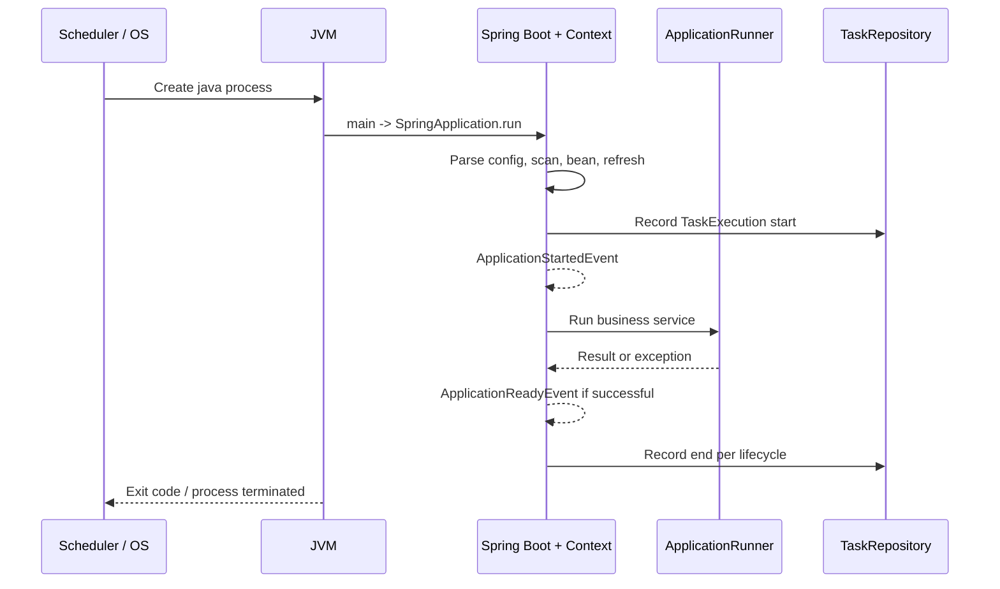
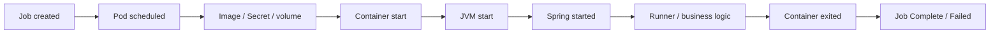

# Measuring JVM and ApplicationContext Startup Overhead

## 1. Why Does Startup Time Matter for Spring Cloud Task?

**Spring Cloud Task** helps build Spring Boot applications with a finite execution lifetime: starting up, receiving parameters, invoking business services, recording metadata via `TaskRepository`, and then terminating. An application can be launched via `java -jar`, cron, Kubernetes CronJob, a workflow engine, or in coordination with Spring Batch. Each execution from a fresh JVM typically has to **start the JVM and build a new `ApplicationContext`**.

For an HTTP service that runs for weeks, startup cost is amortized across a large number of requests. For a task that only processes for 100 ms, the time spent loading classes, creating beans, configuring JDBC, and initializing the repository can instead make up most of **the total time to complete a request**. This directly affects SLAs, CPU, memory peak, Pod retention time, and cost when there are thousands of short-lived runs.

**Hypothetical example, not a real benchmark:**

| Phase | Time |
| --- | ---: |
| JVM creation and Spring/TaskRepository bootstrap | 1,200 ms |
| Business processing | 100 ms |
| Context/JVM shutdown and log flush | 150 ms |
| **Total wall time from launcher perspective** | **1,450 ms** |

In this example, business logic only accounts for about 7% of the total time. To optimize based on evidence, you must **separate JVM, context, runner, and shutdown costs**; looking only at the `Started ... in ... seconds` log line can miss time spent before `main`, inside the runner, or after the context is ready.

**Chapter goal:** learn how to build repeatable measurements of JVM and `ApplicationContext` startup time for a Spring Cloud Task, identify slow beans/phases, correlate with `TaskExecution` and Kubernetes Job timing, and evaluate optimization/upgrade approaches **without sacrificing correctness or retry capability**.

## 2. Measurement Boundaries: What Does Each Timing Metric Tell You?

| Metric | Start/End Milestones | Measurement Tool |
| --- | --- | --- |
| **Scheduler-to-complete** | Job launch request → Job completion | Scheduler, Kubernetes Job status/events |
| **Process wall time** | Shell/parent invokes `java` program → process exits | GNU `time`, PowerShell `Stopwatch` |
| **JVM/bootstrap** | VM created, class loading, code before and inside `main` | JFR and Java logs |
| **Spring started** | Spring Boot starts → `ApplicationStartedEvent`, after context refresh and **before runners** | `getTimeTaken()` of the event |
| **Business runner** | Immediately before → after service/`ApplicationRunner` | `System.nanoTime()`/timer |
| **Spring ready** | Spring Boot starts → `ApplicationReadyEvent`, **after runners** | `getTimeTaken()` of the event |
| **TaskExecution lifetime** | `TASK_EXECUTION.START_TIME` → `END_TIME` | `TaskExplorer` or SQL |
| **Shutdown** | Cleanup, flush, JVM exit | Wall time, shutdown logs, JFR |

Spring Boot publishes `ApplicationStartedEvent` after refreshing the `ApplicationContext` but before running `ApplicationRunner`/`CommandLineRunner` beans; `ApplicationReadyEvent` is published after the runners. Therefore, for Spring Cloud Task, **`application.ready.time` can include business execution time**, not just the cost of building the context.

`TaskExecution.START_TIME` is also **not the moment the JVM was created**. Spring Cloud Task records the start metadata once the lifecycle reaches a certain phase, before the runner but after many bootstrap steps. The `END_TIME - START_TIME` duration can be very short even when JVM/context creation takes a long time.



This diagram is a **conceptual model**; the exact timing of task listeners, commits, and context closing also depends on the version. If a runner throws an exception, `ApplicationReadyEvent` may not be published. If the JVM is killed with `kill -9`, metadata may be missing `END_TIME`. Always collect both logs and the exit code.

```text
T_wall ≈ T_process_bootstrap + T_spring_bootstrap
       + T_business + T_shutdown
```

This is an analytical model, **not a direct sum** of timestamps taken from different clocks. `ApplicationStartedEvent.getTimeTaken()` measures time from an internal `SpringApplication` mark and does not include everything before `main`. To measure a specific segment on its own, you must use **one consistent clock source at both ends of that segment**.

## 3. Sample Spring Cloud Task Application for Establishing a Baseline

The example uses Java 17+, compatible Spring Boot/Spring Cloud Task versions per the BOM, H2 in-memory, and a runner with an adjustable simulated duration. H2 helps you learn how to measure, but **does not represent PostgreSQL, TLS, or network latency in production**.

### 3.1. Maven Dependencies

```xml
<!-- The project requires a compatible Spring Boot parent/BOM and Spring Cloud BOM. -->
<dependencies>
    <dependency>
        <groupId>org.springframework.cloud</groupId>
        <artifactId>spring-cloud-starter-task</artifactId>
    </dependency>
    <dependency>
        <groupId>com.h2database</groupId>
        <artifactId>h2</artifactId>
        <scope>runtime</scope>
    </dependency>
</dependencies>
```

### 3.2. `application.yml`

```yaml
spring:
  application:
    name: startup-cost-app
  main:
    web-application-type: none
  datasource:
    driver-class-name: org.h2.Driver
    url: jdbc:h2:mem:startup_cost;DB_CLOSE_DELAY=-1
    username: sa
    password: ""
  cloud:
    task:
      name: startup-cost-task
      initialize-enabled: true

app:
  demo:
    work-ms: 100
```

`initialize-enabled: true` is suitable for **fresh H2 labs**, when the library has matching schema scripts. Each `java -jar` invocation creates a new JVM and simultaneously creates a new H2 `mem:` database: table initialization time is counted in startup. Production typically requires **a persistent database, a migrated schema**, and `initialize-enabled: false`.

### 3.3. Logging Started, Ready, and Business Time

Create `src/main/java/com/example/startup/StartupCostApplication.java`:

```java
package com.example.startup;

import java.time.Duration;
import org.springframework.beans.factory.annotation.Value;
import org.springframework.boot.ApplicationRunner;
import org.springframework.boot.SpringApplication;
import org.springframework.boot.autoconfigure.SpringBootApplication;
import org.springframework.boot.context.event.ApplicationReadyEvent;
import org.springframework.boot.context.event.ApplicationStartedEvent;
import org.springframework.cloud.task.configuration.EnableTask;
import org.springframework.context.annotation.Bean;
import org.springframework.context.event.EventListener;

@EnableTask
@SpringBootApplication
public class StartupCostApplication {
    public static void main(String[] args) {
        SpringApplication.run(StartupCostApplication.class, args);
    }

    @EventListener
    public void started(ApplicationStartedEvent event) {
        System.out.printf("BOOT_STARTED_MS=%s%n", millis(event.getTimeTaken()));
    }

    @EventListener
    public void ready(ApplicationReadyEvent event) {
        System.out.printf("BOOT_READY_MS=%s%n", millis(event.getTimeTaken()));
    }

    @Bean
    ApplicationRunner runOnce(@Value("${app.demo.work-ms:100}") long workMs) {
        return args -> {
            if (workMs < 0 || workMs > 30_000) {
                throw new IllegalArgumentException(
                        "app.demo.work-ms must be between 0 and 30000");
            }
            long t0 = System.nanoTime();
            try {
                Thread.sleep(workMs); // Simulates business logic, for lab use only.
            } finally {
                System.out.printf("BUSINESS_MS=%.3f%n",
                        (System.nanoTime() - t0) / 1_000_000.0);
            }
        };
    }

    private static String millis(Duration duration) {
        return duration == null ? "unavailable"
                : Long.toString(duration.toMillis());
    }
}
```

`BOOT_STARTED_MS` is measured up to the point where context refresh finishes, **before runners**; it also includes Spring bootstrap steps rather than purely a single `refresh()` call. `BOOT_READY_MS` is measured **after runners**. `BUSINESS_MS` is a segment we bracketed ourselves with `System.nanoTime()` inside the JVM. The difference between the two Boot events can also include other callbacks/overhead and **does not necessarily equal BUSINESS_MS exactly**.

### 3.4. Running Two Load Levels to Verify the Measurement Method

Suppose the executable JAR is named `target/startup-cost-task.jar`:

```bash
java -jar target/startup-cost-task.jar --app.demo.work-ms=0
java -jar target/startup-cost-task.jar --app.demo.work-ms=1000
```

| Milestone | `work-ms=0` | `work-ms=1000` |
| --- | --- | --- |
| `BOOT_STARTED_MS` | Excludes runner | Still excludes runner |
| `BUSINESS_MS` | Close to 0 | Approximately 1,000 ms, with OS variance |
| `BOOT_READY_MS` | Usually closer to started | Usually increases proportionally with runner time |
| Process wall | Startup/cleanup takes a high share | Adds simulated work time |

These are only **expected trends**; `Thread.sleep(1000)` does not guarantee completing in exactly 1000.000 ms. Use the same JDK, configuration, logging mode, and data for both runs to reduce noise.

## 4. Measuring Wall-Clock Time from Outside the JVM

The two milestones `BOOT_STARTED_MS` and `BOOT_READY_MS` do not cover the entire duration from when the OS creates the process until the JVM exits. Therefore, you also need **external wall time** to properly evaluate the total cost of a short task.

### 4.1. Linux/macOS and Windows

On Linux with **GNU time**:

```bash
/usr/bin/time -f 'WALL_S=%e USER_CPU_S=%U SYS_CPU_S=%S MAX_RSS_KB=%M EXIT=%x' \
  java -jar target/startup-cost-task.jar --app.demo.work-ms=0
```

This is GNU `time`-specific syntax; macOS/BSD have different options. `WALL_S` measures actual elapsed time; `USER_CPU_S` and `SYS_CPU_S` measure CPU time. A task waiting on DB, DNS, or experiencing CPU throttling can have **high wall time but low CPU time**.

In **Windows PowerShell**:

```powershell
$jar = "target/startup-cost-task.jar"
$stopwatch = [System.Diagnostics.Stopwatch]::StartNew()
& java -jar $jar --app.demo.work-ms=0
$exitCode = $LASTEXITCODE
$stopwatch.Stop()
"WALL_MS={0:N1} EXIT={1}" -f $stopwatch.Elapsed.TotalMilliseconds, $exitCode
```

`Stopwatch` measures the process invocation duration from the shell; it counts JVM, Spring, runner, shutdown, and shell command overhead. **Always check the exit code**, and do not mix failed startups into the successful duration distribution without stating so explicitly.

### 4.2. Repeating 20 Times and Calculating p50/p95

A single run can be affected by antivirus, OS page cache, network, JDBC, logging, CPU pressure, or GC frequency. The PowerShell 5.1 snippet below runs 20 **new JVMs**, writes each run's output to a separate file, and reports the p50/p95 of successful runs:

```powershell
$jar = "target/startup-cost-task.jar"
$logDir = Join-Path (Get-Location) "bench-logs"
New-Item -ItemType Directory -Path $logDir -Force | Out-Null

$samples = @(
    for ($i = 1; $i -le 20; $i++) {
        $logFile = Join-Path $logDir ("run-{0:00}.log" -f $i)
        $watch = [System.Diagnostics.Stopwatch]::StartNew()
        & java -jar $jar --app.demo.work-ms=0 *> $logFile
        $exitCode = $LASTEXITCODE
        $watch.Stop()
        [pscustomobject]@{
            Run = $i
            ExitCode = $exitCode
            WallMs = [math]::Round($watch.Elapsed.TotalMilliseconds, 1)
        }
    }
)

$samples | Export-Csv "bench-results.csv" -NoTypeInformation -Encoding UTF8
$passed = @($samples | Where-Object { $_.ExitCode -eq 0 } | Sort-Object WallMs)
if ($passed.Count -eq 0) { throw "No successful runs" }

$p50 = $passed[[math]::Ceiling($passed.Count * 0.50) - 1].WallMs
$p95 = $passed[[math]::Ceiling($passed.Count * 0.95) - 1].WallMs
$stats = $passed | Measure-Object -Property WallMs -Minimum -Maximum -Average
"SUCCESS={0}/{1} P50={2}ms P95={3}ms AVG={4:N1}ms" -f $passed.Count, $samples.Count, $p50, $p95, $stats.Average
```

The snippet above runs through the shell and redirects logs, so **log writing overhead is also included in wall time**. Keep logging method, output, and database conditions identical when comparing baseline/candidate. Also report the failure count and min/max; a p95 result from only 20 samples has considerable uncertainty, so for high-impact decisions you should increase the sample count and check stability.

**Do not confuse OS warm cache with JVM warm-up:** running `java -jar` 20 times creates **20 different JVMs**. OS filesystem cache, image cache, and DB may warm up, but the JIT state of a previous JVM is not automatically carried over to a new JVM. Explicitly note the environment's cold/warm state, and do not call this a "warm JVM".

## 5. Using ApplicationStartup to Find Slow Beans/Phases

Spring Framework provides `ApplicationStartup` and `StartupStep` to track context creation. Spring Boot supports `BufferingApplicationStartup`; Spring Framework supports `FlightRecorderApplicationStartup` to record events into **Java Flight Recorder (JFR)**. These two options are for **root-cause analysis**, not a replacement for wall-time measurement.

### 5.1. BufferingApplicationStartup

If you want to record startup steps in memory, replace the **`main` method** in section 3 with the following version:

```java
import org.springframework.boot.SpringApplication;
import org.springframework.boot.context.metrics.buffering.BufferingApplicationStartup;

public static void main(String[] args) {
    SpringApplication app = new SpringApplication(StartupCostApplication.class);
    app.setApplicationStartup(new BufferingApplicationStartup(2048));
    app.run(args);
}
```

This is a replacement for `main`; **do not create a second class/method `main`**. The parameter `2048` is the buffer capacity for startup events, not a duration in milliseconds. A buffer that is too small may fail to retain enough steps; a buffer that is too large consumes extra memory.

When **Spring Boot Actuator** is added, `BufferingApplicationStartup` is configured, and the management HTTP endpoint is enabled, `/actuator/startup` can return the timeline. However, Spring Cloud Task applications typically have `spring.main.web-application-type: none` and **exit immediately after their work**, so you cannot assume the HTTP endpoint can be queried after the task finishes. If you need to capture the startup timeline of a short-lived process, export the data within the process lifecycle or prefer JFR. Do not open a production Actuator port solely for benchmarking without clear security requirements.

### 5.2. FlightRecorderApplicationStartup and JFR

To record Spring startup and JVM events, you can replace `main` with a variant that **enables profiling only when a system property is set**:

```java
import org.springframework.boot.SpringApplication;
import org.springframework.core.metrics.jfr.FlightRecorderApplicationStartup;

public static void main(String[] args) {
    SpringApplication app = new SpringApplication(StartupCostApplication.class);
    if (Boolean.getBoolean("profile.startup")) {
        app.setApplicationStartup(new FlightRecorderApplicationStartup());
    }
    app.run(args);
}
```

With a JDK that supports JFR:

```bash
java -Dprofile.startup=true \
  -XX:StartFlightRecording:filename=startup-cost.jfr,settings=profile,dumponexit=true \
  -jar target/startup-cost-task.jar --app.demo.work-ms=0

jfr summary startup-cost.jfr
```

Open the file with **Java Mission Control** to inspect class loading, allocation, GC, CPU, and Spring startup steps. The `-XX:StartFlightRecording` option must be placed **before `-jar`**; `dumponexit=true` is especially useful for very short-lived tasks because you do not need to wait for a fixed recording duration. Rename the output file for parallel runs to avoid overwriting, and restrict permissions on trace files as they may contain environment data.

**Do not leave profiling enabled when reporting final optimization numbers.** JFR and log printing have overhead. Use traces to find root causes, apply one change, turn off the profiler, and then re-measure across multiple wall-time samples.

### 5.3. Spring Boot Application Startup Metrics

When using Micrometer/Actuator with appropriate metrics configuration, Spring Boot can provide:

| Metric | Measurement Milestone | Proper Usage |
| --- | --- | --- |
| `application.started.time` | Up to `ApplicationStartedEvent`, **before runners** | Inspect Spring Boot/context startup time |
| `application.ready.time` | Up to `ApplicationReadyEvent`, **after runners** | Compare time to ready state, which may include business logic |

Metrics do not replace process wall time. For tasks that stop after a few seconds, **pull/scrape** metrics systems may not scrape data in time before the Pod disappears. You can use structured logs, a collector-based export mechanism, or push metrics appropriately, but you must verify flushing on JVM shutdown and ensure telemetry does not hang the task. Do not enable a web server solely to expose metrics if doing so significantly alters the overhead being measured.

## 6. Deploying as a Kubernetes Job: Adding Pod Creation Overhead

On Kubernetes, the total time from when the scheduler triggers until the Job completes can be **much larger** than `java` wall time because it also includes Pod scheduling, image pulling, volume mounting, container creation, Secret provisioning, and controller updates.



| Latency Segment | Observation Source | When Optimization Is Needed |
| --- | --- | --- |
| Job → Pod scheduled | Kubernetes events, `PodScheduled` | Node autoscaling, quota, scheduler backlog |
| Pod → container running | Pod `containerStatuses` and events | Image pull, registry, volume, Secrets |
| Container → Spring started | JVM/JFR and `BOOT_STARTED_MS` | Class loading, scan, bean/DB init |
| Spring started → ready | `BOOT_READY_MS` and business timer | Service, JDBC, Batch Step, lazy beans |
| Ready → process terminated | Container timestamps and shutdown logs | Background threads, connection close, flush |
| Pod termination → Job condition | Job controller status/events | Retry, asynchronous condition updates |

Example Kubernetes inspection in a **test namespace**:

```bash
kubectl -n batch-lab get job startup-cost-job -o yaml
kubectl -n batch-lab get pods -l batch.kubernetes.io/job-name=startup-cost-job -o wide
kubectl -n batch-lab describe pod <pod-name>
kubectl -n batch-lab logs pod/<pod-name> -c task --timestamps
kubectl -n batch-lab get pod <pod-name> -o yaml
```

In the Pod YAML, inspect `status.startTime`, `containerStatuses[*].state.running.startedAt`, `state.terminated.finishedAt`, `exitCode`, and `reason`. When timestamps come from different nodes/hosts, you must account for clock synchronization; do not treat a few milliseconds difference between two machines' timestamps as an exact profiler conclusion.

For example, if image pull takes 18 seconds while `BOOT_STARTED_MS` is 700 ms, optimizing a bean by 50 ms will not address the largest wait. Conversely, when the Pod appears immediately and Spring started is slow, investigate the JVM/context. If the Kubernetes Job retries, analyze **each Pod/JVM attempt**; each attempt may have a different `TaskExecution`.

## 7. Correlating with TaskRepository and Business Data

`TaskRepository` helps inspect the lifecycle of an execution, **not profile the JVM**. With **PostgreSQL** and the default Task schema:

```sql
SELECT TASK_EXECUTION_ID,
       TASK_NAME,
       START_TIME,
       END_TIME,
       EXIT_CODE,
       ROUND(
           EXTRACT(EPOCH FROM (END_TIME - START_TIME)) * 1000, 1
       ) AS task_lifetime_ms
FROM TASK_EXECUTION
WHERE TASK_NAME = 'startup-cost-task'
  AND END_TIME IS NOT NULL
ORDER BY TASK_EXECUTION_ID DESC;
```

This is **PostgreSQL**-dialect SQL and does not run verbatim on H2/MySQL/Oracle by default. `TaskExecution` may lack `END_TIME` if the process is still running or was killed abruptly; do not substitute `CURRENT_TIMESTAMP` for the end time and treat it as a success.

| Source | What Does It Prove? | What Does It Not Prove? |
| --- | --- | --- |
| `TASK_EXECUTION` | Duration and status per Spring Cloud Task lifecycle | When the JVM started prior to recording metadata |
| `ApplicationStartedEvent` | Spring Boot refreshed the context | That business runners have completed |
| `ApplicationReadyEvent` | Boot passed runners on the success path | That reports/orders are actually accurate and complete |
| External Stopwatch | Full wall time of a process invocation | Which bean is the bottleneck |
| JFR trace | JVM/Spring phases and profiling overhead | Uninstrumented SLA |
| Kubernetes Job/Pod | Deployer/container latency and infrastructure state | Time for `ApplicationContext` alone |

If multiple benchmark runs share a database, supply a **non-sensitive** `requestKey`/run ID to correlate logs, `TaskExecution`, and business results. Do not use `TASK_EXECUTION_ID` as an idempotency key because retries create new IDs; do not put passwords/tokens into CLI arguments or metadata solely for tracing convenience.

## 8. Repeatable Benchmark Procedure

A useful measurement must control execution conditions, rather than merely comparing two `Started ... in ... seconds` log lines from two different environments.

### 8.1. Preparing Baseline and Test Variables

1. **Fix the artifact:** record source version/commit, JAR/image hash, and build configuration. Do not benchmark a development JAR against a release image with different optimizations enabled.
2. **Fix the runtime:** record JDK vendor/version, JVM flags, GC, heap, OS, CPU count/CPU quota, memory limit, profile, timezone, and log level.
3. **Fix the database:** use the same DB type/version, driver, schema/migration, account, sample data, network, and initialization state. Do not compare an app using H2 `mem:` against one using PostgreSQL over a network and attribute the difference solely to Spring.
4. **Fix the workload:** same item count, files/manifests, business parameters, and read/write behavior. If subsequent runs skip data due to idempotency, distinguish "nothing left to do" measurements from real processing measurements.
5. **Separate deployment from process:** measure local `java -jar` for JVM/context; measure Kubernetes Job end-to-end for infrastructure startup. Do not conflate the two questions.
6. **Collect enough samples:** gather exit codes, p50, p95, min/max, failure counts, timeouts, and startup/runner distributions. You can run separate batches for cold OS/image cache and warm OS/image cache.
7. **Change one factor at a time:** e.g., lazy initialization, removing dependencies, changing the JDK, or image configuration. Do not change JDK, Spring Boot, DB pool, and CPU count simultaneously and then claim a single cause.
8. **Verify correctness after testing:** TaskExecution, error states, business results, idempotency, Spring Batch restartability, and scheduler behavior must remain intact.

### 8.2. Sample Result Table and How to Read It

**The numbers in the following table are completely hypothetical; these are not executed benchmark results.**

| Experiment | Wall p50 | Wall p95 | Boot started p50 | Business p50 | Errors |
| --- | ---: | ---: | ---: | ---: | ---: |
| Baseline, work=0 | 1,480 ms | 1,750 ms | 1,030 ms | 1 ms | 0/20 |
| Baseline, work=1000 | 2,500 ms | 2,820 ms | 1,040 ms | 1,001 ms | 0/20 |
| Unused dependencies removed, work=0 | 1,180 ms | 1,360 ms | 790 ms | 1 ms | 0/20 |
| Lazy init, work=0 | 1,280 ms | 1,540 ms | 720 ms | 140 ms | 0/20 |

In the hypothetical table, lazy initialization makes `Boot started` faster but shifts part of bean creation work to the moment the runner touches the beans, so `Business` increases. If you only say "Spring started is 30% faster" while **wall p95 improves very little**, you may have only **shifted the cost** without reducing total time significantly.

Do not compare the baseline's `p50` against the candidate's `p95` to draw conclusions. Keep the same statistical criteria and compare measurement variance. Tasks with tight deadlines or dense schedules usually need to prioritize **p95/p99**, not just the average.

### 8.3. Improvement Acceptance Criteria

Before testing, the team can define **illustrative** criteria:

- Process wall `p95` at `work-ms=0` decreases by at least 15% on the same test environment, with sufficient samples and no increase in errors.
- `p95` when running **real business logic** does not degrade; not just looking better at `ApplicationStartedEvent`.
- Memory peak, connection time, deadlocks, timeouts, or incomplete `TaskExecution` records do not increase.
- TaskRepository still records history properly; Spring Batch still restarts Job instances/Steps accurately if integrated.

The 15% threshold is an **example of setting criteria**, not a mandatory Spring Cloud Task standard. In practice, decisions depend on SLAs, cost, and the system's statistical variance.

## 9. Optimizing After Bottlenecks Are Identified

### 9.1. Avoiding Unnecessary Bean and Infrastructure Creation

| Improvement Approach | When Suitable | What Must Be Verified |
| --- | --- | --- |
| `spring.main.web-application-type: none` | Task does not serve HTTP | No web server/endpoint needs to be kept |
| Remove unused starter dependencies | JFR shows many redundant classes/auto-configs | Essential TaskRepository, JDBC, transaction, Spring Batch are not removed |
| Narrow component scan | Scanning entire monolith even though task only uses a few services | Actual beans, listeners, and Task configurations are still discovered |
| Avoid heavy network calls in constructors/`@PostConstruct` | Bean init time is slow | Mandatory work still runs and errors are reported properly when relocated |
| Optimize DB connections | Startup phase waits on DNS/TLS/connection pool | No improper connection sharing; do not disable auth/TLS for speed |
| Prepare schema via migrations | Every start inadvertently checks/creates DDL | Actual schema already exists and matches the right version |

**Do not disable TaskRepository or concurrency locks solely to reduce startup time** if they are part of audit and operational requirements. A faster job that lacks metadata for investigation or can run concurrently in overlap is not a valid optimization.

### 9.2. Lazy Initialization May Only Shift Cost to the Runner

Spring Boot has the configuration:

```yaml
spring:
  main:
    lazy-initialization: true
```

Lazy initialization defers bean creation until actually needed. In a single-purpose task, `ApplicationRunner` may use most important beans immediately, so the total wall-time gain is smaller than the gain seen at `ApplicationStartedEvent`. Additionally, misconfigured beans may only fail **when business logic begins** instead of at startup.

Measure all of `Boot started`, `Boot ready`, `Business`, wall p95, and correctness. Do not turn on lazy init in production just for a faster `Started` log line.

### 9.3. JVM Flags, AOT, and Native Image

If JFR shows significant time consumed by class loading, reflection, configuration parsing, or JVM startup, options to evaluate include:

| Technique | Potential Benefit | Trade-off |
| --- | --- | --- |
| Choose JDK/GC/heap/flags based on data | Can improve startup, memory footprint | Startup-tuned flags can reduce throughput on long-running work |
| **Spring AOT** | Moves part of configuration processing to build time | Different build pipeline; must test bean/profile compatibility |
| **GraalVM Native Image** | Can start faster and use less memory | Complex build; limits reflection/dynamic proxies/resources |
| Batch multiple items into one finite task | Reduces JVM startup count for the same total data | A longer task needs checkpoints, transactions, and restart handling |

Native Image does **not** turn an arbitrary application into a compatible native binary out of the box. With Spring Cloud Task, Spring Batch, JDBC drivers, reflection, and third-party libraries, you must verify compatibility/reachability metadata, error handling, and schemas. If using Spring Batch, startup improvements must not break proper checkpoint resumption.

### 9.4. Optimizing Kubernetes Deployment Overhead

If the largest delay lies **before container started**, review image size/layers, image caching, registry, pull credentials, service accounts, quotas, node startup, Secrets/volumes, and scheduling. Speeding up a Spring bean by 50 ms cannot fix a 20-second image pull.

If the CPU limit is too low, the JVM can be throttled right during class loading; if the memory limit is too low, `OOMKilled` can leave the task without an `END_TIME`. Measure actual resource usage and set reasonable requests/limits; set `activeDeadlineSeconds` based on **total Job latency p95/p99**, not just runner duration.

## 10. Diagnosing Abnormal Results

| Symptom | Possible Cause | Measure and Investigate |
| --- | --- | --- |
| High `BOOT_STARTED_MS`, low `BUSINESS_MS` | Too many beans/auto-configs, class loading, DB initialization | JFR/`ApplicationStartup`, JDBC logs, dependency graph |
| Boot started is fast but wall does not drop | Cost shifted to runner or shutdown | Compare Boot ready, Business, wall, shutdown |
| Boot ready is slow while Boot started is normal | Slow Runner/Batch Job/service | Service/Step timer, SQL/network latency |
| Wall much higher than Boot time | JVM before Boot, logging/cleanup, or process overhead | Stopwatch, JFR, CPU time |
| Kubernetes slower than local run of same JAR | Image pull, scheduling, quota, volume, node | Pod/Job events, container timestamps |
| First run slow, subsequent runs fast | OS cache, DB/network cache, antivirus | Test cold/warm environment; each JAR is a new JVM |
| Short `TaskExecution` but slow `java -jar` | Start metadata recorded after many bootstrap steps | Process wall vs. Boot started and task lifetime |
| Missing `BOOT_READY_MS` | Runner/listener failed; context did not succeed | Exit code, `ApplicationFailedEvent`, TaskRepository |
| Empty `TaskExecution.END_TIME` | Task still running, process killed, or metadata write failed | Pod/JVM, DB, logs, business output |
| Good p50 but bad p95 | CPU contention, GC, DB timeout, image pull | Per-phase profiling, p95, events |
| Profiling slows down the task | JFR/metrics/logging overhead | Turn off profiler and re-measure in the same environment |
| Upgrade faster because DB changed | H2 vs. PostgreSQL, different schema/caching | Benchmark with the same RDBMS/version/network |

In a failed run, `ApplicationStartedEvent` may occur **without `ApplicationReadyEvent`**. That alone is not proof that context creation failed: runners execute **after started**, and errors from business services can also prevent the ready event.

## 11. Integrating Startup Measurement into Testing and Upgrade Workflows

### 11.1. Regression Benchmark

A CI pipeline or performance lab can:

1. Build the executable JAR with the exact profile/runtime; verify the test database has the corresponding `TASK_*` schema.
2. Run `java -jar` as a **child process**, capturing wall time/exit code and milestone logs. If measuring on Kubernetes, also collect Job/Pod scheduling and startup times.
3. Verify `TaskExecution` has matching ID/name/`START_TIME`/`END_TIME`/`EXIT_CODE`, then reconcile business data.
4. Repeat multiple times, compute p50/p95 and error rate, and compare against the baseline under the same conditions.
5. If slow, collect JFR/`ApplicationStartup` on a sample subset for analysis. After fixing, **disable the profiler** and measure again.

Shared CI runners can be noisy enough to make differences of a few tens of milliseconds unreliable. For serious performance goals, use stable benchmark runners, account for variance, and track trends across multiple runs.

### 11.2. When Upgrading Spring Boot, Spring Cloud Task, and JDK

Checklist before releasing a new version:

- Check the **compatibility matrix** across Spring Boot, Spring Cloud release train, Spring Cloud Task, Spring Batch (if used), JDBC driver, and JDK.
- Check DDL, sequences, migrations, and permissions for `TaskRepository`; do not manually alter metadata tables just to make tests pass.
- Test both success and failure paths of runners, lifecycle listeners, exit codes, and start/end metadata.
- If the task invokes a Spring Batch Job: verify Job/Step executions, identifying `JobParameters`, checkpoints, and restart after failure.
- If running on a schedule or Kubernetes: verify how startup impacts cron overlap, `activeDeadlineSeconds`, backoff, and quota.
- Compare p50/p95 for both startup and total wall time; do not compare only `Started` logs across different versions.
- If using AOT/native: test dynamic configuration, reflection, resources, drivers, and business results.

**Rule:** an upgrade that makes context metrics look prettier but causes DB timeouts, missing TaskExecution records, or duplicate processing **must not be considered a successful optimization**.

## 12. Self-Check Exercises

1. Distinguish between process wall time, `ApplicationStartedEvent.getTimeTaken()`, `ApplicationReadyEvent.getTimeTaken()`, and `TASK_EXECUTION.END_TIME - START_TIME`. Which metric captures overhead before `main` is called?
2. Run the demo with `--app.demo.work-ms=0` and `--app.demo.work-ms=1000`. Record `BOOT_STARTED_MS`, `BOOT_READY_MS`, and `BUSINESS_MS`; explain the trends and the non-overlapping parts.
3. Measure at least 20 separate JVMs using GNU `time` or PowerShell. Calculate p50/p95, report exit codes as well, and explain why you should not pick the fastest run as the baseline.
4. Enable `FlightRecorderApplicationStartup` and record JFR in the lab. Find class loading, GC, and bean initialization events; why must the profiler be turned off when measuring final optimization results?
5. Compare `spring.main.lazy-initialization=false` and `true`. If `BOOT_STARTED_MS` drops but `BUSINESS_MS` increases, what other metrics must you check?
6. Use PostgreSQL to query lifetime from `TASK_EXECUTION`; explain why this lifetime does not equal the time for the OS to create and close the JVM.
7. A Kubernetes Job spends 18 seconds pulling the image, while Boot started is only 700 ms. Which layer will you prioritize optimizing, and which events/logs do you need?
8. A Spring Batch Job processes for 3 minutes, while Spring context startup takes 1 second. Propose timers for chunks/Steps so processing time is not confused with startup.
9. When upgrading JDK/Spring Cloud Task, which parameters must be held constant for a fair p95 comparison? Which metadata/restart tests must pass?
10. Design a dashboard grouped by `taskName`/artifact version/JDK showing wall p50/p95, started/ready time, runner time, failure count, database connection latency, retries, and Kubernetes Pod startup latency.

After this lesson, you need to **measure the right cost boundaries**: Spring Cloud Task records the history of an execution, Spring Boot provides lifecycle events/`ApplicationStartup`, JVM/JFR helps find runtime root causes, and the scheduler/Kubernetes adds infrastructure latency. Only optimize when **wall time and p95 genuinely improve**, while business data, TaskRepository, and retry capability remain safe.

## 13. References

- [Spring Boot — SpringApplication and ApplicationStartup](https://docs.spring.io/spring-boot/reference/features/spring-application.html): ordering of `ApplicationStartedEvent`/`ApplicationReadyEvent`, lazy initialization, and `BufferingApplicationStartup`.
- [Spring Boot — Application Startup Metrics](https://docs.spring.io/spring-boot/reference/actuator/metrics.html): `application.started.time` and `application.ready.time`.
- [Spring Boot — Actuator startup endpoint](https://docs.spring.io/spring-boot/api/rest/actuator/startup.html): timeline and `StartupStep`.
- [Spring Framework — FlightRecorderApplicationStartup Javadoc](https://docs.spring.io/spring-framework/docs/current/javadoc-api/org/springframework/core/metrics/jfr/FlightRecorderApplicationStartup.html): integrating Spring startup steps with Java Flight Recorder.
- [Spring Boot — GraalVM Native Images](https://docs.spring.io/spring-boot/reference/packaging/native-image/introducing-graalvm-native-images.html): advantages and limitations of native image/AOT.
- [Spring Cloud Task — Features](https://docs.spring.io/spring-cloud-task/reference/features.html): task lifecycle and TaskExecution recording.
- [Kubernetes — Jobs](https://kubernetes.io/docs/concepts/workloads/controllers/job/): Pod/Job status, retries, and deadlines when deploying tasks.

**Note:** The timing numbers in the tables are illustrative only, not executed benchmarks. Before deciding on an upgrade, measure on your project's exact JDK/Spring/RDBMS/deployer with sufficient samples and identical conditions; also verify business results, task status, and restartability after failure.
