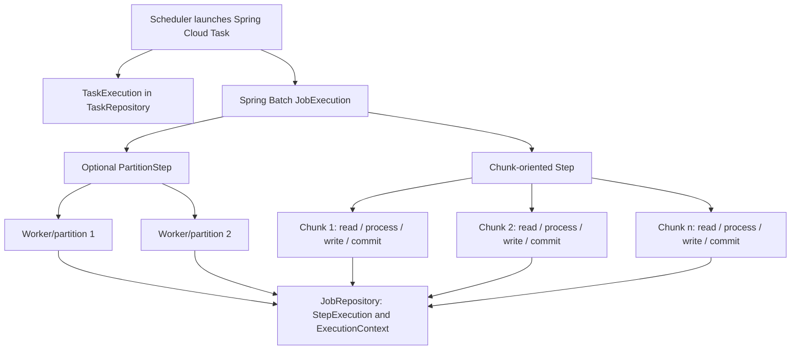
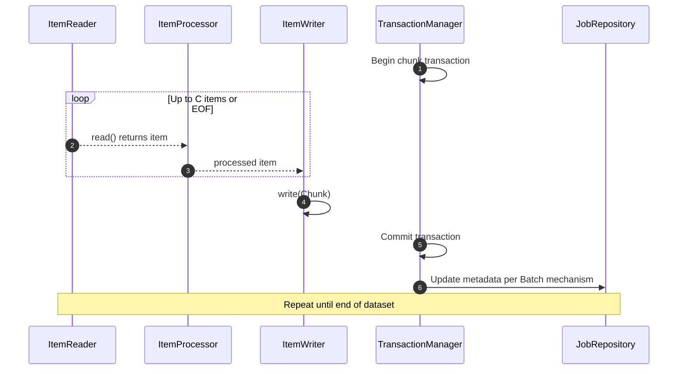
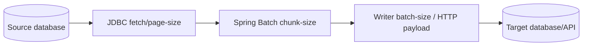

# Choosing Data Size, Chunk Size, and Parallelism in Spring Cloud Task

## 1. Why Must All Three Parameters Be Tuned Together?

A **Spring Cloud Task** application with a finite lifetime may import files, reconcile transactions, aggregate reports, or trigger a **Spring Batch job**. As data grows from a few thousand to millions of records, how data is split, how many records are committed per transaction, and how many workers run concurrently determine speed, RAM usage, database load, and failure recovery.

For example, a `daily-settlement` task needs to process 2.4 million transactions before 06:00 AM. There are three distinct questions:

1. **Data size:** does each run process all 2.4 million records, one day at a time, per merchant, or a fixed snapshot? How many bytes does one record occupy on disk and once loaded into the JVM?
2. **Chunk size:** how many items should Spring Batch read/process/write before committing? Should one transaction hold 50, 200, or 1,000 items?
3. **Parallelism:** how many chunks, steps, partitions, or **Task workers** should execute concurrently to shorten runtime?

These three parameters interact with one another, yet **they are not the same knob**. Raising `chunk-size` can reduce commit overhead while increasing transaction hold time and in-memory item count. Adding workers can reduce duration when spare capacity exists, or cause database contention, API quota exhaustion, or disk bottlenecks.

This lesson in the **Tuning and Upgrades** chapter of the `SPRING_CLOUD_TASK` module explains how to measure, select, and safely upgrade these settings when a task relies on `TaskRepository`, Spring Batch `JobRepository`, schedules, and retry/idempotency requirements.

After this lesson, you will be able to:

- Distinguish record count, total input bytes, in-heap item size, chunk, page, fetch size, and partition.
- Estimate transaction counts, memory demand, and resource budgets across multiple workers.
- Configure a chunk step in Spring Batch 5.x and a `Partitioner` that divides data without overlap.
- Compare sequential processing, multi-threading, local partitioning, and remote partitioning across multiple Spring Cloud Tasks.
- Design controlled benchmarks before raising `chunk-size` or `maxWorkers`.
- Observe `BatchStatus`, `StepExecution`, `TaskExecution`, rollback errors, OOMs, and duplicate side effects.
- Roll out changes incrementally, test restarts, and prepare rollback paths during framework upgrades.

## 2. Spring Cloud Task and Spring Batch Manage Different Boundaries

**Spring Cloud Task** tracks **a single application execution** using `TaskExecution`: task name, start/end timestamps, exit code, and errors. The framework does not automatically split a 10 GiB file into chunks, pick a worker count, or assign transactions to business items.

**Spring Batch** provides *chunk-oriented processing*: `ItemReader` reads items, `ItemProcessor` transforms them if present, and `ItemWriter` writes a group of items; a transaction typically commits after each chunk. `JobRepository` stores `JobExecution`, `StepExecution`, counts, and `ExecutionContext` for restarts.



One application run may execute **thousands of chunks** while still having only **one `TaskExecution`** for the process. When using remote partitioning with separate Spring Cloud Task workers, each worker can have its own `TaskExecution`, while partitioned `StepExecution` records are coordinated in the shared `JobRepository`.

| Concept | Scope | Example |
| --- | --- | --- |
| `TaskExecution` | One Task application launch | Today's `daily-settlement` |
| `JobExecution` | One Spring Batch job run | `settlementJob` for day D |
| `StepExecution` | One step/partition run | `settleStep:partition3` |
| **Chunk** | Group of items at a commit boundary | 200 transactions per transaction |
| **Attempt retry** | Re-invocation after a failure | API gateway retried 3 times |
| **Worker** | Thread/process/Pod executing a slice of work | 8 concurrent Task workers |

Do not use `TaskExecution.executionId` as a transaction deduplication key: each relaunch normally gets a new ID, whereas the business key remains the same merchant, settlement period, or transaction.

## 3. Distinguishing the Different Kinds of "Size" Properly

The same file can correspond to very different numbers:

| Parameter | Description | Must It Equal Chunk Size? |
| --- | --- | --- |
| Total **item count** `N` | Number of logical records to process | No |
| Total **input bytes** | CSV/JSON/DB snapshot volume | No |
| **In-memory item size** `b` | Heap and objects retained per item during read/process | No |
| `chunk-size` / commit interval `C` | Items before a step commit | This is the chunk tuning knob |
| JDBC **fetch size** | Hint to the JDBC driver for how many rows to fetch per round | No |
| JDBC **page size** | Rows returned by one paginated query | No |
| Writer **batch size** | SQL statements/requests grouped into one send to the target | Not necessarily |
| Partition count `K` | Number of logical partitions, each with its own `ExecutionContext` | No |
| Concurrent workers `P` | Number of active work slices | No |

For example, a **compressed** 1.5 GiB CSV file can expand to 8 GiB; a 200-byte record on disk can take far more space on the heap due to strings, collections, buffers, and object headers. Therefore, **never divide file size by chunk-size to estimate RAM**.

### 3.1. Choose the Dataset Size Before Choosing the Chunk Size

First, define **the reprocessable business unit**:

- By accounting date `businessDate` to prevent double-counting periods.
- By merchant or customer if independent orchestration is needed.
- By non-overlapping ID ranges or partition keys.
- By an immutable snapshot/input version so data does not shift across restarts.

Establish a **watermark/snapshot** or stable query condition. When reading a table where rows are continuously inserted or updated, `OFFSET` pagination does not guarantee a consistent item set across queries or retries.

Some rules:

1. The dataset should have **clear bounds** and must not grow unboundedly mid-run.
2. Choose business keys and partition bounds so no records are missed or duplicated.
3. Measure both **item count** and the largest-record distribution, not just averages.
4. Define the final output that must be persisted before the Task reports success.
5. Provide a catch-up path for late-arriving data or missed periods.

## 4. Chunk-Oriented Processing and Transaction Boundaries

Spring Batch reads items from an `ItemReader`, processes them via `ItemProcessor` if configured, and passes a `Chunk` to `ItemWriter`. Under the standard model, once **commit interval** items have been processed or EOF is reached, the transaction commits.



This diagram summarizes the logical flow and does not depict every internal Batch SQL callback. `ItemProcessor` can **filter items** by returning `null`. A fault-tolerant step can **retry/skip** and roll back, so the number of items actually written does not necessarily equal the number of `read()` calls.

### 4.1. Impact of Small Chunks

With `C=1`, each item typically goes through its own transaction:

- Pros: tiny commit boundary, few items buffered in flight, rollbacks affect minimal work.
- Cons: frequent begin/commit cycles, heavy metadata writes, network round trips, and transaction log overhead; throughput can be low.

### 4.2. Impact of Large Chunks

With `C=1,000`, each transaction can hold many items:

- Pros: lower commit overhead and opportunities for more effective JDBC batching.
- Cons: more items/buffers held in memory; longer-lived transactions, heavier locks and rollbacks; an error near the end of a chunk can force substantial rework.

**There is no universal optimal chunk size for every workload.** The right value delivers strong throughput **within RAM limits, transaction duration, downstream latency, rollback risk, and restart requirements**.

## 5. Estimating Commit Count and Time Budget

In a sequential step with no errors, retries, or skips, where each item is processed once, the chunk count can be approximated as:

\[
  Q \approx \left\lceil \frac{N}{C} \right\rceil
\]

Where `N` is total items and `C` is chunk-size. This is an estimate of commit groups, **not a guarantee that `COMMIT_COUNT` equals `Q` exactly**: Spring Batch may perform extra transactions, final commits, or rollbacks depending on configuration.

Example with `N=2,400,000` items:

| Chunk size `C` | Theoretical chunks `ceil(N/C)` |
| ---: | ---: |
| 25 | 96,000 |
| 100 | 24,000 |
| 400 | 6,000 |
| 1,000 | 2,400 |

Suppose the **fixed overhead to commit each chunk** is measured at 12 ms; then the theoretical overhead for `C=400` is:

\[
  6,000 \times 0.012\text{ s} = 72\text{ s}
\]

With `C=100`, the theoretical overhead is `24,000 × 0.012 s = 288 s`. These numbers are **illustrative only**, exclude reading/writing/locks/GC/network, and real commit cost is not necessarily constant.

### 5.1. Measure Instead of Picking by Formula Alone

Increasing chunk size from 100 to 400 may cut overhead on small workloads, yet if the writer holds long SQL locks or a downstream service accepts at most 200 items/request, chunk 400 can be slower and trigger more errors. Highly skewed record sizes can also cause a single chunk holding a few huge records to consume more RAM than many normal chunks combined.

Collect:

- Duration of **reading**, **processing**, **writing**, **committing**, and **rolling back** (when instrumented).
- `READ_COUNT`, `WRITE_COUNT`, `FILTER_COUNT`, `SKIP_COUNT`, `COMMIT_COUNT`, and `ROLLBACK_COUNT`.
- Peak heap, native/container memory, GC pauses, DB lock waits, and WAL/redo log pressure.
- Retryable error counts and downstream p95/p99 latency.
- Total Job and Task duration, including bootstrap and shutdown.

## 6. Estimating Memory by Chunk Size and Concurrency

A formula for **estimating the minimum peak retained item data** for chunks currently in flight is:

\[
  M_{\text{items}} \approx P \times C \times b
\]

Where:

- `P`: number of chunks held/processed concurrently under **the same memory limit**.
- `C`: chunk-size.
- `b`: average bytes **retained in memory** per item (not on-disk file size).
- `M_items`: item/buffer memory only, **excluding** reader caches, writer buffers, thread stacks, JVM heap metadata, direct memory, and container overhead.

For example, `P=8`, `C=200`, and each item with associated objects retains about `32 KiB`:

\[
  M_{\text{items}} \approx 8 \times 200 \times 32\text{ KiB} = 50\text{ MiB}
\]

50 MiB is **not** a sufficient container memory limit for the worker. The JVM also uses shared heap, metaspace, I/O buffers, connection pools, thread stacks, tmpfs files, and unusually large records. With remote partitioning, `P` must be evaluated **per Pod/JVM** when sizing Pod limits, while total cluster RAM scales with worker count.

### 6.1. Why Not Set `-Xmx` Equal to the Memory Limit?

A container with `memory.limit=1Gi` should not automatically be given `-Xmx1g`. Heap is only part of memory. Leave headroom for native/off-heap memory, caches, and JVM overhead; depending on JVM version, use `-XX:MaxRAMPercentage` or a tested `-Xmx`.

If `emptyDir.medium: Memory` is used, temporary files on tmpfs can also count against container memory. Raising chunk size or parallelism without spare RAM headroom can trigger `OOMKilled` and leave `TaskExecution` without an `endTime`.

### 6.2. Average Size Hides Data Skew

If 99% of items are 2 KiB while 1% carry a 5 MiB payload, one 200-item chunk can still capture multiple oversized records. Measure **p95/p99/max retained bytes**, not just averages; enforce payload caps and consider storing large blobs in object storage while keeping only references inside the chunk.

## 7. Configuring Chunks in Spring Batch 5.x

The snippet below uses **Spring Batch 5.x** APIs alongside compatible Spring Boot and Spring Cloud Task versions. Spring Batch **6.x** changes step/transaction configuration APIs; **do not copy 5.x snippets verbatim when upgrading to 6.x** without checking the release notes.

### 7.1. App Configuration with Explicit Defaults

```yaml
spring:
  application:
    name: settlement-worker
  main:
    web-application-type: none
  cloud:
    task:
      name: daily-settlement
  datasource:
    url: ${TASK_DB_URL}
    username: ${TASK_DB_USER}
    password: ${TASK_DB_PASSWORD}
app:
  batch:
    chunk-size: 200
    max-workers: 4
```

`app.batch.chunk-size` and `app.batch.max-workers` are **custom application-defined properties**, **not** an auto-tuning feature provided by Spring Cloud Task. Your code must read and validate them. Datasource variables must be injected via a secret manager/runtime environment; never put passwords in source control or CLI flags.

If a single database is shared by Task and Batch, the database needs **both metadata schema sets** at compatible versions, plus business tables. Using multiple `DataSource` instances requires explicitly wiring the sources for `JobRepository` and `TaskRepository`.

### 7.2. Sample Job/Step with Configurable `chunk-size`

The following example can be used to study the API in a Spring Boot + Batch 5.x project. The reader uses a small list for easy observation and is **not a restartable production reader**.

```java
import java.util.List;

import org.springframework.batch.core.Job;
import org.springframework.batch.core.Step;
import org.springframework.batch.core.job.builder.JobBuilder;
import org.springframework.batch.core.repository.JobRepository;
import org.springframework.batch.core.step.builder.StepBuilder;
import org.springframework.batch.item.ItemReader;
import org.springframework.batch.item.ItemWriter;
import org.springframework.batch.item.support.ListItemReader;
import org.springframework.beans.factory.annotation.Value;
import org.springframework.context.annotation.Bean;
import org.springframework.context.annotation.Configuration;
import org.springframework.transaction.PlatformTransactionManager;

@Configuration(proxyBeanMethods = false)
public class SettlementBatchConfiguration {

    @Bean
    Job settlementJob(JobRepository repository, Step settlementStep) {
        return new JobBuilder("settlementJob", repository)
            .start(settlementStep)
            .build();
    }

    @Bean
    Step settlementStep(
            JobRepository repository,
            PlatformTransactionManager transactionManager,
            ItemReader<String> settlementReader,
            ItemWriter<String> settlementWriter,
            @Value("${app.batch.chunk-size:200}") int chunkSize) {

        if (chunkSize < 1 || chunkSize > 10_000) {
            throw new IllegalArgumentException(
                "chunk-size must be in 1..10000");
        }

        return new StepBuilder("settlementStep", repository)
            .<String, String>chunk(chunkSize, transactionManager)
            .reader(settlementReader)
            .writer(settlementWriter)
            .build();
    }

    @Bean
    ItemReader<String> settlementReader() {
        return new ListItemReader<>(
            List.of("TX-01", "TX-02", "TX-03",
                    "TX-04", "TX-05", "TX-06"));
    }

    @Bean
    ItemWriter<String> settlementWriter() {
        return items -> {
            for (String item : items) {
                // Printed for illustration only; not a real business writer.
                System.out.println("Processed " + item);
            }
        };
    }
}
```

The main Spring Boot application can declare `@SpringBootApplication`, `@EnableTask`, and `SpringApplication.run(...)`; the project needs `spring-boot-starter-batch`, `spring-cloud-starter-task`, a JDBC driver, and compatible metadata schemas. A Job bean can be auto-launched by Boot when `spring.batch.job.enabled=true` and matching auto-configuration is active.

With 6 items and `chunk-size=2`, a happy-path run processes roughly three chunks. With `chunk-size=200`, all six items fall into one chunk. This only demonstrates commit boundaries; `System.out.println` **cannot roll back** if the transaction fails, so it is not a safe writer pattern for real data.

**Example limitations:** `ListItemReader` here does not persist read position for crash recovery, and `ItemWriter` merely prints to stdout. In real deployments, use `JdbcPagingItemReader`/`JdbcCursorItemReader`, `FlatFileItemReader`, or an appropriate reader paired with a transactional/idempotent writer matching your schema and restart rules.

### 7.3. Testing a Few Configurations

```bash
java -jar settlement-task.jar --app.batch.chunk-size=2
java -jar settlement-task.jar --app.batch.chunk-size=3
java -jar settlement-task.jar --app.batch.chunk-size=6
```

If using a Spring Boot Batch runner that accepts JobParameters, distinguish `--app.batch.chunk-size=...` (a Boot property) from arguments without the `--` prefix, which the runner may interpret as **JobParameters**. Each relaunch can create a new `TaskExecution` when the repository is active.

Do not pick a chunk size from six test records and apply it to 2.4 million production records. Benchmark with representative data.

## 8. Chunk Size Is Neither JDBC Fetch Size Nor Writer Batch Size

Many systems have at least three buffering layers:



For example:

- JDBC fetch-size = 500: a row-fetching optimization hint, dependent on driver and cursor type.
- Spring Batch chunk-size = 200: the commit boundary after the step processes a group of items.
- JDBC batch-size = 100: the writer might send two SQL batches within a single 200-item chunk, depending on how the writer is implemented.

These three numbers can differ. **There is no rule that chunk = fetch-size = writer-batch-size.**

With `JdbcPagingItemReader`, `pageSize` controls the SQL page size; with `JdbcCursorItemReader`, `fetchSize` can influence how the driver buffers rows. Some drivers require specific transaction/autocommit settings to truly stream. Measure heap and query counts before assuming a reader is streaming.

### 8.1. Why Is OFFSET Usually Poor at Deep Pages?

`LIMIT ... OFFSET ...` queries on large datasets may scan many rows before reaching deep pages, and are sensitive to mutations in the dataset. On sources with stable keys and proper indexes, **keyset pagination** or range partitioning can be much more efficient.

Example query reading a partition's ID range:

```sql
SELECT id, merchant_id, amount
FROM settlement_source
WHERE id >= :minIdInclusive
  AND id < :maxIdExclusive
ORDER BY id;
```

The `:minIdInclusive`/`:maxIdExclusive` parameters are bind variables supplied by the JDBC reader. Production queries need proper indexes and a fixed snapshot/boundary to prevent drift if the source changes.

## 9. Four Ways to Increase Parallelism

| Approach | Where It Runs | Strengths | Risks / Limits |
| --- | --- | --- | --- |
| **Sequential step** | One step on one thread | Simple, easy to restart, low contention | Slow on large datasets |
| **Multi-threaded / local chunking** | Multiple threads in one JVM, per Batch API/version | Uses multiple CPUs inside a Pod | Thread safety, item ordering, transaction boundaries, shared heap |
| **Local partitioning** | Multiple `StepExecution`s in the same JVM | Each partition has its own `ExecutionContext`; reader/writer can be isolated | All share one JVM's RAM/CPU |
| **Remote partitioning** | Multiple worker JVMs/Pods | Resource isolation, platform scaling | Startup cost, shared repository, coordination, idempotency |

**Do not assume Spring Batch 5.x multi-threading has the same semantics as Batch 6.x local chunking.** Spring Batch 6 introduces a local chunking model and changes parallel processing APIs; consult the documentation for your exact version, especially regarding **thread-bound transactions** and reader/processor/writer thread safety.

### 9.1. Why Not Grow the Thread Pool Indefinitely?

If multiple chunks/partitions query the DB concurrently, each worker can hold its own connection, locks, buffers, and transaction. Raising concurrency from 8 to 32 can cause:

- DB connection pool exhaustion and threads blocking on each other.
- Lock contention on target tables, increasing rollbacks/deadlocks.
- Downstream API `429 Too Many Requests` errors.
- Heap growth proportional to simultaneously buffered chunks.
- Pod CPU throttling or `OOMKilled`.
- Total Job duration **increasing** instead of decreasing.

Pick **concurrency based on measured bottlenecks**, not merely core count or item count.

## 10. Logical Partitions vs. Active Worker Count

In partitioning, **partition count `K`** and **concurrent workers `P`** do not have to be equal.

Suppose `K=32` partitions exist while `P=8` workers run; each worker can take subsequent partitions as capacity frees up. Distribution, queuing, and concurrency limits depend on the `PartitionHandler` and `TaskLauncher` implementation.

In Spring Cloud Task remote partitioning with `DeployerPartitionHandler`, maximum workers can be configured via API such as:

```java
// Abbreviated example: handler is already constructed properly
// and wired to TaskLauncher, JobExplorer, and TaskRepository.
handler.setMaxWorkers(8);
```

This call **does not create partitions itself**; the `Partitioner` and manager step configuration still govern how many `StepExecution`s are created. Actual worker count is also constrained by namespace/deployer quotas and physical resources.

### 10.1. Example `Partitioner` Creating Non-Overlapping Ranges

The Spring Batch 5.x example below splits the ID range `[0, 10000)` by `gridSize`, producing an `ExecutionContext` for each partition:

```java
import java.util.LinkedHashMap;
import java.util.Map;

import org.springframework.batch.core.partition.support.Partitioner;
import org.springframework.batch.item.ExecutionContext;
import org.springframework.context.annotation.Bean;
import org.springframework.context.annotation.Configuration;

@Configuration(proxyBeanMethods = false)
public class RangePartitionConfig {

    @Bean
    Partitioner settlementRangePartitioner() {
        return gridSize -> {
            if (gridSize <= 0) {
                throw new IllegalArgumentException(
                    "gridSize must be > 0");
            }

            long begin = 0;
            long endExclusive = 10_000;
            long total = endExclusive - begin;
            long block = (total + gridSize - 1L) / gridSize;

            Map<String, ExecutionContext> result =
                new LinkedHashMap<>();

            for (int i = 0; i < gridSize; i++) {
                long min = begin + i * block;
                if (min >= endExclusive) {
                    break;
                }
                long max = Math.min(endExclusive, min + block);

                ExecutionContext context = new ExecutionContext();
                context.putLong("minIdInclusive", min);
                context.putLong("maxIdExclusive", max);
                result.put("workerStep:partition" + i, context);
            }
            return result;
        };
    }
}
```

With `gridSize=4`, the ranges are:

| Partition | `minIdInclusive` | `maxIdExclusive` | Range |
| --- | ---: | ---: | --- |
| 0 | 0 | 2500 | `[0, 2500)` |
| 1 | 2500 | 5000 | `[2500, 5000)` |
| 2 | 5000 | 7500 | `[5000, 7500)` |
| 3 | 7500 | 10000 | `[7500, 10000)` |

This is a **learning model**, assuming stable IDs and boundaries. In production, if IDs are sparse or data distribution is uneven, four equal ID ranges **do not guarantee four equal workloads**. Use histograms, routing tables, or precomputed worklists.

### 10.2. Data Skew and Overly Tiny Partitions

If one merchant owns 80% of all transactions while others share 20%, splitting by four merchants can leave three workers idle while one runs very long (*straggler*). Creating more partitions than workers helps balance scheduling, yet each partition adds metadata, startup/coordination, and checkpoint overhead.

Strike a balance:

- **Enough partitions** so workers do not starve under skewed workloads.
- **Not so many partitions** that coordination overhead and repository tables bloat.
- Every partition must have **clear data bounds, restartability, and idempotency**.

## 11. Real-World Limits: CPU, RAM, I/O, DB Pool, and API Quotas

### 11.1. CPU-Bound or I/O-Bound?

| Bottleneck | Symptoms | Tuning Direction |
| --- | --- | --- |
| CPU-bound (compression, hashing, compute) | High CPU usage, little I/O wait | Parallelize up to core/CPU quota limits |
| Database read-bound | Rising query latency, saturated connections | Tune indexes/queries/fetch-size, reduce contention, cap workers |
| Database write-bound | Rising lock waits, WAL/redo, commit latency | Optimize writer/batch size, avoid overly long chunk transactions |
| API-bound | `429`, `503`, p95 latency rises with concurrency | Rate limit, backoff + jitter, lower worker count |
| Memory-bound | Long GC pauses, `OOMKilled`, heap near ceiling | Reduce chunk/parallelism, stream data, add verified headroom |
| Scratch/storage-bound | `No space left on device`, evictions | Clean temp files, raise ephemeral capacity appropriately, use object storage |

Raising `chunk-size` and `maxWorkers` at the same time in your first experiment makes it hard to tell which parameter caused an improvement or regression.

### 11.2. Connection Pool Budget

If one JVM has 8 workers executing JDBC transactions concurrently, the database pool size must cover active connections **plus connections needed by other infrastructure**. Yet setting pool = 100 just "to be safe" can exceed DB limits when 20 Pods run.

Example:

```text
20 Pods × max 10 pool connections = up to 200 connections
```

You must also count managers, `TaskRepository`, `JobRepository`, monitoring, and other applications. Pool size, transaction concurrency, and DB max connections must be designed **system-wide**. With remote workers, each Pod has its own pool; 8 worker processes do not share a single Hikari pool in the manager.

### 11.3. Large Chunks and Lock Duration

Larger chunks mean transactions can run longer, hold locks longer, and increase rollback cost and timeout risk. If a writer calls an external API inside the same DB transaction, the transaction **does not automatically span** the target system: when the database rolls back, already-sent API requests are not necessarily undone.

Keep DB transactions short and use outbox or idempotency keys when coordinating externally; never promise "exactly once" solely because a chunk committed.

## 12. Designing Controlled Benchmarks

A sound benchmark procedure for a finite Task must measure **runtime, data correctness, resources, and retry/restart behavior**, not just items/second.

### 12.1. Hold Influencing Factors Constant

Before comparing, keep fixed:

- Same Spring Boot, Spring Cloud Task, Spring Batch, and JDK versions.
- Same input snapshot, item count, item sizes, and bad-record ratio.
- Same DB engine, schema, indexes, query plans, pool settings, and reset dataset.
- Same Kubernetes requests/limits, node class, quotas, and container image.
- Same mock writer/API or equivalent rate-limited target system.
- Same timeout/retry and skip/rollback policies.

The very first JVM launch can be slower due to class loading and warm-up; run multiple iterations to observe variance rather than deciding from a single run.

### 12.2. Test One Axis at a Time

Starting from a baseline `chunk=100`, `workers=1`, explore chunk size first:

| Run | Chunk | Workers | What to Measure |
| --- | ---: | ---: | --- |
| A | 50 | 1 | Runtime, commits, heap/GC, lock wait |
| B | 100 | 1 | Comparison baseline |
| C | 200 | 1 | Throughput/rollback/memory trade-off |
| D | 500 | 1 | Do buffer, lock, or GC costs climb? |
| E | 1000 | 1 | Safety thresholds crossed or gains saturated? |

Pick 1–2 viable chunk values, then explore concurrency:

| Run | Chunk | Workers | What to Watch |
| --- | ---: | ---: | --- |
| F | 200 | 1 | Sequential duration |
| G | 200 | 2 | Scaling efficiency, DB pool |
| H | 200 | 4 | Throughput, CPU/lock wait |
| I | 200 | 8 | Does runtime keep falling or saturate? |

The numbers above are **not default optimal settings**; they are merely an experimental matrix. If each item is very large, 500/1000 may be unsafe. Bound your test matrix using initial measurements and resource budgets.

### 12.3. Metrics to Record in the Same Table

| Metric | Reason |
| --- | --- |
| Total `TaskExecution` duration | Captures bootstrap, Batch, and shutdown |
| `JobExecution` and per-`StepExecution` duration | Isolates business time by step |
| Items/sec, bytes/sec | Reflects throughput in real units |
| `COMMIT_COUNT`, `ROLLBACK_COUNT`, `READ_COUNT`, `WRITE_COUNT` | Distinguishes transaction tuning from errors/retries |
| CPU throttling, memory peak, GC pauses | Detects compute cost and OOM risk |
| DB pool active/wait, lock wait, SQL latency | Detects database saturation |
| API rate limits, p95/p99, retry counts | Detects concurrency overloading downstream |
| Slowest/fastest partition duration | Detects data skew |
| Missing/duplicate records and safe retry count | Proves correctness |

### 12.4. Measuring Parallel Efficiency

You can compute approximate speedup and efficiency:

\[
S(P) = \frac{T(1)}{T(P)}, \qquad E(P) = \frac{S(P)}{P}
\]

If `T(1)=40 minutes` and `T(4)=14 minutes`, then `S(4)≈2.86` and `E(4)≈0.71`. Increasing workers from 4 to 8 **does not guarantee** runtime drops to 7 minutes: startup, sequential sections, locks, and coordination overhead can take up a large share.

Beyond raw speed, define an **SLO**: e.g., "99% of report runs finish before 06:00 with peak memory under 70% of limit and zero duplicate records." The fastest setting in a single run that frequently triggers `OOMKilled` is not a good configuration.

## 13. Observing Through `JobRepository` and `TaskRepository`

### 13.1. Reading Per-Step/Chunk Outcomes from Batch Metadata

With Spring Batch's standard JDBC schema:

```sql
SELECT JOB_EXECUTION_ID,
       STEP_NAME,
       STATUS,
       READ_COUNT,
       WRITE_COUNT,
       FILTER_COUNT,
       READ_SKIP_COUNT,
       PROCESS_SKIP_COUNT,
       WRITE_SKIP_COUNT,
       COMMIT_COUNT,
       ROLLBACK_COUNT,
       START_TIME,
       END_TIME
FROM BATCH_STEP_EXECUTION
ORDER BY JOB_EXECUTION_ID DESC, STEP_EXECUTION_ID;
```

These counts are **totals per step execution**, not a detailed per-chunk timeline. To measure chunk p95 latency or item size distributions, instrument a `ChunkListener`, Micrometer/observability, or a dedicated metrics system. Do not infer "every commit processed exactly C items" from `COMMIT_COUNT` alone.

### 13.2. Reading Task History

```sql
SELECT TASK_EXECUTION_ID,
       TASK_NAME,
       START_TIME,
       END_TIME,
       EXIT_CODE,
       EXIT_MESSAGE,
       ERROR_MESSAGE
FROM TASK_EXECUTION
WHERE TASK_NAME = 'daily-settlement'
ORDER BY TASK_EXECUTION_ID DESC;
```

`TaskRepository` enables long-term comparison across runs, but **does not automatically store chunk-size, worker count, or SQL latency** unless the application records extra metrics or a config snapshot. Log a tuning summary traceable by `executionId`: artifact version, `chunk-size`, `worker-count`, input snapshot ID, and resource limits.

### 13.3. Distinguishing Metadata Errors from Business Errors

If a worker is OOM-killed before updating `TaskExecution` or `StepExecution`, the record may lack `END_TIME`. Inspect platform process/Pod status, GC logs, and target data rather than assuming "the job processed nothing."

If `JobExecution` has `BatchStatus.FAILED` while the Task application still returns exit code 0, check Batch outcome propagation, such as `spring.cloud.task.batch.fail-on-job-failure` in supported versions. A benchmark that only looks at process exit codes may mistakenly count failed runs as fast completions.

## 14. Retries, Rollbacks, Restarts, and Idempotency When Changing Chunk Size

Changing `chunk-size` changes **how many items fall inside a single rollback**. For example, if a writer error hits at the 199th item of a 200-item chunk, the entire chunk transaction may roll back, and the framework may re-execute part of the work according to fault-tolerance configuration. If the writer already called an external API, those side effects may not roll back.

### 14.1. Bounded Retries

Never retry the same exception infinitely. You must:

- Separate transient errors (timeouts, rolled-back deadlocks, `503`) from permanent errors (invalid input).
- Configure max attempts, exponential backoff, and jitter at the appropriate layer.
- Never sleep inside a long transaction that holds locks.
- Ensure replaying the same item/chunk is safe.
- Count **total** attempts across Spring Retry, Batch retry, and scheduler Task relaunches.

### 14.2. Restarting by `JobInstance`

Spring Batch distinguishes a `JobInstance` by job name and **identifying `JobParameters`**. When restarting a failed job, reuse the appropriate business identity so the framework can resume from its checkpoint. Injecting a fresh UUID into identifying parameters on every retry creates a different job instance and reprocesses everything from scratch.

Changing `chunk-size` **between restarts of the same job** can alter checkpoint boundaries. Readers/writers must support proper restart semantics; before applying to an interrupted job, test with a similar source/step and review documentation for your version.

For readers consuming files or mutable data, persist a recoverable position/key; a demo `ListItemReader` is not a production choice for restartable jobs.

### 14.3. Stable Business Keys

A transaction should be identified by `transactionId` or a composite of `merchantId` + `businessDate` + `operation` per your contract. **Never use `TaskExecution.executionId`, `StepExecution.id`, or partition sequence numbers** as idempotency keys because they can change across retries, relaunches, or repartitioning.

When calling external APIs, pass a partner-supported idempotency key and reconcile status after timeouts. Database unique constraints/upserts also prevent duplicate writes, though they do not merge multiple databases and external APIs into one atomic transaction.

## 15. When Upgrading Spring Batch, Parallel APIs and Behaviors Can Change

This lesson illustrates `new StepBuilder(...).<I,O>chunk(chunkSize, transactionManager)` in **Spring Batch 5.x**. In the **Spring Batch 6.x** line, configuration APIs and parallel capabilities change; 6.x docs describe `StepBuilder.chunk(int)` with updated transaction manager wiring and different local chunking support.

### 15.1. Avoid Copying `throttleLimit` from Old Examples

Some older Spring Batch guides use:

```java
// Historical example; DO NOT copy verbatim into new projects.
stepBuilder.taskExecutor(taskExecutor)
           .throttleLimit(8);
```

`throttleLimit` has been **deprecated since Spring Batch 5.0**; in newer versions, check the version's concurrency/queue management mechanisms. Do not use a legacy API merely to "set 8 workers" without controlling queue capacity, datasource pooling, and thread safety.

### 15.2. Pre-Upgrade Checklist

1. **Lock down a compatible version set**: Spring Boot, Spring Cloud Task, Spring Batch, Spring Cloud Deployer, and JDK. Do not upgrade individual pieces arbitrarily.
2. Read the release notes for **the exact target version**, especially `StepBuilder` APIs, readers/writers, and multi-threading behavior.
3. Verify metadata schemas and migrations for `JobRepository`/`TaskRepository`; take backups before changing anything.
4. Run unit/slice/integration tests on an RDBMS matching production.
5. Test restarting interrupted jobs, fault tolerance, partitioning, and idempotency.
6. Compare old/new benchmarks on **the same input and quotas**.
7. Roll out gradually with low worker counts and watch metrics; prepare artifact/config rollbacks and a schema-compatibility plan.

Do not rely on "chunk size 200 was fastest" from an earlier version if the runtime, GC, driver, or transaction semantics have changed.

## 16. Step-by-Step Procedure for Selecting Production Values

A recommended workflow for a task processing millions of transactions:

### Step 1 — Establish Correctness Before Performance

Lock down the business date, snapshot, transaction identifiers, partition boundaries, and handling of late-arriving data. Enforce unique constraints/idempotency keys on outputs.

### Step 2 — Measure the Workload at Realistic Scale

Record `N`, total bytes, p95/p99 item size, error item ratio, output/scratch size, query counts, and API calls. Identify data skew across merchants/ID ranges.

### Step 3 — Run a Sequential Baseline

Start with a small-to-moderate chunk size from initial testing (e.g., 100), one worker, and an adequate datasource pool. Record duration, throughput, memory, GC, and counts.

### Step 4 — Tune Chunk Size First

Test 50/100/200/500 within memory, transaction latency, and downstream limits. Pick the balance between throughput and rollback cost; never optimize for commits/sec alone.

### Step 5 — Increase Parallelism in Controlled Steps

Scale workers 1→2→4→8; monitor DB pool, CPU throttling, API rate limits, JVM heap, and partition skew. Stop scaling when efficiency drops or SLOs/quotas are breached.

### Step 6 — Test Fault Recovery

Inject failures near the end of a chunk, DB timeouts, worker kills, and restarts. Confirm no missing/duplicate data, no infinite retries, and reconciled Task/Batch metadata.

### Step 7 — Lock Down Traceable Configuration

Record artifact/JDK/schema versions, chunk-size, workers, input snapshot, and resource limits alongside each benchmark's metrics. Manage them in configuration/version control; avoid undocumented ad-hoc tweaks.

### Step 8 — Phased Rollout

Run a canary on a small dataset or test merchant, then scale up workers/datasets. Define quantitative rollback triggers for memory, data errors, or p95 runtime regressions.

## 17. Common Troubleshooting Matrix

| Symptom | Possible Cause | Action to Take |
| --- | --- | --- |
| Larger chunks run slower | Transactions hold locks longer, overloaded writer, rising GC | Reduce chunk size; measure commit/lock/memory |
| High `COMMIT_COUNT` but low throughput | Chunk too small or high per-commit round-trip cost | Increase chunk size stepwise; optimize writer/DB |
| Pod `OOMKilled` after adding workers | Many chunks/buffers live simultaneously; heap/native exceeds limit | Lower concurrency/chunk, stream data, add verified headroom |
| 8 workers no faster than 4 | DB/API/CPU quota saturated; skewed partitions | Identify bottleneck, cap workers, rebalance partitions |
| `BATCH_STEP_EXECUTION` grows rapidly | Too many tiny partitions or repeated restarts | Increase partition size; audit retry budget |
| Workers process duplicate items | Overlapping partition bounds or mutating source | Use half-open ranges, snapshots, and business keys |
| Restarted job reads from wrong position | Non-restartable reader or unstable checkpoint | Use a restartable reader; test restarts and JobParameters |
| `READ_COUNT` differs from `WRITE_COUNT` | Filtering/skipping, writer semantics, or business errors | Inspect filter/skip counts; reconcile output |
| Task exits 0 despite `FAILED` Batch job | Batch failure not propagated to Task | Check runner and version-specific `fail-on-job-failure` |
| Task lacks `END_TIME` | Force kill, DB connection drop | Cross-check Pod/Job logs and target data |
| Raising `fetch-size` does not cut query count | Confusing fetch size with page size or chunk size | Check driver, reader, and actual SQL executed |
| Retries trigger API rate limits | Retries stacked across Batch, HTTP client, and scheduler | Sum total attempts, add backoff/jitter, enforce rate limits |

## 18. Practice Exercises

**Exercise 1 — Estimating chunks.** A step needs to process 1,000,000 items with `chunk-size=250`. Under error-free conditions, how many theoretical chunks are there? If raised to 500, how does the chunk count change?

**Exercise 2 — RAM budget.** A JVM processes 6 chunks concurrently, each with 300 items; each item plus its buffer retains roughly 20 KiB. Estimate item memory and explain why this figure alone cannot serve as the container memory limit.

**Exercise 3 — Partitions and workers.** A manager creates 40 partitions, while the deployer caps workers at 5. Must 40 Pods run simultaneously? Which metadata describes the partitions?

**Exercise 4 — Correctness on restart.** A chunk successfully called a payment API, but the database rolled back. On retry, the request may be sent again. What mechanism would you use to prevent duplicate payment?

**Exercise 5 — Benchmarking.** Testing `chunk=500, workers=8` is faster than baseline, yet `ROLLBACK_COUNT` and API timeouts surge. Should you deploy it immediately? Propose additional metrics to inspect.

**Exercise 6 — Upgrades.** A project uses Spring Batch 5.x with `throttleLimit`. When upgrading to 6.x, why must you re-verify APIs, concurrency semantics, and performance measurements instead of merely fixing compile errors?

**Answer hints:**

1. `ceil(1,000,000/250)=4,000`; at 500 it is `2,000` theoretical chunks.
2. `6 × 300 × 20 KiB = 36,000 KiB ≈ 35.16 MiB`, excluding other heap/native allocations, caches, and spikes.
3. No; 40 partitions can be executed across multiple waves. `StepExecution`/`ExecutionContext` in `JobRepository` describe the partitions.
4. Use a stable transaction idempotency key, query target status, and enforce controlled retries.
5. Not yet; compare actual errors, p95 latency, missing/duplicate data, memory, DB load, quota utilization, and retry cost.
6. Because APIs and execution/transaction models may change; you must also test thread safety, checkpoints, throughput, and restarts.

## 19. Deployment and Upgrade Checklist

- [ ] Clearly define the **input snapshot**, item count, total bytes, and in-memory item size.
- [ ] Distinguish `chunk-size`, `fetch-size`, `page-size`, writer batch-size, and partition count.
- [ ] Chunk size is small enough to maintain RAM headroom, short transactions, and acceptable rollbacks.
- [ ] Establish a single-worker baseline and benchmark **one parameter change at a time**.
- [ ] Parallelism stays within CPU/quota, DB pool, API rate limit, and memory limits.
- [ ] Reader/processor/writer are thread-safe for the chosen concurrency model and Batch version.
- [ ] Partitions do not overlap; source data has stable identifiers/snapshots.
- [ ] Batch `JobRepository` and Task `TaskRepository` are queried to verify actual state.
- [ ] Task/Batch failures propagate accurately as outcomes to the scheduler.
- [ ] Bounded retries, backoff, restartability, and writer/API idempotency are in place.
- [ ] OOM, DB timeout, worker kill, and recovery on the same `JobInstance` have been tested.
- [ ] Schema migration and testing plans exist for Spring Batch/Task/Boot/JDK upgrades.
- [ ] Artifact version, test dataset, chunk size, and workers are logged alongside benchmark results.
- [ ] Rollout includes canary runs, alerts, and quantitative rollback criteria.

## 20. Summary and References

**Data size, chunk size, and parallelism are three distinct yet interdependent decisions.** Spring Cloud Task manages the application's lifecycle; Spring Batch manages chunk transactions, steps/partitions, and checkpoints. Increasing chunk size generally lowers commit overhead while raising memory/lock/rollback costs; adding workers distributes load while risking database and API saturation. Having more partitions than concurrent workers allows flexible scheduling at the cost of extra overhead and the need for stable partitioning keys.

Do not rely on one "standard" number for all projects. **The reliable method is: ensure correctness and idempotency → measure the real workload → benchmark sequentially → tune chunk size → scale parallelism within limits → test failures/restarts → roll out and monitor.** When upgrading Spring Batch, verify the exact version's APIs, schema, and concurrency semantics rather than copying old configs.

**Official documentation to cross-check for your target version:**

- [Spring Batch — Chunk-oriented Processing](https://docs.spring.io/spring-batch/reference/step/chunk-oriented-processing.html)
- [Spring Batch — Commit Interval](https://docs.spring.io/spring-batch/reference/step/chunk-oriented-processing/commit-interval.html)
- [Spring Batch 5.2 — Scaling and Parallel Processing](https://docs.spring.io/spring-batch/reference/5.2/scalability.html)
- [Spring Batch 6 — Scaling and Local Chunking](https://docs.spring.io/spring-batch/reference/scalability.html)
- [Spring Batch — Job/Step Domain and Metadata](https://docs.spring.io/spring-batch/reference/domain.html)
- [Spring Batch — Configuring a Step and Transactions](https://docs.spring.io/spring-batch/reference/step/chunk-oriented-processing/configuring.html)
- [Spring Cloud Task — Features, TaskExecution and TaskRepository](https://docs.spring.io/spring-cloud-task/reference/features.html)
- [Spring Cloud Task — Remote Partitioning](https://docs.spring.io/spring-cloud-task/docs/current/reference/html/)
