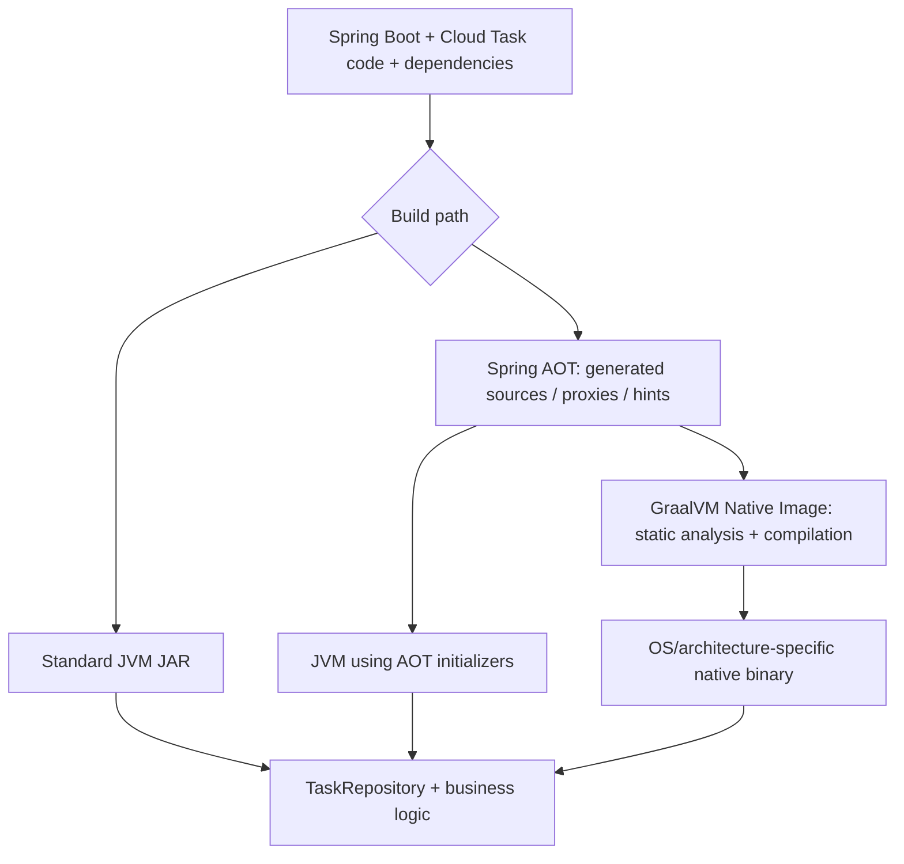

# Evaluating Spring AOT and GraalVM Native Image

## 1. Why Evaluate AOT/Native for Spring Cloud Task?

In the **Tuning and Upgrades** chapter of **Spring Cloud Task**, the goal is not simply producing an executable smaller than a JAR. We need to decide whether **Spring Ahead-of-Time (AOT)** and **GraalVM Native Image** genuinely improve a **finite-running** Spring Boot application: starting up, processing a request or batch of data, recording `TaskExecution` into `TaskRepository`, returning an exit code, and terminating.

Suppose a system runs 20,000 small tasks per day. Each task only processes data for 2 seconds yet needs several seconds for the JVM and Spring Context to start up. As invocation frequency grows, the time and memory spent on startup become a major cost. A native image can **start faster and use less memory** than a standard JVM process. Conversely, a job running continuously for 3 hours may gain little from saving a few seconds of startup while still paying for **resource-heavy native builds**, library compatibility quirks, and a more complex release workflow.

This is a **technical evaluation**, not advice to "migrate every Spring Cloud Task to native." We need to weigh all of these:

- **Performance:** cold start, time from scheduler request to completion, RSS/peak memory, throughput, CPU, and database wait time.
- **Correctness:** `TaskExecution` lifecycle, arguments, transactions, exceptions/exit codes, listeners, repository, and retry idempotency.
- **Compatibility:** JDBC drivers, Spring Batch, reflection, proxies, resources, serializers, and other Spring Cloud integrations.
- **Operations:** image size, CI build duration, artifact reproducibility, observability, security, and rollback.
- **Configuration flexibility:** whether beans/profiles/conditions are decided at build time or runtime.

After this lesson, you will be able to:

1. Distinguish Spring AOT from GraalVM Native Image and running a Java JAR on the JVM.
2. Recognize which finite task workloads typically benefit and which cases are not worth migrating.
3. Prepare a native build POC with Maven or Gradle using compatible versions.
4. Resolve missing `RuntimeHints`, reflection, resources, and proxies without blindly adding global configs.
5. Test TaskRepository, Spring Batch, listeners, exit codes, and startup failures under native.
6. Design fair benchmarks, define acceptance criteria, and roll out incrementally with a rollback path back to the JVM.

> **Version note:** AOT/native support depends tightly on the exact combination of **JDK/GraalVM, Spring Boot, Spring Framework, Spring Cloud Task, Spring Batch, and third-party libraries**. Do not take one release's configuration and assume it applies to every release. The examples below illustrate conceptual practices aligned with Spring Boot 3.x/4.x and Native Build Tools; lock down a compatible version matrix before building.

## 2. Distinguishing the Three Ways to Run the Application

| Deployment Mode | What Happens at Build Time | What Happens at Runtime | Characteristics |
| --- | --- | --- | --- |
| **Standard JVM/JAR** | Compiles Java, packages JAR and dependencies | JVM loads classes; Spring processes beans/auto-configuration dynamically | Flexible, easy to debug, broad library compatibility |
| **Spring AOT on JVM** | Generates code/bytecode and runtime hints for the Spring Context structure | JVM runs using AOT-generated initializers; still a Java process | Validates/uses AOT without native compilation yet |
| **GraalVM Native Image** | Spring AOT followed by GraalVM reachability analysis and native executable compilation for target OS/CPU | Runs native binary; no JVM needed at runtime | Typically better startup/RSS, but restricts dynamic behavior and builds are heavier |

**Spring AOT does not equal GraalVM Native Image**:

- **Spring AOT** translates much of Spring's dynamic configuration processing into generated structures **ahead of runtime**.
- **GraalVM Native Image** analyzes the application under a *closed-world* assumption and compiles it into a platform-specific native executable.
- When building a Spring Boot native image, **AOT is a mandatory step** so the Spring Context has enough metadata for the native image.
- **AOT-processed JVM** can serve as an intermediate verification step; it does not prove that every reflection/resource usage will succeed inside the native binary.



**The same business request** must exhibit equivalent behavior across all three paths: processing the right record count, persisting `TaskExecution` accurately, reporting errors properly, and avoiding duplicate side effects on retry. Startup speed differences must never alter business outcomes.

## 3. How AOT Works: What Gets Fixed at Build Time?

A Spring Boot application on the JVM typically discovers beans, evaluates auto-configuration, and creates dynamic proxies at startup. In AOT mode, Spring resolves bean structure earlier and generates artifacts that the native compiler can understand.

Spring Boot documentation describes these AOT output groups:

- **Java sources** providing generated bean initialization structures.
- **Bytecode** for proxies and required components.
- **Runtime hints** for reflection, resources, serialization, JDK proxies, and operations that cannot be inferred through static analysis alone.

### Closed-World Assumption and Bean Creation Conditions

In a native image, **the classpath and bean structure are largely fixed at build time**. This directly affects:

| JVM Design Pattern | AOT/Native Risk | How to Evaluate |
| --- | --- | --- |
| `@Profile("prod")` creates different beans than `dev` | AOT processes the bean set matching build-time conditions | Align build environment or build separate artifacts per bean set |
| `@ConditionalOnProperty` toggles whether a bean exists | Changing the property at runtime will not recreate a bean excluded at build time | Fix condition values during AOT; test profiles/flags |
| `Class.forName(...)` driven by dynamic config | Unreachable classes may be stripped | Use explicit APIs or register appropriate hints |
| Loading new plugins/JARs at runtime | Native images have a closed classpath | Fix plugins at build time, or stay on JVM if dynamic modules are required |
| Arbitrary runtime proxy/reflection creation | Missing native metadata/proxies | Check AOT compatibility and add `RuntimeHints` |
| Wildcard/JAR-path resource scanning | Resources not packaged or URL protocol unavailable | Register resource hints and test real file reads |
| Native/JNI libraries, crypto, special locales/timezones | Binary depends on platform and metadata | Verify library, OS, charset, and TLS support |

**Not every runtime property is frozen.** For instance, `--business-date=2026-11-24`, `--request-id=...`, or query values are **data read at runtime** and do not necessarily alter the bean graph. Conversely, properties that add/remove a bean via `@ConditionalOnProperty` generally must be decided during AOT.

### Configuration Distinction Example

```java
@Bean
@ConditionalOnProperty(
        name = "feature.audit.enabled",
        havingValue = "true")
AuditPublisher auditPublisher() {
    return new AuditPublisher();
}
```

If AOT builds with `feature.audit.enabled=false`, do not assume passing `--feature.audit.enabled=true` when running the native binary will create the `AuditPublisher` bean. A better operational pattern is keeping a stable bean and toggling **behavior inside the bean** using a runtime value (when safe), or building two artifacts for approved configurations.

In practice, **secrets and database connections** must still be read from the runtime environment via Boot-supported mechanisms; never feed passwords into the AOT build to "bake in" configuration. The AOT step needs configuration **stable enough for bean analysis**, yet must not access or snapshot real secret values.

## 4. When Does Moving to Native Make Sense?

| Spring Cloud Task Workload Type | Potential | What Must Be Proven |
| --- | --- | --- |
| Very short tasks running thousands of times/day | **High** if startup dominates runtime | Cuts startup/total cost without increasing metadata errors |
| Latency-bound on-demand/function tasks | **Potentially high** | End-to-end latency including queue/container scheduling |
| Memory-constrained tasks in small containers | **Potentially high** | Cuts peak RSS without severely degrading throughput |
| Multi-hour Spring Batch jobs | **Typically lower on startup** | Do memory/resource savings and long-term runtime outweigh build cost? |
| Jobs with dynamic JDBC/ORM/JSON/resources | **Needs thorough POC** | Sufficient hints, valid migrations, business output matches JVM |
| Apps loading new plugins/scripts/JARs at runtime | **High risk** | Willing to change architecture or stay on JVM? |
| Rarely run tasks with frequent builds/releases | **Questionable value** | Do CI cost, image storage, and debug/rollback effort outweigh gains? |

A simple estimate: if a Task runs `T_total = T_startup + T_business + T_shutdown`, native only trims the startup part while **database queries still execute and networks still have latency**. For instance, dropping startup from 4 seconds to 0.5 seconds is huge for a 1-second business task, but proportionally minor for a 4-hour business job. This is a **hypothetical example**, not a measurement guaranteed by GraalVM.

For scheduled systems, measure **time from scheduler request to final result**, not just the `"Started … in X seconds"` log line. If Kubernetes waits 30 seconds to pull an image, saving 3 seconds of JVM startup may barely improve the SLA. Conversely, a smaller binary and lower RSS may help pod scheduling/concurrency, though that too must be measured rather than assumed.

## 5. Prerequisites for a Credible POC

Before writing native configuration, document **the running contract of the JVM version**:

1. **Platform:** JDK version, OS, CPU architecture (`linux/amd64`, `linux/arm64`, etc.), base image, build and runtime environments.
2. **Spring versions:** Spring Boot, Framework, Cloud Task, Spring Batch (if used), Spring Cloud Stream/Data Flow/deployer (if used).
3. **Third-party dependencies:** JDBC driver, Jackson, ORM, Flyway/Liquibase, TLS, HTTP clients, serialization, queues, and native libraries.
4. **Configuration sources:** profiles, `@ConditionalOnProperty`, secret injection, resource files, and per-environment config differences.
5. **Task flow:** `ApplicationRunner`/`CommandLineRunner`, listeners, timeouts, exit codes, `TaskRepository`, and Spring Context shutdown behavior.
6. **Business criteria:** record counts read/written, idempotency, Spring Batch checkpoints, retryable vs. non-retryable errors.
7. **Pipeline:** builders with enough CPU/RAM/disk for native builds, Docker/Buildpacks or GraalVM toolchain, and suitable CI runners.

Pick a **small yet representative Task**: one with a PostgreSQL `TaskRepository`, CLI arguments, JDBC queries, and a controlled failure path. Only after the minimal POC passes should you add Spring Batch, Streams, and complex integrations. Do not start with your heaviest task packed with every plugin if the goal is isolating risks layer by layer.

### Compatibility Is a Hypothesis to Test

Spring Boot, Spring Cloud Task, and Spring Batch support AOT/native in compatible releases, yet **that does not guarantee an application's full library combination works out of the box**. If a driver or third-party SDK uses unregistered reflection, the native build can still succeed while a **rare code path** fails at runtime.

Maintain a checklist per dependency covering its version, exercised code paths, and test status. If no safe workaround exists for a critical library, **staying on the JVM** is a sensible decision.

## 6. Sample Spring Cloud Task App for Baseline Comparison

The following example simulates a finite task taking `--business-date`, using JDBC to count records, and returning the result. It can be built for the JVM first, then compiled natively with **the exact same logic**.

```java
package com.example.nativepoc;

import java.time.LocalDate;
import java.util.List;

import org.slf4j.Logger;
import org.slf4j.LoggerFactory;
import org.springframework.boot.ApplicationRunner;
import org.springframework.boot.SpringApplication;
import org.springframework.boot.autoconfigure.SpringBootApplication;
import org.springframework.cloud.task.configuration.EnableTask;
import org.springframework.context.annotation.Bean;
import org.springframework.jdbc.core.JdbcTemplate;

@SpringBootApplication
@EnableTask
public class SettlementTaskApplication {
    private static final Logger log =
            LoggerFactory.getLogger(SettlementTaskApplication.class);

    public static void main(String[] args) {
        SpringApplication.run(SettlementTaskApplication.class, args);
    }

    @Bean
    ApplicationRunner settlementRunner(JdbcTemplate jdbc) {
        return args -> {
            List<String> values = args.getOptionValues("business-date");
            if (values == null || values.size() != 1) {
                throw new IllegalArgumentException(
                        "Requires --business-date=yyyy-MM-dd");
            }

            LocalDate date = LocalDate.parse(values.get(0));
            Long count = jdbc.queryForObject(
                    """
                    SELECT COUNT(*)
                    FROM payment_event
                    WHERE business_date = ?
                    """,
                    Long.class,
                    java.sql.Date.valueOf(date));
            log.info("Date {}, event count: {}", date, count);

            if (args.containsOption("fail")) {
                throw new IllegalStateException(
                        "Simulated error after reading data");
            }
        };
    }
}
```

This is a **learning skeleton**. To run it requires:

- `spring-cloud-starter-task`, `spring-boot-starter-jdbc`, and a compatible PostgreSQL driver.
- A datasource, Spring Cloud Task's `TASK_EXECUTION` schema, and the business table `payment_event`.
- Context-closing configuration/verification after the runner matching your Task version so the finite process actually exits.
- Business outcome rules; a plain `COUNT(*)` is not yet a complete reconciliation task.

**Do not call `System.exit(0)` inside the runner** to force the task to exit quickly: doing so can cut off callbacks, final metadata persistence, or telemetry flushing. To control process exit codes, use the proper Spring Boot/Cloud Task mechanisms and test at the `java -jar`/native executable boundary.

### Basic Runtime Configuration

```yaml
spring:
  application:
    name: settlement-native-poc
  main:
    web-application-type: none
  datasource:
    url: jdbc:postgresql://postgres:5432/task_poc
    username: task_user
  cloud:
    task:
      name: settlement-native-poc
```

Passwords are supplied via secrets/environment variables such as `SPRING_DATASOURCE_PASSWORD`, never embedded in source code or binaries. Create/migrate the metadata schema beforehand. Having a runtime datasource **does not mean connecting to a production DB during the AOT build phase**.

## 7. Building a Native Image with Maven

For Maven projects using **`spring-boot-starter-parent`** and a compatible Spring Cloud BOM, Spring Boot provides a `native` profile to streamline AOT/native tasks. Example **plugin configuration snippet** to add to `pom.xml`:

```xml
<build>
    <plugins>
        <plugin>
            <groupId>org.springframework.boot</groupId>
            <artifactId>spring-boot-maven-plugin</artifactId>
        </plugin>
        <plugin>
            <groupId>org.graalvm.buildtools</groupId>
            <artifactId>native-maven-plugin</artifactId>
        </plugin>
    </plugins>
</build>
```

This snippet is **not a complete `pom.xml`** and does not pick versions for you. Parent/BOM versions must match Java, Boot, Cloud Task, and native build tools verified by your team. If **not using `spring-boot-starter-parent`**, you may need to explicitly configure `process-aot` and reachability metadata for the plugins according to your Spring Boot version's guide.

### Two Common Build Paths

```bash
# Path 1: GraalVM Native Build Tools builds the binary on the build host.
# Requires a matching GraalVM toolchain installed.
./mvnw -Pnative native:compile

# Path 2: Spring Boot Buildpacks builds a native container image.
# Requires a compatible container daemon/builder.
./mvnw -Pnative spring-boot:build-image
```

On Windows, the Maven wrapper typically uses `mvnw.cmd` instead of `./mvnw`; native build hosts need the matching toolchain/OS/architecture. Path 2 is often convenient in CI with Buildpacks, though **the Docker daemon and builder image must also be compatible**.

Path 1 produces a **native executable for the build host's platform**; Path 2 produces a **native container image**, not necessarily a JAR file. Simply copying a Linux AMD64 binary into an ARM64 environment will not run.

### AOT Build Configuration Is Not Runtime Secrets

If the application uses `@ConditionalOnProperty` to alter the bean list, the condition value must be set **during `process-aot`**. Changing that value at runtime to "add a new bean" may not work because the native image lacks that bean. Never pass real passwords into the plugin just to make AOT succeed. Redesign the condition appropriately or use a secret-free build configuration.

## 8. Building a Native Image with Gradle

With Gradle, Spring Boot documentation guides applying the **`org.graalvm.buildtools.native`** plugin alongside the Spring Boot plugin. Example **plugins block** (versions managed/locked in the project's build):

```groovy
plugins {
    id 'java'
    id 'org.springframework.boot'
    id 'io.spring.dependency-management'
    id 'org.graalvm.buildtools.native'
}
```

This is a **structural snippet**, not a complete `build.gradle`: a real build must declare versions or plugin management, repositories, dependencies, and toolchains.

Common commands:

```bash
# Generates and uses AOT output during the native build.
./gradlew nativeCompile

# Builds a container image with the native image via Spring Boot Buildpacks.
./gradlew bootBuildImage
```

The GraalVM native plugin integrates with `processAot` when paired with a compatible Spring Boot plugin. Check artifact outputs and build logs; **do not assume a regular `gradle build` produced a native executable**. On Windows, use `gradlew.bat`/PowerShell as appropriate.

You do not need both Maven and Gradle in one project just to evaluate native. Use your existing build tool; the two snippets above illustrate the **corresponding execution paths**.

## 9. Testing AOT on the JVM Before Native Compilation

Native compilation can consume significant time and memory. Spring Boot lets you run **AOT-generated code on the JVM** as an intermediate check if the built artifact contains AOT output.

For example, after using `-Pnative` and packaging a JAR with AOT assets using the appropriate Maven setup:

```bash
java -Dspring.aot.enabled=true -jar target/settlement-task.jar \
  --business-date=2026-11-24
```

`target/settlement-task.jar` is only an **illustrative name**; use your project's actual built path. If the JAR does not already contain AOT-generated initializers, flipping the runtime property will not conjure AOT code out of thin air. Also distinguish JVM startup from native startup when benchmarking.

Three verification tiers should be executed in order:

1. **Regular JVM:** business logic and metadata baseline.
2. **JVM running AOT output:** validates bean/profile structure and context initialization using pre-generated code.
3. **Native executable:** validates full paths, resources, reflection, DB, TLS, and real post-static-analysis behavior.

A passing test in tier 2 **increases confidence** but **does not prove** native will pass: some reachability/proxy/serialization issues only surface after compiling into a binary.

## 10. RuntimeHints: When Reflection and Resources Do Not Work Automatically

GraalVM statically analyzes classes and methods reachable from the entry point. If the application uses reflection or loads classpath resources by dynamic name, the native compiler may not know to retain them.

Common real-world symptoms:

- JVM reads JSON/SQL/template files in `src/main/resources`, but native reports resource not found.
- Jackson or a mapping library fails to instantiate objects due to missing constructor/field reflection.
- A library uses `Class.forName`, `ServiceLoader`, or dynamic proxies, yet the required implementation was stripped.
- Reflection is only invoked on a rare **error path**; build and native happy path pass while only the failure path breaks.

**Do not blindly add wildcard hints for entire packages.** Identify the exact missing class/resource and use minimal hint APIs.

### 10.1. Example Registering a Runtime Resource

Suppose `WindowProcessor` reads `rules/reconciliation.json` packaged on the classpath. In a native image, you can declare it explicitly:

```java
import org.springframework.aot.hint.RuntimeHints;
import org.springframework.aot.hint.RuntimeHintsRegistrar;
import org.springframework.context.annotation.Configuration;
import org.springframework.context.annotation.ImportRuntimeHints;

final class ReconciliationRuntimeHints implements RuntimeHintsRegistrar {
    @Override
    public void registerHints(RuntimeHints hints, ClassLoader classLoader) {
        hints.resources().registerPattern("rules/reconciliation.json");
    }
}

@Configuration(proxyBeanMethods = false)
@ImportRuntimeHints(ReconciliationRuntimeHints.class)
class ReconciliationHintsConfiguration {
}
```

This snippet only registers the **resource hint**; it does not create `rules/reconciliation.json`. The file must actually exist on the project's classpath. Nor does it replace externalized file paths or volume mounts when business rules/documents are loaded **outside the binary**.

### 10.2. Binding Objects That Need Reflection

If you need to deserialize an application-defined JSON type from a message or file, you can use Spring's `@RegisterReflectionForBinding` annotation:

```java
import org.springframework.aot.hint.annotation.RegisterReflectionForBinding;
import org.springframework.context.annotation.Configuration;

@Configuration(proxyBeanMethods = false)
@RegisterReflectionForBinding(SettlementPayload.class)
class SettlementBindingHints {
}

record SettlementPayload(String orderId, long amountInCents) {}
```

**Java code note:** this example uses a package-private record (no `public` modifier) so it can sit in the same file as the configuration class within an appropriate package. If `SettlementPayload` must be public for other packages, move it into its own `SettlementPayload.java` file.

Do not scatter reflection registration across every entity unless truly necessary. Spring Boot/Spring Framework and many starters already generate hints; add custom hints only for gaps proven by tests.

### 10.3. Testing Custom RuntimeHints

Spring Framework provides `RuntimeHintsPredicates` to verify hints in unit tests:

```java
import static org.assertj.core.api.Assertions.assertThat;

import org.junit.jupiter.api.Test;
import org.springframework.aot.hint.RuntimeHints;
import org.springframework.aot.hint.predicate.RuntimeHintsPredicates;

class ReconciliationRuntimeHintsTest {
    @Test
    void includesReconciliationResource() {
        RuntimeHints hints = new RuntimeHints();
        new ReconciliationRuntimeHints().registerHints(
                hints, getClass().getClassLoader());
        assertThat(RuntimeHintsPredicates.resource()
                .forResource("rules/reconciliation.json")).accepts(hints);
    }
}
```

A hints unit test confirms **the hint was declared**, but is not enough to prove the resource is bundled in the binary or that Jackson deserializes successfully. Add **native integration tests** exercising the real code path and verifying output.

## 11. Spring Cloud Task-Specific Verification Points

For Spring Cloud Task, a native image must preserve the full lifecycle of **a `TaskExecution`**, not just run `main`:

| Verification Point | Why It Matters | Minimum Test |
| --- | --- | --- |
| `@EnableTask`/auto-configuration | AOT must generate the proper Task bean structure | Start a run with no missing beans |
| `TaskRepository`/JDBC schema | Metadata must persist across fresh processes | `START_TIME`, `END_TIME`, `EXIT_CODE` updated |
| `ApplicationRunner`/`CommandLineRunner` | Core of the finite workload | Runner receives args and runs exact expected count |
| `TaskExecutionListener` | Callbacks can determine exit messages/side effects | `onTaskStartup`, `onTaskEnd`, `onTaskFailed` on respective paths |
| `spring.cloud.task.name` parameter | Identifies metadata and single-instance policy | Do not confuse Task name, Task ID, and request ID |
| `spring.cloud.task.external-execution-id` | Links to scheduler/container | External ID readable once attached |
| OS exit code | Schedulers often rely on process exit status | Success 0, failure non-zero per contract |
| `single-instance-enabled` | Condition may need enabling during AOT build | Test two processes with same name competing for lock |

Some context initialization errors occur **before `TaskExecution` is created**, so the database may have **no record** even though the OS invoked the native executable. Every test should therefore capture process exit status and runtime logs, not just SQL.

### Example SQL Comparing JVM and Native Runs

```sql
SELECT TASK_EXECUTION_ID,
       TASK_NAME,
       START_TIME,
       END_TIME,
       EXIT_CODE,
       EXIT_MESSAGE,
       ERROR_MESSAGE
FROM TASK_EXECUTION
WHERE TASK_NAME = 'settlement-native-poc'
ORDER BY TASK_EXECUTION_ID DESC
LIMIT 20;
```

JVM and native runs **will not share a `TaskExecutionId`**, because each run is an independent execution. Compare **behavior**, without expecting identical metadata IDs or timestamps.

When interacting with the repository in native mode, check the JDBC driver, datasource pool, transaction manager, SQL schema initialization, and exception handling path. A binary might start very quickly yet fail to connect to the DB, making total end time **longer** due to network timeouts.

## 12. Special Case: Single-Instance in AOT/Native

Spring Cloud Task provides `spring.cloud.task.single-instance-enabled=true` to prevent two tasks **with the same name** from running concurrently when paired with an appropriate lock and repository. Per Spring Cloud Task documentation, when using this feature with a native image, **it must be enabled during `process-aot`** because it affects generated beans/conditions.

Example `spring-boot-maven-plugin` snippet declaring an AOT execution for the single-instance build:

```xml
<plugin>
    <groupId>org.springframework.boot</groupId>
    <artifactId>spring-boot-maven-plugin</artifactId>
    <executions>
        <execution>
            <id>process-aot</id>
            <goals>
                <goal>process-aot</goal>
            </goals>
            <configuration>
                <jvmArguments>
                    -Dspring.cloud.task.single-instance-enabled=true
                </jvmArguments>
            </configuration>
        </execution>
    </executions>
</plugin>
```

**Important:** The actual property in use is `spring.cloud.task.single-instance-enabled`. Some **prose paragraphs** in Spring Cloud Task docs mention `single-step-instance-enabled`, whereas **the Maven configuration snippet in the very same documentation uses `single-instance-enabled`**; follow the officially documented property and confirm via integration tests. Never copy a typo into a production build untested.

Beyond the build-time condition, the feature also requires Spring Integration lock dependencies and a matching datasource for your version (e.g., `spring-integration-core`, `spring-integration-jdbc`). Native build config **does not replace** runtime enabling/policy checks and does not magically create a cluster-wide mutex.

Minimum test:

1. Launch two native binaries/containers **with the same `spring.cloud.task.name`** sharing a lock store.
2. Keep the first Task alive long enough; launch the second while the first is active.
3. Verify the second is prevented or fails with the error code expected by your Spring Cloud Task version.
4. After the first finishes, run again and verify the lock was released or TTL behaves properly.
5. Test crash/kill to spot stale lock states; never manually edit metadata without confirming root cause.

Single-instance **is not business idempotency**: two sequential runs with the same name can still write duplicate data if the writer lacks its own key guard.

## 13. When the Application Includes Spring Batch

Spring Batch makes native evaluation **more complex** than a single-runner task:

- `JobRepository`/`TaskRepository` require the right datasource and schemas; do not confuse `TaskExecution` with `JobExecution`.
- Identifying `JobParameters` must stay stable across retries to restart the same `JobInstance`.
- `ItemReader`, `ItemProcessor`, `ItemWriter`, and `ItemStream` may rely on different serializers, resources, SpEL, and reflection.
- `ExecutionContext` persisted/read via the repository must keep type and serializer compatibility across versions/artifacts.
- A batch job may succeed while the Task/process exits non-zero in another step; verify outcomes at both layers.
- Native remote partitioning/workers require all workers to share compatible contracts, schemas, and versions; never assume a native worker matches a JVM worker on every resource/driver detail.

### Batch Matrix to Test

| Case | JVM Baseline | AOT JVM | Native |
| --- | --- | --- | --- |
| Small job completes | Writes row count and `COMPLETED` status | Matches JVM | Matches JVM |
| Chunk step fails mid-way | Records `FAILED`, checkpoint | Accurate checkpoint | Accurate checkpoint |
| Restart with same identifying parameters | New `JobExecution` on same `JobInstance` when valid | Behavior preserved | Behavior preserved |
| Reader consumes resource/CSV/JSON | Reads correct charset/format | Reads accurately | Reads accurately, sufficient resource/hints |
| Writer calls external API | Stable idempotency key | No duplicate sends | No duplicate sends |
| Batch status → Task exit code | Propagates failure per policy | Unchanged | Unchanged |

If the code uses `RunIdIncrementer` or a fresh **identifying** timestamp on every retry, that is a **Spring Batch correctness issue**, not a native issue. Fix the restart policy on the JVM first before comparing native.

In particular, never evaluate native solely by running a 10-record happy-path job. Test read/write paths for every resource type, post-failure restarts, and `ExecutionContext` deserialization from metadata persisted by a supported version.

## 14. Differences in Lifecycle, Shutdown, and Observability

A native task must still pass through proper shutdown milestones so Spring Cloud Task can record `END_TIME`/`EXIT_CODE`. In a container:

1. Scheduler requests the workload.
2. Platform provisions container/process.
3. Native executable starts and initializes the Spring Context.
4. `ApplicationRunner` executes business logic.
5. Task listeners/repository record completion if possible.
6. Process returns exit status to the runtime.

**Do not conclude a binary succeeded simply because the startup log was fast.** If hit by `SIGKILL`, missing credentials, or an unavailable repository, metadata may not be created or closed. These failures must be verified via runtime status, logs, and business output.

### Metrics in Short Tasks

A native task can complete **before a Prometheus scrape cycle or OTLP exporter flush**. When startup shrinks, the risk of missing pull-based metrics rises even higher. Do not judge efficiency from an incomplete dashboard and assume un-scraped Tasks never ran.

Monitor all of these together:

- `TaskRepository`: `TASK_EXECUTION_ID`, `START_TIME`, `END_TIME`, `EXIT_CODE`.
- `spring.cloud.task` and `spring.cloud.task.runner` timers when instrumentation and exporters are active.
- Runtime: Pod start/finish, peak RSS, CPU, exit code, and termination reason.
- Domain audit: completeness of processed data, retry count, and duplicate count.

If an exporter cannot flush reliably before shutdown, choose an appropriate finite-job pipeline (push/collector, durable logs, TaskRepository reconciliation) instead of keeping the JVM alive artificially just to wait for a scrape without evaluating the cost.

## 15. Designing Fair Benchmarks

### 15.1. Measure the Exact Same Workload

To decide whether native is worthwhile, hold constant:

- Same **businessDate/input snapshot**, record count, and database schema.
- Same transaction semantics, connection counts, timeouts, retry rules, and batch/chunk sizes.
- Same CPU/memory limits, container architecture, network zone, and external service versions.
- Same application logic and compatible dependencies; change only the build/run mode.
- Same backing resource state and cold/warm cache methodology; note any exceptions explicitly.

**Do not compare** a JVM running on a laptop against a native binary running in production Kubernetes and attribute the difference to AOT.

### 15.2. Metrics That Matter

| Metric | Unit | How to Measure | Decision Impact |
| --- | --- | --- | --- |
| `cold_start_ms` | ms | From process start until app/runner begins | Critical for tiny and on-demand tasks |
| `end_to_end_ms` | ms | From scheduler request until final business output | Reflects real user-facing benefit |
| `task_duration_ms` | ms | From Task/TaskRepository lifecycle or matching timer | Compares framework scope excluding queue wait |
| `business_duration_ms` | ms | Measured inside business service | Detects whether native slows/speeds actual processing |
| `peak_rss_mib` | MiB | Runtime/cgroup/OS metrics | Node cost / Pod memory limits |
| `cpu_seconds` | CPU-s | Runtime metrics | Resource cost and throughput |
| `artifact_size_mib` | MiB | JAR + runtime size vs. native container | Affects distribution/pull/storage |
| `native_build_minutes` | min | CI build per commit/release | Developer and release velocity cost |
| `pass_rate` | % | Business, Batch, TaskRepository, and failure tests | **Mandatory** gate prior to optimizing |

Measure **multiple runs**, report at least median/P95 and error rate, and separate cold starts (unwarmed cache) from warm restarts. With small samples, percentiles are noisy. For latency benchmarks, use the exact same timestamps on both JVM and native to avoid apples-to-oranges comparisons.

### 15.3. Hypothetical Result Set for Practice Reading

| Metric | JVM (hypothetical) | Native (hypothetical) | Interpretation |
| --- | ---: | ---: | --- |
| Median startup | 2,800 ms | 240 ms | Native cuts startup significantly |
| P95 end-to-end | 16.0 s | 13.7 s | Overall gain is smaller than startup ratio |
| Peak RSS | 260 MiB | 115 MiB | May pack more jobs per node |
| CI build time | 2 min | 11 min | Higher release overhead |
| Business pass rate | 100% | 100% | Minimum prerequisite before rollout |

**All numbers above are purely illustrative**, not measurements of a GraalVM/Spring Cloud Task release or real benchmarks. In your project, replace them with numbers from an equivalent test environment and store scripts/manifests for reproducibility.

A reasonable acceptance criterion might be: native must preserve **100% equivalent business results and metadata**, cut P95 end-to-end by at least a team-defined threshold, reduce peak RSS significantly, and keep build/operational overhead within budget. If it falls short, stay on the JVM or fix queries/transactions before optimizing startup.

## 16. Testing Correctness Before Optimizing Numbers

### Recommended Test Matrix

| Scenario | What to Verify | AOT/Native-Specific Risk |
| --- | --- | --- |
| Successful run | `TaskExecution` has start/end/exit code, business output valid | Missing bean/initializer/runtime resource |
| Invalid arguments | Process reports error, creates no side effects | Reflection/validation/locale differences |
| JDBC cut at startup | Clear failure; do not assume TaskExecution always exists | Driver/SSL/TLS metadata and native libraries |
| DB disconnect at end | Reconcile committed data, safe retry | Native shutdown/transaction behavior |
| Listener failure | Exit code and logs do not mask root error | Proxy/hints/exception mapping |
| Spring Batch restart | JobInstance/JobExecution/checkpoint accurate | Reader/writer serialization and resources |
| Single-instance task | Two processes with same name do not overlap | Build-time conditional bean and JDBC lock |
| Classpath JSON/template file | Reads exact content | Missing resource hint |
| JSON/SDK serialize/deserialize | Accurate types and values | Missing reflection/serializer hint |
| Forced kill | Runtime reports failure; metadata may remain open | No Java callbacks on either JVM or native |
| Scheduler retry | No duplicate business outcomes | Native does not grant exactly-once |

### A High-Priority Test Case

1. Run the JVM build for `2026-11-24` against an immutable test dataset.
2. Query `TASK_EXECUTION` after exit and record processed business row count.
3. Reset the test environment or use an equivalent isolated period; run the native build with the same logic.
4. Compare record counts, checksums/totals, error counts, and exit codes—**do not compare absolute IDs or timestamps**.
5. Exercise `--fail` and DB outage paths; confirm native never falsely reports success.
6. Measure performance only after all correctness assertions pass.

For jobs with external side effects, use a sandbox/mock server or idempotency keys so benchmarks never create real transactions. If a run fails partway through, inspect **already-committed data** before retrying and compare both JVM and native paths.

### AOT JVM Tests and Native Tests

Spring Boot documentation recommends keeping most unit/integration tests on the JVM for fast builds, then adding native tests where differences are likely. You can leverage `spring.aot.enabled=true` on AOT-built artifacts as a screening step. Still, a **native executable test pass** remains mandatory to validate production native correctness.

## 17. Diagnosing Build and Runtime Failures

| Symptom | Possible Cause | Investigation Path |
| --- | --- | --- |
| `process-aot` fails to build bean graph | Conditions/profiles, dynamic bean registration, version mismatch | Check AOT startup logs, bean conditions, classpath |
| Native compile fails missing class/reflection | Unsupported dependency/metadata | Check stack trace, version, reachability metadata, custom hints |
| Binary runs but throws `ClassNotFoundException` | Class loaded dynamically and stripped from image | Replace dynamic load or register specific class/hints |
| Cannot read resource file | File absent from binary or missing resource hint | Check classpath and `RuntimeHintsRegistrar` |
| JSON deserialization fails in native | Constructor/field types lack binding hints | Use `@RegisterReflectionForBinding` or minimal hints |
| Cannot connect to PostgreSQL/TLS | Driver, datasource, certificate, network, secret | Compare runtime config, SSL/trust store, and logs |
| `@Profile` changed at runtime but beans unchanged | Bean graph resolved during AOT build | Align build environment or redesign condition |
| Single-instance only works on JVM | Feature not enabled during `process-aot` | Check AOT JVM args and lock configuration |
| Native startup fast yet SLA unimproved | Pod pull/image network/DB dominates | Measure end-to-end instead of startup logs |
| Missing TaskExecution | Context failed before framework created metadata | Check process exit status/runtime logs and DB |
| Task killed with no end metrics | Export/flush did not happen or callbacks skipped | Cross-check runtime, TaskRepository, and business audit |
| New native build cannot restart old Batch job | Schema/serializer/JobParameters mismatch | Drain or migrate metadata; test cross-version restarts |

### Do Not Fix Errors by Blindly Disabling AOT Conditions

When resources or hints are missing, the right fix is usually **pinpointing the exact code path to preserve**. Do not switch every bean to eager initialization or register entire packages for reflection just to get a "green build": that inflates binary size, erodes native benefits, and hides unsupported dependencies.

Likewise, never drop listeners or `TaskRepository` to make the binary faster. Doing so turns the benchmark into comparing **two functionally different applications**, proving nothing about native improvements for an equivalent Spring Cloud Task.

## 18. Deployment and Rollback Strategy

A cautious rollout:

1. **Keep the JVM baseline** in the existing pipeline and container registry, ready for quick re-release.
2. **Build a native POC** for a small task that still exercises full DB and failure paths.
3. **Verify compatibility** of all libraries, build-time profiles/conditions, and runtime hints.
4. **Run equivalent tests** on JVM, AOT JVM, and native; confirm metadata and outcomes.
5. **Benchmark under controlled conditions**, tabulating startup/latency/RSS/CPU/build cost and correctness.
6. **Canary:** route native only to a low-risk, reproducible set of requests/tenants/periods; never let JVM and native process the same business window concurrently.
7. **Monitor telemetry gaps**, retry counts, deserialization errors, TaskRepository, and JobRepository.
8. **Expand incrementally** once SLOs are met, while keeping JVM artifacts for rollback.
9. **Roll back** by pointing the launcher/deployer back to the known-good JVM artifact without deleting Task/Batch history or resetting business state.

### When Both Artifacts Coexist

JVM and native may handle the same job type, yet **must never be dispatched for duplicate business keys**. Use stable request IDs/window keys, idempotency policies, and shared locks/leases. When sharing a Spring Batch `JobRepository`, verify both builds agree on Job names, identifying `JobParameters`, schemas, and serialization before allowing cross-artifact restarts.

Log on every attempt: application version, build mode (`jvm`/`native`), artifact digest, request ID, TaskExecution ID, JobExecution ID (if any), platform ID, and business outcome. That evidence is essential when an incident occurs only in the native binary.

## 19. Hands-On Exercises and Decision Criteria

**Exercise A — Calculating startup benefit:** A task processes for 1.5 seconds; JVM needs 3 seconds to start, native needs 0.4 seconds. Ignoring shutdown/queue time, what is the total runtime for both paths? Why is the end-to-end percentage reduction smaller than the startup percentage reduction?

**Exercise B — Classifying properties:** Distinguish `--business-date=...` (runtime data), `feature.audit.enabled` used in `@ConditionalOnProperty` (bean graph), and `SPRING_DATASOURCE_PASSWORD` (runtime secret). Which property must be decided at AOT build time and which must never be baked into the binary?

**Exercise C — Resource hints:** Suppose `rules/reconciliation.json` works on the JVM but cannot be found in the native binary. Write a `RuntimeHintsRegistrar` registering that exact resource, add a `RuntimeHintsPredicates` unit test, and run a native process test that reads the actual file.

**Exercise D — Listeners and exit codes:** A native task finishes reading/writing data, then an end listener throws an exception. Why can you not conclude business data was not written? Design checks across TaskRepository, process status, and idempotency before retrying.

**Exercise E — Spring Batch restart:** The first `JobExecution` ends `FAILED` after committing 40 chunks. The second run switches from JVM to native. Which `JobParameters`/`ExecutionContext`/serializer elements must remain compatible to restart the exact `JobInstance`?

**Exercise F — Single-instance:** Build a native image with build-time `single-instance-enabled=false` while passing `true` at runtime; why might the feature fail to activate? Check AOT config and test two processes with the same name and lock store.

**Exercise G — Benchmarking:** Measure at least 20 JVM and 20 native runs with identical data/CPU/memory. Compare median/P95 end-to-end, peak RSS, CI build time, and correctness rate. Decide whether to deploy native with justification.

### Self-Check Questions

1. What kinds of output does Spring AOT generate and why does GraalVM need them?
2. Why can't a native image arbitrarily load a new plugin JAR onto the classpath at runtime?
3. Is every `--spring.*` property frozen at AOT build time? Give two counterexamples.
4. Why do `@ConditionalOnProperty` and `@Profile` require special attention?
5. What problems do `RuntimeHintsRegistrar` and `@RegisterReflectionForBinding` solve?
6. Why is testing AOT output on the JVM insufficient to guarantee native runtime correctness?
7. When a Task uses PostgreSQL and TaskRepository, what data must be verified after a native run?
8. Why can the native process exit status and `TASK_EXECUTION.EXIT_CODE` diverge when startup or the repository fails?
9. Why does a sharp drop in startup time not necessarily yield a major improvement in end-to-end SLA?
10. If an older Batch Job used a different serializer than the new native build, what is the risk on restart?
11. When building native with `spring.cloud.task.single-instance-enabled`, why does configuring it during `process-aot` matter?
12. Why must you keep a rollback path to the JVM even after a native POC succeeds on the happy path?

## 20. References

- [Spring Boot — Introducing GraalVM Native Images](https://docs.spring.io/spring-boot/reference/packaging/native-image/introducing-graalvm-native-images.html): distinguishing JVM/native, closed-world, and Spring AOT.
- [Spring Boot — Developing a Native Application](https://docs.spring.io/spring-boot/how-to/native-image/developing-your-first-application.html): Maven/Gradle and Buildpacks build paths.
- [Spring Boot — Testing Native Applications](https://docs.spring.io/spring-boot/how-to/native-image/testing-native-applications.html): AOT JVM and native testing.
- [Spring Boot — Advanced Native Images](https://docs.spring.io/spring-boot/reference/packaging/native-image/advanced-topics.html): RuntimeHints, reflection, resources, and limitations.
- [Spring Boot Maven Plugin — Ahead-of-Time Processing](https://docs.spring.io/spring-boot/maven-plugin/aot.html).
- [Spring Boot Gradle Plugin — Ahead-of-Time Processing](https://docs.spring.io/spring-boot/gradle-plugin/aot.html).
- [Spring Cloud Task — Features, Single Instance Usage for Spring AOT and Native Compilation](https://docs.spring.io/spring-cloud-task/reference/features.html).
- [Spring Cloud Task — Task Execution and Batch Integration](https://docs.spring.io/spring-cloud-task/reference/batch.html).
- [Spring Framework — Ahead-of-Time Optimizations](https://docs.spring.io/spring-framework/reference/core/aot.html).

**Key takeaway:** For **finite Spring Cloud Tasks**, native images are worth evaluating when startup/memory costs heavily impact SLAs and infrastructure bills. **Spring AOT** prepares the bean graph/hints at build time; **GraalVM** compiles a native binary under closed-world constraints. Only adopt native when **TaskRepository, listeners, exit codes, Spring Batch/checkpoints, idempotency, and business outcomes** are all verified identically across JVM and native, and cold-start/RSS gains are weighed against total build, release, and rollback costs.
