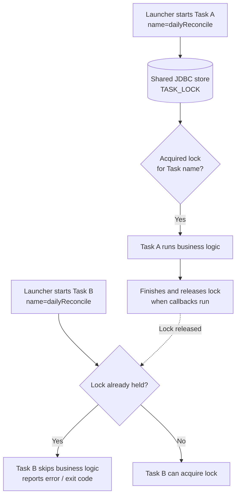
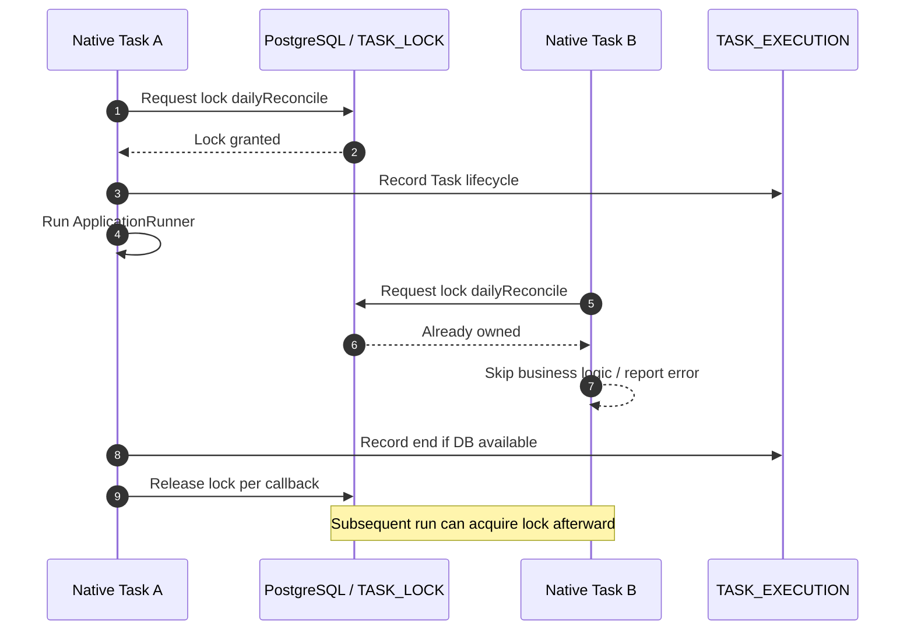

# Configuring Single-Instance Locking When Compiling Native

In **Spring Cloud Task**, finite-lived applications are typically launched by a scheduler or orchestrator to import data, reconcile revenue, export reports, and then record results in **`TaskRepository`**. A common problem is **two processes running the same Task simultaneously**: the previous schedule has not finished before the next trigger arrives, an operator triggers a manual run, or Kubernetes/a launcher retries before confirming the old process has stopped. If both update business data concurrently, they can contend on resources or write duplicate results.

Spring Cloud Task provides a **single-instance** feature to enforce **only one active execution for a given Task name at a time**, backed by a shared lock mechanism. When packaging as a **GraalVM Native Image**, there is an extra caveat: Spring Boot **Ahead-of-Time (AOT)** analyzes and decides many bean-creation conditions **at build time**. Therefore, you cannot simply enable locking via an environment variable after native compilation and assume the feature will be present.

This lesson in the **Tuning and Upgrades** chapter focuses on **enabling single-instance during `process-aot`**, preparing the JDBC lock store, building the native executable, and verifying two competing processes. It also distinguishes locking by Task name from business idempotency keys, alongside TTL, crash, retry, and rollout considerations.

After this lesson, you will be able to:

- Explain `spring.cloud.task.single-instance-enabled`, its lock scope, and its limitations.
- Properly configure **Spring Integration JDBC**, `TASK_LOCK`, and a shared `TaskRepository`.
- Set up Maven `spring-boot:process-aot` with **build-time JVM arguments** to include the locking feature in the native image.
- Distinguish build-time configuration from runtime configuration in Spring Boot AOT.
- Run contention tests between two native/JVM processes and inspect exit codes and metadata.
- Choose sensible TTL/check intervals, handle stale locks, and perform safe upgrade rollouts.

## 1. What Does "Single Instance" Mean?

Here **single instance** means **disallowing two concurrent runs with the same `spring.cloud.task.name`** when processes participate in the locking mechanism. This rule is scoped by **the Task's logical name**, *not* "only run JAR version 1.0" or "may only execute once per day."

For example:

| Process | Task Name | Lock Store | Expected Behavior |
| --- | --- | --- | --- |
| A | `dailyReconcile` | PostgreSQL `taskdb` | Runs and holds the lock while working. |
| B | `dailyReconcile` | Same PostgreSQL `taskdb` | Rejected if A still holds a valid lock. |
| C | `exportInvoices` | Same PostgreSQL `taskdb` | Can run because **the Task name differs**. |
| D | `dailyReconcile` | A **different** database | May not see A's lock; **no global protection**. |

Per Spring Cloud Task documentation, **`spring.cloud.task.single-instance-enabled=false`** is the default. When enabled and a Task with the same name is already running, the subsequent launch fails; the docs describe exit code **`1`** for this case.

### Locked by Task Name, Not by Business Date

Suppose:

```text
Task name: dailyReconcile
Run A: --business-date=2026-11-24
Run B: --business-date=2026-11-25
```

Both runs use **the same Task name**, so single-instance will normally allow only **one of the two** to execute concurrently, even though their business dates differ. If you need safe concurrency per date or per tenant, design a dedicated **business-key lock** or partition/naming rules under controlled governance; do not assume `single-instance-enabled` automatically locks by `business-date`.

Conversely, once A finishes and releases the lock, B can run. Single-instance **does not remember "already-processed dates"** and **does not automatically prevent** a retry of work that already committed. The property *at most one active process per task name* is completely different from *idempotency*.



This diagram illustrates **concurrency semantics**, not internal ordering guarantees across all versions. If a process is killed or the JDBC store fails, inspect lock state and infrastructure rather than assuming locks are always cleaned up.

## 2. Where Is the Lock Implemented?

Spring Cloud Task uses **`SingleInstanceTaskListener`** to create a lock keyed by Task name. This class receives a `DataSource` or **Spring Integration** `LockRegistry` and hooks into the Task lifecycle when the feature is enabled.

To use the JDBC locking mechanism described in the official documentation, add two dependencies:

```xml
<dependency>
    <groupId>org.springframework.integration</groupId>
    <artifactId>spring-integration-core</artifactId>
</dependency>
<dependency>
    <groupId>org.springframework.integration</groupId>
    <artifactId>spring-integration-jdbc</artifactId>
</dependency>
```

These are **additional** dependencies; they do not replace `spring-cloud-starter-task` or your JDBC driver. Spring Integration JDBC provides database-backed lock storage so **multiple JVMs/containers can observe the same lock** when they share the right connection and schema.

### The `TASK_LOCK` Table

The Spring Cloud Task schema includes the **`TASK_LOCK`** table for this feature. The schema documentation describes these core columns:

| Column | Role |
| --- | --- |
| `LOCK_KEY` | Lock key value managed by the lock registry mechanism. |
| `REGION` | Lock namespace/group. |
| `CLIENT_ID` | Identifier of the lock holder per implementation. |
| `CREATED_DATE` | Timestamp when the lock was created/recorded. |

**Do not hand-craft a stripped-down table from the summary above.** Use **the official DDL for your exact Spring Cloud Task version and database**. When setting `spring.cloud.task.initialize-enabled=false` in production, migrations must pre-create all required Task metadata tables **and `TASK_LOCK`** before any process attempts locking.

Do not confuse `TASK_LOCK` with `TASK_EXECUTION`:

- `TASK_EXECUTION` records **the history of each run**, which may persist long-term for auditing.
- `TASK_LOCK` handles **concurrent execution coordination** and may or may not hold a row at query time.
- A completed `TaskExecution` **must not be treated as a held lock** simply because it remains in the history table.

### Why Must a Shared DataSource Be Used?

If manager/worker/native executable A connects to `taskdb_A` while executable B connects to `taskdb_B`, both can acquire a lock in **their own database** and run simultaneously. Even when JDBC URLs only differ in schema/search path, placing lock tables in separate schemas can prevent them from seeing each other.

For applications with **multiple `DataSource`s**, check `TaskConfigurer`, `TaskRepository`, and which JDBC source the listener/lock registry uses. `@Primary` on a business datasource is not proof that the metadata store was wired properly. Test with **two real processes** pointing at the expected shared database/schema.

## 3. Why Must a Native Image Enable Locking at Build Time?

Standard Spring Boot on the JVM can decide many beans via `@ConditionalOnProperty` at startup. In **Spring AOT**, however, the framework pre-analyzes the context and generates initialization code and metadata for GraalVM compilation. Some decisions about **which beans exist** are locked in during **the build phase**, so you cannot expect to turn on a feature that registers brand-new beans via a property passed only when running the native binary.

Unsafe example:

```text
Build native image with single-instance-enabled=false
    ↓
Locking beans/configuration paths are excluded from the AOT graph
    ↓
Run ./daily-reconcile --spring.cloud.task.single-instance-enabled=true
    ↓
Cannot assume the native binary has the complete locking mechanism
```

Therefore, Spring Cloud Task documentation requires **enabling single-instance when running `process-aot`**, via a JVM system property:

```text
-Dspring.cloud.task.single-instance-enabled=true
```

This is a **JVM argument for the AOT metadata-generation process**, **not a JVM argument passed to the native executable**. A native binary does not run under a normal JVM, so the `-D...` syntax inside the plugin takes effect **at build time**.

After building, you should still supply **`single-instance-enabled: true` in runtime configuration** so operational intent stays consistent and properties that do not alter the bean graph bind cleanly. **Never treat a runtime toggle as a way to freely turn on/off an AOT feature that was analyzed with a different value.**

### Important Note on Property Names in Documentation

In some Spring Cloud Task reference versions, the prose of *Single Instance Usage for Spring AOT And Native Compilation* writes **`spring.cloud.task.single-step-instance-enabled`**, while **the Maven snippet right below it**, the configuration properties table, and `TaskProperties` use **`spring.cloud.task.single-instance-enabled`**.

**The property name to use in this lesson is `spring.cloud.task.single-instance-enabled` (without `step`).** That is the property matching `TaskProperties#setSingleInstanceEnabled(...)` and Task-name locking. Before a major-version upgrade, re-verify it in the configuration metadata of the release you actually use.

| Phase | Configuration | Goal |
| --- | --- | --- |
| **AOT build** | `-Dspring.cloud.task.single-instance-enabled=true` in `process-aot.jvmArguments` | Lets AOT see the locking feature and generate the matching bean graph. |
| **Native runtime** | `spring.cloud.task.single-instance-enabled=true` in YAML/env | Keeps single-instance runtime policy consistent during execution. |
| **JDBC metadata** | `TASK_LOCK` DDL and Task tables | Processes share lock state. |
| **Business logic** | Idempotency key per request/date | Prevents duplicate side effects on retries after commit. |

## 4. Preparing a Sample Task Application for Testing

We will build a `daily-reconcile-native` program with finite execution that pauses briefly so we can observe the lock. This is a **concurrency-testing demo**, not production reconciliation logic.

### 4.1. Core Dependencies

In a Maven project already configured with **Spring Boot parent/dependency management, a compatible Spring Cloud BOM, and a supported Java runtime**, add:

```xml
<dependencies>
    <dependency>
        <groupId>org.springframework.cloud</groupId>
        <artifactId>spring-cloud-starter-task</artifactId>
    </dependency>
    <dependency>
        <groupId>org.springframework.boot</groupId>
        <artifactId>spring-boot-starter-jdbc</artifactId>
    </dependency>
    <dependency>
        <groupId>org.springframework.integration</groupId>
        <artifactId>spring-integration-core</artifactId>
    </dependency>
    <dependency>
        <groupId>org.springframework.integration</groupId>
        <artifactId>spring-integration-jdbc</artifactId>
    </dependency>
    <dependency>
        <groupId>org.postgresql</groupId>
        <artifactId>postgresql</artifactId>
        <scope>runtime</scope>
    </dependency>
</dependencies>
```

**Do not hardcode individual dependency versions** when the Spring Boot/Spring Cloud BOM manages them. Native Image also requires a GraalVM Native Image environment or a Spring Boot-supported native container build tool. Running the JAR on the JVM **does not equate to successfully testing the native build**.

### 4.2. Runtime Configuration

Example `src/main/resources/application.yml`:

```yaml
spring:
  application:
    name: daily-reconcile-native
  main:
    web-application-type: none
  cloud:
    task:
      name: dailyReconcile
      single-instance-enabled: true
      initialize-enabled: false
      closecontextEnabled: true
      single-instance-lock-ttl: 3600000
      single-instance-lock-check-interval: 500
```

Note these choices:

- `name: dailyReconcile` identifies **the lock scope**; all instances must use **the same name**.
- `single-instance-enabled: true` enables runtime lock checks, consistent with the build-time `-D` flag.
- `initialize-enabled: false` assumes PostgreSQL migrations have already created `TASK_EXECUTION`, `TASK_LOCK`, and related tables.
- `closecontextEnabled: true` requests closing the context once work completes per Spring Cloud Task mechanics, helping the finite process actually exit.
- `single-instance-lock-ttl: 3600000` is **3,600,000 ms = 1 hour** in this example; tune it to match task duration and recovery strategy.
- `single-instance-lock-check-interval: 500` is **500 ms**, configuring the lock check cadence per the implementation; it is not a business retry interval.



This diagram shows relationships between components; **the exact order of metadata writes and lock acquire/release depends on framework callbacks and version**. Do not infer from the diagram that a rejected run always does or does not leave a `TaskExecution` row.

### 4.3. Example `ApplicationRunner`

File `src/main/java/com/example/task/NativeReconcileApplication.java`:

```java
package com.example.task;

import java.time.LocalDate;
import java.util.List;
import java.util.concurrent.TimeUnit;

import org.springframework.boot.ApplicationArguments;
import org.springframework.boot.ApplicationRunner;
import org.springframework.boot.SpringApplication;
import org.springframework.boot.autoconfigure.SpringBootApplication;
import org.springframework.cloud.task.configuration.EnableTask;
import org.springframework.context.annotation.Bean;

@SpringBootApplication
@EnableTask
public class NativeReconcileApplication {

    public static void main(String[] args) {
        SpringApplication.run(NativeReconcileApplication.class, args);
    }

    @Bean
    ApplicationRunner reconcileRunner() {
        return args -> {
            LocalDate businessDate = LocalDate.parse(
                requiredOption(args, "business-date")
            );
            long holdMs = optionalHoldMs(args);

            System.out.printf(
                "Starting date %s; hold=%d ms%n",
                businessDate, holdMs
            );

            // Only for observing two instances competing for the lock.
            // In production, replace with a service having transactions and idempotency.
            TimeUnit.MILLISECONDS.sleep(holdMs);

            System.out.println("Demo completed");
        };
    }

    private static String requiredOption(
            ApplicationArguments args, String name) {
        List<String> values = args.getOptionValues(name);
        if (values == null || values.size() != 1
                || values.get(0) == null || values.get(0).isBlank()) {
            throw new IllegalArgumentException(
                "Requires exactly one --" + name + "=..."
            );
        }
        return values.get(0);
    }

    private static long optionalHoldMs(ApplicationArguments args) {
        if (!args.containsOption("demo-hold-ms")) {
            return 0L;
        }
        long value = Long.parseLong(
            requiredOption(args, "demo-hold-ms")
        );
        if (value < 0 || value > 120_000) {
            throw new IllegalArgumentException(
                "demo-hold-ms must be in range 0..120000"
            );
        }
        return value;
    }
}
```

The app intentionally **caps hold duration at two minutes** via `--demo-hold-ms`, letting you run two terminals side by side. In production, **never hold a business transaction open** just to test locking, never use `Thread.sleep` in place of data synchronization, and never assume `single-instance` guarantees a financial entry is recorded only once.

## 5. Maven Configuration for Spring AOT and Native Build

This is the **core** of the lesson. Per Spring Cloud Task documentation, `spring-boot-maven-plugin` needs a `process-aot` execution passing **the right JVM argument**:

```xml
<build>
    <plugins>
        <plugin>
            <groupId>org.springframework.boot</groupId>
            <artifactId>spring-boot-maven-plugin</artifactId>
            <executions>
                <execution>
                    <id>process-aot</id>
                    <goals>
                        <goal>process-aot</goal>
                    </goals>
                    <configuration>
                        <jvmArguments>
                            -Dspring.cloud.task.single-instance-enabled=true
                        </jvmArguments>
                    </configuration>
                </execution>
            </executions>
        </plugin>
        <plugin>
            <groupId>org.graalvm.buildtools</groupId>
            <artifactId>native-maven-plugin</artifactId>
        </plugin>
    </plugins>
</build>
```

This is a **build plugins snippet**, not a complete `pom.xml`. You still need the Spring Boot parent, Spring Cloud BOM, compatible Java/GraalVM versions, the earlier dependencies, and artifact configuration. If the parent/plugin already defines a `process-aot` execution via the Maven `native` profile, **merge this configuration into that execution** instead of creating multiple conflicting AOT executions.

### What Happens at Build Time?

1. Maven compiles Java and runs **`spring-boot:process-aot`** per the build configuration.
2. The JVM running the AOT tool receives **`-Dspring.cloud.task.single-instance-enabled=true`**.
3. Spring AOT analyzes the BeanFactory/conditions to generate initialization sources and metadata for the native image.
4. GraalVM Native Image compiles the AOT-processed application into an executable.
5. When the executable launches, it applies **runtime** configuration for database, task name, TTL, and business parameters within the bounds supported by AOT.

When building with the Spring Boot parent's `native` profile, you can run:

```bash
./mvnw -Pnative native:compile
```

This command is **illustrative only** for a project with Native Build Tools properly declared and a GraalVM toolchain ready. Depending on your Spring Boot version, Maven setup, and build target, teams may use `./mvnw -Pnative package` or `spring-boot:build-image` with Cloud Native Buildpacks. Check the Maven Plugin documentation for **your current Boot version** instead of applying one command blindly across all projects.

On Windows, the wrapper is usually `mvnw.cmd`:

```powershell
.\mvnw.cmd -Pnative native:compile
```

The native executable is built for **the target OS and CPU architecture** (or matching container build toolchain). Do not assume a native binary built on Windows can run directly inside a Linux container. When shipping Kubernetes images, build with tools matching the Linux container runtime.

### Never Pass Production Secrets into the AOT Step

In `process-aot`, the JVM argument **only enables the feature structure**. Never place passwords, tokens, or production JDBC credentials inside `<jvmArguments>` in `pom.xml`. Runtime database settings should be injected through environment variables/secret stores when the container actually runs.

Native Image operates under a **closed-world** assumption: the classpath and beans included in the image have constraints on runtime mutability. If profiles or properties decide bean existence, ensure those choices are accounted for during the AOT build. Ordinary properties that only affect operational values **without altering the bean graph** can still be supplied at runtime.

## 6. Passing JDBC Connection Details to the Native Executable

With Spring Boot's default datasource, PostgreSQL settings can be passed via environment variables:

| Spring Property | Environment Variable |
| --- | --- |
| `spring.datasource.url` | `SPRING_DATASOURCE_URL` |
| `spring.datasource.username` | `SPRING_DATASOURCE_USERNAME` |
| `spring.datasource.password` | `SPRING_DATASOURCE_PASSWORD` |

Example on Linux/macOS, **in a test environment**:

```bash
export SPRING_DATASOURCE_URL="jdbc:postgresql://127.0.0.1:5432/taskdb"
export SPRING_DATASOURCE_USERNAME="task_app"
# SPRING_DATASOURCE_PASSWORD is provided by a secret manager.

./target/daily-reconcile-native \
  --business-date=2026-11-24 \
  --demo-hold-ms=30000
```

`./target/daily-reconcile-native` is an example filename: **check the actual executable name** in `target` after building. Some environments add an `.exe` suffix or name it after `artifactId`.

Crucial requirement: **both processes in the test must use the same JDBC URL, schema, lock configuration, and `spring.cloud.task.name`**. If one process uses in-memory H2, it cannot lock out another PostgreSQL process even if both enable the single-instance property.

### Managing PostgreSQL Schemas

In production, `spring.cloud.task.initialize-enabled=false` must pair with migrations that have prepared `TASK_EXECUTION`, `TASK_EXECUTION_PARAMS`, `TASK_LOCK`, and other required tables **matching the release's exact DDL**. The runtime DB user needs privileges for actual JDBC/locking operations, but should not be granted `SUPERUSER`.

You can inspect metadata after a run:

```sql
SELECT
    TASK_EXECUTION_ID,
    TASK_NAME,
    START_TIME,
    END_TIME,
    EXIT_CODE
FROM TASK_EXECUTION
WHERE TASK_NAME = 'dailyReconcile'
ORDER BY TASK_EXECUTION_ID DESC
LIMIT 20;
```

And query the lock table **for observation only**:

```sql
SELECT
    LOCK_KEY,
    REGION,
    CLIENT_ID,
    CREATED_DATE
FROM TASK_LOCK
ORDER BY CREATED_DATE DESC;
```

Note that **the lock table can be empty once a Task completes normally**. A row in `TASK_LOCK` is not sole proof that a process is still running: inspect the actual owner, creation time, TTL, logs, and container status. Never delete lock rows arbitrarily just to let a task run again.

## 7. Key Experiment: Two Processes with the Same Name

To verify **actual locking behavior**, you need two independent processes connecting to the same test PostgreSQL instance. You can start with **the JAR on the JVM** to verify database/schema setup, then run **the native executable** under identical conditions.

### 7.1. Experiment on the JVM

After packaging the JAR (illustrative filename):

**Terminal A**:

```bash
java -jar target/daily-reconcile-native-0.0.1-SNAPSHOT.jar \
  --business-date=2026-11-24 \
  --demo-hold-ms=60000
```

Wait for logs confirming A has entered the runner, meaning the lock has had a chance to be acquired. Then open **Terminal B**, using **the exact same JDBC env**:

```bash
java -jar target/daily-reconcile-native-0.0.1-SNAPSHOT.jar \
  --business-date=2026-11-24 \
  --demo-hold-ms=1000
echo $?
```

With single-instance configured and database locking active, B **must not execute business logic concurrently** while A holds the lock. Spring Cloud Task docs describe the error `"Task with name ... is already running"` and process exit code **1** when blocked. Observe how your specific implementation/version throws the exception and updates `TaskExecution`.

**After A finishes**, run B again; once the lock is released per the lifecycle, the new run should execute. This step separates **rejection due to temporary contention** from **JDBC misconfiguration or stale locks**.

### 7.2. Experiment on the Native Executable

After building native **with `-Dspring.cloud.task.single-instance-enabled=true` in `process-aot`**, repeat the same test:

**Terminal A**:

```bash
./target/daily-reconcile-native \
  --business-date=2026-11-24 \
  --demo-hold-ms=60000
```

**Terminal B**, while A holds the lock:

```bash
./target/daily-reconcile-native \
  --business-date=2026-11-24 \
  --demo-hold-ms=1000
echo $?
```

Expect **native** to show the exact same mutual exclusion behavior as the JVM build; if the JVM blocks correctly while native does not, **inspect `process-aot` and the bean graph**, not just runtime `application.yml`.

In PowerShell, the exit code of the last executed program is stored in `$LASTEXITCODE`:

```powershell
.\target\daily-reconcile-native.exe --business-date=2026-11-24 --demo-hold-ms=1000
$LASTEXITCODE
```

Never run lock-holding or process-kill experiments in production. Use a test database, a dedicated task name, and dummy business data to avoid affecting live runs.

### Mandatory Test Matrix

| Test Case | Conditions | What to Verify |
| --- | --- | --- |
| **JVM vs. JVM** | Two JARs, same name, same DB, single-instance enabled | Two runners never execute concurrently. |
| **Native vs. Native** | Two native binaries, same name, same DB | Correct locking behavior after AOT build. |
| **JVM vs. Native** | One JAR and one native binary, same name, same DB | Both artifact types **share the exact same lock mechanism**. |
| **Different names** | Two different Task names, same DB | Can run together unless constrained elsewhere. |
| **Different databases** | Same Task name on independent DBs | Demonstrates locks are not global without a shared store. |
| **Rerun after completion** | Previous instance finishes and releases lock | Next instance is allowed to run. |
| **Runner failure** | Lock-holding instance throws an exception | Verify lock release, exit code, and Task metadata. |
| **Crash/`SIGKILL`** | Lock-holding instance killed in test | Verify stale lock/TTL handling; do not assume callbacks ran. |

In upgrade pipelines, also test **old and new application builds** sharing the same Task name and lock store. If two builds use different lock schemas or algorithms, mutual exclusion must be verified before concurrent rollout.

## 8. TTL and Check Interval: How to Tune Them?

Spring Cloud Task exposes two properties:

| Property | Documented Description | Caveats |
| --- | --- | --- |
| `spring.cloud.task.single-instance-lock-ttl` | Maximum time a single run may hold the lock, in **milliseconds**. | A TTL that is too short can expire while the old process **is still running**. |
| `spring.cloud.task.single-instance-lock-check-interval` | Interval between lock checks, in **milliseconds**. | Not a Job retry delay or scheduler period. |

Configuration properties documentation across Spring Cloud Task releases lists `single-instance-lock-check-interval` defaulting to **500 ms**, and the default TTL corresponding to **`Integer.MAX_VALUE` milliseconds** when unconfigured. `Integer.MAX_VALUE ms` is roughly **24.85 days**, not "forever."

### Choosing TTL Based on Actual Duration

Suppose a Task normally takes 10–20 minutes and its **actual processing limit/timeout** is 40 minutes. In testing you might set TTL to **60 minutes** for a safety buffer:

```yaml
spring:
  cloud:
    task:
      single-instance-enabled: true
      single-instance-lock-ttl: 3600000
      single-instance-lock-check-interval: 500
```

However, **TTL does not guarantee the process will automatically stop after 60 minutes**. If a worker keeps running once lock ownership expires, another process may acquire the lock depending on the implementation, causing concurrent execution. Therefore, enforce **launcher/Kubernetes-level timeouts**, monitor hung workers, and protect business data with transactions/idempotency.

Conversely, an overly long TTL leaves stale locks after a crash that can block subsequent valid runs. For variable-length jobs, measure p95/p99 and max duration, decide TTL alongside a stale-lock runbook, and re-test whenever upgrading Spring Integration/JDBC lock registry versions.

### Never Delete `TASK_LOCK` Rows as a "Quick Fix"

If a new task fails to start because it reports another instance with the same name is active:

1. Confirm the Task name and database/schema of both processes.
2. Check `TASK_EXECUTION`, logs, and whether the process/Pod is still actively running.
3. Inspect `TASK_LOCK`, creation timestamp, TTL setting, and why the lock is held.
4. Intervene on the lock only after confirming no valid owner remains, following your organization's lock-cleanup runbook, and understanding the current `LockRegistry` mechanics.
5. Log an audit record, retry within limits, and verify business idempotency.

**Manually deleting a lock that still has an active owner** allows two tasks to execute concurrently—the exact condition single-instance is meant to prevent.

## 9. Locking Does Not Replace Idempotency, Transactions, or Infrastructure Limits

| Mechanism | What It Solves | What It Does **Not** Solve Automatically |
| --- | --- | --- |
| **Single-instance lock** | Reduces concurrent runs of two instances with the same Task name and lock store | Prevents sequential retries of already-committed work; locks per date/request. |
| **JDBC transaction** | Commits/rolls back a unit of database work | Does not span start-to-end of the whole process automatically; cannot roll back sent emails/APIs. |
| **Unique constraint / idempotency key** | Prevents duplicate writes for an already-processed logical request | Does not cap total concurrent workers/CPUs launching. |
| **Scheduler/Kubernetes concurrency policy** | Governs how many Jobs/Pods run concurrently per platform rules | Does not replace DB uniqueness checks when manual launches or other systems trigger runs. |
| **TaskRepository / TaskExplorer** | Records and queries `TaskExecution` | Does not guarantee a row missing `END_TIME` means the worker is still alive. |

Important example:

```text
Run 1:
  Acquire lock dailyReconcile
  Record revenue for 2026-11-24 -> COMMIT
  Release lock on completion

Run 2 (subsequent retry for the same date):
  Acquires lock dailyReconcile successfully
  If it adds revenue again -> DUPLICATE DATA
```

Here **single-instance worked as designed** because there were no two concurrent runs, yet business data was corrupted. You need keys like `tenant + businessDate + version`, unique constraints, deterministic writes, outbox/deduplication for external messages, and controlled reprocessing workflows.

### When Spring Cloud Task Contains a Spring Batch Job

A Task may execute multiple `JobExecution`/`StepExecution` runs in Spring Batch. Single-instance locking **prevents contention at the Task-application-name level**; it does not replace:

- `JobInstance` identity based on **Job name + identifying JobParameters**.
- `JobRepository` checkpoints/restarts per `StepExecution`.
- Chunk transaction commits and business idempotency.
- Coordination across multiple managers/workers in remote partitioning.

If you need multiple Batch Jobs running concurrently across non-overlapping data slices, Task-name-level single-instance locking can **throttle throughput**. Decide the right concurrency model instead of enabling a broad lock and working around it by arbitrarily renaming tasks.

## 10. Specific Issues During Native Upgrades and Rollouts

### 10.1. Build-Time and Runtime Must Match

Suppose image `v1` was built with single-instance off, `v2` was built with it on, and you do a blue/green rollout:

- `v2` participates in locking.
- `v1` **does not necessarily participate**, so both versions can still run concurrently.
- Same Task name and same DB cannot save you if one build **does not run the lock listener**.

Therefore, when enabling locking on a live system, upgrade **deliberately**, avoid overlapping artifacts with differing policies, and test JVM/native and v1/v2 interoperability before relying on the lock across the whole rollout.

### 10.2. Schema and Library Changes

When upgrading Spring Cloud Task, Spring Integration JDBC, the PostgreSQL driver, or Spring Boot:

1. Check the **compatibility matrix** for Spring Boot/Spring Cloud release train and GraalVM.
2. Verify `TASK_LOCK`/`TASK_EXECUTION` DDL and migration policies.
3. Check transaction managers and `DataSource` selection when multiple databases exist.
4. Rebuild the **native image** (never mix old AOT output with new binaries).
5. Test two competing processes against **the exact migrated database**.
6. Verify lock errors, exit codes, startup time, task shutdown, idempotency, and stale-lock recovery.

Never let old and new builds **mutate schemas concurrently** in production. Use controlled migrations, backups, and a rollback plan.

### 10.3. Faster Startup Does Not Mean Faster Lock Holding

A native executable can cut startup time and memory footprint compared to the JVM on some workloads, yet **database connection latency**, contention, lock operations, and processing duration still depend on infrastructure. A 20-minute Task will not finish faster than 20 minutes just because startup was compiled natively.

Measure separately:

| Milestone | What It Reveals |
| --- | --- |
| Launcher start request | Queue/deploy latency before container runs |
| Process start → Task start | Startup + database connection overhead |
| Lock acquisition → business start | Lock contention/initialization |
| Business start → commit | Business processing duration |
| Commit → `TaskExecution.END_TIME` | Finalization and metadata write cost |
| Process exit | OS exit code received by scheduler |

If multiple native tasks run simultaneously against one DB, enlarging the connection pool will not resolve **same-task-name** lock conflicts: the lock intentionally rejects or blocks the extra process.

## 11. Troubleshooting Reference

| Symptom | Possible Cause | Inspection Steps |
| --- | --- | --- |
| JVM blocks duplicates but native does not | Property not enabled during `process-aot`; AOT bean graph differs from runtime | Inspect Maven execution and build logs, rebuild native, test two processes. |
| Missing Spring Integration/`LockRegistry` bean error | Missing `spring-integration-core` or `spring-integration-jdbc`, or version mismatch | Inspect dependency tree/BOM and matching auto-configuration. |
| SQL reports `TASK_LOCK` does not exist | Schema not migrated, wrong database/schema/prefix | Apply official DDL and verify JDBC URL and search path. |
| Both instances run despite lock | Different `task.name`, different DB/schema, or one build disabled locking | Log effective task name, datasource, and build-time config of each binary. |
| Second instance rejected with error code | Another task with the same name currently holds the lock | May be expected behavior; avoid rapid retries while old task is still running. |
| Lock remains after JVM dies | Lock release callback never ran; TTL still active | Cross-check Pod/process, `TASK_LOCK`, TTL, and stale-lock runbook. |
| Two processes run together after a long time | TTL expired before owner finished, or configs differ | Adjust TTL to match timeouts and strengthen business guards. |
| Native fails while JVM runs | Missing AOT hints, reflection/dynamic proxy/driver, build profile differs from runtime | Inspect native build errors, GraalVM reachability metadata, and AOT profiles. |
| Pod Succeeded but `END_TIME` is null | Metadata write failure or incomplete callback | Check DB logs, OS exit code, and TaskRepository; do not manually patch tables "green." |
| Sequential retries produce duplicate data | Single-instance only blocks **concurrency**, not reprocessing | Add business idempotency keys and proper transactions. |

### Why Shouldn't You Only Check Environment Variables?

An operator might see:

```text
SPRING_CLOUD_TASK_SINGLE_INSTANCE_ENABLED=true
```

in the container and conclude it is safe. For a native image, this variable **does not prove AOT compiled the locking beans into the binary**. You need evidence from build configuration and contention tests on the actual artifact. Likewise, seeing one row in `TASK_LOCK` does not prove every deployed application build participates in locking.

## 12. Pre-Release Testing Checklist

In a test environment with PostgreSQL and a compatible native build pipeline:

1. **Verify build:** `spring-cloud-starter-task`, Spring Integration Core/JDBC, and JDBC driver are present with mutually compatible Spring Boot/Cloud/BOM/GraalVM versions.
2. **Verify AOT:** `process-aot` receives `-Dspring.cloud.task.single-instance-enabled=true`, not `single-step-instance-enabled`.
3. **Verify runtime:** all instances share the same `spring.cloud.task.name`, JDBC URL/schema, and `single-instance-enabled=true`.
4. **Verify DDL:** `TASK_LOCK` and Task metadata tables match the schema version; the JDBC user has only required privileges.
5. **Test JVM contention:** A holds the lock, B with the same name is rejected; after A finishes, B can run.
6. **Test native contention:** two native binaries behave identically; exit codes/metadata match expectations.
7. **Test mixed-mode:** one JVM build and one native build with the same name and DB exclude each other.
8. **Test failure path:** runner throws an exception; verify lock release, `TaskExecution` record, and next-run behavior.
9. **Test crash/TTL:** kill a test instance and verify recovery per design; never delete lock rows arbitrarily.
10. **Test business retry:** relaunching the same business date after lock release produces no duplicate results.
11. **Test upgrade:** old/new binaries, schema migration, and rollout/rollback follow overlap-prevention procedures.
12. **Collect evidence:** build version, task name, lock table/schema, exit codes, TaskExecution IDs, Pod/process status, and business keys.

You do not need to run native tests on **every minor commit** if build cost is high, but before releasing any change to the bean graph, datasource, schema, or locking mechanism, **real integration tests against the native artifact** are mandatory—not just `@SpringBootTest` on the JVM.

## 13. Practice Exercises and Review Questions

Practice against **a test PostgreSQL database**, never production:

1. Run two JARs with the same `spring.cloud.task.name` and `single-instance-enabled=false`. Observe that both runners execute concurrently.
2. Enable `single-instance-enabled=true` and add both Spring Integration dependencies. Repeat the test and explain why the second instance is rejected.
3. Rename Task B to `exportInvoices` against the same database. Explain why both processes can now run concurrently.
4. Point two same-named instances at **two different PostgreSQL schemas**. Why does single-instance no longer protect the same lock domain?
5. Configure `process-aot` with `-Dspring.cloud.task.single-instance-enabled=true`, build the native image, and test two native processes.
6. Build a test native binary **without** enabling the property in AOT while leaving runtime YAML enabled. Compare behavior against the properly built binary.
7. Let instance A finish normally, and inspect `TASK_LOCK` before and after. Why can a row disappear while `TASK_EXECUTION` history remains?
8. Simulate killing an instance in testing and observe TTL behavior. How do you verify the old process has truly stopped before intervening on a lock?
9. Run two sequential executions with `--business-date=2026-11-24`. Why does single-instance not block reprocessing that date, and what business guard is needed?
10. Plan an upgrade from `v1` JVM to `v2` native: how do you ensure both versions respect locking during rollout and rollback?

**Review questions:**

- Does `spring.cloud.task.single-instance-enabled` lock by **Task name** or by `TaskExecution ID`?
- Why is setting the runtime property alone insufficient when building a native image with a fixed bean graph?
- Which JVM consumes `-Dspring.cloud.task.single-instance-enabled=true` in Maven `process-aot`?
- What roles do `spring-integration-jdbc` and the `TASK_LOCK` table play?
- What risks arise if `single-instance-lock-ttl` is too short or too long?
- Why can two same-named native executables still run concurrently if connected to two separate databases?
- Does single-instance locking solve idempotency and Spring Batch restarts?
- Some documentation mentions `single-step-instance-enabled`; which property is correct in configuration metadata?

**Key takeaway:** To **lock concurrent executions by Task name** when compiling a **GraalVM Native Image**, you must **enable `spring.cloud.task.single-instance-enabled=true` during `spring-boot:process-aot`**, include Spring Integration JDBC, provision the `TASK_LOCK` table, and ensure all processes share **the same Task name and JDBC lock store**. At runtime, keep configuration consistent and **always pair locking with business idempotency**: single-instance prevents concurrent contention, not retries or reprocessing of committed work.

**Official references:**

- [Spring Cloud Task — Features: Restricting Task Instances and Spring AOT/Native](https://docs.spring.io/spring-cloud-task/reference/features.html).
- [Spring Cloud Task — SingleInstanceTaskListener API](https://docs.spring.io/spring-cloud-task/docs/current/apidocs/org/springframework/cloud/task/configuration/SingleInstanceTaskListener.html).
- [Spring Cloud Task — Task Repository Schema](https://docs.spring.io/spring-cloud-task/reference/appendix-task-repository-schema.html): `TASK_LOCK` table.
- [Spring Cloud — Configuration Properties](https://docs.spring.io/spring-cloud/docs/current/reference/html/configprops.html): `single-instance-enabled`, `single-instance-lock-ttl`, `single-instance-lock-check-interval`.
- [Spring Boot Maven Plugin — AOT Processing](https://docs.spring.io/spring-boot/maven-plugin/aot.html): `process-aot`, `jvmArguments`, and native profile.
- [Spring Boot — GraalVM Native Images](https://docs.spring.io/spring-boot/reference/packaging/native-image/introducing-graalvm-native-images.html): ahead-of-time analysis and bean graph constraints.
