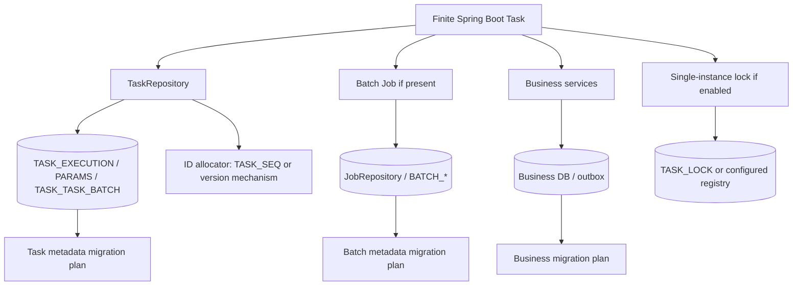
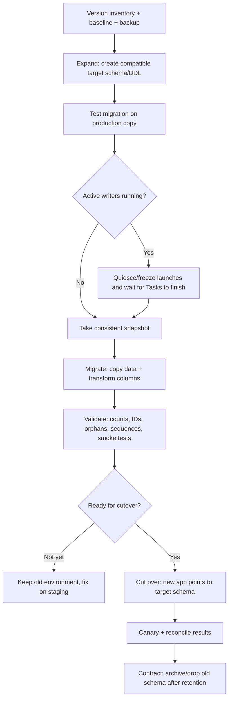

# Schema Changes, DDL, and Data Migration Planning

## Lesson Objectives

**SPRING_CLOUD_TASK (Spring Cloud Task)** helps build **finite-running** Spring Boot applications: receiving parameters, performing work and exiting, and recording timestamps and outcomes in `TaskRepository`. Tasks can be triggered on a schedule, on demand, or to execute Spring Batch Jobs, and may be deployed across multiple JVMs/containers sharing a database.

In the **Tuning and Upgrades** chapter, changing database structures is more than running an `ALTER TABLE` statement. When upgrading Spring Cloud Task, switching databases, changing table prefixes, or migrating historical data, you must preserve **execution IDs, Batch links, the ability to allocate new execution IDs, and completion evidence for in-flight Tasks**. A migration with a missing table or misconfigured ID allocator can cause startup failures, ID collisions, or cause dashboards to misread history.

This lesson walks through a **verifiable data migration plan**: identifying the actual schemas and versions, preparing DDL through migration tools, copying data in order, testing, cutting over applications, verifying post-deployment, and recovering when incidents occur.

After this lesson, you will be able to:

- Distinguish Spring Cloud Task metadata, Spring Batch metadata, lock tables, and business data.
- Read the exact DDL for the running **Spring Cloud Task release and database dialect**, instead of copying DDL from an article on a different version.
- Understand the roles of `TASK_EXECUTION`, `TASK_EXECUTION_PARAMS`, `TASK_TASK_BATCH`, lock tables, and the `TASK_EXECUTION_ID` allocator.
- Build an inventory, snapshots/backups, version comparison matrix, and a writer-quiesce plan before copying.
- Execute **expand → migrate → validate → cut over → contract**, knowing when downtime or change-data capture is required during copy.
- Move metadata to a new schema/database, preserve IDs, and safely reset sequences/ID tables.
- Use Flyway or Liquibase to manage DDL rather than letting multiple Task JVMs race to create/alter tables at startup.
- Verify post-migration via SQL, real JAR tests, Spring Batch restarts, lock/concurrency checks, and runbook recovery.

## 1. Which Schema Is Being Changed?

A Spring Cloud Task application may access **several distinct data domains**:

| Data Domain | Typical Tables or Objects | Responsibility | Migration Considerations |
| --- | --- | --- | --- |
| **Spring Cloud Task metadata** | `TASK_EXECUTION`, `TASK_EXECUTION_PARAMS`, `TASK_TASK_BATCH`, ID allocators such as `TASK_SEQ`. | Stores history of each Task run and Job links. | IDs, timestamps, exit codes, params, child tables, column names/prefixes. |
| **Single-instance locking** | `TASK_LOCK` in the Task appendix; some Spring Integration setups use registry tables like `INT_LOCK`. | Prevents two instances with the same Task name from running concurrently when locking is enabled. | Version-specific table/region/TTL, active owners; never blindly copy locks. |
| **Spring Batch metadata** | `BATCH_JOB_INSTANCE`, `BATCH_JOB_EXECUTION`, `BATCH_STEP_EXECUTION`, `BATCH_JOB_EXECUTION_CONTEXT`, and sequences. | JobInstance, JobExecution, StepExecution state, checkpoints/restarts. | Independent Batch migrations, optimistic locking `VERSION`, execution context, identifying JobParameters. |
| **Business data** | `daily_report`, `order_export`, outbox, files, or message brokers. | Actual outputs of the task. | Business keys, transactions, deduplication on retry. |
| **Platform orchestration** | Scheduler executions, Kubernetes Jobs/Pods, SCDF deployment metadata. | Launches, retries, timeouts, resource states. | Launch ID is not `TaskExecution ID`; preserve correlation. |

**Do not use one generic DDL across all five domains.** `TaskRepository` and Spring Batch `JobRepository` have separate migrations/schemas; lock tables also depend on integration registry mechanisms and library versions.



**Running scenario:** the `daily-report-task` system uses PostgreSQL in the `public` schema. Operations wants to move Task metadata to the `task_meta` schema and upgrade Spring Cloud Task. They still need to query old executions—including Tasks that ran Batch Jobs—and continue allocating non-colliding IDs after the move.

## 2. The Reliable Source of DDL Is the Deployed Artifact Version

Spring Cloud Task documentation includes the **Task Repository Schema appendix**, describing core tables and linking to sample DDL per database. Releases may differ in column names, string lengths, timestamp types, keys, indexes, ID allocation mechanisms, and initializer behavior. Therefore, record the **source and target pair** before authoring migrations:

| Data to Record | Example | Why Is It Needed? |
| --- | --- | --- |
| Spring Boot and Java | Boot 3.x, Java 17/21. | JDBC, auto-configuration, and library compatibility. |
| Spring Cloud release train | Release train name from BOM. | Identifies the compatible Spring Cloud Task version. |
| `spring-cloud-task-core` | **Resolved** version, not just docs version. | Read the exact DDL/API used by the real app. |
| Spring Batch | Version and `spring-batch-core` module. | Batch metadata/DDL has its own lifecycle. |
| Spring Integration JDBC | Version if `single-instance-enabled` is used. | Lock registry/schema/TTL vary by library. |
| Database dialect | PostgreSQL, SQL Server, MySQL, Oracle… and version. | Data types, transactional DDL, sequences, and online indexes differ. |
| Runtime configuration | `TaskConfigurer`, table prefix, schema, `DataSource`, initializer. | Know exactly which tables the repository reads/writes. |
| Actual schema state | Executed DDL, indexes, and custom constraints. | Avoid confusing live schema with default sample schema. |

### 2.1. Identifying Real Dependencies

Example for a Maven project:

```bash
mvn dependency:tree -Dincludes=org.springframework.cloud:*,org.springframework.batch:*,org.springframework.integration:*
mvn help:effective-pom
```

These commands are for **inspecting a real project**, not executed while authoring this guide. `dependency:tree` shows the final resolved versions after BOM/overrides; `effective-pom` reveals dependency management. For Gradle, use `dependencies` and `dependencyInsight` on `runtimeClasspath`.

You can inspect SQL resources **inside resolved JARs** with `jar tf` to check which version's DDL is bundled:

```bash
# JAR filename is illustrative only. Substitute actual spring-cloud-task-core artifact.
jar tf spring-cloud-task-core-<version>.jar | grep -Ei 'schema|sql'

# For Spring Batch, schema/migration scripts
# belong to the spring-batch-core module for that version.
jar tf spring-batch-core-<version>.jar | grep -Ei 'schema|migration'
```

These are **resource inspection** commands and do not assert that every release uses the same paths or packages schemas in identical JARs. The authoritative source is **the exact artifact/release DDL**, release notes, and the schema currently live in the database.

### 2.2. Common Task Fields

Per the Spring Cloud Task appendix, the `TASK_EXECUTION` table describes:

| Column | Role | Migration Checkpoints |
| --- | --- | --- |
| `TASK_EXECUTION_ID` | Task run identifier key, usually `BIGINT`. | **Do not change/renumber** if external systems still use old IDs. |
| `TASK_NAME` | Task name, e.g., `daily-report-task`. | Length limits, encoding, and name resolution rules. |
| `START_TIME`, `END_TIME` | Start and end timestamps. | Precision, timezone/timestamp type; `END_TIME` may be null. |
| `EXIT_CODE` | Task exit code recorded by framework. | May be null while Task is running/incomplete. |
| `EXIT_MESSAGE`, `ERROR_MESSAGE` | Completion or error message. | Column length, encoding, sensitive data. |
| `LAST_UPDATED` | Timestamp when metadata was last updated. | Pre-created records need valid values for constraints. |
| `EXTERNAL_EXECUTION_ID` | External platform ID when configured. | Length and scheduler/SCDF correlation rules. |
| `PARENT_TASK_EXECUTION_ID` or release variant | Links parent Task execution. | **Compare exact column names** between old and new schemas. |

The appendix notes `TASK_NAME` is typically max 100 chars, `EXIT_MESSAGE`/`ERROR_MESSAGE` and `TASK_PARAM` around 2,500 chars, and `EXTERNAL_EXECUTION_ID` around 250 chars. These are **documented schema references**, not guarantees that every release, live DDL, and database uses those exact lengths.

In particular, docs and DDL across release branches have had column name variants such as `PARENT_EXECUTION_ID` vs. `PARENT_TASK_EXECUTION_ID`; blindly running `SELECT *` or only renaming tables can make a version misread or fail to read data. Always map **source column → target column** explicitly from verified DDL.

### 2.3. Objects Beyond the Main Table

- `TASK_EXECUTION_PARAMS` holds `TASK_EXECUTION_ID` and `TASK_PARAM`. These may be command-line arguments, so **secrets** must be controlled during backups, exports, or sharing migration data.
- `TASK_TASK_BATCH` holds `TASK_EXECUTION_ID` and `JOB_EXECUTION_ID` to link Tasks with Batch. Do not drop these pairs if Job reconciliation is still required; never assume both IDs share the same namespace.
- `TASK_LOCK` appears in the Spring Cloud Task appendix, though the actual lock table depends on library and registry config. A setup using Spring Integration JDBC may have `INT_LOCK`. Never arbitrarily rename `INT_LOCK` to `TASK_LOCK`.
- `TASK_SEQ` or equivalent ID allocator must be inspected carefully. Some dialects/releases use a **sequence table**, others use a **native database sequence**; PostgreSQL's `setval` cannot be applied to a sequence table.
- `BATCH_*_SEQ`, `BATCH_*` indexes, `VERSION`, and execution contexts belong to **Spring Batch** and need their own plan. Spring Batch ships migration SQL inside `spring-batch-core`.

## 3. Classifying Changes: Not All Migrations Are Alike

| Change Type | Example | Risk Level | Approach |
| --- | --- | --- | --- |
| **Additive** | Adding an index or sidecar observability table. | Usually low if online / minimal locking. | Expand first, deploy compatible app, measure performance. |
| **Column type/length change** | Timestamp precision, `VARCHAR`, or Unicode. | Medium/high depending on engine and table size. | Test conversion, backfill, locks/timeouts, rollback. |
| **Renaming columns or table prefixes** | `TASK_` → `OPS_TASK_`, schema `public` → `task_meta`. | High if old/new apps run concurrently. | Target DDL, copy, reconcile, controlled cutover. |
| **Switching database/dialect** | PostgreSQL → SQL Server. | High. | Map types/timezones, sequences, identities, consistency, Batch data. |
| **Spring Batch major upgrade** | `BATCH_*` DDL changes, new migration scripts. | High for restarts. | Apply official Batch migrations, test Job restarts. |
| **Lock reconfiguration** | `single-instance-enabled` with a different lock registry. | High while Tasks are running. | Quiesce/drain lock owners, verify TTL and schema. |
| **History purge/archival** | Deleting old executions to reclaim space. | High if links/checkpoints are deleted by mistake. | Approved retention, archive/restore test, FK order. |

A seemingly simple change like `ALTER TABLE TASK_EXECUTION RENAME TO OPS_TASK_EXECUTION` can blind old apps to the repository, break `TASK_EXECUTION_PARAMS` foreign keys, and leave new apps allocating IDs from an outdated sequence. Planning must cover **all dependencies**, not just one table.

## 4. Pre-Migration Discovery: Inventory and Baseline

Before running any DDL, capture a **reconcilable baseline**. Schedule a maintenance window if many Tasks are active or `TaskRepository` is shared by multiple apps/SCDF servers.

### 4.1. Identifying Tables and Structure on PostgreSQL

Example **read-only** query listing metadata tables in the source schema:

```sql
SELECT table_schema, table_name
FROM information_schema.tables
WHERE table_schema = 'public'
  AND (
      table_name LIKE 'task_%'
      OR table_name LIKE 'batch_%'
      OR table_name LIKE 'int_%'
  )
ORDER BY table_name;
```

PostgreSQL folds unquoted identifiers to lowercase. Hence the inventory query uses `task_%`, while other sample SQL writes unquoted `TASK_EXECUTION`; both refer to the same table if objects were created without double quotes. If the system created quoted case-sensitive identifiers, use **exact catalog names**.

List Task columns and types/lengths:

```sql
SELECT table_name,
       ordinal_position,
       column_name,
       data_type,
       character_maximum_length,
       is_nullable
FROM information_schema.columns
WHERE table_schema = 'public'
  AND table_name IN (
      'task_execution',
      'task_execution_params',
      'task_task_batch',
      'task_lock'
  )
ORDER BY table_name, ordinal_position;
```

Do not assume a missing lock table is an error if single-instance is disabled or infrastructure uses a different registry. Reconcile runtime `TaskConfigurer`/`DataSource` against the managed schema.

### 4.2. Row Count, ID, and Status Baseline

```sql
SELECT COUNT(*) AS executions,
       MIN(TASK_EXECUTION_ID) AS min_id,
       MAX(TASK_EXECUTION_ID) AS max_id,
       COUNT(*) FILTER (WHERE END_TIME IS NULL) AS without_end_time,
       COUNT(*) FILTER (WHERE EXIT_CODE IS NULL) AS without_exit_code
FROM public.TASK_EXECUTION;

SELECT COUNT(*) AS parameter_rows
FROM public.TASK_EXECUTION_PARAMS;

SELECT COUNT(*) AS batch_link_rows
FROM public.TASK_TASK_BATCH;
```

`FILTER (WHERE …)` is PostgreSQL syntax; on other databases use `SUM(CASE WHEN … THEN 1 ELSE 0 END)` or equivalent dialect syntax.

`END_TIME IS NULL` **does not prove** a Task is still running; it may be a pre-created execution, a killed JVM, or a failed final metadata update. Cross-check the scheduler/Pod/process before freezing writers or clearing locks.

### 4.3. Checking Orphaned Links

```sql
SELECT COUNT(*) AS orphan_params
FROM public.TASK_EXECUTION_PARAMS p
LEFT JOIN public.TASK_EXECUTION e
  ON e.TASK_EXECUTION_ID = p.TASK_EXECUTION_ID
WHERE e.TASK_EXECUTION_ID IS NULL;

SELECT COUNT(*) AS orphan_task_batch_links
FROM public.TASK_TASK_BATCH l
LEFT JOIN public.TASK_EXECUTION e
  ON e.TASK_EXECUTION_ID = l.TASK_EXECUTION_ID
WHERE e.TASK_EXECUTION_ID IS NULL;
```

If Batch metadata lives in **the same** database, you can also check `JOB_EXECUTION_ID` against `BATCH_JOB_EXECUTION`. If Batch lives in another database, reconcile via two separate queries and application logic; do not add cross-database foreign keys where unsupported by the engine.

Record baseline results in a restricted-access runbook/audit store, including snapshot timestamp, artifact version, checksum/schema dump, and datasource/prefix config. **Never** paste `TASK_PARAM` or `ERROR_MESSAGE` values containing secrets into public tickets.

## 5. Choosing Tools and Managing DDL

In production, **Flyway** or **Liquibase** is commonly used to version schemas. Each change should have a migration ID/version, reviewer, preconditions, and a rollback/roll-forward plan.

Example Task application config when **the migration pipeline pre-creates the schema**:

```yaml
# application-prod.yml
spring:
  application:
    name: daily-report-task
  datasource:
    url: ${TASK_DB_URL}
    username: ${TASK_DB_USER}
    password: ${TASK_DB_PASSWORD}
  cloud:
    task:
      name: daily-report-task
      initialize-enabled: false
      tablePrefix: TASK_
```

`spring.cloud.task.initialize-enabled=false` turns off Spring Cloud Task's automatic table creation at startup. It **does not** run migrations for you and **does not** disable Spring Batch's `spring.batch.jdbc.initialize-schema` or JDBC lock DDL managed by other infrastructure.

Have the migration pipeline run with **a controlled DDL account**, while the Task application only receives needed DML privileges. If multiple Task Pods start together, never let them race to create/alter the same metadata tables.

### Example Migration Layout

```text
db/
  task/
    V101__create_task_repository_from_official_ddl.sql
    V102__create_task_query_indexes.sql
    V103__prepare_task_schema_cutover.sql
  batch/
    V201__apply_batch_release_migrations.sql
  runbooks/
    2026-11-task-schema-cutover.md
```

This is a **mock layout**, not a ready-made script pack. `V101` contents must come from **official DDL for your exact version/dialect** plus verified custom indexes/constraints. Flyway/Liquibase cannot tell on their own whether a change is compatible with Spring Cloud Task.

### Adding a Read Index Without Disrupting Writers

Example specifically for optimizing a dashboard query that filters by task name and start time:

```sql
-- PostgreSQL: inspect query plan/table locks before applying.
CREATE INDEX CONCURRENTLY IF NOT EXISTS
    IDX_TASK_EXECUTION_NAME_START
ON public.TASK_EXECUTION (TASK_NAME, START_TIME);
```

**Warning:** PostgreSQL `CREATE INDEX CONCURRENTLY` **cannot run inside a transaction block**. Flyway normally wraps migrations in transactions when possible; migrations containing this statement must be configured as **non-transactional** per your tool's capabilities/version. It can also run for a long time and leave an invalid index if interrupted. Do not add indexes just because "it sounds faster": test with `EXPLAIN (ANALYZE, BUFFERS)` on a data copy and check impact on Task write speed.

## 6. Schema Change Plan: expand → migrate → cut over → contract

A safe rule for shared-metadata changes is **never break the old structure before the new app is verified**.



| Phase | Goal | Gate Criteria |
| --- | --- | --- |
| **Prepare** | Lock down DDL, list of apps using DB, backups, rollback, schedule. | Backup restore succeeds in test environment. |
| **Expand** | Create target schema/tables/indexes without deleting source. | DDL migration passes staging; target matches artifact. |
| **Quiesce** | Halt new launches, wait for old writers to finish or drain. | No legacy Task/SCDF/service writing to source metadata. |
| **Migrate** | Copy data preserving IDs, params, and links. | Consistent copy with no lost tail Task commits. |
| **Validate** | Compare row counts/IDs/hashes, foreign keys, sequences, Task API. | Reconciliation report passes. |
| **Cutover** | Switch `DataSource`/prefix and roll out new app. | Canary launch and live metadata queries succeed. |
| **Contract** | Retire old schema and archive after retention window. | Monitoring window passed with no source-dependent rollback needed. |

A "zero-downtime" phase is only feasible when **both source and target schemas stay consistently updated** throughout the transition. Spring Cloud Task does not dual-write metadata to two repositories out of the box. Unless you build and prove CDC/dual-write correctness, the simpler and safer route is **pausing new launches, waiting for active writers to finish, and taking a clean snapshot**.

### What Does Freezing Writers Mean?

It is more than pausing one cron. Also check for:

- Kubernetes CronJobs and currently running Jobs.
- Spring Cloud Data Flow server/TaskLauncher pre-creating `TaskExecution`.
- Operational APIs for manual launches.
- Spring Batch managers/workers updating metadata independently.
- A second application sharing the same `TaskRepository`.
- Hung/timed-out Tasks with lingering processes or open transactions.

Only after identifying **all writers** and a consistent cutoff point should you perform a single-pass copy. If any writer is missed, old Tasks can write rows after the snapshot and be lost from the target.

## 7. Example: Moving Task Tables from `public` to `task_meta`

Illustrative scenario: PostgreSQL stores metadata in `public.TASK_*`, and the app will move to `task_meta.TASK_*`. **Mandatory assumptions** before running the example:

1. All writers are quiesced and nothing continues creating/updating `TaskExecution` in the source.
2. The target schema was created from **target-version DDL**, including primary keys, indexes, constraints, and the proper ID allocator.
3. Both sides have the columns shown in the SQL; any extra columns are handled via an explicit mapping table.
4. Both schemas live in **one PostgreSQL database**, allowing a single transaction. Across two separate databases, use a checkpointed snapshot/copy tool and separate reconciliation plan.
5. Backup/snapshot restore was rehearsed in staging; never run SQL below directly on production without change review.

### 7.1. Creating the Target Schema

```sql
-- Namespace creation step only. Repository tables are not created yet.
CREATE SCHEMA IF NOT EXISTS task_meta;

-- Next, apply official DDL for your exact Spring Cloud Task release
-- and PostgreSQL dialect to create task_meta.TASK_EXECUTION,
-- TASK_EXECUTION_PARAMS, TASK_TASK_BATCH, ID allocator, ...
-- Never substitute short examples here for the framework's full DDL.
```

Do not use `CREATE TABLE task_meta.TASK_EXECUTION AS SELECT ...` as production repository DDL: that omits primary keys, defaults, constraints, indexes, sequences/identities, and privileges. Likewise, PostgreSQL `CREATE TABLE ... (LIKE ... INCLUDING ALL)` can carry over defaults referencing sequences in the source schema; inspect and adjust every dependency if used.

### 7.2. Copying Data in Dependency Order

When **both schemas share the same column names** as in this example, the copy transaction can be illustrated with **explicit** column lists:

```sql
BEGIN;

-- 1) Parent table: preserve TASK_EXECUTION_ID.
INSERT INTO task_meta.TASK_EXECUTION (
    TASK_EXECUTION_ID,
    START_TIME,
    END_TIME,
    TASK_NAME,
    EXIT_CODE,
    EXIT_MESSAGE,
    ERROR_MESSAGE,
    LAST_UPDATED,
    EXTERNAL_EXECUTION_ID,
    PARENT_TASK_EXECUTION_ID
)
SELECT
    TASK_EXECUTION_ID,
    START_TIME,
    END_TIME,
    TASK_NAME,
    EXIT_CODE,
    EXIT_MESSAGE,
    ERROR_MESSAGE,
    LAST_UPDATED,
    EXTERNAL_EXECUTION_ID,
    PARENT_TASK_EXECUTION_ID
FROM public.TASK_EXECUTION;

-- 2) Parameters table referencing TaskExecution.
INSERT INTO task_meta.TASK_EXECUTION_PARAMS (
    TASK_EXECUTION_ID, TASK_PARAM
)
SELECT TASK_EXECUTION_ID, TASK_PARAM
FROM public.TASK_EXECUTION_PARAMS;

-- 3) Relationship between TaskExecution and Batch JobExecution.
INSERT INTO task_meta.TASK_TASK_BATCH (
    TASK_EXECUTION_ID, JOB_EXECUTION_ID
)
SELECT TASK_EXECUTION_ID, JOB_EXECUTION_ID
FROM public.TASK_TASK_BATCH;

COMMIT;
```

**This is not a universal script for every version.** If the old schema has `PARENT_EXECUTION_ID`, the mapping must change the source expression to `PARENT_EXECUTION_ID AS PARENT_TASK_EXECUTION_ID` **after officially verifying column names**; never guess from memory. If the old version lacks another column, define explicit defaults/null handling and validation.

Never run a single multi-million-row table `INSERT` without measuring transaction duration, WAL, locks, disk space, and rollback cost. For large volumes, copy by ID range or use a checkpointed data tool while keeping **writers frozen or using reliable CDC/dual-write** so updates are not lost.

### 7.3. When Column Names Must Change During Copy

Example mapping documented in the migration spec:

| Source Release/Schema | Target Release/Schema | Transformation |
| --- | --- | --- |
| `source.TASK_EXECUTION_ID` | `target.TASK_EXECUTION_ID` | Preserve ID. |
| `source.PARENT_EXECUTION_ID` (if present) | `target.PARENT_TASK_EXECUTION_ID` (if present) | Rename when required by target version. |
| `source.START_TIME` | `target.START_TIME` | Verify timezone, precision, and DB type. |
| `source.ERROR_MESSAGE` | `target.ERROR_MESSAGE` | Check lengths; avoid truncating error details. |
| `source.TASK_PARAM` | `target.TASK_PARAM` | Preserve for audit while controlling sensitive values. |
| `source.JOB_EXECUTION_ID` | `target.JOB_EXECUTION_ID` | Keep link if Batch repository/IDs remain valid. |

If converting from a timezone-naive timestamp to a timezone-aware type, define how **legacy timestamps are interpreted**. Never blindly assign UTC to historical data if the app actually wrote server-local time; if uncertain, document the assumption and verify using executions whose timestamps appear in platform logs.

### 7.4. Why Not Copy Currently Held Locks?

When single-instance is enabled, the lock table can hold **owners and leases** for active Tasks. Copying lock rows straight to a new database/schema can trick the new app into believing a Task holds a lock when the old process is already dead, or vice versa.

Only migrate lock schemas/configs after confirming no valid owners remain, understanding how `LockRegistry`/`DefaultLockRepository` operates, and having the library's TTL/cleanup runbook ready. In many cases it is better to **create an empty new lock table after quiescing** rather than migrating stale runtime rows. Never automatically run `DELETE FROM TASK_LOCK` or `DELETE FROM INT_LOCK` while production Tasks are still running.

## 8. Synchronizing the `TASK_EXECUTION_ID` Allocator

After copying history, **allocating the next Task ID** must start **higher than the largest existing ID**. Otherwise, the first launch after cutover can hit primary key collisions or overwrite an existing pre-created execution.

Determine the high-water mark:

```sql
SELECT COALESCE(MAX(TASK_EXECUTION_ID), 0) AS max_task_execution_id
FROM task_meta.TASK_EXECUTION;
```

Do not count rows instead; IDs can have gaps from rollbacks, pre-created failures, retention purges, or older migrations.

### 8.1. When Using a Native PostgreSQL Sequence

**Only when confirmed** that the target allocator is a native PostgreSQL sequence named `task_meta.task_seq`, and all writers are frozen:

```sql
-- Conditional example. Do not run if TASK_SEQ is a table.
-- is_called=false so the next nextval returns exactly max_id + 1.
SELECT setval(
    'task_meta.task_seq'::regclass,
    GREATEST(
        COALESCE(
            (SELECT MAX(TASK_EXECUTION_ID)
             FROM task_meta.TASK_EXECUTION),
            0
        ) + 1,
        1
    ),
    false
);
```

If `TASK_SEQ` is actually a **table** used by the framework/dialect, `setval` does not apply. Read the ID allocator's SQL in your exact version and update its row/sequence according to its rules. Some databases like SQL Server use native `SEQUENCE` differently; Spring Cloud Task docs even note deadlock risks when concurrent Tasks contend on a sequence table in SQL Server. Never run `DROP TABLE TASK_SEQ` as a casual upgrade step; that is a destructive DDL change requiring backups, next-value calculation, and a dedicated maintenance window.

### 8.2. Should Old IDs Be Preserved?

**Yes, in most metadata migrations.** Old IDs can appear in:

- `TASK_EXECUTION_PARAMS.TASK_EXECUTION_ID`.
- `TASK_TASK_BATCH.TASK_EXECUTION_ID`.
- `PARENT_TASK_EXECUTION_ID` of child Task runs.
- `spring.cloud.task.executionid` arguments of pre-created launcher processes.
- Dashboards, logs, audits, SCDF links, investigation reports, and external APIs.

If re-keying is unavoidable when merging two databases with overlapping IDs, build an **old-namespace/ID → new-ID mapping table** and update **every reference** consistently. Also check `JobExecution` links and external IDs stored by other systems. That is a system-wide migration, **not** simply running `UPDATE TASK_EXECUTION SET TASK_EXECUTION_ID = …`.

## 9. Changing Table Prefixes and Schemas Correctly

Spring Cloud Task has the property:

```properties
spring.cloud.task.tablePrefix=TASK_
```

Default tables like `TASK_EXECUTION` and `TASK_EXECUTION_PARAMS` start with `TASK_`. Spring Cloud Task documentation allows using table prefix to rename the table group or prepend a schema name when needed.

**Illustrative** configuration for accessing tables in the `task_meta` schema, to be confirmed against your actual `TaskConfigurer`:

```yaml
spring:
  cloud:
    task:
      initialize-enabled: false
      tablePrefix: "task_meta.TASK_"
```

By prefix convention, `task_meta.TASK_` + `EXECUTION` becomes `task_meta.TASK_EXECUTION`. However, components referencing table names can vary between versions, and a custom `TaskConfigurer` can override properties. **Always smoke-test** `TaskRepository`/`TaskExplorer` and inspect actual SQL; never assume changing one property automatically moves tables or creates schemas.

If changing the prefix to `OPS_TASK_` in **the same** schema, create a full matching DDL set (`OPS_TASK_EXECUTION`, `OPS_TASK_EXECUTION_PARAMS`, `OPS_TASK_TASK_BATCH`, allocator, and version-specific objects). Single-instance locks and Spring Batch table prefixes may be configured **separately**; do not assume they inherit `TaskRepository`'s prefix automatically.

### Multiple DataSources

If the application separates business and metadata databases:

- `TaskConfigurer` must point `TaskRepository` and `TaskExplorer` to the right Task `DataSource` and transaction manager.
- Spring Batch has its own `JobRepository`, `JobExplorer`, schema, and transaction manager configuration.
- `TASK_TASK_BATCH` history must keep `JOB_EXECUTION_ID` aligned with the active Batch store.
- Application profiles, environment variables, and connections from the scheduler/SCDF server must all point to the new repository per design.

Avoid **split-brain metadata**: half of Tasks writing `public.TASK_EXECUTION` while dashboards query `task_meta.TASK_EXECUTION`, making new runs appear to vanish.

## 10. Reconciling Data Before Letting New Tasks Run

After copying and **before cutover**, run multi-layer checks, not just table counts:

### 10.1. Source and Target Row Counts

```sql
SELECT 'source_task' AS item, COUNT(*) AS row_count
FROM public.TASK_EXECUTION
UNION ALL
SELECT 'target_task', COUNT(*)
FROM task_meta.TASK_EXECUTION
UNION ALL
SELECT 'source_params', COUNT(*)
FROM public.TASK_EXECUTION_PARAMS
UNION ALL
SELECT 'target_params', COUNT(*)
FROM task_meta.TASK_EXECUTION_PARAMS
UNION ALL
SELECT 'source_links', COUNT(*)
FROM public.TASK_TASK_BATCH
UNION ALL
SELECT 'target_links', COUNT(*)
FROM task_meta.TASK_TASK_BATCH;
```

If writers are still active on the source, row counts can shift between two `COUNT(*)` calls. That signals **an unfixed snapshot**—return to the quiesce/snapshot step instead of waving a mismatch through.

### 10.2. Missing or Extra IDs

```sql
-- IDs present in source but missing in target.
SELECT TASK_EXECUTION_ID
FROM public.TASK_EXECUTION
EXCEPT
SELECT TASK_EXECUTION_ID
FROM task_meta.TASK_EXECUTION;

-- IDs present in target but missing in source.
SELECT TASK_EXECUTION_ID
FROM task_meta.TASK_EXECUTION
EXCEPT
SELECT TASK_EXECUTION_ID
FROM public.TASK_EXECUTION;
```

Both sets must be empty in a 1-to-1 ID-preserving migration. For migrations with transformations, pruning, or retention rules, document acceptance criteria **before** running.

### 10.3. Comparing Key Fields

```sql
SELECT e.TASK_EXECUTION_ID
FROM public.TASK_EXECUTION e
JOIN task_meta.TASK_EXECUTION t
  ON t.TASK_EXECUTION_ID = e.TASK_EXECUTION_ID
WHERE e.TASK_NAME IS DISTINCT FROM t.TASK_NAME
   OR e.EXIT_CODE IS DISTINCT FROM t.EXIT_CODE
   OR e.START_TIME IS DISTINCT FROM t.START_TIME
   OR e.END_TIME IS DISTINCT FROM t.END_TIME
   OR e.EXIT_MESSAGE IS DISTINCT FROM t.EXIT_MESSAGE
ORDER BY e.TASK_EXECUTION_ID;
```

`IS DISTINCT FROM` is PostgreSQL's `NULL`-safe comparison operator. This example checks key columns, **not** every column and parameter. For large tables, validate by ID ranges, consistent row-level hashes/checksums, and sample executions with errors, parents, parameters, and Batch links.

### 10.4. No New Orphaned Foreign Keys

```sql
SELECT COUNT(*) AS orphan_params
FROM task_meta.TASK_EXECUTION_PARAMS p
LEFT JOIN task_meta.TASK_EXECUTION e
  ON e.TASK_EXECUTION_ID = p.TASK_EXECUTION_ID
WHERE e.TASK_EXECUTION_ID IS NULL;

SELECT COUNT(*) AS orphan_links
FROM task_meta.TASK_TASK_BATCH l
LEFT JOIN task_meta.TASK_EXECUTION e
  ON e.TASK_EXECUTION_ID = l.TASK_EXECUTION_ID
WHERE e.TASK_EXECUTION_ID IS NULL;
```

Also verify **parent Task IDs** if child tasks are used, pre-created executions not yet started, and parameters that might have been truncated if `VARCHAR` lengths shrank. Allow exceptions only when explicitly documented in the runbook.

### 10.5. Checking ID Continuity

IDs do not have to be contiguous. What matters is that **the allocator never reissues an already-used ID** and old foreign keys/links remain valid. After configuring the allocator for your version, launch a **canary** Task and verify the new ID exceeds the source snapshot's high-water mark. Never run a canary while an old app still has write access to the same store using a different allocator.

## 11. When Data Lives in Two Separate Databases

When moving from one PostgreSQL server to **another server** or switching dialects, cross-database `INSERT … SELECT …` transactions may not exist. Choose a strategy:

| Strategy | When Appropriate | Risks / Notes |
| --- | --- | --- |
| Single dump/restore after quiesce | Moderate data size, downtime acceptable. | Restoring schemas/owners/sequences/privileges and dropping incompatible objects. |
| ID-range ETL/copy | Large data, can quiesce or freeze snapshot. | Checkpoints, FK order, total and per-range reconciliation. |
| CDC from source to target | Very short downtime required, CDC ops available. | Ordering updates, deletes, transactions, backfill, and cutover lag. |
| Application dual-write | Only when custom-built and sync logic proven. | Partial write failures, distributed transactions, consistency/replay. |

For **range-based ETL**, an illustrative checkpoint format:

```text
migration_name=task-metadata-cutover-2026-11
source_snapshot=<LSN or consistent cutoff timestamp>
range_start_id=1
range_end_id=100000
copied_execution_rows=<count>
copied_params_rows=<count>
copied_batch_links=<count>
validated=true
```

Per-range order should be: copy `TASK_EXECUTION` first → copy referencing params/links → validate range → commit checkpoint. Never blindly treat `INSERT ... ON CONFLICT DO NOTHING` as a "standard idempotent migration": it can **silently mask content conflicts**, leaving mismatched rows on target under the same ID. On range retries, compare row contents or fail loudly on conflict.

With CDC, **never cut over before lag reaches 0** per system policy and source writers are blocked from creating new data. Individual `END_TIME`/`EXIT_CODE` updates must arrive in order. In particular, pre-created Tasks get an initial row followed by multiple updates; copying only the initial state leaves target metadata permanently "incomplete."

## 12. Upgrade Spring Batch Metadata Together or in Separate Phases?

If the application runs Spring Batch, consider **separating Task and Batch migrations into two windows** unless there is a compelling reason to combine them. Spring Batch has its own DDL and migration scripts in `spring-batch-core`, plus restart policies tied to `JobInstance`, `JobExecution`, `StepExecution`, and `ExecutionContext`.

| Spring Batch Item | Why Must It Not Be Skipped? |
| --- | --- |
| `BATCH_JOB_INSTANCE` and `JOB_KEY` | Identifies `JobInstance` by identifying `JobParameters`. |
| `BATCH_JOB_EXECUTION` | Holds attempt history and restart state. |
| `BATCH_STEP_EXECUTION` | Holds item/chunk counts, Step status, and optimistic locking `VERSION`. |
| `BATCH_*_EXECUTION_CONTEXT` | Holds checkpoints/state needed to resume at the right spot. |
| `BATCH_JOB_EXECUTION_PARAMS` | Parameter types/storage changed across version lines. |
| `BATCH_*_SEQ` | Prevents Job/Step ID collisions after cutover. |
| `TASK_TASK_BATCH` | Links Task IDs to `JobExecution`; keep aligned with the active Batch store. |

**Never purge "too old" `ExecutionContext` or `JobInstance` rows** before checking which Jobs might still need a restart. Spring Batch uses this metadata to determine whether a Job already ran, whether it can restart, and where to resume. A failed Job can turn into a brand-new Job if history is wiped carelessly, causing duplicate processing.

Apply Batch migration scripts along **the exact version upgrade path** and inspect the DDL under `org/springframework/batch/core/migration` in the corresponding artifact. Preserve the `VERSION` column for optimistic locking; never reset it to 0 to "avoid version errors" during concurrent updates.

### Testing Restart After Upgrade

1. On a staging replica, create a Batch Job reading/writing 3 chunks with a fixed identifying `businessDate`.
2. Intentionally fail the second Step after one checkpoint has committed.
3. Record `JobInstance ID`, `JobExecution ID`, and `ExecutionContext` contents.
4. Apply the corresponding Batch/Task migrations and relaunch with the exact same identifying `JobParameters`.
5. Verify `JobInstance` remains the same logical instance per restart policy, `JobExecution` gets a new ID, the Step resumes from the expected position, and **no duplicate output is written**.
6. Query `TASK_TASK_BATCH` to verify each run's `TaskExecution` links to the right Batch `JobExecution`.

This is a **business and repository test**, not just a "the app booted" smoke test.

## 13. Rollout/Cutover and Rollback Capability

A new release may expect the new schema while the old release expects the old schema. They are not guaranteed to run together if columns were renamed or dropped.

### Recommended Rollout Plan

| Step | Task | Owner | Gate |
| --- | --- | --- | --- |
| 1 | Lock source/target versions, target DDL, writer inventory, retention, and column mapping. | Dev + DBA + Ops. | Architecture review passes. |
| 2 | Backup/snapshot source, test restore, and measure duration. | DBA. | Restore rehearsal passes. |
| 3 | Create target schema via migration tool; verify DML grants. | Pipeline/DBA. | DDL/permissions pass. |
| 4 | Pause schedules and confirm in-flight Tasks/Batches finished safely. | Scheduler owner. | Quiesce passes. |
| 5 | Take snapshot, copy/transform data, initialize target allocator. | Migration runner. | Row/ID/link validation passes. |
| 6 | Switch app/profile/`TaskConfigurer`/table prefix to target. | Release pipeline. | Single writer topology verified. |
| 7 | Launch canary; inspect `TaskExecution`, Batch Job if any, and business output. | QA + Ops. | Canary passes. |
| 8 | Gradually re-enable schedules/traffic; monitor SQL errors, latency, IDs, states. | Ops. | Monitoring passes. |
| 9 | Archive/contract old schema **after** rollback window closes. | DBA + data owner. | Deletion approval. |

After cutover, watch closely for:

- `relation does not exist` / `table not found` or `column not found` from wrong prefix/schema/version.
- `duplicate key` from an allocator reissuing IDs.
- Foreign key violations in params or Batch links.
- Lock timeouts/deadlocks on `TASK_SEQ` or lock tables when many Tasks launch together.
- New `TaskExecution` missing from where dashboards/SCDF query.
- `END_TIME`, `EXIT_CODE`, or `ERROR_MESSAGE` not updating even though the runner finished.
- Spring Batch restarts losing checkpoints or `JobExecution` unlinked from `TaskExecution`.

### Conditional Rollback

**Before the new app writes any row:** you can usually revert to the old app/profile while keeping the target schema intact for investigation.

**After the new app has written data:** you cannot simply point the JDBC URL back to the old DB and assume no data is lost. Account for new `TaskExecution` records, Batch links, business outputs, and ID allocators, then choose:

- **Roll forward:** fix target schema/config and continue on the new repository.
- **Rollback with reverse migration:** quiesce both sides, copy new changes back to source, validate all IDs/links, and only then re-enable old writers.
- **Restore from backup:** only when you accept or have reconciled **all writes after the snapshot**. Blindly restoring erases new history.

If a Task already sent emails/webhooks, rolling back the database **does not undo external side effects**. When retries are needed, rely on business-layer idempotency keys or outboxes.

## 14. Subtle Risks During Upgrades

| Risk | Signal | Prevention |
| --- | --- | --- |
| Old and new apps write to two schemas | Dashboard missing runs; split data. | Single clear quiesce/cutover writer; verify live config. |
| Missed copying `TASK_EXECUTION_PARAMS` | History lacks arguments. | Count/copy all child tables and verify security. |
| Skipped `TASK_TASK_BATCH` | Cannot link Tasks to Batch `JobExecution`. | Copy links and query the right Batch repository. |
| Sequence below max ID | Primary key violations on new Task runs. | Capture high-water mark; reset allocator per implementation. |
| Renamed columns from docs of wrong release | SQL query failures; null parent/external IDs. | Diff actual DDL and map columns explicitly. |
| Omitted non-null `LAST_UPDATED` on copy | DB rejects inserts or app misreads. | Verify nullability and defaults. |
| Wrong timezone/precision conversion | Shifted Task durations or timestamps. | Document legacy timezone; verify against platform logs. |
| Adding indexes on huge tables at peak hours | Locks/timeouts and slow Task startup. | Online DDL where supported, monitoring, maintenance window. |
| Copying stale process lock rows | New Tasks rejected or run concurrently. | Quiesce, reinitialize lock registry per version guide. |
| Lost Batch execution context | Restarts misread checkpoints or duplicate writes. | Use official Batch migrations and restart tests. |
| Setting `initialize-enabled=false` too early | Tasks fail due to missing tables. | Run migration pipeline before deploy. |
| Leaving initializer on after cutover | Multiple JVMs alter DDL or create stray tables. | Disable initializer; manage schema via migration tool. |
| Backups expose passwords in `TASK_PARAM` | Operational secret leak. | Access control, encryption, retention, and redaction per policy. |

## 15. Pre-Production Migration Test Matrix

| Test | How to Test on Staging | Passing Criteria |
| --- | --- | --- |
| Fresh DDL install | Run migrations into an empty database of the right dialect. | All tables, indexes, constraints, and allocators required by app exist. |
| Real-data migration | Restore a sanitized/encrypted production copy and apply upgrade. | Zero lost IDs, columns, or rows. |
| Release compatibility | Launch target-version executable JAR with new profile. | Context and `TaskRepository` initialize cleanly. |
| Task success | Run `ApplicationRunner` to completion. | New ID and accurate start/end/exit code saved. |
| Task failure | Runner throws an exception. | `ERROR_MESSAGE`/exit code saved while DB is up. |
| Concurrent ID allocation | Launch multiple Tasks against the same DB in test. | No duplicate IDs or unacceptable deadlocks. |
| Params and external ID | Run Task with sample args and external execution ID. | Values saved/read accurately without truncation. |
| Parent Task | Create child Task with parent execution ID. | Parent–child linkage intact under new schema. |
| Task + Batch | Run both successful and failed Jobs. | `TASK_TASK_BATCH` links accurately and Batch metadata is intact. |
| Batch restart | Stop Step after checkpoint, then restart. | Resumes right `JobInstance` with no duplicate business data. |
| Single-instance lock | Enable lock and launch two same-named Tasks closely. | Lock behavior matches the new registry. |
| Rollback rehearsal | Practice rollback before/after canary writes new data. | Runbook recovers cleanly without unacceptable history loss. |
| Index/query plan | Exercise dashboard, `TaskExplorer`, and SCDF queries. | Latency/throughput within defined SLOs. |
| Retention/archival | Cross-check old/archived records. | Does not affect Tasks/Batches still eligible for restart. |

Run **a real process-level test** via `java -jar` against the new schema rather than relying solely on repository unit tests. That exercises `DataSource` wiring, profiles, transaction managers, initializers, runners, and Task shutdown end to end.

## 16. Hands-On Exercise: Moving Task Metadata to a New Schema

**Scenario:** `daily-report-task` runs on PostgreSQL. Metadata currently sits in `public.TASK_*`; the app has just upgraded Spring Cloud Task and needs metadata moved to `task_meta`. Some older runs launched Spring Batch Jobs. The system requires **preserving historical IDs** without disrupting result reconciliation.

1. Record Boot, Spring Cloud Task, Spring Batch, Spring Integration JDBC, PostgreSQL, and `TaskConfigurer` details for source and target.
2. Fetch exact-version DDL and run `information_schema` inventory; record actual column names—especially parent/external IDs, sequences, foreign keys, and child tables.
3. Query baseline counts for executions/params/links, min/max IDs, rows missing `END_TIME`, and orphaned links.
4. Back up all relevant Task/Batch metadata; rehearse restore in staging. Ensure no sensitive data is exported to public locations.
5. Create the `task_meta` schema and apply new DDL via Flyway/Liquibase using a dedicated migration account.
6. Pause schedulers/API launches, wait for active Tasks/Batches to finish, and verify zero active metadata writers.
7. Copy in order `TASK_EXECUTION` → `TASK_EXECUTION_PARAMS` → `TASK_TASK_BATCH`, applying column mappings if versions changed. Never blindly copy runtime locks.
8. Reconcile counts, IDs, parents, parameters, and Batch links. Reset the ID allocator matching **the actual sequence/table type** so the next ID exceeds the high-water mark.
9. Update canary app profile/`tablePrefix`/`TaskConfigurer`; run one successful Task, one failed Task, and one Task with a Batch Job.
10. Compare `TaskExplorer` before/after, SQL queries, and scheduler logs. Confirm dashboards/SCDF read from the target store.
11. Re-enable schedules and monitor duplicate keys, SQL errors, `TaskExecution` creation latency, `END_TIME` completion rate, and Batch links.
12. Rehearse rollback: if the canary wrote new executions, prove how new rows are preserved before reverting to source. Archive/drop the old schema only after the rollback window expires.

**Passing criteria:** zero lost IDs, parameters, or Batch links; new apps generate non-colliding executions; Task/Batch states remain queryable; rollback/roll-forward procedures are clear; and only the verified topology retains write access to the authoritative repository after cutover.

## 17. References

- [Spring Cloud Task — Task Repository Schema](https://docs.spring.io/spring-cloud-task/reference/appendix-task-repository-schema.html): `TASK_EXECUTION`, `TASK_EXECUTION_PARAMS`, `TASK_TASK_BATCH`, locks, and `TASK_SEQ` notes on SQL Server.
- [Spring Cloud Task — Features: DataSource, Table Prefix, Initialization](https://docs.spring.io/spring-cloud-task/reference/features.html): `TaskConfigurer`, `spring.cloud.task.tablePrefix`, `spring.cloud.task.initialize-enabled`, and pre-created execution IDs.
- [Spring Cloud Task — Reference (release selection)](https://docs.spring.io/spring-cloud-task/reference/): pick the documentation matching your exact release rather than assuming one current path fits all systems.
- [Spring Batch — Meta-Data Schema](https://docs.spring.io/spring-batch/reference/schema-appendix.html): `BATCH_*` tables, ID allocation, optimistic locking, archival, and migration SQL in `spring-batch-core`.
- [Spring Batch — Reference](https://docs.spring.io/spring-batch/reference/): `JobInstance`, `JobExecution`, `StepExecution`, `JobParameters`, and restarts.
- [Flyway — Documentation](https://documentation.red-gate.com/fd): versioned migrations, transactional/non-transactional migrations, and validation.
- [Liquibase — Documentation](https://docs.liquibase.com/): changelogs, preconditions, rollback, and schema changes.
- [PostgreSQL — CREATE INDEX](https://www.postgresql.org/docs/current/sql-createindex.html): `CREATE INDEX CONCURRENTLY`, transaction restrictions, and online index builds.
- [PostgreSQL — Sequence Manipulation](https://www.postgresql.org/docs/current/functions-sequence.html): `setval`, `nextval`, and the `is_called` parameter.

Example SQL uses PostgreSQL for illustration, **not complete Spring Cloud Task DDL, and was not executed against a live database while authoring this lesson**. Every production change must derive from exact version/dialect DDL, pass review, be tested on a data copy, and have rehearsed backups and rollbacks.

## Key Takeaways

- **A Task schema is a related set of tables and ID allocators**, not just `TASK_EXECUTION`. Keep `TASK_EXECUTION_PARAMS`, `TASK_TASK_BATCH`, and old IDs if history queries are still needed.
- DDL must match the **actual Spring Cloud Task artifact, Spring Batch release, database dialect, and repository config**. Never use `CREATE TABLE AS SELECT` as a substitute for proper schema migrations.
- `initialize-enabled=false` only disables automatic Task table creation; migration pipelines must create schemas beforehand. `tablePrefix` does not rename or copy data automatically.
- **Quiesce all writers** before taking a snapshot unless consistent CDC/dual-write is in place. If old Tasks update `END_TIME` after copying, target metadata may miss final outcomes.
- **Preserving IDs and updating the ID allocator matching its implementation** prevents new Tasks from colliding with history. Never run `setval` on a table-backed `TASK_SEQ`.
- Spring Batch has its own migrations, `JobRepository`, execution context, and restart rules; deleting old metadata improperly can destroy checkpoints.
- Only cut over after reconciling counts/IDs/links, smoke-testing the JAR, and running a canary. Once the target holds new data, rollback is no longer just flipping the JDBC URL back.
- A solid plan includes **restore-tested backups, rollout steps, verification steps, rollback/roll-forward paths, and clear owners**—not merely a collection of SQL scripts.
