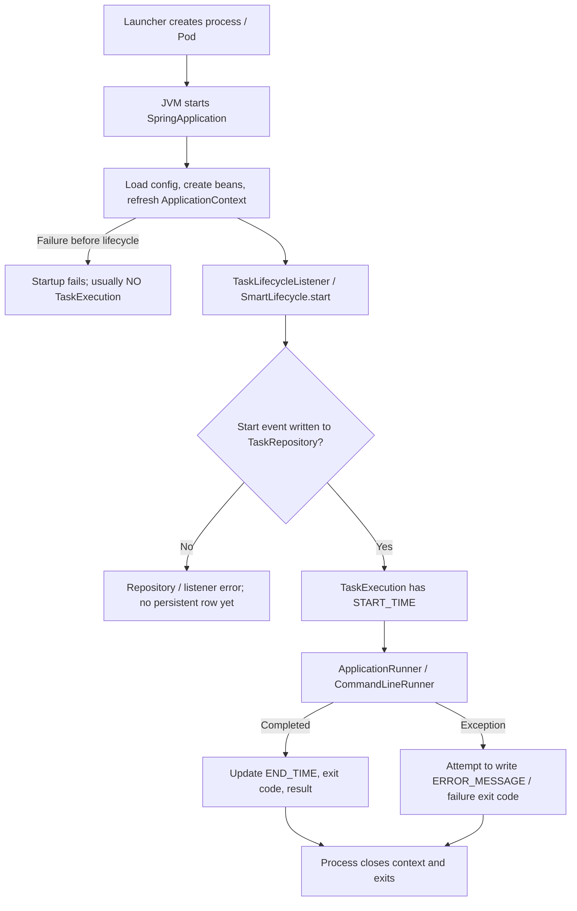
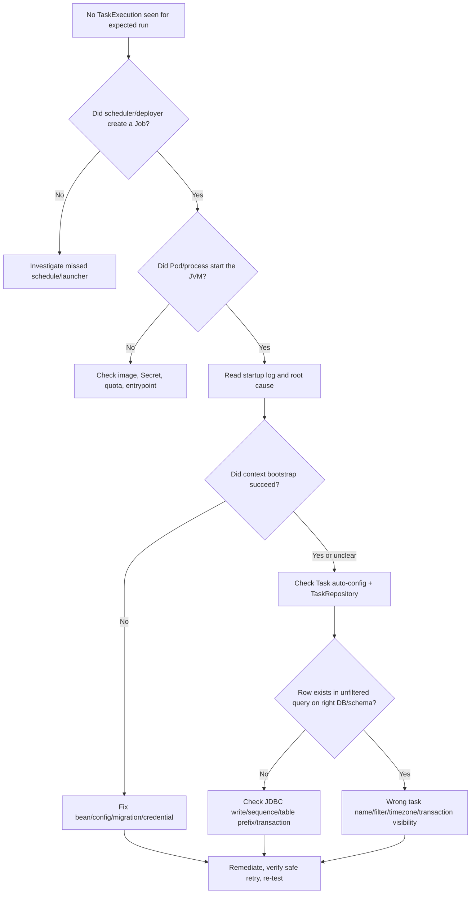
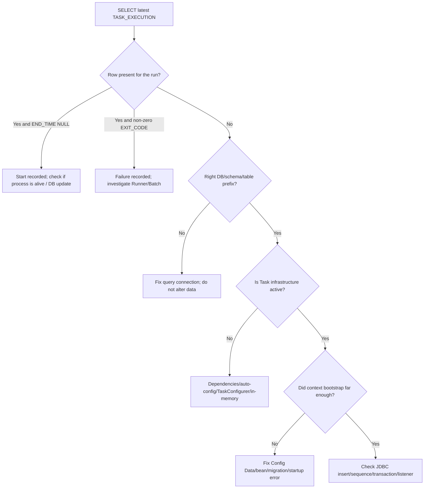

# No TaskExecution Record After Application Startup Failure

## 1. Symptom: Job Fails but the TASK_EXECUTION Table Has No Rows

**Spring Cloud Task** helps build finite-lived Spring Boot applications that can run on a schedule or on demand, accept execution arguments, record their lifecycle in `TaskRepository`, and coordinate with Spring Batch when processing large datasets. In a normal application, each Task run has a `TaskExecution` object containing an ID, Task name, start/end timestamps, exit code, and error information.

However, in production the following situation can occur:

```text
02:00:00  Kubernetes Job is created
02:00:03  Container starts Java
02:00:04  Spring Boot reports APPLICATION FAILED TO START
02:00:05  Container exits with a non-zero exit code
02:02:00  Operator queries TASK_EXECUTION: no new row found
```

This is **not necessarily a Spring Cloud Task bug**. According to the framework's lifecycle documentation, a Task is only recorded after the `ApplicationContext` initializes far enough to run the lifecycle mechanism. If the context cannot bootstrap, **no new TaskExecution is created**. In other cases, the Task tried to create a row but failed to write to the database, or the row was saved in **a different repository/schema** than the one the operator is inspecting.

**Lesson objectives** for the **Diagnostics** chapter:

- Understand the exact point where `TaskExecution` recording begins relative to Spring Boot startup.
- Distinguish **pre-context** failures, failures **during start event recording**, and failures **after the Task has started**.
- Categorize missing-row cases: not launched yet, process did not run, auto-configuration disabled, in-memory repository, wrong database/schema, JDBC errors, listener errors, or transaction issues.
- Use logs, scheduler/Pod status, SQL, and Spring Boot signals to identify the root cause without exposing credentials.
- Safely reproduce bean creation errors versus `ApplicationRunner` errors; verify the difference with tests.
- Build monitoring and a recovery runbook when you cannot rely on TaskRepository.

> **Foundational takeaway:** "No TaskExecution found" and "The Task never ran" are two **different** conclusions. Before retrying, you must verify whether the old process has genuinely stopped and whether business data may have already been committed.

## 2. Actual Lifecycle: At What Point Is the Record Created?

### 2.1. Main Event Sequence

In Spring Cloud Task versions that use `TaskLifecycleListener`, an execution begins when Spring Framework invokes `SmartLifecycle#start()` during context startup, **before** `ApplicationRunner` and `CommandLineRunner` beans run. The framework creates a `TaskExecution` and persists the start event to `TaskRepository`. When the Runners complete or fail through normal execution paths, the framework attempts to update the final result.



This diagram shows the **typical** path for a Task application with a single `ApplicationContext` and a healthy `TaskRepository`. It does not guarantee that callbacks or transactions still execute if the process receives `SIGKILL`, loses power, hits OOM, or loses database connectivity.

### 2.2. Spring Boot Events to Distinguish

| Milestone | Meaning | Could a TaskExecution already exist? |
| --- | --- | --- |
| JVM created | Java process has started | Not certain, usually not yet |
| Reading `application.yml`/Config Data | Loading profiles, environment variables, secret manager | Not yet, if failure happens right here |
| Bean creation and context refresh | Binding configuration, initializing `DataSource`, listeners, migrations | Not yet if context bootstrap fails early |
| Task `SmartLifecycle#start()` | Spring Cloud Task attempts to create the start event | Yes, **if repository write succeeds** |
| Boot `ApplicationStartedEvent` | Context has been refreshed, **before** Runners | Usually yes if Task is configured properly |
| `ApplicationRunner`/`CommandLineRunner` | Business logic executes | Usually a start row already exists |
| `ApplicationReadyEvent` | Boot emits event after Runners finish | Task may have already written the final result |
| `ApplicationFailedEvent` | Boot notifies startup/run failure | **Not guaranteed** to have a Task row; depends on failure timing |

An important nuance: `ApplicationFailedEvent` can occur when the context has not progressed far enough to create `TaskLifecycleListener`, so **seeing this event in the logs does not prove the repository recorded a start event**. If a Runner throws an exception after the start event was saved, recording the failure is usually possible; if the repository also loses connectivity, you still might not see the expected result.

### 2.3. Why Doing Work in @PostConstruct Differs from ApplicationRunner

Do not place important business logic inside a constructor, `@PostConstruct`, `InitializingBean#afterPropertiesSet()`, or a bean creation callback and expect Spring Cloud Task to always record the outcome of that work.

```java
// Risky design: business logic can run before the context is ready.
@PostConstruct
void importDataDuringBeanCreation() {
    importService.importOrders();
}
```

If `importOrders()` is called during bean creation and throws an exception, the context can fail **before `TaskLifecycleListener` writes the start event**. Worse, it may have already written some business data before failing: **no TaskExecution does not mean no side effects**.

Move business logic into an `ApplicationRunner` or `CommandLineRunner`, reserving the bean construction phase for creating and validating required components. Not all startup validation can be moved into a Runner: required config/secrets/schemas must be verified early; what matters is **distinguishing failure timing and having external tracking signals**.

## 3. Five Root-Cause Categories of a "Run Without TaskExecution"

### 3.1. Classification Table by Failure Point

| Category | Examples | Why is there no record? | Where to check first |
| --- | --- | --- | --- |
| **A. Java never executed** | CronJob skipped schedule, Pod Pending, image pull error, wrong entrypoint | Spring Boot never ran | Scheduler, Job/Pod events, container status |
| **B. Context bootstrap failed** | Invalid Config Data, missing secret, bean creation failure, wrong profile, Flyway error | Never reached Task start recording phase | Boot startup logs, root cause exception |
| **C. Missing Task infrastructure** | Missing starter, auto-configuration disabled, missing activation config for the version | No `TaskLifecycleListener` configured as expected | Dependency graph, auto-config report, bean definitions |
| **D. Failed to write to TaskRepository** | DB down, wrong password, missing table/sequence, missing privileges, transaction error | Start event write failed or rolled back | SQLState, JDBC logs, schema, privileges, network |
| **E. Recorded, but looking in the wrong place** | In-memory H2, wrong profile/DB/schema, custom table prefix, different Task name | Row exists but not in the queried DB/table/filter, or vanished with the process | Effective datasource, repository config, unfiltered SQL |

In a complex system, multiple causes can appear simultaneously. For example, a missing Secret prevents the Pod from starting; you have neither Java logs nor a TaskExecution. Or run A was written to the development DB due to a wrong profile, while the operator is querying production.

### 3.2. Do Not Confuse "No Row" with "Row Missing END_TIME"

These three symptoms are very different:

```text
No new TASK_EXECUTION_ID
  -> row not created, write failed, or inspecting the wrong repository

START_TIME present, END_TIME = NULL
  -> start event was recorded; may still be running or died abnormally

START_TIME, END_TIME, and non-zero EXIT_CODE present
  -> failure outcome recorded; investigate Runner/Batch/Task error
```

A row with `END_TIME IS NULL` is **not** proof that the process is still alive. To know whether it is truly running, cross-check the Pod/process ID, Job status, and heartbeat/chunk progress if available.

## 4. Rapid Investigation Workflow: From Outside into the Application



The **optimal order** is to verify that the container actually ran before diving deep into the repository. If image pull failed, tweaking the database will solve nothing.

### 4.1. Collect Four Identifiers

Before investigating, record:

1. **Request/correlation ID** from the API, scheduler, or expected schedule.
2. **Deployment/Job/Pod ID** from the backend (if created).
3. **Artifact version or image digest** actually executed.
4. Expected **Task name** and the database/schema name configured for TaskRepository.

`TaskExecutionId` only exists when the framework manages to write a row. For the scenario in this lesson, **never rely solely on TaskExecutionId** to trace a run.

### 4.2. Minimize Mutating Actions During Investigation

Do not manually delete rows from `TASK_EXECUTION`, insert fake rows, grant arbitrary DBA privileges, or pass passwords via CLI to "do a quick test." Diagnosis should prioritize **reading state, logs, and metadata**; configuration changes must go through a test environment and proper release process.

## 5. Checking the Run in Kubernetes or the Launcher

### 5.1. Case Where the Job Was Never Created

If the Task runs via a Kubernetes CronJob, check:

```bash
kubectl -n batch-jobs get cronjob
kubectl -n batch-jobs describe cronjob orders-daily
kubectl -n batch-jobs get jobs
```

A scheduled run skipped due to `suspend`, `concurrencyPolicy: Forbid`, `startingDeadlineSeconds`, or a controller issue may **never create a Pod**. With no Java process, there cannot be a TaskExecution record created by that run.

If the system requires zero missed business periods, you must maintain a **schedule ledger** or list of expected periods to reconcile against; TaskRepository only records runs that actually reach the Task mechanism.

### 5.2. Case Where the Job Exists but the JVM Has Not Run

```bash
kubectl -n batch-jobs get pods
kubectl -n batch-jobs describe pod <pod-name>
kubectl -n batch-jobs logs <pod-name> --all-containers=true
```

Examples:

| Pod/container state or event | Common causes | Relation to TaskExecution |
| --- | --- | --- |
| `ImagePullBackOff` | Wrong image/tag, registry auth failure | Java never ran → no row |
| `CreateContainerConfigError` | Missing Secret/ConfigMap key | Java never ran → no row |
| `Pending` | Quota, scheduling, PVC, node unavailable | Java has not run yet |
| `Error` after start | Java or entrypoint failure | Must read logs to see if Task lifecycle was reached |
| `OOMKilled` | Process ran out of memory; can die in any phase | May have no row, an open row, or a result depending on timing |
| `Completed` but DB is empty | May use a different/in-memory repository or Task auto-config did not run | Check DB/schema/config; do not assume success |

Replace `<pod-name>` with the actual name; appropriate Kubernetes permissions are required. For a Job with `restartPolicy: Never`, a failing Pod may simply show status `Error` instead of `CrashLoopBackOff` (common when containers are restarted within the same Pod).

### 5.3. A Backend Accepting a Launch Does Not Mean the JVM Ran

`TaskLauncher.launch(...)` or the Spring Cloud Data Flow API can return a deployment ID as soon as the request is accepted, before image pull, opening the datasource, or running Runners. A network error on the caller side can also happen after the backend has already received the request.

When a launch fails with an unclear outcome, **do not blindly resend the exact same request repeatedly**. Inspect the deployment ID, created Jobs/Pods, and business locks before retrying to avoid spawning two Tasks processing the same business period.

## 6. Reading Spring Boot Logs: Find the Root Cause, Not Just the Last Line

### 6.1. Startup Failure Indicators

```text
***************************
APPLICATION FAILED TO START
***************************

Description:
...
Action:
...
```

This banner is the result of Spring Boot's startup failure handling. The most valuable parts are usually:

- The **root cause** of the `Caused by:` chain, not just the outermost wrapper exception.
- `BeanCreationException` or `UnsatisfiedDependencyException` when a bean/constructor fails.
- `ConfigDataResourceNotFoundException` / import resolution errors when configuration cannot load.
- JDBC/`SQLException` errors regarding connectivity, permissions, or metadata tables.
- Flyway/Liquibase errors when migrations fail.
- Class loading / incompatible Java runtime errors.

Do not assume that every `APPLICATION FAILED TO START` message occurs after `TaskLifecycleListener`; it also appears when the context fails to finish initializing.

### 6.2. Symptom–Cause Matrix

| Symptom | Suggested failure point | Where to check |
| --- | --- | --- |
| `Could not resolve placeholder` | Missing environment/config during bind/bean phase | Secret reference, variable name, profile |
| `Failed to bind properties` | Wrong value type or missing constraint | `@ConfigurationProperties`, enum, integer, YAML |
| `BeanCreationException` | Constructor/`@PostConstruct` error | Root-cause bean, circular dependency, early external call |
| `Connection refused` | DB unavailable/network | DNS, service, port, firewall, TLS |
| `password authentication failed` | Wrong or expired credentials | Rotation, IAM, secret version; do not print passwords |
| `relation "TASK_EXECUTION" does not exist` | Mismatched DDL/schema/table prefix | Migrations, `search_path`, naming |
| `permission denied for table/sequence` | JDBC role lacks privileges | GRANT exact needed privileges; do not grant superuser |
| `FlywayValidateException` / migration failed | Schema history mismatch | Inspect individual migrations, checksums, versions |
| `NoSuchMethodError`/`ClassNotFoundException` | Incompatible dependencies | Boot/Cloud/Task BOM and JDK |
| `ApplicationRunner failed` | Error after context startup | Usually finds a TaskExecution start row if repository is ready |

The word "suggested" is crucial: for example, a JDBC authentication failure can happen during bean construction **or** when a Runner opens a connection; the two cases can produce different metadata.

### 6.3. Using Debug Mode Responsibly

In a test environment, you can enable the auto-configuration condition report:

```bash
java -jar target/diagnostic-task.jar --debug
```

Spring Boot's `--debug` explains which auto-configurations matched or did not match. Do not confuse this with **full HTTP/JDBC DEBUG logging**, and do not turn on high-verbosity logging for secrets or request headers in production.

When collecting logs, redact sensitive data before sharing: passwords, bearer tokens, JDBC URLs containing credentials, sensitive Secret names, and private arguments.

## 7. Checking Whether Spring Cloud Task Is Actually Enabled

### 7.1. Dependencies and Auto-Configuration

The project needs a Spring Cloud Task dependency compatible with the Boot/Cloud BOM, for example:

```xml
<dependency>
    <groupId>org.springframework.cloud</groupId>
    <artifactId>spring-cloud-starter-task</artifactId>
</dependency>

<dependency>
    <groupId>org.postgresql</groupId>
    <artifactId>postgresql</artifactId>
    <scope>runtime</scope>
</dependency>
```

This is a Maven snippet, not a complete `pom.xml`. Inspect the **dependency tree of the actual build** to confirm the Task starter, JDBC driver, and compatible versions are present. If a task runs via `java -jar` but **lacks Spring Cloud Task infrastructure**, the process can still complete its business logic without recording a TaskExecution.

Example application entry point:

```java
import org.springframework.boot.SpringApplication;
import org.springframework.boot.autoconfigure.SpringBootApplication;
import org.springframework.cloud.task.configuration.EnableTask;

@SpringBootApplication
@EnableTask
public class DiagnosticTaskApplication {
    public static void main(String[] args) {
        SpringApplication.run(DiagnosticTaskApplication.class, args);
    }
}
```

With the starter and versions that support auto-configuration, enabling Task may not strictly require an explicit `@EnableTask`; the example simply states the intent clearly. Do not add annotations that conflict with existing configuration without checking against the actual release.

### 7.2. Auto-Configuration May Have Been Disabled

Spring Cloud Task documentation lists the property:

```properties
spring.cloud.task.autoconfiguration.enabled=false
```

This setting **disables** Task auto-configuration in supported versions. If a profile sets this property, the application can still execute Runners without a Task repository or listener. Additionally, `SimpleTaskAutoConfiguration` can be excluded via auto-configuration exclusion settings.

When investigating, inspect the effective configuration across all valid sources (YAML, env, Config Data, and CLI) rather than opening a single `application.yml` and concluding the property isn't set elsewhere.

### 7.3. Running Without a DataSource May Use an In-Memory Repository

`TaskConfigurer` documentation describes a **Map-based in-memory** option when no suitable `DataSource` is present; getting-started docs in some versions also use **embedded H2** for demonstration. Such in-memory stores or embedded databases are **not equivalent to production PostgreSQL**.

The outcome can look like:

```text
Log: Started and completed a task
Process: exited normally
Operator: SELECT * FROM production.TASK_EXECUTION -> 0 rows
```

There is no contradiction here if the actual TaskRepository is not `production`. Check the repository/`TaskConfigurer` configuration, H2 dependencies, and the datasource being created. In-memory H2 loses its data when the JVM exits; nor can you retrieve records from the Map repository of a terminated process.

### 7.4. Custom TaskConfigurer

If there is a custom `TaskConfigurer` bean, the framework may use a different repository/transaction manager than the `spring.datasource` you are looking at. Do not assume `TaskRepository` and the business database always share the same `DataSource`.

In a multi-datasource application, you must determine:

- What actual implementation is the `TaskRepository` bean?
- Which JDBC datasource/transaction manager does `TaskConfigurer` provide?
- Is there a `@Primary` bean or auto-configuration condition changing the selection?
- Are the DDL and permissions on that database ready?
- Is the operator querying the right cluster/schema?

You do not need to print credentials to answer these questions; you can log sanitized configuration or use DB metadata inspection commands.

## 8. Checking the Database and Schema with Safe SQL

The following examples illustrate **PostgreSQL**, for a user with read-only access to metadata and allowed tables. Adjust database/schema names to match your actual deployment; do not copy PostgreSQL-specific queries verbatim to Oracle/MySQL/SQL Server.

### 8.1. Verify Where You Are Connected

```sql
SELECT current_database() AS database_name,
       current_schema() AS default_schema,
       current_user AS login_role,
       current_setting('search_path') AS search_path,
       CURRENT_TIMESTAMP AS database_time;
```

This step rules out **querying the wrong DB/schema**, which is very common with multiple environments, multiple datasources, or profiles. Never print JDBC passwords or URLs containing tokens.

### 8.2. Check Table and Sequence Existence

```sql
SELECT to_regclass('public.task_execution') AS execution_table,
       to_regclass('public.task_execution_params') AS params_table,
       to_regclass('public.task_seq') AS task_sequence_object;
```

`to_regclass(...)` returns `NULL` when the specified relation is not found. This is a **name check** assuming the `public` schema; you may be using a different schema or a customized `tablePrefix`.

Some Spring Cloud Task DDL scripts store IDs using a real sequence; some DB engines/versions use a `TASK_SEQ` table or another mechanism. **Do not manually create a new sequence with a random `CREATE SEQUENCE` statement**, as it can cause duplicate IDs or break the version-appropriate schema.

### 8.3. Read Metadata Without Filtering by Task Name First

```sql
SELECT TASK_EXECUTION_ID,
       TASK_NAME,
       START_TIME,
       END_TIME,
       EXIT_CODE,
       ERROR_MESSAGE
FROM TASK_EXECUTION
ORDER BY TASK_EXECUTION_ID DESC
LIMIT 30;
```

Do not start with:

```sql
SELECT *
FROM TASK_EXECUTION
WHERE TASK_NAME = 'orders-import'
  AND START_TIME >= CURRENT_TIMESTAMP - INTERVAL '5 minutes';
```

A filtered query can return `0` rows if the Task name defaulted to `Application`, timestamps differ by timezone, logs and database clocks are skewed, or you check after the time window. Inspect the most recent rows **without a name filter** in the right DB first; then narrow down by time window/correlation ID.

### 8.4. Query Schema Names and Privileges

```sql
SELECT table_schema, table_name
FROM information_schema.tables
WHERE lower(table_name) LIKE '%task%execution%'
ORDER BY table_schema, table_name;
```

```sql
SELECT has_table_privilege(
         current_user, 'public.task_execution', 'SELECT'
       ) AS can_read_task_execution,
       has_table_privilege(
         current_user, 'public.task_execution', 'INSERT'
       ) AS can_insert_task_execution;
```

These two queries are only a **preliminary check**, and privilege checks should be run after confirming the target relation exists. Granting `INSERT` alone is not enough for all operations: Task needs appropriate SELECT/UPDATE privileges as well as privileges on the ID-generating sequence/table, depending on the DDL. Test permissions using the corresponding service user, rather than running production startup as a superuser just to make the error disappear.

### 8.5. Missing Schema Due to Disabled Initialization

Production setups commonly use:

```yaml
spring:
  cloud:
    task:
      initialize-enabled: false
  batch:
    jdbc:
      initialize-schema: never
```

This **assumes** migrations have already created the Task and Batch tables. If the tables do not exist yet, the repository can fail when creating the start event. Do not fix this by casually turning schema initialization back on in production; prefer Flyway/Liquibase or migrations managed by the release pipeline, using a DDL account separate from the runtime account.

## 9. Example Config for a Task with a Persistent Repository

```yaml
spring:
  application:
    name: orders-import
  main:
    web-application-type: none
  datasource:
    url: ${TASK_DB_URL:jdbc:postgresql://localhost:5432/taskdb}
    username: ${TASK_DB_USER:task_user}
    password: ${TASK_DB_PASSWORD}
  cloud:
    task:
      name: orders-import
      initialize-enabled: false
      closecontextEnabled: true
```

Sample prerequisites:

- PostgreSQL already has the `TASK_*` schema matching the Spring Cloud Task release in use.
- `TASK_DB_PASSWORD` is supplied via a Secret/secret manager, not passed via CLI.
- `task_user` has read/write privileges on the required tables and sequences.
- No custom `TaskConfigurer` points TaskRepository to a different database.
- `spring.cloud.task.name` is explicitly set; do not confuse it with the Kubernetes Job name or `spring.application.name`.
- `closecontextEnabled=true` ensures the context closes after the Task completes, **not that a start row will exist when the context fails early**.

If the deployment uses Cloud Foundry/Kubernetes/SCDF or multiple datasources, actual connection properties may differ. Always verify properties against the deployed version rather than assuming every Boot/Cloud Task combination supports the exact same flags.

## 10. Lab: Bean Creation Failure vs. Failure Inside ApplicationRunner

The goal is to inject **two different failures** into a Spring Cloud Task application to observe when `TaskExecution` is written. Run this in a **dedicated test database**, never against production.

### 10.1. Application Entry Point

```java
import org.springframework.boot.SpringApplication;
import org.springframework.boot.autoconfigure.SpringBootApplication;
import org.springframework.cloud.task.configuration.EnableTask;

@SpringBootApplication
@EnableTask
public class DiagnosticTaskApplication {
    public static void main(String[] args) {
        SpringApplication.run(DiagnosticTaskApplication.class, args);
    }
}
```

To run this demo, the project needs the Spring Cloud Task starter, a JDBC driver, a database, and compatible migrations. The illustrative JAR name is `target/diagnostic-task.jar`; replace it with your actual build artifact.

### 10.2. Injecting Failures in Two Phases

```java
import org.springframework.boot.ApplicationRunner;
import org.springframework.boot.autoconfigure.condition.ConditionalOnProperty;
import org.springframework.context.annotation.Bean;
import org.springframework.context.annotation.Configuration;

@Configuration
public class FailureInjectionConfiguration {

    // Failure during singleton bean creation: context has not finished bootstrapping.
    @Bean
    @ConditionalOnProperty(
            name = "lab.failure.phase", havingValue = "context")
    Object failWhileCreatingBean() {
        throw new IllegalStateException(
                "LAB_CONTEXT_FAILURE: bean creation failed");
    }

    // Failure when Runner executes: Task start event has usually already been saved.
    @Bean
    @ConditionalOnProperty(
            name = "lab.failure.phase", havingValue = "runner")
    ApplicationRunner failInsideRunner() {
        return args -> {
            throw new IllegalStateException(
                    "LAB_RUNNER_FAILURE: runner failed");
        };
    }

    @Bean
    @ConditionalOnProperty(
            name = "lab.failure.phase", havingValue = "none")
    ApplicationRunner successfulRunner() {
        return args -> System.out.println("LAB_TASK_COMPLETED");
    }
}
```

`@ConditionalOnProperty` uses a control property **strictly for testing**; do not leave failure-injection code in production artifacts. The bean factory method throws an exception when the singleton is instantiated; with Spring's default non-lazy configuration, this occurs during context startup.

### 10.3. Running the Three Cases

```bash
# Case 1: bean creation fails before context is ready
java -jar target/diagnostic-task.jar --lab.failure.phase=context

# Case 2: Runner throws an error after the start event is written
java -jar target/diagnostic-task.jar --lab.failure.phase=runner

# Case 3: normal completion
java -jar target/diagnostic-task.jar --lab.failure.phase=none
```

After each run, compare the **process exit code**, startup logs, and the `TASK_EXECUTION` table in the target database. In a Unix shell, you can check `echo $?` immediately after the command; in PowerShell, check `$LASTEXITCODE`.

### 10.4. Expectations When the Repository Works Properly

| Test case | Context initialized? | Runner executed? | Expected TaskExecution | Process |
| --- | --- | --- | --- | --- |
| `phase=context` | Did not complete | No | **Usually no new row** | Failed |
| `phase=runner` | Yes | Yes, then throws exception | **Start row present**, usually error updated | Failed |
| `phase=none` | Yes | Yes, completed | Start and end present | Succeeded |

These are **expectations based on the lifecycle documentation**, not observed execution outputs from running this article's code. If case 2 also produces no row, check Task auto-configuration, `TaskConfigurer`, and the DB as described in sections 7–9; do not conclude that Spring Cloud Task intentionally swallows all exceptions.

### 10.5. A Very Useful Measurement

Before and after each run, record:

```sql
SELECT COUNT(*) AS total_execution_rows
FROM TASK_EXECUTION;
```

In addition to the row count, record the query timestamp and extract the latest `TASK_EXECUTION_ID`. `COUNT(*)` is only meaningful in a **test database with no concurrent workers running**; in production, multiple Tasks write simultaneously, so you need a correlation ID or queries filtered by verified time range/Task name.

## 11. Failure Inside TaskExecutionListener

### 11.1. onTaskStartup Runs Before Saving the Start Event

Spring Cloud Task supports `TaskExecutionListener` or annotations:

- `@BeforeTask`: before saving `TaskExecution` to the repository.
- `@AfterTask`: before updating the final status.
- `@FailedTask`: when a Task error occurs, before `@AfterTask`.

If an `onTaskStartup` listener or a `@BeforeTask` method throws an exception, saving the start event **can be aborted before the row is committed**. This is an important cause to check when logs report a context/Task startup error while `TASK_EXECUTION` remains empty.

### 11.2. Do Not Perform Complex I/O in onTaskStartup

Risky design example:

```java
@BeforeTask
public void beforeTask(TaskExecution execution) {
    externalApi.mustRespondBeforeStart(); // network error -> can block writing Task
}
```

Because the callback executes **before** writing start metadata, calling external APIs, reading large files, or mutating business state here increases the risk of the Task failing with no history row.

Keep listeners small and focused on lightweight checks/correlation without leaking data; put main business logic in a Runner. If a validation step can fail before the Task is recorded, you need **external launcher logging and monitoring** so failures are still detected.

### 11.3. When onTaskEnd Fails

If `onTaskEnd` or updating the final result fails, there may **already be a start row** missing `END_TIME` or error details. Do not confuse this situation with having no row at all.

Spring Cloud Task documentation also describes specific exit code rules when a `TaskExecutionListener` throws an exception, differing in some versions from how `ExitCodeExceptionMapper` handles Runner exceptions. Therefore, do not rely solely on the exit code to pinpoint the fault; inspect callbacks, logs, and DB data.

## 12. Distinguishing TaskRepository Failures from Business Database Failures

A system may have:

```text
TaskRepository   -> DB task_metadata
JobRepository    -> DB batch_metadata
Business service -> DB orders
```

If the application creates a business `DataSource` bean at startup and cannot connect, the context can fail **before TaskRepository writes the start event**, even though the `task_metadata` DB is healthy.

Conversely, if the context bootstraps, the Task start event is written to `task_metadata`, and then the Runner queries `orders` and fails, `TaskExecution` is usually updated with the failure provided the metadata DB remains available.

### 12.1. Comparing Three JDBC Failures

| Failure point | Timing | TaskExecution row |
| --- | --- | --- |
| Business `DataSource` opens connection during bean creation | Before Task lifecycle | Possibly **none** |
| `TaskRepository` needs to insert, but metadata DB is read-only | At Task start | Possibly **none** |
| Business service acquires connection in Runner and fails | After Task start | Usually **start row exists**, unless metadata DB also fails |

Therefore, during diagnosis, distinguish the JDBC URL/role/schema of each datasource. A `Connection refused` error only proves that **a connection** failed—it does not identify which database if the logs lack safely redacted identifiers.

### 12.2. Spring Batch Also Has Its Own JobRepository

If the Task contains a Spring Batch Job, `JobRepository` stores `JobExecution` and `StepExecution` in `BATCH_*`. Depending on how Batch infrastructure is initialized, failures preparing Batch metadata can cause the context to fail early; or the Batch Job runs after Task start and then fails.

Do not treat "no JobExecution" as proof of "no TaskExecution" or vice versa. Inspect **both repositories** and the startup/launch order.

## 13. Observing Failures Before TaskRepository Is Ready

### 13.1. Why Are External Signals Needed?

If a Task dies during bean creation, do not wait for the Task's own `TaskExecutionListener` to send an alert: the listener may not have been created yet. More reliable signals include:

- **Scheduler/deployer:** was the run requested, were resources created, or was it rejected?
- **Container runtime:** exit code, termination reason, OOMKilled, image pull.
- **Startup logs:** root exception and error classification.
- **External job ledger:** expected business period, attempt count, was completion confirmed?
- **Secret manager/database audit:** auth requests, permission errors, credential rotation.

Combining these signals answers both "**Did the Task launch?**" and "**Did the Task begin writing metadata?**".

### 13.2. Catching ApplicationFailedEvent Early to Log Error Type

You can register a listener on `SpringApplication` before running it to log the **exception class** when startup fails:

```java
import org.springframework.boot.SpringApplication;
import org.springframework.boot.autoconfigure.SpringBootApplication;
import org.springframework.boot.context.event.ApplicationFailedEvent;
import org.springframework.context.ApplicationListener;

@SpringBootApplication
public class BootstrapFailureReporterApp {
    public static void main(String[] args) {
        SpringApplication app =
                new SpringApplication(BootstrapFailureReporterApp.class);

        app.addListeners(
                (ApplicationListener<ApplicationFailedEvent>) event -> {
                    Throwable failure = event.getException();
                    System.err.println(
                            "BOOT_STARTUP_FAILED_EXCEPTION_TYPE="
                            + failure.getClass().getName());
                });

        app.run(args);
    }
}
```

This snippet logs only the **exception class name**, not messages that might contain URLs with credentials or tokens. Boot emits this event when SpringApplication handles a failure; it cannot catch failures **before the JVM/Java main runs** or if the process is hard-killed. This is a **log-augmentation** technique, not a replacement for TaskRepository.

If the project already has global error reporting, do not add multiple listeners printing sensitive information. And never put mandatory network calls inside a failure listener: during a startup failure, the network or config itself might be the failing component.

### 13.3. Naming and Correlation IDs Before TaskExecution

Example of a safe structured log:

```json
{
  "event": "task-bootstrap-failed",
  "request_id": "run-2026-11-24-0200",
  "application": "orders-import",
  "artifact_version": "1.4.2",
  "phase": "application-context",
  "exception_type": "BeanCreationException",
  "task_execution_id": null
}
```

This is a **custom-designed** format, not a default framework log. `request_id` should be assigned by the launcher before the JVM starts; when TaskExecution does not yet exist, `null` is the accurate value. Never embed tokens or passwords in a correlation ID.

## 14. Missing Record Because Task Name or Table Changed

### 14.1. TaskNameResolver and Default Names

`TaskNameResolver` determines the Task name. With typical configuration:

```yaml
spring:
  application:
    name: orders-import
  cloud:
    task:
      name: orders-import
```

If neither `spring.cloud.task.name` nor `spring.application.name` is set, the name may default to something like `Application` depending on the version. An operator running:

```sql
SELECT *
FROM TASK_EXECUTION
WHERE TASK_NAME = 'orders-daily';
```

will get `0` rows if the framework actually stored `orders-import` or `Application`. Always check the latest rows **without a name filter** and then cross-check the name configuration.

### 14.2. Table Prefix and Schema

Spring Cloud Task provides the `spring.cloud.task.tablePrefix` property (documented in the configuration reference) to change the table prefix, including specifying a schema in some setups.

```properties
spring.cloud.task.tablePrefix=custom_
```

In that case, the repository may not use default table names like `TASK_EXECUTION`. Changing the prefix requires **matching DDL to be prepared beforehand**; do not alter this property in production merely to work around a query returning empty results.

PostgreSQL schemas also rely on `search_path`: the Task might write to `app_task.task_execution` while the SQL client defaults to looking in `public.task_execution`. You must verify **catalog/database, schema, and table prefix**.

### 14.3. Data Not Appearing Immediately Due to Transactions

An uncommitted transaction can prevent another SQL session from seeing the row yet. During real-time investigation, do not jump to conclusions during the startup window; you can re-poll once the transaction completes. However, if the process has already failed and the DB rolled back, waiting longer will not make a row appear.

Do not use `READ UNCOMMITTED` isolation or unsafe queries to "force visibility" of data. Rely on proper transaction semantics and JDBC transaction logging when testing in a test environment.

## 15. Investigation Flowchart Based on SQL Results



A thorough investigation must record **evidence** at every branch: timestamp, error class, datasource/schema, Job/Pod ID, and artifact version. Without evidence, do not blindly tweak properties and retry in production repeatedly.

## 16. Repository Verification Checklist When Suspecting a Lost Start Event

### 16.1. Items to Cross-Check

| Item | What to verify | Typical cause |
| --- | --- | --- |
| `DataSource` | URL, DB, schema, role, pool config | Pointing to test DB or non-existent database |
| JDBC driver | Right vendor/version driver | Driver class cannot be loaded |
| TLS | CA, hostname verification, truststore | TLS handshake fails at startup |
| Secret | Key/namespace/path, rotation, expiration | Stale password or unmounted Secret |
| Repository implementation | JDBC, Map, H2, custom configurer | Data lives in memory only |
| DDL | `TASK_EXECUTION`, params, `TASK_SEQ`/sequence matching version | Missing table or sequence |
| Privileges | SELECT/INSERT/UPDATE and required sequence privileges | `permission denied` |
| Transaction | TransactionManager and commit/rollback | Start write rolled back |
| Task name | `TaskNameResolver`, `spring.cloud.task.name` | Filtering on the wrong name |
| Table prefix | `spring.cloud.task.tablePrefix` | Querying the wrong table |
| Task listener | Does `onTaskStartup` throw an exception? | Blocks writing start event |
| Version | Boot/Cloud/Task/SQL DDL compatibility | API, schema, or class mismatch |

### 16.2. Log Configuration for Testing

In a **test environment**, you can raise log levels for Task and Spring JDBC packages:

```yaml
logging:
  level:
    org.springframework.cloud.task: DEBUG
    org.springframework.jdbc.core: DEBUG
    org.springframework.transaction: DEBUG
```

These are suggestions for **tracing flow**; logger names and logged details may vary across versions. DEBUG/TRACE SQL logging risks exposing data/parameters, so do not deploy it casually to production. Never enable full logging of JDBC bind values or `Environment` when secrets are present.

### 16.3. Do Not Use DBA Privileges to Mask Configuration Errors

If startup fails due to missing `INSERT` or `USAGE` on a sequence, the fix is to **grant the exact required privileges** to the runtime role according to a reviewed schema. Do not switch `spring.datasource.username` to a superuser and consider the issue resolved.

Similarly, if `TASK_EXECUTION` is missing, do not work around it by running multiple concurrent Task instances with `CREATE TABLE` privileges; use a controlled migration release pipeline and official schema DDL.

## 17. Secret or Vault Failures: Errors Occurring Before TaskExecution

A Task may load configuration from a Kubernetes Secret, `configtree:`, Spring Cloud Vault, or a cloud secret manager **before the full context is built**.

If a mounted volume contains two files named `spring.datasource.username` and `spring.datasource.password`, Spring Boot can bind those property names directly via `configtree:`. Configure it as follows, **without self-referencing a property**:

```yaml
spring:
  config:
    import: "configtree:/run/secrets/task-db/"
  datasource:
    url: ${TASK_DB_URL}
```

When a required volume/secret does not exist, Config Data can fail before TaskRepository can create metadata. With Vault, auth role/token/TLS failures during the config loading phase can also cause context bootstrap to fail.

**Safe checks:**

1. Secret and Pod are in the same namespace (for Kubernetes Secrets).
2. `secretKeyRef` key is correct or volume mount path is accurate.
3. `ServiceAccount`/Vault role has permissions for the right secret path.
4. Never print Secret values/`System.getenv()` to logs.
5. Have a rotation mechanism and restart the Task if the environment holds stale credentials.

**Do not try to "fix" this by passing passwords directly in argv** — Task arguments can be recorded in `TASK_EXECUTION_PARAMS` or exposed through the orchestrator.

## 18. When to Retry: You Must Account for Already-Committed Business Data

### 18.1. Side Effects Can Still Occur Without a Start Event

Example:

```text
Context creates importer bean
  -> @PostConstruct calls an external API, succeeds
  -> next bean creation step throws an exception
  -> TaskLifecycleListener has not saved TaskExecution yet
  -> Scheduler sees Job FAILED and auto-retries
  -> API gets called a second time
```

This is a critical reason **not to place business work inside bean initialization**, and to enforce idempotency at the API/data layer even when TaskRepository has not recorded the run.

### 18.2. Retry Rules by Failure Type

| Failure type | Should it auto-retry? | Conditions |
| --- | --- | --- |
| Image pull/wrong Secret reference | Do not hammer retries | Fix configuration/deployment before re-running |
| Database temporarily unavailable | Possibly, with bounded backoff | Verify old process stopped; database and permissions are stable |
| Wrong or revoked credentials | Only after fixing the secret | Never pass passwords via CLI to test |
| Missing/mismatched Schema DDL | Only after running version-matched migration | Do not create ad-hoc tables |
| `BeanCreationException` from code | After releasing a fix | Pin artifact version/digest |
| Runner exception from invalid input | Usually do not auto-retry | Fix input before re-running |
| Transient error in Runner after partial commits | Possibly, if idempotent | Reconcile checkpoints and side effects |
| Unknown whether process caused side effects | **Pause retries** | Investigate logs, DB, and external systems |

Do not use `TaskExecutionId` as the sole idempotency key: a single business period can be retried under a **different TaskExecutionId**. Use a business key such as `(source, businessDate, orderId)` or a durable request ID.

### 18.3. Example Business Constraint

PostgreSQL:

```sql
CREATE TABLE imported_order_results (
    source_name VARCHAR(60) NOT NULL,
    business_date DATE NOT NULL,
    order_id BIGINT NOT NULL,
    processed_at TIMESTAMPTZ NOT NULL DEFAULT CURRENT_TIMESTAMP,
    PRIMARY KEY (source_name, business_date, order_id)
);
```

The writer can use an upsert:

```sql
INSERT INTO imported_order_results (source_name, business_date, order_id)
VALUES (:source, :businessDate, :orderId)
ON CONFLICT (source_name, business_date, order_id)
DO NOTHING;
```

This is an example of **duplicate-record prevention** in PostgreSQL, not exactly-once delivery for HTTP/email/Kafka. Named parameters must be bound via `NamedParameterJdbcTemplate` or a compatible API. Skipping duplicates with `DO NOTHING` also requires business validation: if payloads can be updated, you need versioning/checksums and merge rules.

## 19. Diagnostic Practice Using a Multi-Layered Scenario

### 19.1. Background

A `CronJob` launches `orders-import` at 02:00, and the Task retrieves its PostgreSQL password from a Kubernetes Secret. The runtime image was just upgraded, but the new Task DDL has not been applied yet. The operator sees the Pod failed and finds no `TASK_EXECUTION` record.

### 19.2. Sample Investigation Walkthrough

**Step 1 — Confirm the Job was created.**

```bash
kubectl -n batch-jobs get job orders-import-20261124
kubectl -n batch-jobs get pods
```

**Step 2 — Determine whether Java actually ran.** If the Pod reports `CreateContainerConfigError`, check Secret/ConfigMap first; if the JVM printed `APPLICATION FAILED TO START`, move to the startup logs.

**Step 3 — Read the first root cause.** If the root cause is `relation "TASK_EXECUTION" does not exist`, check the database/schema/prefix; if it is `password authentication failed`, inspect rotation/role state without exposing the password.

**Step 4 — Cross-check versions.** Inspect the JAR/image digest, Spring Cloud Task version, SQL DDL version, and migration state. Never grab DDL from an older release just because the table names look similar.

**Step 5 — Fix through the release pipeline.** Update migrations/schema or Secrets/permissions via proper channels. Do not grant broad DDL admin rights to short-lived Jobs.

**Step 6 — Test in a test environment.** Verify that both a successful run and a Runner failure record metadata properly, while an early bean failure creates no row as expected.

**Step 7 — Verify idempotency before retrying production.** If the worker performed no business work, retrying may be safer, but you must have evidence from logs and the DB/external systems.

**Step 8 — Update alerting.** Add signals for "Pod failed but no corresponding TaskExecution" and "expected business period missing" so similar issues are not only discovered when an operator queries manually.

## 20. Production Troubleshooting Runbook

### 20.1. Gather Evidence

- Task/Job name, scheduled time, and businessDate.
- Request ID, Kubernetes Job/Pod ID, container exit code, and termination reason.
- Image digest, Java/Boot/Cloud Task versions, profile, and config sources.
- Secret-redacted stack trace, root exception, and failure timestamp.
- TaskRepository database/schema/table prefix and results of the latest unfiltered query.
- `TaskExecution` state (if any), `JobExecution` state (if any), and committed business data.

### 20.2. Decision Workflow

1. **Block uncontrolled retries** if there is any chance an old instance is still alive or partially committed.
2. **Verify the scheduler/deployer layer:** were a Job and Pod actually created, and did the image run?
3. **Classify pre- vs. post-context failure:** read the root exception, not just the summary line.
4. **Check Task infrastructure:** dependencies, auto-config, TaskConfigurer, repository implementation.
5. **Check the right datasource/schema:** verify JDBC metadata and prefix, and query the table without a name filter.
6. **Fix at the right layer:** config/secret, schema migration, privileges, bean creation code, or Runner service logic.
7. **Test the fix in an isolated environment** using the three cases: success / context failure / Runner failure.
8. **Reconcile business data** before triggering a new execution.
9. **Re-run with a correlation ID** and bounded retries/backoff, observing both the Pod/process and `TaskExecution`.
10. **Write a postmortem:** signal gaps, root cause, remediation, and preventive monitoring.

### 20.3. What Not to Do

| Anti-pattern | Consequence |
| --- | --- |
| Inserting fake `TaskExecution` rows via SQL to "keep history" | Metadata mismatches the process and corrupts reporting |
| Passing passwords via command-line args | Leaks into logs, argv, or `TASK_EXECUTION_PARAMS` |
| Enabling full DEBUG/TRACE JDBC logging in production | Risks exposing sensitive SQL/parameters |
| Deleting `TASK_SEQ` or resetting IDs because a row is missing | Risk of duplicate IDs / broken foreign references |
| Changing `spring.cloud.task.name` to match a dashboard | Masks the root cause and alters Task/locking scope |
| Retrying immediately when no row is seen | Can spawn duplicate processes or repeat side effects |
| Running the Task as a DBA account to bypass permission errors | Over-privileges runtime access unnecessarily |
| Checking only TaskRepository while ignoring the scheduler | Misses the fact that the Job was never created |

## 21. Monitoring: Detecting Bootstrap Failures Even Without TaskExecution

### 21.1. Recommended Signals

| Metric/event | Source | Meaning |
| --- | --- | --- |
| `expected_task_runs` | Scheduler/ledger | Number of periods expected to run |
| `launched_jobs` | Deployer/Kubernetes | Number of Jobs actually created |
| `containers_started` | Kubernetes | Process had a chance to start |
| `bootstrap_failures` | Startup log/collector | Failures before Task lifecycle could record |
| `task_executions_started` | TaskRepository or exporter | Runs that recorded a start row |
| `task_executions_ended` | TaskRepository or exporter | Runs that recorded an end row |
| `task_business_periods_completed` | Business ledger table | Business periods completed and reconciled |

These names are **custom-recommended metrics**, not default series from Spring Cloud Task or Kubernetes. The backend must define deduplication rules when restarts/retries occur.

### 21.2. One Crucial Alert

Example rule:

```text
If the scheduler created a Job and the Pod failed,
but after a reasonable grace period there is no corresponding TaskExecution:
  fire alert "BOOTSTRAP_OR_REPOSITORY_FAILURE"
  attach Job ID, image digest, and root exception type
```

Do not hardcode a few-second threshold for every environment: Pods can stay Pending, image pulls take time, or TaskRepository writes may have latency. Choose an appropriate SLA and evaluation window.

Additionally, for very short-lived Tasks, Prometheus scraping may miss in-process metrics before the JVM exits. **TaskRepository + Kubernetes events + a log collector** is typically the combination needed for early detection and durable history.

## 22. Pre-Deployment Testing Matrix

| Test | How to simulate in an isolated environment | Outcome to prove |
| --- | --- | --- |
| Context bootstrap failure | Bean throws exception on creation | Process fails, usually **no new row** |
| Runner failure | `ApplicationRunner` throws exception | Start row exists; exit failure if repository still works |
| Successful run | Runner completes | Start, end, exit code 0 recorded |
| Wrong Task DB password | Invalid test secret | Startup/repository fails without printing password |
| Missing `TASK_EXECUTION` table | Unmigrated test DB | Clear error, no ad-hoc DDL creation |
| Missing sequence privileges | Test role lacks required grants | Permission error, no DBA workaround |
| In-memory DataSource | Run locally without external DB | Understand why production DB has no row |
| Auto-config disabled | `spring.cloud.task.autoconfiguration.enabled=false` | App runs without Task metadata |
| Wrong Task name | Change profile name between runs | Unfiltered query finds row under other name |
| Wrong schema/tablePrefix | Query default table when config changed | Locate the actual target table |
| `@BeforeTask` throws exception | Test listener throws error | Observe potential blocking of start write |
| DB disconnects after start | Drop network after Runner begins | `END_TIME NULL` may remain; needs reconciliation |
| ImagePullBackOff | Use non-existent image in test | No Java/TaskExecution |
| Pod OOMKilled | Low memory limit in test | Do not assume final metadata exists |
| Batch metadata failure | Incompatible Batch DDL | Distinguish TaskRepository from JobRepository |
| Retry after partial commit | Induce error mid-way in test data | No duplicate records/side effects |

Kill/DB-outage/broken-schema tests must only be run in an **isolated test namespace/database**. This lesson provides a test plan and illustrative code, **without claiming prior execution against a specific Spring Boot/Task version**.

## 23. Practice Exercises

**Exercise 1 — Identify the milestones.** Trace the order `Config Data → bean creation → SmartLifecycle#start → ApplicationRunner → ApplicationReadyEvent`. Indicate which steps, if they fail, will typically leave no TaskExecution.

**Exercise 2 — Categorize the failure.** A Pod reports `CreateContainerConfigError` due to a missing Secret; the `TASK_EXECUTION` table is empty. Explain why this is not a `TaskRepository.save(...)` bug.

**Exercise 3 — Two-phase experiment.** Implement `FailureInjectionConfiguration` and run `phase=context` and `phase=runner`. Compare logs, exit codes, and new rows in the test database.

**Exercise 4 — Wrong repository.** Logs say the Task completed, but the production database has no row. Build a checklist covering: H2, Map repository, `TaskConfigurer`, JDBC URL, profile, schema, and `tablePrefix`.

**Exercise 5 — SQL troubleshooting.** PostgreSQL reports `TASK_EXECUTION` is missing at startup. Use `current_database()`, `current_schema()`, and `to_regclass(...)` to verify DDL/schema before running migrations.

**Exercise 6 — Listener.** A `@BeforeTask` hook calls an external API and fails. Explain why no TaskExecution may exist and propose moving the logic to a Runner with an idempotent design.

**Exercise 7 — Early failure event.** Add an `ApplicationFailedEvent` listener that logs only the exception name without printing credential-bearing messages. If the JVM is killed before `main`, does the listener run? Why?

**Exercise 8 — Batch.** `JobRepository` reports a schema error when creating a Job/Step; `TaskRepository` has no row either. List when a Batch error can occur before the Task lifecycle and when it occurs after the start event.

**Exercise 9 — Retry.** A Task has no TaskExecution, yet bean initialization already called an external API successfully before context failure. Design an idempotency key so the scheduler can retry without duplicating the effect.

**Exercise 10 — Monitoring.** Propose one alert for `Pod Failed` without a TaskExecution, and another alert for a scheduled run that never created a Pod. Explain why the two alerts cannot replace each other.

**Exercise 11 — Security.** If an operator wants to enable `--debug`, which log categories must be restricted to avoid leaking JDBC passwords and tokens? Propose a safe way to collect root causes.

**Exercise 12 — Runbook.** Given a missing Secret, wrong JDBC role, missing sequence, and Runner exception, order the investigation steps from scheduler down to repository and distinguish the fix for each error.

## 24. Key Principles to Remember

1. **Spring Cloud Task cannot guarantee recording TaskExecution when `ApplicationContext` bootstrap fails.** This is an official lifecycle limitation described in the documentation.
2. **The start event is typically written in `SmartLifecycle#start()` before Runners run.** Hence Runner failures and bean creation failures usually leave different traces.
3. **`ApplicationFailedEvent` does not guarantee a TaskExecution already exists** if the failure occurred very early.
4. **Seeing no row does not mean the process never ran or caused no side effects.**
5. **Check scheduler/deployer/Pod first**, then look for the root exception, Task auto-configuration, and JDBC repository.
6. **Do not confuse an in-memory/H2 repository with the production DB**; verify the exact `TaskConfigurer`, database, schema, and table prefix.
7. **Do not filter too early by Task name or timestamp** when checking whether a row exists.
8. **Startup listeners and `@PostConstruct` actions can block TaskExecution creation**; put core business logic in Runners and design for idempotency.
9. **A row with `END_TIME IS NULL` is completely different from having no row**, and does not guarantee the process is still running.
10. **Retrying is only safe after reconciling processes, metadata, and business data**, especially when a failure happens before any TaskExecution exists.
11. **Diagnostic security**: never put secrets into CLI flags, `TASK_EXECUTION_PARAMS`, logs, traces, or incident-sharing channels.
12. **Resilient monitoring requires multiple sources**: expected periods, Jobs/Pods, startup logs, TaskRepository, and JobRepository (when using Batch).

## References

- [Spring Cloud Task — Getting Started](https://docs.spring.io/spring-cloud-task/reference/getting-started.html): `ApplicationRunner`, `TaskLifecycleListener`, and in-memory `TaskRepository` in demo examples.
- [Spring Cloud Task — Features and Lifecycle](https://docs.spring.io/spring-cloud-task/reference/features.html): when `TaskExecution` is created, limitations on context bootstrap failure, `TaskConfigurer`, and listeners.
- [Spring Cloud Task — Task Repository Schema](https://docs.spring.io/spring-cloud-task/reference/appendix-task-repository-schema.html): `TASK_EXECUTION`, `TASK_EXECUTION_PARAMS`, sequences, and related metadata.
- [Spring Cloud Task — DefaultTaskConfigurer API (3.0.4)](https://docs.spring.io/spring-cloud-task/docs/3.0.4/apidocs/org/springframework/cloud/task/configuration/DefaultTaskConfigurer.html): JDBC/Map repository selection, datasource, and table prefix; verify API against your active version.
- [Spring Boot — SpringApplication](https://docs.spring.io/spring-boot/reference/features/spring-application.html): Boot event ordering, `ApplicationStartedEvent`, Runners, and `ApplicationFailedEvent`.
- [Spring Boot — Externalized Configuration](https://docs.spring.io/spring-boot/reference/features/external-config.html): Config Data, environment, profiles, and property source precedence.
- [Spring Boot — Debugging Auto-Configuration](https://docs.spring.io/spring-boot/reference/using/auto-configuration.html): auto-configuration condition report and `--debug`.
- [Spring Boot — Logging](https://docs.spring.io/spring-boot/reference/features/logging.html): logger groups and log level control.
- [Spring Batch — Reference](https://docs.spring.io/spring-batch/reference/): distinguishing `JobRepository`, `JobExecution`, `StepExecution`, and restarts.
- [Kubernetes — Jobs](https://kubernetes.io/docs/concepts/workloads/controllers/job/): Job/Pod states, restarts, and cases where a process does not start.
- [Kubernetes — Secrets](https://kubernetes.io/docs/concepts/configuration/secret/): providing secrets, errors when keys are missing, and credential protection.
