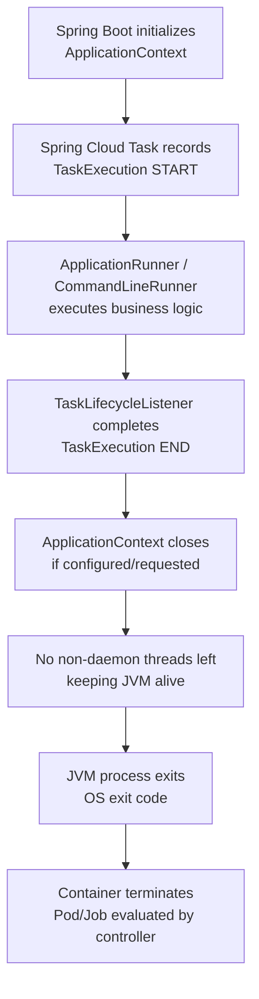
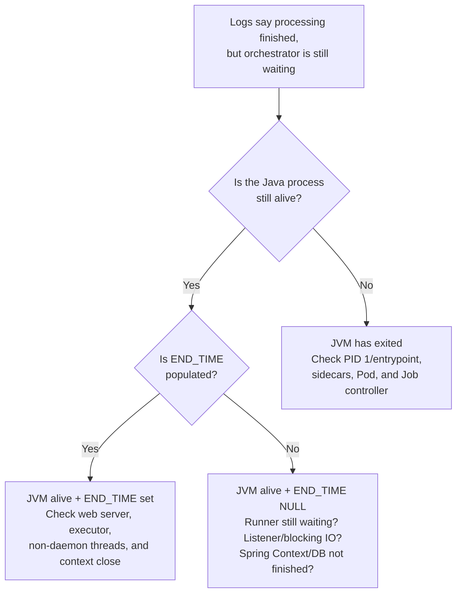

# Task Completes but the Process Does Not Exit

## Lesson Objectives

In the **Diagnostics** chapter of the **Spring Cloud Task** module, this lesson addresses a frustrating operational scenario: business logs report **processing completed**, or the `TaskExecution` record already has `END_TIME` and `EXIT_CODE=0`, yet `java -jar` still has not returned to the shell prompt, the container remains `Running`, and the Kubernetes Job has not become `Complete`.

This is not merely a "resource cleanup" issue. In scheduled or on-demand systems, a non-exiting process can cause a **CronJob to miss its next schedule**, consume CPU/memory, hold connection pools open, exceed `activeDeadlineSeconds`, cause the scheduler to mark it as timed out, and trigger unwanted retries. Conversely, forcing the JVM to exit too early can lose the final `TaskRepository` update, cut off a Spring Batch Job mid-flight, or leave business data in an inconsistent state.

After this lesson, you will be able to:

- Distinguish **business completion**, **Spring Cloud Task completion**, **ApplicationContext closing**, **JVM exit**, and **Kubernetes Job Complete**.
- Classify incidents into cases where `END_TIME=NULL`, `END_TIME` is set while the JVM is still alive, or the JVM has exited while the container/Job has not completed.
- Understand the effect and limitations of `spring.cloud.task.closecontext-enabled=true` together with `spring.main.web-application-type=none`.
- Detect and resolve common root causes: web servers, non-daemon threads, unstopped executors/schedulers, unawaited `@Async` work, broker listeners, blocked I/O tasks, shutdown callbacks, and incorrect shell entrypoints.
- Capture thread dumps safely with `jcmd` or `jstack`, read common stack traces, and distinguish normal waiting threads from threads keeping the process alive.
- Write a minimal reproduction of the bug and a fixed version with controlled `ExecutorService`/`ThreadPoolTaskExecutor` lifecycle management.
- Verify the true exit code, `TaskExecution`, Docker/Kubernetes status, and timeouts **without masking errors using `System.exit(0)`**.
- Design an anti-hang smoke test along with an investigation checklist usable in development, staging, and production.

## 1. "Finished" at Which Level Exactly?

Suppose an application `nightlyRentalImport` receives `--businessDate=2026-11-23`, imports partner data, and prints:

```text
2026-11-24T02:01:00 INFO Imported 120000 rental records
2026-11-24T02:01:00 INFO BUSINESS_COMPLETED
```

Yet the terminal never returns and the Pod stays `Running`. Those two log lines only state that **a business method emitted a log message**; they do not prove:

1. Whether the last `ApplicationRunner`/`CommandLineRunner` has returned.
2. Whether Spring Cloud Task has updated `TASK_EXECUTION.END_TIME`.
3. Whether `ApplicationContext` has closed.
4. Whether **non-daemon threads** and child processes have stopped.
5. Whether the container's main process has exited with a status code.

### 1.1. Five Milestones That Must Be Separated



This diagram illustrates the **expected flow of a finite Task**. In practice:

- The context may close at a different point depending on configuration and JVM shutdown mechanisms.
- Some runners may **never return** because they are blocked on I/O, locks, or `Future.get()`.
- A Task may record `END_TIME` while a manually spawned thread keeps running forever.
- The JVM may exit while a **shell wrapper**, sidecar, or other runtime component keeps the container/Pod alive.

**Key takeaway:** `TaskExecution.EXIT_CODE=0` is a piece of information about the **Task lifecycle**, not proof that the **OS process has terminated**. To know whether the process exited, check the OS/container directly.

### 1.2. Quick Distinction Table

| Signal | What does it prove? | What does it NOT prove? |
| --- | --- | --- |
| Log `BUSINESS_COMPLETED` | One code path printed this message | All runners, threads, transactions, and the JVM finished |
| `TASK_EXECUTION.END_TIME` is populated | Spring Cloud Task recorded the end of the Task run | The JVM or container has stopped |
| `TASK_EXECUTION.EXIT_CODE=0` | The framework recorded a Task result of 0 | The Batch Job, business data, and OS process definitely succeeded |
| `ApplicationContext` closed | Spring bean lifecycle is being / has been torn down | Custom threads created outside Spring have stopped |
| Shell captures `$?` after `java -jar` | The direct process has terminated | No other shell wrapper is holding the container; data is definitely valid |
| `Pod Succeeded` | All containers counted toward Pod completion exited successfully | A multi-Pod/retried Job has finally succeeded |
| `Job Complete` | The Job controller recognized the Job as succeeded | No business-data errors were silently skipped by logic |

## 2. Before Fixing: Classify the Incident with Two Questions

**Question 1:** Is the Task's JVM **truly still alive**?

**Question 2:** Has `TASK_EXECUTION.END_TIME` **already been recorded**?



| Scenario | Symptoms | Root-cause group to check first |
| --- | --- | --- |
| **A. Task finished, JVM still alive** | `END_TIME != NULL`, `java` has not exited | Non-daemon threads, web server, scheduler, unstopped executor, unclosed context |
| **B. Task has not finished** | `END_TIME IS NULL`, JVM still alive | Blocked runner, multiple unfinished runners, improperly awaited `@Async`, network/DB deadlock, bean/listener blocking lifecycle |
| **C. JVM exited, container/Job still waiting** | No Java PID left, container or Pod still Running | Shell entrypoint holding PID 1, regular sidecar still running, other Pods unfinished, controller reconciling |
| **D. No new TaskExecution** | Process ran or failed without repository writing a row | Context failed before lifecycle, `@EnableTask`/auto-config, DataSource/schema, wrong DB or task name |

**Scenario D must not be misclassified as "Task completed."** Spring Cloud Task only records lifecycle metadata once the context initializes far enough for listeners/repositories to function. An earlier startup error may leave no new row at all.

## 3. Understanding Spring Cloud Task's Mechanism Properly

Spring Cloud Task records metadata via `TaskLifecycleListener`. According to the official documentation:

1. Before running `ApplicationRunner`/`CommandLineRunner` beans, the Task creates the start record.
2. Once the runners complete or the application fails along the appropriate lifecycle path, the Task updates `TaskExecution` and the exit code.
3. If you need to **close `ApplicationContext` after runners and repository updates finish**, enable:

```yaml
spring:
  cloud:
    task:
      closecontext-enabled: true
```

The full property name is **`spring.cloud.task.closecontext-enabled`**, and its default is `false` in the configuration tables of the referenced versions. Some docs write it in Java property form `spring.cloud.task.closecontextEnabled`; Spring Boot relaxed binding translates between kebab-case and camelCase. **Prefer the canonical name in your project version's configuration properties table**; kebab-case is used here.

### 3.1. Primary Effect of `closecontext-enabled=true`

This property instructs the listener to close the Spring ApplicationContext when the Task finishes. Closing the context gives Spring the chance to:

- Stop `SmartLifecycle` beans.
- Invoke `@PreDestroy`/`DisposableBean` on eligible beans.
- Shut down **Spring-managed** executors/schedulers.
- Close connection pools, publishers, or clients whose lifecycles are bound to beans.

This **commonly resolves** cases where the Task wrote `END_TIME` yet the context keeps a running executor/scheduler alive. Spring Cloud Task's own documentation uses a `TaskExecutor` example to illustrate when this property is needed.

### 3.2. Why Enabling the Property Alone May Still Not Be Enough

`ApplicationContext.close()` **cannot automatically stop threads created via `new Thread(...)` or `Executors.newSingleThreadExecutor()` that are unmanaged/unclosed**. If such a non-daemon thread loops forever, the JVM stays alive even after TaskRepository has been updated and the context has closed.

In addition:

- A shutdown hook or `@PreDestroy` may **block** on I/O, a lock, or waiting for a non-terminating executor.
- A service may spawn a thread and **drop the reference needed to shut it down**.
- An external library may spin up its own runtime with a close/shutdown method that must be invoked manually.
- A non-Java main process (such as `sh`) may remain alive after Java has exited.

**`closecontext-enabled=true` is Spring lifecycle management, not "kill the entire JVM after N seconds."**

### 3.3. Do Not Confuse `spring.task` and `spring.cloud.task`

| Prefix | Belongs to | Used for |
| --- | --- | --- |
| `spring.task.*` | Spring Boot/Spring Framework | Executors, schedulers, and thread pool configuration |
| `spring.cloud.task.*` | Spring Cloud Task | TaskRepository, Task lifecycle, close context, Task name |
| `spring.batch.*` | Spring Boot/Spring Batch | Job launcher, Batch Job/Step, and metadata |
| `spring.main.*` | Spring Boot | Application type, banner, startup behavior |

`spring.task.execution.*` or `spring.task.scheduling.*` **does not do the same thing** as `spring.cloud.task.closecontext-enabled`. Changing thread pool sizes will not fix a thread leak if that thread never receives a shutdown signal.

## 4. Cause 1: A CLI Task Starts an Unnecessary Web Server

If the classpath contains a web starter and the application type is not configured, Spring Boot may launch a **Tomcat, Jetty, or WebFlux server**. For a CLI application, this creates resources that outlive the runner.

Example:

```text
... Tomcat started on port 8080
... Started RentalImportApplication
... Imported records successfully
... TaskExecution END_TIME updated
... (java is still running)
```

**Proper fix for a Task that does not expose an HTTP API:**

```yaml
spring:
  main:
    web-application-type: none
  cloud:
    task:
      closecontext-enabled: true
```

And in Maven, keep `spring-boot-starter-web` or `spring-boot-starter-webflux` only if genuinely required. Needing an HTTP client **does not mean** needing an HTTP server; you can use an appropriate HTTP client library without opening a listening port.

**Do not use `server.port=-1` in place of `spring.main.web-application-type=none` when the goal is a non-web Task.** Spring Boot docs make a clear distinction: `server.port=-1` disables the HTTP endpoint while still potentially creating a `WebApplicationContext`, whereas `web-application-type=none` does not start an embedded server.

### 4.1. How to Verify

1. Look for logs like `Tomcat started`, `Netty started`, or similar messages.
2. Check dependencies and the effective runtime value of `spring.main.web-application-type`.
3. If HTTP Actuator is present, confirm whether the server actually needs to stay up after the runner finishes. A finite Task usually does not need an HTTP Actuator server; metrics can be exported through a controlled alternative mechanism.
4. After changing `web-application-type=none`, run a smoke test with the same arguments and measure the **return time of `java -jar`**, not just the logs.

## 5. Cause 2: Non-Daemon Threads Keep Running

In Java, the JVM normally exits only when **no non-daemon threads remain**. A `daemon=false` thread running indefinitely keeps the JVM alive even after `main` and runners have returned.

Common thread sources:

- `Executors.newSingleThreadExecutor()` or `newScheduledThreadPool(...)` created manually in code.
- `new Thread(...)` running `while (true)`, `sleep`, or `BlockingQueue.take()`.
- A non-daemon `Timer`.
- Unstopped library schedulers, consumers, or background workers.
- An executor responsible for uploading/pushing data that was neither awaited nor shut down.

**Do not judge a thread in `WAITING` or `TIMED_WAITING` as a bug based solely on its state name.** Many normal JVM threads (e.g., GC, reference handling) also wait; you need to check whether it is daemon, where its stack trace points, and who owns shutting it down.

### 5.1. Intentional Example Creating a Non-Exiting Process

This is a **faulty example** for dev reproduction only; **do not run in production**:

```java
package com.example.taskdiagnostics;

import java.util.concurrent.Executors;
import java.util.concurrent.ScheduledExecutorService;
import java.util.concurrent.TimeUnit;

import org.springframework.boot.ApplicationRunner;
import org.springframework.boot.SpringApplication;
import org.springframework.boot.autoconfigure.SpringBootApplication;
import org.springframework.cloud.task.configuration.EnableTask;
import org.springframework.context.annotation.Bean;

@SpringBootApplication
@EnableTask
public class HangingTaskApplication {

    public static void main(String[] args) {
        SpringApplication.run(HangingTaskApplication.class, args);
    }

    @Bean
    ApplicationRunner importRunner() {
        return args -> {
            // INTENTIONAL BUG: executor is NOT a Spring bean
            // and never calls shutdown().
            ScheduledExecutorService heartbeat =
                Executors.newSingleThreadScheduledExecutor(r -> {
                    Thread thread = new Thread(r, "leaked-heartbeat");
                    thread.setDaemon(false);
                    return thread;
                });

            heartbeat.scheduleAtFixedRate(
                () -> { /* simulated heartbeat */ },
                0, 1, TimeUnit.SECONDS);

            System.out.println("BUSINESS_COMPLETED");
        };
    }
}
```

If the Task creates its repository and updates the outcome, logs may print `BUSINESS_COMPLETED` and `TASK_EXECUTION.END_TIME` will be populated, yet **the JVM stays alive** because `leaked-heartbeat` is an unstopped non-daemon thread.

**This is a Java code bug**, not an H2, Kubernetes, or uncommitted `JobExecution` issue.

### 5.2. Design-Level Fixes

- If the heartbeat is **unnecessary after the runner ends**, do not create it.
- If a finite worker is needed, **await `Future` completion** and shut down the executor.
- If a resource lives for the ApplicationContext lifetime, **register it as a bean with an explicit lifecycle**, such as `@Bean(destroyMethod="shutdown")` or `ThreadPoolTaskExecutor`.
- If a library has its own `close()`/`stop()`, invoke it in `@PreDestroy` or configure bean destruction accordingly.
- Always set **timeouts on I/O** and shutdown steps to prevent infinite hangs.

**Do not fix this by defaulting to `thread.setDaemon(true)`**: daemon threads can be abruptly terminated by the JVM as soon as non-daemon threads vanish, losing data, message ACKs, or final flushes. Daemon threads are only suitable for work that *does not need guaranteed completion*.

## 6. Cause 3: `@Async` and `Future` Not Awaited Properly

A common anti-pattern:

```java
@Override
public void run(ApplicationArguments args) {
    dataImportService.importAsync();
    log.info("BUSINESS_COMPLETED"); // NOT guaranteed import finished!
}
```

Here `importAsync()` may merely **submit work to an executor** without waiting for completion. Both resulting outcomes are dangerous:

1. The runner returns and the Task records completion **too early**, while the worker keeps running and holds the JVM open.
2. Enabling `closecontext-enabled=true` triggers context shutdown **while the worker is still running**, potentially cancelling queued work.

**Do not use `closecontext-enabled=true` to mask a "fire-and-forget" bug when async results are a mandatory part of the business workflow.** Explicitly await those tasks or split them into a separate long-running background service.

### 6.1. Business-Synchronous Handling Pattern

Example configuring a Spring-managed `ThreadPoolTaskExecutor`:

```java
package com.example.taskdiagnostics;

import java.util.concurrent.Future;
import java.util.concurrent.TimeUnit;
import java.util.concurrent.TimeoutException;

import org.springframework.boot.ApplicationRunner;
import org.springframework.context.annotation.Bean;
import org.springframework.context.annotation.Configuration;
import org.springframework.scheduling.concurrent.ThreadPoolTaskExecutor;

@Configuration(proxyBeanMethods = false)
public class ImportWorkerConfiguration {

    @Bean
    ThreadPoolTaskExecutor importExecutor() {
        ThreadPoolTaskExecutor executor = new ThreadPoolTaskExecutor();
        executor.setCorePoolSize(2);
        executor.setMaxPoolSize(2);
        executor.setQueueCapacity(10);
        executor.setThreadNamePrefix("import-worker-");
        executor.setWaitForTasksToCompleteOnShutdown(false);
        executor.setAwaitTerminationSeconds(10);
        return executor;
    }

    @Bean
    ApplicationRunner importRunner(ThreadPoolTaskExecutor importExecutor) {
        return args -> {
            Future<?> job = importExecutor.submit(() -> {
                // DEMO: real work must have explicit timeouts for
                // HTTP/JDBC/file and transactions/idempotency.
                System.out.println("IMPORT_WORKER_DONE");
            });

            try {
                job.get(60, TimeUnit.SECONDS); // wait for real work
            } catch (TimeoutException timeout) {
                job.cancel(true);
                throw new IllegalStateException(
                    "Import worker exceeded 60 seconds", timeout);
            }

            System.out.println("BUSINESS_COMPLETED");
        };
    }
}
```

This sample assumes a **single** demo runner and no other runner spawning threads that hold the JVM. Key points:

- `Future.get(...)` ensures the runner returns only after the worker finishes or throws an error/timeout.
- Worker exceptions (e.g., `ExecutionException`) are **not swallowed**; Spring Boot can reflect the failure.
- `ThreadPoolTaskExecutor` is a Spring bean, so shutdown executes when the context closes.
- `awaitTerminationSeconds(10)` caps **how long shutdown waits for the executor to stop**. This value is an example operational setting, not a global Job timeout.
- `job.cancel(true)` sends an interrupt signal, but the I/O code inside **must cooperate with interrupts/timeouts**. It does not guarantee killing native/blocking operations.

Combine with:

```yaml
spring:
  main:
    web-application-type: none
  cloud:
    task:
      closecontext-enabled: true
```

When processing multiple parallel subtasks, **track and await all Futures**, not just the first one. Do not use unmanaged `CompletableFuture.runAsync(...)` and assume `TaskLifecycleListener` will wait for those futures to finish on its own.

### 6.2. When Using a Manually Created `ExecutorService`

For a local pool, manage its lifecycle in `try/finally`:

```java
ExecutorService pool = Executors.newFixedThreadPool(2);
try {
    Future<?> work = pool.submit(() -> doImport());
    work.get(60, TimeUnit.SECONDS);
} finally {
    pool.shutdown();
    if (!pool.awaitTermination(5, TimeUnit.SECONDS)) {
        pool.shutdownNow();
        if (!pool.awaitTermination(5, TimeUnit.SECONDS)) {
            throw new IllegalStateException(
                "Executor did not terminate on time");
        }
    }
}
```

This is an **illustrative snippet placed inside a method declaring `throws Exception`**, with `java.util.concurrent.*` imports and an application-defined `doImport()` method. `shutdownNow()` is **best effort** and does not guarantee an uncooperative task will actually stop; in such cases, fix the underlying I/O code/timeouts and consider process-level termination only as a controlled last resort.

**Note:** If `finally` throws an exception during shutdown, it can mask the original business exception. In production systems, preserve the primary exception, log shutdown errors separately, and determine the exit status explicitly.

## 7. Cause 4: Schedulers, Listeners, and Background Connections

A Task application sometimes pulls in components designed for **long-running services**:

| Component | Symptom | Check |
| --- | --- | --- |
| `@EnableScheduling` / `@Scheduled` | Scheduler keeps triggering jobs after runner finishes | Is an **in-process** schedule truly needed? Is there a Spring-managed scheduler/close? |
| `@KafkaListener` | Consumer container keeps polling and holding resources | Can a finite batch reader be used, or can the listener container be stopped on completion? |
| `@RabbitListener` | AMQP listener keeps waiting for messages | If a finite batch is intended, is there an explicit termination condition? |
| `@Async` / `TaskExecutor` | Workers still running or queue non-empty | Were all futures awaited? Does the executor destroy/shutdown? |
| `ThreadPoolTaskScheduler` | Scheduled tasks stay alive | Is bean lifecycle managed? Is the shutdown policy appropriate? |
| Web server/Actuator HTTP | JVM serving HTTP requests | Set `web-application-type=none` if CLI |
| Custom client/broker/connection pool | Library background threads unreleased | Invoke `close()/stop()` and design bean destruction |

**Do not jump to the conclusion that every JDBC connection or Kafka client automatically keeps the JVM alive.** Depending on the library, some worker threads are daemon threads or are closed when the context stops. Use **thread dumps and lifecycle logs** to pinpoint the exact thread/resource preventing exit.

### 7.1. Avoiding Double Scheduling

If a Task is triggered by a **Kubernetes CronJob**, **Spring Cloud Data Flow scheduler**, or external cron, you usually should not also enable `@Scheduled` inside that application. Doing so can:

- Turn the application into a never-ending service.
- Execute multiple business runs within a single `TaskExecution`, corrupting execution history semantics.
- Cause overlapping runs when the external scheduler launches a new JVM while the old JVM is still alive.

If the requirement is genuinely a long-lived consumer/worker, split it into a **Spring Boot service or Spring Cloud Stream application**, and reserve Spring Cloud Task for **finite** units of work.

### 7.2. Shutting Down Beans Properly

If an application-created client exposes a `close()` method:

```java
@Bean(destroyMethod = "close")
ExternalClient externalClient() {
    return new ExternalClient(/* safe configuration */);
}
```

This is a **configuration method pattern**, not a standalone Java class: `ExternalClient` is a placeholder for the actual SDK exposing `close()`. Choose the right shutdown/close API for the library and account for flush timing, transactions, and message ACKs.

## 8. Cause 5: The Runner Has Not Actually Finished

Not every case is a thread leak. A runner may still be executing even after logging `BUSINESS_COMPLETED` because a subsequent statement is blocked:

```java
log.info("BUSINESS_COMPLETED");
future.get();               // can wait forever
publisher.flush();          // can wait on network if timeout is missing
otherProcess.waitFor();     // can wait on child process forever
```

This code illustrates potentially blocking calls, **not code to copy verbatim**. If `END_TIME IS NULL` while the JVM is alive, prioritize checking:

1. How many `ApplicationRunner` and `CommandLineRunner` beans exist? Another runner might not have returned yet.
2. Are there calls to `Future.get()`, `CountDownLatch.await()`, `Thread.join()`, or `Process.waitFor()` without timeouts?
3. Is an HTTP client, JDBC query, lock, file I/O, or broker flush waiting?
4. Is there a deadlock across threads or an exhausted connection pool?
5. Did an exception occur in a listener or during TaskRepository persistence, preventing lifecycle completion?
6. Is `@PreDestroy`/`SmartLifecycle.stop()` hanging during shutdown?

Never place `System.exit(0)` at the end of a runner while a `Future` is still pending; that only **hides a design flaw**, risks truncating data, and misleads the scheduler into thinking the task succeeded.

## 9. Local Machine Diagnostics via Process State, Thread Dumps, and Repository

Before intervening, record the **run timestamp, image/JAR version, TaskExecutionId, Task name, PID, last log milestone, and recent config changes**. Never paste raw secrets into shared tickets.

### 9.1. Verify the JVM Is Still Running on Linux

In another terminal:

```bash
ps -eo pid,ppid,stat,etime,comm | grep -E '(^ *PID|[j]ava)'
```

To inspect a process with a known PID:

```bash
ps -p 12345 -o pid,ppid,stat,etime,comm
```

Replace `12345` with the real PID. The `etime` column shows how long the process has been alive. **You do not need to print the full command line** containing `--token`/`--password` just to prove the process exists.

On Windows PowerShell:

```powershell
Get-Process java | Select-Object Id, ProcessName, StartTime
Get-Process -Id 12345
```

If `java` is **no longer running**, switch to diagnosing the shell wrapper/container/Pod (section 11) rather than trying to capture a thread dump of a dead JVM.

### 9.2. Capturing a Thread Dump with `jcmd`

With a **compatible JDK** and JVM access permissions:

```bash
jcmd -l
jcmd 12345 Thread.print -l > task-thread-dump-1.txt
```

`jcmd` must run on the **same machine/appropriate container namespace** with matching user/attach permissions, and typically comes in a JDK distribution; `JRE`/distroless images may lack it. PIDs can differ between host and container. **`jcmd -l` may display process arguments**, so collect it only within authorized access and never share raw output if arguments contain restricted data.

To observe progress rather than a single snapshot:

```bash
jcmd 12345 Thread.print -l > task-thread-dump-1.txt
sleep 5
jcmd 12345 Thread.print -l > task-thread-dump-2.txt
```

Capturing two snapshots reveals whether threads are **making progress** or stuck on the same lock/I/O. If the runtime JDK documentation differs, run `jcmd 12345 help Thread.print` to check supported syntax and options.

Alternatively, you can use:

```bash
jstack -l 12345 > task-jstack.txt
```

on JDKs that include `jstack`. Thread dump files **may contain file paths, class/method names, data strings, or sensitive environment details**: store them in restricted directories and share only after review.

### 9.3. Reading Thread Dumps Properly

| Pattern | Initial inference | What to verify |
| --- | --- | --- |
| `"leaked-heartbeat" ... daemon=false ... TIMED_WAITING` | Custom thread continues running periodically | Was `shutdown`/`cancel` called? |
| `"http-nio-8080-..."` / `"reactor-http-..."` | Web server or Netty client threads active | Did the app open an HTTP server? Inspect stack and bean lifecycle |
| `"taskScheduler-..."` | Scheduler remains alive | Is `@Scheduled` present? Is the executor Spring-managed? |
| `"kafka-consumer-..."` / `"AMQP Connection..."` | Consumer/client still running | Is the listener stopped/closed when the Task completes? |
| `"main" ... FutureTask.get / CountDownLatch.await` | Main runner waiting on other work | Are timeouts and Future outcomes handled? |
| `"main" ... java.net.Socket...` | Blocked network I/O | Connection/read timeout, downstream outage |
| `"main" ... ThreadPoolExecutor.awaitTermination` | Waiting for executor shutdown | Which worker won't exit, and is the timeout right? |
| `"SpringContextShutdownHook" ... close` | Context shutting down after signal/exit | Which `@PreDestroy`/`stop` bean is blocking? |
| `BLOCKED` on same monitor across dumps | Potential lock contention/deadlock | Check owner, lock chain, and `Found one Java-level deadlock` if present |

**A thread dump is evidence, not an automated diagnosis.** A daemon thread waiting on a queue can be completely normal. The JVM can also stay alive because of a **native thread/process** or shutdown hook, requiring correlation with logs, metrics, and runtime state.

### 9.4. Capturing a Thread Dump Without `jcmd`

For a HotSpot JVM on Linux, in an authorized environment where the side effect is acceptable:

```bash
kill -3 12345
```

`SIGQUIT` normally asks HotSpot to print a thread dump to the process's stderr/logs **without terminating the JVM**, though exact behavior depends on JVM/platform/signal-handling setup. **Never use `kill -9` to capture a dump**; `SIGKILL` prevents the JVM from running shutdown hooks or writing final metadata.

If the image lacks tools and debug access is not granted, use JVM diagnostics/JFR configured in staging or ask an authorized operator to gather the data. Do not hot-swap a production image just to attach a debugger.

## 10. Reading `TaskRepository` to Determine Whether the Task Finished

Against the default Spring Cloud Task schema, on **the database where the application actually writes metadata**, run **read-only** SQL:

```sql
SELECT
    TASK_EXECUTION_ID,
    TASK_NAME,
    START_TIME,
    END_TIME,
    EXIT_CODE,
    EXIT_MESSAGE,
    ERROR_MESSAGE
FROM TASK_EXECUTION
WHERE TASK_NAME = 'nightlyRentalImport'
ORDER BY TASK_EXECUTION_ID DESC;
```

`nightlyRentalImport` is an illustrative name. The actual name may come from `spring.cloud.task.name` or `spring.application.name` depending on configuration. When multiple runs overlap, **do not guess TaskExecutionId solely from the latest row**: cross-check timestamps, parent/external execution ID, container, and request ID.

### 10.1. Interpreting the `END_TIME` and `EXIT_CODE` Pair

| `END_TIME` | `EXIT_CODE` | Java still alive? | What to check? |
| --- | --- | --- | --- |
| Present | `0` | **Yes** | Thread leak/web server/context still open; business correctness still needs verification |
| Present | Non-`0` | **Yes** | Task recorded failure, but a resource or shutdown step holds the JVM |
| `NULL` | `NULL` or not updated | **Yes** | Runner blocked, or startup/lifecycle/DB write not finished |
| `NULL` | `NULL` | **No** | JVM killed/crashed or failed before updating metadata |
| Present | `0` | **No** | JVM likely finished; inspect container/Job layer if still reporting Running |

Spring Cloud Task updates `END_TIME` via the listener lifecycle; **never manually update `END_TIME` or `EXIT_CODE` in SQL to force a Job to look "complete"** without understanding the process and business data.

### 10.2. If the Task Runs Spring Batch

Spring Batch's `JobExecution` has its own status:

```sql
SELECT
    JOB_EXEC_ID,
    JOB_INST_ID,
    START_TIME,
    END_TIME,
    STATUS,
    EXIT_CODE
FROM BATCH_JOB_EXECUTION
ORDER BY JOB_EXEC_ID DESC;
```

Signals can diverge:

- **Batch Job `COMPLETED`**, yet Task/JVM still alive: another runner or background thread remains after Batch.
- **Batch Job `STARTED`** and Task `END_TIME=NULL`: the Job may still be running, blocked, or a listener is waiting for the Job.
- **Batch Job `FAILED`** yet Task `EXIT_CODE=0`: Batch-to-Task/process failure mapping may be misconfigured.
- **Batch Job `COMPLETED`** yet a consumer runs forever: business completion and process lifecycle synchronization were not designed properly.

When using `spring-cloud-task-batch` integration, you can set:

```yaml
spring:
  cloud:
    task:
      batch:
        fail-on-job-failure: true
```

This property handles **the exit code when a Batch Job fails**, **not thread leaks**. When enabling it, verify `JobExecution`, `TaskExecution`, and the actual JVM/container exit code on your exact version.

### 10.3. A Quick Test to Separate Task from JVM

1. Run the JAR with fixed arguments in a dev environment.
2. Wait for the `BUSINESS_COMPLETED` log.
3. Check whether `END_TIME` has been written.
4. Check if the JVM PID still exists.
5. If `END_TIME` is set and the PID remains, capture a **thread dump right before stopping**.
6. If `END_TIME` is empty, capture a thread dump to locate blocked runners/locks/I/O; do not blindly toggle `closecontext-enabled`.

Do not create a listener that artificially sets `EXIT_CODE=0` to "confirm" status: that can mask the root cause.

## 11. Docker and Kubernetes: JVM Exit Does Not Guarantee Job Completion

### 11.1. Containers Only Track the Main Process Properly

A Dockerfile should use **exec-form** so Java runs as the main process:

```dockerfile
FROM eclipse-temurin:21-jre
WORKDIR /app
COPY target/task-diagnostics-0.0.1-SNAPSHOT.jar /app/app.jar
ENTRYPOINT ["java", "-jar", "/app/app.jar"]
```

The JAR name is an **example**; adjust to your actual artifact and Java version. Docker image `21-jre` typically **does not contain `jcmd`/`jstack`** because those are JDK tools; for diagnostics, use a staging/debug image with a JDK or approved runtime tooling.

**A bad entrypoint can keep the container alive even after Java exits:**

```dockerfile
# DO NOT DO THIS: shell remains alive after Java finishes.
ENTRYPOINT ["sh", "-c", "java -jar /app/app.jar; tail -f /dev/null"]
```

Or a shell script that backgrounds Java and waits improperly. Switch to exec-form or use `exec java -jar /app/app.jar "$@"` at the end of the wrapper script after preparation steps, making sure arguments are forwarded properly.

### 11.2. Distinguishing `docker ps` from Actual Exit Code

```bash
docker ps --filter "name=task-diagnostics"
docker logs task-diagnostics
docker inspect --format '{{.State.Running}}' task-diagnostics
docker inspect --format '{{.State.ExitCode}}' task-diagnostics
```

These commands assume the container was created with the name `task-diagnostics` and **has not been removed**. If the container is `Running`, `State.ExitCode` is not the final exit code of the current run; never use a placeholder value to conclude the Task succeeded.

If the application runs with Java as PID 1 and the image includes JDK tools, in a test environment:

```bash
docker exec task-diagnostics jcmd 1 Thread.print -l
```

This only works if `jcmd` is present, can attach to the JVM, and PID 1 is actually Java. With minimal production images, you may need preconfigured thread-dump collection mechanisms; **do not run risky debug commands ad hoc in production**.

### 11.3. Kubernetes Job: Inspect Pod, Container, and Job Together

```bash
kubectl get job rental-import-job
kubectl describe job rental-import-job
kubectl get pods -l batch.kubernetes.io/job-name=rental-import-job
kubectl logs job/rental-import-job -c task --timestamps
```

`rental-import-job` and `task` are illustrative names; substitute the real Job/container names. When a Job has multiple Pods due to retries, `kubectl logs job/...` may **not show every attempt**—fetch logs per Pod.

Inspect a Pod with one primary container:

```bash
kubectl get pod POD_NAME \
    -o jsonpath='{.status.containerStatuses[0].state.running.startedAt}'

kubectl get pod POD_NAME \
    -o jsonpath='{.status.containerStatuses[0].state.terminated.exitCode}'

kubectl get pod POD_NAME \
    -o jsonpath='{.status.containerStatuses[0].restartCount}'
```

For a container not yet `Terminated`, `exitCode` may be empty. With `restartPolicy=OnFailure`, also check `lastState.terminated` and prior logs via `kubectl logs POD_NAME -c task --previous` if retained by the runtime.

**When JVM is alive and Pod is Running:** look for thread leaks/web server/runner blocking.

**When Java PID is gone but Pod is Running:** check `ENTRYPOINT`/PID 1, regular sidecar/other containers still alive, and Pod lifecycle.

**When Pod Succeeded but Job is not Complete:** check `completions`, `parallelism`, other Pods, Job controller reconciliation, and events; do not blame everything on Spring Cloud Task.

### 11.4. Kubernetes Timeouts Do Not Replace Root-Cause Fixes

Example:

```yaml
apiVersion: batch/v1
kind: Job
metadata:
  name: rental-import-job
spec:
  backoffLimit: 1
  activeDeadlineSeconds: 900
  template:
    spec:
      restartPolicy: Never
      containers:
        - name: task
          image: registry.example.com/rental-import:1.0.0
          args: ["--businessDate=2026-11-23"]
```

`activeDeadlineSeconds=900` caps the **duration of the entire Job**, across retries; if the JVM hangs for too long, Kubernetes can terminate the Pod and mark the Job `Failed` with a reason like `DeadlineExceeded`. **This is a safety net**, not a fix for thread leaks. When a Pod is killed, Spring Cloud Task may not update final `END_TIME`/`EXIT_CODE`, and already-committed transactions do not automatically roll back globally.

Configure **in-application timeouts** (HTTP/JDBC/reader/shutdown) short enough that the app can record errors and exit before the Job-level deadline. For retries, enforce idempotency; hanging after committing data can also trigger retries and create duplicate records.

## 12. Why Should You NOT "Fix" It with `System.exit(0)`?

Example to avoid:

```java
@Override
public void run(ApplicationArguments args) {
    service.importData();
    System.exit(0); // WRONG: exits directly from inside the runner.
}
```

Consequences:

- May skip `TaskRepository`/`TaskLifecycleListener` updates that the framework performs after runners return.
- Does not wait for still-running writers, publishers, executors, or business transactions.
- Returns **exit code `0`** even when a Batch Job or background thread is failing.
- The scheduler/Kubernetes may conclude `Complete` and skip retries while actual output data is incomplete.

Spring Boot supports `ExitCodeGenerator`, `ExitCodeExceptionMapper`, and the pattern:

```java
System.exit(
    SpringApplication.exit(
        SpringApplication.run(MyTaskApplication.class, args)
    )
);
```

This is a **Spring Boot API pattern**, not a blanket recommendation to wrap every Task's `main` in `System.exit`. If used, you must guarantee:

1. Runners/Batch Jobs have genuinely completed and errors map to the right exit codes.
2. Task lifecycle and repository updated as expected.
3. Closing the context and resources does not truncate mandatory work.
4. Orchestrator and metadata outcomes remain consistent; verified on the exact Spring Boot/Task version.

**Prioritize fixing thread/resource lifecycles.** `System.exit` should only be a deliberate choice at the **entry point** after confirming work completion and exit code mapping—never a way to hide an abandoned background worker.

## 13. Automated Smoke Test to Detect Hanging Processes

### 13.1. Bash Smoke Test with External Timeout

On Linux with **GNU coreutils `timeout`**:

```bash
set +e
timeout --signal=TERM --kill-after=5s 30s \
    java -jar target/task-diagnostics-0.0.1-SNAPSHOT.jar \
    --businessDate=2026-11-23
exit_code=$?
set -e

case "$exit_code" in
  0)
    echo "PASS: process exited normally"
    ;;
  124)
    echo "FAIL: task did not exit within 30 seconds"
    exit 1
    ;;
  *)
    echo "FAIL: process returned exit code $exit_code"
    exit 1
    ;;
esac
```

`timeout` returns **124** on expiration per GNU convention (depending on options/signals, codes like `137` can appear after a kill). Exit code 124 in this script is the **monitoring wrapper's timeout**, not proof that the app intentionally returned 124. If the process is killed after timeout, **TaskRepository may not have recorded the final result**.

When testing on Windows, use subprocess/process timeout handling suited to PowerShell or JUnit `ProcessBuilder` instead of assuming GNU `timeout` exists.

**Never launch a hanging test and wait indefinitely in CI.** Enforce time bounds and capture logs and thread dumps before killing the process whenever possible.

### 13.2. Targeted Tests Proving the Fix

A minimal smoke test suite:

| Case | Config/scenario | Assertion required |
| --- | --- | --- |
| A — Pure Task succeeds | `web-application-type=none`, no background workers | `RUNNER_RETURNED`; JVM exits `0` within budget |
| B — Thread leak bug | Demo `leaked-heartbeat` without shutdown | Runner returns but JVM stays alive; external timeout triggers |
| C — Thread leak fixed | Spring-managed executor or controlled `shutdown()` | JVM exits on time, `END_TIME` populated |
| D — Runner awaiting network | Simulated client timeout | Does not hang forever; exception propagates and JVM exits non-zero |
| E — Batch Job fails | Spring Batch `FAILED` | Task/JVM exit code reflects failure per verified mapping |
| F — Bad container entrypoint | Shell keeps running after Java | Detects Java exited while container stays `Running` |
| G — Kubernetes deadline | Task intentionally sleeps past SLA in test env | Job `Failed` on deadline; retry not treated as success |

**The goal of the smoke test is to measure **process** termination, not merely check for a "Completed" log.** For real data, also verify output and idempotency.

### 13.3. Comparing Before and After the Change

To prove a fix:

1. Pin the JAR/image version, config, input data, and test namespace.
2. Record `TaskExecutionId`, `BUSINESS_COMPLETED` timestamp, and `END_TIME`.
3. On the buggy build, take thread dumps and identify the non-daemon worker holding the JVM.
4. Apply a lifecycle-managed fix; do not merely increase timeouts.
5. Re-run the exact same scenario or **isolated** dataset; measure elapsed time from business completion to process exit.
6. Verify there are no abnormally hanging TaskExecutions and the exit code is correct.
7. Validate business metrics so shutdown fixes do not drop data.

## 14. Advanced Diagnostics: Shutdown Itself Is Stuck

A trickier variant: `spring.cloud.task.closecontext-enabled=true` is already enabled, yet the JVM **still does not exit** because closing the context itself is blocked:

- `@PreDestroy` waits on an HTTP call without a timeout.
- `SmartLifecycle.stop()` waits for a consumer thread or a callback that is never invoked.
- `ThreadPoolTaskExecutor` sets `waitForTasksToCompleteOnShutdown=true`, but a worker never finishes.
- A connection pool or publisher flush blocks on the network.
- A shutdown hook holds a lock another worker is waiting on, causing a deadlock.

In this case, thread dumps typically show `main` or the shutdown thread inside `close()`, `awaitTermination()`, `join()`, or I/O. **Do not arbitrarily set shutdown timeout to 0 just to make the process exit "faster,"** as that can drop unflushed data.

Ordered resolution steps:

1. Identify the blocking bean and method from **two thread dumps**.
2. Inspect timeouts on real resources: network, message ACKs, flushes, and transactions.
3. Ensure the task completes **all mandatory side effects** before the runner returns.
4. Enforce bounded shutdown timeouts; stop best-effort background resources.
5. If cleanup is non-critical, move it off the critical path or give it an independent retry policy.
6. Smoke-test failure paths and restarts to confirm restartability is preserved.

### 14.1. Distinguishing `@PreDestroy` and JVM Shutdown Hooks

`@PreDestroy` is a **Spring bean destruction** callback executed when the context closes. A JVM shutdown hook is a Java runtime mechanism. They can interact, but **do not guarantee a strict ordering compatible with every library**.

In particular, when a process receives `SIGKILL`/`kill -9` or an OOM kill, **there is no guarantee** callbacks or shutdown hooks will run. Always persist recoverable checkpoints/intermediate state and enforce business idempotency.

### 14.2. Virtual Threads and New Caveats

In Java 21+, virtual threads are **daemon** by default, so a standalone virtual thread does not keep the JVM alive the way a platform non-daemon thread does. However, **that does not mean the virtual thread's work completed properly** when the JVM exits; unawaited tasks can be abandoned mid-work.

If using a virtual-thread executor or `StructuredTaskScope` (depending on JDK/API), you must still **await results and handle cancellation** per business contract. `jcmd Thread.print` on newer JDKs has specific limitations/formatting for virtual threads; consult your runtime JDK docs to choose the right diagnostic tool.

## 15. Common Error Reference Table

| Symptom | Likely cause | Evidence to gather | Fix |
| --- | --- | --- | --- |
| Logs show complete, `END_TIME` set, JVM alive | Context not closed | Runtime config and thread dump | Enable `spring.cloud.task.closecontext-enabled=true` |
| Closecontext enabled, still alive | Manually created thread not shut down | Non-daemon thread stack | Manage executor, call `close()/shutdown()` |
| JVM still listening on port 8080 | Web starter launched embedded server | Startup logs, PID, and listening socket | `spring.main.web-application-type=none` |
| `@Scheduled` keeps firing after runner | Task accidentally embeds a long-lived scheduler | Thread dump, scheduled logs | Split service, disable scheduling, or manage lifecycle |
| `@KafkaListener` keeps polling | Listener container not stopped | Consumer threads/logs | Stop listener / batch the workload |
| `END_TIME=NULL`, JVM alive | Runner waiting on `Future.get`/I/O | `main` stack and timings | Bounded await, fix I/O timeout/deadlock |
| `BUSINESS_COMPLETED`, then shutdown hangs | `@PreDestroy` or `SmartLifecycle.stop` blocks | Shutdown stack | Add timeouts, close resources in proper order |
| Batch `COMPLETED`, JVM still running | Background software outside the Job | Batch metadata and thread dump | Control threads and close context |
| Batch `FAILED`, Task `EXIT_CODE=0` | Batch error not mapped to Task | JobExecution, TaskExecution, JVM exit | `fail-on-job-failure` and smoke tests |
| JVM stopped, Docker still Running | Shell `tail -f`/improper wait | PID 1, `docker inspect` | Dockerfile exec-form |
| Java gone, Pod still Running | Sidecar or another container not finished | `kubectl describe pod` and containerStatuses | Fix lifecycle of the remaining container |
| Pod Failed and `END_TIME=NULL` | JVM killed before updating repository | Pod reason, logs, SQL | Investigate OOM/deadline; safe restart |
| `kubectl wait complete` times out | Job not Complete, may be Running/Failed | Job conditions and Pods | Separate Job timeout from JVM hang |
| Task hangs only in production | Quotas, network, DNS, connection pool, secrets | Compare configs, thread dump, metrics | Fix resources/timeouts; don't blindly raise deadline |
| Setting `thread.setDaemon(true)` stops hang | Background work gets abandoned | Missing writes/ACKs/checkpoints | Manage lifecycle; never treat daemon as a fix |
| Using `System.exit(0)` masks errors | JVM forced to report fake success | TaskRepository and output mismatch | Fix completion logic / exit code mapping |

## 16. First 15-Minute Incident Runbook

**Step 1 — Locate where the hang sits.** Collect Task name, execution ID, JAR/image version, business completion timestamp, PID, and Pod/Job name. Do not copy raw credentials/arguments into shared tickets.

**Step 2 — Check OS/container.** Is the JVM still alive? Is Java the main process? How many containers are in the Pod, and which ones are `Running`?

**Step 3 — Check TaskRepository.** Is `END_TIME` set? What is `EXIT_CODE`? Could you be looking at the wrong database/schema or a different run?

**Step 4 — Capture thread dumps and logs.** Prefer two dumps a few seconds apart **before** stopping the process in staging; in production, follow access permissions and incident procedures.

**Step 5 — Inspect lifecycle configuration.** `web-application-type`, `closecontext-enabled`, `@EnableScheduling`, `@KafkaListener`, thread pool shutdown, runner/async design.

**Step 6 — Choose a safe intervention.** If the task is still doing valid business work, **do not kill blindly**. If genuinely stuck, use an approved stop/timeout procedure and verify committed data.

**Step 7 — Prevent duplicate-creating retries.** Pause overlapping schedules if authorized, enforce business keys/idempotent upserts, and confirm business dates.

**Step 8 — Fix root cause and re-test.** Measure actual process exit time, not just logs; reconcile Task/Batch metadata and business outputs.

## 17. Self-Assessment Questions

**1. `TASK_EXECUTION.END_TIME` is populated and `EXIT_CODE=0`, yet `java -jar` has not returned. Is that a contradiction?**

> No. Spring Cloud Task records the completion of the Task lifecycle; a non-daemon thread or web server can still keep the JVM alive.

**2. Which property closes the Spring ApplicationContext after a Task finishes?**

> `spring.cloud.task.closecontext-enabled=true`. It closes **context-managed beans/resources** after Task completion, without automatically killing manually spawned threads outside Spring's lifecycle.

**3. Why is `spring.main.web-application-type=none` suitable for a CLI Task?**

> Because it avoids starting an embedded HTTP server unnecessary for a finite program. `server.port=-1` is not a full equivalent.

**4. A runner calls `@Async importAsync()` and returns. Does the Task reporting completion prove the import finished?**

> No. The runner may have only submitted the work to an executor and exited. You must await the `Future`/`CompletableFuture` properly, handling errors and timeouts.

**5. `closecontext-enabled=true` is enabled, yet the `leaked-heartbeat` thread from a manually created `Executors.newSingleThreadScheduledExecutor()` keeps running. Why?**

> Because that executor is not a Spring bean being closed; it needs controlled `shutdown`/`shutdownNow` or conversion into a lifecycle-managed bean.

**6. Why is `jcmd Thread.print` more useful than just checking for `BUSINESS_COMPLETED`?**

> It shows which threads are running/waiting, in which methods, and on which locks—revealing whether a background thread is holding the JVM or a runner/shutdown step is blocked.

**7. When `END_TIME=NULL` while the JVM is alive, should you immediately insert `System.exit(0)`?**

> No. A runner may still be working or a DB call may be blocked; forcing exit `0` risks losing data and reporting fake success.

**8. If the JVM has exited yet the Pod stays `Running`, where should you investigate first?**

> Check PID 1/entrypoint, other containers in the Pod, and the Job controller, rather than continuing to tweak `TaskLifecycleListener`.

**9. Why is `activeDeadlineSeconds` only a safety net?**

> It lets Kubernetes terminate an overdue Job, but can kill the JVM before TaskRepository updates and does not roll back already-committed business side effects.

**10. Which smoke test catches "Business completed but process did not exit"?**

> A **timeout-bounded subprocess test** that runs the executable JAR, waits for process exit, checks the return code, and reconciles Task metadata and business output.

## Takeaways

- **Business completion ≠ TaskExecution END ≠ ApplicationContext close ≠ JVM exit ≠ Kubernetes Job Complete.**
- `spring.cloud.task.closecontext-enabled=true` is usually required when executors/Spring beans hold the context open; `spring.main.web-application-type=none` eliminates unnecessary embedded servers.
- **Manually created threads outside Spring's lifecycle must be shut down explicitly.** Enabling closecontext or flipping threads to daemon is **not** a reliable universal fix.
- When `END_TIME=NULL`, prioritize investigating unfinished runners/I/O/lifecycle; when `END_TIME` is set yet the JVM stays alive, prioritize thread dumps and resource cleanup.
- `jcmd <pid> Thread.print -l`, process state, `TaskRepository`, and container status pinpoint the cause without guesswork.
- **Do not call `System.exit(0)` inside a runner to fix a hang**: it can cut off listeners, hide errors, and mislead the orchestrator.
- Kubernetes or scheduler retries/timeouts **do not fix thread leaks by themselves**; you need idempotency, verifiable business output, and smoke tests measuring **actual process exit**.

## References

1. [Spring Cloud Task — Features: Task lifecycle, closecontext-enabled, TaskRepository](https://docs.spring.io/spring-cloud-task/reference/3.3/features.html)
2. [Spring Cloud Task — Reference: Closing the Context and Task Properties](https://docs.spring.io/spring-cloud-task/docs/current/reference/htmlsingle/)
3. [Spring Cloud Task — TaskLifecycleListener API (lifecycle and close context)](https://docs.spring.io/spring-cloud-task/docs/current/apidocs/org/springframework/cloud/task/listener/TaskLifecycleListener.html)
4. [Spring Boot — Embedded Web Servers: Disabling the Web Server](https://docs.spring.io/spring-boot/how-to/webserver.html)
5. [Spring Boot — SpringApplication: runners, Application Exit, and shutdown hooks](https://docs.spring.io/spring-boot/reference/features/spring-application.html)
6. [Spring Framework — ExecutorConfigurationSupport: shutdown and awaitTermination](https://docs.spring.io/spring-framework/docs/current/javadoc-api/org/springframework/scheduling/concurrent/ExecutorConfigurationSupport.html)
7. [Oracle JDK 21 — Diagnostic Tools: jcmd, Thread.print, thread dump](https://docs.oracle.com/en/java/javase/21/troubleshoot/diagnostic-tools.html)
8. [Oracle JDK 21 — jcmd Command](https://docs.oracle.com/en/java/javase/21/docs/specs/man/jcmd.html)
9. [Spring Cloud Task — Batch: linking JobExecution and TaskExecution, exit codes](https://docs.spring.io/spring-cloud-task/reference/batch.html)
10. [Kubernetes — Jobs: backoff, activeDeadlineSeconds, and Job states](https://kubernetes.io/docs/concepts/workloads/controllers/job/)
11. [Kubernetes — Pod Lifecycle: container states and restart behavior](https://kubernetes.io/docs/concepts/workloads/pods/pod-lifecycle/)
