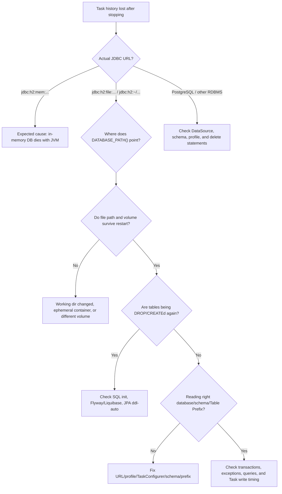

# H2 Repository Loses Data After the Process Stops

## 1. Symptom: Task Runs Successfully but History Vanishes

**Spring Cloud Task** is a framework for finite-lived Spring Boot applications: start up, perform work, record outcomes into **`TaskRepository`**, and terminate. A `TaskExecution` typically carries the Task name, start/end timestamps, exit code, and messages; if the application invokes Spring Batch, `JobRepository` also persists `JobExecution`/`StepExecution` state for tracking and restarts.

Suppose you build a daily invoice-import Task `invoice-import`:

1. Run `java -jar invoice-import.jar --task.business-date=2026-11-24`.
2. While the Task is running, the H2 console or a query sees a row in `TASK_EXECUTION`.
3. The Task finishes, and the JVM exits normally with code `0`.
4. Running the Task a second time or opening another JVM shows an empty table, missing tables, or IDs starting over from the beginning.

This is **not inherently a Spring Cloud Task bug**. If the `DataSource` uses **in-memory** H2, the data exists only inside the JVM's memory. When the JVM stops, the database vanishes too. Every restart can create a brand-new H2 database with the same name yet a **different lifecycle**.

**Objectives for this Diagnostics lesson:** determine whether data loss stems from in-memory H2, connection closing, a database file in the wrong path, ephemeral container storage, schema recreation, selecting the wrong DataSource, or metadata write failures; verify using JDBC URLs and SQL; and decide when to use file-based H2 versus PostgreSQL or another durable RDBMS.

## 2. Core Principle: H2 Has Multiple Modes, and Not All Persist to Disk

H2 is a relational database supporting **in-memory** and **file-based (embedded)** modes, as well as a server mode. The JDBC URL dictates which kind of database is opened.

| Illustrative JDBC URL | Mode | Does data survive JVM exit? | Access scope |
| --- | --- | --- | --- |
| `jdbc:h2:mem:taskdb` | **Named** in-memory H2 | **No** | Matching connections within the same JVM/class loader |
| `jdbc:h2:mem:taskdb;DB_CLOSE_DELAY=-1` | In-memory H2 keeping DB open when last connection closes | **No** | Lifetime of the JVM; not written to disk |
| `jdbc:h2:mem:` | **Unnamed** in-memory H2 | **No** | Separate private database per connection |
| `jdbc:h2:file:./data/taskdb` | File-based H2, **relative path** | **Yes, if** actual directory persists and is writable | Opens file relative to the process's working directory |
| `jdbc:h2:file:/var/lib/task-repository/taskdb` | File-based H2, **absolute Linux path** | **Yes, if** volume/file is persistent | Data stored in file on configured filesystem |
| `jdbc:h2:~/taskdb` | File-based H2 in home directory | **Yes, if** home directory persists | Depends on process user/home |
| `jdbc:h2:tcp://db-host/~/taskdb` | H2 server mode | Depends on database opened by server | Client connects to H2 server, not client's own in-memory instance |

**Key indicator:** `mem:` denotes an in-memory database. Depending on the H2 version, file-based databases typically appear with the `.mv.db` suffix. Do not assume "H2 saved to disk" merely because you see the same database name on the next run.

### 2.1. Why `DB_CLOSE_DELAY=-1` Does Not Save Data After JVM Exit

Normally, H2 can close an **in-memory database** when the last connection closes. The `DB_CLOSE_DELAY=-1` parameter keeps the in-memory database alive **until the JVM terminates**, even if the pool closes every connection while the JVM is still running.

```text
JVM A starts
  -> opens jdbc:h2:mem:taskdb
  -> writes TASK_EXECUTION ID=1
  -> closes last connection
       -> DB_CLOSE_DELAY=0: in-memory DB may be destroyed immediately
       -> DB_CLOSE_DELAY=-1: DB remains in JVM A's memory
  -> JVM A exits
       -> in both cases, the in-memory database is lost

JVM B starts
  -> opens jdbc:h2:mem:taskdb
  -> creates a NEW database with the same name
  -> no ID=1 data from JVM A
```

**Do not confuse `DB_CLOSE_DELAY=-1` with persistence.** Similarly, `DB_CLOSE_ON_EXIT=FALSE` only alters how H2 auto-closes on JVM exit; it **does not turn an in-memory database into a file-based one**. For file-based databases, disabling auto-close also risks unclean file shutdown if the application fails to issue a proper `SHUTDOWN`. Do not append these parameters as an unconditional "patch."

### 2.2. Two JVMs Using the Same Name `taskdb` Do Not Share In-Memory H2

`jdbc:h2:mem:taskdb` in JVM A and `jdbc:h2:mem:taskdb` in JVM B are **two separate databases**, even though the URL strings are identical. If an H2 console runs in a different JVM than the Task, connecting to `mem:taskdb` from that console **cannot read the private database inside the Task's JVM** merely because the name matches.

H2 can expose an in-memory DB over a TCP server running **inside the JVM that owns the database**, but that is a different setup from a default embedded connection. Nor does it let data survive after the server JVM stops; do not use it to solve durable history storage.

## 3. Five-Step Diagnostic Decision Tree



**Practical order:** record the JDBC URL **actually used by the DataSource** and `DATABASE_PATH()` before modifying any configuration. A "newly empty table" symptom can mean two different bugs: **the old database vanished** or **the application connected to a new database**.

| Question | Evidence to find | What not to do |
| --- | --- | --- |
| Is in-memory H2 being used? | `DataSource.getConnection().getMetaData().getURL()` | Guess from the `com.h2database:h2` dependency |
| Which H2 file is in use? | `CALL DATABASE_PATH();`, actual path and volume | Guess from a filename in the project |
| Does the file persist across runs? | Directory listing of `*.mv.db` and persistent volume | Delete/move files while DB is open |
| Do Task tables exist? | `INFORMATION_SCHEMA.TABLES`, `TASK_EXECUTION` | Manually create wrong-version tables |
| Does TaskRepository use the right DataSource? | `TaskConfigurer` when multi-DataSource, runtime config | Assume business DB = Task DB |
| Was metadata actually written? | Lifecycle logs, SQL readback, `EXIT_CODE`/`END_TIME` | Conclude solely from Pod exit code |

## 4. How Spring Cloud Task Selects a DataSource

Spring Cloud Task needs a **DataSource** to persist TaskExecution outcomes. According to official docs:

- In minimal development setups, the framework can use **in-memory H2** to make getting started easy. Suitable for learning and testing, **not suitable for retaining history after JVM exit**.
- If the application has **a single DataSource** configured via Spring Boot conventions, Spring Cloud Task can use that DataSource for its repository.
- If the application has **multiple DataSources**, explicitly designate the DataSource for TaskRepository via a proper `TaskConfigurer` configuration; do not assume it uses the same connection your business code inspects.
- Default table names usually use the `TASK_` prefix, such as `TASK_EXECUTION` and `TASK_EXECUTION_PARAMS`. When `spring.cloud.task.table-prefix` is configured, query **tables matching the actual prefix**.

### 4.1. In-Memory H2 Example for Development

```yaml
spring:
  application:
    name: invoice-import
  main:
    web-application-type: none
  datasource:
    driver-class-name: org.h2.Driver
    url: "jdbc:h2:mem:taskdb;DB_CLOSE_DELAY=-1"
    username: sa
    password: ""
  cloud:
    task:
      name: invoice-import
```

With this URL, you can inspect history while **the same JVM is alive and connections target the same in-memory DB**. When the Task finishes and the process exits, losing the history is **correct in-memory H2 behavior**, not TaskRepository forgetting to commit.

To avoid confusion, clearly document in operational runbooks that this configuration is **for testing only** and provides no retention guarantees. Nor does `DB_CLOSE_DELAY=-1` allow two different Kubernetes Pods to share data.

### 4.2. Using File-Based H2 When Data Must Persist Across Single-Host Runs

Example file-based H2 configuration for **sequential dev/test runs on a single host**:

```yaml
spring:
  application:
    name: invoice-import
  main:
    web-application-type: none
  datasource:
    driver-class-name: org.h2.Driver
    url: "jdbc:h2:file:/var/lib/task-repository/taskdb"
    username: sa
    password: ""
  cloud:
    task:
      name: invoice-import
```

Mandatory requirements for persistence to work:

1. `/var/lib/task-repository` **exists and is writable** by the user running the container/JVM.
2. Files and the filesystem under `/var/lib/task-repository` **are not wiped between runs**.
3. Subsequent runs use the **exact same JDBC URL and directory**. Changing user/home/working directory or mount path may open a different database.
4. The `TASK_*` schema is initialized/migrated in a controlled manner without being dropped by scripts/JPA.
5. No other embedded H2 process opens **the same database file** in an unsupported manner. File-based H2 is not a server DB for multiple concurrent Task pods.

You can use a relative URL `jdbc:h2:file:./data/taskdb` in an IDE, but remember that the IDE's working directory may differ from when running a JAR/container. Using an **absolute path** reduces the chance of pointing at the wrong file. `jdbc:h2:~/taskdb` also depends on user home: the IDE user and container user may differ.

**File-based H2 is not recommended as a multi-replica/Pod production TaskRepository.** When you need durable history, concurrent access, and Spring Batch/Task coordination across JVMs, choose PostgreSQL or another supported database with backups, migrations, and operational policies.

## 5. Querying H2 to Verify Which Database Is Actually Open

This is a **read-only** set of commands; execute via `JdbcTemplate`, a JDBC client, or the H2 console connected to **the right database**:

```sql
-- Returns the file path if H2 uses a file-based database.
-- Returns NULL for an in-memory database.
CALL DATABASE_PATH();

-- Show the database/catalog and schema of the current connection.
SELECT CURRENT_CATALOG() AS DB_NAME,
       CURRENT_SCHEMA() AS SCHEMA_NAME;

-- Find actual Task table names in the current/accessible schemas.
SELECT TABLE_SCHEMA, TABLE_NAME
FROM INFORMATION_SCHEMA.TABLES
WHERE TABLE_NAME LIKE 'TASK%'
ORDER BY TABLE_SCHEMA, TABLE_NAME;

-- After confirming the right prefix and schema:
SELECT TASK_EXECUTION_ID,
       TASK_NAME,
       START_TIME,
       END_TIME,
       EXIT_CODE,
       EXIT_MESSAGE
FROM TASK_EXECUTION
ORDER BY TASK_EXECUTION_ID DESC;
```

**How to read the output:**

- `DATABASE_PATH() = NULL`: that connection uses an in-memory database; **there is no H2 file holding history**.
- `DATABASE_PATH()` returns a path: a file-based database exists; verify **whether that path resides on a persistent volume**.
- `TASK_EXECUTION` does not exist: initializer/migrations may not have run, you are in the wrong schema, or a brand-new database was opened. It does not always mean "data loss."
- The table exists but contains only the current run: the DB may have been recreated, the schema cleared, or the application is using a different DataSource.

`DATABASE_PATH()` only describes **the connection executing the query**. If the project has multiple DataSources, querying with a `JdbcTemplate` bound to the business datasource can return a **different** result from TaskRepository. Identify TaskRepository's exact connection via `TaskConfigurer` and runtime config.

### 5.1. Logging the JDBC URL Once Without Exposing Secrets

During debugging, you can log **the database product and a sanitized/inspected URL**. The snippet below uses a plain `DataSource`, valid only when it is the TaskRepository datasource itself:

```java
import javax.sql.DataSource;
import java.sql.Connection;
import java.sql.SQLException;
import org.slf4j.Logger;
import org.slf4j.LoggerFactory;
import org.springframework.boot.ApplicationRunner;
import org.springframework.context.annotation.Bean;
import org.springframework.context.annotation.Configuration;

@Configuration(proxyBeanMethods = false)
public class RepositoryConnectionDiagnostics {
    private static final Logger log =
        LoggerFactory.getLogger(RepositoryConnectionDiagnostics.class);

    @Bean
    ApplicationRunner logDbKind(DataSource dataSource) {
        return args -> {
            try (Connection connection = dataSource.getConnection()) {
                String product =
                    connection.getMetaData().getDatabaseProductName();
                String url = connection.getMetaData().getURL();

                // Do not log the full JDBC URL in untrusted environments:
                // the URL may contain username, password, or tokens.
                boolean isMemoryH2 =
                    url != null && url.startsWith("jdbc:h2:mem:");
                boolean isFileH2 =
                    url != null && (url.startsWith("jdbc:h2:file:")
                        || url.startsWith("jdbc:h2:~/")
                        || url.startsWith("jdbc:h2:./"));

                log.info("Task DB product={}, h2Memory={}, h2File={}",
                    product, isMemoryH2, isFileH2);
            } catch (SQLException ex) {
                log.error("Failed to determine Task DB type", ex);
                throw ex;
            }
        };
    }
}
```

Never log `spring.datasource.password` or the entire `ApplicationArguments`. When a JDBC URL carries sensitive connection properties, log only the `h2Memory`/`h2File` flags and a secret-redacted URL; logs may be centralized and retained longer than the Task's lifetime.

**Limitation of this example:** if there are multiple DataSources and the injected `DataSource` here is not the one backing TaskRepository, conclusions about TaskRepository can be wrong. Configure the corresponding bean or inspect the actually selected repository.

## 6. Two-Run Experiment to Prove H2's Lifecycle

To isolate H2's behavior from Spring Cloud Task configuration, you can run a tiny standalone JDBC program. The example below uses **H2 2.x** via your project's managed H2 dependency. It creates a marker table and increments the row count on each run.

```java
import java.sql.Connection;
import java.sql.DriverManager;
import java.sql.ResultSet;
import java.sql.Statement;

public class H2PersistenceProbe {
    public static void main(String[] args) throws Exception {
        if (args.length != 1 || !args[0].startsWith("jdbc:h2:")) {
            throw new IllegalArgumentException("An H2 JDBC URL is required");
        }
        String url = args[0];

        try (Connection c = DriverManager.getConnection(url, "sa", "");
             Statement s = c.createStatement()) {
            s.executeUpdate(
                "CREATE TABLE IF NOT EXISTS DEMO_MARKER " +
                "(ID BIGINT GENERATED BY DEFAULT AS IDENTITY PRIMARY KEY)"
            );
            s.executeUpdate("INSERT INTO DEMO_MARKER DEFAULT VALUES");

            try (ResultSet rows =
                    s.executeQuery("SELECT COUNT(*) FROM DEMO_MARKER")) {
                rows.next();
                System.out.println("Rows now = " + rows.getLong(1));
            }
            try (ResultSet path =
                    s.executeQuery("SELECT DATABASE_PATH()")) {
                path.next();
                System.out.println("Database path = " + path.getString(1));
            }
        }
    }
}
```

Assuming `H2PersistenceProbe.class` and `h2.jar` are prepared, on **Linux/macOS** you can invoke:

```bash
# Two separate processes; the memory database is discarded when each JVM exits.
java -cp ".:h2.jar" H2PersistenceProbe \
  "jdbc:h2:mem:probe;DB_CLOSE_DELAY=-1"
java -cp ".:h2.jar" H2PersistenceProbe \
  "jdbc:h2:mem:probe;DB_CLOSE_DELAY=-1"

# Two separate processes; file-based DB retains data if the path persists.
java -cp ".:h2.jar" H2PersistenceProbe \
  "jdbc:h2:file:./probe-data/taskdb"
java -cp ".:h2.jar" H2PersistenceProbe \
  "jdbc:h2:file:./probe-data/taskdb"
```

Expected results across **two sequential JVM executions**:

| Mode | First run | Second run | `DATABASE_PATH()` |
| --- | --- | --- | --- |
| `mem:probe` | `Rows now = 1` | `Rows now = 1` | `null` |
| `file:./probe-data/taskdb` | `Rows now = 1` | `Rows now = 2` | File path |

On Windows, use `;` instead of `:` as the classpath separator and adjust shell quoting. Create a writable `probe-data` directory beforehand; these commands **write files on the current filesystem**, so run them only in a test area. Never deploy the probe program to production or use it to write into `TASK_EXECUTION`.

**Why is an isolated probe useful?** If the file-based probe preserves rows yet TaskRepository still loses data, the problem lies in Spring profiles, DataSource/`TaskConfigurer`, schema initialization, file permissions, or volumes. If the in-memory probe loses data, that is H2's designed behavior.

### 6.1. Verifying in the Real Task

After testing H2 standalone, run the **actual Spring Cloud Task application** twice with **identical configuration**:

1. Before run A, record the effective JDBC URL and `CALL DATABASE_PATH()`.
2. Let the Task finish normally; verify `TaskExecution.exitCode`, container status, and lifecycle logs.
3. Stop the JVM completely; if file-based, verify the DB file still sits on disk.
4. Run B using **the same URL, same schema, same profile, and same volume**.
5. Query `TASK_EXECUTION` after run B. With stable file-based storage, both A and B should remain unless another step cleared/recreated the schema.

If the Task suffers `SIGKILL`, `OOMKilled`, or dies before the repository writes its end state, the TaskExecution record (if created) may retain `END_TIME=NULL`, `EXIT_CODE=NULL`. That differs from **the entire database disappearing**; cross-check logs, transactions, and orchestrator state.

## 7. Data Loss Even with File-Based Mode: Pinpointing the Cause

### 7.1. Relative Path Changes

`jdbc:h2:file:./data/taskdb` is resolved relative to the process's current **working directory**, not always the directory containing the JAR.

```text
In IDE:
  working dir = /workspace/invoice
  jdbc:h2:file:./data/taskdb
  -> /workspace/invoice/data/taskdb.mv.db

In Kubernetes:
  working dir = /app
  jdbc:h2:file:./data/taskdb
  -> /app/data/taskdb.mv.db

Two different paths => two different databases.
```

Solution: use `jdbc:h2:file:/var/lib/task-repository/taskdb`, mount that directory to the exact path, ensure the user has write access, and **verify with `DATABASE_PATH()`**. Never move or copy `*.mv.db` while the database is open; use H2-supported backup/restore or cleanly shut down the process before touching the file.

### 7.2. Container Home Directory Differs from Dev Machine

`jdbc:h2:~/taskdb` opens the database inside the **home directory of the running OS user**. If the IDE runs as `dev` while the container runs as `taskuser`, the home directories differ. An image with a missing or read-only home directory may fail to start or create the database somewhere unexpected depending on config.

Solution: configure an explicit absolute path on a mounted volume, independent of user home, and avoid writing into read-only image layers.

### 7.3. Schema Dropped and Recreated

The database file surviving **does not guarantee table rows survive** if the application runs destructive DDL during startup or shutdown.

Sources to check:

- `spring.jpa.hibernate.ddl-auto=create` or `create-drop` when JPA/Hibernate is present. Spring Boot may auto-select `create-drop` for embedded databases if no schema management tool is detected. Depending on entity config, this can drop/recreate JPA-managed tables.
- `schema.sql`, `data.sql`, or `DROP TABLE`/`TRUNCATE` scripts run automatically by `spring.sql.init.*`.
- Flyway/Liquibase migrations containing `DROP`, clean, or test-environment resets; inspect migration history.
- Test profiles, `@DirtiesContext`, test fixtures, or startup code that purges data.
- Task tables with a different prefix/schema causing you to look at a fresh empty set of tables.

Example configuration **for an environment whose schema is managed by migrations**:

```yaml
spring:
  sql:
    init:
      mode: never
  jpa:
    hibernate:
      ddl-auto: validate
  cloud:
    task:
      initialize-enabled: false
```

**Warning:** this config is only appropriate once Task tables and any required JPA tables **have already been created properly**. If the app does not use JPA, omit `spring.jpa.*`. `validate` does not create tables; `initialize-enabled=false` prevents Spring Cloud Task from auto-creating the schema. If DDL or migrations haven't run yet, the app will fail with missing-table errors—which is a setup error, **not a fix for data loss**.

Never enable two or three uncoordinated schema-initialization mechanisms at once. In production, choose **one versioned migration strategy**, grant minimal DDL privileges, and test when upgrading Spring Cloud Task.

### 7.4. H2 Silently Creates a New Database on a Typo in the URL

File-based H2 typically **creates a new database** if the URL target does not yet exist. A typo like `tasksdb` instead of `taskdb` creates an empty file and looks like lost data.

In a **diagnostic check that should only open an existing database**, add `;IFEXISTS=TRUE`:

```properties
# Only for verification / apps where the DB file has already been provisioned.
spring.datasource.url=jdbc:h2:file:/var/lib/task-repository/taskdb;IFEXISTS=TRUE
```

If the file does not exist, H2 raises an error instead of silently creating a new DB. **Do not enable `IFEXISTS=TRUE` on the very first initialization of a file-based database** before the file exists; it will intentionally fail. Use it as a guard on pre-provisioned environments with a clear initialization workflow.

### 7.5. Multiple DataSources or Different Profiles

`spring.profiles.active=dev` might point to `jdbc:h2:mem:taskdb`, whereas `prod` points to PostgreSQL. Environment variables or deployment properties can override `application.yml`. In a multi-datasource application, the bean your `JdbcTemplate` uses is **not necessarily** TaskRepository's bean.

Cross-check:

1. Active profiles and higher-precedence config sources (environment, CLI, Config Server, Kubernetes Secret/ConfigMap).
2. The JDBC URL read from the **actual DataSource**, not just source YAML files.
3. The TaskRepository/`TaskConfigurer` bean when multiple DataSources exist.
4. Schema names, table prefixes, and access privileges.
5. The DB/session used by SQL tools and dashboards, not just the application's DB.

Never dump the full Spring Environment or Secrets for diagnostics. Log a sanitized JDBC URL or just the DB product, memory/file mode, schema, and environment.

## 8. Kubernetes Jobs and Ephemeral Filesystems

Spring Cloud Task is commonly run as a **Kubernetes Job**. Each Pod has its own filesystem; data written to the **container writable layer** is lost when the container/Pod is replaced. An `emptyDir` volume lives for the **lifetime of a single Pod**, not across Kubernetes Job re-runs.

| H2 file location | Survives new Jobs/Pods? | Assessment |
| --- | --- | --- |
| `/tmp/taskdb` in container writable layer | Unreliable | Temporary data only |
| `emptyDir` at `/data` | No, once Pod is deleted or replaced | Good for scratch; **not** for TaskRepository history |
| `hostPath` on a specific node | Possibly on the **same node**, but moving nodes loses access to the file | Not recommended for durable TaskRepository |
| PVC mounted at `/var/lib/task-repository` | Can retain file across Pod replacements per storage/retain policy | Reasonable only for **single-writer** tests, not broad concurrency |
| Managed PostgreSQL / cluster with backups | Durable independently of Task Pods when configured properly | Suitable for production and multiple Task instances |

Example PVC configuration **snippet** for a test Kubernetes Job using file-based H2:

```yaml
# Excerpt from Job spec, not a complete manifest.
spec:
  template:
    spec:
      restartPolicy: Never
      containers:
        - name: invoice-import
          image: registry.example.com/batch/invoice-import:dev
          env:
            - name: SPRING_DATASOURCE_URL
              value: jdbc:h2:file:/var/lib/task-repository/taskdb
          volumeMounts:
            - name: task-repository-data
              mountPath: /var/lib/task-repository
      volumes:
        - name: task-repository-data
          persistentVolumeClaim:
            claimName: task-repository-dev-pvc
```

**This example is only for validating a single Pod/Job in dev.** The PVC must exist, mount cleanly, and retain data between two Job runs. The image must bundle the H2 driver, and the user needs write permissions, resources, and an appropriate securityContext. Kubernetes `ReadWriteOnce` is **not a logical lock preventing two Tasks from opening the H2 file simultaneously**; this setup is **unsafe for concurrent replicas/Jobs**.

### 8.1. Why a PVC Is Still Not Enough for Production

A PVC **keeps the file**, but embedded file-based H2 relies on file locking and is not designed as a shared server database for multiple JVMs across nodes accessing the same file. If multiple Kubernetes Jobs open the same file, you can hit `Database may be already in use`, lock errors, or distributed filesystem corruption risks depending on the storage backend.

Do not "fix" lock errors by disabling file lock checks. You need a **database server** with proper concurrency control, backups, transactions, and stable access permissions. PostgreSQL is a common choice for `TaskRepository` and `JobRepository` in multi-worker environments.

## 9. Configuring a Durable TaskRepository with PostgreSQL

In production, move TaskRepository off in-memory H2 onto PostgreSQL or a supported RDBMS. Example `application.yml` receiving credentials from environment/Secrets and using pre-deployed migrations:

```yaml
spring:
  application:
    name: invoice-import
  main:
    web-application-type: none
  datasource:
    driver-class-name: org.postgresql.Driver
    url: "jdbc:postgresql://task-db.internal:5432/task_metadata"
    username: task_app
    # Read from SPRING_DATASOURCE_PASSWORD provided securely.
  sql:
    init:
      mode: never
  cloud:
    task:
      name: invoice-import
      initialize-enabled: false
```

Requirements for this example to work:

1. PostgreSQL JDBC driver dependency is packaged in the JAR at a version compatible with Spring Boot/Spring Cloud Task.
2. Database `task_metadata`, user `task_app`, and `TASK_*` tables are provisioned/migrated using DDL matching your Spring Cloud Task version.
3. `SPRING_DATASOURCE_PASSWORD` is supplied via a Secret manager/Kubernetes Secret (or another secure mechanism), never in CLI arguments or logs.
4. All Task runs use the **same database and schema**; with multiple DataSources, `TaskConfigurer` must select the right TaskRepository.
5. Configure retention, backup/restore, TLS, and least-privilege SQL permissions; monitor connection pools and datasource errors.

For Spring Batch, `JobRepository` maintains **its own `BATCH_*` tables**. If a Batch Job needs restartability, losing in-memory H2 wipes not just `TaskExecution` but also `JobExecution`/`StepExecution` and checkpoints. Use a durable database and migrations for **both TaskRepository and JobRepository**; do not assume migrating Task tables alone suffices.

### 9.1. Switching to Postgres Does Not Magically Bring Back Old History

Changing `spring.datasource.url` from in-memory H2 to PostgreSQL creates a **new repository**. `TaskExecution` rows that existed only in an old JVM's RAM **cannot migrate automatically** to the new database after that JVM exited.

If prior history is needed:

- Check whether a backup/snapshot/export was taken before the old JVM exited.
- If using file-based H2, back up/restore using H2-supported tools and plan a reconciled data/schema migration.
- If it was in-memory H2 and the JVM has stopped, the RAM data is gone; you can only partially reconstruct it from **logs, schedulers, brokers, traces, or business reports** if retained externally.
- Do not manually re-insert old `TASK_EXECUTION_ID` values into the new DB without accounting for migrations, sequences, and foreign-key integrity.

## 10. How to Verify After Fixing Configuration

### 10.1. Two-Run Checklist on the Same Database

Test in a test environment first:

1. **Confirm config**: runtime JDBC URL, schema, table prefix, and TaskRepository DataSource.
2. **Confirm mode**: if H2, run `CALL DATABASE_PATH()`; if PostgreSQL, verify the actual host/database/schema connected (without logging secrets).
3. **Run A succeeds**: record `TaskExecutionId=A`, timestamp, exit code, and evidence that metadata committed.
4. **Stop process A completely**: do not merely close a connection while leaving the JVM alive if the goal is testing persistence across restarts.
5. **Run B against the same repository**: record `TaskExecutionId=B`.
6. **Re-query the table**: both A and B must remain; contiguous gap-free IDs are not required, only that A was not overwritten/lost.
7. **Verify infrastructure**: on Kubernetes, confirm Pod A has been deleted while the external DB retains the row.
8. **Test failure paths**: runner throws an exception, process is killed, database temporarily drops connection; observe what gets recorded and document exact limitations.

History query:

```sql
SELECT
    TASK_EXECUTION_ID,
    TASK_NAME,
    START_TIME,
    END_TIME,
    EXIT_CODE,
    CASE
        WHEN ERROR_MESSAGE IS NULL THEN 'NO'
        ELSE 'YES'
    END AS HAS_ERROR
FROM TASK_EXECUTION
WHERE TASK_NAME = 'invoice-import'
ORDER BY TASK_EXECUTION_ID DESC;
```

Do not expose raw `ERROR_MESSAGE` on public dashboards: it may contain stack traces or internal data; similarly, `TASK_EXECUTION_PARAMS` can hold arguments that shouldn't leak. Retain history according to retention policies and access controls.

### 10.2. Expected Outcome Matrix

| Scenario | Database after process A stops | Outcome on run B | Cause / notes |
| --- | --- | --- | --- |
| H2 `mem:taskdb` | Gone with old JVM | Fresh DB; old history missing | In-memory design |
| H2 `mem:taskdb;DB_CLOSE_DELAY=-1` | Gone after JVM exit | Fresh DB; old history missing | Delay only protects while JVM remains alive after connection closes |
| H2 file + stable host path | File remains | A and B history remain if schema wasn't dropped | Suitable for single-JVM/host sequential testing |
| H2 file + changed working dir | Old file sits elsewhere | Opens a new file, looking like "lost data" | Pointed to wrong path |
| H2 file on `emptyDir` | Pod deletion wipes file | New Job/Pod has no history | Ephemeral storage |
| H2 file on PVC + sequential Jobs | File usually remains | Can retain history | Does not solve multi-writer contention |
| Shared PostgreSQL | DB independent of JVM/Pod | Both A and B appear in repository | Ensure right datasource, migrations, backups |
| File/Postgres with `DROP TABLE` on startup | DB exists, tables reset | History lost or schema altered | Initialization/migration policy bug |
| JVM killed mid-Task | Repository may hold `END_TIME=NULL` row | Traceable in durable DB | Unfinished state differs from vanished DB |

## 11. Runbook: "H2 Lost Data" in Real Environments

When receiving a "TaskExecution vanished" report, proceed in order:

**Step 1 — Narrow down the symptom.** Is `TASK_EXECUTION` missing entirely, empty, missing only one run, or are you querying a different database/schema? Record the timestamp and Task name.

**Step 2 — Confirm process lifecycle.** Has the Task's JVM finished? Was this a Kubernetes Job retry spawning a new Pod? In-memory H2 in two Pods never shares data, even with the exact same `mem:taskdb` URL.

**Step 3 — Confirm the actual DataSource.** Check active profiles, environment overrides, and `TaskConfigurer` if multi-DataSource. Run `CALL DATABASE_PATH()` on the right H2 connection; verify table prefix.

**Step 4 — Check files/volumes.** If file-based, verify the absolute path, mount, and permissions. Never delete/move/copy an open database. If Pod/file is gone, check backups and logs.

**Step 5 — Check schema initialization.** Inspect `spring.cloud.task.initialize-enabled`, `spring.sql.init.*`, JPA `ddl-auto`, migrations, and DDL scripts. Distinguish "tables recreated" from "brand-new database."

**Step 6 — Check Task lifecycle.** If only one record is missing, check for startup failures, DB exceptions, rollbacks, or process kills before repository writes. Cross-check Pod/container exit codes and logs; never rely solely on `TaskExecution.exitCode`.

**Step 7 — Controlled recovery.** For file databases: back up first, close connections cleanly, and use H2-supported tools. For lost in-memory DBs: do not promise recovery without backups; reconcile from external evidence sources.

**Step 8 — Prevent recurrence.** Configure a durable DB, controlled migrations, a two-run smoke test, last-success monitoring, backup/restore drills, and an alert if a production datasource points to in-memory H2.

### Quick Triage by Observed Error

| Log/symptom | Likely cause | Action |
| --- | --- | --- |
| `Table "TASK_EXECUTION" not found` | Schema uninitialized, wrong profile, different prefix, or new DB | Verify URL/schema/DDL; do not create ad-hoc wrong tables |
| Run A shows a row, run B resets IDs to 1 | New H2 mem or new file database | Check `DATABASE_PATH()` and working dir |
| `Database may be already in use` | Two JVMs contending over the same H2 file | Do not disable locks; use a shared DB server |
| Cannot write `*.mv.db` | Read-only volume, missing permissions/disk space | Check filesystem, runAsUser, and quota |
| `.mv.db` file exists but table is empty | Connected to wrong file/schema or reset script ran | Query path and migration history |
| H2 console doesn't see TaskExecution while Task JVM runs | Console runs in another JVM or DB | Connect to the right source; `mem:` names are not global |
| `END_TIME` blank | Task crashed/killed or end update failed | Inspect process/Pod, transactions, and logs |
| Lost Batch restart metadata too | JobRepository also in H2 memory | Move both Task and Batch metadata to a durable DB |
| H2 on PVC fails with multiple Pods | File lock and embedded concurrency limits | Use PostgreSQL or another proper DB server |

## 12. Practice Exercises

### Exercise 1 — Prove In-Memory Is Ephemeral

Run `H2PersistenceProbe` twice with `jdbc:h2:mem:probe` and `jdbc:h2:mem:probe;DB_CLOSE_DELAY=-1`. Record the row count after each run. Explain why `DB_CLOSE_DELAY=-1` fails to preserve history after JVM exit.

### Exercise 2 — Switch to File-Based H2

On a dev machine, create a writable directory and run twice with `jdbc:h2:file:./probe-data/taskdb`. Record `DATABASE_PATH()` and the `*.mv.db` file. Change the working directory, run again with the same relative URL, and explain why it can open a different database.

### Exercise 3 — Diagnose TaskRepository

Write a Spring Cloud Task app with a simple runner. Before each run, log the secret-redacted database mode; after each run, query `TASK_EXECUTION`. Compare in-memory H2 and file H2. If the project has two DataSources, add a `TaskConfigurer` configuration to prove the repository uses the chosen source.

### Exercise 4 — Two-Run Kubernetes Job

Run the Task as two separate Jobs:

- Case A: H2 file in `emptyDir`.
- Case B: H2 file on a test PVC, with **only one Job active at a time**.

Compare history after Pod deletion and document the limitations of a PVC. Do not attempt to open the same embedded H2 file concurrently from multiple Pods.

### Exercise 5 — Track Down the New Database

An application uses `jdbc:h2:file:./data/taskdb` and each deployment has a different working directory. Using `DATABASE_PATH()`, locate the real path. Propose using an absolute path and `IFEXISTS=TRUE` in verification checks once the database has been provisioned.

### Exercise 6 — Schema and Spring Batch

Configure a Task that runs a Spring Batch Job and stores metadata in in-memory H2. Fail the Job midway and restart it. Explain why `JobRepository` lacks the old checkpoint and why "re-running from scratch" can create duplicates. Design a migration to PostgreSQL, business keys, and idempotency.

### Exercise 7 — Recovery and Alerting

Create a scenario where no new `TaskExecution` appears after a 01:00 schedule. Write a runbook checking scheduler/Pod, datasource, logs, and TaskRepository. Design a missed-schedule alert independent of error metrics, because a Task that never launched cannot emit failure events itself.

### Self-Assessment

1. At what exact point in time do `jdbc:h2:mem:taskdb` and `jdbc:h2:mem:taskdb;DB_CLOSE_DELAY=-1` behave differently?
2. Why don't two JVMs both connecting to `jdbc:h2:mem:taskdb` see each other's data?
3. What does `DATABASE_PATH()` returning `NULL` tell you?
4. Why can file-based H2 in `./data` appear to "lose" data when moving from an IDE to Docker even though the old file still exists?
5. Does Kubernetes Job's `ttlSecondsAfterFinished` erase PostgreSQL data? What about H2 stored in the container layer?
6. If the `.mv.db` file exists yet `TASK_EXECUTION` is empty, besides file path, which schema configs should you inspect?
7. When is `spring.cloud.task.initialize-enabled=false` appropriate? What happens if tables haven't been migrated yet?
8. Why must both TaskRepository and JobRepository be durable when Spring Batch restarts are needed?
9. Does a TaskExecution with `END_TIME=NULL` prove the database was lost?
10. Why are backups, TaskExecutionId tracing, and idempotency all required for safe operations?

**Completion criteria:** You accurately explain in-memory H2 behavior, verify modes via JDBC URL/`DATABASE_PATH()`, execute the two-JVM test, detect wrong paths/schemas/profiles/container volumes, configure file-based H2 properly for testing, and know how to move TaskRepository/JobRepository to a durable database in real deployments.

## Official References

- [Spring Cloud Task — Features / DataSource](https://docs.spring.io/spring-cloud-task/reference/features.html): default in-memory H2 for development, custom DataSource, and TaskConfigurer.
- [Spring Cloud Task — Task Repository Schema](https://docs.spring.io/spring-cloud-task/reference/appendix-task-repository-schema.html): metadata tables and schema initialization requirements.
- [Spring Cloud Task — TaskRepositoryInitializer API](https://docs.spring.io/spring-cloud-task/docs/current/apidocs/org/springframework/cloud/task/repository/support/TaskRepositoryInitializer.html): `spring.cloud.task.initialize-enabled`.
- [H2 — Features, In-Memory Databases](https://h2database.com/html/features.html): `mem` mode, file-based mode, `DB_CLOSE_DELAY`, and connection lifecycle.
- [H2 — Database URL Cheat Sheet](https://h2database.com/html/cheatSheet.html): `mem`, `file`, `~/`, and server mode URLs.
- [H2 — DATABASE_PATH() Function](https://h2database.com/html/functions.html): checking the actual database file path.
- [H2 — Commands / SET DB_CLOSE_DELAY](https://h2database.com/html/commands.html): delay before closing database when last connection disconnects.
- [Spring Boot — Database Initialization](https://docs.spring.io/spring-boot/how-to/data-initialization.html): `spring.sql.init.mode`, `spring.jpa.hibernate.ddl-auto`, and schema strategies.
- [Kubernetes — Ephemeral Volumes](https://kubernetes.io/docs/concepts/storage/ephemeral-volumes/): Pod ephemeral storage and differences from PersistentVolumes.
- [Kubernetes — Persistent Volumes](https://kubernetes.io/docs/concepts/storage/persistent-volumes/): PVC/PV and access modes.
- [Spring Batch — Reference Documentation](https://docs.spring.io/spring-batch/reference/): JobRepository, restarts, and Step metadata.
