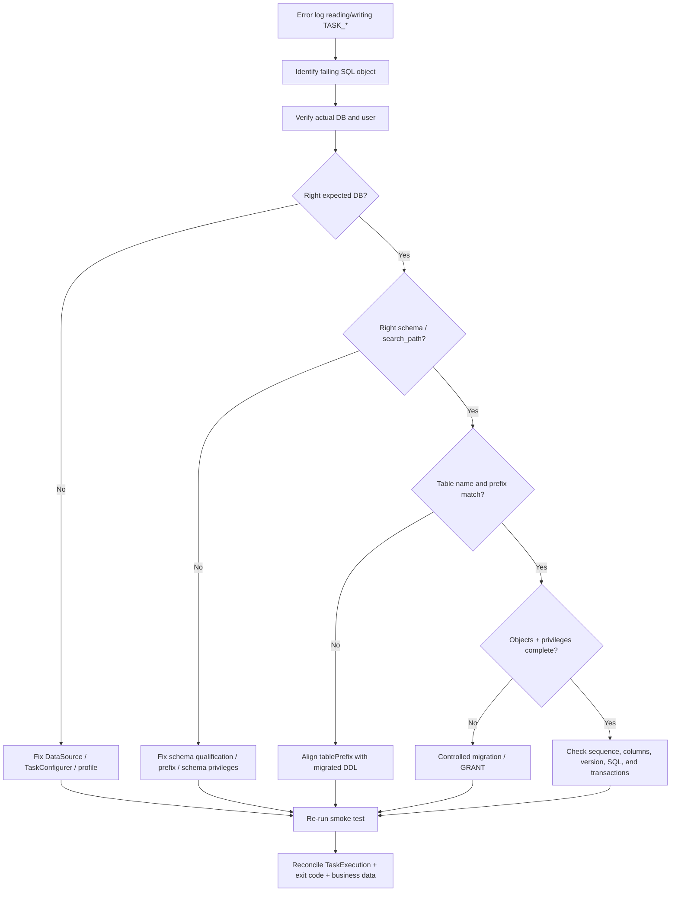
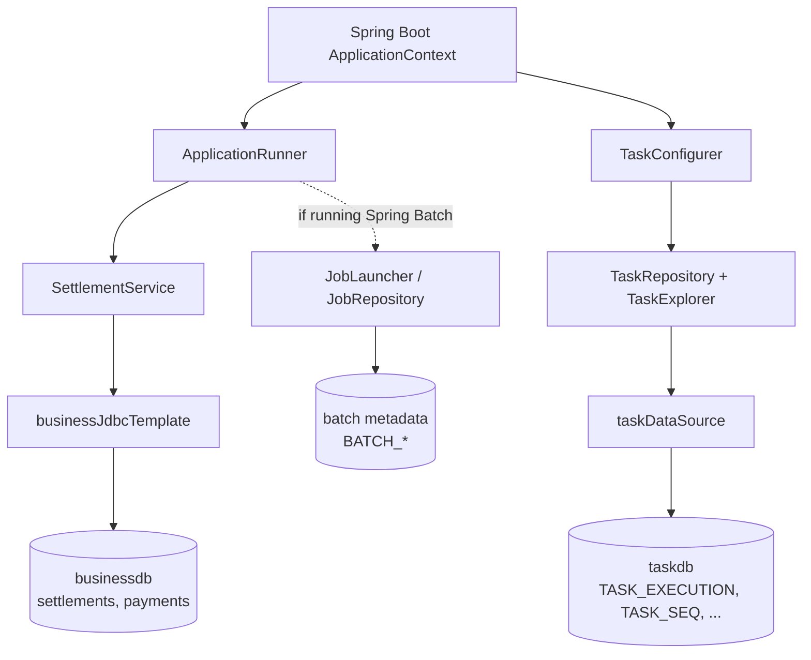

# Missing Table, Wrong `tablePrefix`, or Wrong `DataSource`

## Learning Objectives

After this lesson, you will be able to:

- Distinguish three frequently confused causes when Spring Cloud Task fails to record `TaskExecution`: **metadata table does not exist**, **table prefix (`tablePrefix`)/schema mismatch**, and **`TaskRepository` using the wrong `DataSource`**.
- Recognize JDBC errors such as `relation "task_execution" does not exist`, `Table ... doesn't exist`, `permission denied`, and `executionId` allocation failures; avoid jumping to conclusions from a single stack-trace line.
- Use **read-only** queries to inspect the database, schema, `search_path`, tables, sequences, and privileges of the actual runtime account.
- Explain the exact effects of `spring.cloud.task.table-prefix`, `spring.cloud.task.initialize-enabled`, Spring Boot SQL initializer, and Flyway/Liquibase migrations.
- Configure TaskRepository to point to the right database when an application has **multiple `DataSource` beans**, separating business transactions from metadata transactions.
- Compare Spring Cloud Task's `TASK_*` infrastructure with Spring Batch's `BATCH_*` infrastructure; inspect the Task–Batch link when a Job ran yet Data Flow cannot find its metadata.
- Build a safe diagnosis, remediation, integration testing, and operations workflow when Tasks run on schedule, on demand, or in Kubernetes.

> **Context:** This lesson belongs to the **Diagnostics** chapter of the **SPRING_CLOUD_TASK** module. Spring Cloud Task supports finite-lived Spring Boot applications and persists execution state in a database; applications may use Spring Batch and run on schedule or on demand. For repository errors, the first question is not "how do I quickly create a table?" but **"what object is the code looking for, under which account, in which database/schema, and under which configuration?"**.

## 1. Scenario: Task Works on Dev Laptop but Fails on Kubernetes

Suppose a reconciliation Task runs with:

```bash
java -jar settlement-task.jar \
  --business-date=2026-11-24 \
  --region=apac
```

On the developer laptop, the Task creates a `TaskExecution`, yet when deployed as a Kubernetes Job, the logs show:

```text
org.springframework.jdbc.BadSqlGrammarException: ...
Caused by: org.postgresql.util.PSQLException:
ERROR: relation "task_execution" does not exist
SQLState: 42P01
```

One engineer says "missing table"; another says "wrong prefix"; a third suspects the Pod is connecting to the business database by mistake. **All three hypotheses can produce nearly identical symptoms.**

| Hypothesis | Actual configuration | Why the error occurs |
| --- | --- | --- |
| **Missing table** | Task connects to the right database and schema, but Task migrations never ran. | `TASK_EXECUTION` is absent from that schema. |
| **Wrong `tablePrefix`** | Database has `OPS_TASK_EXECUTION`, yet repository still queries `TASK_EXECUTION`. | SQL looks for the wrong object name. |
| **Wrong `DataSource`** | TaskRepository is wired to `businessdb` instead of `taskdb`. | The table exists in `taskdb`, not in the database the Task actually accesses. |
| **Wrong schema/`search_path`** | Table sits at `task_meta.task_execution`, while the user searches in `public`. | The object exists, but is invisible via an unqualified name. |
| **Wrong privileges** | Table exists, yet the runtime user lacks `SELECT`/`INSERT`/`UPDATE` or sequence privileges. | Repository cannot read/write even though the object is present. |

**Diagnostic goal:** Establish proof of the **DB host/name, schema, prefix, table/sequence, and privileges** before modifying configuration or DDL.

## 2. Which Objects Does `TaskRepository` Operate On?

Spring Cloud Task uses `TaskRepository` to record a run, `TaskExplorer` to query metadata, and `TaskConfigurer` to select the storage/transaction infrastructure. When a suitable JDBC `DataSource` is present, the default configuration uses a JDBC repository. Without a `DataSource`, if the framework falls back to in-memory storage, data disappears once the process terminates—which is unsuitable for production operational history.

Common tables in the Spring Cloud Task schema:

| Default object | Role | Symptom when missing |
| --- | --- | --- |
| `TASK_EXECUTION` | Stores `executionId`, Task name, start/end, exit code, and error message. | Cannot create/update run metadata. |
| `TASK_EXECUTION_PARAMS` | Stores parameters of the run. | Task initialization or argument persistence fails. |
| `TASK_TASK_BATCH` | Links `TaskExecution` with `JobExecution` when Batch integration is active. | Data Flow or observability tools cannot look up associated Jobs. |
| `TASK_LOCK` | Supports locking/single-instance features in supported releases. | Task locking fails when the corresponding feature is enabled. |
| `TASK_SEQ` or DB-specific ID generator | Allocates `TASK_EXECUTION_ID` per the version's DDL/implementation. | ID allocation failure, missing relation/sequence, or sequence privilege error. |

**Note:** The schema list and ID-generation implementation vary by **Spring Cloud Task release and database dialect**. Schema docs reference `TASK_SEQ`, yet some databases use a sequence table, others use a native sequence, and DDL may include additional objects. **Do not create a sequence arbitrarily and assume the schema is complete**; use the migration/DDL script shipped for your exact version.

### When Do Errors Occur?

- **Startup:** the framework must create start metadata; a missing ID generator or `TASK_EXECUTION` can cause `SpringApplication.run(...)` to throw an exception before runners execute business logic.
- **During execution:** business services may fail against a different database; do not confuse an exception on `settlements` with `TASK_EXECUTION`.
- **Completion:** the Task must update `END_TIME`/`EXIT_CODE`. If connectivity drops here, business work may have finished while metadata remains un-updated.
- **During lookup:** `TaskExplorer`/Spring Cloud Data Flow may query the wrong schema/database and miss runs that exist in another source.

Hence `TASK_EXECUTION.END_TIME IS NULL` cannot be treated as proof that the process is still running; the app may have crashed, been killed, or lost connectivity before recording final status.

## 3. Three Root Causes: Table, Table Name, and Connection Path



Never adopt a "toggle initializer flags until it runs" approach on a production database. Creating fresh tables in the **wrong DB** can cause the Task to start writing a **parallel** metadata history; Data Flow will miss executions, while retries may reprocess the same business data.

### Initial Checklist of Questions

Before editing any configuration file, record:

1. JAR/image name and versions of Spring Boot, Spring Cloud Task, and Spring Batch (if used).
2. Active Spring profiles and injected runtime configuration.
3. Which DataSource/`TaskConfigurer` TaskRepository currently selects.
4. JDBC driver and the **database/schema verified over a real connection**.
5. Effective `tablePrefix` value, including trailing underscore and any schema qualification.
6. Exact relation/column/sequence name appearing in the root error.
7. Whether the runtime user holds DML privileges and schema/sequence access.
8. Whether the matching Task migration was applied to the right database/schema.
9. Whether any deployment, secret, or profile changes occurred right before the error appeared.
10. If using Data Flow, whether it reads Task metadata from the same source as the application.

## 4. Reading Stack Traces Correctly

Spring JDBC's top-level message usually wraps detailed driver errors. Read the **deepest meaningful `Caused by`** and the SQL object name in the statement.

PostgreSQL example:

```text
BadSqlGrammarException: PreparedStatementCallback; bad SQL grammar
Caused by: PSQLException: ERROR: relation "task_execution" does not exist
SQLState: 42P01
```

`BadSqlGrammarException` does not always mean the framework's SQL syntax is invalid. When the driver reports a missing relation, the cause may be that **the table sits outside the schema search path or the wrong database is being accessed**.

| PostgreSQL indicator | Initial interpretation | What to verify |
| --- | --- | --- |
| `42P01` / `relation ... does not exist` | Relation cannot be resolved on current connection. | DB/schema/search path/prefix/migrations. |
| `42501` / `permission denied` | User lacks required privilege. | Schema `USAGE`, table, sequence, DML. |
| `3D000` / database does not exist | Database name in JDBC URL is invalid. | Host/name, provisioning. |
| `28P01` / password authentication failed | Wrong or rotated credentials. | Secret, user, credential source; never log secrets. |
| `08001` or connection error | Network, TLS, DNS, or DB service unavailable. | Host, port, certificates, firewall, driver. |
| `42703` / column does not exist | Table exists, yet schema version is wrong or DDL is incompatible. | Migrations and column definitions. |
| `23505` / unique violation | Duplicate key/sequence ID or concurrency race. | Sequence/ID allocation, concurrency, existing data. |

These are **PostgreSQL SQLSTATE codes**, not directly transferable verbatim to MySQL/SQL Server/H2. Across JDBC layers, exceptions may be wrapped by Spring, Hibernate, or connection pools; inspect the entire chain before classifying.

### Similar Errors That Require Different Actions

- `relation task_execution does not exist`: verify name/schema/DB before deciding to create tables.
- `permission denied for table task_execution`: **do not create a new table**; check user privileges.
- `column external_execution_id does not exist`: the table exists, yet is likely **older than the code version**; apply the release-appropriate migration.
- `relation task_seq does not exist`: ID generator may be missing even though `TASK_EXECUTION` exists.
- `Connection refused`: check connectivity/network; do not run migrations to solve a network failure.

## 5. Step 1: Verify Database and Schema from the Right Session

With PostgreSQL, after connecting as the **Task's runtime user** in a test environment or an equivalently scoped diagnostic account, run:

```sql
SELECT
    current_database() AS database_name,
    current_user AS database_user,
    current_schema() AS current_schema,
    current_setting('search_path') AS search_path,
    inet_server_addr() AS server_ip,
    inet_server_port() AS server_port;
```

This query is read-only and returns info **for that specific connection**. If the application uses another connection pool, an operator's `psql` session might not target the same database/schema/user. Cross-check all endpoints and runtime bean wiring.

### Check Schema and Table Lists

```sql
SELECT
    table_schema,
    table_name,
    table_type
FROM information_schema.tables
WHERE lower(table_name) IN (
    'task_execution',
    'task_execution_params',
    'task_task_batch',
    'task_lock'
)
ORDER BY table_schema, table_name;
```

If no tables appear:

- Migrations may not have run yet.
- The account may lack privileges to see metadata.
- Table names may have a **custom prefix** (missed by the default filter).
- You may be querying the **wrong database**.

To list candidate Task metadata tables (beyond default names):

```sql
SELECT table_schema, table_name
FROM information_schema.tables
WHERE lower(table_name) LIKE '%task%execution%'
   OR lower(table_name) LIKE '%task%batch%'
ORDER BY table_schema, table_name;
```

This is an exploratory query and may also return similarly named business tables. Do not rely on name patterns alone to conclude a table belongs to Spring Cloud Task.

### Use PostgreSQL `to_regclass` to Confirm Exact Relations

```sql
SELECT
    to_regclass('public.task_execution') AS public_task_execution,
    to_regclass('task_meta.task_execution') AS task_meta_execution,
    to_regclass('task_execution') AS in_search_path_execution;
```

- If `task_meta_execution` is non-null while `in_search_path_execution` is `NULL`, the object sits in a schema outside `search_path`.
- If all are `NULL`, do not conclude **every database** is missing the table: confirm you are connected to the right database first.
- PostgreSQL folds **unquoted** identifiers to lowercase. Unquoted `TASK_EXECUTION` in SQL resolves to `task_execution`; a table created as `"TASK_EXECUTION"` with case sensitivity is a completely different object.

**Avoid diagnosing by running `CREATE TABLE TASK_EXECUTION (...)` as soon as you see `NULL`**: verify prefix, schema, version, and all companion tables first.

## 6. Step 2: Check ID Allocation Objects

Spring Cloud Task requires an ID allocator for `TASK_EXECUTION_ID`. DDL and implementation details depend on the database and release, so inspect migrations from the **exact dependency**.

In PostgreSQL, list potentially related sequences/tables:

```sql
SELECT
    sequence_schema,
    sequence_name
FROM information_schema.sequences
WHERE lower(sequence_name) LIKE '%task%'
ORDER BY sequence_schema, sequence_name;
```

And check emulated sequence tables if the dialect uses a table:

```sql
SELECT table_schema, table_name
FROM information_schema.tables
WHERE lower(table_name) LIKE '%task%seq%'
ORDER BY table_schema, table_name;
```

Some Spring Cloud Task docs reference `TASK_SEQ`; on some databases it is a **sequence table**, while on others it is a **native sequence**. When missing, logs may show an error on `task_seq` right before the framework inserts into `TASK_EXECUTION`.

**Do not use `SELECT nextval(...)` just for diagnostics**, because calling `nextval` **advances the sequence**. Never reset sequences, `TRUNCATE`, or delete rows to "fix IDs" without a migration plan, backups, and checking concurrent writers.

### Verify Version-Specific Columns

```sql
SELECT column_name, data_type, is_nullable
FROM information_schema.columns
WHERE table_schema = 'task_meta'
  AND table_name = 'task_execution'
ORDER BY ordinal_position;
```

Change `task_meta` if the actual schema differs. Compare the output against the DDL documented for the **running release**. Having the table yet missing `EXIT_CODE`, `ERROR_MESSAGE`, `LAST_UPDATED`, or another column still breaks TaskExecution creation/updates.

Never copy a DDL snippet from Spring Cloud Task 2.x into a 5.x application just because the table names match. Schemas evolve across releases.

## 7. Step 3: Understand What `tablePrefix` Actually Is

By default, Spring Cloud Task uses the prefix **`TASK_`** for metadata tables. Official documentation describes `spring.cloud.task.tablePrefix`; in kebab-case Spring Boot configuration, `spring.cloud.task.table-prefix` works via relaxed binding in supported releases.

Example:

```yaml
spring:
  cloud:
    task:
      table-prefix: TASK_
```

`tablePrefix` is **the string prepended to table names** used by the repository infrastructure. It is not the name of a single table, nor a JPA entity prefix.

| Effective prefix | Expected execution table name | Expected params table name |
| --- | --- | --- |
| Default `TASK_` | `TASK_EXECUTION` | `TASK_EXECUTION_PARAMS` |
| `OPS_TASK_` | `OPS_TASK_EXECUTION` | `OPS_TASK_EXECUTION_PARAMS` |
| `task_meta.TASK_` | `task_meta.TASK_EXECUTION` | `task_meta.TASK_EXECUTION_PARAMS` |
| `APP_` | `APP_EXECUTION` | `APP_EXECUTION_PARAMS` |

These names illustrate how the prefix concatenates with metadata suffixes. If the database folds unquoted identifiers to lowercase (like PostgreSQL), the physical stored names are typically lowercase. Other objects such as `TASK_TASK_BATCH`, `TASK_LOCK`, and the ID allocator must also align with the configuration; do not change only the `EXECUTION` table.

### Two Common Prefix Mistakes

**Mistake 1 — Prefix changed in config without updating DDL**

```yaml
spring:
  cloud:
    task:
      table-prefix: OPS_TASK_
      initialize-enabled: false
```

The database still only contains `TASK_EXECUTION`/`TASK_EXECUTION_PARAMS`. Result: the repository looks for `OPS_TASK_EXECUTION` and fails. Do not create empty `OPS_TASK_EXECUTION` tables if the business requires keeping history in the old tables; decide whether to **revert to the old prefix** or **migrate the schema** properly.

**Mistake 2 — DDL created in another schema while SQL uses unqualified names**

The database has `task_meta.task_execution`, yet the prefix is `TASK_` and the runtime user only searches `public`. Valid fixes include:

- Using `table-prefix: task_meta.TASK_` **if your version and dialect support schema-qualified prefixes**.
- Or configuring the JDBC connection's schema/`search_path` in a controlled way so unqualified SQL resolves properly.
- Aligning migrations, schema privileges, and ID allocation objects.

Do not apply both approaches haphazardly at the same time; inspect the actual SQL generated by the repository, especially how prefixes apply to **tables** and **ID generators**.

## 8. Schemas, `search_path`, and Case Sensitivity

In PostgreSQL:

```sql
SELECT current_schema(), current_setting('search_path');

SELECT to_regclass('task_execution');
SELECT to_regclass('task_meta.task_execution');
```

If `task_meta` holds the tables while the connection searches `public`, one valid fix is setting `search_path` on the database role or connection URL via a driver-supported mechanism, such as PostgreSQL JDBC's `currentSchema`:

```yaml
spring:
  datasource:
    url: "jdbc:postgresql://metadata-db:5432/taskdb?currentSchema=task_meta"
```

**Limitations:** `currentSchema` is a **PostgreSQL JDBC** parameter and must be tested with the active driver. It does not create schemas, create tables, or automatically grant `USAGE`/`SELECT`/`INSERT`/`UPDATE`. If repository SQL already uses a schema-qualified prefix `task_meta.TASK_`, ensure you do not accidentally double-qualify the schema.

### Do Not Work Around Case Sensitivity with Ad-Hoc Quoted Table Names

Example:

```sql
CREATE TABLE "TASK_EXECUTION" (...);
```

In PostgreSQL, `"TASK_EXECUTION"` is a different table from `task_execution`. If the framework emits unquoted `TASK_EXECUTION` SQL, PostgreSQL searches for lowercase `task_execution` and will not find the uppercase quoted table. Always use the **official dialect-appropriate DDL** and consistent naming conventions rather than "fixing" issues with isolated quoted table names.

### Custom Prefixes Increase Migration Responsibility

Spring Cloud Task docs explicitly note that when customizing the prefix, you are responsible for providing matching metadata schemas. Areas to verify:

1. Task tables and Task–Batch link tables.
2. Sequences or sequence tables used for ID allocation.
3. Primary keys, indexes, constraints, and foreign keys where the schema design defines them.
4. Column names, data types, nullability, and string lengths for your release/dialect.
5. Table/sequence/schema privileges for the runtime user.
6. Migration tooling and version history applied on the right DB.
7. Which prefix Job/Task dashboards, operational queries, and older processes still expect.

**Do not change the prefix just to "dodge" a broken table** if Task history is used for auditing or restarts. Switching to a fresh set of tables fragments traceability.

## 9. Step 4: Schema Initialization Configuration

Spring Cloud Task documents the property:

```yaml
spring:
  cloud:
    task:
      initialize-enabled: false
```

`false` means: **do not let Task auto-create tables on startup**, typically used when schemas are managed via Flyway/Liquibase or a migration pipeline. It **does not disable recording TaskExecution** once the JDBC repository is properly configured.

### Three Mechanisms Not to Confuse

| Mechanism | Configuration | Purpose |
| --- | --- | --- |
| Spring Cloud Task schema initialization | `spring.cloud.task.initialize-enabled` | Controls Task table initialization per release capabilities/config. |
| Spring Boot generic SQL initialization | `spring.sql.init.mode`, `spring.sql.init.schema-locations` | Runs `schema.sql`/`data.sql` scripts when configured. |
| Spring Batch schema initialization | `spring.batch.jdbc.initialize-schema` | Initializes `BATCH_*` tables for `JobRepository`. |
| Flyway / Liquibase | Migration files, history table, target datasource | Manages versioned, controlled schema changes. |

`spring.sql.init.mode=always` **does not automatically create the Spring Cloud Task schema** unless matching scripts are provided. `spring.batch.jdbc.initialize-schema=always` initializes **Batch tables**, not `TASK_EXECUTION`.

Illustrative setup for production environments with pre-run migrations:

```yaml
spring:
  cloud:
    task:
      initialize-enabled: false
  sql:
    init:
      mode: never
  batch:
    jdbc:
      initialize-schema: never
```

This illustrates a setup where **tables are already provisioned beforehand**; do not copy it into an unmigrated environment and expect the app to create tables on its own.

### A Sensible Migration Workflow

1. Lock down Spring Cloud Task/Spring Batch versions and database dialect.
2. Obtain the corresponding DDL from the approved version's distribution.
3. Confirm prefix/schema, separating Task and Batch metadata.
4. Run migrations against the **right database** via a controlled pipeline with a dedicated DDL role.
5. Verify checksums, migration history, execution order, and logs.
6. Smoke-test using the runtime account **with only necessary DML privileges**.
7. Run a short Task in test; verify `TASK_EXECUTION` and exit code.
8. Deploy to production under an approved backup/rollback plan.

Never set `continue-on-error: true` to ignore DDL/SQL startup failures. If tables are only partially created, swallowing errors causes the Task to fail later and harder to diagnose.

## 10. Step 5: Which `DataSource` Is TaskRepository Using?

Spring Cloud Task docs state: when an application has a **single** `DataSource`, Task infrastructure can automatically use that DataSource. When an application has **multiple** `DataSource` beans, configure `TaskConfigurer` to select the exact datasource for Task metadata.

Architecture example:



**Risk:** `@Primary` selects the business datasource, `spring.datasource.*`/active profiles point elsewhere, or a default `TaskConfigurer` picks a bean other than the intended metadata datasource. Then TaskRepository looks for `TASK_EXECUTION` in **businessdb**, even though `taskdb` has the complete schema.

### Signs of Selecting the Wrong DataSource

- `psql` into `taskdb` shows Task tables, yet Task logs still report missing tables.
- A new `TASK_EXECUTION` row appears in the business database after someone enabled the initializer.
- Data Flow querying `taskdb` sees no history, while Pod logs claim the Task recorded metadata.
- `TaskExplorer` returns empty results while an operator sees rows via SQL in another datasource.
- Locally the Task runs on H2 while production uses PostgreSQL; after process exit, history vanishes.
- Spring Boot has multiple `DataSource` beans without an explicit, tested `TaskConfigurer`.

**Do not "fix" this by creating extra Task tables in `businessdb`** when the architectural target is `taskdb`. Fix the bean wiring and verify connection destinations first.

## 11. Java Example: Selecting `taskDataSource` Explicitly

This example follows Spring Boot 3.x style and the `DefaultTaskConfigurer` API of Spring Cloud Task **3.0.4** as documented in its Javadoc. For newer Spring Cloud Task releases, check constructors/packages before use.

### 11.1. Defining Two `DataSourceProperties` and Hikari Pools

```java
package com.example.settlement.config;

import com.zaxxer.hikari.HikariDataSource;
import javax.sql.DataSource;

import org.springframework.beans.factory.annotation.Qualifier;
import org.springframework.boot.autoconfigure.jdbc.DataSourceProperties;
import org.springframework.boot.context.properties.ConfigurationProperties;
import org.springframework.context.annotation.Bean;
import org.springframework.context.annotation.Configuration;
import org.springframework.context.annotation.Primary;

@Configuration(proxyBeanMethods = false)
public class TwoDataSourcesConfiguration {

    @Bean("businessDataSourceProperties")
    @Primary
    @ConfigurationProperties("app.datasource.business")
    DataSourceProperties businessDataSourceProperties() {
        return new DataSourceProperties();
    }

    @Bean("businessDataSource")
    @Primary
    @ConfigurationProperties("app.datasource.business.hikari")
    HikariDataSource businessDataSource(
            @Qualifier("businessDataSourceProperties")
            DataSourceProperties properties) {
        return properties
                .initializeDataSourceBuilder()
                .type(HikariDataSource.class)
                .build();
    }

    @Bean("taskDataSourceProperties")
    @ConfigurationProperties("app.datasource.task")
    DataSourceProperties taskDataSourceProperties() {
        return new DataSourceProperties();
    }

    @Bean("taskDataSource")
    @ConfigurationProperties("app.datasource.task.hikari")
    HikariDataSource taskDataSource(
            @Qualifier("taskDataSourceProperties")
            DataSourceProperties properties) {
        return properties
                .initializeDataSourceBuilder()
                .type(HikariDataSource.class)
                .build();
    }
}
```

This configuration uses `DataSourceProperties` to map `url`/`username`/`password` to Hikari's JDBC URL, avoiding errors from binding `url` directly onto Hikari when `jdbcUrl` is expected. Both datasource factory methods inject their properties beans via `@Qualifier` so Spring passes **the bound bean**, rather than invoking `@Bean` methods directly inside `@Configuration(proxyBeanMethods=false)` and accidentally instantiating unbound properties. `@Primary` is reserved for the business datasource; the Task repository will explicitly select `taskDataSource` in the next step.

### 11.2. Explicitly Configuring `TaskConfigurer`

In Spring Cloud Task 3.0.4, Javadoc lists the constructor:

```java
new DefaultTaskConfigurer(
        DataSource dataSource,
        String tablePrefix,
        ApplicationContext applicationContext
);
```

You can declare:

```java
package com.example.settlement.config;

import javax.sql.DataSource;

import org.springframework.beans.factory.annotation.Qualifier;
import org.springframework.beans.factory.annotation.Value;
import org.springframework.cloud.task.configuration.DefaultTaskConfigurer;
import org.springframework.cloud.task.configuration.TaskConfigurer;
import org.springframework.context.ApplicationContext;
import org.springframework.context.annotation.Bean;
import org.springframework.context.annotation.Configuration;

@Configuration(proxyBeanMethods = false)
public class TaskMetadataConfiguration {

    @Bean
    TaskConfigurer taskConfigurer(
            @Qualifier("taskDataSource") DataSource taskDataSource,
            @Value("${spring.cloud.task.table-prefix:TASK_}") String prefix,
            ApplicationContext context) {

        return new DefaultTaskConfigurer(
                taskDataSource, prefix, context);
    }
}
```

In this example:

- `@Qualifier("taskDataSource")` ensures Spring Cloud Task infrastructure picks the **metadata database**, not `@Primary businessDataSource`.
- `prefix` is injected from configuration so **custom prefixes are not lost** when instantiating `DefaultTaskConfigurer` manually.
- `ApplicationContext` is passed because this constructor signature in **3.0.4** takes those three parameters.
- Define **only one clear `TaskConfigurer`**, avoiding competing configurations that make Spring select an unexpected bean.

**Important warning:** The single-argument `new DefaultTaskConfigurer(taskDataSource)` constructor in 3.0.4 Javadoc uses the **default `TASK_` prefix**. If you configured `spring.cloud.task.table-prefix: OPS_TASK_` yet constructed `TaskConfigurer` with the single-datasource constructor, you will hit the exact **wrong prefix** error analyzed in this lesson. Never assume a property automatically applies once you override `TaskConfigurer` construction in code; always verify at runtime.

### 11.3. Configuring Datasources via YAML

```yaml
spring:
  application:
    name: settlement-task
  main:
    web-application-type: none
  cloud:
    task:
      table-prefix: TASK_
      initialize-enabled: false
  sql:
    init:
      mode: never

app:
  datasource:
    business:
      url: jdbc:postgresql://business-db:5432/businessdb
      username: ${BUSINESS_DB_USER}
      password: ${BUSINESS_DB_PASSWORD}
      hikari:
        pool-name: business-pool
        maximum-pool-size: 4

    task:
      url: jdbc:postgresql://task-db:5432/taskdb
      username: ${TASK_DB_USER}
      password: ${TASK_DB_PASSWORD}
      hikari:
        pool-name: task-metadata-pool
        maximum-pool-size: 2
```

This YAML assumes both databases are provisioned, credentials come from Secrets, and the Task schema is already migrated. Never pass passwords via `--spring.datasource.password=...` because CLI arguments can be saved in `TASK_EXECUTION_PARAMS` or exposed in process inspection tools.

### 11.4. When Splitting Databases Is Unnecessary

If there is strictly **one** `DataSource` and Task metadata resides in an authorized schema within that same database, standard `spring.datasource.*` configuration is usually sufficient for Spring Cloud Task auto-detection. **Do not add two DataSources and a custom TaskConfigurer merely to create extra classes.**

What matters is the **actual architecture**: how many connections exist, where metadata belongs, and who owns migrations. Whenever a second datasource is added for a new feature, re-run integration tests to confirm TaskRepository did not silently change targets.

## 12. Verifying the Target `DataSource` Safely in Code

A temporary diagnostic utility can inspect connection identity via JDBC metadata:

```java
package com.example.settlement.diagnostics;

import java.sql.Connection;
import java.sql.SQLException;
import javax.sql.DataSource;

import org.springframework.beans.factory.annotation.Qualifier;
import org.springframework.stereotype.Component;

@Component
public class TaskDataSourceProbe {

    private final DataSource taskDataSource;

    public TaskDataSourceProbe(
            @Qualifier("taskDataSource") DataSource taskDataSource) {
        this.taskDataSource = taskDataSource;
    }

    public DbIdentity inspect() throws SQLException {
        try (Connection connection = taskDataSource.getConnection()) {
            return new DbIdentity(
                    connection.getCatalog(),
                    connection.getSchema(),
                    connection.getMetaData().getUserName());
        }
    }

    public record DbIdentity(
            String catalog, String schema, String databaseUser) {}
}
```

**Never automatically log the full JDBC URL**: URLs may contain sensitive query parameters or credentials. Output only approved fields to a controlled log channel. If the DB user/schema itself is considered sensitive infrastructure detail, restrict log access accordingly.

This probe can be invoked in **a smoke test or standalone diagnostic tool**. If Spring Cloud Task **fails at startup before runners execute**, an `ApplicationRunner` calling the probe might **never run**. In that situation, test with a standalone JDBC diagnostic utility or `psql` from the exact network/Secret/profile the Task uses, rather than waiting past `SpringApplication.run`.

### Do Not Rely Only on URLs in Config Files

An `application.yml` with the right URL does not prove runtime uses the right bean. Spring Boot pulls from many property sources: profiles, environment variables, ConfigMaps, Secrets, command-line args, defaults, and deployment properties. Custom `DataSource` or `TaskConfigurer` code can also override wiring.

Inspect all of the following:

1. **Effective** target DB config values with secrets redacted.
2. `DataSource` bean name wired into `TaskConfigurer`.
3. Actual connection identity (catalog/schema/user).
4. Exact SQL objects Task infrastructure queries, including prefix.
5. That metadata tables actually receive new rows in the **right database** after a smoke test.

Never turn on DEBUG logging for the full environment in production, as that can leak secrets, JAAS configs, or JDBC credentials.

## 13. Database Permissions Can Mimic Missing-Table Errors

If a user can log in to the DB yet lacks schema or sequence privileges, the Task still fails to create/update metadata.

PostgreSQL example for schema `task_meta`:

```sql
SELECT
    has_schema_privilege(current_user, 'task_meta', 'USAGE')
        AS can_use_schema,
    has_table_privilege(
        current_user, 'task_meta.task_execution', 'SELECT')
        AS can_read_execution,
    has_table_privilege(
        current_user, 'task_meta.task_execution', 'INSERT')
        AS can_insert_execution,
    has_table_privilege(
        current_user, 'task_meta.task_execution', 'UPDATE')
        AS can_update_execution;
```

This query assumes `task_meta.task_execution` **already exists**; otherwise check `to_regclass(...)` first. For sequence tables or native sequences, inspect the **exact object type** and required DDL privileges, such as `USAGE` or `UPDATE` on sequences where applicable.

Privilege separation:

- **Migration role:** creates/alters metadata structures during new releases.
- **Task runtime role:** `SELECT`/`INSERT`/`UPDATE`/ID-generator privileges required for Task metadata; no DDL privileges if unnecessary.
- **Data Flow/read-only audit role:** read-only access to metadata for observability if architecture permits.
- **Business role:** accesses only required business tables, without unnecessary Task metadata privileges.

**Never grant `SUPERUSER` or `GRANT ALL ON DATABASE` just to silence a startup error.** Record the SQLSTATE, object, and missing privilege, then apply least-privilege GRANTs via governance.

## 14. Spring Batch: `TASK_*` and `BATCH_*` Are Two Separate Metadata Sets

When Spring Cloud Task coordinates with Spring Batch, the following can coexist:

| Layer | Repository | Typical tables |
| --- | --- | --- |
| Task application lifecycle | `TaskRepository` | `TASK_EXECUTION`, `TASK_EXECUTION_PARAMS`. |
| Batch Job/Step lifecycle | `JobRepository` | `BATCH_JOB_INSTANCE`, `BATCH_JOB_EXECUTION`, `BATCH_STEP_EXECUTION`. |
| Task–Batch link | `spring-cloud-task-batch` integration when enabled | `TASK_TASK_BATCH`. |

**Missing `BATCH_JOB_EXECUTION` is not fixed by `spring.cloud.task.initialize-enabled=true`**, because that is a Spring Batch table. **Missing `TASK_EXECUTION` is not fixed by `spring.batch.jdbc.initialize-schema=always`**, because that is a Task table.

### Example: Job Exists Yet Data Flow Sees No Associated Job

- Spring Batch ran and wrote `BATCH_JOB_EXECUTION`.
- Task metadata wrote `TASK_EXECUTION`.
- Yet `TASK_TASK_BATCH` is missing, the linking listener is disabled, or the two repositories are misconfigured.
- Spring Cloud Data Flow may show no `JobExecution IDs` linked to the Task even though the Job genuinely ran.

Query when both Task and Batch metadata reside in **one accessible database/schema**:

```sql
SELECT
    t.TASK_EXECUTION_ID,
    t.TASK_NAME,
    t.EXIT_CODE AS TASK_EXIT_CODE,
    x.JOB_EXECUTION_ID,
    j.STATUS AS JOB_STATUS
FROM TASK_EXECUTION t
LEFT JOIN TASK_TASK_BATCH x
  ON x.TASK_EXECUTION_ID = t.TASK_EXECUTION_ID
LEFT JOIN BATCH_JOB_EXECUTION j
  ON j.JOB_EXECUTION_ID = x.JOB_EXECUTION_ID
ORDER BY t.TASK_EXECUTION_ID DESC;
```

This is default SQL. With a custom tablePrefix/schema, substitute the matching Task table names. If TaskRepository and JobRepository live in **two separate databases**, a plain SQL join will not work across databases; use APIs, separate queries, or a dedicated correlation mechanism.

### Batch's Prefix Is Not Task's Prefix

Spring Batch has its own table prefix setting (`spring.batch.jdbc.table-prefix` in supported Spring Boot/Spring Batch releases), and `JobRepository` can also be configured programmatically. **Do not set `spring.cloud.task.table-prefix` expecting all `BATCH_*` tables to rename automatically.** When using both frameworks together, manage both schemas, migrations, and prefixes explicitly.

## 15. Docker, Kubernetes, and Scheduler-Specific Issues

The same JAR can succeed locally and fail in a Pod because runtime environments differ:

- Container points to `localhost` and connects inside the Pod instead of the host/DB service.
- `task-db` DNS resolves in another namespace or lacks a Service.
- `spring.profiles.active` differs under a CronJob.
- `SPRING_DATASOURCE_URL` env var overrides the expected profile URL.
- `TASK_DB_USER` and `BUSINESS_DB_USER` Secrets are swapped.
- Image runs a newer artifact version while migrations still match the older version.
- SCDF/Deployer passes application/deployment properties overriding local config.
- Job/Task is killed due to a JDBC error before recording `TaskExecution`.
- Remote partitioning workers point `JobRepository` somewhere different from the manager.

### Example Kubernetes Job Configuration

```yaml
apiVersion: batch/v1
kind: Job
metadata:
  name: settlement-diagnostics-smoke
spec:
  backoffLimit: 0
  template:
    spec:
      restartPolicy: Never
      containers:
        - name: settlement
          image: registry.example.internal/tasks/settlement:1.0.0
          args:
            - "--business-date=2026-11-24"
          env:
            - name: TASK_DB_USER
              valueFrom:
                secretKeyRef:
                  name: task-db-creds
                  key: username
            - name: TASK_DB_PASSWORD
              valueFrom:
                secretKeyRef:
                  name: task-db-creds
                  key: password
            - name: BUSINESS_DB_USER
              valueFrom:
                secretKeyRef:
                  name: business-db-creds
                  key: username
            - name: BUSINESS_DB_PASSWORD
              valueFrom:
                secretKeyRef:
                  name: business-db-creds
                  key: password
```

Run this example only in an **isolated test environment** with proper namespace, image, Secrets, migrations, and JDBC URL configuration. `backoffLimit: 0` stops a startup-failing test from retrying repeatedly, though it is not the right policy for every production workload.

**Do not use `kubectl describe pod` or env dumps to expose secrets**; inspection commands should select non-sensitive fields. When cross-checking, verify Secret/key names and redacted driver logs rather than printing credential values.

### Reading Pod Logs

```bash
kubectl get jobs
kubectl describe job settlement-diagnostics-smoke

kubectl get pods -l job-name=settlement-diagnostics-smoke
kubectl logs <pod-name> -c settlement
kubectl describe pod <pod-name>
```

`<pod-name>` is a placeholder. If the Pod could not start due to image pull/Secret/config errors, there will be **no Java logs** and **no new TaskExecution row**. Distinguish container initialization errors from in-JVM JDBC errors.

If the Pod has already been cleaned up, check centralized logs and Job audit history; `TASK_EXECUTION` may lack entries if the JVM died very early. Do not treat an empty metadata table as proof the scheduler never launched.

## 16. Diagnostic Runbook from Symptom to Root Cause

A fast runbook that avoids destructive actions:

**Step A — Gather evidence without altering the DB:**

1. Record Task name, image digest, environment, profile, timestamp, and correlation ID.
2. Collect app/Pod logs including root exception, SQLSTATE, and relation/column names.
3. Check container exit code; if Spring Boot `run(...)` failed before the Task lifecycle, the repository may have no row.
4. Note recent deployments, migrations, or secret/profile changes around the failure time.

**Step B — Determine "where it is connecting":**

5. Check `TaskConfigurer`/`@Qualifier` and runtime DataSource beans.
6. Using a connection with matching credentials and network path, query `current_database`, `current_schema`, `current_user`, and `search_path`.
7. Do not look solely at local configs; verify the Pod's effective profile and env vars without printing secrets.

**Step C — Determine "what it is looking for":**

8. Check `tablePrefix` and the SQL relation in the stack trace.
9. Search for tables/sequences using `information_schema` and `to_regclass`.
10. Compare DDL, columns, and privileges against official release migrations.
11. For Batch, inspect `BATCH_*` and `TASK_TASK_BATCH` separately.

**Step D — Remediate at the right layer:**

12. If wrong DB: fix `TaskConfigurer`/URL/profile; **do not create tables in the wrong DB**.
13. If wrong schema: fix qualification/`search_path` and privileges; do not copy tables haphazardly.
14. If wrong prefix: align property, custom `TaskConfigurer`, and DDL; plan history preservation.
15. If missing table/column/sequence: apply **version- and dialect-matched** migrations via the pipeline.
16. If missing privileges: grant least-privilege access to the role; never use superuser.

**Step E — Verify and prevent recurrence:**

17. Run a single-Task smoke test against safe data.
18. Verify the new row in `TASK_EXECUTION` in the right DB, including start/end/exit code.
19. For Batch, verify `JobExecution`/Steps and proper linkage.
20. Reconcile business data and side effects from failed/retried runs.
21. Add migration/schema/prefix/datasource checks to CI and deployment gates.

## 17. Quick Diagnostic Reference Table

| Symptom | Suspected cause | Highest-value check | Remediation |
| --- | --- | --- | --- |
| `relation task_execution does not exist` | Missing table, wrong schema, or wrong DB. | `current_database()`, `to_regclass`, prefix. | Fix true cause; migrate only if genuinely missing. |
| `relation ops_task_execution does not exist` | Custom prefix out of sync with DDL. | `table-prefix` config and table listing. | Sync prefix/DDL; preserve history systematically. |
| `TASK_EXECUTION` exists yet still errors | Missing `TASK_SEQ`, column, or privilege; or different DB. | Check **exact relation** in cause, DDL, and connection identity. | Fix ID generator/DDL/privileges per version. |
| `permission denied for schema task_meta` | Missing schema `USAGE`. | `has_schema_privilege`. | Minimal GRANT. |
| `permission denied for sequence ...` | User lacks sequence privilege. | Check sequence type and required grants. | GRANT required sequence privileges. |
| `column ... does not exist` | Outdated schema version. | `information_schema.columns` and migration history. | Migrate to matching release. |
| Works locally, fails in K8s | Wrong profile, Secret, URL, DNS, image version. | Compare runtime identity/profile and migrations. | Fix deploy config/secret/network. |
| Task history only appears in business DB | `TaskConfigurer` picked `@Primary`. | Bean wiring + repository connection identity. | Use `@Qualifier("taskDataSource")`. |
| Data Flow sees no executions | Reading different repository, in-memory datasource, or early fail. | Compare SCDF target DB vs. Task DB and runtime logs. | Align metadata sources. |
| Batch Job exists yet Task lacks Job link | Missing `TASK_TASK_BATCH`/listener; separate repositories. | Task/Batch SQL metadata and listener config. | Fix Task–Batch integration per release. |
| `END_TIME IS NULL` after Pod stops | Killed/crashed/DB outage during update. | Pod termination + logs + metadata query. | Reconcile; do not infer Task is still running. |
| Retry produces duplicate business results | Task committed partially before metadata error. | Business keys and transaction state. | Enforce idempotency/checkpoints; no blind retries. |

## 18. Integration Testing to Catch Issues Before Production

Business-logic unit tests cannot catch `TaskRepository` choosing the wrong DB. You need integration tests backed by **two real databases** or testcontainers plus pipeline schema migrations.

### Minimum Test Matrix

| Scenario | Setup | Expected result |
| --- | --- | --- |
| Right DB, right prefix, complete schema | Task DB migrated with `TASK_*`. | Task writes new row, updates end/exit code. |
| Task DB missing tables | Skip migrations on test Task DB. | Clear startup failure; never auto-creates tables in business DB. |
| Prefix changed to `OPS_TASK_` while DDL stays `TASK_` | Custom prefix mismatches schema. | Clear error; no false success. |
| Custom prefix DDL matches config | Migration creates matching objects. | Task history recorded in custom tables, not old ones. |
| `TaskConfigurer` miswired to business DB | Wrong `@Qualifier` in test profile. | Test catches misdirected write; no silent fallback. |
| Table exists yet missing columns/sequence | Outdated/wrong-version DDL. | Test fails on exact missing object with full logs. |
| Read-only user | Omit INSERT/UPDATE in test role. | Repository cannot write; test identifies permission error. |
| Batch metadata missing | Run Job without `BATCH_*` migrations. | `JobRepository` fails independently of `TaskRepository`. |
| Task dies after business commit | Simulate controlled outage/kill in test. | Retrying with same business key creates no duplicates. |

### Test Verifying Database Separation

You can run a combined test:

1. Provision `businessdb` with `settlements` table, **without** `TASK_EXECUTION`.
2. Provision `taskdb` with version-appropriate `TASK_*` tables, without `settlements`.
3. Configure a `TaskConfigurer` selecting `taskDataSource`.
4. Run a short Task in the test environment.
5. Assert `taskdb.TASK_EXECUTION` gains a new row while `businessdb` **has no** new Task tables.
6. Flip the bean to pick the wrong DB in a negative test; confirm startup fails instead of silently writing metadata to the wrong target.
7. Verify JVM/container exit codes and confirm business data does not duplicate on re-run.

**Never run these tests against production**, especially table creation/teardown tests. Use isolated temporary schemas, controlled teardown, and test-only credentials.

### Example SQL Assertion After Smoke Test

```sql
SELECT
    TASK_EXECUTION_ID,
    TASK_NAME,
    START_TIME,
    END_TIME,
    EXIT_CODE
FROM task_meta.TASK_EXECUTION
WHERE TASK_NAME = 'settlement-task'
ORDER BY TASK_EXECUTION_ID DESC;
```

Use the schema/prefix matching **your actual configuration**. This query does not guarantee business logic succeeded; inspect settlement records and Batch Job status separately if applicable.

## 19. Notes on Remediating Metadata Written to the Wrong Target

If TaskRepository wrote metadata to the **wrong database** for several days, fixing the JDBC URL only fixes future runs. Historical records may remain stranded in the wrong source, leaving Data Flow, audits, or reports "missing" past runs.

Before migrating metadata:

- Inventory `TASK_*` tables/prefixes/schemas and runs across **both databases**.
- Check ID/sequence collisions: both sources may have allocated the **same `executionId`** to different runs.
- Inspect `TASK_EXECUTION_PARAMS`, `TASK_TASK_BATCH`, `PARENT_TASK_EXECUTION_ID`, and related foreign links.
- Locate where associated Batch Job metadata lives.
- Preserve original records, backups, and audit logs; avoid single-table `INSERT ... SELECT` copies that break relationships.
- Design an ID-remapping plan if merging, reviewed and approved by an owner.
- Check retention rules and sensitive data in arguments/error messages.
- Do not drop metadata tables from the wrong DB until retention/migration sign-off is complete.

**Never "heal" history by manually updating `END_TIME` or `EXIT_CODE`** to turn failed rows into successes. Historical metadata should reflect what the framework recorded; business reconciliation outcomes belong in an independent incident report.

## 20. Security During Diagnostics

Debugging workflows can accidentally leak credentials:

- `TaskExecution.arguments`/`TASK_EXECUTION_PARAMS` may store CLI args; never pass secrets via arguments.
- JDBC URLs sometimes include sensitive query params; never log full URLs just to verify DB targets.
- `spring.cloud.task.*`, `spring.datasource.*`, and Hikari configs can surface in actuator/environment logs if unfiltered.
- Dumping Pod env or Secret contents into terminals/tickets risks exposing passwords in history.
- `ERROR_MESSAGE` may reveal internal endpoints or business payloads; restrict read access.
- Migration roles hold higher DDL privileges than runtime roles; never reuse migration credentials for the Task simply to bypass a permission error.

Instead of debugging with admin accounts, use **read-only queries**, appropriately scoped users, and **secret-redacted** evidence. If temporary SQL logging is needed, enable it conditionally in test, keeping relation names while excluding sensitive bind parameters.

### Production Change Rules

1. Confirm root cause with verifiable evidence.
2. Apply minimal config/migration changes in the target environment.
3. Review impact on existing metadata and other datasources.
4. Back up and prepare a rollback plan.
5. Validate on staging with a matching build.
6. Deploy within an approved window and monitor TaskExecution/logs.
7. Reconcile business data before letting the scheduler retry old runs.

Never "quick-test a fix" by repeatedly running a payment Task in production, as each run can trigger external side effects outside the database.

## 21. Practice Exercises

### Exercise 1 — Genuine Missing Table

On a test PostgreSQL instance, create an empty `taskdb`, disable auto-initialization with `spring.cloud.task.initialize-enabled=false`, and run the Task. Record the SQLSTATE, failure point, and process state. Then apply the exact DDL migration and re-run; prove `TASK_EXECUTION` receives a new row.

### Exercise 2 — Wrong Table Prefix

Given a test database with `TASK_EXECUTION` created from default DDL, change `spring.cloud.task.table-prefix` to `OPS_TASK_` without updating DDL. Predict which relation will be missing, observe the logs, and propose a fix **that preserves history**.

### Exercise 3 — Wrong Schema

Create schema `task_meta` and migrate Task tables into it. Keep `search_path=public` and run. Compare using `task_meta.TASK_` versus JDBC `currentSchema=task_meta`; prove with `to_regclass` and metadata rows. Evaluate schema `USAGE` privileges.

### Exercise 4 — Two DataSources

Create `businessdb` and `taskdb`, marking the business database `@Primary`. Declare a `TaskConfigurer` selecting `taskDataSource` and verify new rows land only in `taskdb`. Intentionally miswire it in a negative test and explain why creating `TASK_*` tables in `businessdb` to hide the mistake is dangerous.

### Exercise 5 — Missing Sequence or Privileges

In a test environment, provision Task tables while omitting or denying privileges on the release/dialect's **ID allocation object**. Observe the failure and design a migration/GRANT fix. Never alter production sequences or run `nextval` purely for observation.

### Exercise 6 — Task and Batch

Deploy a Task running a Spring Batch Job in test. Omit `BATCH_*` migrations or disable Task–Batch linking, then inspect `TASK_EXECUTION`, `BATCH_JOB_EXECUTION`, and `TASK_TASK_BATCH`. Distinguish `JobRepository` failures from `TaskRepository` failures.

### Exercise 7 — Kubernetes Profile Incident

Run the Pod with profile `prod` and local with `dev`, each pointing to a different datasource. Build a comparison table of database/schema/user/prefix from **live connections** without printing secrets. Fix the profile/ConfigMap and re-run a smoke test with `backoffLimit=0`.

### Exercise 8 — Migrating Misdirected Metadata

Simulate two test metadata databases with overlapping IDs caused by misdirected writes. Propose a consolidation plan preserving `TASK_EXECUTION_PARAMS` and `TASK_TASK_BATCH`, including ID mapping, backups, verification, and audit trail. Never execute on production without review and a rollback plan.

## Takeaways

- A "`TASK_EXECUTION does not exist`" error **does not prove the table is missing**. It could live in another database, another schema, or under a custom `tablePrefix`.
- Diagnose in order: **live connection → schema/search_path → prefix/relation name → tables/sequences/columns → privileges → version/migrations**.
- `spring.cloud.task.table-prefix` changes the object names the repository queries; with custom prefixes, **DDL must match**. With a custom `TaskConfigurer`, do not assume the property automatically reaches the constructor.
- `spring.cloud.task.initialize-enabled` controls Task table auto-initialization; it does not replace versioned migrations. Spring Boot `spring.sql.init.mode` and Spring Batch `spring.batch.jdbc.initialize-schema` are separate mechanisms.
- With multiple `DataSource` beans, explicitly wire `taskDataSource` in `TaskConfigurer` and verify metadata lands in the **right database**.
- Task metadata (`TASK_*`) and Spring Batch metadata (`BATCH_*`) are distinct; `TASK_TASK_BATCH` links appear only when integration is active.
- **Never create tables in the wrong DB, reset ID sequences, alter historical exit codes, or blindly retry business work.** Fix the right layer and reconcile TaskRepository against business outputs and process exit codes.

## References

- [Spring Cloud Task — Features: DataSource, Table Prefix, Initialization, TaskConfigurer](https://docs.spring.io/spring-cloud-task/reference/features.html)
- [Spring Cloud Task — Task Repository Schema](https://docs.spring.io/spring-cloud-task/docs/current/reference/html/appendix-task-repository-schema.html)
- [Spring Cloud Task 3.0.4 — DefaultTaskConfigurer API](https://docs.spring.io/spring-cloud-task/docs/3.0.4/apidocs/org/springframework/cloud/task/configuration/DefaultTaskConfigurer.html)
- [Spring Cloud Task — Batch Integration](https://docs.spring.io/spring-cloud-task/reference/batch.html)
- [Spring Boot — Database Initialization](https://docs.spring.io/spring-boot/how-to/data-initialization.html)
- [Spring Boot — SQL Databases](https://docs.spring.io/spring-boot/reference/data/sql.html)
- [Spring Batch — Metadata Schema](https://docs.spring.io/spring-batch/reference/schema-appendix.html)
- [PostgreSQL — Information Schema](https://www.postgresql.org/docs/current/information-schema.html)
- [PostgreSQL — Schemas and Search Path](https://www.postgresql.org/docs/current/ddl-schemas.html)
- [PostgreSQL JDBC — Connecting](https://jdbc.postgresql.org/documentation/use/)
