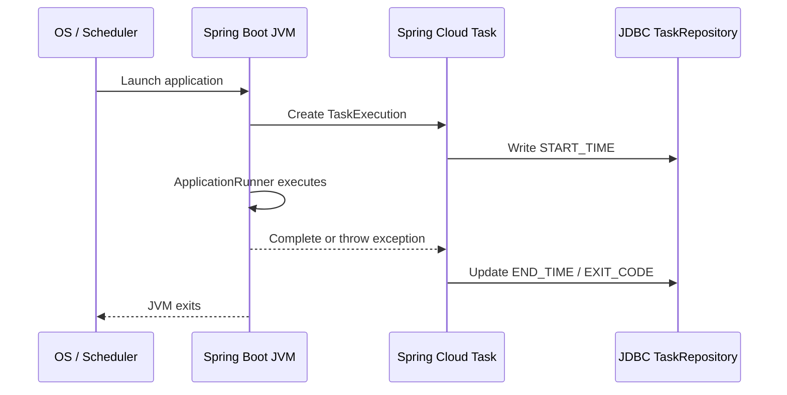
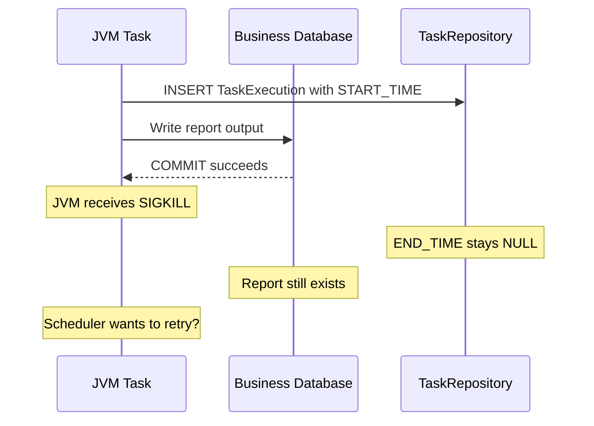
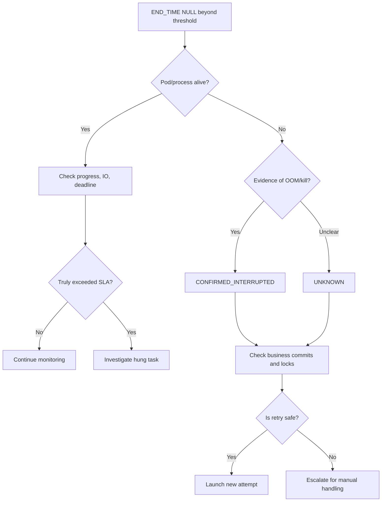

# TaskExecution Missing endTime After JVM Termination

## 1. The Diagnostic Problem

**Spring Cloud Task** builds finite-lived Spring Boot applications that run a unit of work and exit: data imports, synchronization, report generation, or running a Spring Batch Job. Each launch is recorded in **TaskRepository** as a `TaskExecution` storing the start time, end time, arguments, and error state.

A common incident occurs when the task has terminated at the OS or Kubernetes level, yet the `TASK_EXECUTION` table still reads:

```text
TASK_EXECUTION_ID = 1842
TASK_NAME         = daily-reconciliation
START_TIME        = 2026-11-24 08:00:01
END_TIME          = NULL
ERROR_MESSAGE     = NULL
```

**`END_TIME IS NULL` does not prove the task is still running.** The JVM may have received `SIGKILL`, suffered an OOM kill, crashed, or lost database connectivity before finishing the metadata update. Conversely, the task could still be running normally or be hung.

After this lesson in the **Diagnostics** chapter of `SPRING_CLOUD_TASK`, you will be able to:

- Understand the sequence in which Spring Cloud Task writes `START_TIME` and `END_TIME`.
- Distinguish controlled shutdown (`SIGTERM`), forced termination (`SIGKILL`), application failures, and database failures.
- Use SQL to inspect open TaskExecutions without corrupting history.
- Reproduce the symptom with a Java application and persistent PostgreSQL.
- Reconcile `TaskRepository`, logs, PIDs, Pods/Jobs, and business data before retrying.
- Separate metadata issues from Spring Batch status or single-instance locks.
- Design a safe reconciliation and alerting workflow.

## 2. Why Does START_TIME Exist Without END_TIME?

Start and end timestamps are **not written inside a single transaction spanning the entire execution**. Spring Cloud Task opens an execution and persists start metadata, then the runner executes. When exiting along the proper termination path, the framework updates `END_TIME`, exit code, and related fields.



If the JVM disappears **between those two repository operations**, the committed start record stays behind while the end update never occurs.

| Point of interruption | Observable metadata | Meaning |
| --- | --- | --- |
| Before TaskRepository writes successfully | No `TASK_EXECUTION` row | Very early startup failure; cannot diagnose via Task SQL alone. |
| After writing START_TIME, inside runner | Row exists with `END_TIME NULL` | Final status not written yet; task may have been killed. |
| After business data commits, before Task updates | `END_TIME NULL`, yet business data **already exists** | Retrying requires idempotency to avoid duplicates. |
| After callbacks complete and repository updates | `END_TIME` and final outcome present | Metadata describes a finished execution. |

### 2.1. Columns to Understand

| `TASK_EXECUTION` column | Purpose | Limitation when JVM is killed |
| --- | --- | --- |
| `TASK_EXECUTION_ID` | ID of a single run | ID exists if the initial record committed. |
| `TASK_NAME` | Logical task name | Multiple attempts can share the same name. |
| `START_TIME` | Timestamp when framework recorded start | Not a heartbeat proving the task is still alive. |
| `END_TIME` | Timestamp when framework recorded end | May remain `NULL` if no execution path runs the update. |
| `EXIT_CODE` | Outcome code recorded by Task | **Do not infer success** solely from this value when `END_TIME` is `NULL`. |
| `ERROR_MESSAGE`, `EXIT_MESSAGE` | Error/message recorded by framework | May be blank if JVM terminated abruptly. |
| `LAST_UPDATED` | Metadata update timestamp, in schemas that support it | Not necessarily updated continuously while the runner executes. |
| `EXTERNAL_EXECUTION_ID` | Orchestrator identifier if populated | Helps correlate to process/Pod. |

Check the **schema matching your exact Spring Cloud Task version**. `TaskRepository` is distinct from Spring Batch's `JobRepository`; a completed `BATCH_JOB_EXECUTION` does not guarantee `TASK_EXECUTION.END_TIME` was written.

### 2.2. Do Not Conclude from EXIT_CODE or Empty ERROR_MESSAGE

If `END_TIME` remains `NULL`, the final outcome at the TaskRepository level is **unconfirmed**. A non-null `EXIT_CODE` may not reflect the final outcome; an empty `ERROR_MESSAGE` likewise does not indicate success. You need corroborating evidence from the scheduler, logs, and business database.

## 3. Common Root Causes

| Cause | Symptom | What to check |
| --- | --- | --- |
| Task is still running | JVM/Pod alive and making progress | PID, Pod status, duration vs. SLA. |
| Task hung calling DB/API | Pod Running yet logs stopped, thread blocked | Thread dump, timeouts, deadlock, dependencies. |
| `SIGKILL` / `kill -9` | No shutdown logs, OS terminated process immediately | Exit status, host/container events. |
| OOM kill | Container reason `OOMKilled`, often exit code 137 | Memory limits, `kubectl describe pod`, node events. |
| `SIGTERM` followed by grace-period expiry | Shutdown started then forcefully terminated | `terminationGracePeriodSeconds` and shutdown logs. |
| Node/container runtime loss | Pod Evicted/Unknown/Node NotReady | Kubernetes and platform events. |
| JDBC failure on end update | Runner logged completion, metadata not updated | Connection pool, DB privileges, network, JDBC logs. |
| Exit outside framework | `System.exit`, `Runtime.halt`, native crash | Code paths, OS logs, thread dumps. |
| Early startup failure | No initial record | Startup logs, datasource/schema. |

`SIGTERM` requests termination so the process has a chance to shut down gracefully; however, it **does not guarantee** the listener updates the repository if a runner is hung or the grace period expires. `SIGKILL` **cannot be caught by Java**, so `@AfterTask`, `@FailedTask`, and shutdown hooks are not guaranteed to execute.

The same applies to custom callbacks: writing audit records in `@AfterTask` cannot ensure `END_TIME` is always populated after forced termination.

## 4. Read-Only SQL Queries to Locate Suspect Records

The examples below use **PostgreSQL**, assuming the Spring Cloud Task schema is provisioned and the diagnostic account has read privileges.

### 4.1. Runs Without an End Timestamp

```sql
SELECT TASK_EXECUTION_ID,
       TASK_NAME,
       START_TIME,
       END_TIME,
       EXIT_CODE,
       ERROR_MESSAGE
FROM TASK_EXECUTION
WHERE END_TIME IS NULL
ORDER BY START_TIME ASC;
```

This is a **list to investigate**, not a list of guaranteed crashes. On large tables, scope by task name/time window and paginate.

### 4.2. Finding Records Exceeding an SLA Threshold

```sql
SELECT TASK_EXECUTION_ID,
       TASK_NAME,
       START_TIME,
       CURRENT_TIMESTAMP - START_TIME AS ELAPSED,
       EXIT_CODE,
       ERROR_MESSAGE
FROM TASK_EXECUTION
WHERE END_TIME IS NULL
  AND START_TIME IS NOT NULL
  AND START_TIME < CURRENT_TIMESTAMP - INTERVAL '30 minutes'
ORDER BY START_TIME;
```

The **30-minute threshold is purely illustrative**; if a job normally runs for 3 hours, you cannot apply a single 30-minute cutoff. Choose thresholds based on SLA, p95/p99 duration, timeouts, and schedule cadence.

### 4.3. Additional Metadata When Schema Includes Corresponding Columns

```sql
SELECT TASK_EXECUTION_ID,
       TASK_NAME,
       START_TIME,
       LAST_UPDATED,
       EXTERNAL_EXECUTION_ID,
       PARENT_EXECUTION_ID
FROM TASK_EXECUTION
WHERE END_TIME IS NULL;
```

`LAST_UPDATED` is **not a standard heartbeat**; lack of updates while a runner works does not mean the process died. `EXTERNAL_EXECUTION_ID` may be null if the platform does not populate/integrate that identifier. When comparing timestamps, watch out for timezones across the database, nodes, and logs.

### 4.4. Cross-Checking Retries

```sql
SELECT TASK_EXECUTION_ID,
       TASK_NAME,
       START_TIME,
       END_TIME,
       EXIT_CODE
FROM TASK_EXECUTION
WHERE TASK_NAME = 'daily-reconciliation'
ORDER BY TASK_EXECUTION_ID DESC;
```

Each scheduler retry typically creates a new `TaskExecution`. An old attempt with `END_TIME NULL` alongside a newer completed attempt is not necessarily a duplicate-execution bug; distinguish attempts using timestamps, logs, and execution IDs.

## 5. Sample Application to Reproduce the Symptom

This example uses **Java 17**, **Spring Boot 3.4.5**, **Spring Cloud 2024.0.2**, and PostgreSQL. The task runs long enough for you to kill the JVM while the runner is active. PostgreSQL lives outside the process so `TaskExecution` history **does not vanish** when Java is killed.

```text
task-endtime-lab/
├── pom.xml
└── src/main/
    ├── java/com/example/diagnostics/
    │   ├── EndTimeLabApplication.java
    │   └── SlowRunner.java
    └── resources/application.yml
```

### 5.1. Maven `pom.xml`

```xml
<?xml version="1.0" encoding="UTF-8"?>
<project xmlns="http://maven.apache.org/POM/4.0.0"
         xmlns:xsi="http://www.w3.org/2001/XMLSchema-instance"
         xsi:schemaLocation="http://maven.apache.org/POM/4.0.0 https://maven.apache.org/xsd/maven-4.0.0.xsd">
    <modelVersion>4.0.0</modelVersion>

    <parent>
        <groupId>org.springframework.boot</groupId>
        <artifactId>spring-boot-starter-parent</artifactId>
        <version>3.4.5</version>
        <relativePath/>
    </parent>

    <groupId>com.example</groupId>
    <artifactId>task-endtime-lab</artifactId>
    <version>0.0.1-SNAPSHOT</version>

    <properties>
        <java.version>17</java.version>
    </properties>

    <dependencyManagement>
        <dependencies>
            <dependency>
                <groupId>org.springframework.cloud</groupId>
                <artifactId>spring-cloud-dependencies</artifactId>
                <version>2024.0.2</version>
                <type>pom</type>
                <scope>import</scope>
            </dependency>
        </dependencies>
    </dependencyManagement>

    <dependencies>
        <dependency>
            <groupId>org.springframework.cloud</groupId>
            <artifactId>spring-cloud-starter-task</artifactId>
        </dependency>
        <dependency>
            <groupId>org.springframework.boot</groupId>
            <artifactId>spring-boot-starter-jdbc</artifactId>
        </dependency>
        <dependency>
            <groupId>org.postgresql</groupId>
            <artifactId>postgresql</artifactId>
            <scope>runtime</scope>
        </dependency>
    </dependencies>

    <build>
        <plugins>
            <plugin>
                <groupId>org.springframework.boot</groupId>
                <artifactId>spring-boot-maven-plugin</artifactId>
            </plugin>
        </plugins>
    </build>
</project>
```

`spring-boot-maven-plugin` packages an executable JAR; `spring-cloud-starter-task` provides TaskRepository/lifecycle support, and the JDBC driver persists metadata to PostgreSQL. Use BOM-managed versions compatible with Spring Boot and the exact Task schema rather than grabbing DDL from another release.

### 5.2. Configuration `application.yml`

```yaml
spring:
  application:
    name: task-endtime-lab
  main:
    web-application-type: none
  datasource:
    url: ${TASK_DB_URL:jdbc:postgresql://localhost:5432/task_diagnostics}
    username: ${TASK_DB_USER:task_runtime}
    password: ${TASK_DB_PASSWORD:}
  cloud:
    task:
      name: daily-reconciliation
      initialize-enabled: false
      closecontext-enabled: true

logging:
  level:
    org.springframework.cloud.task: DEBUG
```

`TASK_DB_URL`, `TASK_DB_USER`, and `TASK_DB_PASSWORD` are supplied at runtime. The `task_diagnostics` database and runtime user must exist beforehand; apply the **version-matched Spring Cloud Task DDL**, then leave `initialize-enabled=false`. Never use a production database to test process kills.

`web-application-type: none` keeps a web server from holding the JVM alive. `closecontext-enabled: true` encourages closing the context upon task completion, yet **cannot turn `SIGKILL` into a graceful shutdown**. Keep DEBUG logging limited to the lab or investigation window, as verbose logs consume resources and can expose configuration.

### 5.3. Spring Cloud Task Application

`EndTimeLabApplication.java`:

```java
package com.example.diagnostics;

import org.springframework.boot.SpringApplication;
import org.springframework.boot.autoconfigure.SpringBootApplication;
import org.springframework.cloud.task.configuration.EnableTask;

@SpringBootApplication
@EnableTask
public class EndTimeLabApplication {

    public static void main(String[] args) {
        SpringApplication.run(EndTimeLabApplication.class, args);
    }
}
```

### 5.4. Runner with Observable Milestones

`SlowRunner.java`:

```java
package com.example.diagnostics;

import java.util.List;

import org.springframework.boot.ApplicationArguments;
import org.springframework.boot.ApplicationRunner;
import org.springframework.stereotype.Component;

@Component
public class SlowRunner implements ApplicationRunner {

    @Override
    public void run(ApplicationArguments args) throws Exception {
        List<String> secondsArg = args.getOptionValues("hold-seconds");
        long seconds = secondsArg == null || secondsArg.isEmpty()
                ? 120L : Long.parseLong(secondsArg.get(0));
        if (seconds < 0 || seconds > 600) {
            throw new IllegalArgumentException(
                    "--hold-seconds must be within 0..600");
        }

        List<String> labels = args.getOptionValues("run-label");
        String label = labels == null || labels.isEmpty()
                ? "unspecified" : labels.get(0);

        System.out.println("RUNNER_STARTED label=" + label
                + " pid=" + ProcessHandle.current().pid());
        System.out.flush();

        try {
            Thread.sleep(seconds * 1000L);
        } catch (InterruptedException interrupted) {
            Thread.currentThread().interrupt();
            throw interrupted;
        }

        System.out.println("RUNNER_FINISHED label=" + label);
        System.out.flush();
    }
}
```

`Thread.sleep` merely simulates long-running work. `RUNNER_STARTED` marks that execution entered the runner before you try interrupting it. In real business tasks, log request identifiers, checkpoints, and results; never rely on sleep as synchronization.

## 6. Reproducing with Two Runs: Normal vs. SIGKILL

**Practice only on your machine or a dedicated test environment with an isolated database.** Never forcefully kill a production task just to inspect `END_TIME`.

### 6.1. Normal Run

```bash
mvn clean package
java -jar target/task-endtime-lab-0.0.1-SNAPSHOT.jar \
  --hold-seconds=2 --run-label=normal-001
```

Wait for the application to print:

```text
RUNNER_STARTED label=normal-001 pid=...
RUNNER_FINISHED label=normal-001
```

Query `TASK_EXECUTION` by timestamp/ID. On the normal path with a healthy DB, the row will have `END_TIME`. `run-label` is just a runner argument; it is **not a column** on `TASK_EXECUTION`. Do not invent a `RUN_LABEL` column in SQL queries.

### 6.2. Run Interrupted by SIGKILL

On Bash/Linux/macOS, launch a background process:

```bash
java -jar target/task-endtime-lab-0.0.1-SNAPSHOT.jar \
  --hold-seconds=120 --run-label=kill-001 > task-kill.log 2>&1 &
pid=$!
echo "PID=$pid"

# Wait for the runner to start; do not kill before task initialization.
started=false
for i in $(seq 1 100); do
  if grep -q 'RUNNER_STARTED label=kill-001' task-kill.log; then
    started=true
    break
  fi
  if ! kill -0 "$pid" 2>/dev/null; then break; fi
  sleep 0.2
done

if [ "$started" != true ]; then
  echo 'RUNNER_STARTED not observed; check task-kill.log'
  wait "$pid"
  exit 2
fi

# Kill only the exact PID of the test process just launched.
kill -KILL "$pid"
status=0
wait "$pid" || status=$?
echo "OS exit status=$status"
```

Upon receiving `SIGKILL`, the JVM **has no chance to run shutdown hooks**, so it cannot update the end metadata. On many Unix shells, the exit status for signal 9 is `137` (128 + 9); this is an **OS-level** exit code, not necessarily anything Spring Cloud Task wrote to `TASK_EXECUTION.EXIT_CODE`.

After the process terminates, query again:

```sql
SELECT TASK_EXECUTION_ID, TASK_NAME,
       START_TIME, END_TIME, EXIT_CODE, ERROR_MESSAGE
FROM TASK_EXECUTION
WHERE TASK_NAME = 'daily-reconciliation'
ORDER BY TASK_EXECUTION_ID DESC;
```

Typical expectations:

| Observation | Normal run | Killed run |
| --- | --- | --- |
| `RUNNER_STARTED` log | Present | Present |
| `RUNNER_FINISHED` log | Present | Absent |
| OS process alive afterward | No | No |
| Metadata `START_TIME` | Present | Usually present if initial insert succeeded |
| Metadata `END_TIME` | Present | **Likely still NULL** |
| `ERROR_MESSAGE` | No error | Likely empty, as JVM could not write |

If there is no start record because of a datasource error or killing the process too early, that is a **test setup failure**, not a valid reproduction of missing `END_TIME`. You can run SQL as soon as `RUNNER_STARTED` appears to confirm the metadata row exists before sending SIGKILL.

### 6.3. Windows PowerShell

```powershell
$jar = (Resolve-Path ".\target\task-endtime-lab-0.0.1-SNAPSHOT.jar").Path
$p = Start-Process -FilePath "java" -ArgumentList @(
    "-jar", $jar, "--hold-seconds=120", "--run-label=kill-win-001"
) -RedirectStandardOutput ".\task-win-out.log" -RedirectStandardError ".\task-win-err.log" -PassThru -NoNewWindow

# Wait until RUNNER_STARTED appears in task-win-out.log.
# Terminate only after confirming the exact test process.
Stop-Process -Id $p.Id -Force
```

`Stop-Process -Force` simulates forced termination, though it is not identical to POSIX signals. Verify logs and the database rather than expecting a fixed exit code across all operating systems.

### 6.4. SIGTERM Is a **Different** Test

On Unix, `kill -TERM PID` requests a graceful stop, giving Spring a chance to shut down if conditions permit. However, if the runner is blocked or the container's grace period is too short, the OS/orchestrator may escalate to SIGKILL.

Test SIGTERM separately and observe actual behavior. **Do not claim SIGTERM always reaches the `END_TIME` update callback**, nor substitute SIGTERM results for SIGKILL.

## 7. Diagnosing on Kubernetes Jobs and CronJobs

In Kubernetes, a `Job` can spawn **retry Pods** after a Pod fails, and a `CronJob` creates Jobs on a schedule. Each Pod can start a fresh JVM and a new `TaskExecution`. When investigating a row with `END_TIME NULL`, do not inspect only the latest Pod.

### 7.1. Read-Only Platform Queries

```bash
kubectl get jobs -n batch-jobs
kubectl get pods -n batch-jobs -l job-name=daily-reconciliation
kubectl describe job daily-reconciliation -n batch-jobs
kubectl describe pod POD_NAME -n batch-jobs
kubectl logs POD_NAME -n batch-jobs
```

Substitute the real `POD_NAME` and namespace. For a container restarted **within the same Pod**, try:

```bash
kubectl logs POD_NAME -n batch-jobs --previous
```

With `restartPolicy: Never`, the Job controller usually creates a **new Pod** for each retry; `--previous` may have nothing. Inspect all Pod attempts and centralized logs.

| Kubernetes indicator | Interpretation |
| --- | --- |
| `terminated.reason=OOMKilled` | Evidence of memory-pressure termination; inspect limits/events. |
| Exit code `137` | Commonly indicates SIGKILL; cross-check `reason`/events for root cause. |
| Exit code `143` | Commonly associated with SIGTERM in many runtimes, though not an absolute rule. |
| `NodeNotReady`, `Evicted`, or `Unknown` | Likely node/resource issue rather than runner logic bug. |
| `activeDeadlineSeconds` reached | Controller terminated an unfinished Job. |
| `backoffLimit` exceeded | Controller marked the Job failed after retry budget exhausted. |
| Pod `Running` yet no progress | Either still working or hung; check thread dumps and timeouts. |

### 7.2. Illustrative Manifest for Deadlines and Shutdown

```yaml
apiVersion: batch/v1
kind: Job
metadata:
  name: daily-reconciliation
spec:
  backoffLimit: 1
  activeDeadlineSeconds: 300
  template:
    spec:
      restartPolicy: Never
      terminationGracePeriodSeconds: 30
      containers:
        - name: task
          image: registry.example.com/tasks/daily-reconciliation:1.0.0
          args:
            - "--hold-seconds=120"
```

Image, namespace, datasource, and values are **illustrative** and incomplete for real deployment. Add Secrets, resource requests/limits, DB permissions, and an appropriate image registry.

`terminationGracePeriodSeconds` is the window Kubernetes grants for process shutdown—**not a promise that the Task listener will update `END_TIME`**. An OOM-killed container or failed node can still leave unfinished metadata behind.

### 7.3. Correlating a TaskExecution with the Exact Pod

Persist correlation identifiers:

- `TASK_EXECUTION_ID` of each run.
- Task name, start timestamp, and business `requestId` if available.
- Job name, Pod name/UID, namespace, node, container exit code.
- `EXTERNAL_EXECUTION_ID` if populated by platform integration.
- A distinct `attemptId` per retry, separate from the business `requestId` that **stays constant** for a logical command.

Never assume `Pod UID` equals `TASK_EXECUTION_ID`; they come from two different systems. Also avoid putting sensitive data in request IDs, public logs, or high-cardinality metric tags.

## 8. Business Data May Have Committed Before the JVM Died

This is the single biggest reason why manually patching metadata or blindly retrying is dangerous.



**`END_TIME NULL` does not prove business side effects did not happen.** If the scheduler retries with a new request ID, the task may generate a duplicate report, order, or payment.

### 8.1. Reconciling Business Data

Suppose the application writes to a **business-defined** `report_output` table (not a Spring Cloud Task table):

```sql
SELECT request_id, report_day, status, created_at
FROM report_output
WHERE request_id = 'report-20261124';
```

If the report already exists and committed, the right action may be marking the request complete in the orchestrator or running a targeted compensating step—**not** regenerating the entire report.

If no output appears, still verify whether a transaction outcome is uncertain due to a dropped connection. Never infer from a JDBC exception alone that the database server failed to commit.

### 8.2. Idempotency Pattern with a Unique Key

A basic design:

```sql
CREATE TABLE report_request (
    request_id VARCHAR(100) PRIMARY KEY,
    report_day DATE NOT NULL,
    status VARCHAR(20) NOT NULL,
    created_at TIMESTAMPTZ NOT NULL DEFAULT CURRENT_TIMESTAMP
);
```

The application must keep `request_id` **stable across all retries** of the same command, validate the payload when encountering an existing ID, and wrap SQL mutations in proper transactions. The unique constraint prevents two transactions from recording outputs for the same ID.

Example atomic PostgreSQL operation:

```sql
INSERT INTO report_request (request_id, report_day, status)
VALUES ('report-20261124', DATE '2026-11-24', 'PROCESSING')
ON CONFLICT (request_id) DO NOTHING;
```

The `INSERT` outcome is only a **marker**; full correctness also requires designing `PROCESSING`/`COMPLETED` transitions, rollback handling, stuck-marker recovery, and committing business effects. Never treat `PROCESSING` alone as permanent proof a task is still running.

If the task sends emails, processes payments, publishes to Kafka, or calls external APIs, a SQL transaction cannot roll back external side effects. Use downstream idempotency keys, a transactional outbox, or a dedicated reconciliation workflow.

### 8.3. Cross-Checking with Spring Batch

When a task runs Spring Batch, TaskRepository stores **TaskExecution** while Batch `JobRepository` stores **JobExecution/StepExecution**. With `spring-cloud-task-batch` and the appropriate listener configured, `TASK_TASK_BATCH` links the two IDs:

```sql
SELECT t.TASK_EXECUTION_ID,
       t.TASK_NAME,
       t.END_TIME AS TASK_END_TIME,
       e.JOB_EXECUTION_ID,
       e.STATUS AS BATCH_STATUS,
       e.END_TIME AS BATCH_END_TIME
FROM TASK_TASK_BATCH x
JOIN TASK_EXECUTION t
  ON t.TASK_EXECUTION_ID = x.TASK_EXECUTION_ID
JOIN BATCH_JOB_EXECUTION e
  ON e.JOB_EXECUTION_ID = x.JOB_EXECUTION_ID
WHERE t.END_TIME IS NULL
ORDER BY t.TASK_EXECUTION_ID DESC;
```

**Preconditions:** Task and Batch tables must live in the same joinable database, and `TASK_TASK_BATCH` integration must be enabled. If the repositories live in separate DB engines, query each independently and join in application logic.

A `TaskExecution` missing `END_TIME` can still link to a `COMPLETED` Batch Job or an unfinished one. Before restarting, inspect `BATCH_JOB_INSTANCE`, `BATCH_JOB_EXECUTION`, `BATCH_STEP_EXECUTION`, JobParameters, and checkpoints. Never hand-edit JobRepository statuses to bypass restart errors without understanding which Steps already committed.

## 9. Do Not Confuse `END_TIME NULL` with Single-Instance Locking

If you enabled:

```yaml
spring:
  cloud:
    task:
      single-instance-enabled: true
```

Spring Cloud Task uses Spring Integration's JDBC lock registry to prevent overlapping runs of the **same task name**. This relies on the `TASK_LOCK` table in the Task schema, **not directly on `TASK_EXECUTION.END_TIME`**.

Implications:

- An open `TaskExecution` left by a crash **does not automatically mean** the lock is still held.
- A TTL-based lock can expire while an old process is still alive, risking overlap.
- When a retry is rejected, inspect **lock logs, live processes, Task name, datasource, and TTL**—not just `END_TIME`.
- **Never manually delete rows from `TASK_LOCK`** without proving the lock owner has stopped; doing so can launch two concurrent workers.

`single-instance-enabled` prevents overlap by task name, but does not prevent **sequential** duplicates after a lock releases. Business-level idempotency is still required.

## 10. Reconciliation: Investigate First, Never Arbitrarily Edit History

When an `END_TIME NULL` row exceeds its SLA, establish a **reconciliation workflow** drawing from multiple sources:



`UNKNOWN` and `CONFIRMED_INTERRUPTED` are **operator-defined classifications**, **not built-in statuses auto-generated** in `TASK_EXECUTION`.

### 10.1. Recording Evidence in a Separate Audit Table

Example:

```sql
CREATE TABLE task_execution_investigation (
    task_execution_id BIGINT PRIMARY KEY,
    observed_at TIMESTAMPTZ NOT NULL DEFAULT CURRENT_TIMESTAMP,
    observed_status VARCHAR(40) NOT NULL,
    evidence_summary TEXT NOT NULL,
    decision VARCHAR(60)
);
```

Record an evidence-backed conclusion:

```sql
INSERT INTO task_execution_investigation (
    task_execution_id,
    observed_status,
    evidence_summary,
    decision
) VALUES (
    1842,
    'CONFIRMED_INTERRUPTED',
    'Pod OOMKilled; END_TIME NULL; no process alive',
    'CHECK_BUSINESS_STATE_BEFORE_RETRY'
);
```

This is a **custom operational table**, not part of the Spring Cloud Task schema. Storing audits separately preserves original framework records and explains why retries were permitted or blocked.

### 10.2. Should You Manually Update END_TIME and EXIT_CODE?

**Never automate** statements like:

```sql
-- Example of what NOT to automate to mask failures:
-- UPDATE TASK_EXECUTION
-- SET END_TIME = CURRENT_TIMESTAMP, EXIT_CODE = 0
-- WHERE END_TIME IS NULL;
```

Reasons:

1. A still-running task could be marked finished and later overwrite metadata itself.
2. Reconciliation time is **not** when the JVM actually exited.
3. Setting `EXIT_CODE=0` fabricates a **false success** when the process was killed or business logic failed.
4. SLA reporting, audits, and retry decisions become corrupted.

If an exceptional situation requires repairing framework metadata, it must follow an **approved recovery procedure**: confirm the process is dead, identify the exact execution ID, back up data, use proper locking/transactions, log before/after values, and verify downstream systems. Never build a bot that sweeps all `END_TIME NULL` rows.

## 11. Prevention and Mitigation When a JVM Is Interrupted

No Java code can guarantee Spring callbacks execute after **SIGKILL** or power loss. Therefore, the operational goal is to **reduce the chance of losing end metadata, preserve external evidence, and make retries safe**.

### 11.1. Deliberate JVM Shutdown and Timeouts

- Do not launch unnecessary web servers in tasks; finite apps usually use `spring.main.web-application-type=none`.
- Use Spring Cloud Task's normal context-closing mechanism on completion, while recognizing it cannot protect against SIGKILL.
- Ensure runners await all mandatory `CompletableFuture`s/threads/Jobs before returning.
- Set connect/read timeouts on JDBC, HTTP, queues, and external APIs so runners cannot hang indefinitely.
- When handling `InterruptedException`, shut down business work safely, restore the interrupt flag if appropriate, and let the framework observe the failure.
- Budget shutdown time well within `terminationGracePeriodSeconds`; do not rely on infinite grace periods.
- Avoid calling `Runtime.halt` or killing the process mid-flight unless truly unavoidable.

### 11.2. Retry-Safe Data Design

- Give every business command an **idempotency key stable across retries**.
- Use unique constraints/upserts and transactions for outputs that must not duplicate.
- For long-running tasks, save checkpoints per work batch so progress is known.
- For external APIs or message brokers, combine outbox patterns or target-side idempotency.
- For Spring Batch, verify reader/writer restartability, JobParameters, and Step checkpoints.
- When DB connectivity drops and commit outcome is unknown, **reconcile data** before reapplying side effects.

### 11.3. Complementary Monitoring Signals

| Signal | What it detects well | Limitation |
| --- | --- | --- |
| `TASK_EXECUTION.END_TIME IS NULL` past SLA | Run has not recorded end outcome | Does not prove process is dead. |
| Kubernetes/OS exit status | SIGKILL, OOM, crash, runtime timeout | Does not prove business data rolled back. |
| App logs with correlation ID | Last visible step | Final log lines may not flush before kill. |
| Micrometer Observation/metrics | Duration, errors, slowdown signals | Short-lived tasks may die before metrics scrape/export. |
| Spring Cloud Stream task events | Start/end notifications if enabled | End events can also vanish on sudden JVM death. |
| Business/idempotency tables | Committed operations | Does not replace TaskRepository for full execution history. |
| Scheduler run history | Detects tasks that failed before recording TaskExecution | Requires accurate correlation between attempt and Task ID. |

**Seeing only a timer or "start" event without an "end" event** is also merely a trigger to investigate. When a process is killed, end metadata, end metrics, and end events can all go missing simultaneously.

## 12. Real-World Scenarios Easy to Misdiagnose

### Scenario A — OOMKilled After Creating an Invoice

A Kubernetes Job wrote an invoice to the business database and then got `OOMKilled` while rendering the PDF. `TASK_EXECUTION.END_TIME` is `NULL`, yet the invoice table already holds the row.

**Approach:** verify the invoice number has a unique key, identify missing PDF artifacts, and resume only the remaining unfinished steps. Never blindly re-run invoice creation under a new ID.

### Scenario B — SIGTERM Followed by SIGKILL After 10 Seconds

A Pod receives SIGTERM during a rollout/timeout. The runner is blocked on an HTTP client, and the 10-second grace period expires, causing forced termination.

**Approach:** correlate logs with signal timestamps, inspect HTTP timeouts, cancellation support, and checkpoints; tune the grace period if justified, but never assume a longer grace period guarantees `END_TIME` is always saved.

### Scenario C — Runner Finished, Metadata DB Unreachable

The application committed the report to the business database and logged completion. Connectivity to TaskRepository failed right when updating the end record.

**Approach:** inspect JDBC exceptions, DB/network logs, and business tables. Before retrying, verify the output already committed. A single `END_TIME NULL` row is never enough to justify re-running.

### Scenario D — JVM Not Dead, Just Hung

An execution has had a `START_TIME` for two hours; the Pod stays Running without log progress while a thread blocks on a socket.

**Approach:** capture thread dumps, inspect downstream dependencies/timeouts and transaction states. Do not start a second copy while the old process could still write data unless strong fencing/idempotency is in place.

## 13. Troubleshooting Lookup Table

| Symptom | Primary hypothesis | How to verify |
| --- | --- | --- |
| `END_TIME NULL`, Pod Running | Task still working or hung | PID/Pod liveness, progress, thread dumps, and SLA. |
| `END_TIME NULL`, Pod OOMKilled | JVM forcibly terminated | Pod reason, memory metrics, OS exit code. |
| `END_TIME NULL`, runner logged "done" | Metadata update failed or JVM died after business work | JDBC errors, DB connectivity, platform events. |
| `END_TIME NULL`, process received SIGKILL | Framework end path never executed | OS exit status, last logs, and START_TIME record. |
| No TaskExecution row at all | Very early startup error or reading wrong schema/DB | Logs, JDBC URL, profiles, metadata permissions. |
| Multiple rows with same task name | Separate runs or retries | Compare IDs, timestamps, request IDs, and Pod attempts. |
| Retry blocked after old Pod died | Single-instance lock unreleased/TTL active or another process running | Inspect `TASK_LOCK`, owner, TTL, and scheduler. |
| `ERROR_MESSAGE NULL` | Framework had no chance to write error | Check OS/Pod/logs; never assume success. |
| Overdue row yet task still alive | SLA too tight or task genuinely hung | Compare workload, CPU/IO, thread dumps, timeouts. |
| Spring Batch COMPLETED, Task missing END_TIME | Failure after Batch, before Task metadata update | Inspect `TASK_TASK_BATCH`, JobRepository, Task logs, and DB. |

Quick workflow: **suspect SQL → locate exact Pod/PID → check signal/exit code → inspect end-update JDBC errors → check business commits → decide idempotent retry → log reconciliation evidence**.

## 14. Production Operations Checklist

1. Confirm Spring Cloud Task version and matching TaskRepository schema.
2. Use **read-only** queries to find `END_TIME NULL` rows beyond each task's SLA threshold.
3. Identify the exact `TASK_EXECUTION_ID`, Pod, Job, namespace, or PID.
4. Determine whether the process is alive, hung, killed, or OOMKilled.
5. Collect logs, container exit codes, OS/Kubernetes events, timestamps, and request IDs.
6. Check metadata DB privileges/connectivity around the task's termination window.
7. Inspect committed business side effects **before retrying**.
8. Cross-check Batch `JobExecution`/`StepExecution` if the task runs Spring Batch.
9. Check `TASK_LOCK`, TTL, and liveness if single-instance locking is enabled.
10. Never delete locks or update `END_TIME` arbitrarily while the task might still be running.
11. Record `UNKNOWN`/`CONFIRMED_INTERRUPTED` investigation outcomes in a separate audit table.
12. Keep idempotency keys stable; separate `requestId` from `attemptId`.
13. Configure alerts for **missing scheduled runs**, as early startup failures may leave no TaskExecution.
14. Run SIGKILL, timeout, and OOM injection experiments only in isolated staging/test environments.

## 15. Practice Exercises

### Exercise 1 — Compare Normal Run vs. SIGKILL

1. Create the sample project and a test PostgreSQL instance with the official Spring Cloud Task schema.
2. Run `--hold-seconds=2` and confirm `END_TIME` is recorded.
3. Run `--hold-seconds=120`, wait for `RUNNER_STARTED`, then forcefully kill the test JVM.
4. Compare logs, OS exit status, `TASK_EXECUTION.START_TIME`, and `END_TIME`.
5. Explain why `ERROR_MESSAGE` can remain empty.

### Exercise 2 — Two Executions Both Having END_TIME NULL

Execution A has a Running Pod with advancing logs; execution B has an `OOMKilled` Pod. Design a classification scheme for A and B, what evidence to store, and next steps without mutating original metadata.

### Exercise 3 — Retrying When Data Already Committed

A task is killed right after writing a report. Propose a unique key, transaction boundary, and verification SQL to avoid recreating the report when the scheduler retries.

### Exercise 4 — Spring Batch on a Kubernetes Job

A Task runs a three-step Spring Batch Job. The JVM is killed in Step 3 and the Task lacks `END_TIME`. List the tables to inspect, how to verify checkpoints, and when restarting is safe versus creating a new JobInstance.

### Self-Check Questions

1. Why can `START_TIME` be recorded while `END_TIME` remains `NULL`?
2. Does `END_TIME IS NULL` prove the JVM is still running?
3. Why does `SIGKILL` prevent the framework from executing shutdown callbacks?
4. Does `SIGTERM` guarantee `@AfterTask` will run?
5. Why does `ERROR_MESSAGE NULL` not imply the task succeeded?
6. How do you detect an `OOMKilled` Pod?
7. Do `TASK_LOCK` and `TASK_EXECUTION.END_TIME` serve the same role?
8. Why must you not automatically backfill `END_TIME=NOW()` and `EXIT_CODE=0`?
9. When a run is killed after committing, how do retries avoid duplicate data?
10. When a task runs Spring Batch, which additional metadata must you inspect?

**Key takeaway:** `TaskExecution.END_TIME IS NULL` indicates **unconfirmed completion in metadata**, not proof that the task is still alive or had no business side effects. `SIGKILL`, OOM kills, forced termination, or TaskRepository update failures can all cause it. Diagnosis must reconcile **TaskRepository, OS/Pod/scheduler, logs, lock state, and business data**; safe retries rely on idempotency, and investigation conclusions belong in a separate audit record rather than altering history arbitrarily.

## References

- [Spring Cloud Task 3.2 — Features](https://docs.spring.io/spring-cloud-task/reference/3.2/features.html): TaskExecution lifecycle, TaskRepository, and application context management.
- [Spring Cloud Task 3.2 — Task Repository Schema](https://docs.spring.io/spring-cloud-task/reference/3.2/appendix-task-repository-schema.html): `TASK_EXECUTION` columns and related metadata tables.
- [Spring Cloud Task 3.2 — Observability](https://docs.spring.io/spring-cloud-task/reference/3.2/observability.html): metrics and traces for the Task lifecycle.
- [Kubernetes — Pod Lifecycle](https://kubernetes.io/docs/concepts/workloads/pods/pod-lifecycle/): container states and termination behavior.
- [Kubernetes — Job](https://kubernetes.io/docs/concepts/workloads/controllers/job/): retries, Pod attempts, and deadlines.
- [Spring Batch — Configuring a Job](https://docs.spring.io/spring-batch/reference/job/configuring-job.html): JobRepository, JobInstance, JobExecution, and restarts.
