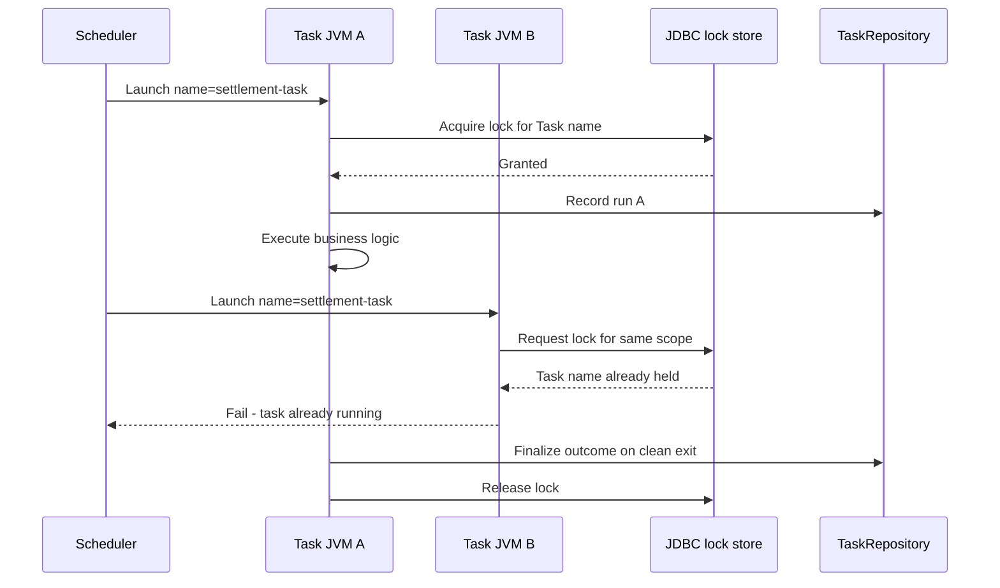
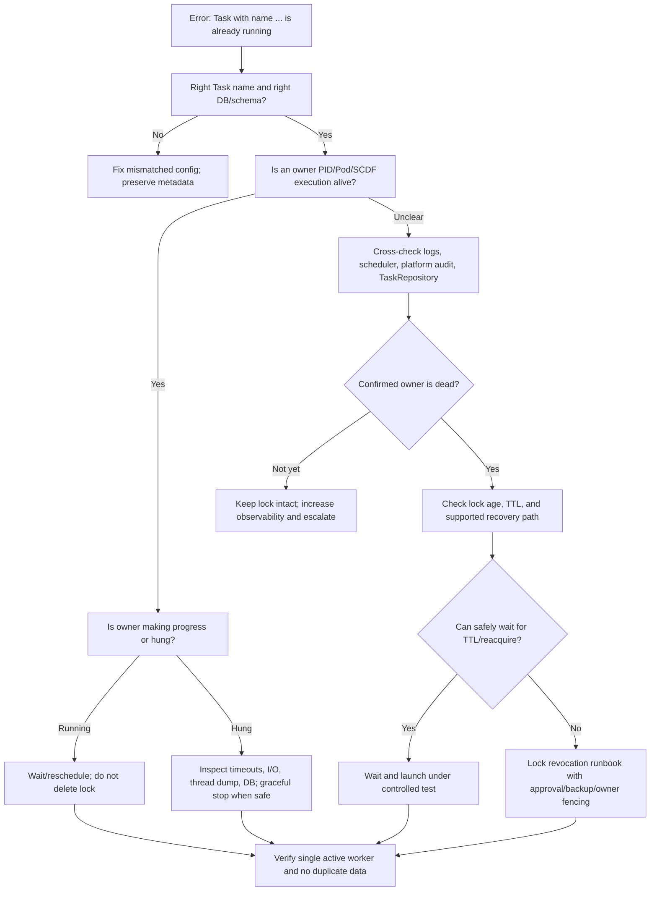

# Task-Already-Running Errors and Handling Still-Valid Locks

## Objectives and Real-World Scenario

In **Spring Cloud Task**, each Spring Boot application is designed to run a **finite-lived** unit of work: read parameters, process business logic, record state in `TaskRepository`, and terminate. An application such as `settlement-task` may be launched on a schedule, from SCDF, as a Kubernetes Job, or by an operator. For workloads that must not overlap, Spring Cloud Task supports `spring.cloud.task.single-instance-enabled=true`.

Suppose at 02:00, process A is reconciling business date `2026-11-23`. At 02:01, the scheduler launches process B with the **same Task name**. B is rejected with a message similar to:

```text
Task with name "settlement-task" is already running.
```

This may be **correct and necessary behavior** to prevent overlapping runs. However, if A **died long ago** yet B is still rejected, there may be an unreleased JDBC lock, an overly long TTL, mismatched configuration across instances, or metadata connectivity errors. Remediation must distinguish a **lock held by a living owner** from a **still-valid lock left behind after a crash**.

After this lesson, you will be able to:

- Recognize the message and exit code when single-instance rejects a Task with the same name.
- Understand the relationship among Task name, `TaskRepository`, the `TASK_LOCK` table, and Spring Integration's `JdbcLockRegistry`.
- Inspect processes/Pods, Task metadata, database config, and lock age **using strictly read-only operations**.
- Understand `single-instance-lock-check-interval`, `single-instance-lock-ttl`, TTL limitations, and the risk of a lock expiring while work is still running.
- Follow an **incident runbook** that avoids breaking lock ownership or causing overlapping runs.
- Test two-JVM contention, mid-run kills, scheduler retries, DB outages, and long-running Tasks.
- Distinguish execution locking from data **idempotency**, especially when Spring Batch or multiple replicas touch the same records.

**Documentation scope:** Behavior is described per [Spring Cloud Task – Features](https://docs.spring.io/spring-cloud-task/reference/features.html), [Spring Cloud Task – Task Repository Schema](https://docs.spring.io/spring-cloud-task/reference/appendix-task-repository-schema.html), [Spring Cloud Configuration Properties](https://docs.spring.io/spring-cloud/docs/current/reference/html/configprops.html), and [Spring Integration – JDBC Lock Registry](https://docs.spring.io/spring-integration/reference/jdbc/lock-registry.html). Columns, APIs, or TTL/renewal mechanisms can vary across releases; verify the deployed version before altering configs or touching the database.

## 1. What Does "Task with Name ... Is Already Running" Mean?

Spring Cloud Task permits **one execution per Task name at a time** when **all participating instances** enable single-instance mode and share a **common lock store**. According to the documentation, this property defaults to `false`:

```yaml
spring:
  application:
    name: settlement-task
  cloud:
    task:
      single-instance-enabled: true
```

If A holds execution rights for `settlement-task`, B with the same name is rejected. When rejected by this feature, **Spring Cloud Task exits with process exit code `1`** per the documentation. Rejection **does not mean B ran any business logic**; it can fail before B's `ApplicationRunner` is ever invoked. Exactly whether a `TaskExecution` row is created or finalized on that failure path must be observed on your specific version rather than assumed.

**Do not confuse three distinct events:**

1. **Another Task is genuinely running**: lock contention is working as intended. Wait or adjust the schedule—do not delete the lock.
2. **The lock-holding Task crashed**: the lock remains in the database after the crash and may be released/reacquired per TTL or a recovery procedure.
3. **The error is not lock contention**: missing lock table, missing DB privileges on the runtime user, different schema/DataSource, DB timeout, or a launcher exception. These can also cause non-zero exits, so read the **root cause and stack trace** before choosing a fix.

Process exit code `1` is **not a unique identifier for a lock conflict**. Spring Boot returns `1` for many other failures as well. Combine the **specific error message, configuration, and live runtime state**.

## 2. The Single-Instance Mechanism and Protection Boundaries

### 2.1. Locks Are Managed via Spring Integration JDBC

The single-instance feature uses **Spring Integration** locking components, so the docs require:

```xml
<dependencies>
    <dependency>
        <groupId>org.springframework.cloud</groupId>
        <artifactId>spring-cloud-starter-task</artifactId>
    </dependency>
    <dependency>
        <groupId>org.springframework.integration</groupId>
        <artifactId>spring-integration-core</artifactId>
    </dependency>
    <dependency>
        <groupId>org.springframework.integration</groupId>
        <artifactId>spring-integration-jdbc</artifactId>
    </dependency>
    <dependency>
        <groupId>org.postgresql</groupId>
        <artifactId>postgresql</artifactId>
        <scope>runtime</scope>
    </dependency>
</dependencies>
```

This is a `dependencies` snippet for a Spring Boot project; add the Boot parent/BOM and Spring Cloud BOM matching the **exact release train**. Never pick an incompatible Spring Integration version just to "fix a lock bug."

When a Task starts, Spring Cloud Task coordinates execution rights by **Task name** via the lock registry. A shared database backend ensures different JVMs/Pods cannot simultaneously claim the same name. In the default schema, Spring Cloud Task provides **`TASK_LOCK`** for this feature, while `TASK_EXECUTION` stores lifecycle history.



This diagram illustrates **logical order**, not the exact sequence of every SQL statement or framework event. On a startup-failure path, `TaskExecution` may not even be created. After a sudden crash, the framework has no chance to run metadata finalization or lock release as it would on a normal exit.

### 2.2. Same Task Name Does Not Mean Same Business Data

| A currently running | B wants to launch | Outcome when sharing lock store & single-instance enabled |
| --- | --- | --- |
| `settlement-task` for shop-42 date X | `settlement-task` for shop-42 date X | B is blocked |
| `settlement-task` for shop-42 date X | `settlement-task` for shop-43 date Y | B **is still blocked** because the name matches |
| `settlement-task` for shop-42 date X | `invoice-export-task` for shop-42 date X | Not excluded by **Task-name** lock |
| A finished and released lock | `settlement-task` for shop-42 date X | B can re-run **the same data** |

This feature restricts **concurrent execution**, not a subsequent run reprocessing the same business date next week. If you need per-tenant parallelism, locking on the entire Task name may be too coarse; consider an explicit partition/tenant-scoped lock design. Regardless of lock scope, **database unique keys, idempotency, and transactions** remain mandatory to protect business data across retries.

### 2.3. Where Does the Task Name Come From?

Per the docs, `TASK_NAME` is determined by `TaskNameResolver`; normally `spring.application.name` sets it. If unset, the default name can become **`application`**. Common consequences:

- Two unrelated applications both omit `spring.application.name` and **accidentally contend over the name `application`**.
- Container A uses `spring.application.name=settlement-task`, while container B gets overridden to `application` or another name, producing unexpected lock behavior.
- A custom `TaskNameResolver` alters the name at runtime without the scheduler/dashboard knowing.
- Different releases carry different configs, making mutual exclusion either too broad or too narrow.

**Your first check is verifying the actual name in the error log, in `TASK_EXECUTION`, and in each instance's runtime config.** Do not rely solely on JAR filenames, Pod names, SCDF task definitions, or Kubernetes Job names; they may not match `TaskExecution.taskName`.

## 3. Diagnostic Sources to Cross-Check

Do not glance at one DB table and declare "stale lock." A minimal investigation cross-checks three sources:

| Source | What to verify | Limitation |
| --- | --- | --- |
| **Runtime**: PID, Pod, Kubernetes Job, SCDF execution | Is A still alive, processing, hung, terminating, or restarted? | Pod disappearance does not mean external side effects completed |
| **TaskRepository**: `TASK_EXECUTION` | Which runs of the same name have `START_TIME`, `END_TIME`, `EXIT_CODE`, `LAST_UPDATED`? | `EXIT_CODE=NULL` can result from a crash, not proof it's alive |
| **JDBC lock store**: `TASK_LOCK` | Are lock row/owner, region, and creation time still present? | An existing row does not prove the owner is alive; do not arbitrarily join `CLIENT_ID` to TaskExecution |
| **Logs and process exit** | Is the error "already running" or a DB/permission error? | Process exit `1` has many possible causes |
| **Business data / Spring Batch** | Have chunks/transactions or external APIs committed? | Task failure does not imply all side effects rolled back |

`TaskRepository` and the lock store must use **the same shared metadata infrastructure** so instances can coordinate. With multiple `DataSource` beans, inspect `TaskConfigurer` and how the lock registry is wired. Per-JVM in-memory H2 cannot act as a distributed lock across two processes; both apps will "acquire the lock" inside separate private databases.

## 4. The `TASK_LOCK` Table: Read Properly, Never Delete Hastily

Spring Cloud Task 5.1 schema docs describe `TASK_LOCK` as:

| Column | Type in schema docs | Role |
| --- | --- | --- |
| `LOCK_KEY` | `CHAR(36)` | Lock identifier used by the registry |
| `REGION` | `VARCHAR(100)` | Lock group/scope |
| `CLIENT_ID` | `CHAR(36)` | Client/owner identifier stored in the lock repository |
| `CREATED_DATE` | `DATETIME`/`TIMESTAMP` | Timestamp when the lock was recorded |

Verify the **actual schema/prefix/DDL** before querying. This table belongs to `single-instance-enabled`, **not** `TASK_EXECUTION` and not `BATCH_JOB_EXECUTION`. `CLIENT_ID` and `LOCK_KEY` may follow internal encoding/generation rules; **never assume** they equal a TaskExecution ID or raw Task name to `JOIN` directly without checking your implementation/version.

**Read-only** query for PostgreSQL, assuming default schema:

```sql
SELECT LOCK_KEY, REGION, CLIENT_ID, CREATED_DATE
FROM TASK_LOCK
ORDER BY CREATED_DATE;
```

Compare against the **database's current clock** (never trust your laptop clock):

```sql
SELECT CURRENT_TIMESTAMP AS db_current_time;
```

On PostgreSQL, if `CREATED_DATE` has a compatible timestamp type, you can estimate age:

```sql
SELECT
    LOCK_KEY,
    REGION,
    CLIENT_ID,
    CREATED_DATE,
    CURRENT_TIMESTAMP AS observed_at,
    EXTRACT(EPOCH FROM (CURRENT_TIMESTAMP - CREATED_DATE))
        AS approximate_age_seconds
FROM TASK_LOCK
ORDER BY CREATED_DATE;
```

**Caveats when interpreting results:**

- Lock creation time **does not automatically reflect the last renewal** in every registry version. Spring Integration has evolved TTL/renewal mechanisms across releases; verify expiry fields against actual DDL/logic.
- An **old row** does not prove a stale lock: the owner may still be alive, the TTL long, or renewals active.
- **Zero rows** at query time does not prove it's safe to launch: another process can acquire the lock **right after** your query; let the coordination mechanism arbitrate.
- Do not run `SELECT * FOR UPDATE`, DDL commands, or long-lived read transactions just to observe; diagnostics must minimize impact on processes acquiring locks.
- If the lock table is named differently due to `spring.cloud.task.table-prefix` or a custom schema, **do not create a second table with the default name** to "fix the error" before checking configuration.

### 4.1. Comparing with `TASK_EXECUTION`

Query history for the same Task name:

```sql
SELECT
    TASK_EXECUTION_ID,
    TASK_NAME,
    START_TIME,
    END_TIME,
    EXIT_CODE,
    LAST_UPDATED,
    EXTERNAL_EXECUTION_ID,
    ERROR_MESSAGE
FROM TASK_EXECUTION
WHERE TASK_NAME = 'settlement-task'
ORDER BY TASK_EXECUTION_ID DESC;
```

Find runs with unfinalized metadata:

```sql
SELECT
    TASK_EXECUTION_ID,
    TASK_NAME,
    START_TIME,
    END_TIME,
    EXIT_CODE,
    LAST_UPDATED
FROM TASK_EXECUTION
WHERE TASK_NAME = 'settlement-task'
  AND (END_TIME IS NULL OR EXIT_CODE IS NULL)
ORDER BY START_TIME;
```

In Spring Cloud Task, `EXIT_CODE=NULL` **while running** is normal. Yet after `SIGKILL`/OOM-kill, the app cannot write final status or timestamps, leaving fields `NULL` even though the JVM is gone. Conversely, a bootstrap failure before `ApplicationContext` finishes may leave **no TaskExecution**. Therefore, cross-check **process/container state**, logs, scheduler, and `TASK_LOCK` rows before concluding.

**Never "clean up" a dashboard with `UPDATE TASK_EXECUTION SET EXIT_CODE=1 WHERE EXIT_CODE IS NULL`.** That both falsifies history and fails to release any lock. Repository metadata and lock registry state are separate concerns.

### 4.2. Distinguishing Lock Registry Locks from SQL Transaction Locks

If a DB transaction holds row locks too long, lock acquisition queries may slow down or time out; however, **PostgreSQL row locks** and application rows in `TASK_LOCK` are completely different concepts. When you see `deadlock detected`, `lock timeout`, `cannot acquire JDBC connection`, or `permission denied for relation TASK_LOCK`, classify it as a **database infrastructure/access issue**, not "another Task with the same name is running."

## 5. Checking `single-instance-lock-*` Config and Lock Hold Duration

Per Spring Cloud Task configuration properties documentation, the primary properties are:

| Property | Documented default | Purpose |
| --- | --- | --- |
| `spring.cloud.task.single-instance-enabled` | `false` | Restricts execution to one running Task per Task name at a time |
| `spring.cloud.task.single-instance-lock-check-interval` | `500` **milliseconds** | Interval between lock checks/attempts |
| `spring.cloud.task.single-instance-lock-ttl` | `Integer.MAX_VALUE` **milliseconds** per docs | Maximum duration a Task holds lock rights before expiry applies |
| `spring.cloud.task.table-prefix` | `TASK_` | Prefix for repository tables, including the lock table per config |
| `spring.application.name` | App-dependent | Typical name used by `TaskNameResolver` to define lock scope |

Both time settings are in **milliseconds**, not seconds. Example:

```yaml
spring:
  application:
    name: settlement-task
  main:
    web-application-type: none
  cloud:
    task:
      single-instance-enabled: true
      single-instance-lock-check-interval: 500
      single-instance-lock-ttl: 1800000
      initialize-enabled: false
      closecontext-enabled: true
```

`1800000` milliseconds equals **30 minutes**. This value is **only for scenarios where the Task always completes in under 30 minutes**; **never** copy it into production if the Task can run longer than 30 minutes. Too short a TTL lets B steal the lock while A is still writing data. Too long a TTL lets a dead JVM block subsequent runs for an unacceptable duration.

**Key distinctions to keep clear:**

- `lock-check-interval` is **not** an overall Task timeout; changing `500` to `1000` will not "release" a held lock.
- `lock-ttl` is **not** an execution timeout killing a running Task; it is the validity duration of the **lock lease**. TTL expiry does not kill A or roll back A's writes.
- `closecontext-enabled=true` closes the context after runners finish so the process can exit when nothing keeps it alive; it **does not** clean up locks left by `SIGKILL`.
- Spring Integration's `JdbcLockRegistry` includes a **renewLock** concept in corresponding versions, but **do not assume** Task's single-instance feature automatically renews locks for every workload and version. If a Task can outlive TTL, verify the implementation/logs or tune TTL alongside data-layer deduplication.
- In Spring Integration 7.0+, some TTL/schema mechanics changed—for example, adding an `EXPIRED_AFTER` column in `INT_LOCK` DDL per 7.x docs. **Never apply `INT_LOCK` SQL migrations onto `TASK_LOCK` of another version** without checking official DDL and actual lock repository wiring.

### 5.1. Choosing TTL from Measured Data, Not Guesswork

A decision model:

```text
Task P99 runtime:      12 minutes
Slow tail/outlier:     18 minutes
Graceful termination:  2 minutes
Trial TTL:             > real worst-case duration + safety margin
Crash RTO:             may need to be shorter than proposed TTL
```

These represent a **trade-off** between two goals:

- **Safety**: TTL must be long enough that a live owner never loses the lock mid-run.
- **Availability**: TTL short enough that a dead owner does not block the next Task too long.

If TTL alone cannot satisfy both, design **version-appropriate ownership/lease renewal plus fencing/idempotency at the data sink**, or establish an operational runbook confirming owner death before intervening. Never try to fix safety simply by setting an ultra-short TTL.

### 5.2. Runtime Config Overrides People Often Miss

Spring Boot supports externalized configuration. Thus `application.yml` alone may not reflect the final values:

- Environment variables can enable or disable `single-instance-enabled`.
- JVM `-D...` system properties and CLI `--spring.cloud.task...` flags override according to precedence.
- `prod` profiles, Config Server, Helm values, and Kubernetes ConfigMaps/Secrets add further layers.
- A Pod running an older release may have a different TTL from a newer Pod with the same Task name.

During an incident, collect the **effective configuration** from deployment manifests and startup logs safely without dumping secrets. Above all, never pass `--spring.cloud.task.single-instance-enabled=false` on a new Pod just to "get past the error"; that **breaks mutual exclusion** and risks two concurrent writers.

## 6. Hands-On: Reproducing Two-JVM Contention on a Shared Database

Use this section strictly in a **test environment**, never against a production business database. We build an `ApplicationRunner` that sleeps for 45 seconds so we can observe lock rejection while one JVM holds execution rights.

### 6.1. Minimal Spring Cloud Task Application

Create `src/main/java/com/example/task/SingleInstanceLabApplication.java`:

```java
package com.example.task;

import java.time.LocalDate;
import java.util.List;

import org.springframework.boot.ApplicationRunner;
import org.springframework.boot.SpringApplication;
import org.springframework.boot.autoconfigure.SpringBootApplication;
import org.springframework.cloud.task.configuration.EnableTask;
import org.springframework.context.annotation.Bean;

@SpringBootApplication
@EnableTask
public class SingleInstanceLabApplication {

    public static void main(String[] args) {
        SpringApplication.run(SingleInstanceLabApplication.class, args);
    }

    @Bean
    ApplicationRunner demoRunner() {
        return args -> {
            List<String> values =
                    args.getOptionValues("business-date");

            if (values == null || values.size() != 1) {
                throw new IllegalArgumentException(
                        "Required --business-date=YYYY-MM-DD");
            }

            LocalDate date = LocalDate.parse(values.get(0));

            System.out.printf(
                    "RUN_START businessDate=%s%n", date);

            // Used only to reproduce overlap in the lab.
            Thread.sleep(45_000L);

            System.out.printf(
                    "RUN_END businessDate=%s%n", date);
        };
    }
}
```

This demo app has one runner and no business side effects. `@EnableTask` requires Spring Cloud Task on the classpath; with the starter and proper auto-configuration, the Task lifecycle creates metadata. Build with compatible Java and Boot/Cloud BOM versions.

### 6.2. Shared Persistent Database Configuration

`src/main/resources/application.yml`:

```yaml
spring:
  application:
    name: single-instance-lab
  main:
    web-application-type: none
  datasource:
    url: ${TASK_DB_URL}
    username: ${TASK_DB_USER}
    password: ${TASK_DB_PASSWORD}
  cloud:
    task:
      single-instance-enabled: true
      single-instance-lock-check-interval: 500
      single-instance-lock-ttl: 120000
      initialize-enabled: false
      closecontext-enabled: true

logging:
  level:
    org.springframework.cloud.task: DEBUG
```

`120000` milliseconds = **2 minutes**; the demo runner sleeps **45 seconds**, so TTL is comfortably longer under normal runs. This config assumes a dedicated lab PostgreSQL instance, JDBC driver, version-matched `TASK_EXECUTION` and `TASK_LOCK` migrations, and an account with DML privileges. **Never** use `jdbc:h2:mem:...` across two processes because they do not share a lock store.

Before running, export `TASK_DB_URL`, `TASK_DB_USER`, and `TASK_DB_PASSWORD` in both terminals using your environment's secure mechanism. Do not paste passwords into Java CLI commands or shell history for convenience.

### 6.3. Running A Then B

After building the project's JAR, for example:

```bash
# Terminal A
java -jar target/single-instance-lab.jar \
  --business-date=2026-11-23

# While A is sleeping, open Terminal B:
java -jar target/single-instance-lab.jar \
  --business-date=2026-11-24
```

Expectations:

1. A starts, prints `RUN_START`, and sleeps for 45 seconds.
2. B shares `spring.application.name=single-instance-lab`, the same DB, and single-instance enabled, so it is rejected. Logs may contain `Task with name "single-instance-lab" is already running.`. Docs specify **exit code `1`** for this failure.
3. Once A finishes, run B **again**: B is allowed to start because A's lock was released.
4. If B runs with a different Task name or connects to a different database, the mechanism does not protect the same scope; the test will **no longer test the right scenario**.

In Bash, run `echo $?` **immediately after** the Java command to inspect the process exit code; in PowerShell, check `$LASTEXITCODE`. If running via `mvn spring-boot:run`, Maven/the plugin acts as a wrapper process; test packaged JAR exit codes with `java -jar` directly.

A read-only SQL query to observe while A runs:

```sql
SELECT LOCK_KEY, REGION, CLIENT_ID, CREATED_DATE
FROM TASK_LOCK
ORDER BY CREATED_DATE;
```

Do not treat `CLIENT_ID` as if it were A's `TASK_EXECUTION_ID`. Correlate using timestamps, task names, runtime logs, launcher execution IDs, and implementation docs.

### 6.4. Variant: Testing Stale Locks After a Crash

Strictly in a **lab with an isolated database**:

1. Launch A and wait for the `RUN_START` log.
2. Induce a **forced JVM termination** (e.g., test harness process kill, skipping normal shutdown hooks).
3. Verify A's Pod/PID is **genuinely gone**, while inspecting `TASK_LOCK` and `TASK_EXECUTION` with read-only queries.
4. Launch B both before and after the configured test TTL; record whether it is rejected and when it succeeds.
5. After B runs, re-inspect Task history without manually editing A's `EXIT_CODE` just to make a dashboard look cleaner.

**Never run `kill -9`, `kubectl delete pod --force`, or lock-table deletes in production to simulate this.** Exact post-crash behavior depends on `JdbcLockRegistry` version, TTL, and process lifecycle; record lab observations alongside version/schema details. A's `TASK_EXECUTION` row may retain `EXIT_CODE=NULL` even though A is dead.

## 7. Diagnostic Decision Flowchart Before Intervening




## 8. Runbook for Handling a Still-Valid Lock After an Incident

The runbook goal is **restoring launch capability** without allowing two processes to mutate the same business data. Routine checks are **read-only**; lock revocation requires separate authorization and approval.

### Step 1 — Scope the Incident and Stop Launch Amplification

Record the Task name in logs, timestamp, image/version, profile, `TaskExecutionId` if any, scheduler/SCDF execution ID, and environment name. Pause any **retry storm** from the launcher/scheduler if every failure spawns a new Pod/Task. Never hastily flip `single-instance-enabled=false`.

First question: does the error affect **one Task name** or **many unrelated Tasks**?

- Only one name blocked, others fine → suspect legitimate lock contention or a name-scoped stale lock.
- Many Tasks failing with SQL/permission/connection timeouts → suspect database, schema, pool, or migration issues—**not** a single lock.
- Two Tasks with the same name running simultaneously → suspect inconsistent single-instance configs, differing `TaskNameResolver`s, unshared lock stores, or overly short TTL.

### Step 2 — Identify Every Possible Owner Process

On Kubernetes, using **verified namespace and labels**:

```bash
kubectl get jobs -n batch-workloads -l app=settlement-task
kubectl get pods -n batch-workloads -l app=settlement-task -o wide
kubectl describe pod -n batch-workloads <pod-name>
kubectl logs -n batch-workloads <pod-name> --timestamps
```

Replace `<pod-name>` with the real Pod name. If a container restarted **inside the same Pod** and prior container logs remain:

```bash
kubectl logs -n batch-workloads <pod-name> \
  --previous --timestamps
```

`--previous` cannot recover logs from a **deleted Pod**; check centralized logging and platform audits in that case. On VMs, inspect PID, process start time, and exit status from supervisor/systemd rather than trusting a single `ps` snapshot.

**Classifying the owner:**

| Runtime finding | Interpretation before touching the lock |
| --- | --- |
| Pod/VM process alive, within SLA | Lock is likely **legitimately held**; do not intervene |
| Process alive yet stuck on I/O/DB, past SLA | Inspect thread dumps, logs, downstream, lock waits; plan graceful stop |
| Pod gone, exit reason/trace confirms death | Grounds to suspect stale lock, yet still check other replicas/launchers |
| Owner cannot be identified | Insufficient evidence to delete lock; increase monitoring/escalate |
| Two processes with same name both active | Check TTL, config, DB, lock registry immediately; **prioritize stopping duplicate writes** |

For Spring Cloud Data Flow, cross-check Task execution listings, deployer resources, and `externalExecutionId`. SCDF can deploy **Pods or Jobs depending on platform/deployer**; do not assume it always creates the same Kubernetes resource type. Never manually delete SCDF-managed resources without understanding deployer lifecycle.

### Step 3 — Confirm Runtime Configuration and Database

Verify the **actual effective values** across every participating launcher:

- `spring.application.name` and `TaskNameResolver`.
- `spring.cloud.task.single-instance-enabled` must be `true` on all excluded instances.
- `spring.cloud.task.single-instance-lock-ttl`, `single-instance-lock-check-interval`, and Spring Cloud Task release.
- JDBC URL, database/schema, table prefix, account, and required `SELECT/INSERT/UPDATE/DELETE` privileges on the lock table per implementation.
- Spring Integration dependencies and matching schema version.
- Whether Task/DB names were accidentally shared across dev/staging/prod.

**Never print JDBC passwords/tokens to logs or tickets.** With multiple DataSources, verify which source **TaskRepository/LockRepository** uses; the business DB URL is not necessarily the lock store.

### Step 4 — Read Task Metadata and Lock Store Without Editing

Run the read-only queries from section 4:

```sql
SELECT TASK_EXECUTION_ID, TASK_NAME, START_TIME,
       END_TIME, EXIT_CODE, LAST_UPDATED
FROM TASK_EXECUTION
WHERE TASK_NAME = 'settlement-task'
ORDER BY TASK_EXECUTION_ID DESC;
```

```sql
SELECT LOCK_KEY, REGION, CLIENT_ID, CREATED_DATE
FROM TASK_LOCK
ORDER BY CREATED_DATE;
```

Compare timestamps against **database time**, process start/end times, and execution-ID-linked logs. `TASK_LOCK` can hold locks for **other scopes**, so **never delete all rows just because one Task is blocked**.

Seeing an unfinalized `TaskExecution` for a dead owner helps explain a post-crash lock; however, `EXIT_CODE=NULL` is **not sole proof**. A rejected attempt B might fail during bootstrap before creating a TaskExecution row—do not blame "DB write failure" when the root cause was rejection prior to record creation.

### Step 5 — Decide Between Waiting for TTL vs. Owner Incident Handling

**Safest branch:** if A is running, **wait**. If A is hung while alive, coordinate with the application team for a **graceful shutdown** after assessing side effects. If A is confirmed dead with no other owners, review the configured TTL, version-specific expiry logic, and observe the next lock acquisition.

- If the system self-recovers after expiry → verify only **one** new instance acquires rights, and document the crash/TTL root cause.
- If TTL is too long relative to RTO → coordinate an incident plan with DBA/SRE; **never** abruptly shorten TTL across production Pods while a live owner remains unverified.
- If a live owner lost rights due to TTL expiry → stop both old and new owners from writing concurrently via **fencing/idempotency**; do not merely delete lock rows.

**Manual lock revocation is a last resort.** If an approved organizational runbook allows acting on `TASK_LOCK`, it must require at minimum: confirming the owner stopped, pausing competing launchers, taking necessary backups/snapshots, scoping strictly by `LOCK_KEY` + `REGION` + owner per implementation, bounded privileges and transaction, checking affected row count, auditing, and preventing the old worker from returning. This is **version-specific**; there is no single universal `DELETE FROM TASK_LOCK` safe for every deployment. This lesson **intentionally omits a default delete command** to prevent misuse during live incidents.

**Strictly avoid:**

```text
Do NOT run: DELETE FROM TASK_LOCK;
Do NOT run: TRUNCATE TASK_LOCK;
Do NOT run: UPDATE TASK_EXECUTION SET EXIT_CODE = 0 ...;
Do NOT disable single-instance just to re-run while owner state is unclear.
Do NOT arbitrarily kill connections/processes on the production database.
```

The lines above are **anti-patterns** listed for recognition, not commands to execute.

### Step 6 — Controlled Re-Launch and Reconciliation

Only once authorization and owner state are clear:

1. Trigger **one** re-launch request with the verified Task name and JDBC config.
2. Monitor `TASK_LOCK`, `TaskExecutionId`, process/Pod, and logs.
3. Confirm **no two owners process business data simultaneously**; if they do, stop/fence per data-safety procedures.
4. Reconcile business results by **business key**; a failed Task run may still have committed partial data.
5. Re-check `TASK_EXECUTION` and Batch Job links if applicable.
6. Re-enable schedules/retries with backoff and quotas once stability returns.

### Step 7 — Postmortem and Recurrence Prevention

Record the timeline, error logs, code/schema versions, actual Task name, TTL/check interval, Task duration, owner status, read-only query outputs, approved actions, and data outcomes. Fix the **root cause**: overlapping schedules, unclosed contexts, hung threads, mis-sized lock TTL, missing indexes/privileges, DB timeouts, miswired multi-datasource configs, or missing deployment cleanup.

## 9. Symptom-Based Diagnostic Table

| Symptom / message | Likely cause | Check first | Remediation direction |
| --- | --- | --- | --- |
| `Task with name "settlement-task" is already running.`, A still running | Same-name mutual exclusion working properly | A's runtime, Task name, TaskRepository | Wait for A or reschedule; do not delete lock |
| Same error, yet Pod A was OOM-killed | Leftover lock after crash, long TTL | Confirmed owner death, lock row/time, OOM logs | Wait for expiry or follow approved revocation runbook |
| Two unrelated apps fail with name `application` | Both use default Task name | `spring.application.name`, `TASK_NAME` | Set distinct, explicit Task names per app |
| B not blocked while A runs same name | B disabled feature, wrong DB, overly short TTL | Effective config, datasource, schema, runtime | Fix shared lock store and strengthen data safety |
| `relation TASK_LOCK does not exist` | Missing schema migration or custom table prefix | DB/schema/DDL, Task config | Run proper pipeline migration; no ad-hoc patching |
| `permission denied for TASK_LOCK` | Runtime DB user lacks privileges | DB grants/account | Grant least-privilege schema permissions |
| `CannotAcquireLockException`/JDBC exception | Connection pool, DB outage, lock contention, or version cache limit | Root cause, DB metrics, stack trace | Fix DB infrastructure; don't jump to stale lock |
| Timeout at Task startup | Slow DB, infra, or lock operation | Network/pool/transactions, logs | Investigate timeout; check races/retries |
| Task finished yet JVM/Pod stays alive | Open context/threads, unclosed listener/worker | Thread dump, runner/lifecycle, closecontext | Close resources/threads cleanly |
| Old lock row yet TaskExecution `EXIT_CODE=0` | Different session/context, unlock failure, or timestamp semantics differ from expectation | Row owner, schema, runtime logs, registry version | Diagnose before declaring stale |
| TaskExecution `EXIT_CODE=NULL` for hours | Task still running or crashed before finalizing | Runtime, logs, `LAST_UPDATED` | Reconcile; never arbitrarily edit SQL history |
| SCDF/Scheduler keeps spawning Jobs after exit `1` | Retrying every non-zero exit indiscriminately | Retry policy, exit codes, and logs | Add backoff/cause-aware retry conditions |
| Spring Batch Job restart causes duplicate writes | Lock only prevents concurrency, not sequential retries | `JobExecution`, checkpoints, business keys | Idempotent writer, unique constraints, reconciliation |

**Never use `CREATED_DATE` in `TASK_LOCK` alone to compute an "expiration date" and decide to delete rows.** Only certain implementations behave that way. Verify TTL/renewal/expiry against the code and DDL of your actual Spring Integration version.

## 10. Comparing with Kubernetes CronJob, SCDF, and Custom Launchers

### 10.1. Why `concurrencyPolicy: Forbid` Does Not Replace Single-Instance

Kubernetes CronJob offers `concurrencyPolicy: Forbid` to stop **Jobs from that same CronJob** from overlapping. However:

- A manually created Job, a Job from another CronJob, or a Task launched by SCDF **is not governed by that CronJob's `concurrencyPolicy`**.
- Delayed/retrying schedulers using custom logic can fire multiple launch requests to the app.
- Two differently named Tasks can still write to the same business records.
- If A dies, letting a new Job run afterward does not prove prior data rolled back.

Therefore, in multi-trigger environments, you need consistent locking at the Task/orchestrator layer **and** always enforce idempotency at the data sink.

```yaml
apiVersion: batch/v1
kind: CronJob
metadata:
  name: settlement-nightly
spec:
  schedule: "0 2 * * *"
  concurrencyPolicy: Forbid
  jobTemplate:
    spec:
      template:
        spec:
          restartPolicy: Never
          containers:
            - name: task
              image: registry.example.internal/settlement-task:1.0.0
```

This is a **minimal manifest illustrating concurrency settings**, insufficient for production: you still need Secrets/DataSource, resource limits, timezone, backoff, service account, logging, and image policies. For multi-tenant Tasks, CronJob `Forbid` may also be too broad if tenants trigger independently.

### 10.2. SCDF, Composed Tasks, and Multiple Launches

Spring Cloud Data Flow can launch a Task definition multiple times, track executions, and orchestrate composed workflows. A Job/Task rejected by single-instance is a **launch-level failure** for that attempt; it does not imply the node started processing data.

Cross-check three IDs:

- Spring Cloud Task `TaskExecutionId` in `TASK_EXECUTION`.
- SCDF/deployer `externalExecutionId` or resource ID for correlation.
- Spring Batch `JobExecutionId`, which is **not** `TaskExecutionId`.

Attempts that fail very early may have **no TaskExecution**. In a composed task, one rejected child can halt the dependency graph per `&&` rules or error transitions; inspect logs and definitions rather than looking only at the parent's `EXIT_CODE`.

### 10.3. Scheduler Retries

Exit code `1` can trigger default job retries and cause a **retry storm** while A is still running:

```text
02:00  A holds the lock
02:01  B rejected with exit=1
02:01  Scheduler retries B
02:01  C rejected again
02:02  Wave of failed launches, log spike, continuous lock queries hammering DB
```

Distinguish **busy/locked** from **broken DB** using logs/error types in the launcher, not just exit code `1`. Configure **backoff, jitter, retry budgets**, and when needed **queue/delay** rather than spawning failed Jobs nonstop. If **every business period** must eventually run rather than skipping blocked schedules, the scheduler must track backlog/business-dates and launch catch-up runs idempotently.

## 11. Spring Batch, Idempotency, and Partially Committed Data

Spring Cloud Task and Spring Batch track different layers:

- `TaskExecution`: a single application/process run.
- `JobExecution` and `StepExecution`: Batch Job and per-Step state, including checkpoints and read/write/skip counts.
- `TASK_LOCK`: execution-locking metadata, **not** a business results table.

Task A might commit the first 10 chunks of a Batch Job and die mid-chunk 11. The lock remains held or eventually hits TTL. B is launched again for the same date:

- **If the writer lacks a unique business key**, B may duplicate the 10 already-committed chunks.
- **If `JobRepository` retains valid checkpoints and restarts the right `JobInstance`**, Spring Batch can resume via restart mechanics.
- **If a new `JobExecution` ID is created for a new `JobInstance`** with different identifying `JobParameters`, data may be re-read from the start even though execution locking worked properly.
- If writing to external Kafka/email/payment APIs, Batch's DB transaction does not automatically undo already-dispatched external side effects.

Example PostgreSQL business table:

```sql
CREATE TABLE settlement_result (
    tenant_id      VARCHAR(80) NOT NULL,
    business_date  DATE NOT NULL,
    total_amount   NUMERIC(20, 2) NOT NULL,
    PRIMARY KEY (tenant_id, business_date)
);
```

A DB-level deduplication approach:

```sql
INSERT INTO settlement_result (
    tenant_id, business_date, total_amount
) VALUES ('shop-42', DATE '2026-11-23', 180000.00)
ON CONFLICT (tenant_id, business_date) DO NOTHING;
```

This is a **PostgreSQL example** enforcing at most one summary row per tenant/date; it **does not** magically solve all double-processing hazards. On conflict, the application must read the existing row and **compare payloads** to distinguish a valid replay from changed data. If business rules allow revised reports, include `reportVersion` in the business key. For external APIs, use receiver-side idempotency keys or an outbox/dedup layer.

**Never "fix locking" by letting two workers run concurrently and hoping the database catches everything.** Unique constraints are a last line of defense, yet concurrency still wastes compute and risks non-DB side effects.

## 12. Monitoring and Alerting Before Locks Cause Outages

Dashboards should cover **four layers** (three operational layers plus business):

| Layer | Metrics/signals | Useful alerts |
| --- | --- | --- |
| Runtime | Process/Pod count per task name, started/finished, OOMKill, pending/terminating | Owner dead yet scheduler thinks it's running; >1 worker in same scope |
| Lock/DB | Single-instance rejection count, lock wait/attempt time, `TASK_LOCK` rows, DB connections, SQL errors | Sudden spike in lock rejections; abnormal lock age after crash |
| Task/Batch | `TaskExecution` `END_TIME`/`EXIT_CODE`, `JobExecution`/`StepExecution`, failure reasons | `NULL` past SLA, Batch Job FAILED, repeated retries |
| Business | New record count, duplicate claims, idempotency conflicts, last successful business date | Missed business period or duplicate outcomes after incident |

Never use `TaskExecutionId` or `LOCK_KEY` as **unbounded-cardinality metric labels**. Put those IDs into logs/traces for correlation, and keep metric tags low-cardinality such as `taskName`, `environment`, and `errorCategory`. Never log raw Task CLI arguments containing secrets or PII.

### 12.1. Setting SLA-Driven Thresholds

Example hypothetical policy:

- `settlement-task` normally runs 2–8 minutes, with a 20-minute SLA.
- If an "already running" log appears **once** while a Pod has been alive for 5 minutes, treat it as a low-severity schedule-overlap warning.
- If the same error repeats for over 30 minutes with no living owner Pod, alert to investigate stale lock/TTL.
- If **two workers write the same business key** concurrently, trigger a high-priority **data-safety** alert.
- If the DB is unreachable and multiple Task names fail simultaneously, escalate an infrastructure alert instead of focusing on a single lock row.

These numbers are examples only. Base thresholds on P95/P99 runtime, business SLA, current TTL, and the system's retry/backlog behavior.

## 13. Regression Testing Matrix

After changing configuration or running the runbook, verify in a **test environment** with a shared DB:

| Test case | Action | Expected observation |
| --- | --- | --- |
| Two JVMs, same name | Launch B while A sleeps | B is rejected; A finishes |
| B runs after A | Wait for A to release lock, then run B | B launches successfully |
| Two different task names | A and B use distinct names | Single-instance does not block each other |
| Default name collision | Two apps omit `spring.application.name` | Confirm shared `application` name causes lock contention |
| Different tenant, same name | A tenant 1, B tenant 2 | B can still be blocked by Task name |
| Unshared databases | A and B point to two different lab DBs | No reliable distributed exclusion; catch misconfiguration |
| B disables `single-instance-enabled` | Run B in lab while A runs | Overlap can occur; identify risk |
| Forced crash of A | Kill JVM A in lab, keep DB | Observe lock TTL and recovery; Task metadata may stay unfinalized |
| Overly short TTL | Task sleeps longer than controlled TTL | Overlap can occur; business constraints still protect data |
| Lock-store DB outage | Simulate brief disconnect on lab DB | Error clearly distinguished from "Task already running" |
| Concurrent Batch retries | A commits several chunks then crashes; B retries | No duplicate rows/side effects; checkpoints and unique keys hold |
| Scheduler retry storm | Cap retries and simulate slow A | Backoff/quota prevents infinite failing Pods |
| Task finishes yet thread stays alive | Use async worker in lab | Verify context/thread shutdown and lock release |
| Multi-replica artifact | Replicas share Task name, config, and JDBC store | Only one owner runs; all share visibility |

**A single A/B test pass does not prove the system achieves "exactly once."** Beyond concurrency, test **sequential** retries, crashes across every commit window, and non-DB side effects.

## 14. Scenario Exercises

**A.** Two distinct Tasks, `daily-import` and `daily-report`, both log `Task with name "application" is already running.`. Which configuration should you check first?

**Hint:** `spring.application.name`/`TaskNameResolver`. If both fall back to default `application`, they share the same lock scope despite being separate apps.

**B.** Scheduler run B exits with `1`, while Pod A of the same name is still running normally within SLA. A DBA suggests `DELETE FROM TASK_LOCK` so B can run immediately. Should you do it?

**Hint:** No. That is likely A's legitimate lock. Deleting it lets B overlap with A and corrupt data concurrently.

**C.** A was OOM-killed, `TaskExecution` still shows `EXIT_CODE=NULL`, and `TASK_LOCK` has an old row. Is that row guaranteed to be A's stale lock?

**Hint:** Not necessarily. Cross-check DB/schema source, Task name, version-specific region/owner, logs, and other replicas. Only after proving the owner died should you evaluate TTL or safe recovery paths.

**D.** A Task runs for 45 minutes while `single-instance-lock-ttl=600000`. When B is allowed to run after minute 10, what can happen?

**Hint:** 600000 ms = 10 minutes. Without an active renewal mechanism, B can acquire the lock while A is still processing. TTL does not kill A; adjust TTL or implement lease/fencing alongside idempotency.

**E.** `SELECT ... FROM TASK_LOCK` returns zero rows, yet the Task still fails with a JDBC connection error. Should you call that an "expired lock"?

**Hint:** No. The failure may stem from DB permissions, transaction/pool issues, or a different schema. A point-in-time empty query also does not prove the system has no lock contention/races.

**F.** A succeeded yesterday; today B with the same name launches again **for the same `businessDate`** and creates duplicate invoices. Did `single-instance-enabled` malfunction?

**Hint:** Not necessarily. Single-instance only prevents **two Tasks from running concurrently**. Once A finishes, B is allowed to run. Enforce stable business keys and unique/idempotency constraints to stop duplicates.

**G.** In an SCDF composed workflow, a child fails because an instance with the same name is already running, while the parent has its own `JobExecution`. Should you `JOIN` the parent's `JOB_EXECUTION_ID` against `TASK_LOCK` to investigate?

**Hint:** No. `JobExecutionId`, `TaskExecutionId`, and lock registry keys are three distinct identifiers. Use SCDF execution logs, TaskRepository metadata, and the version-specific registry schema to correlate properly.

## 15. Operations and Troubleshooting Checklist

- [ ] Distinguish **single-instance conflict** from schema, JDBC, permission, connection pool, or transaction timeout errors.
- [ ] Verify the actual Task name; give every app an explicit `spring.application.name` and consistent `TaskNameResolver`.
- [ ] Ensure all mutually excluded instances share the same JDBC lock store, schema, prefix, and `single-instance-enabled=true`.
- [ ] Align Spring Integration/JDBC dependencies and `TASK_LOCK` DDL with the exact **version** of Spring Cloud Task.
- [ ] Remember `single-instance-lock-check-interval` and `single-instance-lock-ttl` are in **milliseconds**; never confuse TTL with an execution timeout.
- [ ] Size TTL safely above real job duration; understand renewal/fencing if supported; never let a live owner lose its lock mid-write.
- [ ] Check Pod/PID/SCDF execution status and logs **before** concluding a lock is stale after a crash.
- [ ] Use **read-only** queries on `TASK_LOCK` and `TASK_EXECUTION`; never infer ownership solely from `CLIENT_ID` or `CREATED_DATE`.
- [ ] Never use `EXIT_CODE=NULL` as proof a Task is still running; never alter TaskRepository history just to tidy a dashboard.
- [ ] Never wipe the lock table, disable single-instance, or kill DB sessions before verifying owner state.
- [ ] When an owner dies, follow a process to wait out TTL or intervene only with approval, backups, owner fencing, and audit logs.
- [ ] Cap retry storms with backoff/quotas; prevent launchers from spawning endless failing Pods.
- [ ] Enforce unique business keys, transactions, checkpoints, and external API idempotency to protect data on re-runs.
- [ ] Monitor process/container exit, `TaskExecution`, Batch `JobExecution`, locks, and side effects after every recovery.
- [ ] Test two-JVM contention, crashes, short TTLs, mismatched DataSources, Task-name collisions, Spring Batch restarts, and scheduler retries on a test DB.

## 16. Official References

1. [Spring Cloud Task 5.1 – Restricting Spring Cloud Task Instances](https://docs.spring.io/spring-cloud-task/reference/features.html#restricting-spring-cloud-task-instances) — single-instance feature, Spring Integration dependencies, same-name Task message, and exit code `1`.
2. [Spring Cloud Task – Task Repository Schema](https://docs.spring.io/spring-cloud-task/reference/appendix-task-repository-schema.html) — `TASK_EXECUTION`, `TASK_LOCK`, and `LOCK_KEY`/`REGION`/`CLIENT_ID`/`CREATED_DATE` columns.
3. [Spring Cloud – Configuration Properties](https://docs.spring.io/spring-cloud/docs/current/reference/html/configprops.html) — `single-instance-enabled`, `single-instance-lock-check-interval`, and `single-instance-lock-ttl` defaults and millisecond units.
4. [Spring Integration – JDBC Lock Registry](https://docs.spring.io/spring-integration/reference/jdbc/lock-registry.html) — `JdbcLockRegistry`, `DefaultLockRepository`, stale locks, TTL, and renewal by version.
5. [Spring Boot – Externalized Configuration](https://docs.spring.io/spring-boot/reference/features/external-config.html) — property sources and environment/CLI precedence.
6. [Kubernetes – CronJob](https://kubernetes.io/docs/concepts/workloads/controllers/cron-jobs/) — `concurrencyPolicy: Forbid`, CronJob scope, and schedule retries.
7. [Kubernetes – Job](https://kubernetes.io/docs/concepts/workloads/controllers/job/) — Pod/Job states, retries/backoff, and Job completion.
8. [Spring Cloud Task – Batch integration](https://docs.spring.io/spring-cloud-task/reference/batch.html) — `TaskExecution` and `JobExecution`, propagating Batch errors to Task.
9. [Spring Batch – Job Restart](https://docs.spring.io/spring-batch/reference/job.html) — `JobInstance`/`JobExecution` lifecycle and restart semantics.

**Principle to remember:** **"Task with the same name is already running" is a concurrency safeguard, not automatically an error requiring lock deletion.** To recover safely, verify **Task name → runtime owner → TaskRepository → JDBC lock/TTL → business outcomes**, then decide whether to wait, recover, or intervene under control. **Never delete a lock solely because you see an old row, and never substitute execution locking for data idempotency.**
