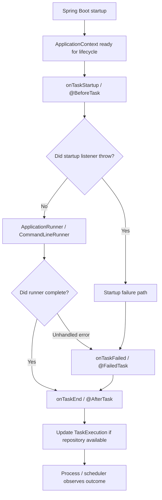
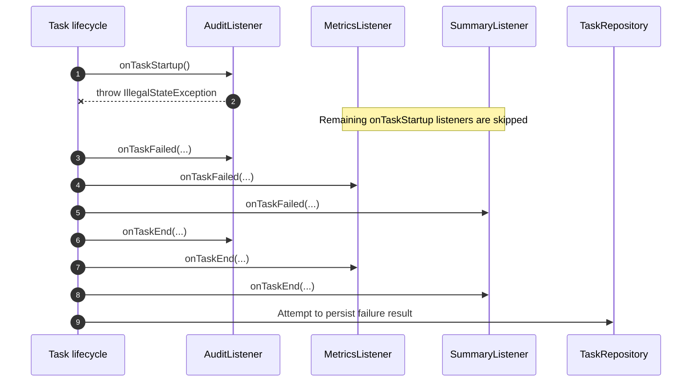

# Listener Throws an Exception or Exit Message Is Overwritten in Spring Cloud Task

## 1. Two Confusing Symptoms When Diagnosing a Task

In the **Spring Cloud Task** module, a Spring Boot application typically runs with a finite lifetime: process arguments, execute work, persist outcomes or invoke **Spring Batch**, and terminate. `TaskRepository` stores a `TaskExecution` recording when the app started, how it ended, and what errors occurred.

When inspecting execution history, operators sometimes run into two confusing situations:

- **Listener throws an exception:** a `@BeforeTask`, `@FailedTask`, `@AfterTask`, or `TaskExecutionListener` fails. Other callbacks do not run as expected; the job may report failure even though business logic succeeded, or error details are incomplete.
- **`exitMessage` is overwritten:** when the runner fails, `onTaskFailed` writes `FAILED: gateway timeout`, yet `onTaskEnd` overwrites it with `DONE`. The final query shows only `DONE` even though `errorMessage` and `exitCode` indicate the Task failed.

Both situations mislead dashboards, schedulers, alerts, and retry logic. An operator looking solely at the `EXIT_MESSAGE` column can easily conclude wrongly that "the Task succeeded."

This lesson belongs to the **Diagnostics** chapter, covering **Listener Throws an Exception or Exit Message Is Overwritten**. It combines Spring Cloud Task lifecycle tracking, distinguishing exit codes from exit messages, hands-on Java, SQL, and container/scheduler incident triage.

After this lesson, you will be able to:

1. Describe the three callbacks `onTaskStartup`, `onTaskFailed`, and `onTaskEnd` and their corresponding annotations.
2. Predict what happens when a listener throws an exception and why other listeners are skipped.
3. Explain `exitMessage` precedence and distinguish it from `errorMessage`/`exitCode`.
4. Write safe listeners that never break a Task due to logging, metrics, or auxiliary cleanup.
5. Verify outcomes across `TaskRepository`, logs, process exit codes, and the orchestrator platform.
6. Build test scenarios for startup errors, runner errors, callback errors, and overwritten messages.
7. Design retries, exit code control, and Spring Batch coordination without masking business failures.

## 2. Task Lifecycle and Where Listeners Fit

Once a Spring Boot application successfully bootstraps its `ApplicationContext`, Spring Cloud Task creates a `TaskExecution` for that run. Then `ApplicationRunner`/`CommandLineRunner` beans execute. Task infrastructure listens to Spring Boot events to determine success or failure and update the repository.

The three main `TaskExecutionListener` callbacks are:

| Interface callback | Corresponding annotation | Conceptual timing | Recommended responsibility |
| --- | --- | --- | --- |
| `onTaskStartup(TaskExecution)` | `@BeforeTask` | Startup phase, before runners | Add concise startup metadata, log correlation ID |
| `onTaskFailed(TaskExecution, Throwable)` | `@FailedTask` | When Task fails with an unhandled error | Record error type, helpful exit message, failure metric |
| `onTaskEnd(TaskExecution)` | `@AfterTask` | Final phase, before finalizing metadata | Fill missing final message, safe auxiliary cleanup |

**Two critical characteristics:**

- `onTaskEnd` **does not run only on success**. It can also be invoked after `onTaskFailed` when the Task fails.
- Exact callback timing relative to detailed metadata INSERT/UPDATE SQL depends on the release; never write logic assuming a database transaction in a given callback has already committed.



This diagram illustrates the **typical logical flow**. A very early bootstrap failure can leave no TaskExecution record at all, while forced shutdown or DB disconnection can leave `END_TIME` un-updated.

### 2.1. Listener Interface vs. Listener Annotations

You can create a bean implementing `TaskExecutionListener` to handle all three events, or place `@BeforeTask`, `@FailedTask`, and `@AfterTask` on Spring-managed bean methods.

Annotation example:

```java
import org.springframework.cloud.task.listener.annotation.BeforeTask;
import org.springframework.cloud.task.listener.annotation.AfterTask;
import org.springframework.cloud.task.listener.annotation.FailedTask;
import org.springframework.cloud.task.repository.TaskExecution;
import org.springframework.stereotype.Component;

@Component
class TaskEventObserver {

    @BeforeTask
    public void before(TaskExecution execution) {
        System.out.println("Starting Task " + execution.getTaskName());
    }

    @FailedTask
    public void failed(TaskExecution execution, Throwable throwable) {
        System.err.println(
            "Task failed with " + throwable.getClass().getSimpleName());
    }

    @AfterTask
    public void after(TaskExecution execution) {
        System.out.println("Task reached the end callback");
    }
}
```

This snippet demonstrates **event syntax**; `System.out` is for learning only—in real environments use a logger and proper observability. `@FailedTask` expects both `TaskExecution` and `Throwable`; do not assume this callback fires for an exception caught and swallowed inside a runner.

### 2.2. Do Not Compete with `TaskLifecycleListener` Using Arbitrary `ApplicationListener` Ordering

`TaskLifecycleListener` is a foundational Spring Cloud Task component. Official documentation warns that ordering an `ApplicationListener` **earlier** than `TaskLifecycleListener` in the event chain can cause unexpected side effects.

Therefore, prefer `TaskExecutionListener` or its annotations for Task lifecycle hooks. Never slap `@Order(HIGHEST_PRECEDENCE)` onto an `ApplicationReadyEvent` listener just to "write `exitMessage` before Task" without understanding metadata finalization ordering.

## 3. The Three Fields: `exitCode`, `exitMessage`, and `errorMessage`

These fields all live on `TaskExecution` yet serve distinct purposes.

| Field | Type/meaning | Common source | What to do when diagnosing? |
| --- | --- | --- | --- |
| `exitCode` | Integer representing Task outcome | Spring Cloud Task event/exception/mapping | Check 0 vs. non-zero; compare with OS exit code |
| `exitMessage` | Summary string set by app/listener | `setExitMessage(...)` in callbacks | Read for **context**; never treat as sole source of truth |
| `errorMessage` | Error details/stack trace on failure path | Exception from `ApplicationFailedEvent` and listener handling | Find technical root cause; may hold sensitive data |
| `endTime` | Recorded completion timestamp | Lifecycle completion | If null, check process/Pod; don't assume still running |

Hypothetical Task execution example:

```text
TASK_EXECUTION_ID = 412
TASK_NAME         = daily-settlement
EXIT_CODE         = 1
EXIT_MESSAGE      = DONE
ERROR_MESSAGE     = java.net.SocketTimeoutException: ...
END_TIME          = 2026-11-24 02:05:16
```

This is a **suspicious** state: `exitCode=1` and `errorMessage` show failure, yet `exitMessage=DONE` was likely overwritten by the final callback.

**Principle:** `exitMessage` is neither a Spring Cloud Task status enum nor a substitute for `errorMessage`. Setting `"COMPLETED"` in Java **does not force the Task to succeed**, and setting `"FAILED"` **does not automatically make the exit code non-zero**.

### 3.1. Database Status and OS Exit Code Can Differ

`TaskRepository` is updated via the Spring lifecycle; the **JVM process** exit code is observed by the OS/scheduler when the process terminates. If an end callback fails, custom exit logic exists, or the process receives `SIGKILL`, the two can diverge.

In tricky incidents, always cross-check:

1. First exception log and callback execution order.
2. `TASK_EXECUTION.EXIT_CODE`, `EXIT_MESSAGE`, `ERROR_MESSAGE`, `END_TIME`.
3. OS exit code or Kubernetes Job/Pod status.
4. Actual business output in target databases, APIs, or files.

## 4. What Happens If a `TaskExecutionListener` Throws an Exception?

Per Spring Cloud Task docs, if a listener throws an exception during a phase, **remaining listeners for that same phase stop executing**. Callbacks for other phases **still have a chance to execute** along the failure/lifecycle path.

Suppose three listeners are registered: `AuditListener`, `MetricsListener`, and `SummaryListener`. During `onTaskStartup`, `AuditListener` throws an exception:



In this diagram, exact bean ordering is illustrative only. **Never assume `@Order` guarantees every order when mixing interface listeners, annotation adapters, and different versions.** The core takeaway is that an exception in one phase can abort subsequent callbacks of that same phase.

### 4.1. Consequences of Failure in Each Phase

| Failing phase | Visible symptom | Risk |
| --- | --- | --- |
| `onTaskStartup` / `@BeforeTask` | Runner may not execute; Task fails early | Job never runs despite valid input |
| `onTaskFailed` / `@FailedTask` | Error-handling listener throws a new error; later failed callbacks skipped | Original root cause gets masked in logs/messages |
| `onTaskEnd` / `@AfterTask` | Runner already finished, yet audit/cleanup/final metric fails | Task metadata/message mismatches processed data |
| Any phase | Some listeners run, others do not | Missing metrics/alerts; confusing log order |

Callback exception handling varies by framework release; **do not claim every exception thrown in `onTaskEnd` immediately kills the JVM or always records the exact same `exitCode`**. Verify via integration tests on your exact version.

### 4.2. Why Can a Failure-Reporting Listener Cause Secondary Failures?

Suppose `@FailedTask` sends an HTTP request to an audit service. The Task originally failed because the network/downstream was broken; the listener calls the same broken endpoint and throws a fresh `SocketTimeoutException`. Result:

- The **original business error** can be masked by the audit exception.
- Remaining failed-phase listeners are skipped.
- Shutdown takes longer, threatening scheduler deadlines.
- `exitMessage` may be missing or truncated.
- If the listener queries `TaskRepository` during a DB outage, it can further complicate recording the final status.

**Do not place high-failure-probability side effects inside lifecycle callbacks solely for observability.** Mandatory auditing must use resilient designs with explicit error handling—never an unbounded HTTP call inside `onTaskEnd`.

## 5. Exit Code Rules When a Listener Throws an Exception

Spring Cloud Task documentation describes the precedence rules for `TaskExecutionListener` exceptions:

1. If an `ExitCodeEvent` is present, the code in that event takes precedence.
2. Without an event, if the exception implements `ExitCodeGenerator`, `getExitCode()` is used.
3. Without a matching custom code, a default error code is used—typically **`1`**.

The docs also note that an **exception thrown by `onTaskStartup`** yields exit code `1` and emphasize that **`ExitCodeExceptionMapper` is not used to override exit codes for exceptions thrown from these listener callbacks**.

However, two reasons still require **testing on your real version and environment**:

- End callbacks run during **metadata finalization**, potentially after status calculation; exact timing and try/catch handling in source code vary across Spring Cloud Task releases.
- The code stored in `TaskExecution` and the code received by the scheduler when the JVM exits **do not always match** on special failure paths.

| Control mechanism | What it affects | Caveat |
| --- | --- | --- |
| `ExitCodeEvent` | Spring Cloud Task records code from supported event | Must be published at the right point per version |
| `ExitCodeGenerator` | Supplies code from exception/bean or Boot exit path | Does not fix every listener failure after status calculation |
| `ExitCodeExceptionMapper` | Maps application exceptions to exit codes | Docs state **it cannot override listener exception codes** |
| `taskExecution.setExitMessage(...)` | Changes the **descriptive summary string** | **Does not** change the exit code |
| `System.exit(...)` | Terminates JVM | Calling directly inside a listener can abort metadata writes |

Never "fix" a listener error by calling `System.exit(1)` inside the callback. That can prevent `TaskRepository` from saving `endTime` or cut cleanup short. Remove unnecessary errors from listeners, surface business failures at proper boundaries, and measure the result.

## 6. Why Does `exitMessage` Get Overwritten?

Spring Cloud Task documentation states the **precedence order across the three phases** when multiple phases set `exitMessage`:

1. **`onTaskEnd` / `@AfterTask`** — highest precedence.
2. **`onTaskFailed` / `@FailedTask`**.
3. **`onTaskStartup` / `@BeforeTask`** — lowest precedence.

This is **temporal callback precedence**, not an application-configurable enum/priority. Because `onTaskEnd` runs after the failed phase on error paths, whatever value it sets replaces the earlier failure message.

### 6.1. Outcome Prediction Table

Assuming each phase may set a non-empty string:

| Startup message | Failed message | End message | Runner status | Final `exitMessage` |
| --- | --- | --- | --- | --- |
| `STARTED` | Not called | Not set | Succeeded | `STARTED` |
| `STARTED` | Not called | `DONE` | Succeeded | `DONE` |
| `STARTED` | `FAILED: timeout` | Not set | Failed | `FAILED: timeout` |
| `STARTED` | `FAILED: timeout` | `DONE` | Failed | **`DONE`** |
| Not set | `FAILED: validation` | `FINISHED_WITH_ERROR` | Failed | `FINISHED_WITH_ERROR` |

In practice, calling `setExitMessage(null)` or leaving it untouched behaves differently from setting a string. The key rule is that **writes in the later phase can win**.

**Never treat `onTaskEnd` as a "success-only" callback.** That misconception is the #1 reason `exitMessage` says `DONE` while `errorMessage` holds an exception stack trace.

### 6.2. Error-Prone Configuration Example

```java
import org.springframework.cloud.task.listener.annotation.AfterTask;
import org.springframework.cloud.task.listener.annotation.FailedTask;
import org.springframework.cloud.task.repository.TaskExecution;
import org.springframework.stereotype.Component;

@Component
class MisleadingExitMessageListener {

    @FailedTask
    public void failed(TaskExecution execution, Throwable error) {
        execution.setExitMessage(
            "FAILED: " + error.getClass().getSimpleName());
    }

    @AfterTask
    public void end(TaskExecution execution) {
        // WRONG: this callback runs even after a failed Task.
        execution.setExitMessage("DONE");
    }
}
```

The result can be:

```text
EXIT_CODE     = 1
EXIT_MESSAGE  = DONE
ERROR_MESSAGE = ... runner exception ...
```

`"DONE"` here **does not make the Task succeed**. It only misleads dashboards and human readers.

### 6.3. Multiple Listeners in the Same Phase

If two `@AfterTask` beans both call `setExitMessage(...)`, the final value depends on callback execution order. The rule that `onTaskEnd` overrides `onTaskFailed` **does not define an order between two `onTaskEnd` callbacks**.

Never let multiple beans fight over the exit message. **Designate one single listener responsible for the final exit summary**, and let other listeners emit logs/metrics or write to separate business stores.

## 7. Writing Safe Listeners: Never Overwrite Error Messages

One effective safeguard is **only setting `exitMessage` in `@AfterTask` when none is set yet**. In the failed phase, write a short message without full stack traces or sensitive data.

```java
import org.slf4j.Logger;
import org.slf4j.LoggerFactory;
import org.springframework.cloud.task.listener.annotation.AfterTask;
import org.springframework.cloud.task.listener.annotation.BeforeTask;
import org.springframework.cloud.task.listener.annotation.FailedTask;
import org.springframework.cloud.task.repository.TaskExecution;
import org.springframework.stereotype.Component;
import org.springframework.util.StringUtils;

@Component
public class SafeDiagnosticTaskListener {

    private static final Logger log =
        LoggerFactory.getLogger(SafeDiagnosticTaskListener.class);

    @BeforeTask
    public void before(TaskExecution execution) {
        log.info("Task started: name={}, executionId={}",
            execution.getTaskName(),
            execution.getExecutionId());
        // Do not set exitMessage to "SUCCESS" during startup.
    }

    @FailedTask
    public void failed(TaskExecution execution, Throwable error) {
        String errorType = error.getClass().getSimpleName();

        // Do not store raw Throwable.getMessage(): it may contain sensitive data.
        execution.setExitMessage("FAILED: " + errorType);

        log.error(
            "Task failed: name={}, executionId={}, errorType={}",
            execution.getTaskName(),
            execution.getExecutionId(),
            errorType, error);
    }

    @AfterTask
    public void after(TaskExecution execution) {
        if (!StringUtils.hasText(execution.getExitMessage())) {
            execution.setExitMessage("FINISHED");
        }

        log.info(
            "Task end callback: name={}, executionId={}, exitMessage={}",
            execution.getTaskName(),
            execution.getExecutionId(),
            execution.getExitMessage());
    }
}
```

This is a **lifecycle observer example**, not a success/failure controller. If the Task fails, `@FailedTask` sets the message and `@AfterTask` preserves it because text is already present. If no error occurred and no message exists, `@AfterTask` sets `FINISHED`.

**Still stay vigilant:** `FINISHED` only means the end callback ran; it does not guarantee business correctness. To represent status accurately, inspect `exitCode` and actual outputs. When distinguishing multiple business outcomes, use explicit domain result types rather than parsing a free-form string.

### 7.1. Do Not Mask System Errors by Swallowing Every Exception

The example above uses a regular logger; in reality, telemetry pipelines can fail too. For **auxiliary** work like emitting metrics, you can catch exceptions **locally and log a warning** so a monitoring outage does not fail the Task.

```java
@AfterTask
public void emitMetricSafely(TaskExecution execution) {
    try {
        metricsPublisher.publishCompletion(execution.getTaskName());
    } catch (RuntimeException monitoringError) {
        // Swallow errors ONLY for non-critical telemetry.
        log.warn("Could not publish task metric", monitoringError);
    }
}
```

This snippet shows a method inside a bean holding `metricsPublisher`/`log`, **not a standalone compilable class**. Bound telemetry timeouts and avoid synchronous retries that stall shutdown.

Conversely, **never catch and ignore core business exceptions** inside `ApplicationRunner` so the Task looks successful. Business failures must surface via exceptions/status; keeping non-critical **telemetry failures** from crashing the Task is a completely separate decision.

### 7.2. Where Does Mandatory Cleanup Belong?

If releasing a resource is required for data consistency, put it inside **business logic** transactions/`try-with-resources`/`finally` or a durable recovery mechanism, rather than relying solely on `@AfterTask`.

`@AfterTask` is well suited for lightweight, idempotent operations with short timeouts. It will not run under forced kills like `kill -9`, power loss, or node failure.

## 8. Controlled Lab Reproduction of Listener Exceptions

To diagnose a real application, use **fault injection in a test environment**, never random faults in production.

The listener below activates under Spring profile `listener-fault-test` and throws an exception in the phase selected by `app.test.listener-fail-phase`.

```java
import org.springframework.beans.factory.annotation.Value;
import org.springframework.cloud.task.listener.TaskExecutionListener;
import org.springframework.cloud.task.repository.TaskExecution;
import org.springframework.context.annotation.Profile;
import org.springframework.stereotype.Component;

@Component
@Profile("listener-fault-test")
public class FaultInjectionTaskListener
        implements TaskExecutionListener {

    private final String phase;

    public FaultInjectionTaskListener(
            @Value("${app.test.listener-fail-phase:none}") String phase) {
        this.phase = phase;
    }

    @Override
    public void onTaskStartup(TaskExecution execution) {
        failIfSelected("startup");
    }

    @Override
    public void onTaskFailed(
            TaskExecution execution, Throwable throwable) {
        failIfSelected("failed");
    }

    @Override
    public void onTaskEnd(TaskExecution execution) {
        failIfSelected("end");
    }

    private void failIfSelected(String current) {
        if (current.equals(phase)) {
            throw new IllegalStateException(
                "Test-only listener failure in " + current);
        }
    }
}
```

**Use this class only in an isolated test/diagnostic profile.** Never enable it alongside production secrets or datasources; an `onTaskStartup` failure can prevent business logic from running, and end-phase failures can interfere with complete metadata writes.

### 8.1. Test Task Application

```java
import org.springframework.boot.ApplicationRunner;
import org.springframework.boot.SpringApplication;
import org.springframework.boot.autoconfigure.SpringBootApplication;
import org.springframework.cloud.task.configuration.EnableTask;
import org.springframework.context.annotation.Bean;
import org.springframework.beans.factory.annotation.Value;

@SpringBootApplication
@EnableTask
public class ListenerDiagnosticsTaskApplication {

    public static void main(String[] args) {
        SpringApplication.run(ListenerDiagnosticsTaskApplication.class, args);
    }

    @Bean
    ApplicationRunner testRunner(
            @Value("${app.test.runner-fail:false}") boolean shouldFail) {
        return args -> {
            System.out.println("Runner started");
            if (shouldFail) {
                throw new IllegalStateException(
                    "Test-only business failure");
            }
            System.out.println("Runner completed");
        };
    }
}
```

To test `@FailedTask`, set `app.test.runner-fail=true`. To test startup callback failure, set `app.test.listener-fail-phase=startup`. No need to modify Spring Cloud Task itself—trigger failures in your application listener bean.

### 8.2. Test Environment Configuration

```yaml
spring:
  application:
    name: listener-diagnostics-worker
  main:
    web-application-type: none
  cloud:
    task:
      name: listener-diagnostics
      closecontext-enabled: true
  datasource:
    url: ${TASK_TEST_DB_URL}
    username: ${TASK_TEST_DB_USER}
    password: ${TASK_TEST_DB_PASSWORD}
app:
  test:
    runner-fail: false
    listener-fail-phase: none
```

This YAML requires a **dedicated test** datasource already migrated with the version-matched Spring Cloud Task schema. `spring.cloud.task.closecontext-enabled=true` suits supervised JAR runs; in `@SpringBootTest` tests that still need the context open for bean injection, override it to `false` so the context does not close prematurely.

Never use per-process in-memory H2 if you want to query history **after the child JVM exits** from another process; use PostgreSQL/Testcontainers or another persistent test database.

## 9. Failure Matrix to Compare Actual Behavior

Run each scenario separately against a clean test DB/schema or distinct correlation ID. Do not enable multiple fault-injection triggers simultaneously on the first pass.

| Scenario | Runner | Throwing phase | What to observe |
| --- | --- | --- | --- |
| A — baseline | Succeeds | None | `TaskExecution` completes cleanly, exit code typically 0 |
| B — business failure | Throws | None | `onTaskFailed` then `onTaskEnd`, `errorMessage` records cause |
| C — startup listener failure | May not run | `onTaskStartup` | Later startup listeners skipped; check failure path and exit code |
| D — failed listener failure | Runner throws | `onTaskFailed` | Later failed listeners may be skipped; end callback still has a chance |
| E — end listener failure | Runner completes | `onTaskEnd` | Later end listeners may be skipped; compare DB vs. OS exit |
| F — message overwrite | Runner throws | No throw needed | `@AfterTask` writes `DONE` over `FAILED` message |
| G — safe listener | Runner throws | None | `FAILED:<type>` message preserved to the end |

**Measure actual outcomes** rather than writing tests that blindly assert "listener throws always returns 1." While docs publish exit-code rules for listener exceptions, exact timing and JVM exit paths can vary across versions. This matrix serves to verify the contract on your active version.

### 9.1. Sample Test Commands on the Test JAR

```bash
# A: no intentional failures
java -jar listener-diagnostics.jar \
  --spring.profiles.active=listener-fault-test \
  --app.test.listener-fail-phase=none \
  --app.test.runner-fail=false

# C: startup callback failure
java -jar listener-diagnostics.jar \
  --spring.profiles.active=listener-fault-test \
  --app.test.listener-fail-phase=startup

# D: runner fails, failed callback also fails
java -jar listener-diagnostics.jar \
  --spring.profiles.active=listener-fault-test \
  --app.test.runner-fail=true \
  --app.test.listener-fail-phase=failed

# E: end callback fails
java -jar listener-diagnostics.jar \
  --spring.profiles.active=listener-fault-test \
  --app.test.listener-fail-phase=end
```

These use Linux/macOS shell line-continuation syntax; PowerShell uses different line continuation. Run `echo $?` **immediately after each Java command** to inspect its exit code; running `grep`, `psql`, or anything else first overwrites `$?`.

**Never pass database secrets via CLI.** Supply `TASK_TEST_DB_*` via environment variables in the test environment; never write passwords into logs or `TASK_EXECUTION_PARAMS`.

## 10. Querying `TaskRepository` to Check Which Message Was Persisted

On the standard Spring Cloud Task JDBC schema:

```sql
SELECT TASK_EXECUTION_ID,
       TASK_NAME,
       START_TIME,
       END_TIME,
       EXIT_CODE,
       EXIT_MESSAGE,
       ERROR_MESSAGE
FROM TASK_EXECUTION
WHERE TASK_NAME = 'listener-diagnostics'
ORDER BY TASK_EXECUTION_ID DESC;
```

An execution showing `EXIT_CODE=1`, `EXIT_MESSAGE='DONE'`, and a stack trace in `ERROR_MESSAGE` strongly hints at **message overwrite in the end callback**. Still, confirm by inspecting per-listener logs or reproducing in test.

### 10.1. What If No Record Appears?

Do not conclude a listener "was never called" just because `TASK_EXECUTION` has no row. Possible causes:

- Context failed before Task infrastructure initialized the record.
- Datasource has the wrong URL/schema or lacks write privileges.
- Task wrote to a different database than the one you are querying.
- Bootstrap exception blocked the Task lifecycle.
- Process started, yet JVM was killed before metadata creation.

Inspect bootstrap logs, process exit code, `spring.datasource.*` config, and **version-matched** schema. Never manually insert or edit `TASK_EXECUTION` in production to mask errors.

### 10.2. What If `END_TIME` Is Blank?

The Task may still be running, or it may have been killed, lost its node, or lost DB connectivity during finalization. Cross-check `kubectl get/describe pod`, OS process status, scheduler, and logs. Never treat `END_TIME IS NULL` alone as a signal to "re-run immediately," since business work may have completed.

### 10.3. What If the Message Is Right Yet the Exit Code Is Wrong?

Inspect codes/exceptions produced via `ExitCodeEvent`, `ExitCodeGenerator`, `ExitCodeExceptionMapper`, and `main` (if using `SpringApplication.exit`). Check whether `System.exit(...)` was called too early or exceptions were swallowed in a runner.

**Do not "fix" `EXIT_CODE` by changing `EXIT_MESSAGE`.** They are independent fields and must be handled at their proper boundaries.

## 11. Designing Traceable Logs Without Relying on `exitMessage`

`exitMessage` should be a **brief summary**. For details, emit structured logs keyed by correlation ID or execution ID.

Illustrative log fields:

```text
timestamp=2026-11-24T02:00:00Z
taskName=listener-diagnostics
taskExecutionId=412
phase=onTaskFailed
errorType=SocketTimeoutException
businessKey=settlement:2026-11-23
artifactVersion=1.0.0
```

These fields are **illustrative**, not a mandate that every framework auto-formats logs this way. Never put tokens, payloads, account numbers, or PII into `exitMessage` or MDC.

Observability recommendations:

- Log one structured entry at startup, failed, and end with an explicit **phase**.
- Track listener error metrics by phase/exception type while avoiding high cardinality.
- Monitor Tasks with empty `END_TIME` whose Pods/Jobs have already terminated.
- Alert on `EXIT_CODE != 0`, not solely when `EXIT_MESSAGE` contains `FAILED`.
- On telemetry errors, log a warning and preserve the **original** business failure.
- For overwritten messages, add integration tests asserting the final value persisted in the repository, not just mocked method calls.

## 12. When Integrating Spring Batch: Another Easily Confused Failure Mode

Spring Cloud Task and Spring Batch track different metadata:

| Layer | Metadata | How failure is represented |
| --- | --- | --- |
| Task | `TaskExecution` | `exitCode`, `exitMessage`, `errorMessage` |
| Batch job | `JobExecution` | `BatchStatus.FAILED`, `ExitStatus` |
| Batch step | `StepExecution` | `STATUS`, `EXIT_CODE`, `EXIT_MESSAGE`, `READ_COUNT`, `WRITE_COUNT` |

A Spring Batch job can end with **`BatchStatus.FAILED`** without the default runner throwing an exception outward. In that case, `@FailedTask` **may never be called** because no Task failure exception propagated. It looks like the listener broke, when the real cause is that **Batch status was not propagated as a Task failure**.

In supported integration versions, setting:

```yaml
spring:
  cloud:
    task:
      batch:
        fail-on-job-failure: true
```

allows the integrated runner to detect `BatchStatus.FAILED` and propagate failure to the Task outcome. This property **does not automatically catch errors from a hand-written custom `JobLauncher`**, nor does it guarantee every custom `ExitStatus` other than `FAILED` is treated as a failure.

To diagnose, check **both repositories**:

```sql
SELECT JOB_EXECUTION_ID,
       STATUS,
       EXIT_CODE,
       EXIT_MESSAGE,
       START_TIME,
       END_TIME
FROM BATCH_JOB_EXECUTION
ORDER BY JOB_EXECUTION_ID DESC;
```

Do not confuse `BATCH_JOB_EXECUTION.EXIT_CODE` (Batch's string `ExitStatus`) with `TASK_EXECUTION.EXIT_CODE` (an integer). When mapping Batch → Task outcomes, verify the runner/auto-configuration, callback ordering, and whether Spring Batch runs asynchronously.

## 13. Step-by-Step Diagnosis of a Real Incident

Suppose the scheduler reports `daily-settlement` failed, yet the dashboard shows `exitMessage=DONE`. Do not delete history or re-run immediately. Work through these steps:

### Step 1 — Scope the Run

Collect `taskName`, `TaskExecution.executionId` (if present), timestamp, artifact version, environment, and input business key. On Kubernetes, also capture Job/Pod UIDs and container IDs.

### Step 2 — Read Raw Metadata

Query `TASK_EXECUTION`: `START_TIME`, `END_TIME`, `EXIT_CODE`, `EXIT_MESSAGE`, `ERROR_MESSAGE`. If Batch is used, also query `BATCH_JOB_EXECUTION`/`BATCH_STEP_EXECUTION`.

### Step 3 — Trace Logs by Phase

Trace the log sequence `onTaskStartup` → runner → `onTaskFailed` (if any) → `onTaskEnd`. Identify the **first exception** and check whether audit/metric/cleanup listeners threw secondary exceptions afterward.

### Step 4 — Find Every `setExitMessage` Call Site

Inspect all beans implementing `TaskExecutionListener` or annotated with `@BeforeTask`, `@FailedTask`, or `@AfterTask` in the **exact codebase deployed**. Look first for an `@AfterTask` unconditionally writing `DONE`, or two listeners racing to set the final string.

Never infer execution order from class names. With multiple listeners, test actual callback order and designate a single owner for the summary.

### Step 5 — Classify the Failure

| Category | Example | Response |
| --- | --- | --- |
| Business failure | Bad input, API `503`, DB constraint | Handle/retry in a controlled manner per business contract |
| Auxiliary listener failure | Audit endpoint timeout, metric exporter error | Reduce side effects, add short timeouts, log warning; never mask root cause |
| Message overwrite | `@AfterTask` writes `DONE` after `@FailedTask` | Set only when empty; add regression test |
| Repository failure | DB outage, wrong schema, missing grants | Restore metadata DB, reconcile platform/outputs; never hand-edit DB |
| Platform failure | `OOMKilled`, node eviction, image pull | Inspect Pod/Job/OS, resources, and startup |
| Batch error unpropagated | `BatchStatus.FAILED` yet Task code 0 | Inspect runner and `fail-on-job-failure` |

### Step 6 — Reconcile Business Results Before Retrying

A Task may have sent payments, uploaded files, or written reports before the end listener failed. **Just because a dashboard reports failure does not mean all side effects rolled back.**

Before retrying, check idempotency keys, source data, and downstream state. If the outcome is uncertain, reconcile first; avoid submitting a fresh request under a new key that duplicates data.

### Step 7 — Fix Root Cause, Test, and Deploy

Write a test case reproducing the bug. Assert the final message in the repository, `errorMessage`, `exitCode`, and OS exit code. Fix the listener, verify against a test DB, run a canary, and monitor the next run.

## 14. Regression Testing Listeners and Exit Messages

Two test layers fit well:

1. **Unit tests for message-building logic**: no Spring required, verifying existing messages are not overwritten.
2. **Integration/process tests**: run Spring Cloud Task against a real test DB, inject errors in each phase, and read back `TaskExecution`.

### 14.1. Extracting "Set Only If Blank" Policy

```java
import org.springframework.cloud.task.repository.TaskExecution;
import org.springframework.util.StringUtils;

public final class ExitMessagePolicy {

    public void setDefaultIfEmpty(
            TaskExecution execution, String fallback) {

        if (!StringUtils.hasText(execution.getExitMessage())) {
            execution.setExitMessage(fallback);
        }
    }
}
```

Illustrative JUnit test:

```java
import static org.assertj.core.api.Assertions.assertThat;

import org.junit.jupiter.api.Test;
import org.springframework.cloud.task.repository.TaskExecution;

class ExitMessagePolicyTest {

    private final ExitMessagePolicy policy = new ExitMessagePolicy();

    @Test
    void preservesFailureMessage() {
        TaskExecution execution = new TaskExecution();
        execution.setExitMessage("FAILED: Timeout");

        policy.setDefaultIfEmpty(execution, "FINISHED");

        assertThat(execution.getExitMessage())
            .isEqualTo("FAILED: Timeout");
    }

    @Test
    void fillsMissingMessage() {
        TaskExecution execution = new TaskExecution();

        policy.setDefaultIfEmpty(execution, "FINISHED");

        assertThat(execution.getExitMessage())
            .isEqualTo("FINISHED");
    }
}
```

This unit test only proves **the policy does not overwrite**. It **does not prove** the framework invoked `@AfterTask` after `@FailedTask`, persisted to the DB in time, or returned the right exit code. Verify those in integration tests.

### 14.2. Integration Tests Without Touching Production Databases

Use a test PostgreSQL instance or Testcontainers, provision the version-matched Task schema, build the test JAR, and execute the section 9 scenarios. After each run, query `TASK_EXECUTION` by distinct task name or correlation ID.

Do not set `spring.cloud.task.closecontext-enabled=true` inside a `@SpringBootTest` where test methods still expect the context to stay open; in context-based tests override it to `false`. To test **real process termination**, launch a separate JVM subprocess.

### 14.3. Required Assertions

| Case | Minimum assertion |
| --- | --- |
| Success | No unexpected errors; Task records expected final state |
| Runner throws | Failed callback runs; repository stores error trace |
| Startup listener throws | Runner not treated as succeeded; later same-phase listeners skipped |
| Failed listener throws | Secondary error logged; original root cause remains traceable |
| End listener throws | Remaining end listeners / metadata observed per version without guessing |
| Failed message set before end | Final `exitMessage` **is not overwritten to `DONE`** |
| JVM killed | `END_TIME` may be missing; orchestrator detects failure |
| Batch job `FAILED` | Task reports failure when integrated runner/property is configured |

Across Spring Cloud Task versions, treat process-level + SQL-readback tests as **contract tests** to catch unexpected behavior changes after upgrades.

## 15. Operational Practice: Logs and Inspection Commands

### 15.1. Kubernetes Job/Pod

On Kubernetes:

```bash
kubectl get jobs -n batch-workloads
kubectl get pods -n batch-workloads
kubectl describe pod <pod-name> -n batch-workloads
kubectl logs <pod-name> -n batch-workloads
```

If a container restarted inside the same Pod, you may need `kubectl logs --previous` if retained by the runtime. When a Job spawns a new Pod per retry, select **the exact Pod of that run**.

A Pod exiting with `137` requires checking its termination reason (e.g., `OOMKilled`) rather than immediately blaming a listener. If the Pod could not start Java, there may be no `TaskExecution` at all.

### 15.2. Correlating Events on a Timeline

Desired log timeline example:

```text
02:00:00 Task startup: executionId=412
02:00:01 Runner begins
02:05:15 Runner throws SocketTimeoutException
02:05:15 onTaskFailed writes exitMessage=FAILED: SocketTimeoutException
02:05:15 onTaskEnd preserves previous exitMessage
02:05:16 TaskRepository completion recorded
02:05:16 JVM exit code observed by scheduler
```

If line 5 instead reads `onTaskEnd writes exitMessage=DONE`, that is a strong clue for message overwrite. If `onTaskFailed` is missing altogether, check whether the runner **swallowed the exception**, the Task never entered the failed path, or an earlier failed callback threw an error.

Include timestamps, correlation IDs, and artifact versions in logs for correlation. `TaskExecution.exitMessage` is only a short summary; never dump huge stack traces, payloads, or sensitive data into it.

## 16. Bad Fixes to Avoid

| Rash fix | Why is it wrong? | Better choice |
| --- | --- | --- |
| `@AfterTask` always writes `SUCCESS` | Overwrites errors from `@FailedTask` | Write only if blank; inspect `exitCode` |
| `@FailedTask` calls audit API without timeout | Can throw secondary error and stall shutdown | Add timeouts/try-catch for telemetry; outbox if audit is critical |
| Calling `System.exit(1)` inside callback | Can interrupt lifecycle and metadata writes | Let business logic fail in runner; verify OS exit separately |
| Using `EXIT_MESSAGE` alone to decide retries | Message can be overwritten while `exitCode` stays non-zero | Cross-check `exitCode`, `errorMessage`, platform, downstream data |
| Hand-editing `TASK_EXECUTION.EXIT_CODE` on failures | Erases incident trace and breaks contracts | Fix code/config, preserve history, add separate incident note |
| Catching all exceptions in runner and returning | Framework may report false Task success | Propagate primary failures appropriately |
| Enabling infinite retries for listener errors | Never fixes root cause; risks duplicate side effects | Fix listener and use bounded retries + idempotency |
| Sharing test and production DBs | Tests mutate/corrupt real metadata | Use an isolated test schema/DB |
| Relying on unverified bean ordering | Listeners race to overwrite message | Single owner for exit message; integration tests |
| Tweaking `@Order` repeatedly to "patch" | Masks ownership design flaw | Decouple audit/metrics from outcome decisions |

## 17. Pre-Closure Incident Diagnostic Checklist

- [ ] Identify exact `taskName`, `executionId`, input business key, and artifact version.
- [ ] Query `EXIT_CODE`, `EXIT_MESSAGE`, `ERROR_MESSAGE`, `START_TIME`, `END_TIME`.
- [ ] Cross-check OS/Kubernetes Job exit code and Pod status.
- [ ] Trace actual execution order of `onTaskStartup`, `onTaskFailed`, `onTaskEnd`.
- [ ] Identify which listener **threw first** and which phase was aborted.
- [ ] Audit every `setExitMessage(...)` call site, especially in `@AfterTask`.
- [ ] Ensure a single listener owns the final exit summary rather than multiple beans overwriting each other.
- [ ] Ensure auxiliary telemetry/logging/cleanup cannot throw and mask the primary failure.
- [ ] Ensure business exceptions propagate properly rather than being logged and swallowed.
- [ ] Maintain a dedicated test data source to reproduce failures and inspect metadata post-exit.
- [ ] For Batch, verify `BatchStatus`, `ExitStatus`, and error-propagation config to Task.
- [ ] Reconcile actual business outcomes before retrying/relaunching.
- [ ] Maintain stable idempotency keys and bounded scheduler/retry budgets.
- [ ] Run regression tests for startup, failed, end errors, and message overwrite.
- [ ] Ensure alerts/dashboards do not rely solely on `exitMessage` text.

## 18. Self-Check Questions

**Q1.** Why can an `onTaskStartup` listener throwing an exception prevent other startup listeners from running?

**Q2.** If the runner fails, `onTaskFailed` sets `FAILED: timeout`, and `onTaskEnd` sets `DONE`, what is usually the final value of `exitMessage`?

**Q3.** Does `exitMessage=DONE` guarantee `exitCode=0`? Why or why not?

**Q4.** Distinguish `exitMessage` from `errorMessage` on `TaskExecution`. Which one typically holds the stack trace?

**Q5.** Why shouldn't you use `ExitCodeExceptionMapper` to "fix" exit codes for exceptions thrown by listeners?

**Q6.** A `@FailedTask` hook emits a metric and the metrics server times out. How should you handle this without masking the business error?

**Q7.** A Pod was deleted yet the Task's `END_TIME` is still `NULL`. Can you conclude the job never processed any data?

**Q8.** A Batch job has `BatchStatus.FAILED`, yet `@FailedTask` never ran. Besides a listener bug, what else is a plausible cause?

**Q9.** If two `@AfterTask` listeners both write the message, why is knowing phase precedence alone insufficient?

**Q10.** Once you fix `exitMessage` overwriting, why must you still test the JVM exit code and business data separately?

**Answer hints:**

1. An exception can halt invocation of remaining listeners **within the same phase**.
2. Usually `DONE`, because `onTaskEnd` takes precedence over `onTaskFailed`.
3. No; the text summary is independent of the exit code.
4. `exitMessage` is a short listener-set summary; `errorMessage` typically holds the exception/stack trace.
5. Documentation states the mapper cannot override exit codes for exceptions originating in these listener callbacks.
6. Enforce a timeout, catch telemetry errors locally, log a warning, and preserve the original business exception.
7. No; the task may have committed side effects before being killed.
8. Batch failure was not propagated into a Task failure via the integrated runner.
9. You must know callback ordering **within the same phase** or designate a single owner.
10. Because callbacks/metadata, OS process exit, and business data are separate outcome layers.

## 19. Summary and References

In **Spring Cloud Task**, listeners extend lifecycle visibility and must not introduce auxiliary errors that obscure business outcomes. If a `TaskExecutionListener` throws an exception, subsequent listeners for **that same callback** may be skipped, while other lifecycle phases still execute. When multiple phases set `exitMessage`, **`onTaskEnd` takes precedence over `onTaskFailed`, followed by `onTaskStartup`**. That is why an `@AfterTask` writing `DONE` can mask an earlier failure message.

The durable fix is **never letting multiple callbacks compete over the exit summary**, never overwriting an existing message in the end phase, keeping `exitMessage` distinct from `exitCode`/`errorMessage`, isolating telemetry errors safely, and verifying outcomes across `TaskRepository`, process/platform exit, and business data. When integrating Spring Batch or retries, ensure errors propagate accurately and re-runs cannot duplicate side effects.

**Official documentation to check against your active version:**

- [Spring Cloud Task — Features: Task Execution Listener, Exceptions, and Exit Messages](https://docs.spring.io/spring-cloud-task/reference/features.html)
- [Spring Cloud Task — Reference Guide, Exceptions Thrown by Task Execution Listener](https://docs.spring.io/spring-cloud-task/docs/current/reference/html/features.html)
- [Spring Cloud Task — TaskExecutionListener API](https://docs.spring.io/spring-cloud-task/docs/current/api/org/springframework/cloud/task/listener/TaskExecutionListener.html)
- [Spring Cloud Task — TaskLifecycleListener source code](https://github.com/spring-cloud/spring-cloud-task/blob/main/spring-cloud-task-core/src/main/java/org/springframework/cloud/task/listener/TaskLifecycleListener.java)
- [Spring Cloud Task — TaskExecution and TaskRepository](https://docs.spring.io/spring-cloud-task/reference/features.html)
- [Spring Boot — Exit Codes and SpringApplication](https://docs.spring.io/spring-boot/reference/features/spring-application.html)
- [Spring Batch — Job and Step Domain](https://docs.spring.io/spring-batch/reference/domain.html)
