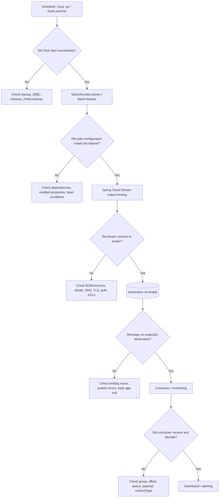

# Events Not Emitted or Binder Configuration Version Mismatch

A **Spring Cloud Task** application normally starts up, runs a finite unit of work, updates `TaskExecution` in **`TaskRepository`**, and exits. If the application also runs **Spring Batch**, Job/Step state is persisted in **`JobRepository`**. To monitor or notify external systems, Spring Cloud Task can integrate with **Spring Cloud Stream** to emit **Task events** and **Batch events** over Kafka, RabbitMQ, or a compatible binder.

A hard-to-diagnose incident occurs when **the task ran and `TASK_EXECUTION` exists in the database, yet the dashboard sees no events**. Another variant occurs when the app works locally, but after a Spring Boot/Spring Cloud upgrade it fails binder initialization, creates no bindings, or publishes to a destination the consumer is not subscribed to.

This lesson, **"Events Not Emitted or Binder Configuration Version Mismatch,"** in the **Diagnostics** chapter, walks through an evidence-driven troubleshooting workflow: confirm **Task executed → listener was created → binding connected → broker received → consumer read**. It also explains how to check the **version compatibility matrix**, event-emission switches, the difference between binding name and destination, and risks when a task exits very quickly.

After this lesson, you will be able to:

- Distinguish **no `TaskExecution`**, **no event emitted**, and **event published yet not received by consumer**.
- Correctly recognize `task-events`, `job-execution-events`, `step-execution-events`, and other Batch events.
- Inspect dependencies, the Spring Cloud BOM, binder implementations, and auto-configuration conditions.
- Locate misconfigurations in `binding name`, `destination`, `binder`, broker credentials, and consumer groups.
- Use logs, condition evaluation reports, JDBC metadata, and broker tools to diagnose without exposing secrets.
- Design integration tests and safe runbooks without treating message events as the sole source of truth for retries.

## 1. Which Event Is Missing?

Before changing any configuration, know whether you expect **Task-level events** or **Spring Batch-level events**.

| Mechanism | Default binding name | Business condition for an event | Corresponding metadata store |
| --- | --- | --- | --- |
| **Spring Cloud Task events** | `task-events` | A Spring Cloud Task actually runs and the event listener is active | `TaskRepository` / `TASK_EXECUTION` |
| **Batch Job execution** | `job-execution-events` | A Spring Batch `Job` executes inside the Task with the corresponding listener | `JobRepository` / `BATCH_JOB_EXECUTION` |
| **Batch Step execution** | `step-execution-events` | A Step actually executes and the Step listener is configured | `BATCH_STEP_EXECUTION` |
| **Batch Chunk** | `chunk-events` | Chunk callbacks execute | Step/chunk stats |
| **Batch Item Read** | `item-read-events` | Item read callbacks execute | Reader and Step |
| **Batch Item Process** | `item-process-events` | Item processor callbacks execute | Processor and Step |
| **Batch Item Write** | `item-write-events` | Item/chunk write callbacks execute | Writer and Step |
| **Batch Skip** | `skip-events` | Batch actually skips an item per skip policy | Step skip counts |

**Missing Skip events** are not necessarily a bug: if the Job skipped zero items, the listener never gets a skip callback to emit. Likewise, a Spring Cloud Task using only an `ApplicationRunner` **without launching a Spring Batch Job** will never emit `job-execution-events`.

Per Spring Cloud Task docs, Task events can be emitted at the **start and end** of an execution, while Batch events come from listeners tracking Job/Step/Chunk/Item lifecycles. These events are a **supplementary notification channel**, not a replacement for framework transactions and metadata.

### Three Distinct Identities

For example, when receiving Step events:

- **Listener**: `StepExecutionListener`, the object observing callbacks.
- **Binding name**: `step-execution-events`, the logical output channel name the listener publishes to.
- **Destination**: `ops.batch.steps.v1`, the broker topic/exchange/target mapped by the binder.

If you change only `destination`, the listener still uses the default binding name. If you change the **binding name**, every `spring.cloud.stream.bindings.<name>.*` property must reference **the new name**. Never lump all three concepts together as a "topic."

## 2. Tracing Flowchart: Pinpoint Where the Message Vanished



**Rule:** Find the **last point with proof of success**, then inspect the next segment. Never change all five configuration layers at once, or you will not know which change actually fixed the issue.

### Quick Triage Table

| Evidence | Initial assessment | Next step |
| --- | --- | --- |
| JVM never enters runner; `TASK_EXECUTION` empty | Failure likely occurred **before any event could fire** | Check startup logs, datasource, schema, Spring Boot config. |
| `TASK_EXECUTION` has start/end, yet no Task event | Task ran; inspect the publish path | Check `task.events.enabled`, binder, and output binding. |
| `task-events` present, yet `job-execution-events` missing | Batch path may not have run or isn't enabled | Check `JobExecution`, Batch listeners, and Batch switches. |
| Logs show publish succeeded, broker has message, dashboard empty | Problem likely on the **consumer** side | Check input destination, group/offset, parser, and ACLs. |
| Startup throws `NoSuchMethodError` / `ClassNotFoundException` | Likely version/classpath conflict | Inspect BOM and dependency tree. |
| Very fast task finishes without visible message | Publisher may not have flushed or consumer lacked subscription | Check logs/broker and delivery guarantees before concluding. |

## 3. Verify Dependencies and Versions Before Debugging the Broker

Spring Cloud Task uses Spring Cloud Stream to emit events; having only **`spring-cloud-starter-task`** does not mean every app has an available, configured **binder**. Spring Cloud Task docs require Spring Cloud Stream, a binder implementation, and Task on the classpath for event auto-configuration to activate.

### 3.1. Illustrative Dependency Set with RabbitMQ

Inside a Maven project that already has a **Spring Boot parent**, a **compatible Spring Cloud BOM**, and the JAR packaging plugin:

```xml
<dependencies>
    <dependency>
        <groupId>org.springframework.cloud</groupId>
        <artifactId>spring-cloud-starter-task</artifactId>
    </dependency>
    <dependency>
        <groupId>org.springframework.boot</groupId>
        <artifactId>spring-boot-starter-jdbc</artifactId>
    </dependency>
    <dependency>
        <groupId>org.springframework.cloud</groupId>
        <artifactId>spring-cloud-stream</artifactId>
    </dependency>
    <dependency>
        <groupId>org.springframework.cloud</groupId>
        <artifactId>spring-cloud-stream-binder-rabbit</artifactId>
    </dependency>
    <dependency>
        <groupId>org.postgresql</groupId>
        <artifactId>postgresql</artifactId>
        <scope>runtime</scope>
    </dependency>
</dependencies>
```

If you also want **Batch events**, add `spring-boot-starter-batch` and actually launch a Batch Job:

```xml
<dependency>
    <groupId>org.springframework.boot</groupId>
    <artifactId>spring-boot-starter-batch</artifactId>
</dependency>
```

These snippets are **not a complete POM**. The Spring Cloud BOM must coordinate Spring Cloud Task, Spring Cloud Stream, the binder, and related modules together. Never pin `spring-cloud-stream-binder-rabbit` to an out-of-train version just to "match the running broker."

If using **Kafka**, replace the RabbitMQ binder dependency with `org.springframework.cloud:spring-cloud-stream-binder-kafka` and update connection settings. Do not keep both Kafka and Rabbit binders on the classpath when using a single broker, unless intentionally configuring **multiple binders**.

### 3.2. Release-Train Compatibility Matrix

Spring Cloud and Spring Boot are released in aligned compatibility trains. Examples at the time of writing:

| Spring Boot generation | Corresponding Spring Cloud release train | Notes |
| --- | --- | --- |
| **3.5.x** | **2025.0.x** | Line for Boot 3.5; check supported service releases. |
| **4.0.x / 4.1.x** | **2025.1.x** | Line for Boot 4.0/4.1 per matching service releases. |
| **4.2.x** | **2026.0.x** | Boot 4.2 line per 2026.0.0 release information. |

**This table illustrates generation alignment, not an automatic upgrade command.** When a project uses an older release train, verify exact supported Boot/Cloud versions and **the Spring Cloud Task/Stream versions managed by the BOM**. See [Spring Cloud project and compatibility table](https://spring.io/projects/spring-cloud/) and [Spring Cloud Release Train documentation](https://docs.spring.io/spring-cloud-release/reference/).

**Common version-mismatch symptoms:**

- `NoSuchMethodError`, `NoClassDefFoundError`, `ClassNotFoundException` in Spring Messaging, Integration, Stream, Cloud Task, or binder packages.
- `BeanCreationException`, failure to find `Binder`, failure to create `MessageChannel`, or binding setup failure.
- Auto-configuration bean behavior changes after upgrading Spring Boot/Spring Batch even though YAML did not change.
- An old transitive dependency pulls in a version conflicting with the BOM.

These symptoms **do not prove a version bug on their own**: read the root cause in the stack trace. Still, they are strong reasons to inspect the dependency tree before tweaking topics or exchanges.

### 3.3. Inspecting Actual Dependencies

In a Maven project:

```bash
./mvnw dependency:tree
./mvnw help:effective-pom
```

Verify in the output:

- `spring-cloud-starter-task` and the actual Task modules.
- `spring-cloud-stream`, `spring-cloud-function`, and related `spring-integration-*` modules.
- **One matching binder**: `spring-cloud-stream-binder-rabbit` or `spring-cloud-stream-binder-kafka`.
- Spring Boot, Spring Messaging, Spring Batch, and versions managed by the BOM.

`effective-pom` reveals how dependencyManagement/pluginManagement resolved; `dependency:tree` shows **the actual JARs** on the classpath. Do not confuse "declared in POM" with "not excluded or overridden during packaging."

**Fix principle:** align on the right Spring Cloud BOM first for unified dependency management, then re-inspect the packaged JAR/image. Never "fix" `NoSuchMethodError` by randomly pinning extra versions of `spring-core`, `spring-messaging`, or binders.

## 4. Verify the Task Application Actually Ran

A fundamental failure mode: **no events exist because the task never reached event emission**. Examples: PostgreSQL unreachable, `TASK_EXECUTION` schema missing, `ApplicationContext` failed, JVM exited early, or no runner was registered.

### 4.1. Minimal Application to Probe Task Events

Create `TaskEventProbeApplication.java`:

```java
package com.example.diagnostics;

import org.springframework.boot.ApplicationRunner;
import org.springframework.boot.SpringApplication;
import org.springframework.boot.autoconfigure.SpringBootApplication;
import org.springframework.cloud.task.configuration.EnableTask;
import org.springframework.context.annotation.Bean;

@SpringBootApplication
@EnableTask
public class TaskEventProbeApplication {

    public static void main(String[] args) {
        SpringApplication.run(TaskEventProbeApplication.class, args);
    }

    @Bean
    ApplicationRunner probeRunner() {
        return args -> {
            System.out.println("DIAG: runner started");
            System.out.println("DIAG: runner completed");
        };
    }
}
```

When run with **TaskRepository and a binder properly configured**, this app emits Task events at the start and end of its lifecycle. The two `DIAG` lines prove the runner executed; they **do not prove** messages reached the broker.

For the failure path:

```java
@Bean
ApplicationRunner failingRunner() {
    return args -> {
        throw new IllegalStateException("Simulated failure");
    };
}
```

This is a **replacement bean for a dedicated profile/test**, not something to register alongside the first runner while assuming execution order. When the runner throws, failure metadata/events can be emitted if the framework and connection remain intact; if the JVM receives `SIGKILL`, end callbacks may not run.

### 4.2. Checking JDBC Metadata

Query the database the application actually connects to:

```sql
SELECT
    TASK_EXECUTION_ID,
    TASK_NAME,
    START_TIME,
    END_TIME,
    EXIT_CODE,
    EXIT_MESSAGE
FROM TASK_EXECUTION
ORDER BY TASK_EXECUTION_ID DESC
LIMIT 20;
```

Cross-check rows against JAR run timestamp, Task name, environment, and launcher logs.

- **No record**: investigate startup/JDBC/schema; framework likely failed before writing metadata.
- **`START_TIME` present, `END_TIME` missing**: either still running or died before updating. Check process/container status.
- **Start/end and exit code present**: Task has history, so investigate the publish/broker path separately.

A completed run in `TaskRepository` **does not guarantee the broker received an event**. JDBC metadata and message publishing are usually not inside **one atomic transaction**.

## 5. Check Event Emission Switches

Spring Cloud Task provides separate switches for **Task events** and **Batch events**.

```properties
spring.cloud.task.events.enabled=true
spring.cloud.task.batch.events.enabled=true
```

To **disable** each mechanism:

```properties
spring.cloud.task.events.enabled=false
spring.cloud.task.batch.events.enabled=false
```

**Important:**

- `spring.cloud.task.events.enabled=false` disables the listener emitting **Task events** such as `task-events`.
- `spring.cloud.task.batch.events.enabled=false` disables listeners emitting **Batch events**.
- `spring.batch.job.enabled=false` only disables **Spring Boot's auto-launch of Batch Jobs on startup**. If the app calls `JobLauncher` explicitly, the Job still runs and emits Batch events.
- Disabling events **does not disable** recording `TaskExecution`, `JobExecution`, or business logic.

### Seven Individual Batch Event Switches

```properties
spring.cloud.task.batch.events.job-execution.enabled=false
spring.cloud.task.batch.events.step-execution.enabled=false
spring.cloud.task.batch.events.chunk.enabled=false
spring.cloud.task.batch.events.item-read.enabled=false
spring.cloud.task.batch.events.item-process.enabled=false
spring.cloud.task.batch.events.item-write.enabled=false
spring.cloud.task.batch.events.skip.enabled=false
```

This snippet illustrates **individual property names**, not a recommendation to disable all of them. If only Job events are missing, inspect `job-execution.enabled` and Job launch conditions. Never assume `skip-events` is broken when zero items were skipped.

In production, teams often prioritize Job/Step/Skip events and consider disabling Chunk/Item-level events to avoid flooding the broker when per-item callbacks aren't needed.

## 6. Check Listener Auto-Configuration Conditions

Even when `enabled=true`, a listener is only created when **auto-configuration conditions are satisfied**. Typical conditions:

| Path | What to verify | Example reason not activated |
| --- | --- | --- |
| **Task events** | Spring Cloud Task enabled, Spring Cloud Stream and binder present, task lifecycle managed | Missing binder, excluded auto-config, no Task lifecycle created. |
| **Batch Job events** | Spring Batch present, `Job` bean and `TaskLifecycleListener` per version conditions, job/step managed | Job executed outside expected context, missing listener auto-config. |
| **Batch Step/Chunk/Item** | Job/Step actually runs and listeners are attached | Step skipped, no chunk/item callbacks, listener disabled. |
| **Upgraded versions** | `@ConditionalOnClass`/`@ConditionalOnBean`/`@ConditionalOnProperty` still match | Changed APIs, missing beans, or changed Spring Batch registration. |

For example, Spring Cloud Task 3.0.x API docs describe **`BatchEventAutoConfiguration`** conditioned on `Job`, `TaskLifecycleListener`, and `spring.cloud.task.batch.events.enabled`. **Do not extrapolate verbatim across every major version**: check the API/source/configuration metadata of your exact release.

### Using the Condition Evaluation Report

In a test environment, launch Spring Boot with:

```bash
java -jar target/task-events-probe.jar --debug
```

And selectively raise logging:

```yaml
logging:
  level:
    org.springframework.cloud.task: DEBUG
    org.springframework.cloud.stream: DEBUG
    org.springframework.integration: DEBUG
```

Inspect entries such as `TaskEventAutoConfiguration`/`BatchEventAutoConfiguration`, why conditions **matched** or **did not match**, created binding names, and broker connection exceptions. Class names vary by version; search by **package and function** rather than relying on a fixed log line.

**Never leave deep DEBUG logging on long-term in production**, as logs can grow huge or leak sensitive config/headers. Never dump the full `Environment` or passwords during diagnostics.

## 7. Configuring Binders and Destinations in a Verifiable Way

### 7.1. Single RabbitMQ Binder: Producer Configuration

The `application.yml` below illustrates a finite Task with **a single RabbitMQ binder** and pre-created metadata schema:

```yaml
spring:
  application:
    name: task-event-probe
  main:
    web-application-type: none
  datasource:
    url: ${TASK_DB_URL}
    username: ${TASK_DB_USERNAME}
    password: ${TASK_DB_PASSWORD}
  cloud:
    task:
      name: taskEventProbe
      initialize-enabled: false
      events:
        enabled: true
      batch:
        events:
          enabled: true
    stream:
      bindings:
        task-events:
          destination: ops.task.lifecycle.v1
        job-execution-events:
          destination: ops.batch.jobs.v1
        step-execution-events:
          destination: ops.batch.steps.v1
  rabbitmq:
    host: rabbitmq.internal
    port: 5672
    username: ${RABBIT_USERNAME}
    password: ${RABBIT_PASSWORD}
```

**Notes:** URLs/hosts are placeholders. Provision the version-matched Spring Cloud Task schema before running with `initialize-enabled: false`. The Task from section 4 with only an `ApplicationRunner` **will not emit Batch events** even with Batch destinations configured; testing Batch events requires executing a Spring Batch `Job` bean.

When only **one binder implementation** sits on the classpath, Spring Cloud Stream automatically picks it. Add `spring.cloud.stream.defaultBinder` only when needed, especially when multiple binders are on the classpath.

### 7.2. Equivalent Configuration for Kafka

If using Kafka, **swap the RabbitMQ binder dependency for Kafka** and configure:

```yaml
spring:
  kafka:
    bootstrap-servers: kafka.internal:9092
  cloud:
    stream:
      bindings:
        task-events:
          destination: ops.task.lifecycle.v1
        job-execution-events:
          destination: ops.batch.jobs.v1
```

This is a **transport-replacement excerpt**, not a complete file. Kafka introduces its own concerns: advertised listeners, SASL/TLS, topic ACLs, partitions, and consumer groups. Never leave `spring.rabbitmq.host` configured for an app using the Kafka binder and assume Kafka is set up.

### 7.3. When Multiple Binders Are on the Classpath

When an app bundles both Kafka and RabbitMQ binders, **explicitly specify** the default binder or per-binding binder. Example selecting RabbitMQ for Task events and Kafka for Job events:

```yaml
spring:
  cloud:
    stream:
      bindings:
        task-events:
          binder: rabbit
          destination: ops.task.lifecycle.v1
        job-execution-events:
          binder: kafka
          destination: ops.batch.jobs.v1
```

This assumes **both binders are validly configured** with separate broker network/credential settings. When defining explicit `spring.cloud.stream.binders.*` entries, follow your Stream version's binder-selection and `defaultCandidate` rules; explicit binder configs can disable default binder detection.

**Never "fix" missing events by adding every binder available.** Each extra binder adds auto-configuration and sometimes health checks, making it harder to tell which broker was actually chosen.

## 8. Changing Destination vs. Changing Binding Name

For example, the producer uses output binding **`task-events`**, while the dashboard reads topic/exchange **`ops.task.lifecycle.v1`**:

```properties
spring.cloud.stream.bindings.task-events.destination=ops.task.lifecycle.v1
```

For Step events:

```properties
spring.cloud.stream.bindings.step-execution-events.destination=ops.batch.steps.v1
```

In both cases, **the binding name stays at its default**. Try this first because it has fewer moving parts.

### When Changing the Binding Name Too

Spring Cloud Task provides properties to rename Batch listener bindings. In releases with matching `TaskEventProperties`, for example:

```yaml
spring:
  cloud:
    task:
      batch:
        events:
          step-execution-event-binding-name: stepAuditOut
    stream:
      bindings:
        stepAuditOut:
          destination: ops.batch.steps.v2
```

**Common mistake:** setting `stepAuditOut` while still mapping `spring.cloud.stream.bindings.step-execution-events.destination`. The listener publishes to the new binding with a default destination, while the consumer still listens on the old destination.

**Watch out for documentation variance:** some Spring Cloud Task guides write `step-execution-events-binding-name`, while `TaskEventProperties` / 3.x configuration metadata uses `step-execution-event-binding-name`. Check the **config metadata of your exact version**. During initial diagnosis, prefer **keeping default binding names** until you confirm the producer emits properly.

### Consumers Have Their Own Input Binding Names

A **functional** Spring Cloud Stream consumer may define a `jobStatusConsumer` bean creating input binding `jobStatusConsumer-in-0`; it must point to the **producer's destination**, not necessarily match the producer's output binding name:

```yaml
spring:
  cloud:
    function:
      definition: jobStatusConsumer
    stream:
      bindings:
        jobStatusConsumer-in-0:
          destination: ops.batch.jobs.v1
          group: operations-monitor
```

This belongs in the **receiving consumer application**, requiring a `jobStatusConsumer` bean and compatible payload type. Do not apply `spring.cloud.function.definition` on the Spring Cloud Task producer just to tweak an existing output binding. Legacy Stream examples use `bindings.input.destination`, while modern functional consumers use `<functionName>-in-0`; mixing styles makes consumers listen on the wrong target.

## 9. When the Broker Has Messages Yet the Dashboard Sees Nothing

Once you prove the producer published to the right destination, inspect the **broker and consumer**.

### 9.1. With RabbitMQ

The Rabbit binder typically maps a destination to an **exchange** and declares/binds queues per consumer configuration. Seeing an exchange exist does not prove **a queue is bound and receiving messages**.

Verify:

1. Are producer and consumer connected to the same **host/port, virtual host, and environment**?
2. Does the broker have the exchange/destination the producer actually publishes to?
3. Does the consumer have a queue created/bound to that exchange with consume permissions?
4. Do routing keys, partitions, consumer groups, and auto-provisioning rules match?
5. Are messages arriving in the queue and getting consumed, rejected, dead-lettered, or expired by TTL?

An exchange with rising publish rates while the dashboard's queue sits empty usually points to **wrong routing/binding or no queue bound at publish time**. Avoid wiping and recreating the entire broker to "try your luck."

### 9.2. With Kafka

Verify:

- Are `bootstrap.servers` and **advertised listeners** reachable from both task containers and consumer containers?
- Does topic `ops.batch.jobs.v1` exist, and do principals have produce/consume ACLs?
- Is the consumer using the **right `group.id`**, offsets, and subscription?
- If the consumer group was created after events were already produced, did `auto.offset.reset` start at `latest`, skipping older messages?
- Are there serializer/deserializer, JSON schema, content type, or poison-message errors?
- Did the producer hit request timeouts, auth failures, SSL handshake errors, or broker unavailability?

When inspecting messages with Kafka CLI tools, choose your consumer group/offset deliberately. **Never reuse the production dashboard's `group.id`** to "peek at messages," as that steals partitions and disrupts live consumers.

### 9.3. Payload Format Matters Too

Task events carry `TaskExecution` payloads; Batch events carry Batch lifecycle payloads. Consumers expecting `String`, `byte[]`, JSON objects, or specific Java types must use **compatible content types and serializers**.

If the broker holds messages yet the handler fails or never receives them:

- Check `contentType` on bindings and actual message headers.
- Check JSON structure, schema versions, and consumer target types.
- Never couple external systems directly to an internal producer Java domain class as a permanent contract.
- When upgrading Spring Cloud Task/Batch, check **schema evolution** and consumer compatibility tests before rolling out.

**Publishing a message is different from processing it successfully.** The consumer may error out, dead-letter messages into a DLQ, or retry endlessly; inspect error counts, consumer logs, and listener health.

## 10. Task Exits Very Fast: Do Not Assume Delivery Succeeded

A Task may finish in a few hundred milliseconds. Events fire in lifecycle callbacks, yet **sending to the broker and receiving acks are not necessarily atomic with metadata updates**.

Scenario:

```text
1. Task starts and creates TaskExecution
2. Listener emits Task start event
3. ApplicationRunner finishes work
4. Listener emits Task end event
5. JVM closes context or is killed
6. Broker/consumer has not necessarily received every message
```

This does not mean **every** short Task loses events. Each binder has its own buffering, sync/async send behavior, and acknowledgments. Check:

- Do logs confirm the listener was actually invoked?
- Was the output binding created and connected before the task exited?
- Did the broker confirm publication? Were there retries, timeouts, or unflushed buffers?
- Did shutdown hit errors, `SIGKILL`, or OOM?
- Did the consumer have an active queue/topic/subscription at the time?

**Never "fix" this in production with `Thread.sleep(5000)`** and claim exactly-once delivery. Sleeping only masks races and slows execution; configure proper delivery semantics, acknowledgments, and binder-appropriate publisher confirms.

If an end event **must** be delivered after business data commits, consider a **transactional outbox** inside the business transaction, a controlled relay dispatcher, and an idempotent consumer. Even an outbox can emit duplicate messages if a crash occurs between publishing and marking sent.

## 11. Checking Batch Jobs/Steps When Task Events Still Work

Classic case: dashboard receives `task-events` yet misses `job-execution-events` or `step-execution-events`.

### Verification Procedure

1. Confirm the app **includes Spring Batch** and has a managed `Job` bean in the application context.
2. Confirm **the Job actually ran**. `spring.batch.job.enabled=false` stops Boot from auto-launching Jobs; the app must invoke `JobLauncher` explicitly.
3. Check `BATCH_JOB_EXECUTION` and `BATCH_STEP_EXECUTION` for new rows in the same timeframe.
4. Check `spring.cloud.task.batch.events.enabled=true` and confirm `job-execution.enabled`/`step-execution.enabled` are not disabled by a profile or external config.
5. Verify auto-configuration registered the Batch event listeners onto the Job/Step.
6. Inspect Batch output bindings and destinations, confirming the consumer subscribes to the exact target.

### Querying Spring Batch State

```sql
SELECT
    JOB_EXECUTION_ID,
    JOB_INSTANCE_ID,
    STATUS,
    EXIT_CODE,
    START_TIME,
    END_TIME
FROM BATCH_JOB_EXECUTION
ORDER BY JOB_EXECUTION_ID DESC
LIMIT 20;
```

Check Steps:

```sql
SELECT
    STEP_EXECUTION_ID,
    JOB_EXECUTION_ID,
    STEP_NAME,
    STATUS,
    READ_COUNT,
    WRITE_COUNT,
    READ_SKIP_COUNT,
    PROCESS_SKIP_COUNT,
    WRITE_SKIP_COUNT
FROM BATCH_STEP_EXECUTION
ORDER BY STEP_EXECUTION_ID DESC
LIMIT 30;
```

Columns shown reflect the standard Spring Batch JDBC schema; verify DDL against your release and any custom table prefix.

### Job Completed Without Any Item Read Events?

The Job may consist solely of a **Tasklet Step** without an `ItemReader`, in which case missing `item-read-events` is completely expected. A completed Job without Skip events is likewise normal. Start with **Job/Step lifecycle events** to prove the Batch event pipeline works before tracking high-frequency events.

## 12. Inspecting Bindings While the Application Runs

Spring Cloud Stream supports inspecting binding lifecycles via **Actuator** or internal APIs. Because Spring Cloud Task is finite-lived, however, limitations apply:

- With `spring.main.web-application-type=none`, there is no HTTP Actuator server to query remotely.
- If a task finishes in a few seconds, it exits before an operator can hit `/actuator/bindings`.
- Never turn a production Task into a permanent web service solely for debug endpoints.

In a **dedicated diagnostic web app** or a test setup with web/actuator enabled, you can configure:

```properties
management.endpoints.web.exposure.include=health,bindings
management.health.binders.enabled=true
```

`/actuator/bindings` lists bindings and their state where supported; `/actuator/health` can expose binder health. **Never assume every binder implements a health indicator** or that `UP` proves individual messages were consumed.

**Security:** expose endpoints only on protected management networks—never publicly or allowing arbitrary binding state mutations. For non-web Tasks, rely on startup/condition logs, broker inspection, and the test binder instead of opening an HTTP server.

### Logs to Look For

| Origin | Useful signals |
| --- | --- |
| Spring Boot startup | Auto-config beans matched/failed, binding or datasource errors. |
| Spring Cloud Task | `TaskLifecycleListener`, start/end metadata, event listeners. |
| Spring Cloud Stream | Created bindings, selected binder, actual destination, binding retry errors. |
| RabbitMQ/Kafka client | Authentication, TLS, DNS, topic/exchange ACLs, timeouts, publisher confirms. |
| Consumer | Input bindings, group/queue/offset, conversion errors, and DLQ/retries. |
| Platform | Pod `Running`/`Failed`, `OOMKilled`, exit code, and lifetime. |

Log only what is necessary; never print tokens, usernames/passwords, full environments, or customer payloads while debugging.

## 13. Upgrade Scenario: Incompatible Binder

Suppose a system previously ran Spring Boot 3.x, Spring Cloud Task 3.x, and Spring Cloud Stream 4.x; one team bumps only the binder dependency to a newer major line while the rest still uses the old BOM.

What can happen:

- At build time: version conflicts, missing APIs, mismatched plugin/dependency majors.
- At startup: Spring fails bean creation or throws `NoSuchMethodError`/`ClassNotFoundException`.
- At binding time: binder implementation is not selected or lacks expected settings.
- At runtime messaging: headers, serialization, binding names, or semantics differ from older consumers.

### Safe Upgrade Procedure

1. **Capture a version baseline:** Java, Boot, Cloud BOM, Task, Stream, binder, Batch, and broker. Save `dependency:tree` before upgrading.
2. **Adopt a compatible release train:** never upgrade one major module alone before the BOM supports it.
3. **Clean build and inspect classpath:** confirm packaged JARs/images do not bundle two versions of the same library.
4. **Test minimal Task event:** confirm `TaskExecution` and `task-events` arrive at a test broker.
5. **Test Batch lifecycle:** confirm `JobExecution`/`StepExecution` and Job/Step events hit the right destinations.
6. **Test producer–consumer contracts:** schemas, content types, consumer groups, and poison-message handling.
7. **Test ultra-short and failing tasks:** confirm metadata and publisher flush semantics match fast-exit conditions.
8. **Roll out in stages:** watch publish rates, delivery failures, DLQs, error logs, and consumer health before expanding.
9. **Prepare rollback:** keep schemas/serialization and destinations backward/forward compatible during transition.

**Special caution:** Never treat Spring Cloud Task 3.x and 5.x as differing only by "version number" while assuming all Spring Batch/Stream examples compile identically; major Boot/Batch/Framework releases alter APIs and bean conditions. Always use **BOM-managed dependencies** and test on the exact target release.

## 14. Testing to Isolate Code vs. Binder vs. Broker Bugs

An effective test strategy splits into three layers:

| Layer | Tooling | Goal |
| --- | --- | --- |
| **Listener / binding logic** | Spring Cloud Stream **test binder**, Spring Test | Verify events are emitted to output bindings when Task/Batch runs. |
| **Binder + real broker** | Testcontainers RabbitMQ or Kafka, integration tests | Verify connectivity, destinations, publish/consume, auth/provisioning in test env. |
| **Task process E2E** | Executable JAR / real container | Verify fast-exit behavior, exit code, metadata, shutdown, and delivery. |

### 14.1. Test Binder

Spring Cloud Stream provides the test binder to isolate app logic from a real broker in integration tests. Typical test dependency:

```xml
<dependency>
    <groupId>org.springframework.cloud</groupId>
    <artifactId>spring-cloud-stream-test-binder</artifactId>
    <scope>test</scope>
</dependency>
```

On versions supporting `InputDestination`/`OutputDestination`, tests can inspect messages on the output binding—but **ensure Spring Cloud Task's listener auto-configuration is actually active in the test context**. Testing a standalone `Function` bean does not prove `TaskLifecycleListener` emitted anything.

If the test binder receives messages yet the real broker does not, focus on **production binder, network/credentials, provisioning, and shutdown**. If even the test binder receives no messages, inspect **conditions/beans, `enabled` switches, and binding names** first.

### 14.2. Testing a Real Broker with Testcontainers

For instance, start a RabbitMQ or Kafka container in an integration test, wire dynamic endpoints into Spring Boot, execute Task/Batch, and attach a test consumer subscribed to **the exact destination**.

What to assert:

- A successful `TaskExecution` is persisted in the test metadata database.
- Producer sends a message to `task-events` or the mapped destination.
- When a Batch Job runs, matching Job/Step events arrive.
- Setting `spring.cloud.task.events.enabled=false` stops Task event publishing while still persisting Task metadata.
- The consumer parses the contract payload; malformed messages trigger binder-appropriate retries/DLQ.
- Fast-exiting tasks do not lose messages due to shutdown settings incompatible with the binder.

Never use production credentials or shared corporate brokers for tests; passing on an in-memory binder does not replace testing against a real broker and network.

## 15. 15-Step Diagnostic Runbook

When operations reports "Task/Batch is not emitting events," execute in order:

1. **Isolate one specific run** by task name, timestamp, execution ID, and environment.
2. **Check process/container status**, startup logs, and OS exit code. Did the Task reach its runner?
3. **Query `TASK_EXECUTION`**, confirming TaskRepository points to the expected datasource/schema.
4. **Identify the missing event type**: Task, Job, Step, Chunk, Item, or Skip.
5. **For Batch**, query `BATCH_JOB_EXECUTION`/`BATCH_STEP_EXECUTION` to confirm the Job/Step actually executed.
6. **Check `enabled` flags** for Task and each Batch listener in effective runtime config, not just repo YAML.
7. **Inspect dependency tree**, BOM, and binder on the classpath of **the deployed artifact**.
8. **Enable condition evaluation** in a test environment; find which bean/event listener was skipped and why.
9. **Record the effective binding name**, such as `task-events` or `stepAuditOut`.
10. **Record the selected destination and binder** from runtime config, keeping producer and consumer distinct.
11. **Check broker endpoints**: Kafka bootstrap/advertised listeners or Rabbit host/vhost, TLS, auth, ACLs.
12. **Check topics/exchanges and consumer subscriptions**: queues/groups/offsets, routing keys, ACLs, DLQs.
13. **Check payloads/serialization**: content types, headers, consumer classes/schemas, deserialization errors.
14. **Check fast-task shutdown**, publisher acks/retries, and OOM/`SIGKILL` incidents.
15. **Fix one root cause**, re-run in test, and verify end-to-end from metadata to consumer message.

### Symptom → Action Matrix

| Symptom | Likely cause | First action |
| --- | --- | --- |
| No `TaskExecution` and no events | Early startup/JDBC/schema error | Inspect Spring Boot and DB errors before touching the broker. |
| `TaskExecution` exists, `task-events` missing | Listener disabled/uncreated or binding/broker failure | Check `spring.cloud.task.events.enabled`, dependencies, and condition report. |
| Task events work, Batch events missing | Job/Step didn't run or Batch listeners weren't created | Query `JobRepository` and inspect `batch.events.*`. |
| Messages go to unexpected topic/exchange | Renamed binding while mapping destination under old name | Check `spring.cloud.stream.bindings.<name>.destination`. |
| App throws `NoSuchMethodError` after upgrade | Incompatible dependencies | Align BOM/classpath; never bump binder alone. |
| No binder selected | Multiple binders on classpath without selection | Set `defaultBinder` or `bindings.<name>.binder`. |
| RabbitMQ has exchange yet queue stays empty | Wrong queue/binding/group/routing | Inspect broker topology and consumer queue. |
| Kafka topic has messages yet dashboard shows none | Wrong group/offset/ACL or deserializer | Test with an isolated consumer, read logs, check offsets. |
| Events lost only on ultra-fast tasks | Shutdown/buffer/ack race or late subscription | Test against real broker; check delivery/shutdown behavior. |
| Duplicate events appear | Task retry or broker redelivery | Deduplicate by event/correlation ID at consumer. |
| Event claims success yet business data missing | Runner swallowed exception or metadata/message misaligned with commit | Reconcile business data and runner error handling. |
| Actuator enabled for debug yet bindings unseen | Non-web Task, ultra-short lifetime, or binding not created | Use logs/condition report/test binder; never keep Tasks alive indefinitely. |

## 16. Safe Operations and Handling Missing Events

**Never treat event presence as sole proof of success.** `TASK_EXECUTION` in the DB, Spring Batch `JobExecution`/`StepExecution`, process exit codes, and business data are all required sources. Messages can drop if a broker is down, or be redelivered multiple times.

**Never retry immediately just because the dashboard missed an event.** The task may have committed all business data and failed only during event publishing. Re-running the same day without idempotency could double-count revenue. Check business keys, committed transactions, and processing markers before launching a new run.

**Separate task monitoring from broker monitoring.** Dashboards must know when the **collector/consumer** is broken rather than interpreting silence as "no tasks ran." Monitor consumer lag, DLQs, broker connectivity, received event counts per task, and last-updated timestamps.

**Protect secrets and payloads.** Never put passwords, tokens, API keys, or PII into arguments, event payloads, or logs. Use Secret managers/Kubernetes Secrets and least-privilege topic/exchange ACLs. When enabling `DEBUG`/Actuator, restrict access and duration.

**Do not rely on default exactly-once delivery.** Publishing a broker event and committing business state rarely share a single atomic transaction. When downstream notification is mission-critical, use a **transactional outbox + idempotent consumer** with clear retry/monitoring policies.

## 17. Practice Exercises

Perform these in a **test application and test broker**, never against production:

1. Create a minimal Task using `ApplicationRunner`, `@EnableTask`, PostgreSQL metadata, and the RabbitMQ binder. Run the JAR and verify both `TASK_EXECUTION` and broker Task events.
2. Set `spring.cloud.task.events.enabled=false`. Run with a new request: explain why `TaskExecution` still exists while Task events do not.
3. Add a Spring Batch Job with a real Step; enable `batch.events.enabled=true` and verify Job/Step events. Test `spring.batch.job.enabled=false` without calling `JobLauncher` in code.
4. Enable `item-read.enabled=true` on a Job with only a Tasklet Step. Why shouldn't you expect Item Read events?
5. Change `task-events` destination to `lab.task.events.v2`. Leave the consumer on the old destination first, then fix it; capture broker evidence.
6. Rename the Step binding to `stepAuditOut` while intentionally mapping destination under the old name. Use binding logs to pinpoint the misconfiguration.
7. Add both Rabbit and Kafka binders to a test app without configuring binder selection. Verify how `defaultBinder`/`bindings.<name>.binder` resolves ambiguity.
8. Use `dependency:tree` to compare the classpath before and after an upgrade; confirm Task, Stream, and binder versions match the Spring Cloud BOM.
9. Simulate an unavailable broker or missing publish ACLs. Observe startup/binding retries and errors, then restore the broker.
10. Run a task that exits almost immediately. Compare events on the test binder versus a real broker; explain the roles of shutdown, producer acks, and consumer subscriptions.
11. When the broker holds messages yet the consumer misses them, inspect Kafka group/offset or RabbitMQ exchange/queue, then check content type and schema.
12. Write a scenario runbook: `TaskExecution.exitCode=0` yet the dashboard lacks events; which evidence must you gather before deciding to retry?

**Review questions:**

- Are `task-events` and `job-execution-events` triggered by the same business condition?
- Why can a JAR with a Spring Cloud Task dependency yet no binder fail to emit events?
- How does a binding name differ from a destination? Why might a producer use `step-execution-events` while a consumer uses `jobStatusConsumer-in-0`?
- Does `spring.batch.job.enabled=false` mean Batch events are disabled?
- When a Task only has a Tasklet Step, why is seeing no Item Read events normal?
- What should you check after an upgrade throws `NoSuchMethodError` before changing RabbitMQ/Kafka config?
- A Kafka topic holds messages yet the dashboard shows nothing: besides the broker, which components must you inspect?
- Why does a successful `TaskExecution` not guarantee the consumer received the event?
- For a task finishing in a couple of seconds, why isn't `/actuator/bindings` the only tool to rely on?
- When an end event is missing, why shouldn't you automatically re-run non-idempotent business logic?

**Takeaway:** Missing events can stem from **Task failing to start**, **listeners not auto-configured**, **incompatible binder dependencies/versions**, **mis-mapped bindings/destinations**, **broker rejections**, **consumers failing to subscribe/decode**, or **the task exiting before delivery completes**. Diagnose end-to-end with evidence, align on a compatible Spring Cloud BOM, and always reconcile `TaskRepository`/`JobRepository` with business data before retrying.

**Official references:**

- [Spring Cloud Task — Spring Cloud Stream Integration](https://docs.spring.io/spring-cloud-task/reference/stream.html): Task events, Batch events, bindings, and `enabled` switches.
- [Spring Cloud Task — BatchEventAutoConfiguration API](https://docs.spring.io/spring-cloud-task/docs/current/apidocs/org/springframework/cloud/task/batch/listener/BatchEventAutoConfiguration.html): listener creation conditions in a specific release.
- [Spring Cloud Stream — Binder Detection](https://docs.spring.io/spring-cloud-stream/reference/spring-cloud-stream/binder-detection.html): detecting binders from the classpath.
- [Spring Cloud Stream — Multiple Binders](https://docs.spring.io/spring-cloud-stream/reference/spring-cloud-stream/multiple-binders.html): explicit binder selection.
- [Spring Cloud Stream — Binding Properties](https://docs.spring.io/spring-cloud-stream/reference/spring-cloud-stream/binding-properties.html): destination, binder, and consumer configuration.
- [Spring Cloud Stream — Binding Visualization and Control](https://docs.spring.io/spring-cloud-stream/reference/spring-cloud-stream/binding_visualization_control.html): Actuator bindings and `BindingsLifecycleController`.
- [Spring Cloud — Release Train Compatibility](https://spring.io/projects/spring-cloud/): aligning Spring Boot and Spring Cloud release trains.
