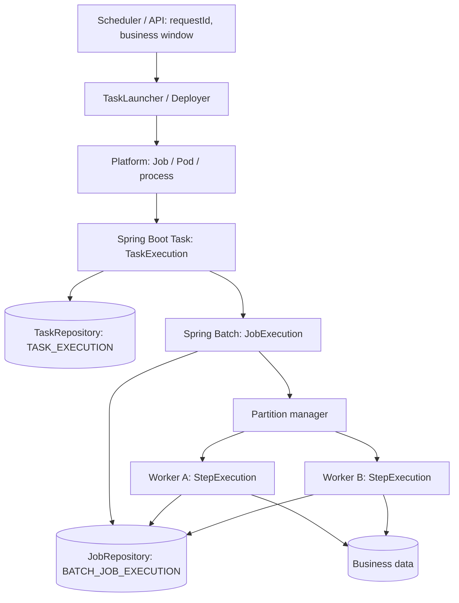
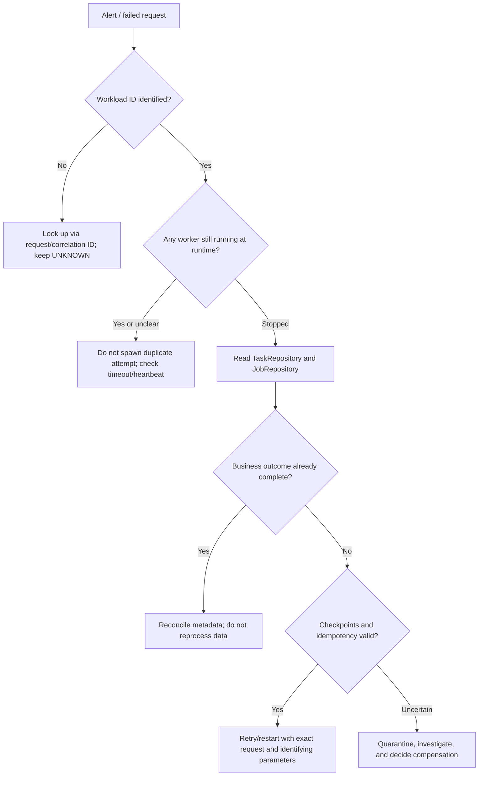
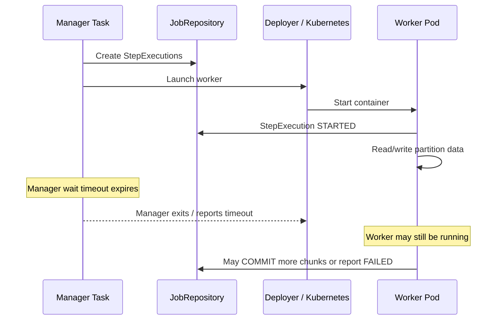

# Wrong Arguments, Partition Timeouts, and Platform Status Diverging from the Task Repository

## 1. Three Incident Categories Easy to Misdiagnose

In the **Diagnostics** chapter of **Spring Cloud Task**, we address situations that arise when a **finite-lived** Spring Boot application is launched on a schedule, on demand, or by an orchestrator. The app must receive the right arguments, execute business logic, record `TaskExecution` in `TaskRepository`, and exit with a status the scheduler understands. When coordinating with **Spring Batch** and **remote partitioning**, a single task can also spawn multiple `StepExecution`s and multiple worker processes on Kubernetes or another platform.

The three symptoms below look similar on a monitoring screen yet can have completely different root causes:

1. **Wrong arguments:** the task receives the wrong business date, an argument type is mistaken, a `JobParameter` name mismatches expectations, or a worker reads the wrong partition. The program may fail immediately, or worse, **succeed against the wrong data**.
2. **Partition timeout:** Spring Batch's manager waits too long for workers, a `StepExecution` makes no progress, or a deadline expires while containers remain alive. A manager timeout does not automatically kill workers or roll back committed side effects.
3. **Platform status diverging from the Task repository:** Kubernetes/Deployer reports the process finished yet `TASK_EXECUTION.END_TIME` stays blank; or `TaskRepository` already recorded a result while the Pod stays `Running`. Causes include sync lag, metadata write failures, querying the wrong store, or killed processes.

**There is no single status column covering everything.** To decide on a safe retry, reconcile the **scheduler request**, **infrastructure state**, **`TaskRepository`**, **`JobRepository`**, and **business data**.

After this lesson, you will be able to:

- Classify argument errors across the scheduler → Task → Spring Batch → worker boundaries without conflating argument layers.
- Query `TASK_EXECUTION_PARAMS`, `TASK_EXECUTION`, and Batch metadata to verify business periods and attempts.
- Distinguish manager timeouts, slow polling, overdue workers, and dead workers whose metadata remains `STARTED`.
- Investigate cases where Pod/Job, `TaskExecution`, and `JobExecution` report conflicting outcomes.
- Follow a step-by-step runbook to isolate faults without **directly deleting or patching metadata**.
- Design checkpoints, idempotency, correlation IDs, alerts, and controlled fault-injection tests.

> **Safety rule:** Before issuing a re-run, answer: *could any process still be writing data, how much already committed, and will the retry reuse the exact old business key/`JobInstance`?* If unconfirmed, keep the state **`UNKNOWN` / needs reconciliation**—never retry blindly.

## 2. Map of Identifiers and Sources of Truth

A single launch request passes through multiple components:



| Identifier / outcome | Where created | Meaning | Common confusion |
| --- | --- | --- | --- |
| `requestId` or window key | Scheduler/business API | One logical request; typically stays fixed across retries | Not `TaskExecutionId` |
| `platformExecutionId` / Pod UID / Job UID | TaskLauncher, Kubernetes, or platform | One specific workload or attempt | Not the Task DB's auto-increment ID |
| `TASK_EXECUTION_ID` | Spring Cloud Task | **One recorded Task launch** | Retries usually get a new ID |
| `EXTERNAL_EXECUTION_ID` | Attached externally to Task | Infrastructure link value if propagated properly | Can be null / differ from Pod UID |
| `JOB_INSTANCE_ID` | Spring Batch | Job name + **identifying** `JobParameters` | Stays constant on a valid restart |
| `JOB_EXECUTION_ID` | Spring Batch | One Batch Job attempt | Restart creates a new execution |
| `STEP_EXECUTION_ID` | Spring Batch | One Step or partition Step execution | Not the worker/container ID |
| Task `EXIT_CODE` | `TASK_EXECUTION` | Task outcome code persisted to repository | Not guaranteed to equal process exit status |
| Batch `STATUS`/`EXIT_CODE` | `BATCH_JOB_EXECUTION` | Batch Job outcome | Batch `EXIT_CODE` is normally a string |

**Source of truth by question:**

| Question | Check first |
| --- | --- |
| Is any Pod/process **genuinely still alive**? | Runtime/deployer API and container logs |
| Did Task record start/end/exit code? | `TaskRepository` (`TASK_EXECUTION`) |
| Which partitions completed, failed, or are running? | `JobRepository` (`BATCH_STEP_EXECUTION` and `ExecutionContext`) |
| Was everything processed without duplicates? | Business database/audits |
| Is it safe to retry the same request? | Request store, runtime state, checkpoints, and idempotency |

Each source knows only **part of the truth**. For example, a missing Pod does not prove the business DB lacks side effects; `END_TIME IS NULL` does not prove the JVM is still alive.

## 3. Rapid Diagnostic Workflow Before Modifying the System

When an alert fires, prioritize **read-only evidence collection** before stopping workloads, retrying, raising timeouts, or editing data.

1. **Freeze the context:** record `requestId`, task name, artifact version, namespace/cluster, tenant, business date/input version, trigger timestamp, and timezone.
2. **Identify the exact attempt:** locate platform Job/Pod UID, `EXTERNAL_EXECUTION_ID`, and `TASK_EXECUTION_ID` if present; never filter only by Task name and grab the cluster's latest row blindly.
3. **Check live runtime state:** is the workload `Succeeded`, `Failed`, `Running`, `Pending`, or gone? Did restarts/OOM/timeouts occur?
4. **Read `TaskRepository`:** verify start time, end time, exit code, error message, and arguments for **that exact attempt**.
5. **If Batch is used:** find `JOB_INSTANCE_ID`/`JOB_EXECUTION_ID` and every `STEP_EXECUTION_ID`; distinguish Steps that never started from Steps stuck at `STARTED` with no updates.
6. **Reconcile business data:** records, checksums, committed chunk counts, idempotency keys, and external side effects.
7. **Classify the fault:** arguments, deployment, true timeout, polling/metadata lag, repository error, or data inconsistency.
8. **Act conditionally:** never retry while any worker is not confirmed stopped; never hand-edit repository tables to make dashboards green.



## 4. First Error Group: Wrong Task Arguments

Typically a launch command passes flags like:

```bash
java -jar order-task.jar \
  --business-date=2026-11-23 \
  --input-version=snapshot-v1 \
  --tenant-id=tenant-a
```

`--business-date`, `--input-version`, and `--tenant-id` are **application-defined business arguments**; Spring Cloud Task **does not inherently know** what they mean or whether they match scheduler expectations. Spring Boot `ApplicationArguments` parses options, yet validation must be enforced by your code, binder, or orchestration layer.

### 4.1. Common Mismatches

| Discrepancy | Symptom | What to compare |
| --- | --- | --- |
| Missing `--business-date` | Runner throws or defaults to today's date | Original request vs. `ApplicationArguments` |
| Wrong date format `23/11/2026` | `DateTimeParseException` | ISO contract schema `yyyy-MM-dd` |
| Duplicate option passed | `getOptionValues` returns multiple values or logic picks wrong one | Raw option list |
| Typed `--businessDate` instead of `--business-date` | App reads wrong key / misses option | Actual property name and relaxed binding rules |
| `--input-version` mismatches real snapshot | Task runs cleanly yet reads wrong dataset | Source manifest/checksum |
| Spoofed config flag like `--spring.datasource.url` | Connects to wrong DB or bypasses privilege boundaries | Argument allowlist + trusted configuration |
| Scheduler passes wrong timezone/UTC | Events get filed under the next day | Business window `[start,end)` |
| Same request passes different `--run.id` on retry | Spring Batch creates a brand-new `JobInstance` | Identifying `JobParameters` |
| Forgot to pass partition ID to worker | Worker cannot find `StepExecution` or processes wrong range | Deployer/worker handler contract |

**Never silently accept out-of-schema arguments** just because Spring Boot starts up cleanly. Unknown options often fail silently or blow up deep inside business logic.

### 4.2. Reading Values Strictly

Java 17+ example inside a Task:

```java
import java.time.LocalDate;
import java.util.List;

import org.springframework.boot.ApplicationArguments;
import org.springframework.boot.ApplicationRunner;
import org.springframework.context.annotation.Bean;
import org.springframework.context.annotation.Configuration;

@Configuration(proxyBeanMethods = false)
public class RequestValidationConfiguration {

    @Bean
    ApplicationRunner validatedRunner(TaskBusinessService service) {
        return args -> {
            String businessDateText = requireOne(args, "business-date");
            String inputVersion = requireOne(args, "input-version");
            String tenantId = requireOne(args, "tenant-id");

            LocalDate businessDate = LocalDate.parse(businessDateText);
            if (!inputVersion.matches("[A-Za-z0-9._-]{1,80}")) {
                throw new IllegalArgumentException("Invalid input-version");
            }
            if (!tenantId.matches("[A-Za-z0-9_-]{1,60}")) {
                throw new IllegalArgumentException("Invalid tenant-id");
            }

            // Business service must enforce tenant/snapshot authorization
            // and protect idempotency across retries.
            service.process(tenantId, businessDate, inputVersion);
        };
    }

    private static String requireOne(ApplicationArguments args, String name) {
        List<String> values = args.getOptionValues(name);
        if (values == null || values.size() != 1 ||
                values.get(0) == null || values.get(0).isBlank()) {
            throw new IllegalArgumentException(
                    "Exactly one value required for --" + name);
        }
        return values.get(0);
    }
}
```

`TaskBusinessService` is an **application service you implement**, not a built-in framework bean. This pattern intentionally validates before invoking business logic; production code should also maintain an argument allowlist, check tenant authorization, and verify snapshot existence.

**Important boundary:** `ApplicationRunner` executes **after Spring Context initializes**. If metadata datasource or bean setup fails **before reaching the runner**, `TaskExecution` may not exist at all—which differs from the runner rejecting a received argument.

### 4.3. Never Derive the Window from Retry Execution Time

If the scheduler assigns `businessDate=2026-11-23`, a retry after midnight must preserve that exact `businessDate` and source version. Calling `LocalDate.now().minusDays(1)` inside a worker on each attempt shifts to the wrong period. For hourly/daily windows, pass and persist explicit UTC `[startInclusive, endExclusive)` bounds or a request/window ID to reload the resolved window.

When working with real data, check events right before and after `endExclusive` using `timestamp >= start AND timestamp < end`. Never convert timezones by adding or subtracting a fixed 24 hours across DST-observing zones.

## 5. Reconciling Arguments Recorded in `TaskRepository`

Spring Cloud Task's JDBC schema typically includes:

- `TASK_EXECUTION`: ID, Task name, start/end, exit/error, and external execution ID.
- `TASK_EXECUTION_PARAMS`: command-line arguments saved with `TASK_EXECUTION_ID`; the parameter column is usually `TASK_PARAM`.

Example SQL reading **one specific execution**:

```sql
SELECT t.TASK_EXECUTION_ID,
       t.TASK_NAME,
       t.START_TIME,
       t.END_TIME,
       t.EXIT_CODE,
       t.ERROR_MESSAGE,
       t.EXTERNAL_EXECUTION_ID,
       p.TASK_PARAM
FROM TASK_EXECUTION t
LEFT JOIN TASK_EXECUTION_PARAMS p
    ON p.TASK_EXECUTION_ID = t.TASK_EXECUTION_ID
WHERE t.TASK_EXECUTION_ID = :taskExecutionId;
```

`:taskExecutionId` is a named parameter for `NamedParameterJdbcTemplate` or a binding-capable SQL client; supply the real ID of the run under investigation. If the Task received multiple arguments, multiple rows are returned. Do not assume `TASK_EXECUTION_PARAMS` rows preserve original argument order unless your schema/tool provides an ordering column.

**Security note:** `TASK_PARAM` can expose sensitive values if passwords/tokens were passed on the CLI. Restrict query access, redact values in screenshots/reports, and fix secret delivery (environment/secret store) if leaks are found. Never paste raw `TASK_PARAM` rows into public tickets.

### When the Query Returns No Parameters

Possible reasons include: Task died before metadata write, Task used a different repository/schema or table prefix, DB rolled back, or rows were purged by retention. Never conclude "the launcher didn't send arguments" solely from an empty query. Cross-check the platform-recorded manifest/command line, **secret-redacted** startup config logs, and the actual inputs read by the app.

## 6. Second Parameter Layer: Mismatched Spring Batch `JobParameters`

When Spring Cloud Task runs Spring Batch, arguments passed to the JVM are **not automatically identical** to the `JobParameters` given to `JobLauncher`. There are three layers:

1. **Task arguments:** enter the application; may be stored in `TASK_EXECUTION_PARAMS`.
2. **Spring Batch `JobParameters`:** name/type/value entries, some marked **identifying** to resolve `JobInstance`.
3. **Step/partition `ExecutionContext`:** range bounds such as `startId`, `endIdExclusive`, and checkpoints consumed by worker Steps.

Spring Batch 5.x example:

```java
JobParameters parameters = new JobParametersBuilder()
        .addString("tenantId", "tenant-a", true)
        .addString("businessDate", "2026-11-23", true)
        .addString("inputVersion", "snapshot-v1", true)
        .toJobParameters();

JobExecution result = jobLauncher.run(reconciliationJob, parameters);
```

This is a **code excerpt** assuming `jobLauncher`/`reconciliationJob` beans exist with version-appropriate Batch imports. If the first run fails, a retry **intending to restart the same `JobInstance`** must preserve the Job name and all identifying parameters. Adding `run.id=System.currentTimeMillis()` as an identifying parameter creates a **new `JobInstance`** instead of resuming from the prior checkpoint.

| Symptom | Likely cause | Check |
| --- | --- | --- |
| Retry re-runs an already-`COMPLETED` Step | New `JobInstance` or step configured with allow-start-if-complete | `JOB_INSTANCE_ID` and identifying params |
| `JobInstanceAlreadyCompleteException` | Same instance already completed; re-run disallowed | `BATCH_JOB_EXECUTION` history |
| `JobExecutionAlreadyRunningException` | Same instance still has a running execution | Runtime and `JobRepository` before retrying |
| `JobRestartException` | Job marked non-restartable or invalid state | Job configuration and status |
| Job reads wrong date despite valid Task param | Runner built wrong `JobParameters` or step reads different key | Task args → `JobParameters` → Step Context |
| Two "identical" `JobInstance`s on dashboard | Different **type**, `identifying` flag, key name, or Job name | Compare full parameter metadata |

With Batch 5.x JDBC schema, inspect parameters in `BATCH_JOB_EXECUTION_PARAMS`:

```sql
SELECT JOB_EXECUTION_ID,
       PARAMETER_NAME,
       PARAMETER_TYPE,
       PARAMETER_VALUE,
       IDENTIFYING
FROM BATCH_JOB_EXECUTION_PARAMS
WHERE JOB_EXECUTION_ID = :jobExecutionId
ORDER BY PARAMETER_NAME;
```

**Batch 4.x and 5.x schemas differ**; the query above targets common 5.x schemas and must be adjusted for your version and prefix. Some `PARAMETER_VALUE` entries can contain sensitive data, so enforce read permissions. Never hand-edit the parameters table to "turn a new `JobExecution` into a restart of an old one."

## 7. Third Parameter Layer: Worker Receives the Wrong Partition

In **remote partitioning**, the manager Step creates per-partition `StepExecution`s and persists their `ExecutionContext` into `JobRepository`. `DeployerPartitionHandler`/`DeployerStepExecutionHandler` (with corresponding integration) dispatches each partition to a **worker process** via Spring Cloud Deployer.

Partitions may be defined by ID ranges:

```text
partition0: startId=1,    endIdExclusive=2501
partition1: startId=2501, endIdExclusive=5001
partition2: startId=5001, endIdExclusive=7501
partition3: startId=7501, endIdExclusive=10001
```

Workers must filter accordingly:

```sql
SELECT order_id, amount
FROM orders_snapshot
WHERE input_version = :inputVersion
  AND order_id >= :startId
  AND order_id < :endIdExclusive
ORDER BY order_id;
```

If a worker handles `partition1` yet receives `startId=1`, it can duplicate all of `partition0` while the manager sees exit code `0`. If `endIdExclusive` is mistakenly treated as inclusive, boundary records appear in two partitions.

**Never assume a worker receives an arbitrary `--partition-id` flag.** Passing `JobExecution`/`StepExecution` identifiers between manager, `TaskLauncher`, and worker handler is an implementation/version contract. With Deployer integration, inspect the **actual** command/env vars generated by the handler rather than guessing option names.

### When Manager and Worker Read Different JobRepositories

A worker can start cleanly yet fail to load `StepExecution`, or load the wrong ID if pointed at another datasource/schema/tenant. Check:

- URL/schema and prefix of **`JobRepository`**, not just `TaskRepository`.
- Batch metadata read/write privileges and transaction manager.
- Spring Batch versions across manager and workers; `ExecutionContext` serializer compatibility.
- List of `Step` beans in the worker and exact Step name requested by the manager.
- Whether the exact `STEP_EXECUTION_ID` and context were committed before the worker read them.

**Numeric IDs are not globally unique.** Two `JobRepository` instances in separate databases can share the same `STEP_EXECUTION_ID` for unrelated runs; always verify the datasource namespace.

## 8. Second Error Group: What Does "Partition Timeout" Actually Mean?

A "partition timeout" alert can refer to three distinct issues:

| Timeout type | Clock measured | Typical behavior |
| --- | --- | --- |
| **Manager wait timeout** | How long `PartitionHandler` waits for the partition set to finish | Manager fails/times out before aggregating; workers may still be running |
| **Worker runtime deadline** | Pod/Job, launcher, or business service deadline | Platform may kill worker; Batch metadata may not get updated |
| **SLA/business deadline** | Organization's business completion target | Task may still be running validly yet breaching SLO |

In Spring Cloud Task's remote partitioning docs, `DeployerPartitionHandler` exposes:

- `setGridSize`: suggested partition count; does not guarantee that many concurrent Pods.
- `setMaxWorkers`: caps concurrent running workers.
- `setPollInterval`: interval for polling Step status in `JobRepository`; docs cite a default of **10 seconds** in corresponding versions.
- `setTimeout`: how long the manager waits for workers to complete; default `-1` means **unlimited** in documented versions.

```java
// Illustrates configuration hooks on DeployerPartitionHandler.
// Constructor/dependencies and units for timeout/pollInterval
// must be checked against the Javadoc of your exact release.
partitionHandler.setGridSize(16);
partitionHandler.setMaxWorkers(4);
partitionHandler.setPollInterval(pollInterval);
partitionHandler.setTimeout(managerTimeout);
```

`pollInterval`/`managerTimeout` must be derived from SLOs and **the exact units of your version's API**; this snippet is not a complete bean definition. Never multiply arbitrary seconds without confirming setter units. If using `RemotePartitioningManagerStepBuilder` from Spring Batch Integration instead of `DeployerPartitionHandler`, APIs and timeout semantics can differ.

**Most importantly:** handler timeout is the **manager's wait limit**. It **does not** mean worker Pods were terminated, transactions rolled back, or external writes undone.

### Example Timeline



If the scheduler immediately retries the manager after timeout, two generations of workers can concurrently write to the same partition. That is a **duplicate-execution risk**, not merely a slow-timing metric.

## 9. Reading Step Metadata to Locate Stuck Partitions

Spring Batch's `JobRepository` typically provides `BATCH_JOB_INSTANCE`, `BATCH_JOB_EXECUTION`, `BATCH_STEP_EXECUTION`, and `BATCH_STEP_EXECUTION_CONTEXT`.

### 9.1. `JobInstance` Run History

```sql
SELECT ji.JOB_INSTANCE_ID,
       ji.JOB_NAME,
       je.JOB_EXECUTION_ID,
       je.STATUS,
       je.EXIT_CODE,
       je.START_TIME,
       je.END_TIME
FROM BATCH_JOB_INSTANCE ji
JOIN BATCH_JOB_EXECUTION je
  ON je.JOB_INSTANCE_ID = ji.JOB_INSTANCE_ID
WHERE ji.JOB_NAME = :jobName
ORDER BY ji.JOB_INSTANCE_ID DESC, je.JOB_EXECUTION_ID DESC;
```

Multiple `JobExecution`s under one `JobInstance` indicate **restart** history; never merge runs solely by Job name.

### 9.2. Specific Steps and Partitions

```sql
SELECT JOB_EXECUTION_ID,
       STEP_EXECUTION_ID,
       STEP_NAME,
       STATUS,
       EXIT_CODE,
       START_TIME,
       END_TIME,
       LAST_UPDATED,
       READ_COUNT,
       WRITE_COUNT,
       COMMIT_COUNT,
       ROLLBACK_COUNT
FROM BATCH_STEP_EXECUTION
WHERE JOB_EXECUTION_ID = :jobExecutionId
ORDER BY STEP_EXECUTION_ID;
```

In common partitioning setups, `STEP_NAME` looks like `workerStep:partition2`, though naming is an implementation detail: inspect actual names rather than parsing by guesswork. `LAST_UPDATED` reflects the last metadata write, **not a universally reliable heartbeat**. During a long uncommitted chunk, the row changes little even while the worker is actively processing.

### 9.3. Inspecting Checkpoints Only When Necessary

`BATCH_STEP_EXECUTION_CONTEXT` stores recovery state per `StepExecution` (such as `SHORT_CONTEXT` and serialized data depending on version):

```sql
SELECT STEP_EXECUTION_ID, SHORT_CONTEXT
FROM BATCH_STEP_EXECUTION_CONTEXT
WHERE STEP_EXECUTION_ID = :stepExecutionId;
```

Never manually parse or overwrite serialized context via SQL. Contents may hold sensitive values and depend on serializer/version. Use `JobExplorer`/`ExecutionContext` APIs for typed reads against the right schema and transaction manager.

### Distinguishing "Truly Stuck" from "Legitimately Slow"

A partition showing `STATUS=STARTED`, `END_TIME IS NULL`, and an old `LAST_UPDATED` is **insufficient** to prove the worker died. Also check:

- Is the Pod `Running`, `Failed`, or `Succeeded`? Does the container still have a Java process?
- Do logs show read/write progress or deadlocks/query timeouts/HTTP timeouts?
- Are CPU, memory, connection pools, or broker lag abnormal?
- Is a DB transaction waiting on locks? Is a large chunk still processing before commit?
- Did the worker connect to the right datasource/namespace/`StepExecution` ID?
- Did the manager time out while the worker can still finish cleanly?

Never flip `BATCH_STEP_EXECUTION.STATUS` from `STARTED` to `FAILED` just to force a restart before confirming the process actually stopped and committed data is safe.

## 10. Diagnosing Why a Partition Did Not Complete

| Symptom | Cause group | Evidence to gather |
| --- | --- | --- |
| Worker Pod stuck `Pending` | Missing nodes, quota, image, volume, or permissions | Pod events/conditions, scheduler reason |
| `ImagePullBackOff` | Wrong image URI/tag or registry credentials | Image reference, `imagePullSecrets`, events |
| Worker exits very early | Wrong `--spring.profiles.active`, missing Step bean, bad args | Boot logs/stack trace, effective args |
| `StepExecution` missing / not found | Worker cannot see `JobRepository` or got wrong ID | DB config and worker identifying args |
| `StepExecution=STARTED` long, Pod still running | Slow reads, DB locks, API timeouts, oversized chunks | Logs, thread dumps (when appropriate), DB waits |
| `StepExecution=STARTED` long, Pod gone | Kill/OOM or failed final metadata write | Runtime termination reason, `TaskRepository`, DB logs |
| Worker `COMPLETED` yet manager keeps waiting | Polling/aggregation misses partitions, wrong repo | List of `StepExecution`s, `gridSize`, manager logs |
| Multiple workers read same range | Buggy partitioner, context changed on retry, source data mutated | `ExecutionContext`, checksums, query filters |
| Manager times out early after scaling workers | Startup quota, DB contention, slow container provisioning | Separate launch time from business processing time |
| Timeout after worker finished business logic | Batch metadata update failed or signal delayed | Domain audit vs. `JobRepository` |

**`gridSize` is not `maxWorkers`.** A manager may create 20 partitions while allowing only 4 concurrent workers. If each worker needs 5 minutes, a 6-minute manager timeout is mathematically insufficient even when every worker behaves perfectly. Account for scheduling queue time, bootstrap, chunk processing, commits, polling, and cleanup.

A rough planning estimate for roughly uniform partitions:

```text
estimated_batches = ceil(partitionCount / maxConcurrentWorkers)
estimated_processing ≈ estimated_batches × slowest_partition_duration
expected_total ≥ provisioning + estimated_processing + polling/cleanup
```

This is a **planning heuristic**, not a runtime guarantee: skew, queuing, contention, and retries extend real duration. Before raising timeouts, confirm whether slowness is legitimate or an **infinite hang**.

## 11. Third Error Group: Platform State and TaskRepository Disagree

A Spring Cloud Task has at least two independent status sources:

- The platform (Kubernetes/Deployer) tracks **Pod/Job/process**: `Pending`, `Running`, `Succeeded`, `Failed`, exit code, kill reason, and timestamps.
- `TaskRepository` writes **`TaskExecution`** to the database: `START_TIME`, `END_TIME`, `EXIT_CODE`, `ERROR_MESSAGE`, and `EXTERNAL_EXECUTION_ID`.

In Spring Cloud Task's standard schema, `TASK_EXECUTION` **has no `STATUS` column analogous to Kubernetes Pod phase**. Never write `WHERE STATUS='FAILED'` against the Task table if your schema lacks that column.

### Common Divergence Matrix

| Platform | TaskRepository | Possible cause | Classification |
| --- | --- | --- | --- |
| Pod `Succeeded` | `END_TIME` set, `EXIT_CODE=0` | Both layers succeeded; still verify business outputs | Normal technically, incomplete domain check |
| Pod `Failed` or `OOMKilled` | `END_TIME IS NULL` | JVM died before end callback | Metadata unclosed; rollback not guaranteed |
| Pod `Failed` | Task `EXIT_CODE=0` | Killed/errored after repo end write, wrapper/process exit differs, or wrong attempt | Status mismatch requiring investigation |
| Pod `Succeeded` | Task non-zero `EXIT_CODE` | Shell wrapper swallowed exit code, Task mapper differs from process, or wrong record | Inspect command/entrypoint |
| Pod `Running` | Task has `END_TIME` | App wrote end metadata yet sidecar/thread pool/context stays alive | Check which container/thread stays running |
| Pod gone/cleaned up | Task `END_TIME IS NULL` | Runtime GC'd Pod, JVM killed, or DB update failed | Check logs/events; never manually mark finished |
| Pod `Pending` | No `TaskExecution` | JVM never started; missing image/quota/permissions | Deployment error, not `TaskRepository` bug |
| Pod `Running` | No `TaskExecution` | JVM hasn't reached Task phase, wrong DB/schema, init fail, or sidecar | Insufficient evidence to conclude yet |
| Multiple `TaskExecution`s with same name | Single Pod shown on dashboard | Retries, multi-cluster/tenant, stale records, or bad filter | Missing correlation/ID |

### Why Statuses Can Disagree Without a Framework Bug

Events happen in **different systems** with no distributed transaction spanning Kubernetes and `TaskRepository`. A launch request returns a platform ID before Java writes `TaskExecution`. A JVM can write end metadata before the OS finishes tearing down the container. If killed, the database may miss the final update. Monitoring UIs may also read from a **lagging read replica**, stale cache, or mismatched environment/namespace filter.

Never pick one side as "absolute truth" simply because two views disagree. Reconcile **the exact same attempt**, update timestamps, and each source's reliability.

## 12. Read-Only Kubernetes/Deployer Lookup Workflow

Kubernetes example, assuming the operator knows the namespace and Job/Pod name of **the exact attempt**:

```bash
# List recent Jobs/Pods and timestamps.
kubectl get jobs -n batch-tasks
kubectl get pods -n batch-tasks -o wide

# Inspect conditions, events, and container states.
kubectl describe job order-sync-20261124 -n batch-tasks
kubectl describe pod order-sync-20261124-abcde -n batch-tasks

# View full JSON if comparing UIDs/ownerReferences.
kubectl get pod order-sync-20261124-abcde -n batch-tasks -o json

# Read logs of the exact Pod/container while retained.
kubectl logs pod/order-sync-20261124-abcde \
  -n batch-tasks -c task --timestamps
```

Job/Pod names above are **illustrative**. Never match a Pod by partial name and mix logs across retry attempts. Correlate via `ownerReferences`, `request-id` labels, annotations/UIDs, or platform execution IDs per your deployment contract.

When a Pod restarts a container and retains prior logs, `kubectl logs --previous` helps; it **may return nothing** if the container/Pod was deleted or log retention expired. For image pull/permission/quota failures, reading **Pod Events** is far more useful than hunting for non-existent Java stack traces.

**Never run `kubectl delete` or mutate Jobs/Pods during evidence collection.** Deleting destroys logs/UIDs and does not guarantee child workers or business side effects stopped.

### When Using Spring Cloud Data Flow or Another `TaskLauncher`

Workload status APIs and how "running" is determined depend on the platform implementation. `TaskLauncher` for local processes, Kubernetes, or Cloud Foundry has **different durability and history semantics**. For instance, a local process launcher may lose its in-memory process list if the launcher service restarts; never treat "launcher no longer sees the execution" as proof the task never ran.

Inspect **both the platform's native runtime** and Task metadata. Never assume `TaskLauncher` keeps a durable table equivalent to `TASK_EXECUTION`.

## 13. SQL: Viewing the Exact Record and Task–Batch Links

### 13.1. Latest `TaskExecution` by Correlation

```sql
SELECT TASK_EXECUTION_ID,
       TASK_NAME,
       EXTERNAL_EXECUTION_ID,
       PARENT_TASK_EXECUTION_ID,
       START_TIME,
       END_TIME,
       EXIT_CODE,
       EXIT_MESSAGE,
       ERROR_MESSAGE
FROM TASK_EXECUTION
WHERE EXTERNAL_EXECUTION_ID = :externalId
ORDER BY TASK_EXECUTION_ID DESC;
```

If external ID is unset, filter by Task name **scoped to the right time window and environment**, while verifying arguments/request ID from audits. `EXTERNAL_EXECUTION_ID` is optional; its absence **does not prove** Task config is broken.

### 13.2. Batch Link Table When Integration Is Enabled

Spring Cloud Task provides `TASK_TASK_BATCH` to join `TASK_EXECUTION_ID` with `JOB_EXECUTION_ID` **when the Task–Batch link listener is enabled and actually wrote data**:

```sql
SELECT TASK_EXECUTION_ID, JOB_EXECUTION_ID
FROM TASK_TASK_BATCH
WHERE TASK_EXECUTION_ID = :taskExecutionId
ORDER BY JOB_EXECUTION_ID;
```

If Task and Batch metadata share the **same database**, you can join:

```sql
SELECT t.TASK_EXECUTION_ID,
       t.EXIT_CODE AS TASK_EXIT_CODE,
       l.JOB_EXECUTION_ID,
       je.STATUS AS BATCH_STATUS,
       je.EXIT_CODE AS BATCH_EXIT_CODE
FROM TASK_EXECUTION t
LEFT JOIN TASK_TASK_BATCH l
  ON l.TASK_EXECUTION_ID = t.TASK_EXECUTION_ID
LEFT JOIN BATCH_JOB_EXECUTION je
  ON je.JOB_EXECUTION_ID = l.JOB_EXECUTION_ID
WHERE t.TASK_EXECUTION_ID = :taskExecutionId;
```

**Never run cross-datasource SQL joins directly** unless your DB engine explicitly supports and configures federation. With two separate metadata stores, query Task/links via `TaskExplorer` and Batch via `JobExplorer` using the respective execution IDs.

**Do not mistake `TASK_TASK_BATCH` for a mapping from each worker Task to a partition Step.** It links **TaskExecution ↔ Batch JobExecution**; worker-to-Step correlation comes from `StepExecution` metadata and deployer/application correlation.

## 14. Classifying Divergence by Time and Update Source

To avoid false alarms caused by synchronization lag, build a UTC timeline:

| Illustrative UTC time | Platform | TaskRepository | JobRepository | Interpretation |
| --- | --- | --- | --- | --- |
| 01:00:00 | Job created, Pod `Pending` | No `TaskExecution` yet | No worker `StepExecution` yet | Java likely hasn't started yet |
| 01:00:35 | Pod `Running` | `START_TIME` set | `StepExecution` `STARTED` | Workload entered business phase |
| 01:08:10 | Pod `OOMKilled` | `END_TIME=NULL` | Step `STARTED` | Metadata could not close |
| 01:08:20 | Job `Failed` | `END_TIME` still null | Step still `STARTED` | Confirm worker dead, then handle restart |
| 01:15:00 | New Job created after approval | New `TaskExecution` | New `JobExecution` on same `JobInstance` if valid restart | Each attempt needs distinct correlation |

Timestamps/IDs are **illustrative**, not a guaranteed framework sequence. `TaskRepository` errors can happen **before** Batch metadata is created; connectivity to the two stores may be independent.

Before declaring a state "truly diverged," verify:

1. Same cluster, namespace, task name, artifact version, and request ID?
2. Same database, schema, table prefix, and tenant? Is a read replica or cache involved?
3. Are clocks NTP-synced and converted to a consistent timezone?
4. Is a retry request spawning a new attempt while the UI merges history?
5. How much time elapsed since the runtime event, and when did the metadata writer last update?
6. If Task lacks `END_TIME`, does a live runtime process exist, or only a historical Job object?

## 15. Retrying and Restarting When Metadata Is Stuck

Spring Cloud Task and Spring Batch handle **two different kinds of restarts**:

- Orchestrator re-launches the Spring Boot Task → usually creates a **new `TaskExecution`**.
- Spring Batch restarts a `FAILED`/`STOPPED` restartable `JobInstance` → creates a **new `JobExecution`** under the **same `JobInstance`** for the Steps needing re-execution.

If a Batch execution stays `STARTED` after a worker is killed, the framework may refuse restarts thinking the job is still running. **Never hand-update `BATCH_JOB_EXECUTION.STATUS` or `BATCH_STEP_EXECUTION.STATUS` in SQL.** First verify all workers stopped, transactions finished, which metadata is stuck, and what data committed; then use **supported Batch administrative procedures and APIs for your version**. Unrecoverable cases must be flagged for manual intervention rather than forcing a new `JobInstance`.

If your dispatcher defines states such as `UNKNOWN`, `RETRYABLE`, or `QUARANTINED`, those are **orchestrator-defined business states**, not built-in `TASK_EXECUTION` statuses. Transition a request from `UNKNOWN` to `RETRYABLE` only after verifying the old worker can no longer write data, or when approved strong fencing/idempotency is in place.

### Pseudocode for Retry Decisions

```text
observe(requestId):
    runtime = queryPlatform(requestId)
    task = queryTaskRepository(requestId / externalExecutionId)
    batch = queryJobRepository(jobInstanceOrExecutionId)
    business = verifyBusinessOutcome(windowKey)

    if business == CONFIRMED_COMPLETE:
        return RECONCILE_METADATA_NO_REPROCESS

    if runtime == RUNNING or runtime == UNKNOWN:
        return WAIT_OR_INVESTIGATE_NO_NEW_ATTEMPT

    if batch == STARTED_OR_STALE:
        return MANUAL_RECONCILIATION_BEFORE_RESTART

    if business == INCOMPLETE and
       runtime == CONFIRMED_STOPPED and
       checkpointAndIdempotency == VERIFIED:
        return RESTART_WITH_ORIGINAL_IDENTIFYING_PARAMETERS

    return QUARANTINE_AND_INVESTIGATE
```

This is **policy pseudocode**, not a built-in framework API. `runtime == CONFIRMED_STOPPED` must cover **every worker belonging to that request**, not just the manager Pod. `business == CONFIRMED_COMPLETE` must rely on actual data completeness, not merely an `EXIT_CODE=0` row.

### When Task Metadata Is Missing Yet Business Data Committed

A container might process 70% of the data and then lose connectivity to `TaskRepository`. If the scheduler sees an empty Task `EXIT_CODE` and re-runs from scratch, results can duplicate. Use business keys/unique constraints, checkpoints, outbox/inbox tables, or stable idempotency keys—never use the new attempt's `TASK_EXECUTION_ID` as a deduplication key.

For external transactions like money transfers or emails, if you cannot confirm whether the prior request was received, query the downstream system / reconcile operation IDs before re-sending.

## 16. Runbook A — Task Received Wrong Arguments

**Symptom:** Task reports `Invalid date`, reads the wrong snapshot, or runs on a different date than triggered.

1. Capture the original request and attempt identifiers; determine canonical business date, tenant, input version, and UTC window.
2. Read arguments from `TASK_EXECUTION_PARAMS` while **redacting secrets**; compare with the actual launch manifest/request.
3. Distinguish parser errors (missing, duplicate, bad format), tenant authorization failures, config binding issues, and Task-args-to-`JobParameters` conversion bugs.
4. If Batch is used, inspect `BATCH_JOB_EXECUTION_PARAMS` and `JOB_INSTANCE_ID`; check whether retries accidentally created a new instance.
5. For remote workers, inspect `STEP_EXECUTION_ID` contexts and compare range bounds and input snapshot against the manager's partitioner.
6. Check **whether any business data was already written**; never treat an argument validation failure as proof no side effects occurred.
7. Fix the request producer or validation/allowlist code; never patch a single metadata DB row in isolation.
8. If only a retry of the same job is needed, reuse the approved window key/identifying parameters; if bad data was written, follow a **compensation/reprocess** policy.

**PASS evidence:** request, Task args, `JobParameters`, `StepExecution` context, and business outputs all match the exact same logical job; a re-run produces no duplicates.

## 17. Runbook B — Partition Manager Timed Out

**Symptom:** Manager throws a timeout error, several `workerStep:partitionN` rows remain `STARTED`, or the Job misses its deadline.

1. Identify **which layer timed out**: handler wait, Kubernetes Job deadline, HTTP timeout, DB timeout, or SLA.
2. Record actual `DeployerPartitionHandler` config: `gridSize`, `maxWorkers`, `pollInterval`, `timeout`; verify units/version and partition count.
3. Check how many worker Pods were actually scheduled, how many are `Pending`/`Running`/`Failed`, and provisioning latency. Do not confuse `gridSize` with concurrency.
4. Query `BATCH_STEP_EXECUTION`; separate **COMPLETED**, **FAILED**, **unchanged STARTED**, and **not started**.
5. For non-advancing Steps, inspect runtime and resource metrics; if the Pod is running, check DB locks, chunk sizes, reader performance, API timeouts, and data skew.
6. If the manager timed out, **do not retry immediately**: old workers may still be running and committing.
7. Only after old workers are confirmed stopped and data is retry-safe, restart the same `JobInstance` (or follow manual recovery if metadata remains stuck).
8. Once the root cause is clear, tune partition count, `maxWorkers`, resources, timeouts/polling, or queries; never "raise timeout to infinity" to hide a deadlock.

**PASS evidence:** all related `StepExecution`s are in consistent states or handled per runbook, no old workers remain writing, business results are complete, and the manager reflects true Batch state.

## 18. Runbook C — Pod/Deployer and `TaskRepository` Disagree

**Symptom:** Platform reports Job `Succeeded` yet Task `EXIT_CODE=1`, or Pod `Failed`/gone yet Task `END_TIME IS NULL`.

1. Pin down the **platform workload ID + UID**, never relying solely on task name.
2. Check Pod/container termination reason, exit status, timestamps, restart count, entrypoint, and shell wrapper.
3. Read `TASK_EXECUTION` for that exact attempt via `EXTERNAL_EXECUTION_ID` or audit correlation; inspect `END_TIME`, `EXIT_CODE`, and `ERROR_MESSAGE`.
4. Verify TaskRepository URL/schema/prefix/tenant; confirm the dashboard isn't querying a lagging read replica or cache.
5. If `END_TIME` is `NULL` and workers stopped, look for kill/DB-outage traces; classify as **unclosed metadata**, never setting `END_TIME=now()` to clear alerts.
6. If Pod `Succeeded` yet Task failed, check whether an entrypoint script swallowed the exit code and how `ExitCodeGenerator`/mappers apply.
7. If Pod stays `Running` yet Task finished, look for sidecars, thread pools, non-daemon threads, or unclosed contexts—don't assume the Task is still doing business work.
8. Cross-check `JobRepository` and domain data, then close the alert, file a telemetry fix, or run recovery per procedure.

**PASS evidence:** a unified correlation ID/timeline explains the discrepancy; retry decisions never rely on a single status field alone.

## 19. Deduplication When Retrying a Partition

Remote partitioning typically commits multiple chunks before one partition fails. Retrying does not automatically roll back prior writes. Ensure:

| Layer | Safeguard | What must not be misunderstood |
| --- | --- | --- |
| Manager/request | Key `tenant + businessWindow + inputVersion` | Blocking duplicate requests does not stop a live old worker from writing |
| Spring Batch | Stable `JobInstance`, valid `ExecutionContext` and checkpoints | Metadata restart does not guarantee HTTP exactly-once |
| Business database | Unique constraints / conditional upserts | `ON CONFLICT DO NOTHING` can silently drop changed payloads |
| External systems | Idempotency keys, outbox/inbox, reconciliation | Exit code `0` does not prove external requests weren't duplicated |
| Runtime | Prevent two worker generations on one key; fencing/leases | Lease expiry does not prove the old worker died |
| Observability | Correlation IDs, timestamped logs/metrics/audits | Lack of logs does not prove lack of side effects |

PostgreSQL example defining an idempotent output table keyed by data window:

```sql
CREATE TABLE reconciled_item (
    tenant_id VARCHAR(80) NOT NULL,
    input_version VARCHAR(100) NOT NULL,
    item_id VARCHAR(100) NOT NULL,
    total_amount NUMERIC(18, 2) NOT NULL,
    PRIMARY KEY (tenant_id, input_version, item_id)
);

INSERT INTO reconciled_item (
    tenant_id, input_version, item_id, total_amount
) VALUES (
    :tenantId, :inputVersion, :itemId, :totalAmount
)
ON CONFLICT (tenant_id, input_version, item_id)
DO NOTHING;
```

**This is an example**, valid only when the same key always implies identical content. If payloads can change, `DO NOTHING` ignores discrepancies; production requires payload validation, checksums, or an explicit revision policy. Money-transfer/order systems need stronger idempotency contracts than a single result table.

## 20. Observability: Separating True Timeouts from "Result Not Visible Yet"

A recommended log schema records:

```text
timestampUtc, environment, namespace, requestId, attemptNo,
platformExecutionId, taskExecutionId, jobInstanceId,
jobExecutionId, stepExecutionId, partitionName,
businessDate, inputVersion, phase, reasonCode
```

Never log passwords, tokens, full CLI arguments, or customer PII. When a Task spawns multiple workers, ensure every worker gets its own correlation while still pointing to the **shared request/`JobInstance`**.

Metrics to watch:

- **Task:** run counts by name and outcome, duration, `spring.cloud.task`/runner timers when instrumented.
- **Batch/partition:** `StepExecution` `STARTED`/`FAILED`/`COMPLETED` counts, read/write progress, retry counts, time since last metadata update.
- **Platform:** `Pending` duration, time-to-start, container restarts/OOMs, active Pod count, image pull duration.
- **DB:** connection pool usage, lock waits, query latency, connection timeouts, transaction rollbacks.
- **Domain:** completed record counts, duplicate rates, and snapshot completeness.

For very short-lived Tasks, pull-based metrics may miss the process before a scrape cycle. **Having `TaskRepository` rows without scraped metrics** is normal collection behavior—never alter Task records to "reconcile metric counts." Likewise, a stale `LAST_UPDATED` on `StepExecution` does not prove a worker died if each chunk takes a long time.

## 21. Controlled Fault-Reproduction Testing

| Test scenario | How to inject in test env | What to assert |
| --- | --- | --- |
| Missing `--business-date` | Launch without option | Runner fails cleanly; writes no wrong data |
| Duplicate option | Pass two `--business-date` flags | Validation rejects; never picks arbitrarily |
| Invalid date | `--business-date=2026-02-30` | Date parse/validation fails; never rolls date forward |
| Wrong `JobParameters` on retry | Add identifying timestamp | Detect unexpected `JOB_INSTANCE_ID` change |
| Overlapping partition ranges | Give two contexts overlapping IDs | Test catches duplicate outputs, not just exit code |
| Worker `Pending` too long | Constrain quota/resources in test cluster | Manager timeout classified properly, not blamed on reader |
| Legitimately slow worker | Sleep/chunk processing longer than poll interval | Stale `LAST_UPDATED` not misclassified as dead |
| Manager times out before worker | Let worker run past manager timeout | No duplicate copy launched while old worker lives |
| Worker receives `SIGKILL` | Kill test Pod after chunk commit | Task `END_TIME` may be null, Batch `STARTED`; retry verifies idempotency |
| Task DB disconnects at end | Drop metadata datasource | Platform exits while repo lacks `END_TIME` |
| Batch DB points to wrong schema | Point worker to wrong Batch datasource | `StepExecution` not found; logs clearly state cause |
| Shell wrapper swallows exit code | Script invokes Java then exits 0 | Detect Pod `Succeeded` despite Task/Batch failure |
| Scheduler retries on launch timeout | Drop Pod creation response | Keep `UNKNOWN`, locate existing Pod via correlation before relaunching |

**Never run fault injection against production data.** Use dedicated test namespaces, schemas, and buckets, approved artifacts, bounded retries, and safe cleanup. For DB-outage or Pod-kill cases, capture logs, timestamps, and SQL readbacks before cleaning up resources.

### Test: "Same Request, Two Sources Disagree"

1. Have the worker insert 100 records with unique business keys.
2. After inserts succeed, sever connectivity to `TaskRepository` before the `END_TIME` update phase.
3. Record platform status and `TASK_EXECUTION` state.
4. Re-submit the same request to the dispatcher; verify it **does not immediately spawn a new Pod** while the prior outcome is unreconciled.
5. Verify total business rows remain 100 with no duplicate external messages or transactions.
6. Mark the test PASS only when both **deduplication behavior** and **metadata observations** are explained.

## 22. Production Incident Checklist

Before concluding or running recovery:

1. **Right attempt?** Have `requestId`, UID/namespace, external execution ID, and `TaskExecution` ID.
2. **Right arguments?** Compared scheduler contract → Task args → `JobParameters` → Step context, with secrets redacted.
3. **Right data source?** Snapshot/input version, tenant, timezone, non-overlapping ranges.
4. **Any worker still alive?** Checked all child workers, not just the manager Pod.
5. **Which timeout layer fired?** Manager wait, runtime kill/deadline, or business SLA.
6. **Is `JobRepository` trustworthy?** Datasource, schema, `StepExecution` status, checkpoints, commit/rollback counts.
7. **Is `TaskRepository` trustworthy?** Right schema/replica, `START_TIME`, `END_TIME`, `EXIT_CODE`, and `ERROR_MESSAGE`.
8. **How much data wrote?** Domain audits, external side effects, idempotency keys.
9. **Is retry safe?** Same identifying parameters, old workers stopped, valid checkpoints, idempotent writers.
10. **Evidence preserved?** Logs, manifests, UTC timeline, SQL snapshots, and decision rationale.
11. **Load bounded?** Timeouts, `maxWorkers`, DB pools, quotas, backoff, and attempt limits.
12. **Rollback/compensation ready?** If outcome remains ambiguous, quarantine rather than hand-editing statuses.

### Practice Exercises

**Exercise A — Wrong argument:** On its first run, a Task received `--business-date=2026-11-23`, yet `JobParameters` contains `businessDate=2026-11-24`. List the queries/logs to pinpoint which conversion step failed and how to fix it without erasing history.

**Exercise B — Partition overlap:** `partition0=[1,500)` and `partition1=[499,1000)`. Which record belongs to both? Rewrite the ranges as half-open intervals with zero overlap.

**Exercise C — Manager timeout:** There are 16 partitions, max 4 workers, and each partition takes ~5 minutes excluding provisioning. Why is an 8-minute deadline too short even if zero workers hang?

**Exercise D — Stuck metadata:** A worker Pod `Failed` with OOM, `BATCH_STEP_EXECUTION.STATUS` stays `STARTED`, and `TASK_EXECUTION.END_TIME` is null. What evidence do you need to restart without writing duplicates?

**Exercise E — Inverted status:** A Kubernetes Job `Succeeded`, yet `TaskRepository` records `EXIT_CODE=1`. Which points in the entrypoint script, metadata write timing, and correlation IDs should you inspect before blaming a framework bug?

**Exercise F — Lost response:** `TaskLauncher` timed out, yet a Pod was actually created and is running. Why is immediately replaying the launch dangerous, and which correlation labels/audits locate the existing Pod?

**Exercise G — Two repositories:** The manager writes Batch metadata to `batch_db_A` while workers read `batch_db_B`. Which queries and configs detect this mismatch without directly altering Batch tables?

**Exercise H — Business already completed:** A worker wrote all data and completed an HTTP request successfully, yet `TaskRepository` failed to close metadata. Design a reconciliation step that avoids issuing duplicate requests.

### Self-Check Questions

1. What distinct purposes do `TASK_EXECUTION_PARAMS` and `BATCH_JOB_EXECUTION_PARAMS` serve?
2. Why can changing an identifying property in `JobParameters` prevent a retry from acting as a restart?
3. Do `StepExecution` and a worker's `TaskExecution` share the same ID or always map one-to-one?
4. In what scenario can a long-`STARTED` partition still be running legitimately?
5. Does `DeployerPartitionHandler.setTimeout` automatically kill every worker Pod?
6. How do `gridSize` and `maxWorkers` differ?
7. Why does `END_TIME IS NULL` not equate to "Task is still running"?
8. If a Pod is `Pending` with no `TaskExecution`, can you conclude JDBC metadata is broken?
9. Why shouldn't you manually update `BATCH_STEP_EXECUTION.STATUS` to force a restart?
10. When `TaskRepository`, `JobRepository`, and runtime disagree, which source verifies business side effects?
11. How does `TaskExecution.EXIT_CODE` differ from the OS process exit code and Batch `ExitStatus`?
12. What facts must be verified before safely retrying the same data window?

## 23. References

- [Spring Cloud Task — Task lifecycle, TaskExecution, and TaskRepository](https://docs.spring.io/spring-cloud-task/reference/features.html).
- [Spring Cloud Task — Task Repository Schema](https://docs.spring.io/spring-cloud-task/reference/appendix-task-repository-schema.html).
- [Spring Cloud Task — Batch: remote partitioning and worker handling](https://docs.spring.io/spring-cloud-task/reference/batch.html).
- [Spring Cloud Task — DeployerPartitionHandler API](https://docs.spring.io/spring-cloud-task/docs/current/apidocs/org/springframework/cloud/task/batch/partition/DeployerPartitionHandler.html).
- [Spring Batch — Scaling and Parallel Processing](https://docs.spring.io/spring-batch/reference/scalability.html).
- [Spring Batch — JobRepository and JobExplorer](https://docs.spring.io/spring-batch/reference/job/advanced-meta-data.html).
- [Spring Batch — Metadata Schema](https://docs.spring.io/spring-batch/reference/schema-appendix.html).
- [Spring Cloud Deployer — TaskLauncher and deployment platforms](https://docs.spring.io/spring-cloud-deployer/docs/current/reference/html5/).
- [Kubernetes — Jobs](https://kubernetes.io/docs/concepts/workloads/controllers/job/), [Pod Lifecycle](https://kubernetes.io/docs/concepts/workloads/pods/pod-lifecycle/).

**Takeaway:** Spring Cloud Task diagnostics must connect **requests and arguments**, **`TaskExecution`**, **`Job/StepExecution`**, and **actual platform workloads**. Wrong arguments can yield wrong business results even when the process succeeds; a manager timeout does not guarantee workers stopped; Pod status and `TaskRepository` can diverge due to differing lifecycles, transactions, or lag. Whenever evidence is incomplete, keep **`UNKNOWN`**, reconcile committed data, and retry only with stable identifiers, valid checkpoints, and clear idempotency. Never "paint a metadata column green" before understanding the truth at every layer.
