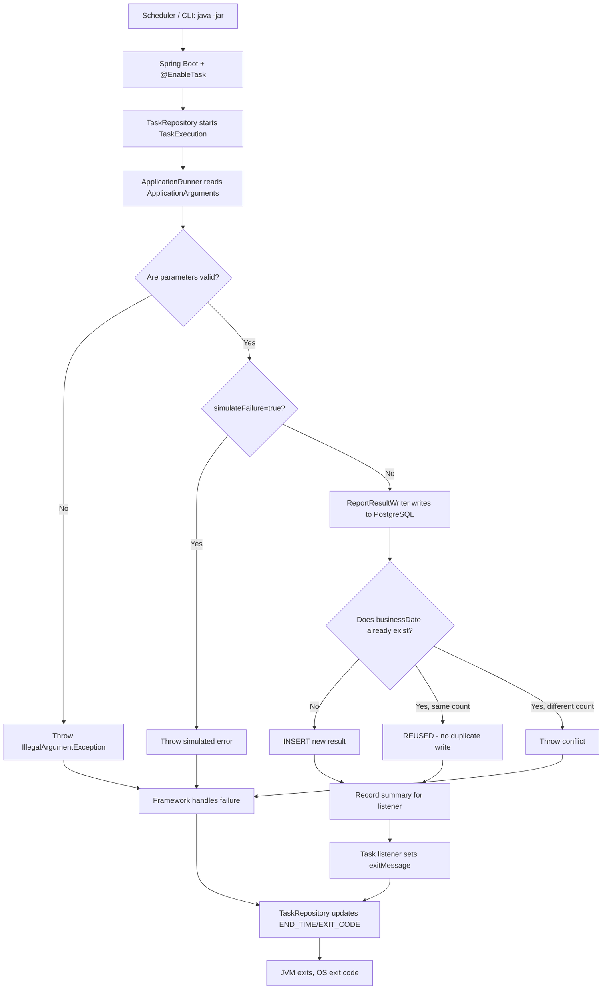
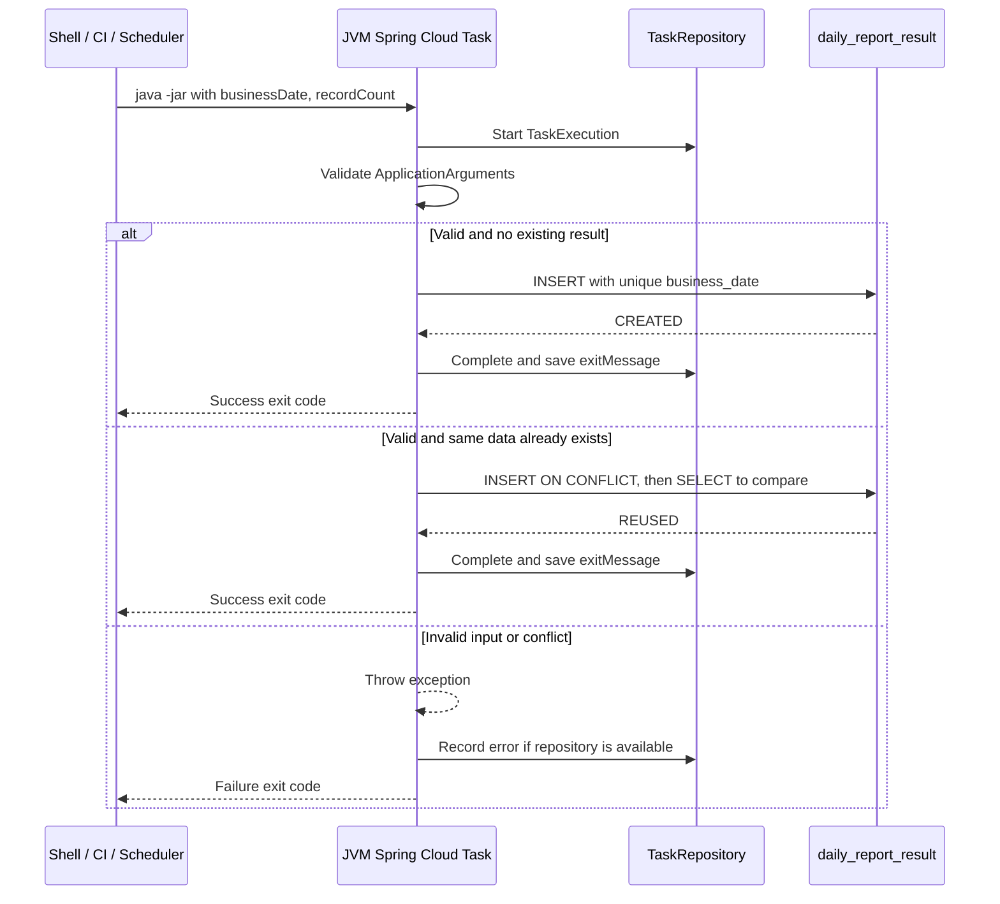

# Task for Parameter Validation and Completion Result Recording

## Objectives and Practice Deliverable

**SPRING_CLOUD_TASK (Spring Cloud Task)** is a framework for Spring Boot applications **with finite runtimes**: it starts on demand or on a schedule, executes work, records run metadata in `TaskRepository`, and then terminates. Each run has its own `TaskExecution` to look up start/end times, exit code, and error information. When batch processing is needed, this same model can work together with Spring Batch.

In this **Hands-On Practice** chapter, we build the `report-summary-task` application that accepts command-line arguments, **rejects invalid data before writing**, creates a minimal business result in PostgreSQL, and **records the completion result** of the Task run through the Spring Cloud Task mechanism.

The exercise answers three practical questions:

1. When invoking `java -jar`, do `--businessDate` and `--recordCount` have valid formats and value ranges?
2. If an operator re-runs the same date, does the Task create duplicate results or silently overwrite the old result?
3. After the JAR finishes, how do we distinguish **business result recorded**, **Task completed successfully**, and **Task failed**?

### Completion Criteria

- A valid run creates a record in `daily_report_result` and has a corresponding `TASK_EXECUTION` row.
- Re-running the same date with the same count does not create a second record; if the count differs, the Task **fails explicitly** instead of overwriting.
- A missing date, invalid date, negative/non-numeric count, or malformed flag all fail **before writing business data**.
- A simulated failure case does not create a new result; the scheduler observes a failure exit code on the verified execution path.
- `EXIT_MESSAGE` reflects a summary of the business result on a successful run; `ERROR_MESSAGE` aids diagnostics when the Task fails.
- Know how to cross-check logs, PostgreSQL, OS exit code, and execution history instead of relying on a single signal.

## 1. Context and Architecture

The operations team needs to aggregate the record count for a business date, for example `2026-11-23`. To focus on **parameter validation and Task completion**, the example takes the count from the `recordCount` parameter and stores it in a summary table; this is **simulated data**, not a production order-counting pipeline.

Expected launch command:

```bash
java -jar target/report-summary-task.jar \
  --spring.profiles.active=local \
  --businessDate=2026-11-23 \
  --recordCount=125
```

Processing flow:



**Two independent record types:**

| Artifact | Storage Location | Meaning |
| --- | --- | --- |
| `daily_report_result` | Custom business table. | Written result for `businessDate`, with a unique key to prevent duplicates. |
| `TaskExecution` | `TASK_EXECUTION` of Spring Cloud Task. | Each Task JVM run, including parameter validation failures if the lifecycle has started. |
| `TaskExecution.exitMessage` | `EXIT_MESSAGE` column in Task repository. | Summary message added by the listener, **not automatic proof of a business transaction**. |
| `TaskExecution.errorMessage` | `ERROR_MESSAGE` column when the framework can persist it. | Error details/stack trace of an unhandled exception. |
| OS exit code | Return value when the JVM exits. | Used by the scheduler to decide alerting/retry; not necessarily equal to every metadata field in all failure cases. |

For the same `businessDate`, you can run multiple `TaskExecution` instances while still having only **one** business result. That is intentional: execution history and business results have different cardinalities.

## 2. Environment Setup

**Reference requirements:** JDK 17 or higher, Maven, a test PostgreSQL instance, and compatible Spring Boot/Spring Cloud Task versions. Spring Cloud Task supports H2 for quick learning, but this example uses PostgreSQL for **durable, verifiable results across separate `java -jar` runs**.

You can create a Maven project from Spring Initializr with Spring Cloud Task, Spring JDBC, PostgreSQL, and Spring Boot Test dependencies. Choose the Spring Boot version first, then pick a **compatible Spring Cloud release train/BOM**; do not pick an arbitrary standalone Task version or mix Spring Batch APIs from another major version.

Reference `pom.xml` snippet (placed in a project that already has a valid Spring Boot parent and Spring Cloud BOM):

```xml
<dependencies>
    <dependency>
        <groupId>org.springframework.cloud</groupId>
        <artifactId>spring-cloud-starter-task</artifactId>
    </dependency>
    <dependency>
        <groupId>org.springframework.boot</groupId>
        <artifactId>spring-boot-starter-jdbc</artifactId>
    </dependency>
    <dependency>
        <groupId>org.postgresql</groupId>
        <artifactId>postgresql</artifactId>
        <scope>runtime</scope>
    </dependency>
    <dependency>
        <groupId>org.springframework.boot</groupId>
        <artifactId>spring-boot-starter-test</artifactId>
        <scope>test</scope>
    </dependency>
</dependencies>
```

This is a **dependencies snippet**, not a complete POM. The project must manage versions, include `spring-boot-maven-plugin` to build an executable JAR, and configure tests appropriately. When a project requires Spring Batch, the Batch dependency is added separately; Batch is not needed for this simple practice exercise.

### Example Project Structure

```text
report-summary-task/
├── pom.xml
└── src/
    ├── main/
    │   ├── java/com/example/reporttask/
    │   │   ├── ReportTaskApplication.java
    │   │   ├── ReportRequest.java
    │   │   ├── ReportResult.java
    │   │   ├── ReportResultWriter.java
    │   │   ├── ReportRunner.java
    │   │   └── CompletionSummaryListener.java
    │   └── resources/
    │       └── application-local.yml
    └── test/
        └── java/com/example/reporttask/
            └── ReportRequestTest.java
```

Each Java snippet below is **one file** with the matching name, in package `com.example.reporttask`. With Maven, the final JAR name depends on `artifactId`/`version` and plugins; the example uses the shorthand `target/report-summary-task.jar` after you configure `finalName` or rename the output artifact.

## 3. Creating Metadata Schema and Result Table

Spring Cloud Task uses its own metadata tables (`TASK_EXECUTION`, `TASK_EXECUTION_PARAMS`, ID-generating objects, and auxiliary tables depending on version). When using PostgreSQL and needing to preserve history after the JVM exits, manage these tables using DDL/migrations **matching the exact Spring Cloud Task version**, rather than hand-writing a simplified `TASK_EXECUTION` table.

Example **business table owned by our application**:

```sql
CREATE TABLE IF NOT EXISTS daily_report_result (
    business_date DATE PRIMARY KEY,
    record_count INTEGER NOT NULL CHECK (record_count >= 0),
    created_at TIMESTAMP NOT NULL DEFAULT CURRENT_TIMESTAMP
);
```

`business_date` is the primary key: two JVMs cannot create two valid records for the same day, even when scheduler triggers overlap. This is an idempotency key **by business date**, distinct from `TASK_EXECUTION_ID`, which is newly generated for every run.

**Environment warning:** run DDL on a test PostgreSQL instance; the Task schema must be installed from the official script for the library version. Do not turn the lab's `CREATE TABLE IF NOT EXISTS` into your sole production migration strategy; long term, use Flyway/Liquibase with a dedicated DDL account and schema review.

### application-local.yml

```yaml
spring:
  application:
    name: report-summary-task
  main:
    web-application-type: none
  datasource:
    url: ${TASK_DB_URL}
    username: ${TASK_DB_USER}
    password: ${TASK_DB_PASSWORD}
  cloud:
    task:
      name: report-summary-task
      initialize-enabled: false
      closecontextEnabled: true

logging:
  level:
    org.springframework.cloud.task: INFO
    com.example.reporttask: INFO
```

Assume **both Task metadata and business results share one PostgreSQL DataSource** in this lesson to keep configuration simple. In production, `TaskConfigurer` can point `TaskRepository` to a separate database/schema; in that case, you must define the transaction manager, linking tables, and permissions for each source.

`initialize-enabled: false` means the Task tables have already been migrated **before the JAR runs**. `closecontextEnabled: true` asks Spring Cloud Task to close the `ApplicationContext` when work finishes according to the framework mechanism; it does not replace closing thread pools or resources managed directly by the application.

Do not put real passwords in YAML or on the command line: Spring Cloud Task may store process arguments in `TASK_EXECUTION_PARAMS`.

## 4. Spring Boot Application Enabling Task

File `ReportTaskApplication.java`:

```java
package com.example.reporttask;

import org.springframework.boot.SpringApplication;
import org.springframework.boot.autoconfigure.SpringBootApplication;
import org.springframework.cloud.task.configuration.EnableTask;

@SpringBootApplication
@EnableTask
public class ReportTaskApplication {

    public static void main(String[] args) {
        SpringApplication.run(ReportTaskApplication.class, args);
    }
}
```

`@EnableTask` activates the Spring Cloud Task lifecycle. Spring Boot invokes `ApplicationRunner`/`CommandLineRunner` beans after context initialization. Task metadata is typically recorded around the runner lifecycle; logic executed in constructors or `@PostConstruct` **does not belong to the runner work scope** as described by Spring Cloud Task, so avoid placing business processing there.

**Do not add HTTP controllers or `@Scheduled` tasks that keep the JVM alive** for this lab; this is a run-and-exit JAR. An external platform handles scheduling and retries.

## 5. Validating Parameters Before Writing Data

Input requirements:

| Parameter Name | Required | Rules | Example |
| --- | --- | --- | --- |
| `--businessDate` | Yes | Single value, ISO `yyyy-MM-dd`, must be a valid calendar date. | `--businessDate=2026-11-23` |
| `--recordCount` | Yes | Integer from `0` to `100000`. | `--recordCount=125` |
| `--simulateFailure` | No | Only accepts `true` or `false`; defaults to `false`. | `--simulateFailure=true` |

`simulateFailure` is only for learning/testing environments to trigger a controlled business failure. In real systems, remove this flag from production code.

File `ReportRequest.java` uses `ApplicationArguments` to extract options explicitly:

```java
package com.example.reporttask;

import java.time.LocalDate;
import java.time.format.DateTimeParseException;
import java.util.List;
import org.springframework.boot.ApplicationArguments;

public record ReportRequest(
        LocalDate businessDate,
        int recordCount,
        boolean simulateFailure) {

    public static ReportRequest from(ApplicationArguments args) {
        String rawDate = required(args, "businessDate");
        String rawCount = required(args, "recordCount");

        LocalDate date;
        try {
            date = LocalDate.parse(rawDate);
        } catch (DateTimeParseException error) {
            throw new IllegalArgumentException(
                    "businessDate must be a valid ISO yyyy-MM-dd date",
                    error);
        }

        int count;
        try {
            count = Integer.parseInt(rawCount);
        } catch (NumberFormatException error) {
            throw new IllegalArgumentException(
                    "recordCount must be an integer", error);
        }
        if (count < 0 || count > 100000) {
            throw new IllegalArgumentException(
                    "recordCount must be within 0..100000");
        }

        List<String> flags = args.getOptionValues("simulateFailure");
        boolean fail = false;
        if (flags != null) {
            if (flags.size() != 1 ||
                    (!"true".equalsIgnoreCase(flags.get(0)) &&
                     !"false".equalsIgnoreCase(flags.get(0)))) {
                throw new IllegalArgumentException(
                        "simulateFailure only accepts true or false");
            }
            fail = Boolean.parseBoolean(flags.get(0));
        }
        return new ReportRequest(date, count, fail);
    }

    private static String required(
            ApplicationArguments args, String option) {
        List<String> values = args.getOptionValues(option);
        if (values == null || values.size() != 1 ||
                values.get(0) == null || values.get(0).isBlank()) {
            throw new IllegalArgumentException(
                    "Missing or duplicate --" + option + "=...");
        }
        return values.get(0);
    }
}
```

Why not use `Boolean.parseBoolean` directly on unvalidated text? Java treats any string other than `"true"` as `false`, easily turning a typo into normal execution behavior. Why not default `businessDate=LocalDate.now()`? Catch-up runs may happen on a different calendar day; requiring an explicit date prevents retries/backfills from writing to the wrong date.

**Place validation at the start of the runner**, before any business write command. If parameter validation fails, the unhandled exception goes through Spring Boot/Spring Cloud Task's error handling rather than writing a bad result row before discovering the mistake.

## 6. Business Result and Duplicate-Safe Writing

File `ReportResult.java` describes the result of the service call:

```java
package com.example.reporttask;

import java.time.LocalDate;

public record ReportResult(
        LocalDate businessDate,
        int recordCount,
        boolean reused) {

    public String summary() {
        return "result=" + (reused ? "REUSED" : "CREATED")
                + "; businessDate=" + businessDate
                + "; recordCount=" + recordCount;
    }
}
```

File `ReportResultWriter.java` uses Spring JDBC's `JdbcTemplate`:

```java
package com.example.reporttask;

import java.sql.Date;
import java.util.Objects;
import org.springframework.jdbc.core.JdbcTemplate;
import org.springframework.stereotype.Service;

@Service
public class ReportResultWriter {

    private final JdbcTemplate jdbc;

    public ReportResultWriter(JdbcTemplate jdbc) {
        this.jdbc = jdbc;
    }

    public ReportResult write(ReportRequest request) {
        Date date = Date.valueOf(request.businessDate());

        int inserted = jdbc.update(
            "INSERT INTO daily_report_result " +
            "(business_date, record_count) VALUES (?, ?) " +
            "ON CONFLICT (business_date) DO NOTHING",
            date, request.recordCount());

        if (inserted == 1) {
            return new ReportResult(
                    request.businessDate(), request.recordCount(), false);
        }

        Integer existing = jdbc.queryForObject(
            "SELECT record_count FROM daily_report_result " +
            "WHERE business_date = ?",
            Integer.class, date);

        if (!Objects.equals(existing, request.recordCount())) {
            throw new IllegalStateException(
                "BUSINESS_DATE_CONFLICT: date already has a different result");
        }

        return new ReportResult(
                request.businessDate(), request.recordCount(), true);
    }
}
```

`ON CONFLICT DO NOTHING` is **PostgreSQL syntax** and will not run verbatim on every database. With two concurrent processes, the unique constraint ensures only one `INSERT` succeeds. The other process reads the existing result: if `recordCount` matches, it returns `REUSED`; if the count differs, it reports a conflict to avoid silently altering published data.

**Limitation:** this example uses **a single INSERT statement** plus a verification query, and does not cover multi-file reports or thousands of transactions. The INSERT result is committed by PostgreSQL according to the active JDBC transaction configuration; if the Task dies **after committing the business write but before TaskRepository writes END_TIME**, a business record can exist while the Task is not marked complete in metadata. That is why idempotency and post-failure reconciliation are essential.

## 7. Recording Completion Messages with TaskExecutionListener

Spring Cloud Task provides `TaskExecutionListener` with lifecycle callbacks:

| Callback | When | What Should It Do? |
| --- | --- | --- |
| `onTaskStartup(TaskExecution)` | When the Task starts, before saving the initial start record according to the reference docs. | Reset internal state, log briefly if needed. |
| `onTaskFailed(TaskExecution, Throwable)` | When an unhandled error fails the Task, before `onTaskEnd`. | Mark as failed; do not swallow the exception. |
| `onTaskEnd(TaskExecution)` | Before the repository updates `TaskExecution` at completion. | Only attach a precomputed `exitMessage`; **do not** re-run business logic. |

Instead of writing again to the database from the listener, we store a summary **in the memory of a single Task JVM**, then attach it to `TaskExecution.exitMessage` when the framework finishes the run. This shows that the completion message is **metadata**, not an independent computed business result.

File `CompletionSummaryListener.java`:

```java
package com.example.reporttask;

import java.util.concurrent.atomic.AtomicBoolean;
import java.util.concurrent.atomic.AtomicReference;
import org.springframework.cloud.task.listener.TaskExecutionListener;
import org.springframework.cloud.task.repository.TaskExecution;
import org.springframework.stereotype.Component;

@Component
public class CompletionSummaryListener
        implements TaskExecutionListener {

    private final AtomicReference<ReportResult> recorded =
            new AtomicReference<>();
    private final AtomicBoolean failed = new AtomicBoolean();

    public void markRecorded(ReportResult result) {
        recorded.set(result);
    }

    @Override
    public void onTaskStartup(TaskExecution execution) {
        recorded.set(null);
        failed.set(false);
    }

    @Override
    public void onTaskFailed(
            TaskExecution execution, Throwable error) {
        failed.set(true);
    }

    @Override
    public void onTaskEnd(TaskExecution execution) {
        ReportResult result = recorded.get();
        if (!failed.get() && result != null) {
            execution.setExitMessage(
                    "BUSINESS_RESULT_RECORDED; " + result.summary());
        }
    }
}
```

This is internal state for **a single process with one TaskExecution**, not durable result storage and not for communication between two JVMs. Using `AtomicReference`/`AtomicBoolean` simply makes the data handoff from runner to listener clear; in environments with multiple lifecycles or asynchronous runners, you must redesign the context/correlation handling.

**Why not set `execution.setExitCode(0)` inside `onTaskEnd`?** Because the end callback can run even when the Task fails. Forcing code `0` would mask failures. Let Spring Cloud Task/Spring Boot determine the exit code, and only attach the summary when the business path has succeeded and no failure callback fired.

Spring Cloud Task documentation notes that messages set in `onTaskEnd` take precedence over messages from earlier callbacks. If multiple listeners modify `exitMessage`, the final value also depends on listener ordering; in this exercise, only one listener sets the message. **Never let a listener throw an exception** from parsing, logging, or auxiliary API calls, as listener errors can alter the termination path and exit code.

## 8. ApplicationRunner Connecting Validation, Execution, and Recording

File `ReportRunner.java`:

```java
package com.example.reporttask;

import org.slf4j.Logger;
import org.slf4j.LoggerFactory;
import org.springframework.boot.ApplicationArguments;
import org.springframework.boot.ApplicationRunner;
import org.springframework.stereotype.Component;

@Component
public class ReportRunner implements ApplicationRunner {

    private static final Logger log =
            LoggerFactory.getLogger(ReportRunner.class);

    private final ReportResultWriter writer;
    private final CompletionSummaryListener completion;

    public ReportRunner(
            ReportResultWriter writer,
            CompletionSummaryListener completion) {
        this.writer = writer;
        this.completion = completion;
    }

    @Override
    public void run(ApplicationArguments args) {
        // Validate all parameters before writing business data.
        ReportRequest request = ReportRequest.from(args);
        log.info("report.started businessDate={} recordCount={}",
                request.businessDate(), request.recordCount());

        if (request.simulateFailure()) {
            throw new IllegalStateException(
                    "SIMULATED_BUSINESS_FAILURE");
        }

        // Execute SQL first, then publish the summary.
        ReportResult result = writer.write(request);
        completion.markRecorded(result);

        log.info("report.result {}", result.summary());
    }
}
```

**Important ordering:**

1. `ReportRequest.from(args)` validates the date, count, and flag. Errors at this step execute no business write SQL.
2. `simulateFailure` simulates an error after validation but **before** the write operation.
3. `ReportResultWriter.write` decides `CREATED`, `REUSED`, or throws a conflict.
4. Only after `write` returns does `markRecorded` pass information to the listener.
5. Spring Boot finishes the runner; Spring Cloud Task invokes the final callbacks and attempts to update `TASK_EXECUTION`.

An unhandled exception from the runner triggers the Spring Boot/Spring Cloud Task failure path. Under typical configurations, the OS exit code is nonzero and `TaskExecution.exitCode` also reflects failure when metadata can be saved; **the exact code must be verified against your executable JAR and framework version**, especially if you use a custom `ExitCodeGenerator` or `ExitCodeExceptionMapper`.

### Why Not Use try/catch Just to Log and Return?

**Wrong** example:

```java
try {
    writer.write(request);
} catch (Exception error) {
    log.error("Error writing report", error);
    // Dangerous: swallowing the exception and exiting the runner normally.
}
```

If you only log without rethrowing or mapping a clear failure status, the framework may record `EXIT_CODE=0` even though the report was never saved. Catch errors only when you can **truly recover** or need to translate them into an exception with an exit-code contract, such as `throw new ReportProcessingException(…)`.

## 9. Running the JAR and Testing Each Scenario

**Preparation:** a test PostgreSQL instance is running, with Spring Cloud Task metadata tables **matching the exact library version** and the `daily_report_result` table created. Provide `TASK_DB_URL`, `TASK_DB_USER`, and `TASK_DB_PASSWORD` environment variables to your terminal/scheduler. Use a secret manager or restricted env file; never commit passwords to Git or print them in logs.

### 9.1. Build the Executable JAR

With a Maven/Boot project created from Initializr and configured with `spring-boot-maven-plugin`:

```bash
./mvnw -DskipTests package
```

The artifact name is determined by the POM. In the commands below, assume you configured `finalName=report-summary-task` to get `target/report-summary-task.jar`, or adjust the path to match the actual JAR name in `target`.

Do not treat a `.jar` produced by `maven-jar-plugin` without the Spring Boot launcher/dependencies as an equivalent executable JAR. Test `java -jar` directly **before** setting up a cron or Kubernetes Job.

### 9.2. First Valid Run

```bash
java -jar target/report-summary-task.jar \
  --spring.profiles.active=local \
  --businessDate=2026-11-23 \
  --recordCount=125
code=$?
printf 'OS exit code: %s\n' "$code"
```

Expected: logs show `report.started` and `report.result result=CREATED`, OS exit code `0` on the success path, one `daily_report_result` row for `2026-11-23`; `TaskRepository` has a completed `TaskExecution` record.

**Important when using a shell:** capture `$?` **immediately after** the Java command. If you run `echo` before saving it, `$?` will already become the exit code of `echo`. On PowerShell, check `$LASTEXITCODE` immediately after `java.exe`.

### 9.3. Re-running the Same Date and Same Count

```bash
java -jar target/report-summary-task.jar \
  --spring.profiles.active=local \
  --businessDate=2026-11-23 \
  --recordCount=125
```

Expected: logs show `result=REUSED`; the number of business result rows **does not increase**; there is a **new TaskExecution**, because it is another Task JVM run. The new run's `EXIT_MESSAGE` can record `BUSINESS_RESULT_RECORDED; result=REUSED; …`.

### 9.4. Running the Same Date with a Different Count

```bash
java -jar target/report-summary-task.jar \
  --spring.profiles.active=local \
  --businessDate=2026-11-23 \
  --recordCount=126
code=$?
printf 'OS exit code: %s\n' "$code"
```

Expected: the service throws `BUSINESS_DATE_CONFLICT`, OS exit code is nonzero via the normal error path, and **the `count=125` row remains unchanged**. This is an intentional business error: changing the count must not be treated as an identical retry of the old request.

### 9.5. Testing Parameter and Execution Errors

| Additional JAR Arguments | Expected Result | New Business Row Created? |
| --- | --- | --- |
| `--recordCount=20` only | Reports missing `businessDate`. | No. |
| `--businessDate=2026-02-30 --recordCount=20` | Reports non-existent calendar date. | No. |
| `--businessDate=2026-11-24 --recordCount=abc` | Reports non-integer count. | No. |
| `--businessDate=2026-11-24 --recordCount=-1` | Reports out-of-range value. | No. |
| `--businessDate=2026-11-24 --recordCount=15 --simulateFailure=maybe` | Reports invalid flag. | No. |
| `--businessDate=2026-11-24 --recordCount=15 --simulateFailure=true` | Reports `SIMULATED_BUSINESS_FAILURE`. | No, if no row exists from an earlier run. |
| `--businessDate=2026-11-24 --recordCount=0` | Valid; saves a result of 0. | Yes, if it does not already exist. |

**Test execution order matters:** if a result for `2026-11-24` has already been created, subsequent tests may return `REUSED` or conflict because data already exists. Use a clean test database/schema or pick a distinct `businessDate` for each test case that verifies row insertion.

## 10. Observing TaskRepository with SQL

Spring Cloud Task generates a unique ID for each execution, and this information is stored in `TASK_EXECUTION` when the JDBC repository is active.

Summary query:

```sql
SELECT TASK_EXECUTION_ID,
       TASK_NAME,
       START_TIME,
       END_TIME,
       EXIT_CODE,
       EXIT_MESSAGE,
       ERROR_MESSAGE
FROM TASK_EXECUTION
WHERE TASK_NAME = 'report-summary-task'
ORDER BY TASK_EXECUTION_ID DESC
LIMIT 20;
```

These table and column names apply to the documented default schema; if your application uses a custom `tablePrefix` or schema, adjust the query to match the actual DDL. `ERROR_MESSAGE` data may contain stack traces or sensitive configuration details; restrict read access and never expose its full contents on public dashboards.

Cross-checking business results:

```sql
SELECT business_date, record_count, created_at
FROM daily_report_result
WHERE business_date = DATE '2026-11-23';

SELECT COUNT(*) AS result_rows_for_day
FROM daily_report_result
WHERE business_date = DATE '2026-11-23';
```

Expect `result_rows_for_day=1` after a `CREATED` run and all `REUSED` runs for the same day. On conflict errors, `record_count` must retain its previous value.

### Distinguishing EXIT_MESSAGE and ERROR_MESSAGE

| Scenario | `EXIT_CODE` | `EXIT_MESSAGE` | `ERROR_MESSAGE` |
| --- | --- | --- | --- |
| Result created successfully | Usually `0`. | `BUSINESS_RESULT_RECORDED; result=CREATED; …`. | Usually empty/null. |
| Re-run with same result | Usually `0`. | `BUSINESS_RESULT_RECORDED; result=REUSED; …`. | Usually empty/null. |
| Validation failed in runner | Usually nonzero. | No success summary because our listener does not set it. | Exception details if TaskRepository can persist them. |
| Business conflict | Usually nonzero. | No success summary. | `BUSINESS_DATE_CONFLICT` details if persisted. |
| Early bootstrap failure | May have no record. | Not applicable. | Not applicable; check scheduler/process logs. |
| JVM killed mid-run | Platform-dependent OS code. | May not be updated. | May be missing; `END_TIME` remains null. |

`onTaskEnd` is called **before** the final update to `TaskRepository` according to Spring Cloud Task documentation. Therefore, a `BUSINESS_RESULT_RECORDED` message only describes that the business step succeeded at the service level; it **does not guarantee `END_TIME` has been committed**. To confirm full Task completion, wait for the process to exit, then inspect metadata and verify the outputs.

### Checking Task Counts by Result

```sql
SELECT TASK_NAME,
       EXIT_CODE,
       COUNT(*) AS run_count
FROM TASK_EXECUTION
WHERE TASK_NAME = 'report-summary-task'
GROUP BY TASK_NAME, EXIT_CODE
ORDER BY EXIT_CODE NULLS FIRST;
```

`EXIT_CODE IS NULL` may mean an incomplete execution, a pre-created execution, or a failed end-time update; do not automatically count all null records as “currently running”.

## 11. Reading Results Back with TaskExplorer

Beyond SQL, Spring Cloud Task provides `TaskExplorer` to query metadata via the framework API. This is a suitable choice when building an **independent** monitoring service or an admin page that already has a `DataSource` to the Task repository.

Example method to look up a `TaskExecution` by ID:

```java
import org.springframework.cloud.task.repository.TaskExecution;
import org.springframework.cloud.task.repository.TaskExplorer;

public TaskExecution findExecution(
        TaskExplorer taskExplorer, long executionId) {

    TaskExecution execution =
            taskExplorer.getTaskExecution(executionId);
    if (execution == null) {
        throw new IllegalArgumentException(
                "TaskExecution does not exist: " + executionId);
    }
    return execution;
}
```

This is an **API snippet** to add to a monitoring service, not a standalone method outside a Java class. `TaskExplorer` reads Task metadata; it cannot read the custom `daily_report_result` table, and it does not replace Spring Batch's `JobExplorer`.

To build a “Has the Task completed?” dashboard, use these signals:

1. `TaskExecution.executionId` to identify the exact run.
2. `endTime`, `exitCode`, and `errorMessage` once persisted by the repository.
3. JVM/Pod/Job status from the scheduler to detect cases where the Task died before updating metadata.
4. The `daily_report_result` row to verify the **business result** for the corresponding date.

Do not infer a run's `executionId` from `MAX(TASK_EXECUTION_ID)` when multiple processes can run concurrently. In practice, pass a `requestId`/external execution ID through the orchestrator, log the framework-assigned ID, or use pre-created execution ID APIs when the launcher supports them.

## 12. Unit Testing Validation with JUnit 5

The part that can be tested completely **without a database** is the `ReportRequest.from` logic. Spring Boot provides `DefaultApplicationArguments` to simulate CLI options.

File `ReportRequestTest.java`:

```java
package com.example.reporttask;

import java.time.LocalDate;
import org.junit.jupiter.api.Test;
import org.springframework.boot.DefaultApplicationArguments;

import static org.junit.jupiter.api.Assertions.*;

class ReportRequestTest {

    @Test
    void acceptsValidRequest() {
        ReportRequest request = ReportRequest.from(
            new DefaultApplicationArguments(
                "--businessDate=2026-11-23",
                "--recordCount=125"));

        assertEquals(LocalDate.of(2026, 11, 23),
                request.businessDate());
        assertEquals(125, request.recordCount());
        assertFalse(request.simulateFailure());
    }

    @Test
    void supportsExplicitFailureSwitch() {
        ReportRequest request = ReportRequest.from(
            new DefaultApplicationArguments(
                "--businessDate=2026-11-24",
                "--recordCount=0",
                "--simulateFailure=true"));
        assertTrue(request.simulateFailure());
    }

    @Test
    void rejectsMissingDate() {
        assertThrows(IllegalArgumentException.class,
            () -> ReportRequest.from(
                new DefaultApplicationArguments(
                    "--recordCount=10")));
    }

    @Test
    void rejectsInvalidCalendarDate() {
        assertThrows(IllegalArgumentException.class,
            () -> ReportRequest.from(
                new DefaultApplicationArguments(
                    "--businessDate=2026-02-30",
                    "--recordCount=10")));
    }

    @Test
    void rejectsNegativeCount() {
        assertThrows(IllegalArgumentException.class,
            () -> ReportRequest.from(
                new DefaultApplicationArguments(
                    "--businessDate=2026-11-23",
                    "--recordCount=-2")));
    }

    @Test
    void rejectsBadFailureSwitch() {
        assertThrows(IllegalArgumentException.class,
            () -> ReportRequest.from(
                new DefaultApplicationArguments(
                    "--businessDate=2026-11-23",
                    "--recordCount=10",
                    "--simulateFailure=maybe")));
    }
}
```

This is a **unit test**, verifying only parsing/validation rules. It does **not** start the `ApplicationContext`, execute `ReportResultWriter`, or prove the JAR's `TaskExecution.exitCode` or OS exit code. Integration tests are needed to verify those layers.

Run unit tests with a configured Maven project:

```bash
./mvnw test
```

If a test suite uses `@SpringBootTest` to boot the Task context automatically, you must supply required arguments or replace the runner bean in tests; otherwise the runner may throw an unintended error. With a plain `ReportRequestTest` class as above, there is no need to boot all of Spring Boot.

## 13. Integration Testing Against the Database and Independent Processes

A run can pass unit tests yet **fail when packaged** due to a missing PostgreSQL driver, wrong schema, or lifecycle bugs. Therefore, verify with the **real JAR** in a test environment:



### Suggested Test Cases

| Code | Input / Pre-state | Business Result | Task Result to Verify |
| --- | --- | --- | --- |
| P01 | Unused date, valid count. | Creates exactly one row. | New Task, `END_TIME` populated, success code, `CREATED` message. |
| P02 | Same date, same count. | No new row added, count not updated. | New `TaskExecution`, `REUSED` message. |
| P03 | Same date, different count. | Existing row preserved. | New Task fails, conflict details recorded. |
| P04 | Missing `businessDate`. | Nothing written. | Validation error; Task metadata if context initialized. |
| P05 | Invalid `businessDate`. | Nothing written. | Error exit code and clear log reason. |
| P06 | `recordCount=abc`. | Nothing written. | Parse error, not coerced to `0`. |
| P07 | `recordCount=-1` or over limit. | Nothing written. | Validation error. |
| P08 | `simulateFailure=true` on new date. | Nothing written. | Error from runner, no false completion message. |
| P09 | Two processes with same date/count. | Single unique row via unique key. | Two separate `TaskExecution` rows; results may be `CREATED`/`REUSED`. |
| P10 | Two processes with same date, different counts. | Winning row not overwritten. | One run succeeds, the other reports conflict. |
| P11 | Intentionally wrong DataSource/schema. | Unable to write result. | Startup error; `TaskExecution` may be absent. |
| P12 | Kill JVM after business write, before metadata completion. | Row may already exist. | `END_TIME` may be null; retry is safe via idempotency. |

**Measuring real OS exit codes:** on Linux/macOS use `$?` immediately after `java -jar`; on PowerShell use `$LASTEXITCODE`. To automate this, write a JUnit integration test using `ProcessBuilder` to invoke the executable JAR in a separate JVM, wait with `waitFor(timeout)`, and redirect both stdout/stderr to files so tests do not hang on full pipes. Do not only assert `exitCode != 0`: a missing JAR also returns nonzero even though validation logic never ran. Verify log markers and metadata for the exact run.

### Test Data Must Be Isolated

Use a dedicated database/schema for tests, or a `businessDate` that does not collide with active runs. Clean up data in the test environment according to an appropriate policy; do not arbitrarily `TRUNCATE TASK_EXECUTION` or delete `TASK_SEQ`, as the tables have relationships and their own ID-generation mechanisms.

In-memory H2 across **two separate JVMs** does not share a database by default. With `ProcessBuilder` and standalone JAR tests, network-accessible PostgreSQL/Testcontainers is the right choice so both the test JVM and child JVM can query the same repository.

## 14. Error Handling, Restarts, and Idempotency

This exercise uses the `businessDate` key to prevent **duplicate writes** at the business layer. However, several other protection layers exist:

| Mechanism | What Does It Protect? | What Does It Not Replace? |
| --- | --- | --- |
| `ReportRequest` validation | Prevents running with missing/invalid parameters. | Does not prevent two valid requests from running concurrently. |
| `business_date` unique key | Prevents two result rows for the same day. | Does not guarantee a multi-step pipeline has no duplicate side effects. |
| `ON CONFLICT DO NOTHING` + count check | Retries with identical data become `REUSED`; differing data conflicts fail. | Does not handle amending an already published report. |
| `TaskRepository` | Stores history of each run, exit code, and errors. | Does not provide business locking or retry decisions. |
| Spring Cloud Task `single-instance-enabled` | Can restrict overlapping runs of the same Task name when JDBC locking is properly configured. | Does not replace idempotency, and may be overly broad when processing different dates in parallel. |
| Scheduler/queue | Controls schedule, retries, timeouts, and concurrency. | Does not prove a business transaction committed. |
| Spring Batch `JobRepository` | Stores Job/Step state, checkpoints, and restarts when using Batch. | Does not replace `TaskRepository` or business unique keys. |

### Hard Case: Disconnection After Writing the Business Result

Suppose `ReportResultWriter` committed the record for `2026-11-23`, but before Spring Cloud Task saved `END_TIME`, the JVM was killed. The operator sees incomplete Task metadata, yet `daily_report_result` **already has the count**.

**Correct handling procedure:**

1. Check process/Pod status rather than relying only on `END_TIME IS NULL`.
2. Read the `daily_report_result` row for that date and verify the count/output.
3. If the data is already correct, note that the previous run had a committed side effect; decide whether to rerun per policy.
4. If re-run with the same parameters, the code returns `REUSED` and does not create an extra row.
5. To correct a saved count, use an **approved data-correction procedure** instead of casually changing `ON CONFLICT DO NOTHING` to `DO UPDATE`.

**There is no default atomic transaction spanning `TaskExecution` status and business results**, especially if the two repositories use different datasources. When business requirements demand stronger guarantees, consider transaction boundaries, per-request idempotency keys, transactional outbox patterns, and reconciliation mechanisms.

### If Replacing recordCount with a Spring Batch Job

When upgrading the exercise from “saving a simulated count” to processing CSV/DB data with Spring Batch:

- `TaskExecution` still represents a single Task JVM run.
- `JobInstance` depends on the Job name and identifying `JobParameters`; one `JobInstance` can be run/restarted across multiple `JobExecution`s.
- `BatchStatus.FAILED` may not automatically produce a nonzero Task exit code under every launch configuration; verify `spring.cloud.task.batch.fail-on-job-failure` and your actual execution path.
- `TaskBatchExecutionListener` can create links in `TASK_TASK_BATCH` when properly integrated.
- Checkpoints/restarts do not automatically make external writers or message publishing idempotent.

This section is an **extension path**; you do not need to add the Spring Batch dependency for the basic lab.

## 15. Troubleshooting Common Issues

| Symptom | Possible Cause | Resolution |
| --- | --- | --- |
| `relation "task_execution" does not exist` | Task DDL not applied, or wrong schema/table prefix. | Check datasource/profile and version-matched DDL; migrate before running. |
| `relation "daily_report_result" does not exist` | Business table not created. | Run the SQL from section 3 on the right test database. |
| Cannot create `JdbcTemplate` bean | Missing Spring JDBC/DataSource/driver or bad DB config. | Check dependencies and `spring.datasource.*`. |
| Task finishes but nothing appears in DB | Using in-memory H2, wrong database/profile, or repository uninitialized. | Check the actual JDBC URL, `TaskRepository`, and logs. |
| `EXIT_MESSAGE` is empty despite runner success | Listener not registered, failed before `markRecorded`, or another listener overwrote it. | Check the `CompletionSummaryListener` bean, lifecycle, and version. |
| `ERROR_MESSAGE` is populated but OS code is `0` | Exception swallowed or custom exit code mapping. | Do not mask errors; measure exit code with a real JVM and inspect Boot exit mapping. |
| `BUSINESS_DATE_CONFLICT` | Same date, but count parameter does not match the saved result. | Reconcile against source data; do not overwrite automatically. |
| Second run has a new `TaskExecution` but no new result row | Expected `REUSED` behavior. | Do not confuse Task run count with business report count. |
| `END_TIME` stays null even though process stopped | JVM was killed, DB error during completion, or pre-created Task. | Cross-check scheduler/process state and the result table. |
| JAR refuses to exit | Web server/thread pool/scheduler or unclosed resource. | Enable non-web mode, close resources, and test with process timeouts. |
| PostgreSQL SQL error even though code compiles | Wrong dialect or table/constraint differs from example. | Verify `ON CONFLICT`, actual schema, and migrations. |

**Do not fix errors by setting `exitCode=0` in a listener or deleting failed `TaskExecution` rows.** Failure history helps diagnose system faults and make accurate retry decisions.

## 16. Extension Exercises

After completing the main scenario, implement the following changes one by one:

1. **Reject future dates:** reject dates later than the current business date. Inject a `Clock` instead of hardcoding `LocalDate.now()` in the parser so unit tests remain time-independent.
2. **Standardize exit codes:** distinguish `INVALID_ARGUMENT`, `BUSINESS_DATE_CONFLICT`, and `INFRASTRUCTURE_FAILURE`. Consider `ExitCodeExceptionMapper` or `ExitCodeGenerator`, and verify OS exit codes on the executable JAR.
3. **Move counting into a real service:** replace `--recordCount` with an order aggregation query. Then only `--businessDate` is an input; the count must be computed from a trusted data source.
4. **Add `requestId`:** accept `--requestId` from the scheduler, log it safely, and store correlation in the business table or orchestrator. Do not treat a request ID as a secret or use it to replace `TaskExecution ID`.
5. **Test concurrency:** run two JARs for the same date with the same count and with different counts; verify that the unique constraint blocks overwrites.
6. **Completion reconciliation:** write an admin tool querying `TaskExecution` and `daily_report_result` by date, distinguishing “result present” from “Task completed”.
7. **Schedule execution:** use cron/systemd or a Kubernetes CronJob to invoke the JAR, capture stdout/stderr, and alert when no scheduled run succeeds.
8. **Add Spring Batch:** replace the simulated writer with a chunk-oriented Job, and inspect `JobExecution`/`StepExecution` alongside Task error codes.

### Acceptance Checklist

- [ ] Correctly parses `businessDate`, `recordCount`, and `simulateFailure`.
- [ ] Invalid input never calls `ReportResultWriter`.
- [ ] First valid run produces one `CREATED` result.
- [ ] Re-running with the same data returns `REUSED` without adding business rows.
- [ ] Running with a different count reports `BUSINESS_DATE_CONFLICT` and preserves existing data.
- [ ] Listener only sets `EXIT_MESSAGE` when a result was recorded and no error callback ran.
- [ ] One JVM run corresponds to one new `TaskExecution` when lifecycle/repository are active.
- [ ] OS exit code, `TASK_EXECUTION.EXIT_CODE`, and business output are verified independently.
- [ ] Recovery procedure exists if the JVM dies after business commit but before metadata update.
- [ ] No passwords or tokens appear in command-line arguments, logs, or exercise files.

## 17. References

- [Spring Cloud Task — Getting Started](https://docs.spring.io/spring-cloud-task/reference/getting-started.html): `@EnableTask`, `ApplicationRunner`, lifecycle, and repository.
- [Spring Cloud Task — Features](https://docs.spring.io/spring-cloud-task/reference/features.html): `TaskExecution`, exit codes, listeners, `exitMessage`, and closing `ApplicationContext`.
- [Spring Cloud Task — Repository Schema](https://docs.spring.io/spring-cloud-task/reference/appendix-task-repository-schema.html): DDL, `TASK_EXECUTION`, and related metadata tables.
- [Spring Cloud Task — Batch Integration](https://docs.spring.io/spring-cloud-task/reference/batch.html): `TaskBatchExecutionListener`, `fail-on-job-failure`, and metadata linking.
- [Spring Boot — SpringApplication / Runners / Exit Codes](https://docs.spring.io/spring-boot/reference/features/spring-application.html): `ApplicationArguments`, `ApplicationRunner`, and `ExitCodeGenerator`.
- [Spring Framework — JdbcTemplate](https://docs.spring.io/spring-framework/reference/data-access/jdbc/core.html): SQL execution and result mapping via JDBC.
- [PostgreSQL — INSERT / ON CONFLICT](https://www.postgresql.org/docs/current/sql-insert.html): handling unique conflicts and `DO NOTHING` behavior.
- [JUnit 5 — User Guide](https://junit.org/junit5/docs/current/user-guide/): testing parsers and assertions.

The Java/SQL examples here are practice material and **have not been compiled/executed against a real database during authoring**. Pin compatible Spring Boot/Spring Cloud BOM versions, apply the matching Task schema, and test in an isolated environment before operating in production.

## Key Takeaways

- A **finite Spring Cloud Task** should validate parameters **before writing** and let unhandled errors propagate through the framework rather than logging and returning fake success.
- `TaskExecution` tracks **each application run**; the business table records **daily results**. Re-running the same date can create a new `TaskExecution` without creating a new result row.
- `TaskExecutionListener.onTaskEnd` attaches `exitMessage` **before final metadata is saved**; never use this callback to re-run business logic or force exit code `0`.
- A unique key combined with `CREATED/REUSED/CONFLICT` logic is a simple idempotency example; it does not equate to exactly-once guarantees for all side effects.
- Always cross-check the **OS exit code**, `TASK_EXECUTION`, and **business results**. If the process is killed or the DB fails before startup, Task metadata may be missing.
- Test invalid inputs, retries, conflicts, concurrency, and startup failures on a real JAR before scheduling or deploying to production.
