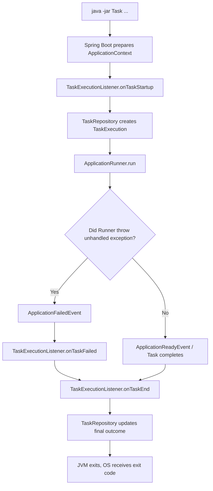

# Testing Exit Codes, Exceptions, and Listeners in Spring Cloud Task

## 1. Objectives of This Practice Lab

**Spring Cloud Task** helps build Spring Boot applications with finite runtimes: they start up, accept arguments, execute work, record metadata into `TaskRepository`, and terminate. A single run is represented by a `TaskExecution` containing fields such as `executionId`, `taskName`, `startTime`, `endTime`, `exitCode`, `exitMessage`, and `errorMessage`.

When an invoice-processing Task fails, at least **three places** can describe the outcome:

1. **The OS / container** receives the JVM's *process exit code*.
2. **TaskRepository** stores `TaskExecution.exitCode`, `exitMessage`, and `errorMessage`.
3. **Listeners** are invoked at startup, failed, or end phases and can attach messages or throw errors themselves.

These values are **related, yet not always equal**. For instance, a Task might catch and swallow an exception so the application returns exit code `0` even though business logic failed; a listener throwing an exception follows different exit-code rules than an exception thrown from `ApplicationRunner`. If the Task also runs **Spring Batch**, `BatchStatus.FAILED` does not automatically translate into a nonzero Task exit code either.

After completing this lesson in the **Hands-On Practice** chapter, you will be able to run and compare:

- Task success, input errors, transient dependency errors, and unexpected failures.
- `ExitCodeExceptionMapper`, exceptions implementing `ExitCodeGenerator`, and the OS process exit code.
- The three `TaskExecutionListener` callbacks: `onTaskStartup`, `onTaskFailed`, and `onTaskEnd`.
- How `exitMessage` precedence works and why it must never be used to mask failures.
- Exceptions that are **caught and ignored** versus **unhandled** exceptions.
- Listeners throwing exceptions in each phase and their impact on sibling listeners.
- Querying Task history in the database, safe retries, and distinguishing missing metadata from execution failures.

**Environment scope:** Java 17+, a project with Spring Boot and Spring Cloud Task versions **compatible via the Spring Cloud BOM**, file-based H2 for **sequential single-machine** lab runs or PostgreSQL for extension exercises. The examples are practice code, not build outputs executed here.

## 2. Lifecycle Diagram: When Is Metadata Recorded?



This diagram shows the typical model per Spring Cloud Task documentation; when a listener callback throws an exception, initialization fails, or an abnormal shutdown occurs, ordering and metadata persistence may differ. Never treat `onTaskEnd` as proof that the database has committed, because that callback runs **before** the final status update.

| Moment | Observable Signal | What Not to Infer |
| --- | --- | --- |
| `onTaskStartup` | Task prepares to save startup metadata; can set `exitMessage` | Not guaranteed `executionId` is already durably committed in DB |
| Runner executing | `TaskExecution.exitCode` may still be `null` | `null` does not mean failure |
| `onTaskFailed` | Framework detected an unhandled exception; receives `Throwable` | Not guaranteed to run if the app caught and swallowed the error |
| `onTaskEnd` | Chance to attach a message before completion | Cannot be treated as a post-commit repository callback |
| Repository update | `endTime`/`exitCode`/final message may be saved | If the JVM is killed, this step is not guaranteed |
| Process exit | Shell/Kubernetes receives container/JVM exit code | Does not mean inner Batch Jobs succeeded if the app masked errors |

## 3. Setting Up the Project and TaskRepository

### 3.1. Minimal Dependencies

In a project that **already declares** a Spring Boot parent/plugin and compatible Spring Cloud BOM, you need the Task starter and a JDBC driver. Example Maven `dependencies` section:

```xml
<dependencies>
    <dependency>
        <groupId>org.springframework.cloud</groupId>
        <artifactId>spring-cloud-starter-task</artifactId>
    </dependency>
    <dependency>
        <groupId>com.h2database</groupId>
        <artifactId>h2</artifactId>
        <scope>runtime</scope>
    </dependency>
    <dependency>
        <groupId>org.springframework.boot</groupId>
        <artifactId>spring-boot-starter-test</artifactId>
        <scope>test</scope>
    </dependency>
</dependencies>
```

Gradle example (Groovy DSL), assuming the BOM is imported via `platform(...)` or dependency management:

```groovy
dependencies {
    implementation 'org.springframework.cloud:spring-cloud-starter-task'
    runtimeOnly 'com.h2database:h2'
    testImplementation 'org.springframework.boot:spring-boot-starter-test'
}
```

Do not mix arbitrary versions of Spring Cloud Task, Spring Boot, H2, and Spring Batch. Use the compatibility matrix/BOM pinned by your project. Documentation may span different generations, so test on your **exact runtime dependency versions** before adopting in CI/CD.

### 3.2. application.yml for Sequential Lab Runs

Place `application.yml` in `src/main/resources` of your **practice project**:

```yaml
spring:
  application:
    name: task-exit-lab
  main:
    web-application-type: none
  datasource:
    driver-class-name: org.h2.Driver
    url: "jdbc:h2:file:./lab-data/taskdb"
    username: sa
    password: ""
  cloud:
    task:
      name: task-exit-lab
      initialize-enabled: true
```

**Why use `jdbc:h2:file:...`?** With `jdbc:h2:mem:taskdb`, the database vanishes when the JVM stops, making it impossible to query multi-run history from a fresh process. File-based H2 persists data to disk across runs in the **same working directory**. Create a writable `lab-data` directory first and run only **one Task JVM at a time**. Never share the same embedded H2 file across multiple active containers/JVMs.

`spring.cloud.task.initialize-enabled=true` allows Spring Cloud Task to initialize the schema via its supported mechanism. If your project already creates `TASK_*` tables with Flyway/Liquibase or separate migrations, switch to `initialize-enabled=false` so the framework does not manage DDL. Before the second run, check schema and initialization behavior for your version if an already-exists table error appears; do not wipe the database just to run a "retry" test.

**Production alternative:** use PostgreSQL or another supported database server, provision the schema beforehand via migrations, and supply credentials through a Secret manager. File-based H2 here is solely for observing differences across sequential runs.

### 3.3. Sample Code Structure

```text
src/main/java/com/example/tasklab/
  TaskExitLabApplication.java
  ProbeTaskExecutionListener.java
src/main/resources/
  application.yml

lab-data/
  taskdb.mv.db           # created by H2 after the first run
```

The code below requires neither a web server nor Spring Batch. Once you understand the Task lifecycle, add the Batch extension in section 11.

## 4. Sample Application: Success and Multiple Exception Types

Create `src/main/java/com/example/tasklab/TaskExitLabApplication.java`:

```java
package com.example.tasklab;

import org.slf4j.Logger;
import org.slf4j.LoggerFactory;
import org.springframework.boot.ApplicationArguments;
import org.springframework.boot.ApplicationRunner;
import org.springframework.boot.ExitCodeExceptionMapper;
import org.springframework.boot.ExitCodeGenerator;
import org.springframework.boot.SpringApplication;
import org.springframework.boot.autoconfigure.SpringBootApplication;
import org.springframework.cloud.task.configuration.EnableTask;
import org.springframework.context.annotation.Bean;

import java.util.List;

@SpringBootApplication
@EnableTask
public class TaskExitLabApplication {

    private static final Logger log =
        LoggerFactory.getLogger(TaskExitLabApplication.class);

    public static void main(String[] args) {
        // SpringApplication.exit closes the context and returns Boot's exit code.
        // If run(...) throws, Boot handles startup failure before
        // this expression reaches exit(...).
        System.exit(SpringApplication.exit(
            SpringApplication.run(TaskExitLabApplication.class, args)));
    }

    @Bean
    ApplicationRunner demoRunner() {
        return args -> {
            String mode = option(args, "lab.mode", "ok");
            log.info("RUNNER_START mode={}", mode);

            switch (mode) {
                case "ok" -> log.info("RUNNER_OK");

                case "input-error" ->
                    throw new InvalidInputException("INVALID_INVOICE_DATE");

                case "temporary-error" ->
                    throw new TemporaryDependencyException(
                        "DOWNSTREAM_UNAVAILABLE");

                case "generator-error" ->
                    throw new GeneratedExitException("SOURCE_REJECTED");

                case "unexpected-error" ->
                    throw new IllegalStateException("UNEXPECTED_FAILURE");

                case "caught-error" -> {
                    try {
                        throw new IllegalStateException(
                            "SIMULATED_INTERNAL_ERROR");
                    } catch (IllegalStateException ex) {
                        // ONLY TO DEMONSTRATE AN ANTI-PATTERN.
                        log.warn("RUNNER_SWALLOWED_EXCEPTION");
                    }
                    // Normal return => Task may be treated as successful!
                }

                default -> throw new InvalidInputException(
                    "UNSUPPORTED_LAB_MODE");
            }

            log.info("RUNNER_RETURNED_NORMALLY");
        };
    }

    @Bean
    ExitCodeExceptionMapper exceptionToExitCode() {
        return exception -> {
            // Spring Boot may wrap the original exception from
            // ApplicationRunner; inspect the entire cause chain.
            Throwable current = exception;
            while (current != null) {
                if (current instanceof InvalidInputException) {
                    return 20;
                }
                if (current instanceof TemporaryDependencyException) {
                    return 30;
                }
                current = current.getCause();
            }
            // 0 = this mapper does not map; let other Boot mechanisms
            // (ExitCodeGenerator/default) decide.
            return 0;
        };
    }

    private static String option(
            ApplicationArguments args, String key, String defaultValue) {
        List<String> values = args.getOptionValues(key);
        if (values == null) {
            return defaultValue;
        }
        if (values.size() != 1 || values.get(0) == null
                || values.get(0).isBlank()) {
            throw new InvalidInputException("INVALID_LAB_OPTION");
        }
        return values.get(0);
    }

    static class InvalidInputException extends RuntimeException {
        InvalidInputException(String message) {
            super(message);
        }
    }

    static class TemporaryDependencyException extends RuntimeException {
        TemporaryDependencyException(String message) {
            super(message);
        }
    }

    static class GeneratedExitException
            extends RuntimeException implements ExitCodeGenerator {
        GeneratedExitException(String message) {
            super(message);
        }

        @Override
        public int getExitCode() {
            return 44;
        }
    }
}
```

### 4.1. Key Points Explained

- `lab.mode=ok` finishes normally and expects exit code `0`.
- `input-error` and `temporary-error` throw two **distinct exception types** to verify `ExitCodeExceptionMapper` returns `20` and `30` respectively.
- `generator-error` throws an exception implementing `ExitCodeGenerator`, expecting Spring Boot's mechanism to pick `44` when no mapper returns a nonzero code.
- `unexpected-error` is an `IllegalStateException` unrecognized by the mapper; by default Spring Boot/Task treats it as a failure (typically `1`).
- `caught-error` deliberately **swallows the exception**, leaving Boot without a runner failure signal. Without another failure source, the Task is recorded as successful despite the warning log. This demonstrates the bug intentionally in the lab, **not a recommended pattern**.
- `RUNNER_RETURNED_NORMALLY` does not appear after throwing branches, making early termination easy to spot.

An exception's exit code can be affected by the ordering of other registered `ExitCodeGenerator`s, `ExitCodeExceptionMapper`s, and `ExitCodeEvent`s. This lab defines **one mapper** and one generator exception for clarity; verify actual results against your Boot/Task version and deployment configuration.

**About `System.exit(...)`:** Spring Boot's official examples pass `SpringApplication.exit(...)` to `System.exit(...)`. That emits the process exit code when `SpringApplication.run` returns a context normally. If `run` fails during initialization or runner execution, execution never reaches `System.exit`; Spring Boot uses its own failure handling path. Therefore, never deduce a process exit code merely by seeing `System.exit(...)` in source code: observe the real outcome.

## 5. Sample Listener: Tracking startup, failed, and end

Create `src/main/java/com/example/tasklab/ProbeTaskExecutionListener.java`:

```java
package com.example.tasklab;

import org.slf4j.Logger;
import org.slf4j.LoggerFactory;
import org.springframework.cloud.task.listener.TaskExecutionListener;
import org.springframework.cloud.task.repository.TaskExecution;
import org.springframework.core.env.Environment;
import org.springframework.stereotype.Component;

@Component
public class ProbeTaskExecutionListener implements TaskExecutionListener {

    private static final Logger log =
        LoggerFactory.getLogger(ProbeTaskExecutionListener.class);

    private final Environment environment;

    public ProbeTaskExecutionListener(Environment environment) {
        this.environment = environment;
    }

    private String throwPhase() {
        return environment.getProperty(
            "lab.listener.throw-phase", "none");
    }

    private boolean useEndMessage() {
        return environment.getProperty(
            "lab.listener.end-message", Boolean.class, false);
    }

    @Override
    public void onTaskStartup(TaskExecution task) {
        log.info("LISTENER_STARTUP taskName={} currentId={}",
            task.getTaskName(), task.getExecutionId());
        task.setExitMessage("STARTUP_MARK");

        if ("startup".equals(throwPhase())) {
            throw new IllegalStateException("LISTENER_STARTUP_EXCEPTION");
        }
    }

    @Override
    public void onTaskFailed(TaskExecution task, Throwable error) {
        log.error("LISTENER_FAILED errorType={}",
            error.getClass().getSimpleName());
        task.setExitMessage("FAILED_MARK");

        if ("failed".equals(throwPhase())) {
            throw new IllegalStateException("LISTENER_FAILED_EXCEPTION");
        }
    }

    @Override
    public void onTaskEnd(TaskExecution task) {
        log.info("LISTENER_END exitCodeAtCallback={}",
            task.getExitCode());

        if (useEndMessage()) {
            task.setExitMessage("END_MARK");
        }
        if ("end".equals(throwPhase())) {
            throw new IllegalStateException("LISTENER_END_EXCEPTION");
        }
    }
}
```

**Experiment design notes:**

- `onTaskStartup` writes `STARTUP_MARK`; it runs **before** the `TaskExecution` is saved in the repository per the lifecycle docs. The ID here may not yet reflect a committed DB row; do not treat the logged ID as proof of persisted data.
- `onTaskFailed` is called only when the Task encounters an unhandled error per lifecycle rules; it receives `Throwable` for classification. It sets `FAILED_MARK` without trying to override the exit code.
- `onTaskEnd` runs before `TaskRepository` saves the final result; if `lab.listener.end-message=true`, it sets `END_MARK` to test precedence.
- `lab.listener.throw-phase` is a **fault-injection test switch**; never ship it in production applications.
- `exitCodeAtCallback` only reflects **observation at callback time**, not necessarily the final persisted state. When a listener throws an exception, check both the DB and the shell rather than inferring from a single log line.

### 5.1. Annotation Listeners and Multiple Listeners

Spring Cloud Task also supports `@BeforeTask`, `@FailedTask`, and `@AfterTask` annotations on bean methods. They correspond to before `TaskExecution` save, on Task failure, and before completion respectively. They can be used instead of implementing `TaskExecutionListener`.

Example illustrating an additional observer bean (only for extension exercises):

```java
import org.springframework.cloud.task.listener.annotation.BeforeTask;
import org.springframework.cloud.task.listener.annotation.FailedTask;
import org.springframework.cloud.task.listener.annotation.AfterTask;
import org.springframework.cloud.task.repository.TaskExecution;
import org.springframework.stereotype.Component;

@Component
class ExtraTaskObserver {
    @BeforeTask
    public void before(TaskExecution task) {
        System.out.println("EXTRA_BEFORE");
    }

    @FailedTask
    public void failed(TaskExecution task, Throwable error) {
        System.out.println("EXTRA_FAILED");
    }

    @AfterTask
    public void after(TaskExecution task) {
        System.out.println("EXTRA_AFTER");
    }
}
```

**Never assume** ordering among multiple listener beans based on source line order or class names. Spring Cloud Task may support `@Order`/`Ordered` depending on implementation, yet startup versus end/failed callback ordering can differ due to how the framework iterates lists. Before relying on ordering, read the implementation for your exact version and write an integration test. To avoid "callback B needs callback A to have written DB", keep each listener independent or move dependent logic into an explicit coordinator component.

## 6. Running the Cases in the Terminal

First prepare the `lab-data` directory, build the JAR from a compatible Boot/Cloud BOM project, and verify the actual JAR path. The examples use `task-exit-lab.jar`. **The commands below are instructions for learners to run in a test environment; they were not executed in this article.**

### 6.1. Linux/macOS (Bash)

```bash
mkdir -p lab-data

# Only after the project has configured plugins/BOM and the classes above.
./mvnw -DskipTests package

# Replace with the actual JAR path under target/.
java -jar target/task-exit-lab.jar --lab.mode=ok
echo "process_exit=$?"

java -jar target/task-exit-lab.jar --lab.mode=input-error
echo "process_exit=$?"

java -jar target/task-exit-lab.jar --lab.mode=temporary-error
echo "process_exit=$?"

java -jar target/task-exit-lab.jar --lab.mode=generator-error
echo "process_exit=$?"

java -jar target/task-exit-lab.jar --lab.mode=unexpected-error
echo "process_exit=$?"

java -jar target/task-exit-lab.jar --lab.mode=caught-error
echo "process_exit=$?"
```

`$?` must be read **immediately after `java`**, before any other command overwrites the exit status. `mvnw -DskipTests` only illustrates packaging; a real pipeline must run tests before release. No source code changes are needed between cases—only the CLI option changes.

### 6.2. Windows PowerShell

```powershell
New-Item -ItemType Directory -Force lab-data | Out-Null

java -jar .\target\task-exit-lab.jar --lab.mode=ok
$code = $LASTEXITCODE
Write-Host "process_exit=$code"

java -jar .\target\task-exit-lab.jar --lab.mode=input-error
$code = $LASTEXITCODE
Write-Host "process_exit=$code"
```

In PowerShell, use `$LASTEXITCODE` to read the native `java` process exit code; `$?` is a boolean PowerShell command success flag, not the numeric exit code to compare. Changing the working directory changes where the H2 file database lives; keep the working directory fixed across runs.

### 6.3. Recording Evidence in One Table

After each run, record:

| Recorded Column | Source |
| --- | --- |
| `scenario` | Values of `--lab.mode` and `--lab.listener.*` |
| `process_exit` | `$?` (Bash) or `$LASTEXITCODE` (PowerShell) |
| `RUNNER_*` log | Application stdout/logs |
| `LISTENER_STARTUP/FAILED/END` | Logs from `ProbeTaskExecutionListener` |
| `TaskExecutionId` | Query on `TASK_EXECUTION` |
| `exitCode`, `exitMessage`, `hasError` | Columns from `TaskRepository` |
| `startTime`, `endTime` | Database metadata to confirm lifecycle |

**Never conclude success solely from seeing `RUNNER_OK` printed:** an `onTaskEnd` listener can still throw an exception after the runner; only logs plus the repository reveal the final outcome.

## 7. Expectation Matrix: What Changes When the Runner Throws?

With the lab configuration having no extra listeners, no `lab.listener.throw-phase`, and `lab.listener.end-message` disabled, predictions are:

| Case | Runner | Expected Process Exit | Expected `TaskExecution.exitCode` | Expected `exitMessage` |
| --- | --- | ---: | ---: | --- |
| `ok` | Returns normally | `0` | `0` | `STARTUP_MARK` |
| `input-error` | Throws `InvalidInputException` | `20` | `20` | `FAILED_MARK` |
| `temporary-error` | Throws `TemporaryDependencyException` | `30` | `30` | `FAILED_MARK` |
| `generator-error` | Throws `ExitCodeGenerator` exception | `44` | `44` | `FAILED_MARK` |
| `unexpected-error` | Throws unmapped exception | Usually `1` | Usually `1` | `FAILED_MARK` |
| `caught-error` | Catches error and returns | `0` | `0` | `STARTUP_MARK` |

Codes `20`, `30`, and `44` are **illustrative conventions**, not Spring Cloud Task defaults. This table shows *expected scenario outcomes*; framework versions, error-handling paths, and other beans can change actual behavior, especially during startup failures. **This exercise requires recording observed results even if they differ from the table, rather than tweaking numbers to match expectations.**

Deeper explanation:

1. **`ok`:** `onTaskStartup` and `onTaskEnd` run; `onTaskFailed` does not. `STARTUP_MARK` can still be persisted since no later callback overwrote it.
2. **`input-error`:** the unhandled exception triggers `onTaskFailed` and `onTaskEnd`; the mapper returns `20`. `errorMessage` may hold the input error stack trace.
3. **`generator-error`:** an exception supplying `44` via `ExitCodeGenerator` uses a **different mechanism** from the mapper; only compare after confirming the mapper returns `0` for this case.
4. **`caught-error`:** the runner deliberately logs the error and exits normally. No `ApplicationFailedEvent` fires for swallowed exceptions, so the Task appears successful. This is a dangerous **anti-pattern** if a scheduler retries based on process exit codes.

If you catch an exception to add context, **rethrow it**, wrap it into a mapped exit-code exception, or fail explicitly per verified rules. Never just call `log.error(...)` and return `void`.

## 8. Testing the Three Listener Phases and exitMessage Precedence

### 8.1. startup, failed, and end Phases

| Phase | When Called | Typical Purpose | Risk If Throwing an Exception |
| --- | --- | --- | --- |
| `onTaskStartup` | Before `TaskExecution` is persisted | Prepare tracking data, attach descriptive marker | May prevent the runner from executing and leave metadata unsaved |
| `onTaskFailed` | On unhandled error; before end | Attach failure marker or record diagnostics | May mask the root error and block sibling listeners in the same phase |
| `onTaskEnd` | Before repository finalizes `TaskExecution` | Write summary `exitMessage`, light cleanup | May alter final outcome and complicate completion persistence |

According to Spring Cloud Task docs, **`exitMessage`** precedence by phase is:

1. `onTaskEnd` (highest priority).
2. `onTaskFailed`.
3. `onTaskStartup`.

That is **message precedence**, not a claim that all three callbacks run in every case. On Task success, `onTaskFailed` is not called; if the end listener sets no new message, the message from an earlier phase may remain.

### 8.2. Testing exitMessage Overwrites

```bash
# Case A: success, no new message written at end.
java -jar target/task-exit-lab.jar --lab.mode=ok

# Case B: end sets END_MARK, overriding STARTUP_MARK.
java -jar target/task-exit-lab.jar \
  --lab.mode=ok \
  --lab.listener.end-message=true

# Case C: runner fails, end still sets END_MARK.
java -jar target/task-exit-lab.jar \
  --lab.mode=input-error \
  --lab.listener.end-message=true
```

Expected:

| Case | Callbacks Setting Message | Final `exitMessage` | Exit Code |
| --- | --- | --- | --- |
| A | Startup = `STARTUP_MARK` | `STARTUP_MARK` | `0` |
| B | Startup = `STARTUP_MARK`; End = `END_MARK` | `END_MARK` | `0` |
| C | Startup = `STARTUP_MARK`; Failed = `FAILED_MARK`; End = `END_MARK` | `END_MARK` | **Still failure** (expected `20`) |

**Important:** `exitMessage="END_MARK"` does not turn `exitCode` into `0`. A dashboard or **Spring Cloud Data Flow** composed task may treat `exitMessage` as a *transition token*, so unconditionally writing `"COMPLETED"` inside `onTaskEnd` on failure can mislead orchestration. In production, set `exitMessage` strictly consistent with actual status and use logs/metrics for details.

## 9. Listeners Throwing Exceptions: Controlled Fault Experiments

Spring Cloud Task docs explain that when a `TaskExecutionListener` callback throws an exception, remaining listeners in **that same callback phase** stop being invoked in that loop; subsequent lifecycle callbacks (`onTaskFailed` or `onTaskEnd`) may still execute. Notably, `ExitCodeExceptionMapper` **cannot be used to override the exit code of an exception thrown by a listener** the way it handles normal runner exceptions.

### 9.1. Testing a Failure at startup

```bash
java -jar target/task-exit-lab.jar \
  --lab.mode=ok \
  --lab.listener.throw-phase=startup
echo "process_exit=$?"
```

**Observations to record:** does `LISTENER_STARTUP` appear? Does `RUNNER_START` appear? What do `onTaskFailed` and `onTaskEnd` log? Is there a new row in `TASK_EXECUTION`?

Per the documentation, an exception in `onTaskStartup` typically prevents business execution and yields exit code **`1`**. However, the callback runs **before `TaskExecution` is persisted**, so **never assume** a complete `TaskExecution` row will always exist for this case. If missing, trace startup failures through logs/scheduler.

### 9.2. Testing a Failure at the failed Callback

```bash
java -jar target/task-exit-lab.jar \
  --lab.mode=input-error \
  --lab.listener.throw-phase=failed
echo "process_exit=$?"
```

In this case **two errors** occur: the runner throws `InvalidInputException` and `onTaskFailed` throws `IllegalStateException` while handling the first error. Do not assume `ExitCodeExceptionMapper` will still return `20` as in the pure runner case. Listener exceptions follow a separate exit-code path; Spring Cloud Task docs note the code can come from `ExitCodeEvent`, `ExitCodeGenerator`, or default to `1`, rather than being forced via `ExitCodeExceptionMapper`.

When investigating, preserve both the **original exception** (`INVALID_INVOICE_DATE`) and the **secondary exception** (`LISTENER_FAILED_EXCEPTION`) as distinct pieces of evidence. In production, listeners sending audits or notifications should handle secondary failures intentionally (logs, outbox, out-of-band retries) so they never obscure the primary business error.

### 9.3. Testing a Failure at the end Callback

```bash
java -jar target/task-exit-lab.jar \
  --lab.mode=ok \
  --lab.listener.throw-phase=end
echo "process_exit=$?"
```

The runner already printed `RUNNER_OK`, yet the end listener threw `LISTENER_END_EXCEPTION`. The exit code **cannot be guessed from the runner's result alone**. Compare the process exit code with `TaskRepository`; when a callback fails during finalization, the final database record may differ from normal runs. `ExitCodeExceptionMapper` is not a tool to "fix" this exception.

### 9.4. Listener Fault-Injection Matrix

| Case | Fault Trigger | What to Prove |
| --- | --- | --- |
| Startup error | `--lab.listener.throw-phase=startup` | Runner blocked, process fails, inspect metadata presence |
| Failed error | `--lab.mode=input-error --lab.listener.throw-phase=failed` | Listener can introduce secondary errors; do not assume mapper code `20` |
| End error | `--lab.mode=ok --lab.listener.throw-phase=end` | Runner success **does not guarantee** whole-Task success |
| No listener error | `--lab.mode=input-error` | Baseline comparison with pure runner error and mapper |
| End message override | `--lab.mode=input-error --lab.listener.end-message=true` | End message can overwrite failed message but must not hide failure status |

**Never run fault injection on production systems.** Callbacks run inside the Task's own status-recording lifecycle; throwing exceptions there can break observability and root-cause detection. This lab uses synthetic data and a test repository only.

## 10. Querying TaskRepository to Cross-Check Results

With the standard schema, Spring Cloud Task stores history in `TASK_EXECUTION`. On this example's file-based H2, use a JDBC tool/H2 Shell **after the Task JVM exits** or read from a separate process configured against the same database file. With PostgreSQL, use `psql` or an equivalent SQL client.

### 10.1. Summary SQL Query Across Runs

```sql
SELECT
    TASK_EXECUTION_ID,
    TASK_NAME,
    START_TIME,
    END_TIME,
    EXIT_CODE,
    EXIT_MESSAGE,
    CASE
        WHEN ERROR_MESSAGE IS NULL THEN 'NO'
        ELSE 'YES'
    END AS HAS_ERROR_MESSAGE
FROM TASK_EXECUTION
WHERE TASK_NAME = 'task-exit-lab'
ORDER BY TASK_EXECUTION_ID DESC;
```

Notes on columns:

- `EXIT_CODE`: an integer, possibly `NULL` while the Task is unfinished; distinct from Spring Batch's **string** `ExitStatus`.
- `EXIT_MESSAGE`: string set by callbacks or application logic. May be overwritten by later callbacks.
- `ERROR_MESSAGE`: may contain a stack trace on `ApplicationFailedEvent`; not guaranteed for all error types and should not be dumped verbatim onto public dashboards.
- `START_TIME` / `END_TIME`: indicate metadata recording state; `END_TIME IS NULL` can also result from a killed JVM and does not prove the process is still alive.

### 10.2. Inspecting a Specific Run

```sql
SELECT
    TASK_EXECUTION_ID,
    TASK_NAME,
    START_TIME,
    END_TIME,
    EXIT_CODE,
    EXIT_MESSAGE
FROM TASK_EXECUTION
WHERE TASK_EXECUTION_ID = :taskExecutionId;
```

`:taskExecutionId` is a named-parameter placeholder used by SQL clients/frameworks; a plain H2 Shell may require substituting a concrete integer ID. Never build SQL strings by concatenating user-controlled input.

### 10.3. Distinguishing Three Misleading Situations

| Symptom | Possible Explanation | What Else to Check |
| --- | --- | --- |
| Nonzero process exit but **no** new `TaskExecution` row | Failed before repository created record, startup callback failed, or DataSource/schema unavailable | Spring Boot startup logs, DB config, scheduler |
| `TaskExecution` row exists with `END_TIME=NULL` | Process killed mid-run, metadata finalization failed, or Task still running | Pod/PID, logs, and timestamps |
| `TaskExecution` has `EXIT_CODE=0` despite exception in logs | Error was caught and did not propagate to lifecycle (like `caught-error`) | Runner code, business conditions, Spring Batch status |

If using `jdbc:h2:mem:...`, stopping the JVM erases the entire in-memory database, making cross-process SQL history impossible. File-based H2 suits sequential experiments only; for concurrent processes or CI, use PostgreSQL/persistent storage with accurate schema and migrations.

## 11. Extension: Task Calling a Spring Batch Job

A **Spring Batch** `JobExecution` has a `BatchStatus` (enum) and an `ExitStatus` (string code); the Task itself has `TaskExecution.exitCode` (integer). If a Batch Job returns `BatchStatus.FAILED` yet the application/runner inspects `JobExecution` and returns normally, the Task **can** exit with `0`.

With compatible Spring Cloud Task Batch integration, you can configure:

```yaml
spring:
  cloud:
    task:
      batch:
        fail-on-job-failure: true
```

Using this setting requires the **`spring-cloud-task-batch`** integration dependency and a Job tracked by the supported mechanism; do not assume it handles every `STOPPED`, `UNKNOWN`, custom `ExitStatus`, or asynchronous Job that the Task does not wait for. If the application launches a Batch Job explicitly, inspect **`JobExecution.status`** and map it to a Task-level failure according to a tested policy.

### 11.1. Four-Signal Batch Experiment

1. Build a simulated Batch Job with one passing Step and one intentionally failing Step.
2. Run with `fail-on-job-failure` **disabled**, recording `JobExecution.status`, `JobExecution.exitStatus`, Task exit code, and process exit code.
3. Enable `fail-on-job-failure`, launch a new valid `JobInstance`, and compare all four values.
4. Record Job/Task IDs and Step statuses in `BATCH_STEP_EXECUTION`. When restarting, use `JobRepository` and stable identifying `JobParameters` rather than inventing random parameters to bypass failed state.

Example query when Task–Batch integration populates the linking table:

```sql
SELECT
    t.TASK_EXECUTION_ID,
    t.EXIT_CODE AS TASK_EXIT_CODE,
    b.JOB_EXECUTION_ID,
    j.STATUS AS JOB_BATCH_STATUS,
    j.EXIT_CODE AS JOB_EXIT_STATUS
FROM TASK_EXECUTION t
JOIN TASK_TASK_BATCH b
  ON b.TASK_EXECUTION_ID = t.TASK_EXECUTION_ID
JOIN BATCH_JOB_EXECUTION j
  ON j.JOB_EXECUTION_ID = b.JOB_EXECUTION_ID
WHERE t.TASK_EXECUTION_ID = :taskExecutionId;
```

`TASK_EXECUTION.EXIT_CODE` is **numeric**; `BATCH_JOB_EXECUTION.EXIT_CODE` is a **string** code. The `TASK_TASK_BATCH` table only has valid links when Batch–Task integration is configured; never infer from its name that every project automatically links them.

## 12. Safe Operations: Messages, Logs, and Retries

A scheduled Task or Kubernetes Job may automatically restart whenever the process exits nonzero. Therefore, **never misuse exit codes**:

| Error Category | Example Code | Auto-Retry? | Handling |
| --- | ---: | --- | --- |
| Success | `0` | No | Record duration metrics / reconcile results |
| Invalid input error | `20` | Usually no | Fix source data or arguments |
| Transient dependency error | `30` | Possible, capped | Backoff, timeout, idempotency |
| Unmapped fallback error | `1` | Depends on triage | Preserve logs and investigate root cause |
| Self-supplied exit exception | `44` | Per business contract | Publish exit-code table to scheduler |
| Listener error | Not fixed like runner | Do not retry blindly | Fix monitoring/callback path, find root error |

Codes `20`, `30`, and `44` are lab conventions, not HTTP statuses, `BatchStatus`, or Spring Cloud Task defaults. For a scheduler to branch retries by code, **configure it explicitly** in the scheduler/container and test actual code propagation from the JVM to the OS.

**Sensitive data cautions:**

- Never pass passwords or tokens via CLI because Spring Cloud Task may store `arguments` in `TASK_EXECUTION_PARAMS`.
- Never put stack traces containing customer data into `exitMessage`; use short stable codes like `INVALID_INPUT` or `DOWNSTREAM_UNAVAILABLE`.
- `errorMessage` may contain stack traces; restrict `TaskRepository` read permissions and retention windows.
- Never put high-cardinality `taskExecutionId` or business keys into metric labels; use logs/traces to look up specific runs.
- Do not send emails or write complex business data directly inside listeners if failures in that dependency could unexpectedly fail the Task. For mandatory audits, use an outbox or separate durable pipeline.

**Retries do not guarantee exactly-once execution.** If the runner commits partial data and then throws, the next run may write duplicates. Use transactions, Spring Batch checkpoints (if applicable), unique constraints, and per-day/per-entity idempotency keys.

## 13. Test Matrix and Acceptance Criteria

To evaluate this lab properly, record a **real results table** for at least ten scenarios:

| ID | Command / Scenario | Key Assertion |
| --- | --- | --- |
| T01 | `--lab.mode=ok` | Runner completes normally; process exit `0`; no failed callback |
| T02 | `--lab.mode=input-error` | Mapper evaluated; distinguish `20` and message/stack trace |
| T03 | `--lab.mode=temporary-error` | Distinguish retryable error and code `30` |
| T04 | `--lab.mode=generator-error` | Verify `ExitCodeGenerator` returns `44` |
| T05 | `--lab.mode=unexpected-error` | Unmapped error is not recorded as success |
| T06 | `--lab.mode=caught-error` | Prove swallowed exceptions can cause Task exit `0` |
| T07 | `--lab.mode=ok --lab.listener.end-message=true` | End message takes precedence over startup message |
| T08 | `--lab.mode=input-error --lab.listener.end-message=true` | End message overwrites failed message without turning failure into success |
| T09 | `--lab.listener.throw-phase=startup` | Runner never starts; inspect code and metadata presence |
| T10 | `--lab.mode=input-error --lab.listener.throw-phase=failed` | Do not assume mapper handles listener error; inspect root error |
| T11 | `--lab.listener.throw-phase=end` | Runner OK yet Task completion may fail |
| T12 | H2/schema connection error before `TaskExecution` creation | Record may be absent; check startup logs |

### 13.1. Practice Report Template

```text
Environment info:
  Java version         : ...
  Spring Boot version  : ...
  Spring Cloud Task    : ...
  Datasource URL mode  : jdbc:h2:file:...
  Listener count       : ...

Scenario T0N:
  Command               : ...
  Process exit code     : ...
  TaskExecutionId       : ... / NONE
  TASK_EXIT_CODE        : ... / NULL
  TASK_EXIT_MESSAGE     : ... / NULL
  HAS_ERROR_MESSAGE     : YES / NO
  Callbacks invoked     : ...
  Did Runner execute?   : ...
  Vs expectation        : MATCH / DIFFER
  Difference notes      : ...
```

**Do not rationalize results by retroactively editing hypotheses after running.** If the OS exit code differs from `TASK_EXIT_CODE`, record both and inspect `main`, Spring Boot exception handling, listeners, and shell/container exit-code propagation. If metadata is missing, inspect startup phases, datasource/schema setup, and lifecycle behavior.

### 13.2. Self-Guided Extension Exercises

**Exercise 1 — Add a second listener.** Register a second listener logging each callback clearly, then deliberately throw an exception in the first listener. Observe which same-phase listener is skipped. Try `@Order` and explain why ordering must be verified against the real implementation.

**Exercise 2 — Cause-chain ExitCodeExceptionMapper.** Wrap `InvalidInputException` inside an `IllegalStateException`, preserving `cause`; prove the mapper walking the cause chain still finds code `20`. Then change the mapper to always return `0` and observe the fallback behavior.

**Exercise 3 — Separating logs from Task results.** Keep `caught-error` with a simulated scheduler inspecting only the exit code. Propose a fix so business failures always fail the Task; verify via `TaskRepository`.

**Exercise 4 — Crash before metadata completion.** In a test environment using file-based H2/PostgreSQL, make the runner sleep long enough and kill the process. Compare `END_TIME`, OS/Kubernetes exit code, and logs. Never assume listeners/`finally` run under `SIGKILL`.

**Exercise 5 — Spring Batch.** Fail one Step in a Batch Job and compare Job, Task, and container statuses with `fail-on-job-failure` enabled vs. disabled. Explain why string `JobExecution.exitStatus` cannot serve directly as a numeric process exit code.

**Exercise 6 — Designing retries.** Use `20` for input errors and `30` for transient API failures. Write a bounded retry policy with backoff, verifying business keys and idempotency so duplicates are never written.

### 13.3. Self-Check Questions

1. Why are `exitMessage` and `exitCode` two separate fields?
2. When is `onTaskFailed` **not called** even though an exception appears in the logs?
3. Can `ExitCodeExceptionMapper` always override the exit code when a listener throws an exception?
4. Why cannot `onTaskEnd` be treated as the event "TaskRepository has committed"?
5. Why does `TaskExecution.exitCode` being `null` not necessarily mean the Task failed?
6. Can a Task that logged `RUNNER_OK` still fail in its final listener?
7. Why does using `jdbc:h2:mem:` make observing history across two separate JVMs difficult?
8. If a Spring Batch Job fails while the process exits `0`, which layer failed to propagate the error signal?
9. What happens if a retry runs without idempotency after a Task already persisted partial data?
10. Why should test reports explicitly record Java/Boot/Task versions?

**Completion criteria:** The learner builds a finite Spring Cloud Task application, observes all three callbacks, classifies failures via mapper/generator, collects process exit codes and `TaskRepository` rows across scenarios, diagnoses listener faults, and demonstrates at least one case where logs show an error while the Task still reports success. Results must be verified against actual versions rather than guessed from logs.

## Official References

- [Spring Cloud Task — Features](https://docs.spring.io/spring-cloud-task/reference/features.html): `TaskExecution`, exit-code mapping, listeners, callback exceptions, and `exitMessage` precedence.
- [Spring Cloud Task — Repository Schema](https://docs.spring.io/spring-cloud-task/reference/appendix-task-repository-schema.html): `TASK_EXECUTION`, parameters, and history metadata.
- [Spring Cloud Task — Batch Integration](https://docs.spring.io/spring-cloud-task/reference/batch.html): `fail-on-job-failure` when a Task runs a Spring Batch Job.
- [Spring Boot — SpringApplication / Application Exit](https://docs.spring.io/spring-boot/reference/features/spring-application.html): `SpringApplication.exit`, `ExitCodeGenerator`, and exit codes.
- [Spring Boot — ExitCodeExceptionMapper API](https://docs.spring.io/spring-boot/3.5/api/java/org/springframework/boot/ExitCodeExceptionMapper.html): mapping exception causes to numeric codes.
- [Spring Cloud Task — TaskExecutionListener API](https://docs.spring.io/spring-cloud-task/docs/current/apidocs/org/springframework/cloud/task/listener/TaskExecutionListener.html): the three callbacks and parameter types.
- [Spring Batch — Reference Documentation](https://docs.spring.io/spring-batch/reference/): `BatchStatus`, `ExitStatus`, and Job restarts.
- [H2 Database — Features](https://h2database.com/html/features.html): file-based H2, in-memory mode, and data lifecycle.
