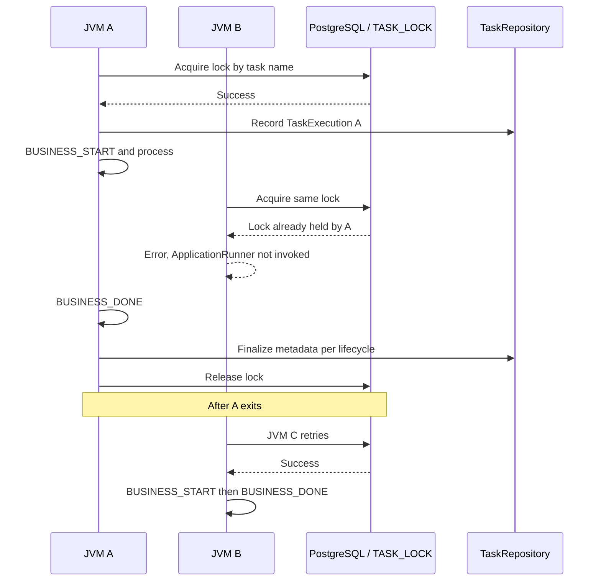

# Running Two Processes to Verify Single-Instance Execution Locking

## 1. Objectives and Completion Criteria

**Spring Cloud Task** is used to build Spring Boot applications with finite runtimes: they start up, accept arguments, perform a job, persist status via `TaskRepository`, and exit. A task may be triggered by cron, a Kubernetes CronJob, Spring Cloud Data Flow, or manual requests. If a previous run has not finished when the next schedule fires, **two JVMs can process the same resources** and cause duplicate writes or transaction contention.

Spring Cloud Task provides `spring.cloud.task.single-instance-enabled=true` to prevent **two instances with the same task name** from running concurrently. This feature uses `SingleInstanceTaskListener` and a Spring Integration JDBC locking mechanism; the Spring Cloud Task schema includes a `TASK_LOCK` table for this purpose. By default, `single-instance-enabled` is `false`.

In this lab, you will run **two independent Java processes** sharing one PostgreSQL database. JVM A enters `ApplicationRunner` and holds work for 90 seconds. While A is still running, JVM B attempts to run with the same task name and **must be rejected before entering the runner**. After A completes, JVM C runs with the same name and succeeds.

| Time | Action | Expected Evidence |
| --- | --- | --- |
| A starts | Run `locked-report-task` for 90 seconds | `BUSINESS_START attempt=A`; no `BUSINESS_DONE` yet |
| B starts while A runs | Same JAR, task name, DB, and lock flag | Single-instance lock error; **no `BUSINESS_START attempt=B`** |
| A holds lock | Inspect `TASK_LOCK` and `TASK_EXECUTION` | Lock entry and metadata present for run A |
| A finishes | Wait for A to exit normally | `BUSINESS_DONE attempt=A`, process exits |
| C starts after A | Same task name, DB, and lock flag | `BUSINESS_START` followed by `BUSINESS_DONE` for C |

**Lab scope:** verifies **non-overlapping execution for one task name**, not business `exactly-once` guarantees. A and C are two sequential runs that could still modify the same order without unique constraints or idempotency. Therefore, after this lab, you must still design proper business keys, checkpoints, and retries.

## 2. Distinguishing Task Name, Process, and Shared Lock Store



Core prerequisites:

1. A and B are **two independent JVMs/processes**. Two threads calling the same method inside one `ApplicationContext` do not prove multi-process behavior.
2. Both point to **the same PostgreSQL database and lock schema**, not two separate `jdbc:h2:mem:...` instances.
3. Both use **the exact same `spring.cloud.task.name`** and have `single-instance-enabled=true` enabled.
4. Metadata schema and SQL permissions must be provisioned **before concurrent testing**, avoiding DDL contention at startup.
5. Launch B **only after** seeing A's `BUSINESS_START` and **before** A prints `BUSINESS_DONE`.

`TASK_EXECUTION_ID` identifies **one run** in `TaskRepository`, not a business lock. On retries, each process may receive a different ID; rejected run B might **not even have a completed `TaskExecution` record** depending on when the listener fails. Thus, evidence includes **process logs, exit codes, locks, and metadata**, not merely counting `TASK_EXECUTION` rows.

## 3. Preparing Java, Maven, and PostgreSQL

To perform the lab, you need a JDK compatible with your chosen Spring Boot/Spring Cloud Task versions (e.g., Java 17+), Maven, a PostgreSQL instance reachable from two terminals, and a SQL client like `psql`. Never use in-memory H2 across two JVMs: each `jdbc:h2:mem:lab` lives in its own JVM, so two processes do not share `TASK_LOCK`.

| Component | **Illustrative** Value |
| --- | --- |
| JDBC URL | `jdbc:postgresql://127.0.0.1:5432/task_lock_lab` |
| Database | `task_lock_lab` |
| Task name | `locked-report-task` |
| Built JAR | `target/task-lock-demo.jar` |
| Runner A duration | `90` seconds |
| Runner B/C duration | `0` seconds |

### 3.1. Creating the Database and Version-Matched Schema

Run this command **once** with admin privileges on your lab PostgreSQL instance:

```sql
CREATE DATABASE task_lock_lab;
```

Inside the new database, apply the **official PostgreSQL DDL for your exact Spring Cloud Task version**, including `TASK_EXECUTION`, `TASK_EXECUTION_PARAMS`, ID sequences, and `TASK_LOCK`. Obtain the DDL from documentation or the pinned Spring Cloud Task artifact and manage it through controlled migrations. **Do not guess DDL** for `TASK_LOCK`: primary keys, indexes, `REGION`/`CLIENT_ID`, and column types can vary across versions.

Current schema docs describe `TASK_LOCK` with columns `LOCK_KEY`, `REGION`, `CLIENT_ID`, and `CREATED_DATE`. Before running two JVMs, verify the tables exist using a SQL client:

```sql
SELECT COUNT(*) AS existing_locks FROM TASK_LOCK;
SELECT COUNT(*) AS existing_executions FROM TASK_EXECUTION;
```

If the schema is absent, some versions support `spring.cloud.task.initialize-enabled=true` to create tables. Use that **only in a separate one-time setup on an empty DB**, then switch back to `false`; **never let A and B run the initializer concurrently**. In production, use migrations rather than two Pods racing to create DDL.

### 3.2. Maven Dependencies

Assuming the Maven project manages versions with a **compatible Spring Boot parent/BOM and Spring Cloud BOM**:

```xml
<dependencies>
    <dependency>
        <groupId>org.springframework.cloud</groupId>
        <artifactId>spring-cloud-starter-task</artifactId>
    </dependency>
    <dependency>
        <groupId>org.springframework.boot</groupId>
        <artifactId>spring-boot-starter-jdbc</artifactId>
    </dependency>
    <dependency>
        <groupId>org.springframework.integration</groupId>
        <artifactId>spring-integration-core</artifactId>
    </dependency>
    <dependency>
        <groupId>org.springframework.integration</groupId>
        <artifactId>spring-integration-jdbc</artifactId>
    </dependency>
    <dependency>
        <groupId>org.postgresql</groupId>
        <artifactId>postgresql</artifactId>
        <scope>runtime</scope>
    </dependency>
</dependencies>
```

Both `spring-integration-core` and `spring-integration-jdbc` are **prerequisites for the single-instance feature** per Spring Cloud Task documentation. Setting the property without the required dependencies and schema produces a configuration error, not a successful lock test.

## 4. Configuring Both Processes to Share One Lock Store

Create `src/main/resources/application.yml`:

```yaml
spring:
  application:
    name: task-lock-demo
  main:
    web-application-type: none
  datasource:
    url: ${TASK_DB_URL}
    username: ${TASK_DB_USER}
    password: ${TASK_DB_PASSWORD}
  cloud:
    task:
      name: locked-report-task
      single-instance-enabled: true
      initialize-enabled: false
      closecontext-enabled: true

app:
  hold-seconds: 0
  attempt: unknown
```

**Understanding each property accurately:**

- `spring.cloud.task.name` is the logical task name identifying **the same job type**. A, B, and C must all use `locked-report-task`; do not give them different names like `locked-report-A` and `locked-report-B`.
- `single-instance-enabled: true` must be active in **both JVMs**. Its default is `false`, so make sure it is not omitted in another profile.
- `initialize-enabled: false` means the schema was created **beforehand**; it does not mean the framework creates tables at runtime.
- `closecontext-enabled: true` closes the context when the task finishes (if supported by your version), allowing the finite process to stop and release resources. It **does not replace** locking properties.
- `app.hold-seconds` and `app.attempt` are **custom properties for this lab**, not Spring Cloud Task APIs.

On the first run, **do not set a short TTL**. Configuration docs also mention `spring.cloud.task.single-instance-lock-ttl` and `spring.cloud.task.single-instance-lock-check-interval` (in milliseconds on supported versions). A TTL shorter than A's work duration makes the test unreliable; understand TTL and reclamation mechanics before customizing them.

## 5. Writing a Runner That Holds Work for 90 Seconds

Create `src/main/java/com/example/tasklock/TaskLockDemoApplication.java`:

```java
package com.example.tasklock;

import java.time.Instant;
import org.springframework.beans.factory.annotation.Value;
import org.springframework.boot.ApplicationRunner;
import org.springframework.boot.SpringApplication;
import org.springframework.boot.autoconfigure.SpringBootApplication;
import org.springframework.cloud.task.configuration.EnableTask;
import org.springframework.context.annotation.Bean;

@EnableTask
@SpringBootApplication
public class TaskLockDemoApplication {

    public static void main(String[] args) {
        SpringApplication.run(TaskLockDemoApplication.class, args);
    }

    @Bean
    ApplicationRunner runOnce(
            @Value("${app.hold-seconds:0}") int holdSeconds,
            @Value("${app.attempt:unknown}") String attempt) {

        return args -> {
            if (holdSeconds < 0 || holdSeconds > 300) {
                throw new IllegalArgumentException(
                        "app.hold-seconds must be within 0..300");
            }

            long pid = ProcessHandle.current().pid();
            System.out.printf(
                    "BUSINESS_START attempt=%s pid=%d at=%s hold=%ds%n",
                    attempt, pid, Instant.now(), holdSeconds);

            // Simulate finite work solely to create an overlap window.
            Thread.sleep(holdSeconds * 1000L);

            System.out.printf(
                    "BUSINESS_DONE attempt=%s pid=%d at=%s%n",
                    attempt, pid, Instant.now());
        };
    }
}
```

`BUSINESS_START` means `ApplicationRunner` has **begun executing**. If B is blocked by the listener before entering the runner, B's log **must not contain** `BUSINESS_START attempt=B`. `ProcessHandle.current().pid()` shows each launch is a separate JVM. `Thread.sleep` merely gives you time to launch B; **it is not a locking mechanism**.

This sample code modifies no business data, making it safe for practicing observation. In real applications, replace the sleep with a business service having its own transactions, business keys, and idempotency; task-name locking does not guard all data writes.

### 5.1. Building the JAR

With the Spring Boot Maven plugin and appropriate entry point configured:

```bash
mvn -DskipTests package
```

Assume the built executable JAR is named `target/task-lock-demo.jar`. If Maven produces a different filename, use the **actual filename** rather than guessing. This article only provides instructions; **no application build or execution was performed in the workspace while authoring**.

## 6. Main Experiment: Opening Terminal A and Terminal B

### 6.1. Providing Identical PostgreSQL Settings

In **both terminals**, use the exact same database, schema, username, and password. Example on Linux/macOS:

```bash
export TASK_DB_URL='jdbc:postgresql://127.0.0.1:5432/task_lock_lab'
export TASK_DB_USER='task_lab_user'
# TASK_DB_PASSWORD: provided from your lab environment secret.
```

On Windows PowerShell:

```powershell
$env:TASK_DB_URL  = "jdbc:postgresql://127.0.0.1:5432/task_lock_lab"
$env:TASK_DB_USER = "task_lab_user"
# TASK_DB_PASSWORD: provided from your prepared secret environment.
```

Ensure both terminals receive `TASK_DB_PASSWORD` before running. Never put real passwords in commands saved to shell history, `application.yml` in source control, or screenshots. If `INSERT/UPDATE/DELETE` on `TASK_LOCK` or writes to `TASK_EXECUTION` are forbidden, startup may fail with a **permission** error rather than B being blocked by A.

To confirm **no database mismatch** between terminals A and B, run with a metadata-reading SQL account:

```sql
SELECT current_database(), current_schema(), current_user;
```

Note that `current_schema()` can depend on `search_path`. An identical database name on **two different PostgreSQL servers** still does not share locks; verify hostname/port and network configuration.

### 6.2. Terminal A — Long Run Holding the Lock

In Terminal A, run:

```bash
java -jar target/task-lock-demo.jar \
  --app.attempt=A \
  --app.hold-seconds=90
```

In PowerShell you can write it on **one line** to avoid changing line-continuation escapes:

```powershell
java -jar target/task-lock-demo.jar --app.attempt=A --app.hold-seconds=90
```

Wait until a line similar to this appears:

```text
BUSINESS_START attempt=A pid=41234 at=... hold=90s
```

The **absence** of `BUSINESS_DONE attempt=A` means the simulated work is still in progress. Do not rely purely on wall-clock time: if A failed during bootstrap and never entered the runner, there is no valid overlap to test B.

### 6.3. Terminal B — Attempting to Run While A Is Still Active

While A is still holding the job, run in **Terminal B**:

```bash
java -jar target/task-lock-demo.jar \
  --app.attempt=B \
  --app.hold-seconds=0
```

PowerShell:

```powershell
java -jar target/task-lock-demo.jar --app.attempt=B --app.hold-seconds=0
```

**Expected:** B is rejected because an instance with the same name is running. Official docs describe an error similar to:

```text
Task with name "locked-report-task" is already running.
```

`SingleInstanceTaskListener` can throw `TaskExecutionException` when it cannot acquire the lock. Feature docs state **exit code 1** for an instance rejected by single-instance locking. Exact log lines, stack traces, and launcher exit-code propagation depend on version and configuration. To inspect the exit code:

```bash
# Linux/macOS: run immediately after B's java command.
echo $?
```

```powershell
# PowerShell: run immediately after B's java command.
$LASTEXITCODE
```

**Most critical PASS criterion:** B **must not print** `BUSINESS_START attempt=B`, and logs must state that a task with the same name is already running or locked. Simply seeing exit code `1` **is not enough**, because B could also exit 1 due to a missing `TASK_LOCK` table, wrong password, bad classpath, or configuration error.

### 6.4. Waiting for A to Finish, Then Running C

Return to Terminal A and wait for:

```text
BUSINESS_DONE attempt=A pid=41234 at=...
```

Ensure **process A has actually exited**, not merely printed `BUSINESS_DONE`; task listeners, metadata updates, and cleanup can still occur after the runner returns. Then from Terminal B run:

```bash
java -jar target/task-lock-demo.jar \
  --app.attempt=C \
  --app.hold-seconds=0
```

Expect C to run cleanly:

```text
BUSINESS_START attempt=C pid=... at=... hold=0s
BUSINESS_DONE attempt=C pid=... at=...
```

C's success proves the lock does not **permanently** block a task of the same name after a normal finish. C is still **a new execution**, with a `TASK_EXECUTION_ID` different from A's.

### 6.5. Experiment Recording Table

Fill in actual observed values after running; never copy illustrative PIDs/IDs as measured results:

| Attempt | PID | `BUSINESS_START` Seen? | `BUSINESS_DONE` Seen? | Exit Code | Assessment |
| --- | --- | --- | --- | --- | --- |
| A | Record real PID | Yes | Yes after 90 seconds | Usually 0 | Held lock and completed |
| B | Record real PID/log if any | **No** | No | Docs state 1 when locked | Rejected while A ran |
| C | Record real PID | Yes | Yes | Usually 0 | Valid subsequent run after A |

If B also prints `BUSINESS_START` **while A has not finished**, the result is **FAIL** for this lab's goal. Check task name, `single-instance-enabled`, and shared database settings before tweaking TTL or deleting locks.

## 7. Cross-Checking SQL While A Holds the Lock

The following queries assume Spring Cloud Task's **default schema** in PostgreSQL. If your organization configures a custom schema or `table-prefix`, use the actual table and column names from your deployed version.

### 7.1. Inspecting `TASK_LOCK`

In a metadata-reading SQL session, run **after A's `BUSINESS_START` and before `BUSINESS_DONE`**:

```sql
SELECT LOCK_KEY, REGION, CLIENT_ID, CREATED_DATE
FROM TASK_LOCK
ORDER BY CREATED_DATE DESC;
```

Normally, once A acquires the lock, a corresponding lock row appears in `TASK_LOCK`. However, **do not assume `LOCK_KEY` always equals the literal string `locked-report-task`**, or that `CLIENT_ID` is always the PID/JVM/task execution ID; lock storage keys and regions are managed by the implementation. Inspect actual data and version-matched DDL rather than guessing a `JOIN` between `TASK_LOCK` and `TASK_EXECUTION`.

After A exits and C completes, re-run the query. Lock rows may be deleted/released per the lock repository's behavior; observe **the change in lock state** and **C's successful lock acquisition** rather than enforcing `COUNT(*) = 0` for every implementation. If rows remain, understand TTL, cleanup, and locks from other applications before drawing conclusions.

### 7.2. Inspecting `TaskExecution` History

```sql
SELECT TASK_EXECUTION_ID,
       TASK_NAME,
       START_TIME,
       END_TIME,
       EXIT_CODE,
       EXIT_MESSAGE,
       ERROR_MESSAGE
FROM TASK_EXECUTION
WHERE TASK_NAME = 'locked-report-task'
ORDER BY START_TIME DESC, TASK_EXECUTION_ID DESC;
```

While A is running, A's `END_TIME` may remain null. After A completes, A's record is updated by the framework lifecycle. C typically produces a new execution record as well. **Do not assume B must have a `TaskExecution` row:** the listener may detect the lock and fail **before or during** the lifecycle step that creates/updates metadata; final DB row counts and exit codes depend on implementation and failure timing.

To count successful runs recorded without confusing them with logs:

```sql
SELECT TASK_NAME,
       COUNT(*) AS recorded_executions,
       COUNT(*) FILTER (WHERE EXIT_CODE = 0 AND END_TIME IS NOT NULL)
           AS successful_executions
FROM TASK_EXECUTION
WHERE TASK_NAME = 'locked-report-task'
GROUP BY TASK_NAME;
```

`FILTER` is PostgreSQL syntax. `recorded_executions` may **differ from the number of `java` invocations** if a process failed before `TaskRepository` became active. In this lab, A and C provide evidence of two successful executions; for B, check **logs and exit code** to see why it was rejected.

### 7.3. What SQL Tells You and What It Does Not

| Evidence | Valid Conclusion | Invalid Inference |
| --- | --- | --- |
| `BUSINESS_START A`, no `BUSINESS_DONE A` yet | Runner A is executing during observation | 100% of business data is committed |
| B log reports same task running, no `BUSINESS_START B` | B never entered runner and was rejected by single-instance | Every exit code 1 is caused by a lock |
| Row exists in `TASK_LOCK` | Lock state is currently recorded by repository | `LOCK_KEY` is plaintext task name or client ID is PID |
| `TASK_EXECUTION` shows A and C succeeded | Framework recorded two executions | Those two runs caused no duplicate side effects |
| C runs after A | Lock does not block sequential runs | A per-`requestId` lock was established |

**Never manually delete or edit `TASK_LOCK`/`TASK_EXECUTION` just to make a demo look clean.** If a lock appears stuck, verify no process is still running, inspect TTL and implementation docs, and only then follow operational recovery procedures.

## 8. What This Experiment Proves and Why

To declare the test **PASS**, combine **three layers of evidence**:

1. **Time overlap:** A's log shows `BUSINESS_START` before B starts, and A's `BUSINESS_DONE` appears **after** B is rejected. That proves true temporal overlap.
2. **Same identity and shared repository:** configuration sets `spring.cloud.task.name=locked-report-task` and `single-instance-enabled=true` in both A and B; DB URL/schema point to one shared source.
3. **Business path blocked:** A runs, B does not enter the runner due to the same-name lock, and C runs after A. `TASK_LOCK`/`TASK_EXECUTION` corroborate the check rather than replacing it.

Conversely, if B fails with `database connection refused`, `relation TASK_LOCK does not exist`, or `Access denied`, the lab **has not verified single-instance locking**. Fix the environment and re-test before claiming success.

## 9. Control Experiments and Lock Boundaries

After completing the main scenario, use these **lab-only** variants to understand how misconfiguration lets two tasks run together. Return to baseline state before each variant; never use production data to induce collisions.

### 9.1. A/B Control with `single-instance-enabled=false`

Using **two other test processes**, set `spring.cloud.task.single-instance-enabled=false` for both runs. Without single-instance locking, two `ApplicationRunner`s can overlap:

```bash
# Terminal A, control lab only.
java -jar target/task-lock-demo.jar \
  --spring.cloud.task.single-instance-enabled=false \
  --app.attempt=CONTROL-A --app.hold-seconds=90

# Terminal B, run after CONTROL-A prints BUSINESS_START.
java -jar target/task-lock-demo.jar \
  --spring.cloud.task.single-instance-enabled=false \
  --app.attempt=CONTROL-B --app.hold-seconds=0
```

**Expected:** both print `BUSINESS_START` before A's hold finishes. This is a **negative control**, confirming the rejection in the main scenario came from **enabling** the lock feature rather than an OS inability to run two Java processes.

Only use simulated `Thread.sleep` like this lab; if a runner performs **real data mutations**, running two unlocked copies can create duplicate transactions or corrupt data.

### 9.2. Two Different Task Names **Are Not Mutually Locked**

With `single-instance-enabled=true` on both JVMs, override the name in B:

```bash
java -jar target/task-lock-demo.jar \
  --spring.cloud.task.name=another-report-task \
  --app.attempt=DIFFERENT-NAME --app.hold-seconds=0
```

While A still runs as `locked-report-task`, B has a **different task name**, so name-based locking does not block B. This matters greatly when splitting an application into `orders-import-task` and `orders-reconcile-task`: **two differently named tasks can still modify the same business table concurrently**. To prevent conflicts at the table, customer, or processing-date level, use business locks or scheduler/workflow locks.

### 9.3. Same Name Against **Two Separate Databases** Does Not Prove Distributed Locking

Suppose A points to PostgreSQL server X and B to server Y; both have a `TASK_LOCK` table, yet they are **independent**. Both can acquire locks in **their own stores** and run concurrently. Try this only if you prepared **two isolated lab databases**—never alter JDBC URLs carelessly and hit production.

A multi-environment setup (dev/staging/prod) should keep lock/metadata stores isolated **by environment boundary**, while **instances that must mutually exclude each other within the same environment** must share one lock store.

### 9.4. One Side Forgets the Lock Flag

Do not verify safety merely by reading a shared `application.yml`: profiles, environment variables, or CLI arguments can override it. If A sets `true` while B accidentally runs with `false`, **B does not participate in mutual exclusion** and can run alongside A. In operations, log task names and **non-sensitive** configuration flags at startup to catch drift.

## 10. TTL, Crashes, and Recovery: The Hard Part of Distributed Locks

### 10.1. Normal Exit vs. Forced Kill

In the main scenario, A finishes `ApplicationRunner` and the Spring Cloud Task lifecycle gets to release the lock. When a container receives `SIGKILL`, hits OOM, loses node power, or the JVM dies before completion callbacks, **locks or metadata may not be cleaned up as in a normal exit**.

| Scenario | What Can Happen | How to Handle |
| --- | --- | --- |
| A finishes normally | Listener/registry can release the lock; C runs | Cross-check logs, metadata, run C |
| A throws an exception during work | Failure lifecycle may release lock, yet partial business data may have committed | Check error, `TaskExecution`, committed data, and cleanup |
| A gets `kill -9` / `OOMKilled` | No normal shutdown callbacks; metadata may lack `END_TIME` | Check Pod/process, lock lease, and recovery policy |
| A still running while TTL is too short | Lock risks expiring before work finishes | Size TTL from evidence-based max execution time |
| B rejected after an old crash | Stale lock state may remain uncleaned | Verify **no old process is alive**, check DDL/logs/TTL before intervening |

**Never test `kill -9` against real data.** To simulate a crash, use only an isolated lab database you can safely wipe and rebuild. After a crash, never rely on `END_TIME IS NULL` to assume A is still alive; check running processes, Pods/Jobs, and audit business data.

### 10.2. TTL and Check Interval

Some Spring Cloud Task versions expose these properties:

| Property | Meaning | Practical Note |
| --- | --- | --- |
| `spring.cloud.task.single-instance-lock-ttl` | Max duration one execution holds the lock, in **milliseconds** | Never set shorter than max possible task duration; understand reclaim/cleanup |
| `spring.cloud.task.single-instance-lock-check-interval` | Wait interval between lock status checks, in **milliseconds** | Not a cron schedule or JDBC query timeout |

Current version config docs list `single-instance-lock-check-interval` defaulting to **500 ms** and TTL defaulting to a very large value (`Integer.MAX_VALUE` milliseconds in property docs). However, **exact lock checking/reclamation mechanics depend on the Spring Cloud Task and Spring Integration versions**; do not assume a `TASK_LOCK` row vanishes at the exact millisecond of expiration.

**Serious mistake:** A may run for 15 minutes while someone configures a 30-second TTL. Once the lock expires or is reclaimed per implementation rules, another JVM risks taking the lock while A is still mutating data. Never use short TTLs to "speed up" a lab; determine max runtime, lease-renewal needs, shutdown behavior, and recovery policies properly.

When encountering a leftover lock, the minimum procedure is: verify the old process is dead; inspect `TASK_LOCK`, timezone/`CREATED_DATE`, and TTL config; audit committed data and external side effects; then follow documented operational cleanup steps. **Never arbitrarily run `DELETE FROM TASK_LOCK`** before verifying who holds the lock.

### 10.3. Single-Instance Is Not Idempotency

Suppose a task imports 1,000 orders:

1. A acquires the lock and commits 700 orders.
2. A terminates before finishing.
3. Once allowed to rerun, C acquires the lock and restarts with the same input.

Single-instance locking **only prevents A and C from running at the same instant**; it does not prevent the 700 committed orders from being re-imported. You still need business keys like `(source_system, external_order_id)`, idempotent writes, checkpoints, and count/ID reconciliation. When integrating **Spring Batch**, preserve the Job name and **identifying `JobParameters`** to restart the same Job instance and checkpoint rather than inventing a random `run.id` to bypass failure state.

## 11. Integrating with Schedules and Orchestrators

In production, a scheduler can launch two processes due to cron overlap, timeout retries, Kubernetes CronJobs creating a new Job, or manual operator triggers. Single-instance locking is **an application-level defense layer**, not a replacement for orchestration policies.

| Control Layer | What It Protects | What It Does Not Protect |
| --- | --- | --- |
| Kubernetes CronJob `concurrencyPolicy: Forbid` | Overlapping Jobs from **that exact CronJob** | Manual launches or another CronJob running the task |
| Spring Cloud Task `single-instance-enabled` | Instances with the **same task name** and lock store config | Differently named tasks modifying the same data |
| Spring Batch `JobRepository` | Job instances, checkpoints, and restarts by identifying parameters | External side effects outside transactions |
| Unique business key + transaction | Duplicate writes for the same business entity | Process scheduling overlap |
| Provider idempotency key / outbox | Duplicate effects on API/message calls | JVM-level single-instance locking |

**A practical combination:** the scheduler limits overlaps; Spring Cloud Task rejects same-name instances when accidental overlap still happens; the business service protects data even across retries or lock expiration. These layers complement one another—never pick one and discard the rest.

When the scheduler sees B fail because the lock is held, do not conclude "business task failed" and hammer infinite immediate retries. Skip the duplicate trigger, apply backoff retries, or enqueue per **business requirements**. Verify A has finished and data meets acceptance criteria before deciding whether a new run is needed.

## 12. Troubleshooting When the Experiment Fails

| Symptom | Possible Cause | How to Verify and Fix |
| --- | --- | --- |
| A does not print `BUSINESS_START` | JDBC error, missing schema, unresolved dependency, or bootstrap failure | Read stack trace, JDBC URL, privileges, and schema before testing B |
| B runs business logic alongside A | B lacks `single-instance-enabled=true`, different task name, or different DB/region | Print non-sensitive effective config; confirm both processes share the same DB |
| B exits 1 with `TASK_LOCK does not exist` | Lock table migration missing | Apply **official schema** for your version; do not count this as PASS |
| B exits 1 with `permission denied` | Account lacks lock/`TaskRepository` write privileges | Verify required `SELECT/INSERT/UPDATE/DELETE` grants, role, and schema |
| B succeeds without error because A already printed `BUSINESS_DONE` | The two commands did not actually overlap in time | Lengthen A and launch B immediately after seeing `BUSINESS_START` |
| `TASK_LOCK` looks empty while A runs | Querying wrong DB/schema, wrong timing, or implementation difference | Check connection, timestamps, `TaskNameResolver`, listener logs |
| `TASK_EXECUTION` has no row for B | B was rejected before metadata stage | Check **B's logs** and exit code; do not assume a B row must exist |
| C is still rejected after A exited | Lock not cleaned up or TTL/recovery unresolved | Confirm no JVM/Pod remains; inspect lock registry, TTL, and recovery steps |
| Two runs of same task show different names in DB | `spring.application.name` or CLI overrides `spring.cloud.task.name` | Pin a fixed name; query `TASK_EXECUTION.TASK_NAME` |
| H2 `mem:` lets two JVMs run concurrently | Two isolated H2 databases, no shared distributed lock | Use PostgreSQL or a shared RDBMS |
| Retries duplicate orders despite no process overlap | Single-instance does not guarantee exactly-once | Add business keys, idempotent writers, checkpoints, reconciliation |
| JVM fails to exit after `BUSINESS_DONE` | Non-daemon threads remain or context did not close cleanly | Inspect thread dumps, `closecontext-enabled`, driver/pool, and launcher |

### Quick Verification Runbook

1. Record **taskName**, timestamps of both commands, PIDs, exit codes, and `BUSINESS_START`/`BUSINESS_DONE` logs.
2. Confirm both JVMs use the same `TASK_DB_URL`/schema and `single-instance-enabled=true`; avoid printing passwords.
3. Query `TASK_LOCK` while A is running; check table privileges and version-matched DDL.
4. Query `TASK_EXECUTION` by task name; cross-check against logs rather than inferring Java invocation counts from row counts.
5. Once B is legitimately rejected, wait for A to exit and run C. If C fails, investigate stale locks/TTL and lingering processes.
6. In real applications modifying business data, reconcile **target data** and side effects before deciding to re-run.

## 13. Self-Check Practice Exercises

1. Run A for 90s, B for 0s while A is running, then C for 0s after A finishes. Save a table with PIDs, exit codes, `BUSINESS_START`/`BUSINESS_DONE` timestamps, and an evidence-backed PASS/FAIL verdict.
2. Explain why B exiting with code 1 **is not enough** to prove locking worked. Name at least three other configuration errors that also produce a nonzero exit code.
3. Inspect `TASK_LOCK` while A runs and after A/C finish. Can you infer the task name directly from `LOCK_KEY` or `CLIENT_ID`? Why must you check the schema and implementation?
4. Compare `TASK_EXECUTION` row counts against `java -jar` invocations. Why might a process that fails before `TaskRepository` have no persisted execution row?
5. Repeat the test **in the lab only** with `single-instance-enabled=false` on both processes. What evidence shows the runners overlapped?
6. Keep the lock flag enabled, but change JVM B's task name to `another-report-task`. Why do two differently named tasks not automatically block each other despite sharing a DB?
7. Describe what happens if A and B point to two separate PostgreSQL servers with identical database names. How do you catch the mistake using `current_database()`, host/port, and JDBC URLs?
8. Design a crash test **on an isolated lab database**: A is killed after committing partial data; what must you verify before retrying? Why not immediately `DELETE` the lock?
9. A job typically runs 20 minutes, yet someone sets TTL to 30 seconds. Analyze the risks and define criteria for choosing TTL and check interval for your actual library version.
10. When using Spring Batch to import orders, explain the difference between task-name locking, Job instance/identifying `JobParameters`, checkpoints, and unique business keys.
11. In Kubernetes, compare `concurrencyPolicy: Forbid`, `spring.cloud.task.single-instance-enabled`, and DB idempotency. Which mechanism still holds when someone launches a manual Job outside the CronJob?
12. Propose how to run a daily task with a stable `requestKey`; if tomorrow's schedule fires while yesterday's run is still active, should the system skip, wait, or fail? Explain what observability signals drive that decision.

**Self-assessment:** this practice lab succeeds only when you prove **actual temporal overlap**, A enters the runner, B **does not enter the runner due to the same-name lock**, C runs cleanly after A, and all components point to one shared lock store. Without that evidence, a nonzero exit code alone proves nothing.

## 14. References

- [Spring Cloud Task Reference — Restricting Spring Cloud Task Instances](https://docs.spring.io/spring-cloud-task/reference/features.html): `single-instance-enabled`, Spring Integration dependencies, and duplicate-instance rejection behavior.
- [Spring Cloud Task Javadoc — SingleInstanceTaskListener](https://docs.spring.io/spring-cloud-task/docs/current/apidocs/org/springframework/cloud/task/configuration/SingleInstanceTaskListener.html): listener acquiring a lock by task name and throwing `TaskExecutionException` when already locked.
- [Spring Cloud Task — Task Repository Schema](https://docs.spring.io/spring-cloud-task/reference/appendix-task-repository-schema.html): `TASK_EXECUTION`/`TASK_LOCK` metadata structures.
- [Spring Cloud — Configuration Properties](https://docs.spring.io/spring-cloud/docs/current/reference/html/configprops.html): `single-instance-lock-ttl`, `single-instance-lock-check-interval`, and property defaults.
- [Spring Integration — JDBC Lock Registry](https://docs.spring.io/spring-integration/reference/jdbc/lock-registry.html): shared DB lock concepts, TTL, and registry behavior.
- [Spring Batch Reference](https://docs.spring.io/spring-batch/reference/): Job instances, `JobRepository`, `StepExecution`, and safe restarts when tasks integrate with Batch.

**Limitation:** this document is a **testing guide**, not a claim that the commands were executed or timings/exit codes observed on a live system. When practicing, choose compatible Spring Boot/Spring Cloud Task/Spring Integration versions, run against a test database, record real evidence, and never modify or delete production lock rows for testing.
