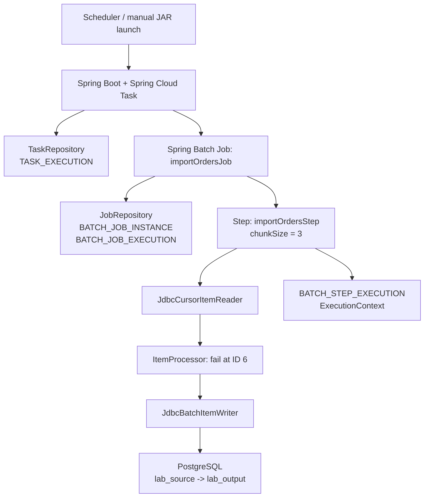
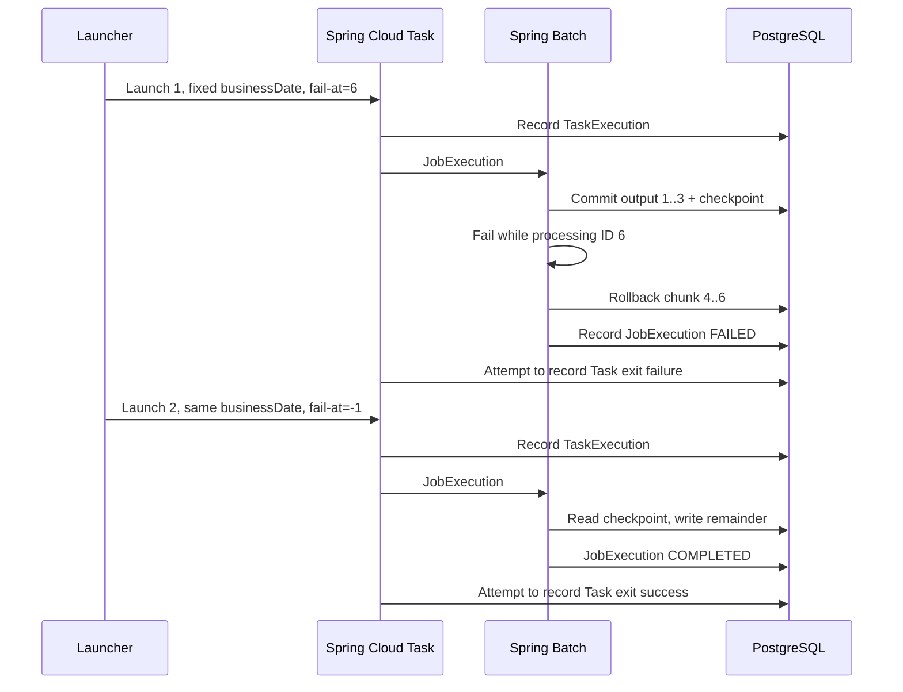

# Integrating a Failing Batch Job with Controlled Restart

## 1. What Problem Does This Practice Lab Solve?

**Spring Cloud Task** targets Spring Boot applications with finite runtimes: they start, execute work, record `TaskExecution` in `TaskRepository`, and terminate. When a Task embeds **Spring Batch**, data processing gains `Job`, `Step`, chunk-level transactions, `JobRepository`, and restart metadata. These two state layers help operate scheduled ingestion, reconciliation, aggregation, or synchronization workloads.

In practice, a Batch Job can fail after committing part of the data. The scheduler only sees a nonzero process exit code; operators must know **whether to re-run, where to resume from, and how to prevent duplicate writes**. Without distinguishing `JobInstance` from `JobExecution`, an apparently harmless retry command can create a new `JobInstance`, reprocess everything from the start, and corrupt results.

This lab builds a **Spring Cloud Task + Spring Batch + PostgreSQL** application with a single-Step Job:

1. Read 10 orders from a source table using `JdbcCursorItemReader`.
2. Process in chunks of size **3**.
3. Intentionally throw an error on record ID **6**, after the first chunk has committed.
4. Observe `JobExecution=FAILED` and the already-committed data.
5. Turn off the fault flag and launch with **the same Job name and same identifying `JobParameters`**.
6. Verify Batch restarts the exact `JobInstance`, resumes from the checkpoint, and finishes all 10 records **without duplicates**.
7. Cross-check Batch outcomes against `TaskExecution` and the process exit code.

### 1.1. Expected Results

| Observation | Run 1: Fail at ID 6 | Run 2: Restart |
| --- | --- | --- |
| `TaskExecution` | One Task run, normally recording failure when integrated properly | One new `TaskExecution` |
| `JobInstance` | Created with `businessDate=2026-11-23` | **Same `JobInstance` ID preserved** |
| `JobExecution` | `FAILED` | **New** `JobExecution`, `COMPLETED` |
| `StepExecution` | `FAILED`, with previous chunk checkpoint | New `StepExecution`, restoring reader state |
| Target `lab_output` row count | **3** rows, if failure triggers cleanly at ID 6 | **10** rows, no duplicates |
| Process exit code | Expected nonzero when Batch failure propagation is enabled | Expected 0 on success |

The numbers 3 and 10 in the table are **lab design expectations**, not results verified by executing in the learner's environment. `READ_COUNT`/`ROLLBACK_COUNT` on the Step can reflect details depending on failure timing and internal retry behavior; they do not necessarily equal the row count in the target table.

### 1.2. Prerequisites

- Java 17+ and Spring Boot 3.x / Spring Batch 5.x with a **compatible Spring Cloud release train**. The Java code below uses **Spring Batch 5** builder APIs; Batch 6 has some API/package changes and requires adjustments before compiling.
- Maven, PostgreSQL, and connectivity via `psql` or a SQL client.
- `@EnableTask`, `TaskRepository`, `ApplicationRunner`/Batch auto-launch, `JobParameters`, `JobRepository`.
- JDBC transactions, unique constraints, and **idempotency** principles on re-runs.
- A **dedicated test environment**; never inject faults against production tables.

> **Lesson scope:** This is a lab constructed from APIs and behaviors documented by Spring Cloud Task/Spring Batch, not a live build/test execution. Pin exact versions via your BOM and environment before deploying. Never run test data creation/deletion SQL against live user-serving databases.

## 2. Three State Layers: Task, Batch, and Business Results



| Concept | Identifier | In This Lab |
| --- | --- | --- |
| **TaskExecution** | `TASK_EXECUTION_ID` generated by Spring Cloud Task per process run | Two launches normally create **two** `TaskExecution`s |
| **JobInstance** | Job name + **identifying `JobParameters`** | Both runs use `importOrdersJob` with `businessDate=2026-11-23` |
| **JobExecution** | ID of one execution attempt of a `JobInstance` | First is `FAILED`, second is `COMPLETED` |
| **StepExecution** | Execution of a Step within a `JobExecution` | Holds counters, `ExecutionContext`, and checkpoint state |
| **Business record** | `(business_date, source_id)` | Protected by primary key / unique constraint |

**A new `TaskExecution` does not imply a new `JobInstance`.** A Spring Batch restart means a **new `JobExecution` belonging to the existing `JobInstance`**. `TaskRepository` and `JobRepository` are two distinct metadata stores, even though this lab shares one PostgreSQL instance to simplify transactions and queries.

## 3. Designing Intentional Failure and Checkpointing

Source records have IDs `1..10` sorted ascending; chunk size is **3**:

```text
Chunk 1: [1, 2, 3]   -> writer inserts -> COMMIT
Chunk 2: [4, 5, 6]   -> processor hits ID 6 -> error, ROLLBACK
Chunk 3: [7, 8, 9]   -> not executed yet
Chunk 4: [10]        -> not executed yet

First run after failure:
  lab_output = {1,2,3}

Restart same JobInstance, fault disabled:
  checkpoint after chunk 1
  continues reading 4,5,6,7,8,9,10
  lab_output = {1,2,3,4,5,6,7,8,9,10}
```

In a Step using a reader with `saveState=true`, Spring Batch persists progress in `ExecutionContext` on each checkpoint cycle. With the same `JobInstance` and a restartable Step, `JobRepository` reconstructs the new execution from the saved state.

**Mandatory condition:** The source query must have deterministic ordering (`ORDER BY source_id`), and the dataset must not shift cursor positions via insertions/deletions between runs. If rows are inserted or deleted ahead of the checkpoint, position-based resuming can skip or duplicate records; in production, use snapshots/watermarks or keyset-based progress readers.



IDs `#A`/`#B`/`#1`/`#2` are illustrative labels; the database assigns actual IDs. The diagram shows normal lifecycle completion and does not guarantee final metadata persistence if the process is hard-killed or DB connectivity drops.

## 4. Preparing a Dedicated PostgreSQL Environment

### 4.1. Database Requirements

Use a fresh database named `tasklab`, e.g., PostgreSQL 16, solely for this lab. The test account needs schema-creation privileges **only during initialization**; production should separate migration and runtime accounts.

You can use an existing local PostgreSQL server or a local PostgreSQL container. With Docker, create DB `tasklab` and role `tasklab_user` per your local setup. JDBC connection string format:

```text
jdbc:postgresql://localhost:5432/tasklab
```

Provide connection details via environment variables:

```bash
# Values represent variable names only; never save real passwords in CLI history.
export LAB_JDBC_URL="jdbc:postgresql://localhost:5432/tasklab"
export LAB_JDBC_USER="tasklab_user"
# LAB_JDBC_PASSWORD is supplied from your test environment / secret store.
```

The snippet above is for Bash/Unix; on Windows PowerShell, use `$env:LAB_JDBC_URL=...` and similarly for username/password. Never put production passwords in practice files, Git, or `--spring.datasource.password` arguments.

### 4.2. Creating the Two Business Tables

Connect to **the right test database** and run:

```sql
CREATE TABLE IF NOT EXISTS lab_source (
    business_date DATE NOT NULL,
    source_id BIGINT NOT NULL,
    amount NUMERIC(12, 2) NOT NULL,
    PRIMARY KEY (business_date, source_id)
);

CREATE TABLE IF NOT EXISTS lab_output (
    business_date DATE NOT NULL,
    source_id BIGINT NOT NULL,
    imported_at TIMESTAMPTZ NOT NULL DEFAULT CURRENT_TIMESTAMP,
    PRIMARY KEY (business_date, source_id)
);

INSERT INTO lab_source (business_date, source_id, amount)
SELECT DATE '2026-11-23', n, n * 100.00
FROM generate_series(1, 10) AS ids(n)
ON CONFLICT (business_date, source_id) DO NOTHING;
```

`lab_source` is the input, `lab_output` is the output. The primary key `(business_date, source_id)` detects or blocks duplicates when re-running the same date. Never run `TRUNCATE` on databases holding real data.

Verify inputs:

```sql
SELECT business_date,
       COUNT(*) AS source_rows,
       MIN(source_id) AS min_id,
       MAX(source_id) AS max_id
FROM lab_source
GROUP BY business_date;
```

Expect `source_rows=10`, `min_id=1`, and `max_id=10` for `2026-11-23`. If your database already contains old test runs, use a **fresh database/schema** or a new `businessDate` with matching seed rows to avoid mixing runs.

### 4.3. Task and Batch Metadata Schemas

Two independent table groups are needed:

| Schema | Example Tables | Purpose |
| --- | --- | --- |
| Spring Cloud Task | `TASK_EXECUTION`, `TASK_EXECUTION_PARAMS`, `TASK_TASK_BATCH` | Process history, Task–Batch linkage |
| Spring Batch | `BATCH_JOB_INSTANCE`, `BATCH_JOB_EXECUTION`, `BATCH_STEP_EXECUTION`, `BATCH_STEP_EXECUTION_CONTEXT` | `JobInstance` identity, run status, checkpoints |

In this lab with a **brand-new database**, you can let the frameworks create metadata tables **once on the first launch**:

```properties
spring.cloud.task.initialize-enabled=true
spring.batch.jdbc.initialize-schema=always
```

On the **second run**, switch to:

```properties
spring.cloud.task.initialize-enabled=false
spring.batch.jdbc.initialize-schema=never
```

Because Spring Batch's init script runs vendor `CREATE TABLE` statements, keeping `always` on an already-initialized schema can fail startup. This is a **lab bootstrap shortcut**, not a production model. Production should use Flyway/Liquibase/dedicated migration jobs with DDL matching the **exact releases** of Spring Cloud Task and Spring Batch; all subsequent application runs keep auto-initialization disabled.

If metadata tables already exist from an earlier attempt, **never enable `initialize-schema=always`**. Inspect schema/migrations instead of wiping checkpoint data and accidentally turning a "restart" into a "fresh run".

## 5. Creating the Spring Boot Project and Dependencies

Create a Java Maven project with **Spring Boot 3.x**, **Spring Batch 5.x**, and **compatible Spring Cloud Task 3.x** (choose the matching release train/BOM from Spring Cloud docs when creating the project). Never mix Spring Batch 6/Boot 4 example APIs with the Batch 5 code below.

Key dependencies in `pom.xml`:

```xml
<dependencies>
    <dependency>
        <groupId>org.springframework.cloud</groupId>
        <artifactId>spring-cloud-starter-task</artifactId>
    </dependency>
    <dependency>
        <groupId>org.springframework.cloud</groupId>
        <artifactId>spring-cloud-task-batch</artifactId>
    </dependency>
    <dependency>
        <groupId>org.springframework.boot</groupId>
        <artifactId>spring-boot-starter-batch</artifactId>
    </dependency>
    <dependency>
        <groupId>org.postgresql</groupId>
        <artifactId>postgresql</artifactId>
        <scope>runtime</scope>
    </dependency>
</dependencies>
```

This is an **additional dependencies snippet**, not a full `pom.xml`: the project needs the Spring Boot parent/`spring-boot-dependencies`, the matching Spring Cloud BOM, and the executable JAR build plugin. If Maven reports missing versions for Spring Cloud artifacts, the BOM was not imported properly; do not hardcode an arbitrary Task version on an older Boot project just to make it compile.

**Do not add `@EnableBatchProcessing`** in this example: Spring Boot auto-configures Batch and auto-launches the single `Job`. Adding `@EnableBatchProcessing`/`DefaultBatchConfiguration` in Boot 3.x causes Boot Batch auto-configuration—including auto schema initialization—to **back off**. Use it only when intentionally configuring Batch infrastructure manually.

### 5.1. Project Structure

```text
batch-retry-task/
  pom.xml
  src/main/java/com/example/tasklab/
    BatchRetryTaskApplication.java
    ImportBatchConfiguration.java
  src/main/resources/
    application.yml
```

The exercise contains two Java files and one config file, using PostgreSQL for both metadata and business tables.

## 6. Configuring application.yml

```yaml
spring:
  application:
    name: batch-retry-task
  main:
    web-application-type: none
  datasource:
    url: ${LAB_JDBC_URL:jdbc:postgresql://localhost:5432/tasklab}
    username: ${LAB_JDBC_USER:tasklab_user}
    password: ${LAB_JDBC_PASSWORD}
  cloud:
    task:
      name: batch-retry-task
      initialize-enabled: false
      closecontextEnabled: true
      batch:
        fail-on-job-failure: true
  batch:
    jdbc:
      initialize-schema: never
    job:
      enabled: true
      name: importOrdersJob

lab:
  fail-at: -1
```

Explanation:

- `web-application-type: none`: the application runs batch jobs only without starting an HTTP server.
- `spring.cloud.task.name`: logical name recorded in `TASK_EXECUTION`.
- `closecontextEnabled: true`: requests Task to close the context after completion; verify exact property and behavior against your Spring Cloud Task release.
- `fail-on-job-failure: true`: enables Spring Cloud Task support for translating a `FAILED` Batch Job into a nonzero exit code instead of false success.
- `spring.batch.job.enabled: true`: lets Spring Boot auto-launch the discovered Job at startup.
- `spring.batch.job.name: importOrdersJob`: selects which Job to run; this project has only one Job, yet naming it makes intent explicit.
- `lab.fail-at`: **lab-only** property to trigger faults; not a `JobParameter`.
- `initialize-enabled: false` and `initialize-schema: never`: safe defaults once metadata schemas exist. **On the very first run against a fresh DB**, we override these two via CLI in the run section.

Spring Cloud Task can use `TaskBatchExecutionListener` to link `JobExecution` to `TaskExecution` when `spring-cloud-task-batch` is on the classpath and the listener is properly configured. If `TASK_TASK_BATCH` has no rows after the lab, check classpath, auto-configuration, and version behavior before assuming the Job did not run.

## 7. Application Entry Point

File `BatchRetryTaskApplication.java`:

```java
package com.example.tasklab;

import org.springframework.boot.SpringApplication;
import org.springframework.boot.autoconfigure.SpringBootApplication;
import org.springframework.cloud.task.configuration.EnableTask;

@SpringBootApplication
@EnableTask
public class BatchRetryTaskApplication {

    public static void main(String[] args) {
        SpringApplication.run(BatchRetryTaskApplication.class, args);
    }
}
```

With the starter and certain Spring Cloud Task versions, auto-configuration already enables Task infrastructure; `@EnableTask` is included here to make intent explicit. **Do not add another `ApplicationRunner` that manually calls `jobLauncher.run(...)`**, because Boot/Spring Cloud Task already provides a runner launching the Job under section 6's settings. Launching the Job a second time from a custom Runner can trigger `JobExecutionAlreadyRunningException` or unpredictable results.

## 8. Spring Batch Job with Intentional Failure

`ImportBatchConfiguration.java` below uses **Spring Batch 5.x** APIs.

### 8.1. Complete Java Code

```java
package com.example.tasklab;

import java.time.LocalDate;
import javax.sql.DataSource;

import org.springframework.batch.core.Job;
import org.springframework.batch.core.Step;
import org.springframework.batch.core.configuration.annotation.StepScope;
import org.springframework.batch.core.job.builder.JobBuilder;
import org.springframework.batch.core.repository.JobRepository;
import org.springframework.batch.core.step.builder.StepBuilder;
import org.springframework.batch.item.ItemProcessor;
import org.springframework.batch.item.database.JdbcBatchItemWriter;
import org.springframework.batch.item.database.JdbcCursorItemReader;
import org.springframework.batch.item.database.builder.JdbcBatchItemWriterBuilder;
import org.springframework.batch.item.database.builder.JdbcCursorItemReaderBuilder;
import org.springframework.beans.factory.annotation.Value;
import org.springframework.context.annotation.Bean;
import org.springframework.context.annotation.Configuration;
import org.springframework.transaction.PlatformTransactionManager;

@Configuration
public class ImportBatchConfiguration {

    @Bean
    Job importOrdersJob(JobRepository jobRepository,
                        Step importOrdersStep) {
        return new JobBuilder("importOrdersJob", jobRepository)
                .start(importOrdersStep)
                .build();
    }

    @Bean
    Step importOrdersStep(
            JobRepository jobRepository,
            PlatformTransactionManager transactionManager,
            JdbcCursorItemReader<Long> sourceReader,
            ItemProcessor<Long, Long> failureProcessor,
            JdbcBatchItemWriter<Long> outputWriter) {

        return new StepBuilder("importOrdersStep", jobRepository)
                .<Long, Long>chunk(3, transactionManager)
                .reader(sourceReader)
                .processor(failureProcessor)
                .writer(outputWriter)
                .build();
    }

    @Bean
    @StepScope
    JdbcCursorItemReader<Long> sourceReader(
            DataSource dataSource,
            @Value("#{jobParameters['businessDate']}")
            String businessDate) {

        LocalDate date = LocalDate.parse(businessDate);

        return new JdbcCursorItemReaderBuilder<Long>()
                .name("sourceOrderIdCursor")
                .dataSource(dataSource)
                .sql(
                    "SELECT source_id " +
                    "FROM lab_source " +
                    "WHERE business_date = ? " +
                    "ORDER BY source_id"
                )
                .preparedStatementSetter(
                    ps -> ps.setObject(1, date))
                .rowMapper(
                    (rs, rowNum) -> rs.getLong("source_id"))
                .saveState(true)
                .build();
    }

    @Bean
    @StepScope
    ItemProcessor<Long, Long> failureProcessor(
            @Value("${lab.fail-at:-1}") long failAt) {
        return sourceId -> {
            if (sourceId == failAt) {
                throw new IllegalStateException(
                    "LAB_EXPECTED_FAILURE_AT_ID=" + sourceId);
            }
            return sourceId;
        };
    }

    @Bean
    @StepScope
    JdbcBatchItemWriter<Long> outputWriter(
            DataSource dataSource,
            @Value("#{jobParameters['businessDate']}")
            String businessDate) {

        LocalDate date = LocalDate.parse(businessDate);

        return new JdbcBatchItemWriterBuilder<Long>()
                .dataSource(dataSource)
                .sql(
                    "INSERT INTO lab_output " +
                    "(business_date, source_id) " +
                    "VALUES (?, ?) " +
                    "ON CONFLICT (business_date, source_id) " +
                    "DO NOTHING"
                )
                .itemPreparedStatementSetter(
                    (sourceId, ps) -> {
                        ps.setObject(1, date);
                        ps.setLong(2, sourceId);
                    })
                .assertUpdates(false)
                .build();
    }
}
```

### 8.2. Job Components

| Component | Role in Lab | Notes |
| --- | --- | --- |
| `JobBuilder("importOrdersJob")` | Defines stable Job name | Combined with `JobParameters` to identify `JobInstance` |
| `StepBuilder("importOrdersStep")` | Creates a chunk-oriented Step | Restartable if Job and state allow |
| `chunk(3, transactionManager)` | Commits in batches of 3 items | Uses transaction manager matching the datasource |
| `@StepScope` | Instantiates reader/processor/writer per Step run | Allows injecting `JobParameters`/`ExecutionContext` |
| `JdbcCursorItemReader` | Reads `source_id` in order | `name` and `saveState(true)` enable checkpointing |
| `failureProcessor` | Intentionally throws on ID 6 | `lab.fail-at` is a property, **not** a `JobParameter` |
| `JdbcBatchItemWriter` | Inserts IDs into the target table | PostgreSQL upsert and unique key limit duplicates |

**Why `.assertUpdates(false)`?** By default `JdbcBatchItemWriter` may require every statement to affect at least one row. `INSERT ... ON CONFLICT DO NOTHING` returns `0` affected rows when an input was already inserted; in this lab we allow it to demonstrate an idempotent writer. Note, however, that Spring Batch's `WRITE_COUNT` counts **items passed to the writer**, not necessarily newly inserted SQL rows. Production must add business reconciliation and only use `DO NOTHING` if ignoring existing records matches business policy.

**Does not mean everything is exactly-once:** If a writer sends HTTP/email/Kafka messages instead of SQL inside the same transaction, `@StepScope` and `saveState(true)` cannot automatically protect side effects sent before a checkpoint. You need idempotency keys, outboxes, or target-side deduplication.

### 8.3. Why Does Failing at ID 6 Roll Back the Second Chunk?

Spring Batch executes reader → processor → writer per chunk. The first chunk `[1,2,3]` is written and committed. When reading/processing hits ID 6 in chunk `[4,5,6]`, `IllegalStateException` is thrown **before the writer receives the second chunk**; the Step enters its default failure/rollback path, so only the first three rows remain committed.

Neither `.skip(...)` nor `.retry(...)` is configured in this lab: the goal is for the Job to genuinely enter `FAILED` on the first run. In real applications, Step-level retries for transient faults can be useful, provided you only retry exceptions classified as **recoverable**, with retry caps and backoff.

## 9. Parameters: The Most Common Mistake on Restart

### 9.1. Differences Between JobParameters and Spring Application Properties

Under **Spring Boot Batch auto-launch**, command-line syntax carries special meaning:

| Argument | Interpretation | Affects `JobInstance`? |
| --- | --- | --- |
| `businessDate=2026-11-23` | Batch `JobParameter` (no `--`) | **Yes**, if identifying |
| `--lab.fail-at=6` | Spring Boot application property | **Not** automatically added to `JobParameters` |
| `--lab.fail-at=-1` | Property disabling the fault for next run | Does not change `JobInstance` |
| `--spring.batch.job.name=importOrdersJob` | Selects which Job to launch | Not an identifying `JobParameter` |
| `--spring.datasource.password=...` | Property exposing secret in argv | **Never use** |
| `run.id=1234` | New Batch `JobParameter` | **Can create a new `JobInstance`** |

According to Spring Boot 3.x docs, Batch parameters follow `name=value` **without `--`**. Spring Boot parses arguments starting with `--` as application properties and does not pass them into `JobParameters` during standard Job auto-launch.

**Major trap:** If you pass `--businessDate=2026-11-23`, code reading `jobParameters['businessDate']` receives `null`. Then the `@StepScope` reader fails on `LocalDate.parse(null)`, and the lab never reaches the intended failure at ID 6.

### 9.2. Identifying via JobInstance

Spring Batch uses **Job name + identifying `JobParameters`** to look up `JobInstance`. In this lab:

```text
Job name: importOrdersJob
Identifying JobParameters:
  businessDate = 2026-11-23

Run 1: --lab.fail-at=6
Run 2: --lab.fail-at=-1

=> Identifying JobParameters DO NOT change
=> Restarts the same JobInstance
```

Never add a timestamp or a new `run.id` to identifying `JobParameters` just to "bypass" a failed run. That creates a separate `JobInstance` and **reprocesses from the beginning**, rather than restarting from the checkpoint.

### 9.3. Using Non-Identifying Parameters

Spring Batch supports parameters excluded from `JobInstance` identity; however, they must be declared and formatted per `JobParametersConverter`/framework syntax. Spring Batch docs describe `name=value,type,identifying` with `false` for non-identifying parameters.

For this lab, we **do not need** `fail-at` in `JobParameters`, so using the application property `--lab.fail-at` is cleaner. If a project uses a custom `JobLauncher`/`JobOperator`, verify its converter so you do not confuse Boot auto-run parsing with manual launching.

## 10. Building and Running the First Time: Intentional FAILED

### 10.1. Pre-Run Checklist

- Database `tasklab` must be empty **with respect to `BATCH_*`/`TASK_*` metadata tables** if using first-run auto-initialization.
- `lab_source` has been seeded with 10 rows for `2026-11-23`; `lab_output` is empty.
- `LAB_JDBC_URL`, `LAB_JDBC_USER`, and `LAB_JDBC_PASSWORD` are set for the Java process.
- The application defines only one Job (`importOrdersJob`) and no other Runner calls `JobLauncher`.

Build the executable JAR with Maven (this command is **for the learner to run**; this guide does not execute it):

```bash
./mvnw clean package -DskipTests
```

The built artifact name depends on your project's `artifactId`/`version`. In the commands below, assume the JAR is named/copied to `target/batch-retry-task.jar`; adjust the path if yours differs.

### 10.2. Launch 1: Enable Failure at ID 6 and Initialize Metadata Schema Once

```bash
java -jar target/batch-retry-task.jar \
  businessDate=2026-11-23 \
  --lab.fail-at=6 \
  --spring.cloud.task.initialize-enabled=true \
  --spring.batch.jdbc.initialize-schema=always
```

This is for **the very first run on a brand-new metadata database**. Do not re-run with `initialize-schema=always` once metadata tables exist; it can fail during table creation before reaching the Step.

Key aspects of this command:

- `businessDate=...` is the identifying Batch `JobParameter`.
- `--lab.fail-at=6` controls only the first run.
- The schema properties are solely for **one-time bootstrap**.
- `fail-on-job-failure=true` is already in `application.yml`; when the Job is `FAILED`, the Task/process should exit with an error per your version's integration support.

### 10.3. Expected Logs

Illustrative output:

```text
TaskExecution started: batch-retry-task
Job importOrdersJob started
Step importOrdersStep started
... first chunk written successfully ...
LAB_EXPECTED_FAILURE_AT_ID=6
Step importOrdersStep status=FAILED
Job importOrdersJob status=FAILED
... Task exits nonzero when Batch failure mapping is active ...
```

This is an **illustrative log**, not an exact literal output guaranteed by Spring Boot/Spring Cloud Task. Never rely on log text as a stable API; verify via Batch/Task metadata and process exit codes.

In a POSIX shell, inspect the Java command's exit code immediately:

```bash
echo $?
```

In PowerShell, use `$LASTEXITCODE`. If you get `0` even though `BATCH_JOB_EXECUTION.STATUS=FAILED`, inspect `spring.cloud.task.batch.fail-on-job-failure`, `spring-cloud-task-batch` on the classpath, whether Spring Cloud Task wrapped the Batch runner, and your version's shutdown exit behavior. **Never declare a Job successful solely from exit code 0**.

## 11. Inspecting Results Immediately After Run 1

### 11.1. Business Data: Only Three Rows Committed

```sql
SELECT business_date, source_id
FROM lab_output
WHERE business_date = DATE '2026-11-23'
ORDER BY source_id;
```

Expected:

```text
business_date | source_id
--------------+----------
2026-11-23    | 1
2026-11-23    | 2
2026-11-23    | 3
```

If you see `0` rows, the Job may have failed before the first chunk or connected to the wrong DB. If you see `5` or `6` rows, inspect chunk/transaction settings and where the fault is thrown; your code may differ from the example. **Never manually edit rows to force the table to match expectations**—find the cause.

### 11.2. JobInstance and JobExecution

```sql
SELECT ji.JOB_INSTANCE_ID,
       ji.JOB_NAME,
       je.JOB_EXECUTION_ID,
       je.STATUS,
       je.EXIT_CODE,
       je.CREATE_TIME,
       je.END_TIME
FROM BATCH_JOB_INSTANCE ji
JOIN BATCH_JOB_EXECUTION je
  ON je.JOB_INSTANCE_ID = ji.JOB_INSTANCE_ID
WHERE ji.JOB_NAME = 'importOrdersJob'
ORDER BY je.JOB_EXECUTION_ID;
```

Expect **one `JobInstance`** and **one `JobExecution`** with status `FAILED`. If `JobExecution` stays `STARTED` after the JVM has genuinely exited, investigate transactions/metadata, crashes, or repository disconnects; blindly restarting may be rejected by Spring Batch.

### 11.3. StepExecution

```sql
SELECT STEP_EXECUTION_ID,
       JOB_EXECUTION_ID,
       STEP_NAME,
       STATUS,
       READ_COUNT,
       WRITE_COUNT,
       COMMIT_COUNT,
       ROLLBACK_COUNT,
       START_TIME,
       END_TIME
FROM BATCH_STEP_EXECUTION
WHERE STEP_NAME = 'importOrdersStep'
ORDER BY STEP_EXECUTION_ID;
```

Expect Step `FAILED` with commit/rollback counts. **Do not assert exact counts** strictly from target row counts: `StepExecution` updates happen around commit boundaries; failures before metadata flush and rollback mechanics can affect reported counters.

### 11.4. Inspecting Batch JobParameters

For standard Spring Batch 5 JDBC schemas:

```sql
SELECT p.JOB_EXECUTION_ID,
       p.PARAMETER_NAME,
       p.PARAMETER_TYPE,
       p.PARAMETER_VALUE,
       p.IDENTIFYING
FROM BATCH_JOB_EXECUTION_PARAMS p
WHERE p.PARAMETER_NAME = 'businessDate'
ORDER BY p.JOB_EXECUTION_ID;
```

Expect `businessDate` stored with value `2026-11-23` and `IDENTIFYING` set per the default converter. Spring Batch 4 uses a different parameter table layout; do not run a Batch 5 query verbatim against an older schema and mistake a SQL error for a broken Job.

### 11.5. TaskExecution and Task–Batch Link

```sql
SELECT TASK_EXECUTION_ID,
       TASK_NAME,
       START_TIME,
       END_TIME,
       EXIT_CODE,
       ERROR_MESSAGE
FROM TASK_EXECUTION
WHERE TASK_NAME = 'batch-retry-task'
ORDER BY TASK_EXECUTION_ID;
```

If the Task–Batch integration module is active, check the link table:

```sql
SELECT TASK_EXECUTION_ID, JOB_EXECUTION_ID
FROM TASK_TASK_BATCH
ORDER BY TASK_EXECUTION_ID, JOB_EXECUTION_ID;
```

Do not assume `TASK_EXECUTION_ID = JOB_EXECUTION_ID`: the two repositories generate IDs independently. Having no rows in `TASK_TASK_BATCH` may mean the listener/integration module was not active, not that Batch failed to execute.

## 12. Verifying Preconditions Before Restart

Before running the second attempt, verify at least six conditions:

1. **The first `JobExecution` is `FAILED` or `STOPPED`** and the Job allows restarts; no execution is still running.
2. **The old process/Pod has genuinely stopped**, and no other worker holding the same data key is writing output.
3. `lab_source` for `2026-11-23` **was not inserted into, deleted from, or reordered** between runs.
4. **`BATCH_*` metadata is intact**: do not wipe/reinit `JobRepository` or `ExecutionContext`.
5. `JdbcCursorItemReader` has a stable `name` and `saveState(true)`; Step and Job names remain unchanged.
6. The writer has duplicate-prevention constraints and already-committed data has been reconciled rather than trusting `READ_COUNT` alone.

If the first run failed due to schema/secret/JDBC errors before `JobRepository` created an execution, that is **not** a checkpoint-based Batch restart. Diagnose startup/repository issues and verify which records actually exist.

### 12.1. Why Not Edit BATCH_* Tables Directly with SQL?

`JobRepository` stores execution status and `ExecutionContext` to guarantee safe restarts. Deleting `BATCH_JOB_INSTANCE`, manually updating `BATCH_JOB_EXECUTION.STATUS`, or resetting `BATCH_STEP_EXECUTION_CONTEXT` can cause Batch to lose checkpoints or treat already-processed records as untouched.

When encountering a `STARTED` execution whose process was killed, follow a **stale execution** recovery procedure using version-supported APIs/admin tools after confirming no old worker remains and reconciling data. Never instinctively run SQL `STARTED → FAILED`.

## 13. Launch 2: Disable Fault, Keep the Same JobInstance

On the second run, change only the `lab.fail-at` application property while keeping `businessDate` identical:

```bash
java -jar target/batch-retry-task.jar \
  businessDate=2026-11-23 \
  --lab.fail-at=-1 \
  --spring.cloud.task.initialize-enabled=false \
  --spring.batch.jdbc.initialize-schema=never
```

**Do not** add a new `run.id`. **Do not** change `businessDate`. **Do not** wipe `BATCH_*` between runs. The two `initialize-*` properties ensure the frameworks **reuse** the existing schema.

When all conditions hold, Spring Batch locates the prior `JobInstance` by Job name and identifying parameters, creates a new `JobExecution`, and opens the reader with the checkpointed `ExecutionContext`. The reader resumes after the three committed rows; the processor no longer fails on ID 6; the writer finishes the remaining items.

### 13.1. Expected Counts After Restart

```sql
SELECT COUNT(*) AS imported_rows,
       COUNT(DISTINCT source_id) AS distinct_ids,
       MIN(source_id) AS min_id,
       MAX(source_id) AS max_id
FROM lab_output
WHERE business_date = DATE '2026-11-23';
```

Expected:

```text
imported_rows = 10
distinct_ids  = 10
min_id        = 1
max_id        = 10
```

Verify the full ID set, not just the count:

```sql
SELECT s.source_id
FROM lab_source s
LEFT JOIN lab_output o
  ON o.business_date = s.business_date
 AND o.source_id = s.source_id
WHERE s.business_date = DATE '2026-11-23'
  AND o.source_id IS NULL
ORDER BY s.source_id;
```

Expect **0 rows**, meaning no source ID is missing from output. Even if count equals 10 with a wrong ID (e.g., from another date), key-based comparison detects the mismatch.

### 13.2. Expected Metadata

Re-run the query from section 11.2. Now:

```text
JobInstance #X
   +-- JobExecution #Y: FAILED
   |      +-- StepExecution: FAILED
   |
   +-- JobExecution #Z: COMPLETED
          +-- StepExecution: COMPLETED

TaskExecution #A: launch 1, failed
TaskExecution #B: launch 2, succeeded
```

Actual IDs are not fixed. The strongest acceptance criteria:

- There is **one `JOB_INSTANCE_ID`** for the tested `importOrdersJob` + `businessDate` pair.
- There are **two `JOB_EXECUTION_ID`s** attached to that `JobInstance`.
- The first `JobExecution` is `FAILED`; the second `JobExecution` is `COMPLETED`.
- There is a new `TaskExecution` for each JAR run (when `TaskRepository` is functioning).
- The output table holds all 10 source keys with zero duplicates.

### 13.3. What Happens on a Third Run with the Same JobParameters?

Once the `JobInstance` is `COMPLETED`, running again:

```bash
java -jar target/batch-retry-task.jar \
  businessDate=2026-11-23 \
  --lab.fail-at=-1 \
  --spring.cloud.task.initialize-enabled=false \
  --spring.batch.jdbc.initialize-schema=never
```

Per Spring Batch rules, attempting to run an **already completed `JobInstance`** with the same identifying parameters throws `JobInstanceAlreadyCompleteException` instead of re-running the Step as a normal new `JobExecution`. Do not treat this as corrupted data: it is protection against accidental duplicate execution. If business rules require **recomputing** an already completed day, design a separate replay/revision workflow with distinct identity and explicit overwrite/idempotency rules.

## 14. Exit Code: Batch FAILED Does Not Imply Process FAILED Without Config

### 14.1. Why Is fail-on-job-failure Needed?

Spring Cloud Task docs note that when Spring Boot auto-launches a Spring Batch Job, by default `JobExecution.STATUS=FAILED` can still result in the Task/process returning exit code **0**. Schedulers like Kubernetes Jobs often rely on the process exit code to determine success or failure, risking **false success**.

Therefore configure:

```yaml
spring:
  cloud:
    task:
      batch:
        fail-on-job-failure: true
```

On supported versions, Spring Cloud Task replaces the Batch launch runner with one that inspects Job status and translates Batch failures into a nonzero exit code (commonly `1` by default). This property is distinct from `spring.batch.job.enabled` and is not a restart toggle.

### 14.2. Three-Layer Cross-Check Table

| Source | After Run 1 | After Run 2 |
| --- | --- | --- |
| `BATCH_JOB_EXECUTION.STATUS` | `FAILED` | `COMPLETED` |
| `TASK_EXECUTION.EXIT_CODE` | Expected nonzero if integration & metadata updates succeed | Expected 0 |
| OS/container exit code | Expected nonzero per integration config | Expected 0 |

**Never assume all three always match** when the JVM is killed, context fails before Task lifecycle, or the database fails to receive final updates. `TaskRepository`, `JobRepository`, and the OS record results at different moments.

If Batch reports `FAILED` while the OS exit code stays `0`, investigate **runner configuration**, rather than faking a failed `TaskExecution` via SQL. For schedulers, enable auto-retry only after verifying Task idempotency rules.

## 15. Inspecting the Same JobInstance via SQL

### 15.1. JobInstance and JobExecution Counts

```sql
SELECT ji.JOB_INSTANCE_ID,
       ji.JOB_NAME,
       COUNT(je.JOB_EXECUTION_ID) AS executions,
       STRING_AGG(
           je.STATUS,
           ', ' ORDER BY je.JOB_EXECUTION_ID
       ) AS execution_statuses
FROM BATCH_JOB_INSTANCE ji
JOIN BATCH_JOB_EXECUTION je
  ON je.JOB_INSTANCE_ID = ji.JOB_INSTANCE_ID
WHERE ji.JOB_NAME = 'importOrdersJob'
GROUP BY ji.JOB_INSTANCE_ID, ji.JOB_NAME
ORDER BY ji.JOB_INSTANCE_ID;
```

On a clean database run twice for a single date, expect `executions=2` and status list `FAILED, COMPLETED`. If you ran multiple `businessDate`s or test cycles, filter/join with `BATCH_JOB_EXECUTION_PARAMS` to isolate the exact date.

### 15.2. Task and Job Relationship

```sql
SELECT t.TASK_EXECUTION_ID,
       t.TASK_NAME,
       t.EXIT_CODE AS task_exit_code,
       b.JOB_EXECUTION_ID,
       j.STATUS AS batch_status
FROM TASK_TASK_BATCH b
JOIN TASK_EXECUTION t
  ON t.TASK_EXECUTION_ID = b.TASK_EXECUTION_ID
JOIN BATCH_JOB_EXECUTION j
  ON j.JOB_EXECUTION_ID = b.JOB_EXECUTION_ID
ORDER BY t.TASK_EXECUTION_ID, b.JOB_EXECUTION_ID;
```

This query assumes `TASK_TASK_BATCH` is initialized and `TaskBatchExecutionListener` is active. If links are absent, query Task and Batch tables independently to verify; never insert fake link rows.

### 15.3. Verification Principle

**Concluding a successful restart requires all three pieces of evidence:** Batch metadata shows the existing `JobInstance` resumed; business output is complete and duplicate-free; Task/process reports matching status. Checking only `Job completed` logs or only output row counts misses partial failure scenarios.

## 16. Transactions and Limits of Idempotency

### 16.1. Chunk Commits, Not a Whole-Job Transaction

With `chunkSize=3`, the framework normally opens one transaction per chunk. Once chunk 1 commits, its records **do not automatically roll back** merely because chunk 2 fails. That is intentional in Batch so large datasets can be processed without holding one giant transaction across the entire Job.

| Chunk | IDs | Run 1 | Run 2 |
| --- | --- | --- | --- |
| 1 | 1–3 | Committed | Skipped via proper checkpoint |
| 2 | 4–6 | Failed / rolled back | Committed once fault removed |
| 3 | 7–9 | Not executed | Committed |
| 4 | 10 | Not executed | Committed |

Whenever a Job becomes `FAILED`, **already-committed data remains in the table**. Recovery procedures must inspect output tables and reconcile rather than treating failure as "nothing happened".

### 16.2. Why Share One DataSource in This Lab?

The lab uses the same PostgreSQL database for source, output, `TaskRepository`, and `JobRepository` to avoid multi-datasource setup. The Spring Batch Step uses this datasource's `PlatformTransactionManager`, allowing checkpoints and the JDBC writer to coordinate within appropriate transaction boundaries.

If `JobRepository` sits in **DB A** while the writer writes to **DB B**, each system commits separately; a failure between business commit and metadata commit can cause Batch to restart from an older checkpoint and re-write data. Spring Batch docs state you must handle this with **idempotency** or distributed transactions when strict guarantees are required.

### 16.3. A Unique Constraint Does Not Guard Against Every Fault

`PRIMARY KEY (business_date, source_id)` blocks inserting two rows with the same key into `lab_output`. However:

- `ON CONFLICT DO NOTHING` can hide source value changes when the writer skips updates.
- Batch `WRITE_COUNT` can exceed newly inserted rows when `DO NOTHING` skips duplicates.
- HTTP/email/Kafka calls do not participate in SQL transactions by default.
- Two different `JobInstance`s can still read the same date if the scheduler lacks business-key locking.
- A stale worker can keep writing after a timeout without proper ownership/fencing.

Production must explicitly define: create new records; for existing records, skip, update, or fail? Pair this with checkpoints, a run ledger, and retry policies.

### 16.4. When Reprocessing from Scratch Is Needed

If business wants to recompute results for an already `COMPLETED` day, you cannot just call "restart" and expect Batch to rerun everything. Design a separate **reprocessing/revision** workflow:

1. Pick a new period revision or a newly identified `JobInstance`.
2. Freeze input data and define the overwrite policy for old outputs.
3. Verify no Job with the same key is currently active.
4. Record audit metadata: requester, reason, code version, and data revision.
5. Execute in appropriate transactions/partitions, reconcile, and publish new results.

This is a **business reprocessing flow**, distinct from checkpoint-resuming a `FAILED` Job.

## 17. When to Use JobOperator.restart Instead of Re-launching with Same Parameters

Spring Batch offers `JobOperator` to manage Jobs, including start, stop, restart, and execution queries. Given a specific `FAILED` execution ID, `restart(jobExecutionId)` can fit orchestrators authorized to manage executions.

Conceptual snippet:

```java
// API illustration only; not a complete REST controller.
long failedExecutionId = 123L; // Retrieved from JobRepository.
long newExecutionId = jobOperator.restart(failedExecutionId);
```

Exact method signatures, synchronization, and permissions for `JobOperator` depend on your Spring Batch version. When using Boot auto-launch from a JAR as in this lab, re-running with **the same identifying `JobParameters`** is simpler and sufficient. Never combine `JobOperator.restart(...)` **and** Boot auto-launch simultaneously for the same execution.

For production, a restart API must validate:

- The caller is authenticated and authorized to restart that specific Job.
- The previous execution is in a restartable state and no worker is still running.
- Retry count limits and backoff policies are enforced.
- Already-committed data and idempotency have been reconciled.
- `JobParameters` and artifact versions match the previous run appropriately.

A "Retry Job" button on a dashboard **must never** simply spawn a new Kubernetes Pod with a random `run.id`.

## 18. Safe Orchestration from Kubernetes Jobs or Schedulers

### 18.1. Packaging the Task as a Finite Process

A Kubernetes Job can invoke the JAR via the image entrypoint and pass:

```yaml
apiVersion: batch/v1
kind: Job
metadata:
  name: batch-retry-lab-20261123-a1
  namespace: batch-jobs
spec:
  backoffLimit: 0
  activeDeadlineSeconds: 1800
  template:
    spec:
      restartPolicy: Never
      serviceAccountName: batch-lab-runner
      containers:
        - name: task
          image: registry.example.com/lab/batch-retry-task:1.0.0
          args:
            - "businessDate=2026-11-23"
            - "--lab.fail-at=6"
          env:
            - name: LAB_JDBC_URL
              value: "jdbc:postgresql://postgres:5432/tasklab"
            - name: LAB_JDBC_USER
              value: "tasklab_user"
            - name: LAB_JDBC_PASSWORD
              valueFrom:
                secretKeyRef:
                  name: tasklab-db
                  key: password
          resources:
            requests:
              cpu: "250m"
              memory: "256Mi"
            limits:
              memory: "768Mi"
```

This is an **illustrative manifest**, missing full deployment prerequisites: namespace, Secret, ServiceAccount, registry, network, schema, and image entrypoint must exist. Metadata schemas must be migrated before launching Kubernetes Jobs; never enable concurrent auto-initialization across multiple Pods.

`backoffLimit: 0` lets the lab observe the first failure without Kubernetes immediately restarting the Pod before you inspect metadata. In production, choose retry counts based on business policy and idempotency guarantees.

### 18.2. Re-launching for the Same Date

Each Kubernetes Job resource typically requires a fresh name per launch request, yet **the Kubernetes Job name is not an identifying Batch `JobParameter`**:

```text
Kubernetes Job: batch-retry-lab-20261123-a1
Batch JobInstance: importOrdersJob + businessDate=2026-11-23

Kubernetes Job: batch-retry-lab-20261123-a2
Batch JobInstance: still importOrdersJob + businessDate=2026-11-23
```

This is the desired behavior: **each process has a new deployment name yet resumes the same `JobInstance`**. Ensure Job `a1` is no longer running when creating `a2`; if both overlap, `JobExecutionAlreadyRunningException` or concurrent writes can occur.

### 18.3. Avoiding Infinite Retries

An operational policy might look like:

```text
Work key: source=marketplace, businessDate=2026-11-23
Attempt 1: FAILED due to known business error
Attempt 2: after fix and confirming old worker stopped
Attempt 3: only for transient recoverable faults
If still failing: stop auto-retry, alert, investigate manually
```

Do not endlessly retry the lab's intentional `IllegalStateException`. Production should classify config/schema/credential errors (requiring fixes) separately from transient errors like network timeouts (eligible for bounded retries), tracking attempt counts per business key.

## 19. Failure Matrix: Data and Metadata Are Not Always Synchronized

| Failure Point | `TaskExecution` | `JobExecution` | Target Data | Auto-Restart Safe? |
| --- | --- | --- | --- | --- |
| Maven/JAR/image pull fails | None yet | None yet | Not run | Fix deploy and re-run |
| Context bootstrap fails before Task starts | May be absent | May be absent | Early side effect possible if poorly designed | Reconcile before retrying |
| `TaskRepository` cannot save start | May be absent | Uncertain | Uncertain | Check DB/schema/privileges |
| Batch Job fails at ID 6 | Usually has start/end | `FAILED` | Chunk 1 committed | Restart same `JobInstance` after fix |
| Process receives `SIGKILL` mid-chunk | May lack end | May stay stuck `STARTED` | Some chunks committed | Do not restart immediately; triage stale execution |
| Writer commits while separate checkpoint DB fails | May lack completion | May lack latest progress | Side effects committed | Requires idempotency/reconciliation |
| Batch Job already `COMPLETED` | Usually completed | `COMPLETED` | Results complete | Do not restart same `JobInstance` |
| Exit-code mapping misconfigured | Task/process may falsely exit 0 | `FAILED` | May be partial | Fix failure-propagation config |

**Important:** `TASK_EXECUTION.END_TIME IS NULL` alone does not prove the Task is still running. Conversely, an absent `TaskExecution` does not guarantee zero data mutations occurred. When status is unclear, default to **unknown + investigate**, never forcing success/failure via SQL.

## 20. Automated Checks and Acceptance Criteria

### 20.1. Functional Assertions

With a **fresh test database** and `2026-11-23`:

| Assertion | After Launch 1 | After Launch 2 |
| --- | --- | --- |
| Output count | 3 | 10 |
| Output IDs | 1–3 | 1–10 |
| `JobInstance` count for date | 1 | 1 |
| `JobExecution` count for date | 1 | 2 |
| Latest `JobExecution` | FAILED | COMPLETED |
| `TaskExecution` count | 1 | 2 |
| Process exit code | Nonzero when mapping active | 0 on completion |
| Duplicate source keys in output | 0 | 0 |

Counting two `TaskExecution` rows only holds when the test environment had no other runs and `TaskRepository` persisted metadata successfully. In parallel test suites, correlate runs using a request correlation ID, time windows, and `TASK_TASK_BATCH` links.

### 20.2. Queries Checking Missing or Duplicate Data

Find source IDs missing from output:

```sql
SELECT s.source_id
FROM lab_source s
LEFT JOIN lab_output o
  ON o.business_date = s.business_date
 AND o.source_id = s.source_id
WHERE s.business_date = DATE '2026-11-23'
  AND o.source_id IS NULL
ORDER BY s.source_id;
```

Check for duplicate keys (primary key prevents them, so expect 0):

```sql
SELECT business_date, source_id, COUNT(*) AS duplicate_count
FROM lab_output
GROUP BY business_date, source_id
HAVING COUNT(*) > 1;
```

In production, also verify monetary totals/checksums, external delivery receipts, and business SLAs. A matching `COUNT(*)` alone does not guarantee content completeness.

### 20.3. Optional Experiments

1. Change to `--lab.fail-at=2`: fault hits in the **first chunk**, output expects 0 rows; after restart all 10 must exist.
2. Change to `--lab.fail-at=10`: first three chunks commit (1–9), final chunk fails; restart completes only the remainder.
3. Re-run `businessDate=2026-11-23` after `COMPLETED`: observe `JobInstanceAlreadyCompleteException`.
4. Try `businessDate=2026-11-24` with **no seeded source rows**: Job may finish `COMPLETED` with 0 items; decide whether empty runs are valid in your domain.
5. Replace `ON CONFLICT DO NOTHING` with plain `INSERT`: analyze why unique constraints should surface explicit errors if checkpoints ever drift from committed data.
6. Disable `fail-on-job-failure` in an isolated test: compare process exit code against `BATCH_JOB_EXECUTION.STATUS`.
7. In a dedicated test, drop metadata DB connectivity after one chunk: inspect what happens when the writer and checkpoint cannot commit together.

Never run kill or JDBC outage experiments against user-serving environments.

## 21. Lab Troubleshooting

| Symptom | Likely Cause | Resolution |
| --- | --- | --- |
| `No qualifying bean of JobRepository` | Missing Batch starter/config or auto-config disabled | Check BOM dependencies and remove manual `@EnableBatchProcessing` |
| `relation BATCH_JOB_INSTANCE does not exist` | `BATCH_*` not initialized | Run migrations or first-run init on a clean DB |
| `relation TASK_EXECUTION does not exist` | `TASK_*` not initialized | Check Task DDL and `initialize-enabled` |
| `table already exists` on second run | `spring.batch.jdbc.initialize-schema=always` still enabled | Disable schema init on restarts |
| `LocalDate.parse(null)` | Passed `--businessDate` instead of `JobParameter` `businessDate=...` | Omit `--` for identifying `JobParameter`s |
| Job runs from scratch on second attempt | Changed `JobParameters`/Job name or lost metadata | Preserve exact identity; avoid wiping `JobRepository` |
| `JobInstanceAlreadyCompleteException` on run 2 | Run 1 already `COMPLETED` or fault never triggered | Check `--lab.fail-at` and `JobExecution` SQL |
| Output has all 10 rows on first run | Processor bypassed, wrong flag, or table had prior test data | Check Step wiring, profile, metadata, and input date |
| Output has 0 rows after first run | Failed before chunk 1 or during startup | Inspect logs, DB/schema, and exception location |
| Task exits 0 while Job is `FAILED` | `fail-on-job-failure` disabled or incompatible | Check `spring-cloud-task-batch` and runner setup |
| No `TASK_TASK_BATCH` link | Missing or inactive `TaskBatchExecutionListener` | Check `spring-cloud-task-batch` and configuration |
| `JobExecutionAlreadyRunningException` | Previous run still `STARTED` or two processes overlapped | Inspect processes/metadata; stop blind retries |
| `JobExecution` stuck `STARTED` after kill | Process could not update final status | Follow controlled recovery; do not blindly edit SQL |
| Missing output rows after restart | Source changed, reader disabled state, or checkpoint skewed | Reconcile source snapshot and `ExecutionContext` |
| Duplicates silently ignored | `ON CONFLICT DO NOTHING` + `assertUpdates(false)` | Verify counts/checksums; pick right conflict policy |
| SQLState auth/TLS error | Bad secret or JDBC config | Check Secret/cert/role without printing passwords |

## 22. Production Controlled-Restart Runbook

**Step 1 — Pause uncontrolled retries.** Verify schedulers, Kubernetes Jobs/Pods, and old workers have finished or stopped cleanly; never run two processes for the same business key.

**Step 2 — Gather identifiers.** Record Job name, identifying `JobParameters`, `JobInstance` ID, `JobExecution` ID, `StepExecution` ID, `TaskExecution` ID, image digest, and failure timestamp. Never use `TaskExecution` ID alone to deduce `JobInstance`.

**Step 3 — Classify the error.** Code bug, bad input, DB/auth/schema, network timeout, process crash, infrastructure outage, or uncertain commit? Fix permanent errors first; transient errors may allow bounded retries.

**Step 4 — Reconcile committed work.** Inspect output/checkpoints, row counts, and external side effects. Never assume the entire Job rolled back just because one Step `FAILED`.

**Step 5 — Verify restartability.** Prior execution is legitimately `FAILED`/`STOPPED`, metadata is intact, Steps hold state, and input resources are stable. For stale `STARTED` executions, investigate via `JobOperator` and version-supported procedures.

**Step 6 — Confirm policy.** Restart the **same `JobInstance`** to resume, or intentionally recompute as a **new `JobInstance`**? Those are distinct operations requiring different approvals.

**Step 7 — Preserve identifying parameters.** On restart, keep identifying `businessDate`/source parameters unchanged. Never inject random `run.id` values. Pin the artifact version so readers/writers, serializers, and SQL match legacy metadata.

**Step 8 — Launch once with bounds.** Use `JobOperator` or a new Task process—never mix both concurrently. Log request correlation ID, timestamp, and operator.

**Step 9 — Verify all three layers.** Check `TASK_EXECUTION`, `BATCH_JOB_EXECUTION`/`BATCH_STEP_EXECUTION`, and business output. Confirm the process exit code is accurate.

**Step 10 — Close the incident.** Once data is complete and duplicate-free, mark the period complete per business SLA; archive the runbook, evidence, and preventive actions.

### 22.1. Actions That Must Never Count as a "Restart"

- Deleting `BATCH_*` rows and re-running a Job with the same name.
- Adding a timestamp to spawn a new `JobInstance` without duplicate controls.
- Manually updating `STATUS='COMPLETED'` to silence dashboard alerts.
- Running `kubectl delete pod` and assuming the Job's transactions automatically rolled back completely.
- Launching a new Job while an old worker is still processing the same `businessDate`.
- Ignoring `JobExecution=FAILED` just because the Task/process exited 0.

## 23. Extension Exercises

**Exercise 1 — Move the fault point.** Test `fail-at=2` and `fail-at=10` in two separate test databases. Predict committed output row counts and explain based on chunk size 3.

**Exercise 2 — JobInstance vs. JobExecution.** Diagram the relationship between one `JobInstance` and two `JobExecution`s after restart; write SQL proving identical `JOB_INSTANCE_ID` with distinct `JOB_EXECUTION_ID`s.

**Exercise 3 — Identifying parameters.** Compare `businessDate=2026-11-23`, `--businessDate=2026-11-23`, and `run.id=123` under Boot auto-launch. Explain why a single `--` prefix changes semantics.

**Exercise 4 — Exit code.** Disable `spring.cloud.task.batch.fail-on-job-failure` in an isolated lab, fail the Job, and compare Batch status against process exit code; then re-enable it and re-test.

**Exercise 5 — JdbcCursorItemReader restart.** Change the reader to `saveState(false)` and analyze the risk of reprocessing from the beginning. Explain when an idempotent writer still yields complete output while Step metrics no longer reflect prior writes.

**Exercise 6 — Unique key.** Replace the writer with a plain `INSERT` lacking `ON CONFLICT`. Predict what exception occurs if checkpoints ever drift from committed data, and propose detection/recovery steps.

**Exercise 7 — Separate DataSources.** Move `JobRepository` to DB A and output to DB B. Analyze what happens if the writer commits to DB B and connectivity to DB A drops before saving the checkpoint.

**Exercise 8 — Scheduler.** Design a Kubernetes CronJob running the Task nightly with rules preventing two Jobs for the same `businessDate` from overlapping, including manual triggers.

**Exercise 9 — Incident.** A Task is `OOMKilled`, `StepExecution` stays `STARTED`, and 5 rows exist in output. Design a recovery procedure without manually editing Batch tables or spawning duplicate workers.

**Exercise 10 — Version migration.** A failed Job was created under Batch version A, while the new deployment uses Batch version B. Build a pre-restart checklist covering `BATCH_*` schema, `ExecutionContext` serialization, Job/Step names, source queries, and artifact versions.

**Exercise 11 — Changing input data.** While the Job is `FAILED`, someone inserts `source_id` 0 or deletes `source_id` 2. Explain why a position-tracking cursor can resume inaccurately and propose source snapshotting.

**Exercise 12 — Business acceptance.** Beyond `COUNT(*)=10`, propose checks for exact ID sets, `amount` sums, checksums, and external API call counts, then define true `COMPLETED` criteria for a data period.

## 24. Summary

1. **Spring Cloud Task tracks process lifecycles; Spring Batch tracks Jobs/Steps and checkpoints.** Two metadata stores answer two different questions.
2. **`JobInstance` = Job name + identifying `JobParameters`.** A restart creates a new `JobExecution` under the same `JobInstance`, not a new `JobInstance`.
3. **Committed chunks do not roll back** when a later chunk fails; reconcile already-written data before retrying.
4. **Keep `businessDate` fixed**, putting fault flags in **application properties** so you do not accidentally alter `JobInstance`.
5. **Restartable readers require a name, saved state, and stable source data.** `ExecutionContext` cannot guarantee correctness if source rows shift.
6. **`fail-on-job-failure=true` propagates Batch `FAILED` to Task/process exit codes** on supported versions; always verify empirically.
7. **Unique keys and idempotent writers are complementary safeguards**, not replacements for checkpoints or business rules when inputs change.
8. **Never manually edit `BATCH_*` tables to force a restart.** For stale/unknown executions, investigate and use proper APIs/procedures.
9. **Every production restart needs concurrency limits, retry caps, access controls, and audit logs.**
10. **Success criteria span valid metadata, accurate process exit codes, and verified business data**, not merely a `COMPLETED` log line.

## References

- [Spring Cloud Task — Batch Integration](https://docs.spring.io/spring-cloud-task/reference/batch.html): `TaskBatchExecutionListener`, Task–Batch linking, and `spring.cloud.task.batch.fail-on-job-failure`.
- [Spring Cloud Task — Features](https://docs.spring.io/spring-cloud-task/reference/features.html): `TaskExecution`, `TaskRepository`, Task lifecycle, and exit codes.
- [Spring Cloud Task — Task Repository Schema](https://docs.spring.io/spring-cloud-task/reference/appendix-task-repository-schema.html): `TASK_EXECUTION`/`TASK_TASK_BATCH` tables and metadata.
- [Spring Boot 3.4 — Batch Applications](https://docs.spring.io/spring-boot/3.4/how-to/batch.html): Batch auto-launch, `JobParameters` without `--`, and restarting with identical parameters.
- [Spring Boot — Database Initialization](https://docs.spring.io/spring-boot/how-to/data-initialization.html): `spring.batch.jdbc.initialize-schema` and external migrations.
- [Spring Batch — Chunk-oriented Processing](https://docs.spring.io/spring-batch/reference/step/chunk-oriented-processing.html): chunk transactions, Reader/Processor/Writer.
- [Spring Batch — Configuring a Step for Restart](https://docs.spring.io/spring-batch/reference/step/chunk-oriented-processing/restart.html): checkpoints, skipping completed Steps, and restarts.
- [Spring Batch — Configuring a Job](https://docs.spring.io/spring-batch/reference/job/configuring-job.html): `JobInstance`, restartability, and `preventRestart()`.
- [Spring Batch — Running a Job](https://docs.spring.io/spring-batch/reference/job/running.html): `JobOperator`, `JobParameters`, and exit-code status.
- [Spring Batch 5.2.6 — JdbcCursorItemReader API](https://docs.spring.io/spring-batch/docs/5.2.x/api/org/springframework/batch/item/database/JdbcCursorItemReader.html): JDBC cursor, state, SQL, and `PreparedStatementSetter`.
- [Spring Batch 5.2.6 — JdbcBatchItemWriterBuilder API](https://docs.spring.io/spring-batch/docs/5.2.x/api/org/springframework/batch/item/database/builder/JdbcBatchItemWriterBuilder.html): `assertUpdates`, item setters, and builder.
- [Spring Cloud — Release Train Compatibility](https://spring.io/projects/spring-cloud): choosing a Spring Cloud BOM compatible with Spring Boot.
- [Kubernetes — Job](https://kubernetes.io/docs/concepts/workloads/controllers/job/): retries, backoff, deadlines, and process state.
