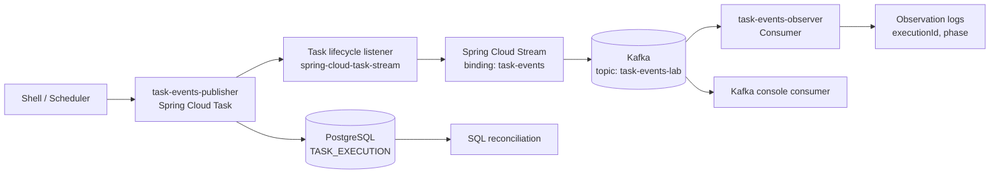
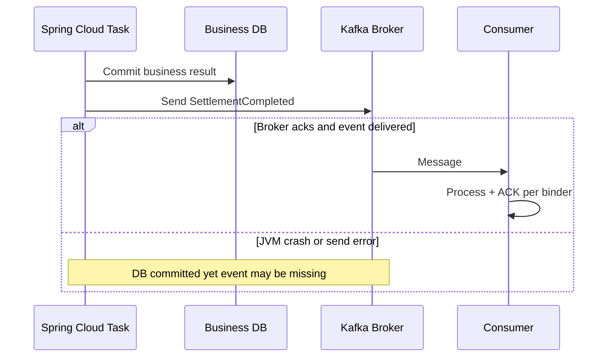

# Publishing Execution Events Through a Message Broker

## 1. Objectives and Deliverables of This Lab

In this lab, you will build a finite **Spring Cloud Task** application that publishes `TaskExecution` lifecycle events through **Apache Kafka** via **Spring Cloud Stream**, and then write a **consumer** application that receives and classifies those events. At the end, you will reconcile the messages against the `TaskRepository` database and test publish failures, message redelivery, and Task re-runs.

After completing this practice, you will be able to:

1. Distinguish **Task started**, **Task ended**, and custom **business events**.
2. Add `spring-cloud-starter-task`, `spring-cloud-task-stream`, and `spring-cloud-stream-binder-kafka` dependencies to enable Task event publishing on supported versions.
3. Configure the `task-events` output binding pointing to the `task-events-lab` Kafka topic.
4. Build a finite `ApplicationRunner` that logs business-date arguments while keeping `TaskRepository` active.
5. Build a consumer application using the **functional model** (`Consumer<...>`) to receive messages and identify START/END phases from `TaskExecution` payloads.
6. Read messages using the Kafka CLI, query `TASK_EXECUTION` with SQL, and correlate the matching **`executionId`**.
7. Test success scenarios, invalid parameters, disabled events, broker outages, and consumer message replay.
8. Explain delivery limits and how to add inbox/outbox patterns when events carry critical business impact.

> **Scope:** This is a lesson in the **Hands-On Practice** chapter of the **SPRING_CLOUD_TASK** module. Spring Cloud Task supports Spring Boot applications with finite runtimes that persist status and results to a database, run on demand or on schedules, and integrate with Spring Batch. This exercise uses **Task lifecycle events** and does not assume every run is a Spring Batch Job. The Batch extension at the end applies only when you actually have a `Job` and `JobRepository`.

### Expected Deliverables

| Component | Observable Output |
| --- | --- |
| Task publisher | `task-events-publisher` completes with a new `TaskExecution.executionId`. |
| Kafka | Topic `task-events-lab` receives messages representing Task lifecycle stages. |
| Observer/consumer | `task-events-observer` reads messages and logs execution ID, Task name, phase, and exit code when present. |
| PostgreSQL | `TASK_EXECUTION` has matching start/end times and exit code once the Task completes and writes metadata. |
| Failure tests | Understand when events are missing, when events duplicate, and why the broker cannot be the sole source of truth. |

Lab diagram:



**Core principle:** Spring Cloud Task publishes `TaskExecution` when a Task starts and ends via the integration module's listener. Two events can share the same `executionId` while representing **two different moments**. Never discard an END event simply because you already saw a START with the same ID.

## 2. Pinning a Compatible Stack Before Starting

The lab uses **Java 17+**, **Maven**, **Docker**, **PostgreSQL**, and **Apache Kafka**. To give the Java/Jackson snippets a clear boundary, you can pick:

| Component | Illustrative Baseline | Notes |
| --- | --- | --- |
| Spring Boot | `3.5.x` | Managed via `spring-boot-starter-parent`. |
| Spring Cloud release train | `2025.0.x` | Compatible with Spring Boot 3.5.x; e.g., published `2025.0.3`. |
| Spring Cloud Task | `3.3.x` | Managed by the corresponding Spring Cloud BOM. |
| Spring Cloud Stream | `4.3.x` | Managed by the corresponding Spring Cloud BOM. |
| Java | `17` or higher | Snippets use records in extensions and modern Java APIs. |
| Local Kafka | Apache Kafka `4.1.2` image | Single-node demo broker with security disabled; **test machines only**. |
| Local PostgreSQL | `postgres:16` image | Dedicated database for Task metadata. |

**Version lifecycle note:** The Boot 3.5 / Cloud 2025.0 baseline is used here to present one concrete combination, not a claim that it remains the supported release train at the time you study. For production projects, pick a currently supported release train from the [Spring Cloud compatibility matrix](https://spring.io/projects/spring-cloud/), apply security patches, and verify the API of `spring-cloud-task-stream` and your binder. With Spring Boot 4 or Spring Cloud Task 5.x, re-check packages, dependencies, and JSON libraries before copying.

Illustrative Maven properties in both `pom.xml` files:

```xml
<properties>
    <java.version>17</java.version>
    <spring-cloud.version>2025.0.3</spring-cloud.version>
</properties>
```

Set `spring-boot-starter-parent` to `3.5.15`, compatible with the example train. **Do not override** individual versions for Task, Stream, and binders when a BOM is present; avoid mixing Spring Cloud Task 3.x with Spring Cloud Stream 5.x.

### Prerequisites

You need local Docker permissions, JDK/Maven, and unused ports **5432** (PostgreSQL) and **9092** (Kafka). Kubernetes or Spring Cloud Data Flow is not required for the basic lab.

## 3. Setting Up Kafka and PostgreSQL with Docker

The commands below are **for learners to run locally** and were not executed during authoring. They use dummy local credentials; **never use sample passwords in real systems**.

### 3.1. Starting the Kafka Broker

Per Apache Kafka's Docker guide, the JVM image can start with default configuration for a test environment:

```bash
docker run -d \
  --name task-events-kafka \
  -p 9092:9092 \
  apache/kafka:4.1.2
```

Verify the broker:

```bash
docker logs task-events-kafka
docker ps --filter name=task-events-kafka
```

Once the broker is ready, create the topic explicitly instead of relying on binder auto-creation:

```bash
docker exec task-events-kafka \
  /opt/kafka/bin/kafka-topics.sh \
  --bootstrap-server localhost:9092 \
  --create \
  --topic task-events-lab \
  --partitions 1 \
  --replication-factor 1
```

Inspect topic details:

```bash
docker exec task-events-kafka \
  /opt/kafka/bin/kafka-topics.sh \
  --bootstrap-server localhost:9092 \
  --describe \
  --topic task-events-lab
```

In this lab, `localhost:9092` is the endpoint **for apps running on the host machine**, while `docker exec` runs Kafka CLI inside the Kafka container. If you run the publisher inside **another container**, `localhost` refers to the publisher's own container: use a Docker network and proper advertised listeners rather than keeping the sample URL verbatim.

### 3.2. Starting PostgreSQL for Task Metadata

```bash
docker run -d \
  --name task-events-postgres \
  -p 5432:5432 \
  -e POSTGRES_DB=task_demo \
  -e POSTGRES_USER=task_demo \
  -e POSTGRES_PASSWORD=local_demo_only \
  postgres:16
```

Verify:

```bash
docker logs task-events-postgres
docker exec task-events-postgres \
  pg_isready -U task_demo -d task_demo
```

This is a dedicated database for observing `TASK_EXECUTION`. Initially, you can let Spring Cloud Task **auto-initialize the schema in the lab** with `spring.cloud.task.initialize-enabled=true`. In production, use formal version/dialect-matched migrations and typically set `initialize-enabled=false`.

**Warning:** Container data does not persist permanently if you delete the container without a mounted volume. For the lab that is acceptable. Do not run `docker rm -v` if you want to keep data.

### 3.3. Two Distinct Sources of Truth

- **PostgreSQL / `TaskRepository`**: records `TaskExecution` in the finite application.
- **Kafka broker**: transports event messages to observers.

They do not participate in a single atomic transaction by default. When a Task writes to the database but broker publishing fails, you can still see Task metadata without seeing a message.

## 4. Organizing the Two Applications

Create **two separate Spring Boot Maven projects**, avoiding accidentally putting `spring-cloud-starter-task` on the consumer and causing it to shut down after startup:

```text
task-events-lab/
  publisher/
    pom.xml
    src/main/java/com/example/taskevents/TaskEventsPublisherApplication.java
    src/main/resources/application.yml
  observer/
    pom.xml
    src/main/java/com/example/taskevents/TaskEventsObserverApplication.java
    src/main/resources/application.yml
```

All paths are **suggested project layouts for learners to create**, not files automatically generated by this article.

| Application | Role | Lifecycle |
| --- | --- | --- |
| `publisher` | Runs an `ApplicationRunner` and exits; Spring Cloud Task records metadata and emits events. | **Finite**. |
| `observer` | `Consumer` reading the topic and logging received events. | **Long-running** in the lab until stopped by the operator. |

You can generate project skeletons via [Spring Initializr](https://start.spring.io/) or build `pom.xml` per the sections below. If using Initializr, ensure both projects use matching Boot/Cloud BOMs.

## 5. Creating the `publisher` Maven Project

`publisher/pom.xml`:

```xml
<?xml version="1.0" encoding="UTF-8"?>
<project xmlns="http://maven.apache.org/POM/4.0.0"
         xmlns:xsi="http://www.w3.org/2001/XMLSchema-instance"
         xsi:schemaLocation="http://maven.apache.org/POM/4.0.0
         https://maven.apache.org/xsd/maven-4.0.0.xsd">
    <modelVersion>4.0.0</modelVersion>

    <parent>
        <groupId>org.springframework.boot</groupId>
        <artifactId>spring-boot-starter-parent</artifactId>
        <version>3.5.15</version>
        <relativePath/>
    </parent>

    <groupId>com.example</groupId>
    <artifactId>task-events-publisher</artifactId>
    <version>1.0.0-SNAPSHOT</version>

    <properties>
        <java.version>17</java.version>
        <spring-cloud.version>2025.0.3</spring-cloud.version>
    </properties>

    <dependencyManagement>
        <dependencies>
            <dependency>
                <groupId>org.springframework.cloud</groupId>
                <artifactId>spring-cloud-dependencies</artifactId>
                <version>${spring-cloud.version}</version>
                <type>pom</type>
                <scope>import</scope>
            </dependency>
        </dependencies>
    </dependencyManagement>

    <dependencies>
        <dependency>
            <groupId>org.springframework.cloud</groupId>
            <artifactId>spring-cloud-starter-task</artifactId>
        </dependency>
        <dependency>
            <groupId>org.springframework.cloud</groupId>
            <artifactId>spring-cloud-task-stream</artifactId>
        </dependency>
        <dependency>
            <groupId>org.springframework.cloud</groupId>
            <artifactId>spring-cloud-stream-binder-kafka</artifactId>
        </dependency>
        <dependency>
            <groupId>org.springframework.boot</groupId>
            <artifactId>spring-boot-starter-jdbc</artifactId>
        </dependency>
        <dependency>
            <groupId>org.postgresql</groupId>
            <artifactId>postgresql</artifactId>
            <scope>runtime</scope>
        </dependency>
        <dependency>
            <groupId>org.springframework.boot</groupId>
            <artifactId>spring-boot-starter-test</artifactId>
            <scope>test</scope>
        </dependency>
    </dependencies>

    <build>
        <plugins>
            <plugin>
                <groupId>org.springframework.boot</groupId>
                <artifactId>spring-boot-maven-plugin</artifactId>
            </plugin>
        </plugins>
    </build>
</project>
```

### Why Are All Three Spring Cloud Modules Needed?

- `spring-cloud-starter-task`: activates the Task lifecycle and `TaskRepository`/`TaskExplorer` beans per config.
- `spring-cloud-task-stream`: integrates the **listener publishing `TaskExecution`** via Spring Cloud Stream in supported lines.
- `spring-cloud-stream-binder-kafka`: connects Stream bindings to **Kafka**.

Having `spring-cloud-stream` **without the Kafka binder** gives you no transport to Kafka. Conversely, having the binder without the `spring-cloud-task-stream` listener module prevents `task-events` from being published as expected.

Do not add a `Spring Cloud Function Supplier<TaskExecution>` yourself if your goal is to use Spring Cloud Task's built-in `task-events` listener. A polling supplier can emit repeated messages unrelated to new `TaskExecution`s and cannot replace the Task lifecycle.

## 6. Configuring `publisher` and the `task-events` Binding

`publisher/src/main/resources/application.yml`:

```yaml
spring:
  application:
    name: task-events-publisher
  main:
    web-application-type: none

  datasource:
    url: jdbc:postgresql://localhost:5432/task_demo
    username: task_demo
    password: local_demo_only

  cloud:
    task:
      initialize-enabled: true
      events:
        enabled: true

    stream:
      bindings:
        task-events:
          destination: task-events-lab
          content-type: application/json

      kafka:
        binder:
          brokers:
            - localhost:9092
          auto-create-topics: false

logging:
  level:
    org.springframework.cloud.task: INFO
```

Pay close attention to YAML indentation:

- `spring.cloud.task.events.enabled=true` is the **flag enabling Task lifecycle event publishing**; Spring Cloud Task docs describe disabling it with `false`. This flag does not turn an arbitrary `ApplicationRunner` into a consumer.
- `spring.cloud.stream.bindings.task-events.destination=task-events-lab` sets the **broker destination** for the **output binding named `task-events`**. In Data Flow docs, this default binding can be pointed to any destination.
- `spring.cloud.stream.kafka.binder.brokers` specifies the Kafka broker.
- `auto-create-topics=false` requires the topic to exist from step 3.
- `initialize-enabled=true` suits **lab environments** only where schema initialization is allowed. If your schema is already migrated, switch to `false` to prevent conflicts.
- `web-application-type=none` prevents the Task app from keeping a web server open indefinitely.
- Never commit real passwords in config files; in production use Secrets/environment variables with least-privilege permissions.

**Different binding names:** In the functional model, `observeTask-in-0` is the input binding name of the `Consumer` you write in the observer. Meanwhile, **`task-events` is the binding name used by Spring Cloud Task's listener**; do not rename it to `taskEvents-out-0` and expect the built-in listener to publish there.

## 7. Writing the Task Publisher Application

`publisher/src/main/java/com/example/taskevents/TaskEventsPublisherApplication.java`:

```java
package com.example.taskevents;

import java.time.LocalDate;
import java.util.List;

import org.springframework.boot.ApplicationArguments;
import org.springframework.boot.ApplicationRunner;
import org.springframework.boot.SpringApplication;
import org.springframework.boot.autoconfigure.SpringBootApplication;
import org.springframework.cloud.task.configuration.EnableTask;
import org.springframework.context.ConfigurableApplicationContext;
import org.springframework.context.annotation.Bean;

@SpringBootApplication
@EnableTask
public class TaskEventsPublisherApplication {

    public static void main(String[] args) {
        ConfigurableApplicationContext context =
                SpringApplication.run(
                        TaskEventsPublisherApplication.class, args);

        int exitCode = SpringApplication.exit(context);
        System.exit(exitCode);
    }

    @Bean
    ApplicationRunner settlementDemoRunner() {
        return args -> {
            String dateArgument = exactlyOneOption(
                    args, "business-date");
            LocalDate date = LocalDate.parse(dateArgument);

            System.out.println("Starting settlement demo, date=" + date);

            // Simulated work with no business side effects.
            // Does not touch payment DB or send real emails.
            System.out.println("Demo work completed, date=" + date);
        };
    }

    private static String exactlyOneOption(
            ApplicationArguments args, String name) {
        List<String> values = args.getOptionValues(name);
        if (values == null
                || values.size() != 1
                || values.get(0).isBlank()) {
            throw new IllegalArgumentException(
                    "Expected --" + name + "=yyyy-MM-dd");
        }
        return values.get(0);
    }
}
```

### Why Does the Code Not Call a Kafka Producer Directly?

In the main scenario, the **Spring Cloud Task listener** is responsible for publishing `TaskExecution`. The runner merely executes the finite job. When the integration listener is active:

1. The framework records Task startup with an `executionId`.
2. The listener publishes startup-phase `TaskExecution` data via `task-events`.
3. `ApplicationRunner` runs its work.
4. When the Task finishes, the framework updates final metadata and the listener attempts to publish the end event.

Exact timing between repository updates, listener callbacks, and binder shutdown depends on the version. **Never assume the END event is durably stored in the broker simply because `SpringApplication.exit(...)` returned.**

### Exit Codes and Failure Paths

`SpringApplication.exit(context)` collects Spring Boot's exit code and closes the context; `System.exit(exitCode)` forwards that code to the JVM/OS. When `SpringApplication.run(...)` throws an exception before returning a context, the subsequent two lines do not execute along the normal path; Spring Boot runs its startup failure handling.

When an option is invalid, `LocalDate.parse(...)` throws an exception. Do not catch and ignore it, as that can cause a scheduler to treat the Task as successful even though no work ran.

**Learning model:** This exercise does not call `TaskRepository` directly inside the runner. The framework handles persisting `TaskExecution`, keeping business logic testable independently of the broker.

## 8. Creating the `observer` Maven Project

`observer` is a **long-running Consumer** application, not a Spring Cloud Task. It needs the Kafka binder and does not need `spring-cloud-task-stream` or `spring-cloud-starter-task`.

`observer/pom.xml`:

```xml
<?xml version="1.0" encoding="UTF-8"?>
<project xmlns="http://maven.apache.org/POM/4.0.0"
         xmlns:xsi="http://www.w3.org/2001/XMLSchema-instance"
         xsi:schemaLocation="http://maven.apache.org/POM/4.0.0
         https://maven.apache.org/xsd/maven-4.0.0.xsd">
    <modelVersion>4.0.0</modelVersion>

    <parent>
        <groupId>org.springframework.boot</groupId>
        <artifactId>spring-boot-starter-parent</artifactId>
        <version>3.5.15</version>
        <relativePath/>
    </parent>

    <groupId>com.example</groupId>
    <artifactId>task-events-observer</artifactId>
    <version>1.0.0-SNAPSHOT</version>

    <properties>
        <java.version>17</java.version>
        <spring-cloud.version>2025.0.3</spring-cloud.version>
    </properties>

    <dependencyManagement>
        <dependencies>
            <dependency>
                <groupId>org.springframework.cloud</groupId>
                <artifactId>spring-cloud-dependencies</artifactId>
                <version>${spring-cloud.version}</version>
                <type>pom</type>
                <scope>import</scope>
            </dependency>
        </dependencies>
    </dependencyManagement>

    <dependencies>
        <dependency>
            <groupId>org.springframework.boot</groupId>
            <artifactId>spring-boot-starter</artifactId>
        </dependency>
        <dependency>
            <groupId>org.springframework.boot</groupId>
            <artifactId>spring-boot-starter-json</artifactId>
        </dependency>
        <dependency>
            <groupId>org.springframework.cloud</groupId>
            <artifactId>spring-cloud-stream-binder-kafka</artifactId>
        </dependency>
    </dependencies>

    <build>
        <plugins>
            <plugin>
                <groupId>org.springframework.boot</groupId>
                <artifactId>spring-boot-maven-plugin</artifactId>
            </plugin>
        </plugins>
    </build>
</project>
```

In this Boot 3.x example, `spring-boot-starter-json` supplies Jackson support for JSON payloads. If you are studying with Boot 4.x, packages/JSON starters may differ; update the example to match your chosen stack.

## 9. Configuring `observer` to Read the Topic

`observer/src/main/resources/application.yml`:

```yaml
spring:
  application:
    name: task-events-observer
  main:
    web-application-type: none

  cloud:
    function:
      definition: observeTask

    stream:
      bindings:
        observeTask-in-0:
          destination: task-events-lab
          group: task-events-lab-observer
          content-type: application/json
          consumer:
            max-attempts: 3

      kafka:
        binder:
          brokers:
            - localhost:9092
          auto-create-topics: false

logging:
  level:
    com.example.taskevents: INFO
```

Explanation:

- `observeTask` is the Java **function bean name**. Its default input binding is `observeTask-in-0`.
- `destination` must match the topic the publisher writes to: `task-events-lab`.
- A fixed `group` preserves consumer group offsets/consumption state across restarts, unlike spawning an anonymous group on every startup.
- `max-attempts` configures binder-supported message retry attempts; **it does not automatically create a DLQ**.
- `web-application-type=none` does not mean the observer should exit immediately. The consumer binding keeps the application running while observing.

If the consumer is only for live observation, you can configure a dedicated consumer group for your test environment. To replay older history, use the Kafka CLI with `--from-beginning` or create a new group respecting topic retention; never assume an existing consumer group automatically re-reads committed records.

## 10. Writing a Consumer That Distinguishes START and END

`observer/src/main/java/com/example/taskevents/TaskEventsObserverApplication.java`:

```java
package com.example.taskevents;

import java.util.function.Consumer;

import com.fasterxml.jackson.databind.JsonNode;
import org.slf4j.Logger;
import org.slf4j.LoggerFactory;
import org.springframework.boot.SpringApplication;
import org.springframework.boot.autoconfigure.SpringBootApplication;
import org.springframework.context.annotation.Bean;

@SpringBootApplication
public class TaskEventsObserverApplication {

    private static final Logger log =
            LoggerFactory.getLogger(
                    TaskEventsObserverApplication.class);

    public static void main(String[] args) {
        SpringApplication.run(
                TaskEventsObserverApplication.class, args);
    }

    @Bean
    Consumer<JsonNode> observeTask() {
        return event -> {
            String executionId =
                    event.path("executionId").asText("missing");
            String taskName =
                    event.path("taskName").asText("unknown");

            JsonNode endTime = event.path("endTime");
            boolean hasEndTime =
                    !endTime.isMissingNode()
                    && !endTime.isNull()
                    && !endTime.asText().isBlank();

            String phase = hasEndTime
                    ? "END"
                    : "START_OR_INCOMPLETE";

            String exitCode = event.path("exitCode")
                    .asText("not-reported");

            log.info(
                    "Task event: executionId={}, taskName={}, "
                            + "phase={}, exitCode={}",
                    executionId,
                    taskName,
                    phase,
                    exitCode);
        };
    }
}
```

**Why use `JsonNode` instead of `TaskExecution` on the consumer?**

- The observer only needs a few payload fields; it does not need to couple to the publisher's `TaskExecution` class.
- The integration payload is `TaskExecution` serialized **by that release's serializer**, not a versioned business schema under your control.
- A JSON tree keeps the demo independent of `TaskExecution` constructors/deserialization quirks when two apps are packaged separately.
- When you want a stable contract, define your own application-level **event envelope** carrying `eventId`, `eventType`, and `eventVersion`.

**Do not interpret `START_OR_INCOMPLETE` as a guaranteed START event.** A killed Task, serialization quirk, or unpopulated field can also lack `endTime`. For lab purposes, the two messages roughly correspond to "start" and "end", but never build a production state machine solely off `endTime`.

### Never Log Entire Payloads in Production

`TaskExecution` can contain arguments or error messages. In real applications, those may hold sensitive information. The observer above logs only selected fields. Avoid `log.info("{}", event)` in environments with real data.

## 11. Running the Lab in Order and Observing Results

### 11.1. Verifying Infrastructure Readiness

```bash
docker ps --filter name=task-events-kafka
docker ps --filter name=task-events-postgres

docker exec task-events-postgres \
  pg_isready -U task_demo -d task_demo
```

The `task-events-lab` Kafka topic must exist. If the broker is still starting up, inspect logs rather than immediately blaming binder configuration.

### 11.2. Building Both JARs

In `publisher`:

```bash
mvn -DskipTests package
```

In `observer`:

```bash
mvn -DskipTests package
```

Use `mvnw` instead of `mvn` if your project includes Maven Wrapper. These commands are **for the learner to run**; this guide does not run Maven or Docker.

### 11.3. Starting the Observer First

In Terminal A, from `observer`:

```bash
java -jar target/task-events-observer-1.0.0-SNAPSHOT.jar
```

Keep this terminal open. Consumers normally miss historical messages if a group has already committed offsets; starting the observer before the publisher makes it easy to catch both START and END messages.

### 11.4. Running the Publisher Once

In Terminal B, from `publisher`:

```bash
java -jar target/task-events-publisher-1.0.0-SNAPSHOT.jar \
  --business-date=2026-11-24
```

Application output should include the two business log lines:

```text
Starting settlement demo, date=2026-11-24
Demo work completed, date=2026-11-24
```

The observer should print lines along these lines:

```text
Task event: executionId=1, taskName=task-events-publisher,
            phase=START_OR_INCOMPLETE, exitCode=...

Task event: executionId=1, taskName=task-events-publisher,
            phase=END, exitCode=0
```

This is an **illustrative example**, not guaranteed exact output: the actual ID is assigned by `TaskRepository`, JSON field formatting and START `exitCode` vary by version, and messages may arrive late or go missing on send failures. Check Kafka binder logs if events do not appear.

### 11.5. Reading Messages Directly from Kafka

In Terminal C:

```bash
docker exec -it task-events-kafka \
  /opt/kafka/bin/kafka-console-consumer.sh \
  --bootstrap-server localhost:9092 \
  --topic task-events-lab \
  --from-beginning
```

Press `Ctrl+C` to stop the console consumer after inspecting the data. With the JSON serializer, you typically see fields like `executionId`, `taskName`, `startTime`, `endTime`, and `exitCode`. **Do not assume every field or timestamp format matches the example identically**.

If the Kafka CLI shows messages while the observer app logs nothing:

- Check `spring.cloud.function.definition` and the `observeTask` bean name.
- Check the `observeTask-in-0` binding, topic, group, and offset.
- Check consumer logs for deserialization/JSON conversion errors.
- Verify the observer's Kafka binder is connecting to the right broker.

If **neither Kafka CLI nor the observer** shows events, check the `spring-cloud-task-stream` dependency, the `task-events` output binding, and publisher logs.

## 12. Reconciling Against the `TASK_EXECUTION` Table

PostgreSQL shell command:

```bash
docker exec -it task-events-postgres \
  psql -U task_demo -d task_demo
```

Inside `psql`:

```sql
SELECT
    TASK_EXECUTION_ID,
    TASK_NAME,
    START_TIME,
    END_TIME,
    EXIT_CODE,
    EXIT_MESSAGE,
    ERROR_MESSAGE
FROM TASK_EXECUTION
ORDER BY TASK_EXECUTION_ID DESC;
```

For a Task that completed normally, the new row typically shows:

| Column | Illustrative Value | Meaning |
| --- | --- | --- |
| `TASK_EXECUTION_ID` | `1` | Task run ID, matching `executionId` in the payload. |
| `TASK_NAME` | `task-events-publisher` | Registered Task name. |
| `START_TIME` | Populated | Timestamp when the framework recorded Task start. |
| `END_TIME` | Populated | Timestamp when the Task finished and updated metadata. |
| `EXIT_CODE` | `0` on success path | Result recorded by the framework. |
| `ERROR_MESSAGE` | Usually empty on success | Error info if any occurred. |

If a message was lost while DB metadata exists, never assume "the Task didn't run". A Kafka topic and `TASK_EXECUTION` differ in purpose and retention.

### Querying Task Parameters

```sql
SELECT TASK_EXECUTION_ID, TASK_PARAM
FROM TASK_EXECUTION_PARAMS
ORDER BY TASK_EXECUTION_ID DESC;
```

The `--business-date=2026-11-24` argument can be stored in Task metadata. **Never pass passwords/tokens as CLI arguments**, as they can end up in `TASK_EXECUTION_PARAMS` and event payloads/logs depending on configuration.

### Triggering Another Run

In Terminal B, re-run the same date:

```bash
java -jar target/task-events-publisher-1.0.0-SNAPSHOT.jar \
  --business-date=2026-11-24
```

Expect a **new `TaskExecution` ID**, even though `businessDate` matches the first run. In this demo with no business writes, that is harmless. In production, real reconciliation jobs require business keys/idempotency so transactions are never processed twice.

**Never use `executionId` to infer a different business dataset.** It identifies only *one process execution*.

## 13. Distinguishing Two Valid Events from Duplicate Messages

Suppose the observer receives three messages:

```text
executionId=41, phase=START
executionId=41, phase=END
executionId=41, phase=END
```

Two concepts apply:

- **START and END with the same `executionId`:** two **distinct** events representing two lifecycle points.
- **END received twice:** can result from broker redelivery, consumer restart, uncommitted offsets/retries, or publisher resends.

You cannot use `executionId` alone as the deduplication key for every event. For a dashboard consumer, the minimum key is `(taskRepositoryIdentity, executionId, phase)`; if multiple state transitions or multiple events per phase matter, add an application-defined **event ID / event version**.

Example receipt table model for a **custom observer application**:

```sql
CREATE TABLE task_event_receipt (
    source_repository VARCHAR(100) NOT NULL,
    task_execution_id BIGINT NOT NULL,
    phase VARCHAR(30) NOT NULL,
    received_at TIMESTAMPTZ NOT NULL DEFAULT CURRENT_TIMESTAMP,
    PRIMARY KEY (source_repository, task_execution_id, phase)
);
```

This is **not a standard Spring Cloud Task table**, just a suggestion for building an idempotent consumer. With PostgreSQL, recording looks like:

```sql
INSERT INTO task_event_receipt (
    source_repository, task_execution_id, phase)
VALUES ('task-demo-local', 41, 'END')
ON CONFLICT (
    source_repository, task_execution_id, phase)
DO NOTHING;
```

If the consumer both stores a receipt and updates a projection, keep both operations in **the same database transaction** to avoid committing the receipt while failing the projection. The example above does not handle out-of-order events; dashboards must also enforce state-transition ordering.

**Never treat `TaskExecution.exitCode=0` as proof that all business side effects succeeded.** A runner may swallow an exception, or a Batch Job may end `FAILED` without propagating to the Task result.

## 14. Test Scenario 1: Disabling Event Publishing While Preserving Task History

Set in `publisher/application.yml`:

```yaml
spring:
  cloud:
    task:
      events:
        enabled: false
```

This is a **configuration snippet change**, not a complete YAML replacing section 6. After rebuilding/re-running the publisher:

- `TaskRepository` must still write `TASK_EXECUTION` if JDBC/schema work.
- The integration listener **does not emit** Task lifecycle events to `task-events`.
- The observer receives no new lifecycle events for that run (assuming no other producer uses the topic).
- Old events may still appear from the broker if a consumer rewinds offsets; do not mistake old messages for new events.

To avoid editing the file, you can also override at launch time:

```bash
java -jar target/task-events-publisher-1.0.0-SNAPSHOT.jar \
  --spring.cloud.task.events.enabled=false \
  --business-date=2026-11-25
```

After testing, set `spring.cloud.task.events.enabled=true` back. Setting `false` only disables **broker event publishing**; it does not disable `TaskRepository` or the Task application itself.

## 15. Test Scenario 2: Invalid Parameter and Task Failure

Run:

```bash
java -jar target/task-events-publisher-1.0.0-SNAPSHOT.jar \
  --business-date=invalid-date
```

In the publisher code, `LocalDate.parse(...)` throws an error. Record:

1. Exit status **of the Java process**, not the exit code of another Docker CLI command.
2. Exception/stack-trace logs.
3. Whether a new `TASK_EXECUTION` row was created and its `EXIT_CODE`/`END_TIME`.
4. Whether the broker received any START/END messages.
5. Whether the observer printed phase and failure exit code.

Bash example:

```bash
java -jar target/task-events-publisher-1.0.0-SNAPSHOT.jar \
  --business-date=invalid-date
echo $?
```

PowerShell:

```powershell
java -jar target/task-events-publisher-1.0.0-SNAPSHOT.jar --business-date=invalid-date
$LASTEXITCODE
```

Startup failure paths do not carry the same guarantees as success paths: exceptions can occur before the context finishes initializing, repositories or brokers may be unready, and the end event may fail to send. **Never write test assertions requiring exactly two events for every failure.** Verify each layer individually.

If an error is caught inside the runner and merely logged with `log.error` without rethrowing, the Task can appear successful. Test that case in a sandbox to see why error propagation is essential.

## 16. Test Scenario 3: Broker Outage

In your local test environment, before running the publisher:

```bash
docker stop task-events-kafka
```

Then run the publisher with a valid date and observe the result in an isolated test run. You may observe:

- The binder fails to connect during startup or publishing.
- Producer/consumer retries or blocks until timeout per configuration.
- `TaskRepository` still records a row if the database remains reachable, while messages never reach the consumer.
- The application may fail early or fail to complete depending on module/binder/exception policies in your version.

**Never assume the Task always returns a nonzero exit code when the broker is down.** Depending on lifecycle timing, publishing may fail asynchronously or the binder may shut down before receiving an acknowledgment. When guaranteed event delivery is required, design durable publishing like an outbox and measure real broker outcomes.

Restart the broker:

```bash
docker start task-events-kafka
```

Once the broker recovers:

1. Verify Kafka CLI/observer receives new events when running a **new** Task.
2. Inspect older Task history in PostgreSQL.
3. Identify any missing events and design **reconciliation** instead of expecting the broker to materialize messages that were never saved.
4. Never replay real payment business logic solely to regenerate a missing notification.

### Why Producer Retries Alone Do Not Solve Every Case

An event may reach the broker while the producer **misses the ack** due to timeout/network drops. Retrying can publish a **duplicate**. Conversely, if the JVM dies before creating a broker record, Kafka producer retries cannot run after process exit. You need persisted publish intent (such as an outbox) or reliable event reconstruction from a repository.

## 17. Test Scenario 4: Observer Message Replay

Keep publisher/metadata untouched, stop the observer, and start it again. Depending on the consumer group and committed offsets, it may **not re-read** older messages. To intentionally observe replay:

- Use Kafka CLI `--from-beginning`.
- Or create a fresh consumer group in the test environment with an appropriate auto-offset-reset policy.
- Or use authorized offset-reset tooling **strictly on test topics/groups**.

If a consumer performed a side effect (sending email, updating a projection) and crashed before committing its offset, the record can be redelivered and cause duplicate side effects.

### Replay Matrix

| Scenario | What Can Happen | Handling Design |
| --- | --- | --- |
| Receive START then END for same ID | Two valid events. | Include phase in key. |
| Receive END a second time | Broker/consumer replay. | Inbox/deduplication. |
| END arrives before START | Retry/partitioning or different observation order. | State machine blocks late START from overwriting final state. |
| Task re-run for same `businessDate` | New `executionId`. | Idempotency by business key, not `TaskExecution` ID. |
| Consumer fails parsing payload | Retry/DLQ per binder. | Version/schema validation and alerting. |
| Kafka retention deletes records | Cannot replay past retention window. | Size retention appropriately; reconcile from `TaskRepository`. |

**Lesson goal:** See clearly why "event was published" differs from "every consumer processed it exactly once". For critical workflows, build idempotent consumers, lag monitoring, DLQs, and real fault tests.

## 18. Extension: Spring Batch Job/Step Events

If the publisher is extended to run a Spring Batch Job, Spring Cloud Task provides mechanisms to emit listener events when Task–Batch/Stream integration is enabled:

| Event Type | Default Channel / Destination Documented |
| --- | --- |
| Task lifecycle | `task-events` |
| `JobExecutionListener` | `job-execution-events` |
| `StepExecutionListener` | `step-execution-events` |
| `ChunkListener` | `chunk-events` |
| `ItemReadListener` | `item-read-events` |
| `ItemProcessListener` | `item-process-events` |
| `ItemWriteListener` | `item-write-events` |
| `SkipListener` | `skip-events` |

This is an **extension path**; Batch events will not appear merely from configuring topic names if the application **has no Spring Batch Job**. You need:

- Compatible integration dependencies and auto-configuration.
- An actual `Job` running against a migrated `JobRepository`.
- Bindings/brokers configured for each event channel you want to observe.
- Volume management: item/chunk events can vastly outnumber `TaskExecution` counts.
- Review of sensitive data inside `ExecutionContext` payloads, arguments, or error messages.

Example configuration renaming the Job event destination:

```yaml
spring:
  cloud:
    stream:
      bindings:
        job-execution-events:
          destination: batch-job-events-lab
```

Do not confuse `spring.cloud.task.batch.events.enabled=false` (disabling Batch event publishing over Stream where supported) with `spring.cloud.task.batch.listener.enabled=false` (Task–Batch metadata linking): those two features serve different roles.

If one Task runs multiple `JobExecution`s, the same `TaskExecution` ID can relate to multiple `JobExecution` IDs and numerous Batch events; consumers must choose unique keys at the **corresponding metadata granularity**, never sharing `executionId` across every record.

## 19. Adding Custom Business Events with `StreamBridge` (Optional)

`task-events` carries **technical Task lifecycle events**, whereas an application may need to emit `SettlementCompleted` after confirming transactions. This is an **application-defined** event, not provided automatically by `spring.cloud.task.events.enabled`.

One approach in the Spring Cloud Stream functional model is `StreamBridge`:

```java
package com.example.taskevents;

public record SettlementCompleted(
        String eventId,
        String businessDate,
        long processedCount
) {}
```

Illustrative publisher service:

```java
package com.example.taskevents;

import org.springframework.cloud.stream.function.StreamBridge;
import org.springframework.stereotype.Component;

@Component
public class BusinessEventPublisher {

    private final StreamBridge streamBridge;

    public BusinessEventPublisher(StreamBridge streamBridge) {
        this.streamBridge = streamBridge;
    }

    public void publish(SettlementCompleted event) {
        boolean accepted =
                streamBridge.send("settlement-out-0", event);

        if (!accepted) {
            throw new IllegalStateException(
                    "Message not accepted by stream binding");
        }
    }
}
```

With binding:

```yaml
spring:
  cloud:
    stream:
      output-bindings: settlement-out-0
      bindings:
        settlement-out-0:
          destination: settlement-business-events-lab
          content-type: application/json
```

This example **does not include a transactional outbox**, so it **cannot guarantee the event exists on the broker** after JDBC commit or a crash. The boolean result from `send` only reflects Spring Cloud Stream's send call contract; it is not proof that consumers processed the event.

Never use `StreamBridge` to manually publish a **third** `TaskExecution` onto `task-events-lab` unless you intentionally design deduplication rules for it. This extension highlights the distinction between **lifecycle events** and **business events**.

## 20. When Events Cannot Be Lost: Outbox and Reconciliation

A common failure window exists:



For critical business events, use a **transactional outbox**:

1. In the **same database transaction** as the business result, insert an `outbox_event` carrying a stable `eventId`.
2. A separate dispatcher (scheduled Task or continuous service) polls unsent rows.
3. The dispatcher publishes to the broker, awaits binder confirmation, and marks the row sent.
4. If the dispatcher crashes after publishing before marking sent, it may send a **duplicate**; consumers need an inbox/dedup check.
5. Monitor backlog, cap retries, configure DLQ/reconciliation, and define intervention procedures.

For built-in `TaskExecution` events, you **do not automatically get an outbox** simply by adding the Stream dependency. If strict auditability is required, build a service that **reads `TaskRepository` and reconciles receipts** to emit verified summary events, or design your own durable event pipeline with an explicit contract.

### Which Data Source Is More Authoritative?

| Question | Authoritative Source |
| --- | --- |
| Which Task did the framework record as started? | `TASK_EXECUTION` in the right `TaskRepository`. |
| Which records did Kafka store? | Topic/offsets in the broker; mind retention. |
| Did the consumer apply the event? | Consumer inbox/projection or consumer app state. |
| Did the Spring Batch Job/Step complete? | `BATCH_JOB_EXECUTION`, `BATCH_STEP_EXECUTION` in `JobRepository`. |
| Was business data committed properly? | Business database / target system reconciliation. |
| Did the scheduler see the Task succeed or fail? | JVM/container exit code and platform Job/Task status. |

No single source in this table replaces all the others.

## 21. Quick Troubleshooting of Common Lab Issues

| Symptom | Causes to Check | Action |
| --- | --- | --- |
| Publisher fails with `relation task_execution does not exist` | Task schema missing, wrong DB/schema, or `initialize-enabled=false`. | Verify JDBC URL, `tablePrefix`, DB grants, and version-matched migrations. |
| Kafka CLI shows no messages | Missing `spring-cloud-task-stream`, missing binder, events disabled, wrong output binding, or broker error. | Inspect dependency tree, `task-events` destination, startup logs, and Kafka topic. |
| Observer receives nothing while Kafka CLI shows data | Wrong `observeTask-in-0`, function definition, group offset, or JSON conversion. | Read binding/consumer logs; verify topic and config. |
| `TaskExecution` exists but event is missing | Broker down, async send failed, listener inactive, or early termination. | Cross-check SQL, publisher logs, and broker status. |
| One run produces two messages with same `executionId` | START and END are two distinct events. | Distinguish by phase/state rather than deduplicating on ID alone. |
| END received twice | Kafka redelivery, group replay, or consumer crash before ack. | Idempotent consumer/inbox; never trigger side effects twice. |
| Task received `SIGKILL` | JVM had no time to record END or send event. | Check container exit, `END_TIME`, logs, and business data. |
| Task returns `0` despite Job/logic error | Exception swallowed, or Batch Job status not propagated. | Inspect runner, `JobExecution`, and `System.exit`. |
| Local broker reachable from host, not from Pod | `localhost` inside container/Pod points to itself; advertised listeners/DNS/network issue. | Configure broker address reachable from the app. |
| Cannot create topic | Broker permissions or `auto-create-topics=false` without pre-created topic. | Pre-create topic via infra tools and grant required ACLs. |
| Message JSON fields differ from example | Release/serializer payload differences. | Inspect raw payload and adapt consumer to real contract. |
| Restarted consumer misses old events | Group already committed offsets or retention/offset policy. | Use a fresh test group or Kafka CLI `--from-beginning`. |

### Prioritized Investigation Steps

1. Verify the **publisher actually ran** and the repository recorded `TASK_EXECUTION`.
2. Verify `spring-cloud-task-stream` is on the classpath and the listener is not disabled.
3. Verify the **`task-events` binding** is created and points to `task-events-lab`.
4. Inspect the Kafka topic via CLI rather than relying only on the observer.
5. If records exist, inspect `observeTask` function, binding name, group offsets, and JSON conversion.
6. If no records exist, inspect publisher logs, broker health, connectivity, and retry/ack settings.
7. With Batch, inspect `JobRepository` and Job/Step event configurations separately.

Never "fix" errors by disabling TLS/ACLs in production, endlessly rotating consumer group names to hide offset bugs, or deleting live data topics just to retry.

## 22. Test Matrix and Grading Criteria

| Test | `TASK_EXECUTION` | Kafka `task-events-lab` | Observer | Assessment |
| --- | --- | --- | --- | --- |
| Run with valid date | New row; usually exit code `0`. | Expect START/END events if listener/broker succeed. | Logs ID and phase. | Pass if correlated by same ID. |
| Re-run same date | New `executionId`. | New events for new run. | Not confused with duplicate of prior run. | Pass if execution vs. business keys are distinguished. |
| `events.enabled=false` | Metadata still saved. | No new events from this Task listener. | No matching new logs. | Pass if understanding flag only disables events. |
| Invalid date | May record failure metadata or miss if very early failure. | Two events not guaranteed. | Observe per failure path. | Pass if actual evidence is recorded. |
| Broker stopped | DB may still record Task. | Events may be missing. | No new events received. | Pass if delivery limits are identified. |
| Consumer replay | Does not create new `TaskExecution`. | Old records may remain. | May re-receive messages. | Pass if deduplication is handled. |
| Task killed mid-run (isolated test) | `END_TIME` may be null. | END may be missing. | Must not assume success. | Pass if container/logs/DB are cross-checked. |

### Evidence Learners Should Submit

- Publisher/observer Maven and YAML configs with **real credentials redacted**.
- Observer screenshots/logs showing at least one `TaskExecution` ID matching SQL output.
- Output of `TASK_EXECUTION` query after a successful run.
- Result of testing `events.enabled=false` and explanation of why `TaskRepository` rows remain.
- One failure scenario documenting process exit status, logs, broker status, and actual metadata.
- Explanation of why START and END with the same `executionId` are not duplicate messages and how to design consumer idempotency.

## 23. Advanced Exercises

**Exercise 1 — Change destination:** Change `spring.cloud.stream.bindings.task-events.destination` to `operational-task-events` and update the observer; pre-create the new topic if auto-create is disabled. Prove `TaskRepository` data is unaffected by topic name.

**Exercise 2 — Two consumer groups:** Run two observers with two distinct consumer groups reading the same topic. Explain why both groups legitimately receive the same events without indicating a broker bug.

**Exercise 3 — Failure statistics:** Write a consumer storing `(repositoryIdentity, executionId, phase, exitCode)` and reporting total Tasks ending in failure. Prevent a late START from overwriting END.

**Exercise 4 — Failure ordering:** Stop Kafka right before the Task finishes. Inspect SQL, logs, and missing events; propose a reconciliation mechanism for dashboards.

**Exercise 5 — Spring Batch:** Extend the publisher to run a one-Step Job, enable matching Batch events, and correlate `TASK_TASK_BATCH` with `BATCH_JOB_EXECUTION` and their topics. Do not rely solely on `job-execution-events` to verify Job data commits.

**Exercise 6 — Outbox:** Define a `SettlementCompleted` business event with a stable `eventId`. Write the event to an outbox in the same transaction as business results, build a dispatcher and consumer inbox. Simulate a crash after publish before marking `SENT`, confirming the consumer does not apply side effects twice.

**Exercise 7 — Production environment:** Switch the local broker to Kafka with TLS/SASL/ACLs and the database to Secrets. Design hostname verification, least-privilege topic ACLs, retention, and alerts when publishers fail to emit events. Never copy real usernames/passwords into submissions.

## 24. Cleaning Up the Lab Environment

Stop the observer with `Ctrl+C`. Once test data is no longer needed and no other apps use these containers:

```bash
docker stop task-events-kafka task-events-postgres
docker rm task-events-kafka task-events-postgres
```

**Data warning:** Removing the database container deletes Task metadata created in the lab unless a persistent volume is used. Save any SQL/log evidence before deleting. Never run these commands against shared, staging, or production brokers or databases.

## Key Takeaways

- Spring Cloud Task can publish `TaskExecution` on the **`task-events`** binding at the **start and end** of a run when Stream integration, a binder, and configuration are present.
- The listener's `task-events` binding **differs** from the functional consumer's `observeTask-in-0` input binding, while sharing **the same Kafka destination**.
- `TaskRepository` saves metadata, Kafka transports events, and the observer processes messages: all three must be inspected **independently and reconciled**.
- One `executionId` can appear in two valid START/END events. **Redelivery** can replay the same event, requiring contract-level idempotency.
- Broker outages or killed processes can drop events while business data/Task metadata exists; **never assume exactly-once** simply from using Spring Cloud Stream.
- When critical business events must be published reliably, consider **transactional outbox + inbox**, while still handling duplicates and retention.
- With Spring Batch, `job-execution-events` and `step-execution-events` aid Job/Step monitoring and do not replace Batch repositories or process exit codes.

## References

- [Spring Cloud Task — Spring Cloud Stream Integration](https://docs.spring.io/spring-cloud-task/reference/3.3/stream.html)
- [Spring Cloud Task — Features / TaskRepository](https://docs.spring.io/spring-cloud-task/reference/3.3/features.html)
- [Spring Cloud Stream — Programming Model, Functions, and StreamBridge](https://docs.spring.io/spring-cloud-stream/reference/spring-cloud-stream/producing-and-consuming-messages.html)
- [Spring Cloud Stream — Binding Properties](https://docs.spring.io/spring-cloud-stream/reference/spring-cloud-stream/binding-properties.html)
- [Spring Cloud Stream — Kafka Binder](https://docs.spring.io/spring-cloud-stream/reference/kafka/kafka-binder/index.html)
- [Spring Cloud Data Flow — Subscribing to Task and Batch Events](https://docs.spring.io/spring-cloud-dataflow/docs/current/reference/htmlsingle/)
- [Spring Cloud — Release Train / Spring Boot Compatibility](https://spring.io/projects/spring-cloud/)
- [Apache Kafka — Docker Quick Start](https://kafka.apache.org/41/getting-started/docker/)
- [Spring Batch — Metadata Schema](https://docs.spring.io/spring-batch/reference/schema-appendix.html)
