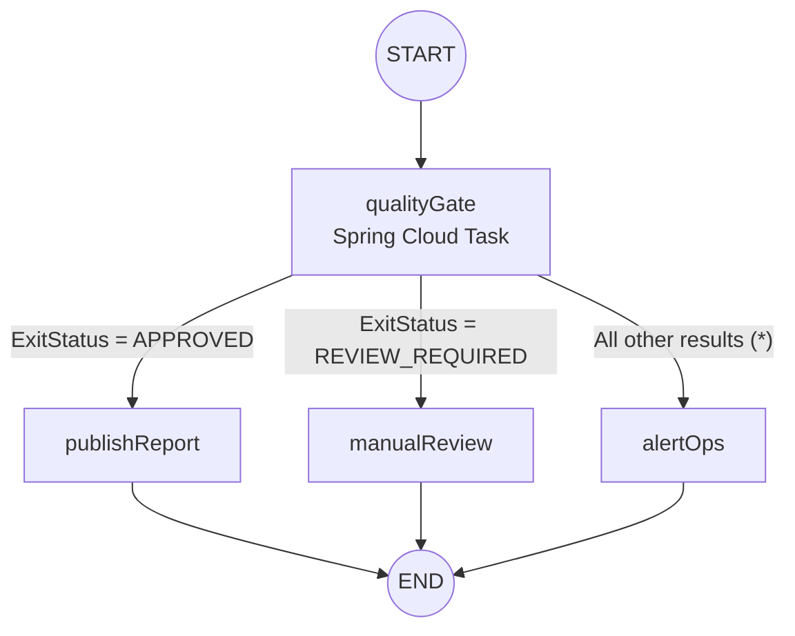
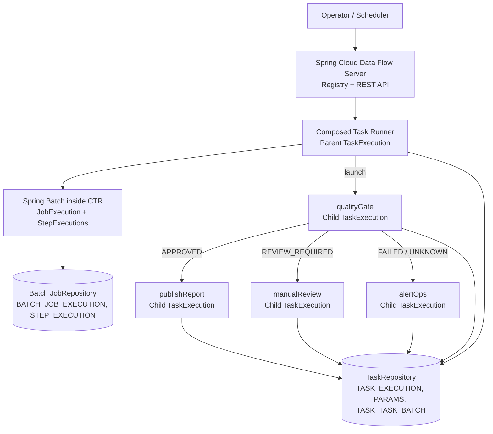
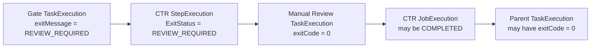

# Building Conditional Data Flow Pipelines and Reconciling Executions

## Practice Objectives

In this **Hands-On Practice** chapter of the **Spring Cloud Task** module, we build a complete lab on **Spring Cloud Data Flow (SCDF)** and **Composed Task Runner (CTR)**: launching finite Spring Cloud Task applications, branching based on validation step outcomes, and **reconciling each run at both the `TaskExecution` and Batch `JobExecution` levels**.

Upon completion, you will know how to:

- Build a Spring Boot + Spring Cloud Task application with `ApplicationRunner` and `@AfterTask` to emit a **controlled `exitMessage`**.
- Create conditional **transitions** using Data Flow Task DSL: `'APPROVED' ->`, `'REVIEW_REQUIRED' ->`, and `'*' ->`.
- Distinguish conditional `&&` (proceed only when the prior step succeeds) from `->` transitions and `<A || B>` parallel splits.
- Register Task applications, create **one composed task definition**, and execute multiple runs with differing outcomes.
- Use **SCDF Shell/UI**, `TaskRepository`, and `Batch JobRepository` to trace **parent CTR → child `TaskExecution`s → CTR `JobExecution` → `StepExecution`s**.
- Prove that **unselected branches never launch**, and recognize when an error routed to an alert branch **remains unresolved from a business standpoint**.
- Compare a fresh launch against **restarting a failed CTR Job**, controlling run identity and preventing duplicate data processing.
- Build an expected-vs-actual reconciliation table, auditing missing metadata, exit codes, timeouts, business data, security, and idempotency.

> **Scope:** This lab is built on a **sample Task application that writes no real transactions**. To apply this to an organization's monetary or order data, replace simulated logic with real validation and writers backed by transactions, idempotency, access control, and proper monitoring.

## 1. Scenario: Rental Transaction Period Close

Suppose a rental system must decide whether to publish a settlement report for business date `2026-11-23`. The workflow consists of:

1. **`qualityGate`:** checks row counts, checksums, and reconciliation variances for the batch of data.
2. If the outcome is `APPROVED` → **`publishReport`**, publishes the report.
3. If the outcome is `REVIEW_REQUIRED` → **`manualReview`**, creates a review request.
4. On technical failure `FAILED` or any unexpected status → **`alertOps`**, notifies the operations team.



The flow is expressed using **Composed Task DSL**:

```text
qualityGate 'APPROVED' -> publishReport
            'REVIEW_REQUIRED' -> manualReview
            '*' -> alertOps
```

This is a **single DSL expression**, wrapped across lines for readability. In the Shell commands later, pass it as **one quoted string**.

### 1.1. Outcome Matrix to Verify

| Run Case | `qualityGate` Outcome | Next Child That Must Run | Children That Must Not Run |
| --- | --- | --- | --- |
| A — Approved | `exitCode=0`, `exitMessage=APPROVED` | `publishReport` | `manualReview`, `alertOps` |
| B — Needs review | `exitCode=0`, `exitMessage=REVIEW_REQUIRED` | `manualReview` | `publishReport`, `alertOps` |
| C — Technical failure | `exitCode != 0`, no custom exit message | `alertOps` via wildcard if CTR maps failure to `FAILED` | `publishReport`, `manualReview` |
| D — Unknown status | `exitCode=0`, `exitMessage=UNKNOWN` | `alertOps` via wildcard | `publishReport`, `manualReview` |

**Two critical distinctions:**

- `REVIEW_REQUIRED` **is not necessarily a process error**. A Task can exit cleanly (`exitCode=0`) while signaling a business outcome requiring human review.
- A **failed child Task caught by a transition** can cause the alert branch to succeed, letting the orchestration Job finish cleanly along the handled path. That **does not mean the reconciliation task succeeded**.

In this lab, `manualReview` and `alertOps` merely log messages so you can verify branch selection. **In production, persist a durable ticket or alert event** instead of treating a log line as incident resolution.

## 2. Architecture and IDs to Reconcile



A single `task launch rentalCloseFlow` typically creates:

- **One parent `TaskExecution`** for the CTR process.
- **One Spring Batch `JobExecution`** inside CTR. Nodes in the graph map to Steps of this orchestration Job.
- **One child `TaskExecution`** for `qualityGate`.
- **One child `TaskExecution`** for the **selected branch**.

Thus, for each case in the matrix, there are **typically 3 `TaskExecution`s per run** (1 parent + 2 children); actual counts may vary when a launch fails before metadata creation, retries occur, or SCDF config introduces extra steps. Never guess counts from logs alone—**count records sharing the same `parentExecutionId`**.

### 2.1. Do Not Conflate Status Layers

| Attribute | Storage Location | Example | What Does It Indicate? |
| --- | --- | --- | --- |
| `TaskExecution.exitCode` | `TASK_EXECUTION.EXIT_CODE` | `0` or nonzero | Outcome of a single Task process |
| `TaskExecution.exitMessage` | `TASK_EXECUTION.EXIT_MESSAGE` | `APPROVED`, `REVIEW_REQUIRED` | Message that CTR can use as `ExitStatus` |
| `Batch StepExecution.exitStatus` | `BATCH_STEP_EXECUTION.EXIT_CODE` | `APPROVED`, `FAILED` | Branching status inside the CTR Job |
| `Batch JobExecution.status` | `BATCH_JOB_EXECUTION.STATUS` | `COMPLETED`, `FAILED` | Status of the **orchestration Job** |
| `TaskExecution.parentExecutionId` | `TASK_EXECUTION.PARENT_TASK_EXECUTION_ID` | `1200` | Links child Task to parent CTR |
| `TaskExecutionId` | `TASK_EXECUTION.TASK_EXECUTION_ID` | `1201` | ID of **one Task run**, distinct from `JobExecutionId` |

If `qualityGate` sets `exitMessage=REVIEW_REQUIRED`, **`exitCode` can still be `0`**. This represents a **conditional business outcome**, not an infrastructure failure.

## 3. Prerequisites

To complete this lab, you need an environment with:

1. A running **SCDF Server** with an active Task platform (Local, Cloud Foundry, or Kubernetes) reachable from SCDF Shell/UI.
2. A **Composed Task Runner artifact/image** configured in SCDF at the matching version; CTR must be able to call the **SCDF REST API** from its own JVM/container.
3. A **shared persistent metadata database**, or repository config ensuring SCDF/CTR sees `TaskExecution`s written by children. Use PostgreSQL/MariaDB/MySQL per supported dialect/scripts; **never use isolated per-child in-memory H2** to verify parent–child execution.
4. Spring Cloud Task (`TASK_`), Spring Batch (`BATCH_`), and SCDF schemas initialized/migrated at **matching versions**. Runtime accounts hold least-privilege permissions.
5. Java/Maven/registry to build and publish **one Task artifact** pullable by every node in the graph.
6. Access to `Tasks / Executions`, `Jobs / Executions`, and **read-only** query access to metadata tables for reconciliation.

### 3.1. Which Versions?

The Java examples follow **Java 17 + Spring Boot 3.x + Spring Cloud Task 3.x** with a compatible BOM; Composed Task DSL and Shell commands are based on **Spring Cloud Data Flow 2.11.x**. **Never assume every Spring Boot/Task 3.x build deploys cleanly into every SCDF 2.11.x release**: choose the release train/CTR/task app combination supported by your environment. If SCDF runs an older line, match app/JDK versions to that platform and adjust APIs/packages accordingly.

The `task launch` commands in the walkthrough use **SCDF Shell**, not Bash, PowerShell, or `kubectl`. Prefixes like `dataflow:>` are illustrative prompts; **omit the prompt** when copying commands into the Shell.

### 3.2. Standardized System Variables

| Variable / Concept | Illustrative Value | Purpose |
| --- | --- | --- |
| `businessDate` | `2026-11-23` | Identifies the business period |
| `runKey` | `rental-close-2026-11-23` | Business correlation / idempotency key |
| `flowName` | `rentalCloseFlow` | Composed task definition name |
| `parentTaskExecutionId` | Assigned by SCDF on launch | Reconciles the entire CTR execution |
| `jobExecutionId` | Assigned by Spring Batch for CTR | Inspects which Step traversed which branch |
| `childTaskExecutionIds` | Assigned by `TaskRepository` | Verifies which child apps actually ran |

`runKey` is **not** `TaskExecutionId` and should not depend on Pod names. A business period may be re-run, while each Task launch receives its own `TaskExecutionId`. Clearly distinguish when you mean "re-run the same business work" versus "start a new business period".

## 4. Building One Reusable Child Task Application for All Four Nodes

To focus on Data Flow orchestration, we build **one Spring Cloud Task JAR** and register it **four times under four distinct app names**. Each node passes `lab.action` so the JAR knows which role to play.

Action values:

| `lab.action` | Node Role | Demo Status / Side Effect |
| --- | --- | --- |
| `gate` | Evaluates conditions | Emits `APPROVED`, `REVIEW_REQUIRED`, `UNKNOWN`, or throws simulated exception |
| `publish` | Publishes report | Logs `REPORT_PUBLISHED_DEMO` only |
| `review` | Queues manual review | Logs `MANUAL_REVIEW_REQUESTED_DEMO` only |
| `alert` | Signals error alert | Logs `OPS_ALERT_DEMO` only |

The sample app writes no real files or business records because **its purpose is demonstrating branching and metadata**.

### 4.1. Dependencies

Create a Java 17 project with Spring Initializr or Maven, using a matching Spring Boot parent and **Spring Cloud BOM**. Core dependencies:

```xml
<dependencies>
    <dependency>
        <groupId>org.springframework.cloud</groupId>
        <artifactId>spring-cloud-starter-task</artifactId>
    </dependency>
    <dependency>
        <groupId>org.springframework.boot</groupId>
        <artifactId>spring-boot-starter-jdbc</artifactId>
    </dependency>
    <dependency>
        <groupId>org.postgresql</groupId>
        <artifactId>postgresql</artifactId>
        <scope>runtime</scope>
    </dependency>
    <dependency>
        <groupId>org.springframework.boot</groupId>
        <artifactId>spring-boot-starter-test</artifactId>
        <scope>test</scope>
    </dependency>
</dependencies>
```

This is a **dependencies** snippet, not a full `pom.xml`. On platforms not using PostgreSQL, swap the driver/dialect for one supported by your environment. **Do not add Spring Batch to child tasks just for CTR to work**: CTR itself uses Spring Batch to orchestrate the graph. A child may use Batch independently if its own workload needs it, which forms a separate `JobExecution` layer.

### 4.2. Entry Point Class

File `src/main/java/com/example/flowlab/FlowLabApplication.java`:

```java
package com.example.flowlab;

import org.springframework.boot.SpringApplication;
import org.springframework.boot.autoconfigure.SpringBootApplication;
import org.springframework.cloud.task.configuration.EnableTask;

@SpringBootApplication
@EnableTask
public class FlowLabApplication {

    public static void main(String[] args) {
        SpringApplication.run(FlowLabApplication.class, args);
    }
}
```

The application **runs no web server**; `@EnableTask` enables the Task lifecycle. In this lab, **do not add a second `ApplicationRunner`**, as it can trigger unexpected extra side effects.

### 4.3. State Holder for Exit Message

File `src/main/java/com/example/flowlab/LabOutcome.java`:

```java
package com.example.flowlab;

import org.springframework.stereotype.Component;

@Component
public class LabOutcome {

    private volatile String exitMessage;

    public void setExitMessage(String message) {
        this.exitMessage = message;
    }

    public String getExitMessage() {
        return exitMessage;
    }
}
```

Each child is launched by SCDF in its **own JVM/container**; this state holder retains only the transient result of **one Task run** and must never act as business storage. Using `volatile` avoids visibility issues across threads if logic later becomes async, though the current lab runs synchronously in the runner.

### 4.4. Runner Simulating Quality Gate and Branch Nodes

File `src/main/java/com/example/flowlab/FlowLabRunner.java`:

```java
package com.example.flowlab;

import org.slf4j.Logger;
import org.slf4j.LoggerFactory;
import org.springframework.boot.ApplicationArguments;
import org.springframework.boot.ApplicationRunner;
import org.springframework.core.env.Environment;
import org.springframework.stereotype.Component;

@Component
public class FlowLabRunner implements ApplicationRunner {

    private static final Logger log =
            LoggerFactory.getLogger(FlowLabRunner.class);

    private final Environment environment;
    private final LabOutcome outcome;

    public FlowLabRunner(Environment environment, LabOutcome outcome) {
        this.environment = environment;
        this.outcome = outcome;
    }

    @Override
    public void run(ApplicationArguments args) {
        String action = environment.getProperty(
                "lab.action", "gate");
        String runKey = environment.getProperty(
                "lab.run-key", "rental-close-2026-11-23");

        log.info("NODE_START action={} runKey={}", action, runKey);

        switch (action) {
            case "gate" -> runGate(runKey);
            case "publish" -> log.info(
                    "REPORT_PUBLISHED_DEMO runKey={}", runKey);
            case "review" -> log.info(
                    "MANUAL_REVIEW_REQUESTED_DEMO runKey={}", runKey);
            case "alert" -> log.warn(
                    "OPS_ALERT_DEMO runKey={}", runKey);
            default -> throw new IllegalArgumentException(
                    "Unknown lab.action");
        }

        log.info("NODE_END action={} runKey={}", action, runKey);
    }

    private void runGate(String runKey) {
        String selected = environment.getProperty(
                "lab.outcome", "APPROVED");

        if ("CRASH".equals(selected)) {
            throw new IllegalStateException(
                    "Simulated technical failure in quality gate");
        }

        if (!"APPROVED".equals(selected)
                && !"REVIEW_REQUIRED".equals(selected)
                && !"UNKNOWN".equals(selected)) {
            throw new IllegalArgumentException(
                    "Unsupported lab.outcome");
        }

        // Lab: assign result label. Production: verify row counts,
        // checksums, businessDate, and source/target data first.
        outcome.setExitMessage(selected);
        log.info("QUALITY_GATE_RESULT runKey={} result={}",
                runKey, selected);
    }
}
```

**Characteristics of this example:**

- When `lab.action=gate` and `lab.outcome=APPROVED`, the runner exits normally and stores exit message `APPROVED`.
- When `lab.outcome=REVIEW_REQUIRED`, the runner also exits normally while signaling a business outcome requiring review.
- When `lab.outcome=UNKNOWN`, the runner exits normally, and the DSL wildcard routes to alerts.
- When `lab.outcome=CRASH`, the runner **throws an exception before setting an exit message**. Without a custom exit message and with a nonzero `exitCode`, CTR maps the Step to `ExitStatus=FAILED`.
- Actions `publish/review/alert` **set no custom exit message**; on success, CTR normally sees `COMPLETED` from `exitCode=0`.

**Note:** Strings like `REPORT_PUBLISHED_DEMO` and `MANUAL_REVIEW_REQUESTED_DEMO` only verify logs. A production app must **persist reports/tickets with idempotency keys** and complete only after data commits.

### 4.5. Using `@AfterTask` to Set Exit Message for CTR

File `src/main/java/com/example/flowlab/OutcomeTaskListener.java`:

```java
package com.example.flowlab;

import org.springframework.cloud.task.listener.annotation.AfterTask;
import org.springframework.cloud.task.repository.TaskExecution;
import org.springframework.stereotype.Component;

@Component
public class OutcomeTaskListener {

    private final LabOutcome outcome;

    public OutcomeTaskListener(LabOutcome outcome) {
        this.outcome = outcome;
    }

    @AfterTask
    public void beforeTaskRecordIsFinalized(TaskExecution execution) {
        String message = outcome.getExitMessage();
        if (message != null) {
            execution.setExitMessage(message);
        }
    }
}
```

Per Spring Cloud Task documentation, `@AfterTask` runs **before the final `TaskExecution` status is saved to `TaskRepository`**. Here, `@AfterTask` is not used to alter `exitCode`: it only sets a **conditional outcome label**.

A common bug is calling `taskExecution.setExitMessage("APPROVED")` in **every** `@AfterTask` run, even after the runner failed. That can mislead CTR into entering the report-publishing branch. In this lab, `LabOutcome` is populated only after `runGate` passes validation; `CRASH` or prior exceptions leave no success label.

**Remember:** Spring Cloud Task applies lifecycle precedence across exit-message listeners; `@AfterTask` can overwrite messages from earlier callbacks. When registering multiple listeners, clarify ordering so another listener never alters the outcome accidentally.

### 4.6. Application Configuration

File `src/main/resources/application.yml`:

```yaml
spring:
  main:
    web-application-type: none
  cloud:
    task:
      closecontext-enabled: true
      initialize-enabled: false
  datasource:
    url: "${LAB_TASK_DB_URL}"
    username: "${LAB_TASK_DB_USERNAME}"
    password: "${LAB_TASK_DB_PASSWORD}"
    driver-class-name: org.postgresql.Driver

lab:
  action: gate
  outcome: APPROVED
  run-key: rental-close-2026-11-23
```

`LAB_TASK_DB_*` variables must be injected by the **platform/secret store** into every child. `initialize-enabled=false` assumes Task schemas were prepared via proper migrations. **Never put real passwords in Task DSL/`app.*` properties**, as they can surface in metadata and scheduler logs.

SCDF/CTR must also point to the metadata store where **it can read child executions**, with appropriate permissions. If children run against isolated in-memory H2 databases, parent–child reconciliation and CTR polling will fail.

### 4.7. Small Unit Test for Gate Outcomes

In JUnit 5, you can test the logic independently using `MockEnvironment`. Example checking `APPROVED` and `CRASH`:

```java
package com.example.flowlab;

import org.junit.jupiter.api.Test;
import org.springframework.boot.DefaultApplicationArguments;
import org.springframework.mock.env.MockEnvironment;

import static org.junit.jupiter.api.Assertions.*;

class FlowLabRunnerTest {

    @Test
    void approvedSetsExitMessage() {
        LabOutcome outcome = new LabOutcome();
        MockEnvironment env = new MockEnvironment()
                .withProperty("lab.action", "gate")
                .withProperty("lab.outcome", "APPROVED");

        new FlowLabRunner(env, outcome).run(
                new DefaultApplicationArguments());

        assertEquals("APPROVED", outcome.getExitMessage());
    }

    @Test
    void crashDoesNotForgeApprovedMessage() {
        LabOutcome outcome = new LabOutcome();
        MockEnvironment env = new MockEnvironment()
                .withProperty("lab.action", "gate")
                .withProperty("lab.outcome", "CRASH");

        assertThrows(IllegalStateException.class,
                () -> new FlowLabRunner(env, outcome).run(
                        new DefaultApplicationArguments()));

        assertNull(outcome.getExitMessage());
    }
}
```

Unit tests only verify Java state/exceptions; they **do not verify which branch SCDF launches**. Real proof comes from launching and querying metadata in the steps below.

## 5. Building and Registering the Application in SCDF

Build the JAR in your own sample project (not inside this lesson repository):

```bash
./mvnw clean verify
./mvnw package
```

These commands are practice instructions; you need a **complete Maven project**, BOM-managed dependency versions, and passing tests. Publish the artifact to a repository or registry that **the SCDF Server/Task platform can actually reach**. Running `mvn install` on a laptop does not make the artifact visible to SCDF running in another container or cluster.

### 5.1. Registering the Same JAR Under Four Names

For example, using the published Maven artifact `com.example:flow-lab-task:1.0.0`:

```text
dataflow:> app register --name qualityGate --type task --uri maven://com.example:flow-lab-task:1.0.0
dataflow:> app register --name publishReport --type task --uri maven://com.example:flow-lab-task:1.0.0
dataflow:> app register --name manualReview --type task --uri maven://com.example:flow-lab-task:1.0.0
dataflow:> app register --name alertOps --type task --uri maven://com.example:flow-lab-task:1.0.0
```

All four names point to **one artifact**, while each node receives a **different `lab.action` property** in the DSL. In real systems, you can replace them with four completely distinct Task applications without changing the transition rules.

If the platform uses Kubernetes and requires Docker/OCI images per environment design, register URIs like `docker:registry.example.com/flow-lab-task:1.0.0` instead of Maven URIs. Ensure image tags, JDK, registry credentials, and entrypoints match.

### 5.2. No Need to Pre-Create Four Task Definitions Manually

SCDF can automatically create **child task definitions** for the graph nodes when creating a composed task. For a composed task named `rentalCloseFlow`, child definitions typically follow names like `rentalCloseFlow-qualityGate` and `rentalCloseFlow-publishReport`. Exact names depend on DSL/labels and version; inspect `task list` rather than hardcoding.

**Distinction:**

- `app register` registers **applications** (`qualityGate`, `publishReport`, etc.).
- `task create rentalCloseFlow --definition "...DSL..."` creates the **graph** and corresponding child definitions.
- `task launch rentalCloseFlow` creates a **run** and its `TaskExecution`s.

If other task definitions already exist with conflicting names, check before creating the composed task; never delete someone else's definitions or history.

## 6. Defining the Conditional Flow with DSL

Main command in **SCDF Shell**:

```text
dataflow:> task create rentalCloseFlow --definition "qualityGate --lab.action=gate --lab.outcome=APPROVED 'APPROVED' -> publishReport --lab.action=publish 'REVIEW_REQUIRED' -> manualReview --lab.action=review '*' -> alertOps --lab.action=alert"
```

This DSL expression has **one entry node** (`qualityGate`) and **three transitions branching out from that same node**.

| DSL Fragment | Meaning |
| --- | --- |
| `qualityGate --lab.action=gate` | Runs the shared JAR in gate mode |
| `--lab.outcome=APPROVED` | Default value for the first test |
| `'APPROVED' -> publishReport` | Approval branch |
| `'REVIEW_REQUIRED' -> manualReview` | Manual review branch |
| `'*' -> alertOps` | Wildcard branch catching any `ExitStatus` other than the two above |
| `--lab.action=publish/review/alert` | Configures each target node's role |

**Do not read the DSL as a linear sequence** `qualityGate -> publishReport -> manualReview -> alertOps`. These are **three conditional transitions** leaving one decision node; on any single run of the lab, **only one target node** is launched.

### 6.1. Validating the Graph Before Launch

In SCDF Shell:

```text
dataflow:> task list
dataflow:> task validate rentalCloseFlow
```

In the Dashboard, open **Tasks → Definitions → rentalCloseFlow → Details** (menu labels vary by version) and confirm the rendered graph shows three transition edges and one Start/End. If `task validate` or the UI reports errors, verify registered apps, resolvable URIs, `task` app type, and DSL/CTR version compatibility.

**Do not launch until you verify the graph**, especially when branches can send notifications or mutate real data.

### 6.2. Why Not Use `&&` for All Three Branches?

Wrong if branching is intended:

```text
qualityGate && publishReport && manualReview && alertOps
```

`&&` means the next step runs only if the previous step succeeded; it **does not treat `APPROVED` and `REVIEW_REQUIRED` as distinct business labels**. With that DSL, you would accidentally run all three downstream steps after the gate.

`||` in `<A || B>` means **parallel execution**, not fallback when A fails. Here, the workflow **picks one branch** via `'STATUS' -> task` transitions.

### 6.3. Safe Fallback Condition

In this lab, `'*' -> alertOps` catches unexpected values. If you omit the wildcard and the gate returns `UNKNOWN`, CTR can **finish the flow without launching any downstream handler**. Thus, critical decision gates need a **default/unknown** handler or an explicit fail-fast mechanism.

However, a succeeding `alertOps` **does not fix the fault**. Reconciliation reports must preserve the gate's final outcome and ticket/alert status rather than marking `APPROVED` just because the CTR Job reached `COMPLETED`.

## 7. Launching One Composed Task Repeatedly to Verify Branches

SCDF supports **passing application properties to individual children at launch time** using the `app.<child-app-name>.<property>` prefix. Launch-time properties override matching defaults in the task definition per SCDF 2.x docs.

In this lab, we keep **one composed task definition `rentalCloseFlow`** and vary `app.qualityGate.lab.outcome` across launches. The `--arguments` flags below are passed to **CTR**, distinct from `--properties` targeted at children.

### 7.1. Case A — Validation Passes and Report Publishes

```text
dataflow:> task launch rentalCloseFlow --arguments "--increment-instance-enabled=true --interval-time-between-checks=1000 --max-wait-time=120000" --properties "app.qualityGate.lab.outcome=APPROVED"
```

Expected after children finish:

```text
rentalCloseFlow (CTR parent)
  qualityGate       exitCode=0, exitMessage=APPROVED
  publishReport     exitCode=0, exitMessage=null
  manualReview      NO TaskExecution for this run
  alertOps          NO TaskExecution for this run
```

In `publishReport` logs, look for `REPORT_PUBLISHED_DEMO`. If the `publishReport` child did not appear, inspect the gate's `TASK_EXECUTION.EXIT_MESSAGE` and the CTR Step's `ExitStatus` rather than checking only `NODE_END` logs.

### 7.2. Case B — Manual Review Required

```text
dataflow:> task launch rentalCloseFlow --arguments "--increment-instance-enabled=true --interval-time-between-checks=1000 --max-wait-time=120000" --properties "app.qualityGate.lab.outcome=REVIEW_REQUIRED"
```

Expected:

```text
rentalCloseFlow (CTR parent, another run)
  qualityGate       exitCode=0, exitMessage=REVIEW_REQUIRED
  manualReview      exitCode=0, exitMessage=null
  publishReport     DID NOT RUN
  alertOps          DID NOT RUN
```

`manualReview` prints `MANUAL_REVIEW_REQUESTED_DEMO`. **This run must not be treated as having published a report**, even though both children exited cleanly.

### 7.3. Case C — Technical Failure in Gate

```text
dataflow:> task launch rentalCloseFlow --arguments "--increment-instance-enabled=true --interval-time-between-checks=1000 --max-wait-time=120000" --properties "app.qualityGate.lab.outcome=CRASH"
```

Expected when Spring Cloud Task records the error and CTR processes the transition:

```text
rentalCloseFlow (CTR parent, another run)
  qualityGate       exitCode != 0
                    exitMessage=null (not custom-set)
                    errorMessage contains exception details
  alertOps          exitCode=0, exitMessage=null
  publishReport     DID NOT RUN
  manualReview      DID NOT RUN
```

Per SCDF 2.11 CTR docs, **when a child has no `ExitMessage`**, `ExitCode=0` maps to `COMPLETED`, whereas **nonzero codes** map to `FAILED`. The wildcard catches this branch if CTR can read the outcome and continue the graph. If the child fails to create a `TaskExecution` or SCDF launch fails before metadata exists, CTR may **not follow the wildcard normally**; check CTR logs, `max-wait-time`, and platform errors.

**This is a real failure needing investigation**, even though `alertOps` ran. If alerting fails or does not create a durable ticket, never consider the incident "handled".

### 7.4. Case D — Unknown Result

```text
dataflow:> task launch rentalCloseFlow --arguments "--increment-instance-enabled=true --interval-time-between-checks=1000 --max-wait-time=120000" --properties "app.qualityGate.lab.outcome=UNKNOWN"
```

Expected:

```text
rentalCloseFlow (CTR parent, another run)
  qualityGate       exitCode=0, exitMessage=UNKNOWN
  alertOps          exitCode=0
  publishReport     DID NOT RUN
  manualReview      DID NOT RUN
```

`UNKNOWN` illustrates an **unrecognized business label without a technical Task crash**. The wildcard still selects `alertOps`. Never infer "approved" from `exitCode=0` alone.

### 7.5. Capturing IDs for Each Run

After **each launch command**, record the **parent `TaskExecutionId`** from:

```text
dataflow:> task execution list
```

Or open the Dashboard **Tasks → Executions** and locate composed task `rentalCloseFlow` by timestamp. Fill actual IDs into this table:

| Case | Parent TaskExecutionId | Gate Child ID | Selected Branch Child ID | CTR JobExecutionId |
| --- | --- | --- | --- | --- |
| A | *fill after run* | *fill* | *fill* | *fill* |
| B | *fill after run* | *fill* | *fill* | *fill* |
| C | *fill after run* | *fill* | *fill* | *fill* |
| D | *fill after run* | *fill* | *fill* | *fill* |

**Never guess IDs from launch sequence numbers.** Platforms may run concurrent Tasks, retries, or prior sequences. Read actual IDs from the repository or SCDF responses.

## 8. Level 1 Reconciliation: Parent TaskExecution and Children

Each composed task runs in a CTR process, while each selected node runs as its **own process/container**. Spring Cloud Task stores metadata in `TASK_EXECUTION`; SCDF passes the **parent execution ID** to children when properly integrated.

### 8.1. Listing Parent and Children with SQL

SQL example (default schema; adjust schema/prefix to your environment):

```sql
SELECT
    p.TASK_EXECUTION_ID AS PARENT_ID,
    p.TASK_NAME AS FLOW_NAME,
    p.START_TIME AS FLOW_START,
    p.END_TIME AS FLOW_END,
    p.EXIT_CODE AS FLOW_EXIT_CODE,
    c.TASK_EXECUTION_ID AS CHILD_ID,
    c.TASK_NAME AS CHILD_NAME,
    c.START_TIME AS CHILD_START,
    c.END_TIME AS CHILD_END,
    c.EXIT_CODE AS CHILD_EXIT_CODE,
    c.EXIT_MESSAGE AS CHILD_EXIT_MESSAGE
FROM TASK_EXECUTION p
LEFT JOIN TASK_EXECUTION c
    ON c.PARENT_TASK_EXECUTION_ID = p.TASK_EXECUTION_ID
WHERE p.TASK_EXECUTION_ID = 1200
ORDER BY c.START_TIME, c.TASK_EXECUTION_ID;
```

`1200` is an **illustrative ID**; replace it with the parent ID from case A/B/C/D. Using `LEFT JOIN` ensures you still see the parent even if no child launched or child metadata is missing.

**How to read the output:**

1. There is **one parent** and the two children actually launched along the chosen branch.
2. Child `qualityGate` carries the `EXIT_MESSAGE` matching the run case.
3. The chosen branch child has populated `END_TIME` and matching `EXIT_CODE`.
4. Neither of the two unselected branch children exists **under the same `PARENT_ID`**.
5. `FLOW_END` is populated only after CTR finishes and saves metadata.

**Never query children across the whole database with `TASK_NAME LIKE '%qualityGate%'` without filtering by parent**: doing so mixes runs from different composed task executions.

### 8.2. Checking Node Counts per Run

```sql
SELECT
    p.TASK_EXECUTION_ID AS PARENT_ID,
    p.TASK_NAME,
    COUNT(c.TASK_EXECUTION_ID) AS CHILD_COUNT,
    SUM(CASE
        WHEN c.TASK_EXECUTION_ID IS NOT NULL
             AND c.END_TIME IS NULL THEN 1 ELSE 0
    END) AS UNFINISHED_CHILD_COUNT,
    SUM(CASE
        WHEN c.EXIT_CODE IS NOT NULL AND c.EXIT_CODE <> 0
        THEN 1 ELSE 0
    END) AS FAILED_CHILD_COUNT
FROM TASK_EXECUTION p
LEFT JOIN TASK_EXECUTION c
    ON c.PARENT_TASK_EXECUTION_ID = p.TASK_EXECUTION_ID
WHERE p.TASK_NAME = 'rentalCloseFlow'
GROUP BY p.TASK_EXECUTION_ID, p.TASK_NAME
ORDER BY p.TASK_EXECUTION_ID DESC;
```

| Case | Expected `CHILD_COUNT` | Expected `FAILED_CHILD_COUNT` | Explanation |
| --- | ---: | ---: | --- |
| A | 2 | 0 | Gate + publish |
| B | 2 | 0 | Gate + review |
| C | 2 | 1 | Gate crash + alert (if transition succeeded) |
| D | 2 | 0 | Gate UNKNOWN + alert |

These numbers are **verification targets for a non-retried lab run**, not an immutable SCDF guarantee. If more than two children appear, investigate duplicate launches or retries. If fewer appear, check for still-running `TaskExecution`s, mismatched metadata stores, or CTR stopping at an earlier step.

### 8.3. Using Exit Messages to Verify Correct Branching

For a compact summary report across runs:

```sql
SELECT
    p.TASK_EXECUTION_ID AS PARENT_ID,
    p.EXIT_CODE AS PARENT_EXIT,
    MAX(CASE
        WHEN c.TASK_NAME LIKE '%qualityGate%'
        THEN c.EXIT_MESSAGE
    END) AS GATE_RESULT,
    MAX(CASE
        WHEN c.TASK_NAME LIKE '%publishReport%'
        THEN 1 ELSE 0
    END) AS HAS_PUBLISH,
    MAX(CASE
        WHEN c.TASK_NAME LIKE '%manualReview%'
        THEN 1 ELSE 0
    END) AS HAS_REVIEW,
    MAX(CASE
        WHEN c.TASK_NAME LIKE '%alertOps%'
        THEN 1 ELSE 0
    END) AS HAS_ALERT
FROM TASK_EXECUTION p
LEFT JOIN TASK_EXECUTION c
    ON c.PARENT_TASK_EXECUTION_ID = p.TASK_EXECUTION_ID
WHERE p.TASK_NAME = 'rentalCloseFlow'
GROUP BY p.TASK_EXECUTION_ID, p.EXIT_CODE
ORDER BY p.TASK_EXECUTION_ID DESC;
```

**Use `LIKE` only as a convenience for a lab with fixed node names.** In real systems, SCDF may apply prefixes/labels; if app names change or nodes share similar names, maintain an explicit node mapping table rather than relying on substring matching as a business key.

**Desired reconciliation matrix**:

| `GATE_RESULT` | `HAS_PUBLISH` | `HAS_REVIEW` | `HAS_ALERT` | Business Assessment |
| --- | ---: | ---: | ---: | --- |
| `APPROVED` | 1 | 0 | 0 | Entered publishing path |
| `REVIEW_REQUIRED` | 0 | 1 | 0 | **Not** approved; review requested |
| `NULL` with failed gate child | 0 | 0 | 1 | Technical failure routed to alert |
| `UNKNOWN` | 0 | 0 | 1 | Abnormal status routed to alert |

Seeing `GATE_RESULT=APPROVED` **and** `HAS_REVIEW=1` under the same parent indicates a defect worth investigating. Never manually update SQL to "fix" the picture; inspect the actual DSL, child creation, logs, and retry history.

## 9. Level 2 Reconciliation: CTR's Spring Batch JobExecution

CTR uses Spring Batch to represent graph nodes as `StepExecution`s. When `spring-cloud-task-batch` / `TaskBatchExecutionListener` is integrated properly, `TASK_TASK_BATCH` links the **parent `TaskExecution`** to CTR's `JobExecution`.

### 9.1. Tracing Parent to JobExecution

```sql
SELECT
    t.TASK_EXECUTION_ID AS CTR_TASK_ID,
    t.TASK_NAME AS COMPOSED_TASK_NAME,
    t.EXIT_CODE AS CTR_TASK_EXIT_CODE,
    j.JOB_EXEC_ID AS CTR_JOB_EXECUTION_ID,
    j.JOB_INST_ID,
    j.STATUS AS CTR_JOB_STATUS,
    j.EXIT_CODE AS CTR_JOB_EXIT_STATUS
FROM TASK_EXECUTION t
JOIN TASK_TASK_BATCH bridge
    ON bridge.TASK_EXECUTION_ID = t.TASK_EXECUTION_ID
JOIN BATCH_JOB_EXECUTION j
    ON j.JOB_EXEC_ID = bridge.JOB_EXECUTION_ID
WHERE t.TASK_EXECUTION_ID = 1200
ORDER BY j.JOB_EXEC_ID;
```

Replace `1200` with your parent ID. `CTR_TASK_EXIT_CODE` is an integer, whereas `CTR_JOB_EXIT_STATUS` is a string managed by Spring Batch. **Never collapse these two attributes into one numeric column in dashboards.**

If the query returns zero rows while the UI shows a `JobExecution`, check:

- Whether `spring-cloud-task-batch` and `TaskBatchExecutionListener` are active.
- Whether SCDF/CTR and children use **the exact same datasource and schema**.
- Whether Task tables use a non-default prefix.
- Whether CTR's Batch metadata lives in a different repository; the SQL above works only when both table sets can be joined directly.

### 9.2. Inspecting Which Steps Executed

```sql
SELECT
    j.JOB_EXEC_ID,
    j.STATUS AS JOB_STATUS,
    j.EXIT_CODE AS JOB_EXIT_STATUS,
    s.STEP_EXEC_ID,
    s.STEP_NAME,
    s.STATUS AS STEP_STATUS,
    s.EXIT_CODE AS STEP_EXIT_STATUS,
    s.START_TIME,
    s.END_TIME
FROM BATCH_JOB_EXECUTION j
JOIN BATCH_STEP_EXECUTION s
    ON s.JOB_EXEC_ID = j.JOB_EXEC_ID
WHERE j.JOB_EXEC_ID = 501
ORDER BY s.STEP_EXEC_ID;
```

`501` is an **illustrative `JobExecution` ID** from the previous query. Check:

- The Step linked to `qualityGate` has `STEP_EXIT_STATUS` reflecting `APPROVED`/`REVIEW_REQUIRED` or `FAILED`.
- The Step matching **the selected branch** appears and completed appropriately.
- Steps for **unselected branches** have no `StepExecution` in that `JobExecution`.
- After mid-run errors or restarts, `StepExecution` counts can differ, and a single Step name may have multiple `StepExecution`s across attempts.

Never infer from `JobExecution.status=COMPLETED` that **the business report was approved**. On `manualReview` or `alertOps` branches, the orchestration Job completed the graph properly while business still requires follow-up action.

### 9.3. Expected Statuses Across Layers



This diagram illustrates one **technically valid scenario**, not a universal rule across versions: *orchestration flow completed* differs from *settlement batch approved*. Observability systems need an independent **business status** such as `APPROVED` / `REVIEW_REQUIRED` / `REJECTED`.

## 10. Testing an Unhandled Failure to Observe Fail-Fast Behavior

To contrast **errors routed to `alertOps`** with **errors that fail the CTR Job itself**, create **another composed task**, run only in the lab environment:

```text
dataflow:> task create rentalCloseFailFast --definition "qualityGate --lab.action=gate --lab.outcome=CRASH && publishReport --lab.action=publish"
dataflow:> task launch rentalCloseFailFast --arguments "--increment-instance-enabled=true --max-wait-time=120000"
```

Here:

- `qualityGate` deliberately throws an exception.
- There is no `'FAILED' -> ...` transition or wildcard handling the error.
- `publishReport` **never launches**.
- CTR's Spring Batch Job is normally marked `FAILED` because the preceding Step failed.
- Inspect the CTR Task/JVM exit code separately; some default setups do not automatically convert `JobExecution=FAILED` into a nonzero process exit code.

Spring Cloud Task/Batch integration provides:

```yaml
spring:
  cloud:
    task:
      batch:
        fail-on-job-failure: true
```

This property must be set in the **CTR runtime**, not just in child `qualityGate`, to propagate orchestration Job failure to the CTR Task/process exit code per your version's behavior. Measure **actual** `JobExecution.status`, `TaskExecution.exitCode`, and container exit codes before designing retry policies.

### 10.1. Comparing the Two Failure Modes

| Scenario | Gate Child | Alert Branch | Batch CTR Job | Business Meaning |
| --- | --- | --- | --- | --- |
| `rentalCloseFlow` with `CRASH` | Failed | May launch `alertOps` via `'*'` | May complete handled path | **Incident still open**; ticket required |
| `rentalCloseFailFast` | Failed | None | Usually `FAILED` | Must fix failure before retrying |

**No single success flag suffices for every audience.** Reconciliation must record **technical status**, **selected branch**, **business status**, and **next required action**.

## 11. New Launch vs. Restarting a Failed Composed Task

Suppose a real pipeline looks like:

```text
extractSnapshot && qualityGate && publishReport
```

After `extractSnapshot` finishes, `qualityGate` fails. You have two choices:

| Choice | Impact |
| --- | --- |
| **Re-launch the composed task definition** | CTR may create a **new `JobInstance`/orchestration run**; earlier steps may re-execute |
| **Restart the `FAILED` CTR Spring Batch `JobExecution`** | Using `JobRepository`, skips already-completed Steps and resumes from the failed Step |

SCDF docs describe restarting via **Jobs → Executions → Restart** for a failed CTR Job. On restart, the system creates a **new parent `TaskExecution`** for the new CTR process and a **new `JobExecution`** under the same `JobInstance`, while relaunched branch children receive new `TaskExecution` IDs.

### 11.1. Prerequisites for a Meaningful Restart

1. **Persistent Batch store**, with `BATCH_JOB_EXECUTION_CONTEXT` / Step contexts intact.
2. **Identifying `JobParameters`** preserved to recover the exact `JobInstance`.
3. Appropriate restartability policies on CTR Steps; do not assume every Step can safely re-run.
4. Any relaunched child must be **idempotent** for the same `runKey`/`businessDate`.
5. Never overlap multiple CTRs for the same data batch if they could overwrite one another.

In this lab, actions only log messages, so re-running creates no business records. In production, `publishReport` must enforce idempotency before publishing—e.g., keying reports by `(businessDate, reportVersion)` with atomic publishing.

### 11.2. Why `--increment-instance-enabled=true` Is a Double-Edged Sword

In section 7's launches, this CTR argument creates a **fresh instance per launch**, which is convenient when testing multiple outcomes without colliding with completed `JobInstance`s. When you need to **restart a failed `JobInstance`**, however, use the proper restart path under **Jobs** and keep the logical job identity unchanged.

**Never inject a new identifying `run.id` to "restart" a child's Spring Batch Job.** That spawns a new `JobInstance`, bypasses checkpoints, and duplicates data.

## 12. Reconciling Business Outcomes, Not Just Metadata

By now we know **which graph path ran**. In real systems, the next step is verifying **what data was processed**.

A minimal business ledger record for a period close might include:

| Field | Example | Why Needed? |
| --- | --- | --- |
| `runKey` | `rental-close-2026-11-23` | Business / idempotency key |
| `businessDate` | `2026-11-23` | Target dataset date |
| `snapshotId` | `snap-20261123-v1` | Proves all Tasks used the same snapshot |
| `sourceRowCount` | `150000` | Source record count |
| `processedRowCount` | `150000` | Processed record count |
| `sourceChecksum` / `resultChecksum` | Custom hashes/controls | Detects missing or duplicated records |
| `gateOutcome` | `APPROVED` or `REVIEW_REQUIRED` | Gate business verdict |
| `parentTaskExecutionId` | Assigned by SCDF | Traces the orchestration run |
| `gateTaskExecutionId` | Child Task ID | Traces the exact evaluation run |
| `publishedAt` / `ticketId` | Timestamp or ID | Proof the branch completed |

For `APPROVED`, reconciliation must verify:

1. Only **one official report** is published per `runKey`/`reportVersion`.
2. Totals and variances satisfy control thresholds.
3. `publishReport` **committed** its output rather than merely logging.

For `REVIEW_REQUIRED`:

1. **No official report** was published by that branch.
2. A ticket/record exists in the review system under a unique key.
3. The ticket links back to `runKey`, parent/child `TaskExecution` IDs, and sanitized reasons.

For `CRASH`/`UNKNOWN`:

1. A durable alert or consumer-acknowledged event exists per operational policy.
2. No report was published.
3. A retry/remediation plan exists; never silently mark business completion just because CTR reached the end of the graph.

### 12.1. Why Not Wrap the Entire Graph in One Transaction?

Nodes are **independent JVMs/containers**. CTR only orchestrates ordering and branching; it does not create a distributed transaction across children, databases, and brokers. One child can commit before a later child fails.

Therefore, use idempotent upserts, unique constraints, staging tables, outboxes, reconciliation manifests, or compensating actions. **Exactly-once never comes for free** from Spring Cloud Task or Composed Task Runner.

### 12.2. Summary Reconciliation Table

| Parent ID | Gate Result | Actual Branch | CTR Job | Business Data | Decision |
| --- | --- | --- | --- | --- | --- |
| *ID A* | `APPROVED` | `publishReport` | Verified in DB | Counts/checksums match | Allow release |
| *ID B* | `REVIEW_REQUIRED` | `manualReview` | Verified in DB | Ticket exists, unpublished | Await approval |
| *ID C* | `FAILED` per CTR | `alertOps` or not launched | Verified in DB | Incident logged | Fix and retry |
| *ID D* | `UNKNOWN` | `alertOps` | Verified in DB | Incident logged | Check status contract |

*IDs and outcomes in the table are test labels/criteria, not live tool outputs.* Fill in actual values collected after each run.

## 13. Automated Testing and PASS/FAIL Criteria

### 13.1. End-of-Lab Verification Matrix

| Test | Input / Run Mode | PASS Criterion |
| --- | --- | --- |
| T1 | `APPROVED` | Parent + gate + publish; no review/alert |
| T2 | `REVIEW_REQUIRED` | Parent + gate + review; no publish/alert |
| T3 | `UNKNOWN` | Parent + gate + alert; no publish/review |
| T4 | `CRASH` with wildcard | Gate fails; alert launches if metadata/transition work; no publish |
| T5 | `CRASH` with `rentalCloseFailFast` | CTR Job `FAILED`; publish never runs |
| T6 | Rerun `APPROVED` with new instance | Parent ID and child IDs **differ** from prior run; business output not duplicated |
| T7 | Restart failed CTR Job | Only restart-eligible Steps re-run per metadata; no duplicate output |
| T8 | Child killed before recording `END_TIME` | Alert/timeout triggers; never falsely marked `APPROVED` |
| T9 | SCDF/CTR cannot see child's Task DB | Datasource/polling fault detected accurately; no fake success |
| T10 | Alert branch logs without creating ticket | Business assessment remains **FAIL/PENDING**, not succeeded |

### 13.2. Verifying Another Launch of the Same Definition

Re-launch Case A:

```text
dataflow:> task launch rentalCloseFlow --arguments "--increment-instance-enabled=true --max-wait-time=120000" --properties "app.qualityGate.lab.outcome=APPROVED"
```

Compare against the previous Case A run:

1. **Parent `TaskExecutionId`** must be a new ID, never reusing the old one.
2. **Gate and Publish child IDs** are new.
3. `TASK_EXECUTION.PARENT_TASK_EXECUTION_ID` points to the new parent.
4. Business data, if persisted, must **prevent duplicate reports** by `runKey`.
5. Never count `TaskExecution`s across the entire database; filter **by parent ID**.

### 13.3. Handling Asynchrony

A successful `task launch` response only means **SCDF accepted the launch request**, not that children have finished. Test runners or CI pipelines must poll for final status with a **timeout** and verify:

```text
SCDF launch accepted
  != Parent TaskExecution END_TIME != NULL
  != CTR JobExecution COMPLETED
  != Business report approved
```

Set polling timeouts generous enough for startup and child runtime, yet bounded. On timeout, collect `TaskExecution` IDs, logs, Pod/container states, and Job status before deciding to retry. **Never manually update `END_TIME` or `EXIT_CODE` via SQL just to make tests pass.**

## 14. Common Lab Troubleshooting

| Symptom | Likely Cause | How to Verify / Fix |
| --- | --- | --- |
| `task create` says app does not exist | App not registered via `app register` or wrong name | Check app registry; match `qualityGate` and node names |
| CTR cannot launch children | CTR cannot reach SCDF REST API, platform/quota error | Check CTR/SCDF logs, server URI, permissions, and network |
| Child runs while CTR waits forever | Child writes `TASK_EXECUTION` to a different DB/schema | Compare datasources, `TaskRepository`, and `PARENT_TASK_EXECUTION_ID` |
| `APPROVED` yet `publish` never runs | `@AfterTask` did not set exit message, or property override missed child | Check `TASK_EXECUTION.EXIT_MESSAGE` and effective app properties |
| `REVIEW_REQUIRED` routes to alert | Typo in status string or missing transition in DSL | Compare exact string and Step `ExitStatus` |
| `CRASH` routes to publish | Another listener overwrote `APPROVED` after error, or wrong parent queried | Check listener order, gate execution ID, and DSL |
| No `alertOps` when child crashes | Failed before writing `TaskExecution`; CTR never received outcome | Inspect CTR errors/timeouts; never assume wildcard always fires |
| `task launch` succeeds yet Job is unfinished | Launch is asynchronous | Poll Job/Task status within a bounded timeout |
| More than two children for one parent | Retries, duplicate launches, or unintended graph | Inspect child IDs, start times, and CTR Step executions |
| Branch has `exitCode=0` yet is not `APPROVED` | Business verdict encoded in `exitMessage` | Cross-check exit message and business table |
| CTR Job `COMPLETED` despite gate failure | Failure routed into a succeeding handler branch | Track technical/business statuses separately; incident still open |
| CTR Job `FAILED` yet JVM exits `0` | Batch failure not mapped to Task/process exit code | Check `fail-on-job-failure` on CTR |
| Restart re-runs entire flow | Launched new instance instead of restarting Job, or Batch metadata lost | Distinguish Job restart from new launch; check `JobInstance` |
| Child produces duplicate data | Missing unique key/upsert, scheduler retry | Enforce idempotency by `runKey`/`businessDate` |
| Missing `TASK_TASK_BATCH` links | Integration listener absent or schema mismatch | Verify `TaskBatchExecutionListener` and DB/prefix |
| Error logs expose secrets | Tokens passed via CLI/`app.*` | Use secret stores; restrict access to logs/metadata |
| Parent/Batch history vanished | Retention/cleanup deleted records early | Restore authorized backups and review retention policies |

## 15. Extension: Combining Conditions and Parallel Execution

Once the core lab runs reliably, try a more complex business graph:

```text
<extractRentals || extractPayments>
    && qualityGate 'APPROVED' -> publishReport
                   'REVIEW_REQUIRED' -> manualReview
                   '*' -> alertOps
```

This is an **illustrative DSL structure**, not a ready-to-run create command until you also register `extractRentals` and `extractPayments`. Per SCDF documentation:

- `<A || B>` runs both branches in parallel.
- `qualityGate` starts only after both split branches succeed under default flow semantics.
- `qualityGate` transitions choose the final branch based on `ExitStatus`.
- CTR needs sufficient `split-thread-core-pool-size` and the platform needs enough quota to run two children concurrently.

**Split warning:** SCDF docs warn that a child inside a split returning an `ExitMessage` other than `COMPLETED` can mark the entire split `FAILED`. If a split child genuinely needs a custom exit message, review `ignoreExitMessage=true` for that app while still validating `exitCode` and business status properly. Never apply this flag indiscriminately, as it can hide warning signals.

Extended reconciliation must confirm **both extractors processed the same `businessDate` and `snapshotId` and finished** before the gate checks figures; avoid turning "same day" into "same snapshot" if source data is still mutating.

## 16. Handover Checklist for a Complete Lab

1. **Environment:** Compatible SCDF Server, CTR, and task platform sharing one persistent metadata store.
2. **Application:** Uses `@EnableTask`, finite runner, and `@AfterTask` setting exit messages only on valid outcomes.
3. **Registration:** Four app names registered pointing to an accessible artifact/image.
4. **DSL:** Flow defines exact three branches (`APPROVED`, `REVIEW_REQUIRED`, `*`); sequences and transitions are not confused.
5. **Launches:** Tested at least cases A/B/C/D plus one fail-fast case.
6. **Evidence:** Saved parent ID, child IDs, CTR `JobExecutionId`, `StepExecution` statuses, logs, and timestamps per run.
7. **Reconciliation:** Selected branch has a `TaskExecution`; unselected branches have no `TaskExecution` under **the same parent ID**.
8. **Business correctness:** Review/alert branches are never treated as published; durable business/ticket records exist in real usage.
9. **Repeatability:** Ran two launches of the same composed task definition, verifying new IDs without duplicate outputs.
10. **Recoverability:** Practiced proper Job restart, distinct from launching a new instance.
11. **Safety:** Credentials kept in secret stores, error logs sanitized, least-privilege DB/SCDF grants, and log retention configured.
12. **Time bounds:** Timeouts configured for CTR polling, child I/O, and processes/containers so tests never hang indefinitely.

## 17. Self-Check Questions

**1. Why does `qualityGate` returning `exitCode=0` not necessarily mean the report may be published?**

> Because the business outcome may be `exitMessage=REVIEW_REQUIRED` or `UNKNOWN`. CTR uses `ExitStatus` for branching, whereas `exitCode=0` only indicates the child exited technically without crashing.

**2. Does DSL `qualityGate 'APPROVED' -> publishReport 'REVIEW_REQUIRED' -> manualReview` run both target nodes?**

> No. Both transitions originate from `qualityGate`; CTR picks one path matching its `ExitStatus`. Add a wildcard transition to handle unexpected statuses.

**3. Why must children share a metadata repository visible to CTR?**

> CTR asks SCDF to launch children and polls child `TaskExecution` status. If children write to isolated databases CTR cannot query, CTR cannot observe completion and times out.

**4. How many `TaskExecution`s does one `rentalCloseFlow` run normally produce in a non-retried lab?**

> One CTR parent and two launched children (gate + selected branch), totaling three. This count can change on launch errors, retries, or different flows; verify by parent ID.

**5. Why can the CTR Job report `COMPLETED` even when the gate routed to `alertOps`?**

> Because the flow caught the error via a transition and finished the alert step cleanly. Orchestration completion does not mean business succeeded or the incident was resolved.

**6. Are `TaskExecutionId`s reused when re-running a composed task definition?**

> No. Every Task run receives a new ID. When restarting a failed `JobInstance`, a new `JobExecutionId` also appears while the `JobInstanceId` can stay the same.

**7. Where do you look to verify which Steps executed after transitions?**

> Follow parent `TaskExecution` through `TASK_TASK_BATCH` to `BATCH_JOB_EXECUTION` and `BATCH_STEP_EXECUTION`, or inspect SCDF's Jobs/Executions UI when properly integrated.

**8. Should you return exit code `0` on every exception and set `exitMessage=APPROVED` so the workflow never stops?**

> No. That corrupts outcomes and risks publishing invalid data. Technical errors must preserve failure status, and business labels must be set only after validation genuinely passes.

**9. When should you use `&&` instead of transitions?**

> Use `&&` when the next step simply runs if the prior step succeeded, without branching on distinct outcome labels. Use transitions when distinguishing `APPROVED`/`REVIEW_REQUIRED`/`FAILED`/wildcard.

**10. If the same `runKey` runs twice, how do you prevent publishing two reports?**

> Enforce unique keys on `(runKey, reportVersion)`, atomic upserts/publishing, snapshot checks, and idempotency. CTR does not provide business-level exactly-once guarantees automatically.

## Key Takeaways

- **Composed Task Runner orchestrates a Spring Cloud Task graph using Spring Batch**; each child is its own `TaskExecution`, and each CTR run has a parent `TaskExecution` and an orchestration `JobExecution`.
- **Transitions `'STATUS' -> task`** route based on `ExitStatus`; CTR can derive this label from `TaskExecution.exitMessage`.
- **`@AfterTask` lets you set exit messages cleanly** right before updating `TaskRepository`; never set `"APPROVED"` after code has failed.
- **Reconcile by parent ID**: verify selected and unselected children, then cross-check CTR Job Steps and business data.
- **Technical completion differs from business approval**. An alert branch finishing cleanly can still represent an unresolved incident.
- **Restarting CTR differs from launching a new instance**; idempotency and persistent metadata govern whether re-runs are safe.

## References

1. [Spring Cloud Data Flow — Composed Task Feature Guide: conditional, transition, wildcard, split, restart](https://dataflow.spring.io/docs/feature-guides/batch/composed-task/)
2. [Spring Cloud Data Flow 2.11.3 Reference — Composed Task DSL](https://docs.spring.io/spring-cloud-dataflow/docs/2.11.3/reference/htmlsingle/#_composed_tasks_dsl)
3. [Spring Cloud Data Flow 2.11.3 Reference — Launch and Passing Properties to Child Tasks](https://docs.spring.io/spring-cloud-dataflow/docs/2.11.3/reference/htmlsingle/#_composed_tasks)
4. [Composed Task Runner App Starter — Graph, ExitStatus, maxWaitTime](https://docs.spring.io/spring-cloud-task-app-starters/docs/current/reference/html/_composed_task_runner.html)
5. [Spring Cloud Task 3.x — TaskExecution and Exit Messages](https://docs.spring.io/spring-cloud-task/reference/3.2/features.html)
6. [Spring Cloud Task Javadoc — `@AfterTask` annotation](https://docs.spring.io/spring-cloud-task/docs/current/apidocs/org/springframework/cloud/task/listener/annotation/AfterTask.html)
7. [Spring Cloud Task — Task Repository Schema: TASK_EXECUTION / TASK_TASK_BATCH](https://docs.spring.io/spring-cloud-task/docs/current/reference/html/appendix-task-repository-schema.html)
8. [Spring Cloud Task — Batch Integration: TaskBatchExecutionListener and fail-on-job-failure](https://docs.spring.io/spring-cloud-task/reference/batch.html)
9. [Spring Batch — Domain Language: JobInstance, JobExecution, StepExecution](https://docs.spring.io/spring-batch/reference/domain.html)
