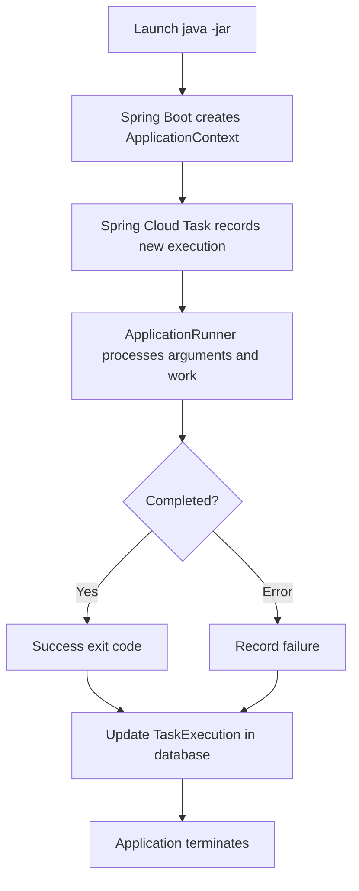

# Creating a Spring Boot Application with Spring Cloud Task

## 1. Lesson Objectives

After this lesson, you will be able to create and run a **finite-task Spring Boot** application using **Spring Cloud Task**, pass command-line arguments, observe execution status stored in the database, and test a failed run. This is the foundation for building data import tasks, report generation, periodic synchronization, or on-demand workflows.

The example application is named `first-task`. Each time it launches, it receives the `--name` argument, prints a greeting, and terminates. Spring Cloud Task records **one `TaskExecution` record per run**, including the start time, end time, task name, and exit code.

> **Scope:** This lesson focuses on creating and verifying your first task. H2 is used for local practice; in production deployments, you should use a persistent database accessible across multiple runs. Spring Cloud Task tracks the application lifecycle, while business output data should be stored using a separate mechanism if needed.

## 2. What Does Spring Cloud Task Add to Spring Boot?

A standard Spring Boot application can run code inside a `CommandLineRunner` or `ApplicationRunner` and then exit. The **Spring Cloud Task** library adds the ability to track **each individual execution**:

| Component | Role |
| --- | --- |
| `@EnableTask` | Enables the Spring Cloud Task infrastructure for the application. |
| `ApplicationRunner` | Contains the work to be performed once when the application starts. |
| `TaskLifecycleListener` | Tracks when a run starts, ends, or fails. |
| `TaskRepository` | Writes and reads `TaskExecution` information in the database. |
| `TaskExecution` | Represents **a single run**, not the general definition of the task. |

Overview of the execution flow:



Spring Cloud Task **does not schedule runs on its own**. The task still needs to be invoked via a command, a scheduler such as `cron`/Kubernetes `CronJob`, or an orchestration system. A successful launch does not mean business data has been persisted: `TaskRepository` primarily stores **execution metadata**.

## 3. Project Setup

You need **JDK 17 or later**, Maven, and the ability to run a Spring Boot application. The example below uses **Spring Boot 3.4.5** with **Spring Cloud 2024.0.2** to demonstrate a matching generation pair. When creating a new project with different versions, choose the Spring Cloud release train compatible with that Spring Boot version; do not mix versions arbitrarily.

Create a Maven project with `groupId` set to `com.example` and `artifactId` set to `first-task`, then use the following structure:

```text
first-task/
├── pom.xml
└── src/
    └── main/
        ├── java/com/example/firsttask/
        │   ├── FirstTaskApplication.java
        │   └── GreetingTask.java
        └── resources/
            └── application.yml
```

### 3.1. Declaring Dependencies in `pom.xml`

```xml
<?xml version="1.0" encoding="UTF-8"?>
<project xmlns="http://maven.apache.org/POM/4.0.0"
         xmlns:xsi="http://www.w3.org/2001/XMLSchema-instance"
         xsi:schemaLocation="http://maven.apache.org/POM/4.0.0 https://maven.apache.org/xsd/maven-4.0.0.xsd">
    <modelVersion>4.0.0</modelVersion>

    <parent>
        <groupId>org.springframework.boot</groupId>
        <artifactId>spring-boot-starter-parent</artifactId>
        <version>3.4.5</version>
        <relativePath/>
    </parent>

    <groupId>com.example</groupId>
    <artifactId>first-task</artifactId>
    <version>0.0.1-SNAPSHOT</version>

    <properties>
        <java.version>17</java.version>
        <spring-cloud.version>2024.0.2</spring-cloud.version>
    </properties>

    <dependencyManagement>
        <dependencies>
            <dependency>
                <groupId>org.springframework.cloud</groupId>
                <artifactId>spring-cloud-dependencies</artifactId>
                <version>${spring-cloud.version}</version>
                <type>pom</type>
                <scope>import</scope>
            </dependency>
        </dependencies>
    </dependencyManagement>

    <dependencies>
        <dependency>
            <groupId>org.springframework.cloud</groupId>
            <artifactId>spring-cloud-starter-task</artifactId>
        </dependency>
        <dependency>
            <groupId>org.springframework.boot</groupId>
            <artifactId>spring-boot-starter-jdbc</artifactId>
        </dependency>
        <dependency>
            <groupId>com.h2database</groupId>
            <artifactId>h2</artifactId>
            <scope>runtime</scope>
        </dependency>
    </dependencies>

    <build>
        <plugins>
            <plugin>
                <groupId>org.springframework.boot</groupId>
                <artifactId>spring-boot-maven-plugin</artifactId>
            </plugin>
        </plugins>
    </build>
</project>
```

The three dependencies each have a specific responsibility: `spring-cloud-starter-task` provides the Task infrastructure; `spring-boot-starter-jdbc` sets up database connections and JDBC utilities; H2 is a lightweight database for observing runs. The Maven BOM `spring-cloud-dependencies` manages compatible versions of Spring Cloud libraries.

### 3.2. Configuring `application.yml`

```yaml
spring:
  application:
    name: first-task
  main:
    web-application-type: none
  datasource:
    url: jdbc:h2:file:./data/taskdb;DB_CLOSE_ON_EXIT=FALSE
    driver-class-name: org.h2.Driver
    username: sa
    password: ""
  cloud:
    task:
      name: first-task
      initialize-enabled: true
      closecontext-enabled: true
```

Explanation of the settings:

- `web-application-type: none`: does not start an HTTP server; the program simply runs its work and exits.
- `datasource`: uses H2 in **file-based storage** mode `./data/taskdb`, so the history persists after the Java process stops. The `./data` path is resolved relative to the **current working directory when running the command**.
- `spring.cloud.task.name`: assigns an easily recognizable name for `TaskExecution` records.
- `initialize-enabled: true`: instructs Spring Cloud Task to initialize the metadata tables for this hands-on exercise. In real deployments, you should manage schemas via migrations and proper database permissions rather than letting the application create tables automatically.
- `closecontext-enabled: true`: closes the Spring application context when the task finishes, releasing database connection resources.

**Why not use `jdbc:h2:mem:...`?** H2 in-memory loses all data when the process terminates. Using a file-based H2 database lets you open the database afterward and query `TASK_EXECUTION`. You should not have multiple processes sharing this H2 file concurrently; if there are parallel tasks or multiple hosts, use PostgreSQL/MySQL with proper schema management.

## 4. Writing Your First Task Application

### 4.1. Enabling Spring Cloud Task

Create `src/main/java/com/example/firsttask/FirstTaskApplication.java`:

```java
package com.example.firsttask;

import org.springframework.boot.SpringApplication;
import org.springframework.boot.autoconfigure.SpringBootApplication;
import org.springframework.cloud.task.configuration.EnableTask;

@SpringBootApplication
@EnableTask
public class FirstTaskApplication {

    public static void main(String[] args) {
        SpringApplication.run(FirstTaskApplication.class, args);
    }
}
```

`@SpringBootApplication` enables auto-configuration and component scanning within the package. `@EnableTask` activates Spring Cloud Task configuration, including lifecycle tracking and persistence via `TaskRepository`. The `main()` entry point remains a standard Spring Boot entry point.

### 4.2. Implementing an `ApplicationRunner`

Create `src/main/java/com/example/firsttask/GreetingTask.java`:

```java
package com.example.firsttask;

import java.util.List;

import org.springframework.boot.ApplicationArguments;
import org.springframework.boot.ApplicationRunner;
import org.springframework.stereotype.Component;

@Component
public class GreetingTask implements ApplicationRunner {

    @Override
    public void run(ApplicationArguments args) {
        List<String> names = args.getOptionValues("name");
        String name = (names == null || names.isEmpty())
                ? "friend"
                : names.get(0).trim();

        if (name.isBlank()) {
            throw new IllegalArgumentException("The --name parameter must not be empty");
        }

        System.out.printf("Hello, %s!%n", name);
    }
}
```

`ApplicationRunner` receives `ApplicationArguments` to read options formatted as `--name=Lan`. If no argument is provided, the application uses the default value `friend`. If an empty `--name=` is passed, the runner throws an exception to demonstrate a failed run. This is an **intentional failure** in the example; real-world applications should validate input data and report the cause appropriately.

Each time Spring Boot starts successfully and invokes the runner, Spring Cloud Task creates tracking information for that run. The runner can be replaced with file processing, API queries, or data synchronization, but the work should remain **finite** with a clear termination point.

## 5. Packaging, Running, and Observing Results

From inside the `first-task` directory, package the application:

```bash
mvn clean package
```

Run it the first time with the `name` argument:

```bash
java -jar target/first-task-0.0.1-SNAPSHOT.jar --name=Lan
```

Output produced by the runner:

```text
Hello, Lan!
```

Run it a second time without arguments:

```bash
java -jar target/first-task-0.0.1-SNAPSHOT.jar
```

```text
Hello, friend!
```

The two runs should create **two separate `TaskExecution` records**, even though they use the same JAR file and the same task name. Both end normally with a success exit code, typically `0`.

### 5.1. Checking Records in the Database

After the program finishes, use an H2 management tool or JDBC client to connect to URL `jdbc:h2:file:./data/taskdb`, user `sa`, and an empty password. Make sure you open it from the exact directory where you ran the application. Run the query:

```sql
SELECT TASK_EXECUTION_ID,
       TASK_NAME,
       START_TIME,
       END_TIME,
       EXIT_CODE,
       EXIT_MESSAGE
FROM TASK_EXECUTION
ORDER BY TASK_EXECUTION_ID DESC;
```

Illustrative output (actual IDs and timestamps will differ):

| TASK_EXECUTION_ID | TASK_NAME | END_TIME | EXIT_CODE |
| ---: | --- | --- | ---: |
| 2 | first-task | Present | 0 |
| 1 | first-task | Present | 0 |

To view the parameters that Spring Cloud Task recorded for each run, run:

```sql
SELECT TASK_EXECUTION_ID, TASK_PARAM
FROM TASK_EXECUTION_PARAMS
ORDER BY TASK_EXECUTION_ID;
```

Typically, the run with `--name=Lan` will have the corresponding parameter; the run without arguments will not have that parameter. **Do not pass passwords, tokens, or secrets in command-line arguments**, because arguments may be stored in metadata tables and appear in logs or process lists.

### 5.2. Testing a Failed Run

Run:

```bash
java -jar target/first-task-0.0.1-SNAPSHOT.jar --name=
```

The runner throws `IllegalArgumentException`. Spring Boot reports a startup or runner execution error, and the process typically exits with a non-`0` code. Reopen the database and query `TASK_EXECUTION`: the new run should have an `EXIT_CODE` indicating failure; error metadata may be recorded in `ERROR_MESSAGE` depending on the version and where the error occurred.

```sql
SELECT TASK_EXECUTION_ID, TASK_NAME, EXIT_CODE, ERROR_MESSAGE
FROM TASK_EXECUTION
ORDER BY TASK_EXECUTION_ID DESC;
```

This is an important distinction between **printing an error message** and **letting the framework know the task failed**. When handler code catches an exception without rethrowing it or setting an appropriate failure status, external systems may mistakenly interpret the run as successful.

## 6. Observing the Lifecycle with `TaskExecutionListener` (Optional)

In addition to querying the database, you can register a `TaskExecutionListener` bean to log or record metrics at lifecycle milestones. The following example is **optional** and not required to run the hands-on exercise:

```java
package com.example.firsttask;

import org.springframework.cloud.task.listener.TaskExecutionListener;
import org.springframework.cloud.task.repository.TaskExecution;
import org.springframework.stereotype.Component;

@Component
public class TaskLogListener implements TaskExecutionListener {

    @Override
    public void onTaskStartup(TaskExecution execution) {
        System.out.println("Starting TaskExecution #" + execution.getExecutionId());
    }

    @Override
    public void onTaskEnd(TaskExecution execution) {
        System.out.println("Finished TaskExecution #" + execution.getExecutionId());
    }

    @Override
    public void onTaskFailed(TaskExecution execution, Throwable throwable) {
        System.err.println("Task failed: " + throwable.getMessage());
    }
}
```

These callbacks allow you to observe the lifecycle of the **entire task application**. `TaskRepository` is the source of truth for looking up execution history, whereas callbacks are well suited for logging, emitting metrics, or pushing monitoring events. In real applications, keep logging inside listeners concise and avoid throwing additional errors that could mask the original failure cause.

## 7. Common Errors

| Symptom | Common Cause | Resolution |
| --- | --- | --- |
| Cannot find `@EnableTask` or dependency | Missing `spring-cloud-starter-task`, or Maven has not downloaded dependencies | Check the POM, BOM, and reload Maven dependencies. |
| Application fails due to incompatible versions | Spring Boot and Spring Cloud belong to different release trains | Use a compatible version pair; do not override individual Spring Cloud dependency versions manually. |
| `Table ... not found` error when creating `TaskExecution` | Task schema has not been initialized | Check the datasource and `initialize-enabled`; for external DBs, create the version-appropriate schema before running. |
| No history visible after application stops | Using H2 in-memory or connecting to the wrong file path | Use file-based H2 and ensure the URL points to the current working directory. |
| Process does not exit after finishing | A web server, scheduler, or background thread is still active | Set `web-application-type: none`, close resources, and ensure the work has a termination point. |
| `EXIT_CODE` still shows success despite business error | Exception was caught and swallowed | Log the context and rethrow the error, or use an appropriate exit code mechanism. |

When encountering connection or schema errors, check startup logs **before** checking runner logic: Spring Cloud Task needs a place to store metadata in order to manage its lifecycle. If a business step can be re-run, design the operation to be *idempotent* to avoid creating duplicate data when an orchestrator retries.

## 8. From Your First Task to Production Tasks

The greeting example can be replaced with a data import or system synchronization job. As you scale up, separate the layers of responsibility:

1. **Parameters and configuration:** Receive parameters safely, validate input, and use a secret manager or environment variables for sensitive data.
2. **Business processing:** Keep the work finite, return clear errors upon failure, and support safe retries if possible.
3. **Execution tracking:** Use `TaskRepository` to know when a task started/ended and whether it succeeded; store business results in separate tables or services.
4. **Orchestration:** Use a `cron` schedule, Kubernetes `Job`/`CronJob`, or a system that invokes tasks on demand; define timeouts, retries, and overlap prevention.
5. **High-volume processing:** When you need to read, process, and write data in chunks with checkpoints and step-level restarts, you can integrate **Spring Batch** inside a **Spring Cloud Task** application. `TaskRepository` tracks the application run, while Spring Batch's `JobRepository` tracks `JobExecution`/`StepExecution`; they address two different levels.

In multi-host environments or when long-term history retention is needed, replace H2 with a shared database (such as PostgreSQL), manage table schemas via migrations, restrict access to metadata, and monitor process exit codes. Do not use `spring.cloud.task.initialize-enabled: true` as a production migration strategy.

## 9. Post-Lesson Self-Check

- [ ] The Maven project compiles and builds an executable JAR.
- [ ] Running `--name=Lan` prints the expected greeting and the application terminates on its own.
- [ ] Running again without arguments creates another `TaskExecution` record.
- [ ] Querying `TASK_EXECUTION` shows start time, end time, and exit code.
- [ ] Passing `--name=` causes the runner to fail, and the new run is recorded as failed.
- [ ] You can explain why Task does not schedule itself and why secrets must not be stored in command-line arguments.

**Key takeaway:** `ApplicationRunner` defines *the work*; `@EnableTask` and `TaskRepository` add *tracking for each time the work is executed*. Once you understand this flow, you can expand it into on-demand tasks, scheduled tasks, or tasks integrated with Spring Batch.
