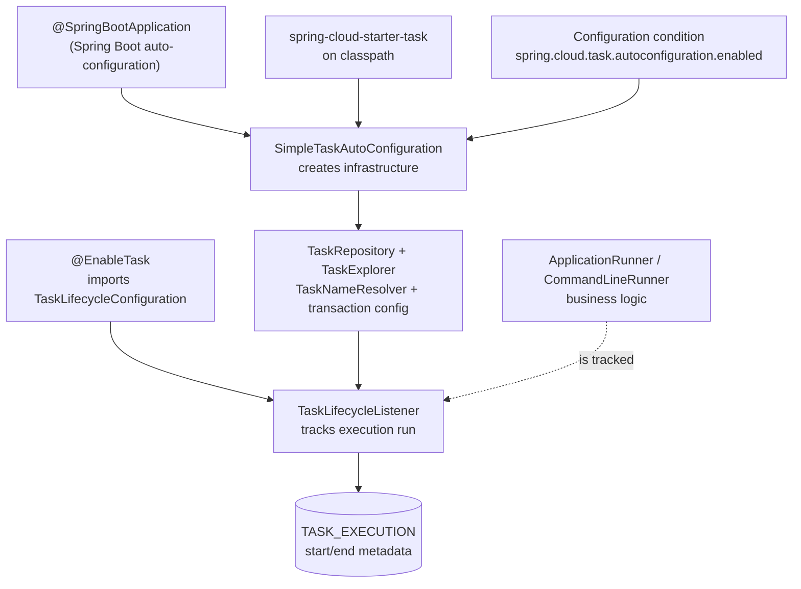

# Auto-Configuration Conditions and the Role of `@EnableTask` Across Versions

## Lesson Objectives

In the **First Task** chapter of the **Spring Cloud Task** module, this lesson explains why a Spring Boot application can run a task successfully yet have no `TaskExecution` record, as well as how to distinguish auto-configured infrastructure from lifecycle tracking components. After completing this lesson, you will be able to:

- Explain the difference between Spring Boot **auto-configuration** and Spring Cloud Task **lifecycle activation**.
- Understand the roles of `@SpringBootApplication`, `SimpleTaskAutoConfiguration`, `@EnableTask`, `TaskLifecycleListener`, and `TaskRepository`.
- Recognize the turning point introduced in **Spring Cloud Task 2.1 GA** and avoid applying outdated guides to new applications.
- Run a task with `ApplicationRunner`, inspect parameters, and verify metadata in the database.
- Diagnose missing annotations, disabled auto-configuration, missing schemas, DataSource errors, and version mismatches.

## 1. The Problem: Having the Task Starter Without Execution History

Suppose you need to implement a daily inventory aggregation program. The program reads `--businessDate`, performs its work, and exits. You add the starter:

```xml
<dependency>
    <groupId>org.springframework.cloud</groupId>
    <artifactId>spring-cloud-starter-task</artifactId>
</dependency>
```

And create an `ApplicationRunner`. When executed, the program prints “Aggregation complete”, yet the `TASK_EXECUTION` table has no new run. A common cause is confusing **the Task infrastructure created by Spring** with **the process lifecycle being recorded**.

In modern versions of Spring Cloud Task, there are two separate layers:

1. **Infrastructure:** Spring Boot auto-configuration prepares beans such as `TaskRepository` (writes metadata), `TaskExplorer` (reads metadata), `TaskNameResolver`, and the necessary transaction configurations.
2. **Lifecycle:** `@EnableTask` enables `TaskLifecycleListener`, the component that tracks when the application starts/ends and records a `TaskExecution` for the run.

This explains why **a runner executing successfully does not prove Spring Cloud Task is tracking the run**. `ApplicationRunner` belongs to Spring Boot; the runner is still invoked even if you omit `@EnableTask`.

The official **Spring Cloud Task 2.1.0 GA release announcement (January 22, 2019)** clearly describes separating these two layers: infrastructure beans are auto-configured, while `TaskLifecycleListener` is created when the application adds `@EnableTask`.

## 2. Two Complementary Mechanisms



This diagram represents a **conceptual model** for 2.1+ branches, not an exhaustive depiction of every internal bean and condition in every release.

### 2.1. `@SpringBootApplication` and `SimpleTaskAutoConfiguration`

`@SpringBootApplication` includes **Spring Boot**'s `@EnableAutoConfiguration` mechanism. When the Task starter is on the classpath and the conditions are satisfied, Spring Boot can create the Task infrastructure without the developer declaring each bean manually.

An important condition on `SimpleTaskAutoConfiguration`, as documented in its Javadoc, is:

```java
@ConditionalOnProperty(
    prefix = "spring.cloud.task.autoconfiguration",
    name = "enabled",
    havingValue = "true",
    matchIfMissing = true
)
```

Practical implications:

- **Property omitted:** auto-configuration is enabled by default because `matchIfMissing = true`.
- **Setting `spring.cloud.task.autoconfiguration.enabled=false`:** disables this automatic Task infrastructure configuration.
- **Property enabled:** only allows the configuration to be evaluated; required dependencies and resources must still be valid.

Auto-configuration does not guarantee the database can actually be reached. The DataSource, driver, schema, and transaction manager must be properly configured. If multiple DataSources exist, a custom `TaskConfigurer` may be needed so Task uses the right metadata store.

### 2.2. `@EnableTask` and `TaskLifecycleListener`

`@EnableTask` is a Spring Cloud Task annotation:

```java
import org.springframework.cloud.task.configuration.EnableTask;
```

In the published Spring Cloud Task 2.3/3.x API, this annotation uses `@Import(TaskLifecycleConfiguration.class)` to activate `TaskLifecycleListener`. The listener hooks into the Spring Boot lifecycle: creating a record when the Task starts, and updating the end time and outcome when runners finish or an error is recorded.

You only need to place `@EnableTask` **once on a Spring configuration class**, typically the class annotated with `@SpringBootApplication`; do not put it on every `ApplicationRunner`.

**Note:** `@EnableTask` does **not** provide cron scheduling, does not process data by itself, does not provide the full infrastructure if you disabled auto-configuration, and does not automatically guarantee exactly-once execution.

| Component | Role |
| --- | --- |
| `@SpringBootApplication` | Bootstraps the Spring Boot application and enables auto-configuration |
| `SimpleTaskAutoConfiguration` | Provides Task infrastructure beans when conditions are met |
| `TaskRepository` | Writes and updates data about an execution run |
| `TaskExplorer` | Queries the history of recorded execution runs |
| `@EnableTask` | Enables lifecycle configuration for the Task process |
| `TaskLifecycleListener` | Tracks start/end events and interacts with the repository |
| `ApplicationRunner` / `CommandLineRunner` | Executes application-defined business logic |
| `@EnableScheduling` | Enables Spring Framework's `@Scheduled`; does not replace `@EnableTask` |

## 3. Behavior Changes Across Versions

This is the easiest area to get confused about if you read Spring Cloud Task documentation from different eras.

| Branch | How documentation describes enabling Task | Takeaway when building applications |
| --- | --- | --- |
| **1.x** | `@EnableTask` imports `SimpleTaskConfiguration`, initializing both infrastructure and lifecycle | The annotation was the entry point for enabling Task in the older design |
| **2.0.x** | Getting Started docs continued describing `@EnableTask` as the Task bootstrap mechanism | Do not assume the starter alone sets up everything |
| **2.1.0 GA** | Auto-configuration creates `TaskRepository`/`TaskExplorer`; `@EnableTask` creates `TaskLifecycleListener` | **Distinguish creating infrastructure from recording lifecycle** |
| **2.2.x–2.3.x** | Separated infrastructure/lifecycle; `@EnableTask` Javadoc explicitly specifies the listener part | Use the starter and add `@EnableTask` in applications that run a Task |
| **3.x, 5.x** | Official Getting Started still demonstrates `@SpringBootApplication` + `@EnableTask`; infrastructure is auto-configured | Verify the exact version in use; continue declaring `@EnableTask` for apps that need to record a Task run |

### Why Does Information About 2.1 Seem Contradictory?

The **2.1.0.M1** announcement in November 2018 introduced auto-configuration with the tagline “Goodbye to `@EnableTask`”. However, the **2.1.0 GA** release post in January 2019 explicitly clarified that **auto-configuration does not create `TaskLifecycleListener`**. The listener is only created when `@EnableTask` is declared. Whenever there is a discrepancy between a milestone blog post and released behavior, prioritize **GA release notes, reference guides, and version-specific Javadocs**.

### Choosing Spring Boot and Spring Cloud Versions

`spring-cloud-starter-task` must be compatible with your Spring Boot and Spring Cloud release train. Examples of branch relationships documented in the Spring Cloud compatibility matrix:

| Spring Boot | Spring Cloud release train | Spring Cloud Task |
| --- | --- | --- |
| 3.2.x–3.3.x | 2023.0.x | 3.1.x |
| 3.4.x | 2024.0.x | 3.2.x |
| 3.5.x | 2025.0.x | 3.3.x |
| 4.0.x–4.1.x | 2025.1.x, per supported patch | 5.0.x |

This table shows **branch relationships** and does not guarantee every patch pair is compatible. Branches and support statuses may change over time. You should generate projects with [Spring Initializr](https://start.spring.io/) or select a release train from [Spring Cloud](https://spring.io/projects/spring-cloud/) and let the **Spring Cloud BOM** manage dependency versions. For versions newer than the example table, cross-check [Supported Versions](https://github.com/spring-cloud/spring-cloud-release/wiki/Supported-Versions).

## 4. Conditions for the First Task to Be Recorded

You can use the following five verification layers:

| Verification Layer | What is needed | Symptom when missing |
| --- | --- | --- |
| **Classpath** | Task starter and compatible version set | Missing classes/beans or application startup failure |
| **Auto-configuration** | Boot loads Task configuration, property not disabled | Repository/explorer may be missing |
| **Lifecycle** | `@EnableTask` on an application configuration class | Runner runs, but no listener records `TaskExecution` |
| **Metadata store** | Proper DataSource/repository/schema | DB connection error, SQL failure, or non-persistent metadata |
| **Runner and exit** | Logic returns or reports errors clearly; process exits | Task hangs indefinitely, swallows exceptions, or fails to record end time |

The list above is a **practical checklist**, not a single `@ConditionalOnProperty` expression.

Two important warnings:

- Having a `TaskRepository` bean does not mean a new `TaskExecution` has been created. A service that only **reads Task history** may need a repository/explorer without needing a listener to record the service itself.
- If the `ApplicationContext` fails **before the Task lifecycle starts**, there may be no record in the repository. In that case, you must rely on JVM logs and the scheduler/container status.

## 5. Hands-On: The `inventory-snapshot` Application

We will create a finite application that accepts a business date `--businessDate=yyyy-MM-dd`, performs an illustrative operation, and terminates. The goal is to observe the relationship between the **starter**, **`@EnableTask`**, and **metadata persistence**, rather than building a complete inventory system.

### 5.1. Adding Dependencies

Create a Spring Boot Maven project aligned with the Spring Cloud BOM using Spring Initializr, selecting **Task (Spring Cloud)** and **H2 Database**. If using a project with an existing parent/BOM setup, the corresponding dependencies are:

```xml
<dependencies>
    <dependency>
        <groupId>org.springframework.cloud</groupId>
        <artifactId>spring-cloud-starter-task</artifactId>
    </dependency>
    <dependency>
        <groupId>com.h2database</groupId>
        <artifactId>h2</artifactId>
        <scope>runtime</scope>
    </dependency>
</dependencies>
```

This is only the **dependencies snippet**, not the full `pom.xml`. Do not specify a starter version independently of the Spring Cloud BOM.

### 5.2. Writing the Application

File `src/main/java/com/example/task/InventorySnapshotApplication.java`:

```java
package com.example.task;

import java.time.LocalDate;
import java.util.List;

import org.springframework.boot.ApplicationArguments;
import org.springframework.boot.ApplicationRunner;
import org.springframework.boot.SpringApplication;
import org.springframework.boot.autoconfigure.SpringBootApplication;
import org.springframework.cloud.task.configuration.EnableTask;
import org.springframework.context.annotation.Bean;

@SpringBootApplication
@EnableTask
public class InventorySnapshotApplication {

    public static void main(String[] args) {
        SpringApplication.run(InventorySnapshotApplication.class, args);
    }

    @Bean
    ApplicationRunner snapshotRunner() {
        return (ApplicationArguments arguments) -> {
            List<String> dates = arguments.getOptionValues("businessDate");
            if (dates == null || dates.size() != 1) {
                throw new IllegalArgumentException(
                    "Exactly one --businessDate=yyyy-MM-dd is required"
                );
            }

            LocalDate businessDate = LocalDate.parse(dates.get(0));
            System.out.println("Starting aggregation " + businessDate);

            // Real application: read inventory, compute, save results.
            // Must design for idempotency when re-running the same businessDate.

            System.out.println("Aggregation complete " + businessDate);
        };
    }
}
```

Explanation:

1. `@SpringBootApplication` enables Boot's auto-configuration mechanism.
2. The Task starter puts Spring Cloud Task classes and configurations on the classpath.
3. `@EnableTask` activates the listener that tracks the execution run.
4. `ApplicationRunner` reads `businessDate`, parses it as a `LocalDate`, and executes the business logic.
5. If the date is missing or invalid, an exception is thrown instead of silently marking the business operation as successful.

### 5.3. Local Configuration

File `src/main/resources/application.yml`:

```yaml
spring:
  application:
    name: inventory-snapshot
  main:
    web-application-type: none
  datasource:
    url: jdbc:h2:file:./data/task-metadata
    driver-class-name: org.h2.Driver
    username: sa
    password: ""
  cloud:
    task:
      autoconfiguration:
        enabled: true

logging:
  level:
    org.springframework.cloud.task: DEBUG
```

In this hands-on exercise, `autoconfiguration.enabled: true` is written explicitly for visibility; this property is already enabled by default. **File-based** H2 preserves metadata across JVM exits if you run from the same working directory, unlike in-memory H2 which loses data when the process terminates.

`web-application-type: none` avoids starting an unnecessary web server. If you want to actively close the Spring `ApplicationContext` immediately after the runner finishes, you can use `spring.cloud.task.closecontextEnabled=true` as described in the version documentation and verify the property binding for your branch.

When moving to production, use a persistent database, schema migrations for metadata tables, appropriate DB permissions, and monitoring independent of the task's logs.

### 5.4. Running and Verifying

```bash
./mvnw package
java -jar target/inventory-snapshot-0.0.1-SNAPSHOT.jar --businessDate=2026-11-23
```

If your project uses a different `artifactId` or version, adjust the JAR filename in the command to match the actual file built. Expected two business log lines:

```text
Starting aggregation 2026-11-23
Aggregation complete 2026-11-23
```

To verify **the lifecycle is actually working**, use an SQL client to connect to the exact H2 file and query Task metadata:

```sql
SELECT
    TASK_EXECUTION_ID,
    TASK_NAME,
    START_TIME,
    END_TIME,
    EXIT_CODE
FROM TASK_EXECUTION
ORDER BY TASK_EXECUTION_ID DESC;
```

In the default setup with the proper schema tables, each successful run gets a new `TASK_EXECUTION_ID`, the Task name, and start/end timestamps. Passed values are recorded in parameter metadata (such as the `TASK_EXECUTION_PARAMS` table). **Inventory aggregation business data is not automatically saved by Spring Cloud Task**; you must design separate tables/services for that.

If the table does not exist, check the DataSource and schema creation process. If the table exists but has no new run, revisit `@EnableTask` and the listener before debugging business logic.

## 6. Experiment to Distinguish Four Scenarios

Run this in a development environment with the same H2 configuration, comparing the row count in `TASK_EXECUTION` before and after each run:

| Scenario | Change | Prediction and how to interpret |
| --- | --- | --- |
| **A. Standard** | Starter + `@EnableTask` + auto-configuration enabled | Runner executes; listener writes a new record |
| **B. Missing `@EnableTask`** | Remove annotation from application class, keep starter | Runner **may still execute**; repository/explorer may still exist, but no listener automatically records the Task run |
| **C. Auto-configuration disabled** | Keep annotation, set `spring.cloud.task.autoconfiguration.enabled=false` | Default infrastructure configuration is not applied; without replacement beans, lifecycle may fail at startup |
| **D. Wrong DataSource/schema** | Keep annotation, use unreachable DB or missing tables | Startup or metadata write failure; cannot conclude history is recorded properly |

Do not run experiments that disable configuration or break the DB in production environments.

### Two Commonly Misunderstood Cases

**B: Runner prints “complete” but Task has no record.** This is the most confusing behavior. `ApplicationRunner` is invoked by Spring Boot independently of Spring Cloud Task. To prove Task is working, there must be a `TaskExecution` record or verification of the `TaskLifecycleListener` bean.

**C: Adding `@EnableTask` while disabling auto-configuration.** The lifecycle annotation **does not recreate** infrastructure beans that were disabled. If you truly need to disable `SimpleTaskAutoConfiguration`, you must supply a replacement configuration providing the repository, explorer, and required dependencies. Conversely, for an application that only uses `TaskExplorer` to query history, you can keep auto-configuration enabled while **omitting `@EnableTask`** so it does not track its own run.

## 7. Diagnosing in a Clear Order

### 7.1. Checking Spring Boot Conditions

Run in a development environment:

```bash
java -jar target/inventory-snapshot-0.0.1-SNAPSHOT.jar --debug --businessDate=2026-11-23
```

Spring Boot's `--debug` flag prints the **Condition Evaluation Report**. Look for `SimpleTaskAutoConfiguration` and its matched/did not match sections; from there, check properties, dependencies, and conflicting configurations. A “matched” auto-configuration **does not prove** the listener is enabled.

### 7.2. Checking Beans and Results

In a debugger or the Spring Context, verify the key beans:

- `TaskRepository` / `TaskExplorer`: infrastructure.
- `TaskLifecycleListener`: lifecycle recording.
- `TaskConfigurer`: custom infrastructure strategy, especially when multiple DataSources exist.

If Spring Boot Actuator is present and the `beans` endpoint is properly secured, you can use it in development to inspect beans. Do not expose `/actuator/beans` publicly in production solely for diagnostics.

Next, query `TASK_EXECUTION` in the DB. Distinguish three questions: **are the beans present?**, **is there a new run?**, and **are the business results accurate?**. Only when all three are answered affirmatively can you conclude the application is working as expected.

### 7.3. Common Errors Table

| Symptom | Possible Cause | Resolution |
| --- | --- | --- |
| Business logs printed, no `TaskExecution` recorded | Missing `@EnableTask` | Verify the annotation is on a configuration class and `TaskLifecycleListener` exists |
| Cannot find `EnableTask` or `SimpleTaskAutoConfiguration` | Missing starter or version mismatch | Check dependency tree, Spring Cloud BOM, and version-matching Javadocs |
| Context initialization error when `autoconfiguration.enabled=false` | No replacement infrastructure provided | Re-enable auto-configuration or provide all required beans manually |
| Listener present, but SQL errors occur | Wrong DataSource or Task schema; missing permissions | Check connection config, migrations, and `TASK_` tables |
| Unexpected `TASK_NAME` | Task name resolved differently than intended | Check `spring.application.name`, `spring.cloud.task.name`, and `TaskNameResolver` |
| Business logic fails, but Task reports success | Exception was caught and swallowed instead of propagated | Convert errors into meaningful exceptions/exit codes |
| Startup fails before metadata is written | Context failed to initialize before Task lifecycle started | Inspect JVM logs and the task execution platform status |
| Record stays at `END_TIME = NULL` indefinitely | Process was killed or failed to update the result | Cross-check scheduler/container status; do not assume success |

## 8. Limitations of `@EnableTask` and Proper Operations

`@EnableTask` helps track **a single run of a finite application**. It does not manage schedules, automatically retry tasks, prevent duplicate processing, or persist business data. For production applications, you also need:

1. **Valid parameters:** e.g., `--businessDate` must be a valid date. Do not pass passwords/tokens via CLI because arguments may be stored in metadata and logs.
2. **Reliable error reporting:** do not swallow exceptions; define exit codes and record failure reasons.
3. **Schedule or trigger:** cron, Kubernetes CronJob, user request, or Spring Cloud Data Flow.
4. **Idempotency:** a request executed twice for the same date can create **two `TaskExecution` records**; target data must have business keys/unique constraints or deduplication mechanisms.
5. **Spring Batch when needed:** if you need chunks, checkpoints, step restarts, or granular retries, use Spring Batch for data processing; Spring Cloud Task tracks the overall process.
6. **Persistent metadata:** use a production DB, manage schemas, monitor hung processes, and alert when expected runs fail to appear.

Example: A CronJob runs a reconciliation task at 02:00 and retries at 02:05. Spring Cloud Task records both runs; ensuring two identical reports are not generated is the responsibility of business code and the database, not `@EnableTask`.

## 9. Self-Assessment

**Question 1.** You have the starter and `ApplicationRunner`, but no `@EnableTask`. Will the runner execute?

> It can run normally because runners are managed by Spring Boot. In newer branches, having only the repository infrastructure does not guarantee a lifecycle listener is present to record `TaskExecution`.

**Question 2.** What did Spring Cloud Task 2.1 GA change?

> Beans such as `TaskRepository`/`TaskExplorer` are created via auto-configuration, whereas `TaskLifecycleListener` is enabled when `@EnableTask` is present.

**Question 3.** Is setting `spring.cloud.task.autoconfiguration.enabled=false` while keeping `@EnableTask` always safe?

> No. The lifecycle may lack the repository and dependent beans, leading to startup failures if you do not provide replacement configuration.

**Question 4.** Is seeing the log “Aggregation complete” enough to prove Task metadata exists?

> Not yet. You must verify the right DataSource, schema, and that a new `TaskExecution` has been written and durably persisted.

**Question 5.** What should you do before changing annotations when upgrading an app from Task 2.0 to 5.x?

> Choose a compatible Spring Boot/Spring Cloud set, read the branch-specific documentation, inspect the auto-configuration and lifecycle mechanisms, then test and verify `TaskExecution`.

## Key Takeaway

**The starter brings Task components into the application; auto-configuration creates the infrastructure when conditions are met; `@EnableTask` turns on the listener that records the process lifecycle.** This is the core distinction since **Spring Cloud Task 2.1 GA**. When diagnosing your first task, check in order: **version → auto-configuration → lifecycle listener → TaskRepository/DataSource → business results**.

## References

1. [Spring Cloud Task 2.1.0 GA — auto-configuration changes and the role of @EnableTask](https://spring.io/blog/2019/01/22/spring-cloud-task-2-1-0-ga-is-now-available/)
2. [Spring Cloud Task 1.3 — @EnableTask in legacy documentation](https://docs.spring.io/spring-cloud-task/docs/1.3.0.RELEASE/reference/htmlsingle/)
3. [Spring Cloud Task 2.0 — historical reference guide](https://docs.spring.io/spring-cloud-task/docs/2.0.0.RELEASE/reference/htmlsingle/)
4. [Spring Cloud Task — Getting Started](https://docs.spring.io/spring-cloud-task/reference/getting-started.html)
5. [Spring Cloud Task — Features](https://docs.spring.io/spring-cloud-task/reference/features.html)
6. [Javadoc EnableTask](https://docs.spring.io/spring-cloud-task/docs/current/apidocs/org/springframework/cloud/task/configuration/EnableTask.html)
7. [Javadoc SimpleTaskAutoConfiguration](https://docs.spring.io/spring-cloud-task/docs/current/apidocs/org/springframework/cloud/task/configuration/SimpleTaskAutoConfiguration.html)
8. [Spring Cloud — Supported Versions](https://github.com/spring-cloud/spring-cloud-release/wiki/Supported-Versions)
