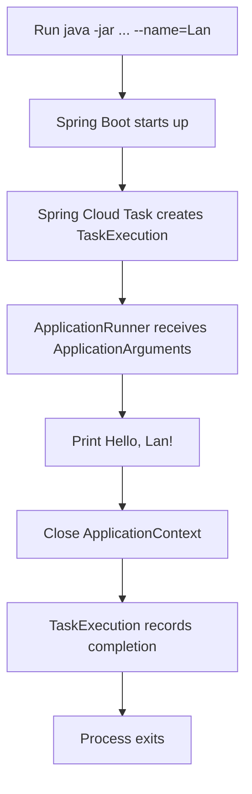

# Writing a Hello World Task with ApplicationRunner

In the **First Task** chapter of the **SPRING_CLOUD_TASK** module, we will build a Spring Boot application that performs a single job: printing a greeting and then exiting. This small example clarifies Spring Cloud Task's **finite-lived** application model before moving on to tasks that require complex arguments, error handling, scheduled or on-demand execution, and Spring Batch integration.

Unlike a REST API, the application does not need to hold an HTTP port open waiting for new requests. When the `ApplicationRunner` finishes, the application closes its resources and the process can exit. Spring Cloud Task adds the ability to record **each execution** in `TaskRepository`, enabling status, duration, and outcome tracking when configured with an appropriate database.

## 1. Learning Objectives

After this lesson, you will be able to:

- Create a Spring Boot project using Spring Cloud Task and `ApplicationRunner`.
- Explain why `ApplicationRunner` is suitable for single-execution tasks.
- Pass and read the `--name` argument using `ApplicationArguments`.
- Shut down the application after processing completes and read the output via logs and exit codes.
- Understand the roles of `TaskExecution`, `TaskRepository`, and JDBC configuration in the Hello World example.
- Recognize common configuration pitfalls and the limitations of an in-memory H2 database.

## 2. What Will We Build?

Suppose the system needs to send a greeting on demand for an operator. Each run is an independent unit of work:

1. Start the application using the `java -jar` command.
2. Spring Boot creates the `ApplicationContext`; Spring Cloud Task records an execution.
3. `ApplicationRunner` reads the `--name` parameter, defaulting to `World`.
4. The task prints `Hello, World!` or `Hello, Lan!`.
5. The application closes the context and terminates the process.



The diagram illustrates the **success** flow. If the runner throws an exception, the application can terminate with a failure and Spring Cloud Task's lifecycle mechanism records the error as long as resources remain available. A forcibly killed process or lost database connection does not guarantee complete metadata updates.

## 3. Project Setup

### 3.1. Tools and Versions

You need:

- A **JDK** compatible with your chosen Spring Boot version (for example, Java 17 or later for Spring Boot 3.x).
- **Maven** or the Maven Wrapper (`mvnw`) included with the project.
- A **Spring Boot** project configured with a compatible Spring Cloud version. Do not pick Spring Boot and Spring Cloud versions arbitrarily: use a pair that is supported together.

You can start from a standard Spring Boot Maven application. This example uses the package `com.example.task` and application name `hello-task`.

### 3.2. Adding Maven Dependencies

In the `<dependencies>` section of `pom.xml`, add:

```xml
<dependency>
    <groupId>org.springframework.boot</groupId>
    <artifactId>spring-boot-starter</artifactId>
</dependency>

<dependency>
    <groupId>org.springframework.cloud</groupId>
    <artifactId>spring-cloud-starter-task</artifactId>
</dependency>

<dependency>
    <groupId>org.springframework.boot</groupId>
    <artifactId>spring-boot-starter-jdbc</artifactId>
</dependency>

<dependency>
    <groupId>com.h2database</groupId>
    <artifactId>h2</artifactId>
    <scope>runtime</scope>
</dependency>
```

The project needs appropriate version management: typically `spring-boot-starter-parent` (or the Spring Boot BOM) manages Boot libraries and a **Spring Cloud BOM** manages `spring-cloud-starter-task`. If your project does not have a Spring Cloud BOM yet, add a section like the following to `pom.xml` and set the `spring-cloud.version` property to the release train **compatible with your project's Spring Boot version**:

```xml
<dependencyManagement>
    <dependencies>
        <dependency>
            <groupId>org.springframework.cloud</groupId>
            <artifactId>spring-cloud-dependencies</artifactId>
            <version>${spring-cloud.version}</version>
            <type>pom</type>
            <scope>import</scope>
        </dependency>
    </dependencies>
</dependencyManagement>
```

To ensure the package command produces an **executable JAR** (runnable via `java -jar`), make sure the project includes the Spring Boot Maven Plugin in the `build` section of `pom.xml`:

```xml
<build>
    <plugins>
        <plugin>
            <groupId>org.springframework.boot</groupId>
            <artifactId>spring-boot-maven-plugin</artifactId>
        </plugin>
    </plugins>
</build>
```

This example uses H2 to start quickly without installing a database server. `spring-boot-starter-jdbc` provides JDBC integration, and Spring Cloud Task uses the configured data source to store execution metadata.

The source code structure will be:

```text
hello-task/
├── pom.xml
└── src/
    └── main/
        ├── java/com/example/task/HelloTaskApplication.java
        └── resources/application.yml
```

## 4. Writing the Task with ApplicationRunner

Create `src/main/java/com/example/task/HelloTaskApplication.java`:

```java
package com.example.task;

import java.util.List;

import org.springframework.boot.ApplicationRunner;
import org.springframework.boot.SpringApplication;
import org.springframework.boot.autoconfigure.SpringBootApplication;
import org.springframework.cloud.task.configuration.EnableTask;
import org.springframework.context.ConfigurableApplicationContext;
import org.springframework.context.annotation.Bean;

@SpringBootApplication
@EnableTask
public class HelloTaskApplication {

    public static void main(String[] args) {
        ConfigurableApplicationContext context =
                SpringApplication.run(HelloTaskApplication.class, args);

        int exitCode = SpringApplication.exit(context);
        System.exit(exitCode);
    }

    @Bean
    ApplicationRunner helloRunner() {
        return arguments -> {
            String name = "World";

            if (arguments.containsOption("name")) {
                List<String> names = arguments.getOptionValues("name");

                if (names == null || names.size() != 1
                        || names.get(0).isBlank()) {
                    throw new IllegalArgumentException(
                            "The --name parameter must have exactly one non-empty value");
                }

                name = names.get(0).trim();
            }

            System.out.println("Hello, " + name + "!");
        };
    }
}
```

### Component Breakdown

| Component | Purpose |
| --- | --- |
| `@SpringBootApplication` | Declares the application entry point and enables Spring Boot auto-configuration. |
| `@EnableTask` | Activates Spring Cloud Task infrastructure to track execution lifecycle. |
| `@Bean ApplicationRunner` | Registers the unit of work invoked by Spring Boot once the context is initialized. |
| `ApplicationArguments` | Reads `--key=value` options and command-line arguments without manual string parsing. |
| `SpringApplication.exit(context)` | Closes the context and obtains the exit code from Spring Boot's exit code mechanism. |
| `System.exit(exitCode)` | Terminates the JVM process, passing the exit code to the shell/container or orchestrator. |

**Why use `ApplicationRunner`?** Spring Boot invokes `ApplicationRunner` beans after the context has been initialized. The `run(ApplicationArguments args)` method is a convenient place for finite work that needs to process arguments. In this example, there is only one runner and no loop waiting for new requests.

**Why exit explicitly?** For a task application, the goal is a "finished processing" state, not keeping a server alive. `SpringApplication.exit` cleanly closes beans/resources managed by the context; `System.exit` ensures the JVM process exits and returns the exit code. If an error occurs directly inside `SpringApplication.run` (such as the runner throwing an exception), the subsequent `SpringApplication.exit` statement will not execute; Spring Boot handles the startup failure and propagates the error to the process.

**Note:** An application with multiple `ApplicationRunner` or `CommandLineRunner` beans may run multiple initialization blocks. When ordering is required, use `@Order` or `Ordered`; avoid relying implicitly on bean registration order.

## 5. Configuring Spring Cloud Task and H2

Create `src/main/resources/application.yml`:

```yaml
spring:
  application:
    name: hello-task
  main:
    web-application-type: none

  datasource:
    url: jdbc:h2:mem:taskdb
    driver-class-name: org.h2.Driver
    username: sa
    password: ""

  cloud:
    task:
      name: hello-world-task
      initialize-enabled: true
```

Meaning:

- `spring.main.web-application-type: none` specifies that this process **does not start a web server**.
- `spring.datasource.*` declares the H2 connection for the hands-on example.
- `spring.cloud.task.name` sets an easily recognizable name for execution records.
- `spring.cloud.task.initialize-enabled` enables initializing the Spring Cloud Task schema in test environments according to the mechanism of the library version in use.

**Important limitation:** `jdbc:h2:mem:taskdb` is an **in-memory database**. Once the JVM exits, the H2 data from that run disappears. This configuration is suitable for trying out your first task, but **does not support querying history across multiple runs**. In real systems, configure a persistent database (such as PostgreSQL), grant appropriate permissions, and manage schemas via migrations matching your Spring Cloud Task version.

Do not put real passwords or sensitive data into committed configuration files; use environment variables or a secret management system in deployment environments.

## 6. Packaging and Running Hello World

From the root directory of the project, package the application:

```bash
# Linux / macOS
./mvnw clean package

# Windows PowerShell: use the corresponding command
# .\mvnw.cmd clean package
```

Assuming the generated artifact is `target/hello-task-0.0.1-SNAPSHOT.jar` (the actual name depends on `pom.xml`), run it for the first time:

```bash
java -jar target/hello-task-0.0.1-SNAPSHOT.jar
```

Expected business output line:

```text
Hello, World!
```

Try passing an argument:

```bash
java -jar target/hello-task-0.0.1-SNAPSHOT.jar --name=Lan
```

Business output line:

```text
Hello, Lan!
```

When running, the console will also print Spring Boot startup logs and Spring Cloud Task/JDBC activity depending on log levels and version. Do not write tests that require exact character-by-character matching of the entire log; focus on the greeting, presence/absence of errors, whether the process exits, and the exit code.

**Checking the exit code:** immediately after the `java -jar` command finishes, use `echo $?` on Linux/macOS or `$LASTEXITCODE` in PowerShell. For a normal successful run, the exit code is `0`. A non-`0` code indicates a process-level error; check the logs and execution metadata for the specific cause.

### Testing Invalid Parameters

Try running:

```bash
java -jar target/hello-task-0.0.1-SNAPSHOT.jar --name=
```

Because `name` is empty, the runner throws `IllegalArgumentException`. Spring Boot reports an error and the process fails. This is intentional behavior: when input is invalid, the task must not silently print “Hello, World!” and report success.

One thing to remember: `--name=Lan` is an **application argument** parsed by `ApplicationArguments`; it does not mean a parameter is automatically used by Spring Cloud Task to make business decisions. You must read, validate, and apply input inside your own code.

## 7. What Does Spring Cloud Task Record?

Even when the job is simply printing a single line, Spring Cloud Task still adds value: each run of a finite application gets its own **`TaskExecution`**. When the JDBC connection and schema are working, `TaskRepository` persists execution metadata.

| Component | Example Information or Purpose |
| --- | --- |
| `TaskExecution` | Run identifier, task name, start/end timestamps, exit code, and related error details. |
| `TaskRepository` | Writes/updates execution metadata to the configured data store. |
| `TaskExplorer` | Reads stored execution records for lookup or monitoring. |
| `TASK_EXECUTION` | Standard metadata table in the Spring Cloud Task JDBC schema. |

For example, after deploying to a **persistent** database and initializing the proper schema, you can query history using SQL:

```sql
SELECT TASK_EXECUTION_ID,
       TASK_NAME,
       START_TIME,
       END_TIME,
       EXIT_CODE
FROM TASK_EXECUTION
ORDER BY TASK_EXECUTION_ID DESC;
```

Distinguish between three outcomes:

1. **Business result:** the console prints `Hello, Lan!`.
2. **Process result:** the JVM exits with code `0` or an error code.
3. **Execution metadata:** `TaskRepository` records a `TaskExecution` containing the run's timestamps and status.

With H2 `mem:` in this example, you **cannot exit the application and open another H2 process to query lost history**. To observe multiple runs, use a persistent database with the appropriate schema.

If switching to PostgreSQL, you need to add the PostgreSQL JDBC driver, configure `spring.datasource.url`, set a secure username/password, and prepare the Spring Cloud Task tables with the corresponding scripts/migrations. In production, disable automatic schema creation on startup once the schema is managed by migrations. These steps belong to more advanced `TaskRepository` configuration.

## 8. What Happens When the Runner Fails?

Consider two cases:

- **Invalid input:** `--name=` causes an immediate exception in the runner; the task fails and the caller must inspect the exit code/logs.
- **Database connection loss:** creating/updating metadata may fail, preventing the task from starting or recording its final status. In that case, you need to analyze both application logs and process/container status.

Do not handle errors like this when a failure should fail the task:

```java
try {
    // Perform main work
} catch (Exception exception) {
    System.err.println(exception.getMessage());
    // Swallow error: the runner may still finish as if the work succeeded!
}
```

For errors that cannot be recovered from automatically, log sufficient context and allow the exception to propagate (or represent a failure exit code using Spring Boot's mechanism). Doing so lets schedulers, Kubernetes Jobs, or task-invoking systems detect the failed run and apply an appropriate retry policy.

**Do not confuse retrying with safe re-execution:** in the Hello World example, printing multiple times causes no harm. For tasks that send emails, transfer funds, or mutate data, you need business keys, idempotency, and deduplication rules before enabling retries.

## 9. How Does ApplicationRunner Differ from CommandLineRunner?

Spring Boot supports both mechanisms for running code at application startup:

| Criterion | `ApplicationRunner` | `CommandLineRunner` |
| --- | --- | --- |
| Signature | `run(ApplicationArguments args)` | `run(String... args)` |
| Argument parsing | Built-in `containsOption`, `getOptionValues`, `getNonOptionArgs` | Receives raw string array; parse manually if needed |
| When to use | Tasks with many `--key=value` options | Simple tasks needing only a few string arguments |
| Lifecycle | Invoked when Spring Boot runs its runners | Same; invoked when Spring Boot runs its runners |

Neither interface **turns an application into a Spring Cloud Task by itself**: metadata recording comes from the enabled and configured Spring Cloud Task infrastructure. Conversely, Spring Cloud Task does not require all business logic to be written as an `ApplicationRunner`; it is simply an approachable starting point suited for a first lesson.

## 10. Common Errors and How to Check Them

| Symptom | Possible Cause | How to Check |
| --- | --- | --- |
| `ClassNotFoundException` or dependency resolution failure | Starter not added, mismatched BOM, Maven has not downloaded libraries | Check dependencies, BOM configuration, and Maven output |
| `Hello, World!` does not appear | Runner not registered as a bean, or application failed before reaching runner | Check `@Bean`, package scanning, stack trace, and datasource |
| Application does not exit | Web server accidentally enabled, infinite loop, or non-terminating thread | Check `web-application-type: none`, runner code, and background threads |
| `TASK_EXECUTION` table does not exist | Spring Cloud Task schema not initialized or connected to wrong database | Check JDBC configuration, table creation permissions, migrations, and version |
| No history visible after second run | Using `jdbc:h2:mem:` so data is lost when the JVM stops | Switch to a persistent database |
| `--name=` command produces an error | Matches the parameter validation rule in the example | Pass `--name=Lan` or omit the option to use the default |
| Process reports success but business data is missing | Exception was swallowed or success condition was not verified | Add business validation and return a failure status when needed |

## 11. Practice Exercises

**Exercise 1 — Personalized Greeting.** Add a `--language=vi` or `--language=en` option. For `vi`, print `Xin chào, Lan!`; for `en`, print `Hello, Lan!`. Reject unsupported language values.

**Exercise 2 — Timing Measurement.** Print the start and end timestamps of the work using `Instant.now()`. Compare the duration measured by the application itself with `START_TIME`/`END_TIME` in `TaskExecution`: business execution duration and total run duration are not necessarily identical.

**Exercise 3 — Simulating Failure.** Add a `--fail=true` option and make the runner throw `IllegalStateException` when enabled. Observe the logs, exit code, and metadata when using a persistent database.

**Exercise 4 — Persisting Execution History.** Replace in-memory H2 with PostgreSQL or a persistent JDBC database with prepared schemas. Run the same application twice with different names, then use the SQL query in Section 7 to view both executions. Create the schema only once using a proper migration workflow.

### Self-Check Questions

1. Why can a program using `ApplicationRunner` exit after printing a greeting, whereas a REST API typically stays running?
2. When running `--name=Lan`, which component reads and validates this option?
3. Why should H2 `mem:` not be used to monitor execution history in production?
4. Why is seeing the printed greeting insufficient to confirm that `TaskExecution` metadata was durably persisted?
5. If a runner throws an exception, why should you not catch and ignore it?

## 12. Summary

- `ApplicationRunner` is a clear way to implement **a finite task** right after Spring Boot starts up.
- `@EnableTask` and the Spring Cloud Task infrastructure add metadata tracking for **each execution** via `TaskRepository`; `ApplicationRunner` itself only performs business logic.
- Setting `web-application-type: none` and explicitly closing the context helps the application finish and exit cleanly.
- `ApplicationArguments` makes reading parameters like `--name=Lan` convenient; inputs must be validated rather than trusted blindly.
- In-memory H2 is sufficient for testing a first run. To track history and outcomes **across multiple runs**, you need a persistent database and the exact Spring Cloud Task schema.
- This forms the foundation for building real-world tasks with arguments, error handling, scheduled or on-demand execution, and Spring Batch integration when batch data processing is needed.
